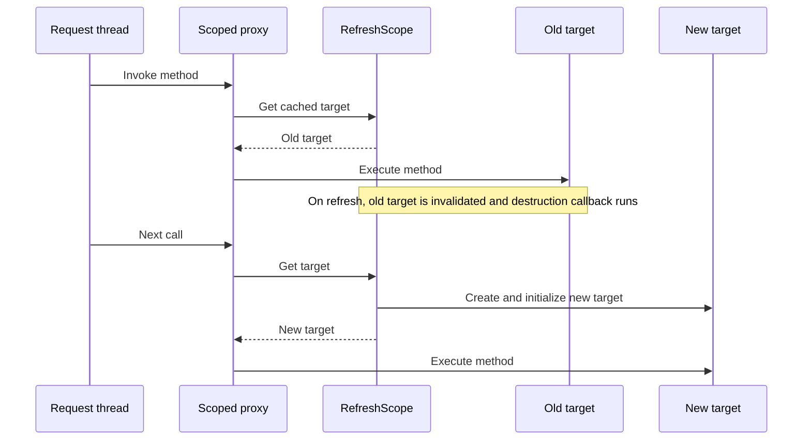

# Refresh Causes Lost Resources or Concurrency Errors

## 1. Symptoms and Common Causes

After calling `/actuator/refresh`, a Spring Cloud application may exhibit errors such as:

- In-flight requests suddenly receive `ClosedChannelException`, `Connection is closed`, or `Pool is closed`.
- Some requests use the new configuration while others still use the old value.
- Latency spikes right at refresh time; request-handling threads wait at the scoped proxy.
- A background task started before refresh fails when continuing to use a client or stream.
- Refresh scope health transitions to `DOWN` because a bean cannot reinitialize.
- Errors occur only under concurrent requests; sequential tests do not reproduce them.

These symptoms typically stem from refresh replacing target beans and running destruction callbacks while the application still has work relying on resources owned by the old target. Another group of errors comes from rebinding a mutable configuration bean in place while other threads are reading its fields.

This lesson belongs to the **Troubleshooting** chapter of the **SPRING_CLOUD_CORE** module. The module helps learners understand Spring Cloud Commons, Spring Cloud Context, externalized configuration, refresh scope, discovery, service registry, service communication, and testing/operating common abstractions.

After this lesson, learners can:

- Describe the `@RefreshScope` target lifecycle and when destruction callbacks are invoked.
- Distinguish synchronous method invocations through a scoped proxy from asynchronous work outliving the method.
- Identify race conditions when `@ConfigurationProperties` is rebound in place.
- Diagnose errors caused by closed resources, failed target reinitialization, or refreshes blocked by long-running requests.
- Design controlled replacement of configuration and resources.
- Write integration tests reproducing refresh while requests are in flight.

## 2. What Does RefreshScope Do?

### 2.1. Target Is Cached Behind a Scoped Proxy

Beans annotated with `@RefreshScope` are accessed through a scoped proxy. The proxy holds a reference to the target managed by RefreshScope. The target is typically created on first use and cached by bean name.

When calling `RefreshScope.refresh(name)` or `refreshAll()`, Spring Cloud removes the target from the scope cache and executes registered lifecycle destruction callbacks. The next method call through the proxy creates a new target from the original bean definition. Property placeholders and expressions are re-evaluated when the new target is created.



This means refresh is a bean lifecycle replacement operation. It does not merely update a field inside a running object.

### 2.2. Destruction Callbacks May Close Resources

If the target implements `DisposableBean`, `AutoCloseable`, has a `@PreDestroy` method, or registers a destruction callback, that callback is invoked when the target is refreshed. Resources commonly closed include:

- HTTP clients and connection pools.
- Sockets, channels, or sessions.
- File handles, streams, and watchers.
- Schedulers, executors, or threads owned by the bean.
- Consumers or listeners registered with a broker.
- Native resources or third-party libraries with their own lifecycles.

Closing resources is necessary to prevent leaks. Problems arise when some ongoing work continues using that resource after the closing callback runs.

### 2.3. The Scoped Proxy Has a Read/Write Lock

In current Spring Cloud Context, `GenericScope` uses a per-bean lock for calls through the scoped proxy:

- Regular method invocations acquire a read lock. Multiple requests can hold the read lock and invoke the bean concurrently.
- Destroy/refresh operations acquire a write lock. They must wait for in-flight method invocations holding the read lock to finish.
- While the write lock is held, new method calls to the same bean must wait.

This mechanism prevents a target from being destroyed mid-way through a synchronous method invocation going through the proxy. It does not turn the entire ApplicationContext into an atomic refresh transaction, and it does not automatically protect work continuing after the method returns.

Therefore, when you see requests waiting in `GenericScope.LockedScopedProxyFactoryBean.invoke`, check whether refresh is waiting for a long method to finish or whether multiple requests are queuing behind the write lock. This may be synchronization delay rather than necessarily a deadlock.

Lock implementation details may vary across Spring Cloud versions and configured ScopeCache implementations. Verify the running release train before relying on these internals.

## 3. Why Can Resources Still Be Lost Even with a Lock?

### 3.1. Method Returns Before Work Completes

The read lock only spans the duration of the method call through the proxy. If the method starts background work and returns immediately, the lock is released while the work still uses the old target.

Dangerous example:

```java
import java.util.concurrent.CompletableFuture;

import org.springframework.cloud.context.config.annotation.RefreshScope;
import org.springframework.stereotype.Component;

@RefreshScope
@Component
class ReportClient {

    private final RemoteSession session;

    ReportClient(RemoteSession session) {
        this.session = session;
    }

    CompletableFuture<Report> loadReport(String id) {
        return CompletableFuture.supplyAsync(
                () -> session.fetchReport(id)
        );
    }

    @PreDestroy
    void close() {
        session.close();
    }
}
```

`loadReport` returns a `CompletableFuture` before `fetchReport` finishes. The scoped proxy releases the read lock when the method returns. If a refresh happens afterward, the destruction callback can close `session` while the background task is still using it.

Return types requiring special scrutiny:

- `CompletableFuture` or `CompletionStage`.
- `Mono` or `Flux` where subscription and reading occur after the method returns.
- `InputStream`, `Reader`, `Iterator`, or cursors consumed in the caller layer.
- Callbacks, listeners, scheduled tasks, or message handlers retaining a reference to the target.
- Any handle representing a transaction, connection, or session outliving the method that created it.

### 3.2. Storing the Target or Resource Outside the Proxy

A component might fetch the target/resource once and hold a direct reference. Subsequent calls bypass the scoped proxy and therefore do not participate in the scope's read/write lock.

Error-prone design example:

```java
@Component
class ReportService {

    private final ReportClient reportClient;

    ReportService(ReportClient reportClient) {
        this.reportClient = reportClient;
    }

    void startBackgroundWork() {
        ReportClient target = unwrapOrCacheTarget(reportClient);
        executor.execute(target::runLongTask);
    }
}
```

Never store an unwrapped target, internal proxy object, or target-owned resource inside another singleton. Call through the proxy for every operation with a synchronous lifecycle, or use a lease/drain mechanism designed specifically for long-running work.

### 3.3. Long Method Invocations Block Refresh

The read lock protects synchronous methods by forcing refresh to wait until methods complete. If a method holds the lock for a long time due to:

- Waiting on an HTTP response with an overly large timeout.
- Reading an unbounded stream.
- Waiting on a message or callback.
- Running a large batch processing loop.
- Calling a hung external service.

then refresh can wait for a long time. Meanwhile, new requests calling the same bean queue up behind the write lock. If the refresh endpoint is called on an already overloaded thread pool, queuing can cascade to other requests.

Do not fix this by blindly lowering timeouts. Measure method durations, bound I/O time, set task timeouts, and separate long-running processing from beans whose lifecycle needs hot replacement.

### 3.4. The Lock Does Not Make the Target Thread-Safe

A read lock allows multiple readers to run concurrently. Thus, requests can still call the same target at the same time. If the bean holds non-thread-safe mutable state, the refresh lock does not protect concurrent request-to-request operations.

For example, an `ArrayList` field updated by multiple requests can still suffer race conditions even when the bean is in RefreshScope. Shared beans must ensure thread safety for their internal state themselves.

## 4. @ConfigurationProperties Rebinding Also Has Its Own Race Conditions

### 4.1. Mutable Beans Are Updated in Place

Upon receiving `EnvironmentChangeEvent`, Spring Cloud rebinds `@ConfigurationProperties` beans. For mutable JavaBeans, the rebinder may reset properties to defaults and then rebind new values onto the same object. Rebind steps for the same bean are serialized with one another, yet threads reading the bean externally are not automatically blocked during this process.

Suppose configuration has two related fields:

```java
@ConfigurationProperties("partner.connection")
public class PartnerConnectionProperties {

    private String host = "partner-v1.internal";
    private int port = 8080;

    public String getHost() { return host; }
    public void setHost(String host) { this.host = host; }

    public int getPort() { return port; }
    public void setPort(int port) { this.port = port; }
}
```

A thread reading configuration right during rebinding could observe the new host alongside the old port. If the two values must always move together, that combined state can form an invalid URL or point to the wrong endpoint.

This example does not mean every refresh exposes an intermediate state; it shows that serializing rebinds is not the same as locking every reader.

### 4.2. How to Maintain a Consistent Configuration View

If multiple properties form a single logical configuration, read them as a single snapshot and use that snapshot for the entire operation.

Common options:

- Place the consumer needing a consistent view in `@RefreshScope`, so the target is replaced and method invocations through the proxy synchronize with refresh.
- Build a new immutable settings object, validate it fully, then swap a single reference with `AtomicReference`.
- Group related properties behind an abstraction with atomic update operations, rather than letting multiple consumers read scattered mutable fields.

Do not fetch individual properties from multiple different beans at different points within the same request if the values must belong to the same version.

### 4.3. Not All Beans Refresh the Same Way

Limitations to check before diagnosing:

- `@RefreshScope` on a `@Configuration` class does not automatically put all beans declared in that class into refresh scope.
- A bean depending on a refreshed bean is not automatically recreated unless that dependency chain itself is designed to receive the new target.
- Constructor-bound `@ConfigurationProperties`, including Java records, are not rebound like mutable JavaBeans.
- `HikariDataSource` is in the default `spring.cloud.refresh.never-refreshable` list. Do not use `extra-refreshable` to force closing/reopening the pool without dedicated lifecycle design and testing.
- Deleting a property from the configuration source and refreshing has specific semantics; do not assume property absence is always reflected as a new value.

If a bean cannot be safely rebound or recreated, a rolling restart may be the safer way to apply configuration.

## 5. Diagnosing by Symptom

| Symptom | Possible Mechanism | How to Verify |
| --- | --- | --- |
| `Connection pool is closed` or `ClosedChannelException` after refresh | Async task/stream still uses old target's resource after proxy method returned | Log task start/end timestamps and when `@PreDestroy` ran |
| Refresh waits a very long time | Synchronous method holds read lock for long; refresh needs write lock to destroy target | Measure method durations on scoped bean and inspect thread dumps |
| New requests spike in latency during refresh | Requests wait for write lock held on the same bean | Look for stacks with `LockedScopedProxyFactoryBean.invoke` and `ReentrantReadWriteLock` |
| One request uses new host with old port | Reader observed mutable `@ConfigurationProperties` bean mid-rebind | Log configuration version/snapshot rather than scattered fields |
| Only some beans updated | Only one bean marked refresh scope or consumer holds non-refreshable dependency | Inspect bean definitions, proxies, and dependency chains |
| Refresh succeeds yet first subsequent call fails | Target is created lazily when next method runs; constructor or init callback failed | Check target initialization exception and RefreshScope health |
| Old bean still used after refresh | Component holds unwrapped target/resource or direct cache | Find where references, static fields, callbacks, and executors are stored |
| Low CPU yet requests hang | Multiple threads waiting on locks or untimed I/O | Thread dumps, lock owners, socket timeouts, and executor queues |
| Error occurs only across multiple replicas | Instances receive refresh at different times or only some instances refresh successfully | Cross-check refresh events, config versions, health, and logs per instance ID |

### 5.1. Gather Evidence Before Refreshing Again

Right when the error happens, collect the following before triggering refresh again:

1. Thread dump of the affected instance.
2. Full stack trace of the failing request and root exception.
3. Timestamps of refresh start, destruction callback, and new target initialization.
4. In-flight request counts, executor queues, and connection pool metrics.
5. Config version or hash applied on each instance.
6. `/actuator/health` status, especially the refresh scope component if exposed.

Repeatedly triggering refresh can erase evidence about the failing target/resource and grow the request queue.

### 5.2. Reading Thread Dumps to Identify Lock Contention

If a stack looks like:

```text
java.util.concurrent.locks.ReentrantReadWriteLock$ReadLock.lock(...)
org.springframework.cloud.context.scope.GenericScope$LockedScopedProxyFactoryBean.invoke(...)
org.springframework.aop.framework.ReflectiveMethodInvocation.proceed(...)
```

the thread is waiting for the scoped proxy's read lock. Inspect the thread holding the write lock or the running refresh method. If another thread is holding the read lock too long, look for methods waiting on I/O, streams, or long synchronous work.

If a thread is inside `@PreDestroy`, `DisposableBean.destroy()`, or `close()`, check whether the callback is waiting on a request currently blocked by refresh. Callbacks must never wait indefinitely on an executor or callback that depends on the bean being refreshed.

A deadlock can occur when refresh holds the write lock to destroy the target, the destruction callback waits for a task in an executor, and that task calls the scoped proxy and waits for the read lock. The callback will not finish until the task runs, and the task cannot run until the callback finishes. Avoid synchronously awaiting tasks that call back into the bean being destroyed; drain beforehand or design cleanup tasks independent of that proxy.

### 5.3. Using the RefreshScope Health Indicator

Spring Cloud provides `RefreshScopeHealthIndicator`. If a target fails to reinitialize or rebinding fails, the health indicator can transition to `DOWN` and display the relevant exception.

Distinguish:

- Refresh endpoint received the request and returned a response.
- Environment contains the new value.
- Bean was rebound or the new target initialized successfully.
- Real requests use the new resource and work properly.

One step succeeding does not automatically prove all remaining steps succeeded.

## 6. Design Patterns for Safe Refresh

### 6.1. Keep the Entire Synchronous Operation Inside the Proxy Method

If work can complete within a single synchronous call, let the refresh-scoped bean's method own the entire resource usage lifecycle:

```java
import org.springframework.cloud.context.config.annotation.RefreshScope;
import org.springframework.stereotype.Component;

@Component
@RefreshScope
class PartnerGateway implements AutoCloseable {

    private final RemoteSession session;

    PartnerGateway(RemoteSessionFactory factory,
                   PartnerSettings settings) {
        this.session = factory.open(settings);
    }

    String fetch(String partnerId) {
        // Method returns only after the session finishes the operation.
        return session.fetchAndReadBody(partnerId);
    }

    @Override
    public void close() {
        session.close();
    }
}
```

When a request calls `fetch` through the scoped proxy, the read lock is held until the method returns. Refresh must wait for the method to finish before running the destruction callback that closes the old session.

This works well when the method truly consumes the response, stream, or cursor before returning. If the method returns a handle for the caller to keep using, external usage falls outside the protected window.

### 6.2. For Async Work, Use a Lease or Reference Count

Do not acquire a thread-owned read lock and expect a callback on another thread to release it. For asynchronous work, use a lease with an explicit lifecycle:

1. Task acquires a lease on the current resource.
2. Manager marks the old resource as retired when new config arrives and routes new requests to the new resource.
3. Retired resource stays open while active leases remain.
4. When the last lease closes, the resource is permitted to close.
5. If the task is cancelled or times out, the cleanup path must still close the lease.

Caller-side lease management example:

```java
ClientLease lease = clientManager.acquire();

try {
    return lease.client()
            .sendAsync(request)
            .whenComplete((response, error) -> lease.close());
}
catch (RuntimeException ex) {
    lease.close();
    throw ex;
}
```

The manager must ensure `acquire()` never issues leases for a retired resource, and `lease.close()` decrements the reference count exactly once. Only when the reference count hits 0 on the retired resource does the manager close the old connection pool or session.

With Reactor, the lease must be released when the subscription completes, cancels, or errors, such as via `doFinally`. Do not release the lease immediately when constructing a `Mono` or `Flux`, because I/O may not have started yet.

### 6.3. Use an Immutable Snapshot for Related Property Groups

If multiple values must be read as a consistent set, construct an immutable object and swap one reference:

```java
import java.util.concurrent.atomic.AtomicReference;

import org.springframework.stereotype.Component;

record PartnerSettings(
        URI baseUrl,
        Duration timeout,
        int maxAttempts,
        long version) {
}

@Component
class PartnerSettingsHolder {

    private final AtomicReference<PartnerSettings> current;

    PartnerSettingsHolder(PartnerSettings initial) {
        this.current = new AtomicReference<>(initial);
    }

    PartnerSettings snapshot() {
        return current.get();
    }

    void apply(PartnerSettings next) {
        validate(next);
        current.set(next);
    }

    private void validate(PartnerSettings settings) {
        if (settings.timeout().isNegative()
                || settings.timeout().isZero()
                || settings.maxAttempts() < 1) {
            throw new IllegalArgumentException("Invalid partner settings");
        }
    }
}
```

Consumers read the snapshot once at the start of the operation:

```java
PartnerSettings settings = settingsHolder.snapshot();
return client.call(
        settings.baseUrl(),
        settings.timeout(),
        settings.maxAttempts()
);
```

Record fields cannot change piecemeal while a request is reading them. Requests that grabbed the old snapshot continue using the old set of values; requests after `apply` completes use the new snapshot.

The record here is an internal snapshot object. If you use a record directly as a `@ConfigurationProperties` bean, do not assume the Spring Cloud rebinder can mutate/rebind a constructor-bound record. Build a new snapshot from the configuration source and publish it with an atomic operation.

### 6.4. Create and Verify the New Resource Before Swapping the Pointer

For clients or pools that can be instantiated alongside the old one, prepare the new resource before shifting traffic. A simple manager can use a read/write lock for synchronous operations:

```java
import java.util.concurrent.locks.Lock;
import java.util.concurrent.locks.ReentrantReadWriteLock;

class ClientManager implements AutoCloseable {

    private final ReentrantReadWriteLock lifecycle =
            new ReentrantReadWriteLock();

    private ClientHandle current;

    ClientManager(ClientHandle initial) {
        this.current = initial;
    }

    String execute(Request request) {
        Lock read = lifecycle.readLock();
        read.lock();
        try {
            return current.execute(request);
        }
        finally {
            read.unlock();
        }
    }

    void replace(ClientSettings settings) {
        // Create and verify the new resource while the old one still serves traffic.
        ClientHandle replacement = ClientHandle.createAndValidate(settings);

        ClientHandle previous;
        Lock write = lifecycle.writeLock();
        write.lock();
        try {
            previous = current;
            current = replacement;
        }
        finally {
            write.unlock();
        }

        // Write lock is granted only after in-flight executes finish.
        // New requests after the swap only see the replacement.
        closeQuietly(previous);
    }

    @Override
    public void close() {
        ClientHandle previous;
        Lock write = lifecycle.writeLock();
        write.lock();
        try {
            previous = current;
            current = null;
        }
        finally {
            write.unlock();
        }
        closeQuietly(previous);
    }

    private void closeQuietly(ClientHandle handle) {
        if (handle == null) {
            return;
        }
        try {
            handle.close();
        }
        catch (Exception ex) {
            // Log and record cleanup failure metrics; do not drop the new resource.
        }
    }
}
```

This example illustrates an application-owned lifecycle manager, not a direct replacement for every `@RefreshScope` bean. If async work is required, combine it with leases/reference counting instead of only holding the read lock during the method that builds a `Future`.

### 6.5. Choose Restart When Resources Do Not Support Hot Replacement

Use rolling restarts if a resource:

- Cannot instantiate a new instance alongside the old instance.
- Has no way to determine when all consumers have stopped using the old instance.
- Has a lifecycle tied to processes or threads that cannot be safely drained.
- Is on Spring Cloud's never-refreshable list.
- Requires changing multiple beans/resources as an atomic unit without a dedicated application-level manager.

Do not add a class to `spring.cloud.refresh.extra-refreshable` just to bypass limitations. This property changes which beans are processed, but does not magically add thread safety, graceful shutdown, or resource rotation to the underlying library.

## 7. Testing Race Conditions Before Enabling Refresh in Production

### 7.1. Testing In-Flight Synchronous Methods

Create a refresh-scoped bean with a method that waits on a latch and a destruction callback that records when it closes. The test should:

1. Invoke the method via the proxy on thread 1.
2. Wait until the method signals it has started.
3. Call `RefreshScope.refresh("beanName")` on thread 2.
4. Confirm the destruction callback has not run while the method still holds the read lock.
5. Release the latch so the method finishes.
6. Confirm refresh completes and the destruction callback runs.
7. Invoke the proxy again and confirm a new target is initialized.

Use latches/barriers to control ordering. Avoid relying solely on `Thread.sleep`, which makes tests pass or fail depending on machine speed.

### 7.2. Testing Asynchronous Work Crossing the Method Boundary

Create a method returning a `CompletableFuture` immediately after starting a background task. The background task waits on a latch before using the resource. After the method returns the future:

1. Trigger refresh.
2. Confirm the destruction callback can run while the background task is still incomplete.
3. Complete the background task and observe the failure if it uses a closed resource.
4. Apply leases/reference counting or a drain mechanism.
5. Repeat the test and confirm the old resource closes only after the last lease ends.

This test exercises the actual boundary of the lock: the duration of the method call through the proxy, not the entire lifetime of the future.

### 7.3. Testing Mutable Configuration

If the application uses a mutable `@ConfigurationProperties` bean, write a test with two interdependent fields. Intentionally let a reader read while the rebinder updates configuration and verify inconsistent mixed-version values can be observed.

Then test the solution:

- Use an immutable snapshot.
- Validate the entire snapshot before publishing.
- Have readers fetch the snapshot once per request.
- Never mix fields from old and new snapshots in the same operation.

### 7.4. Testing New Target Initialization Failures

Configure the new target to fail in its constructor or initialization callback, such as an invalid or unreachable new endpoint. Verify:

- The exception is recorded and diagnosable.
- The RefreshScope health indicator reflects the failure state.
- Requests after refresh do not silently continue using old configuration if the old target was already destroyed.
- After fixing the configuration source, refreshing again creates the new target.
- Resources from the old target and partially initialized target are not leaked.

## 8. Design Mistakes to Avoid

| Practice | Why It Is Error-Prone | Alternative |
| --- | --- | --- |
| Returning `InputStream` from a refresh-scoped bean method and reading it in a controller | Scoped proxy releases read lock when method returns the stream; refresh can close resource before stream is consumed | Read/consume stream inside the method, or issue a lease to the caller |
| Returning `CompletableFuture` while closing client in `@PreDestroy` | Future may continue running after method returns and lock is released | Manage reference count until future completes/cancels |
| Caching an unwrapped target in another singleton | Subsequent calls bypass the scope's proxy and lock | Keep the proxy or use a manager with an explicit lifecycle |
| Placing related settings across multiple independent mutable beans | A request can read beans at different versions | Use a single versioned immutable snapshot |
| Putting an entire service facade in RefreshScope when only one client needs replacement | Every method on the facade goes through the scope lock; refresh may wait on unrelated methods | Put scope on the bean owning the resource that actually needs replacement |
| Running long, untimed methods in a scoped bean | Refresh must wait on methods; new requests queue up | Bound I/O, split tasks, and set timeouts |
| Treating the read lock as thread-safety protection | Multiple readers still execute concurrently | Use immutable state, concurrent collections, or synchronization for internal state |
| Closing an executor in callback while tasks still depend on the bean | Callback may cause tasks to be rejected or interrupted mid-flight | Stop accepting new tasks, drain running tasks, then close executor |
| Adding HikariDataSource to extra-refreshable | Refresh configuration does not automatically provide safe pool rotation | Rolling restart or a dedicated, tested datasource rotation mechanism |
| Refreshing multiple beans simultaneously assuming the whole context updates atomically | Locks are managed per bean, not as a context-wide transaction | Group related settings or use a shared snapshot/version |

## 9. Incident Response Procedure

When refresh drops resources or causes concurrent request failures, handle in order:

1. **Limit blast radius:** pause further refreshes and identify affected instances, beans, and property sources.
2. **Preserve evidence:** capture thread dumps, exceptions, lifecycle logs, and metrics before restarting.
3. **Identify work boundaries:** is the method running synchronously through the proxy or returning a future/stream/handle?
4. **Identify resource ownership:** which bean creates the resource, which callback closes it, and what still holds references?
5. **Check lock contention:** check whether requests wait on the read lock or refresh waits on the write lock.
6. **Check configuration:** verify config version, Environment, rebind errors, and target initialization.
7. **Restore service:** if the new target fails to initialize or resources are broken, restore valid configuration and perform a controlled refresh or rolling restart.
8. **Fix lifecycle:** add timeouts, consume resources before the method returns, use leases/draining, or use immutable snapshots.
9. **Reproduce in tests:** write separate synchronous and asynchronous tests to prevent regression.
10. **Roll out per instance:** expand refreshes widely only after canary health and behavior are confirmed.

### 9.1. Remediation Selection Matrix

| Situation | Preferred Fix |
| --- | --- |
| Short synchronous method, resource fully consumed before return | Keep operation inside the method via scoped proxy |
| Long synchronous method blocking refresh | Shorten method, add timeouts, batch work, or move long work to a worker with its own lifecycle |
| Future/stream uses resource after method returns | Lease/reference count or drain until task finishes |
| Multi-field configuration must switch atomically | Immutable snapshot and atomic swap |
| New resource must be verified before replacing old resource | Build/validate new resource, then swap and retire old resource |
| Resource does not support rotation or cannot drain | Rolling restart |
| Reader sees mixed-version property values | Replace direct mutable rebinding with snapshots or RefreshScope consumers |

## 10. Prevention Checklist

Before annotating a bean with `@RefreshScope`, confirm:

1. Does the bean truly need to be recreated when configuration changes?
2. Do all requests invoke the bean through its scoped proxy?
3. Does the method hold the resource only until synchronous work completes?
4. Does any method return a future, publisher, stream, iterator, or handle outliving the method?
5. Do callbacks, executors, listeners, or scheduled tasks hold references to the old target?
6. Does the destruction callback properly close resources owned by the bean?
7. Can the callback wait on a thread/request currently blocked by refresh?
8. Does the target contain mutable state needing thread safety across concurrent requests?
9. Must multiple properties be read as a single snapshot/version?
10. Is a `@ConfigurationProperties` bean rebound in place while read concurrently?
11. Does the resource belong to `spring.cloud.refresh.never-refreshable`?
12. Can the new target be built and validated before shifting traffic?
13. Are timeouts, metrics, logs, and health checks in place for refresh duration/initialization failures?
14. Are there latch tests for synchronous calls and separate tests for async work?
15. Is there a rollback or rolling restart plan if refresh fails?

## 11. Official References

- [Spring Cloud Commons — Application Context Services](https://docs.spring.io/spring-cloud-commons/reference/spring-cloud-commons/application-context-services.html): `@RefreshScope` lifecycle, destruction callbacks, `@ConfigurationProperties` rebinding, read/write synchronization, and RefreshScope health indicator.
- [Spring Cloud Commons — Configuration Properties](https://docs.spring.io/spring-cloud-commons/reference/configprops.html): `spring.cloud.refresh.never-refreshable`, `spring.cloud.refresh.extra-refreshable`, and related properties.
- [GenericScope — Spring Cloud Context API](https://javadoc.io/doc/org.springframework.cloud/spring-cloud-context/5.0.1/org/springframework/cloud/context/scope/GenericScope.html): scope implementation, per-bean lock, and scoped proxy.
- [RefreshScope — Spring Cloud Context source](https://github.com/spring-cloud/spring-cloud-commons/blob/main/spring-cloud-context/src/main/java/org/springframework/cloud/context/scope/refresh/RefreshScope.java): `refresh(String)`, `refreshAll()`, and publishing `RefreshScopeRefreshedEvent`.
- [ConfigurationPropertiesRebinder — Spring Cloud Context source](https://github.com/spring-cloud/spring-cloud-commons/blob/main/spring-cloud-context/src/main/java/org/springframework/cloud/context/properties/ConfigurationPropertiesRebinder.java): serializing rebinds for the same bean and limitations when readers access mutable beans concurrently.

**Remember:** RefreshScope synchronizes method invocations through the scoped proxy with target destruction, but the protection window ends when the method returns. Async work, streams, or handles outliving the method need explicit leases/draining. For multi-field configuration, use immutable snapshots so readers always see a complete version; for resources that cannot be safely hot-swapped, choose rolling restarts.
