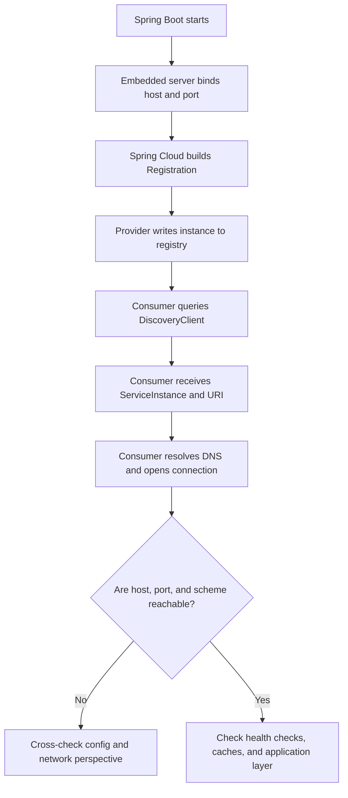

# Registering the Wrong IP, Hostname, Port, or Scheme

## Context and Symptoms

In Spring Cloud, service discovery helps an application find instances of other services through a registry such as Eureka or Consul. On startup, an application can self-register its instance details; consumers query the registry, receive a list of instances, and use the returned addresses to call the service.

A registration record typically contains service ID, instance ID, host or IP, port, secure status (HTTP vs. HTTPS), and metadata. Spring Cloud Commons provides abstractions such as `DiscoveryClient`, `ServiceInstance`, `ServiceRegistry`, and `Registration`; details of record creation and configuration property names depend on the specific implementation.

Issues commonly appear in these forms:

- The registry displays `localhost`, `127.0.0.1`, `0.0.0.0`, a Docker network adapter IP, or a private IP unreachable by consumers.
- The registered hostname works on the host running the application yet cannot resolve from consumer containers, pods, or machines.
- Consumers receive the container's internal port when only a host-published port is reachable, or receive the management port instead of the application HTTP port.
- The registry returns `http://` while the endpoint requires TLS, or returns `https://` while the instance listens only on HTTP.
- The instance shows status `UP` in the registry yet actual requests hit timeouts, connection refused, DNS errors, or TLS errors.

Do not start by randomly tweaking a property. First determine which address is being registered, which source produced it, and from which network consumers actually connect.

## Distinguishing the Registry Address from the Instance Address

Two configuration groups are frequently confused:

| Group | Example | Meaning |
| --- | --- | --- |
| Registry address | `eureka.client.serviceUrl.defaultZone`, `spring.cloud.consul.host`, `spring.cloud.consul.port` | Where the application connects to register or query the registry |
| Advertised instance address | `eureka.instance.*`, `spring.cloud.consul.discovery.*` | Host/IP, port, and scheme consumers receive to call the application |
| Port the application listens on | `server.port`, actual embedded server port | Port opened by the Spring Boot process in its network namespace |
| Bind address | `server.address` or corresponding server setting | Local address the embedded server binds to; not automatically the address that should be advertised |

For example, `spring.cloud.consul.host=consul.internal` specifies the Consul agent to which the application sends registrations. It does not mean consumers will call the application at `consul.internal`. The address consumers receive is governed by instance discovery settings and Consul registration logic.

Flow to inspect:



## Diagnostic Procedure

### 1. Identify the Consumer's Network Perspective

The right address is the address **reachable by the consumer**, not necessarily the address visible to the host machine. Explicitly record where consumers run: same process, same machine, same Docker network, same Kubernetes cluster, different subnet, or behind a gateway/ingress.

Common scenarios:

- Within the same Docker network, consumers usually call by DNS service name and container port. Host-published ports serve connections coming from outside the Docker network.
- In Kubernetes, in-cluster consumers can use Kubernetes Service DNS and the service port. Pod IPs are appropriate only when the architecture intentionally calls pods directly and consumers have routes to the pod network.
- For applications behind an ingress or reverse proxy, the public address may be a hostname on port 443; internal service-to-service traffic inside the cluster may still need service DNS, internal ports, and HTTP.
- On VMs or bare metal, the hostname must resolve in the DNS used by consumers, and firewalls/security groups must permit connections to the registered port.

Never advertise `localhost` or `127.0.0.1` to consumers on other processes/machines. Loopback addresses always point back to the consumer's own environment. `0.0.0.0` is a wildcard bind address, not a destination address for clients to connect to.

### 2. Compare Configured Port with Actual Port

Spring Boot uses `server.port` to configure the main HTTP port; the default is typically `8080`. When `server.port=0` is set, the OS picks an ephemeral port at startup. The configured value `0` is not a port consumers can call. You can read the actual port after web server initialization via logs or `WebServerInitializedEvent`.

Example logging the bound port:

```java
import org.slf4j.Logger;
import org.slf4j.LoggerFactory;
import org.springframework.boot.web.context.WebServerInitializedEvent;
import org.springframework.context.event.EventListener;
import org.springframework.stereotype.Component;

@Component
class BoundPortLogger {
    private static final Logger log =
            LoggerFactory.getLogger(BoundPortLogger.class);

    @EventListener
    void onWebServerInitialized(WebServerInitializedEvent event) {
        log.info("Web server context={} bound port={}",
                event.getApplicationContext().getId(),
                event.getWebServer().getPort());
    }
}
```

If the application has a separate management port, events may fire for multiple web server contexts. Match each context to its corresponding port; do not mistake the Actuator port for the main API port. With Consul, current documentation describes the default registration port as taken from `server.port`; when `management.server.port` differs from the application port, Consul may register a separate management service as well.

In container environments, distinguish three values:

| Value | Example | Who Uses It |
| --- | --- | --- |
| Container port | `8080` | Process and container network |
| Host published port | `18080` in `18080:8080` mapping | Clients connecting via the host |
| Kubernetes Service port | `80` in Service | Clients calling via Service DNS and this port |

A Kubernetes Service forwards from `port: 80` to `targetPort: 8080`. If a consumer calls a Pod IP directly, it must use the port the container listens on, usually `targetPort`; if calling via Service DNS, it uses the Service port.

Do not copy the host published port into the registry if all consumers are inside the same container network and must call the container port directly. Conversely, if consumers are outside that network, the container port may have no route.

### 3. Inspect the Selected IP and Hostname

Spring Cloud Commons provides `InetUtils` to help select a hostname/IP from network interfaces. Key properties include:

- `spring.cloud.inetutils.ignored-interfaces`: list of regexes for network interface names to ignore, e.g., `docker0` or `veth.*`.
- `spring.cloud.inetutils.preferred-networks`: list of regexes for preferred network addresses, e.g., internal IP ranges of the deployment environment.
- `spring.cloud.inetutils.use-only-site-local-interfaces`: consider only interfaces with site-local addresses.
- `spring.cloud.inetutils.default-hostname` and `spring.cloud.inetutils.default-ip-address`: fallback values when hostname/IP cannot be determined; defaults are `localhost` and `127.0.0.1`, respectively.

Example ignoring bridge interfaces unused for service communication and preferring application network ranges:

```yaml
spring:
  cloud:
    inetutils:
      ignored-interfaces:
        - 'docker0'
        - 'veth.*'
      preferred-networks:
        - '10\.20\..*'
        - '172\.20\..*'
```

These values are Java regular expressions, not CIDRs. Replace them with actual interface names and address ranges from your environment. Do not enable `use-only-site-local-interfaces` out of habit: a site-local address can still lack a route from the consumer, especially across multiple overlay networks or subnets.

If the registry suddenly records `localhost` or `127.0.0.1`, inspect interface-discovery logs, OS DNS/hostname, and fallback values. `InetUtils` only affects places where the provider uses it to infer addresses; explicit host/IP settings or a custom `Registration` can supersede this outcome.

### 4. Read the Exact Registry Record and DiscoveryClient Result

Cross-check at least three layers:

1. The instance record in the Eureka/Consul UI or API: host/IP, port, scheme, instance ID, metadata, and status.
2. Values received by the consumer from `DiscoveryClient#getInstances(serviceId)`.
3. The actual URI used by LoadBalancer or the HTTP client when sending requests.

You can temporarily add diagnostic logging on the consumer:

```java
import org.slf4j.Logger;
import org.slf4j.LoggerFactory;
import org.springframework.cloud.client.ServiceInstance;
import org.springframework.cloud.client.discovery.DiscoveryClient;
import org.springframework.stereotype.Component;

@Component
class DiscoverySnapshot {
    private static final Logger log =
            LoggerFactory.getLogger(DiscoverySnapshot.class);

    private final DiscoveryClient discoveryClient;

    DiscoverySnapshot(DiscoveryClient discoveryClient) {
        this.discoveryClient = discoveryClient;
    }

    void logInstances(String serviceId) {
        for (ServiceInstance instance :
                discoveryClient.getInstances(serviceId)) {
            log.info("serviceId={} host={} port={} secure={} uri={} metadata={}",
                    instance.getServiceId(),
                    instance.getHost(),
                    instance.getPort(),
                    instance.isSecure(),
                    instance.getUri(),
                    instance.getMetadata());
        }
    }
}
```

Invoke `logInstances` from a diagnostic path after the registry has synced. Do not assume calling it right at application startup will show the application's own record, as initialization order and auto-registration depend on the provider.

Spring Cloud Commons provides an Actuator endpoint with ID `serviceregistry` if the application enables and exposes it. With Actuator's default base path, the HTTP path is `/actuator/serviceregistry`; if the application changes `management.endpoints.web.base-path`, the path adjusts accordingly. GET on this endpoint reports registration status; it does not replace reading host/port/scheme from the registry or `ServiceInstance`. Protect Actuator and expose diagnostic endpoints only within appropriate boundaries.

If the registry is right yet `DiscoveryClient` returns stale data, check provider sync intervals, client-side load balancer caches, and lease durations. After updating, re-verify from the consumer instead of looking solely at the new record in the registry.

### 5. Test Connectivity from the Exact Consumer Environment

Run checks inside the container, pod, or machine that actually sends requests:

```bash
# Check whether the hostname resolves to the expected address
getent hosts inventory-1.internal

# Check whether the TCP port is open from the consumer
nc -vz inventory-1.internal 8080

# Check the HTTP endpoint
curl -sv http://inventory-1.internal:8080/actuator/health

# If the instance is advertised over HTTPS
curl -sv https://inventory-1.internal:8443/actuator/health
```

If the environment lacks `getent` or `nc`, use equivalent DNS/TCP tools such as `nslookup`, `Resolve-DnsName`, or `Test-NetConnection`. When testing HTTPS, inspect the certificate hostname, trust chain, and handshake errors. Only disable certificate verification in isolated tests to distinguish certificate errors; never make it a production configuration.

With Consul, default HTTP health checks normally call `/actuator/health`. If the application changes context path, servlet path, or management endpoint path/port, re-verify the health check URL. A health check executed from the Consul agent also has its own network perspective; a successful `curl` from your laptop does not prove the agent can reach the endpoint.

## Per-Provider Configuration

### Spring Cloud Netflix Eureka

Eureka uses the `eureka.instance.*` group to describe an instance. An explicit hostname and port configuration can look like:

```yaml
server:
  port: 8080

eureka:
  instance:
    hostname: inventory-1.internal
    prefer-ip-address: false
    non-secure-port: 8080
    non-secure-port-enabled: true
    secure-port-enabled: false
```

If consumers must call by IP, set an IP routable on that network and enable `prefer-ip-address`:

```yaml
eureka:
  instance:
    ip-address: 10.20.1.15
    prefer-ip-address: true
```

Do not enable `prefer-ip-address` just to work around DNS issues if the chosen IP is a bridge/container IP unreachable from consumers. When using HTTPS directly on the instance, configure the secure port matching the listener and enable the secure flag:

```yaml
eureka:
  instance:
    non-secure-port-enabled: false
    secure-port-enabled: true
    secure-port: 8443
```

When secure port is enabled, Spring Cloud Netflix Eureka DiscoveryClient returns URIs with the `https` scheme. Therefore, enable it only when the instance genuinely accepts HTTPS at the advertised address and port. If TLS terminates at a proxy while internal traffic to the application remains HTTP, internal consumers may need the internal HTTP address; do not automatically advertise HTTPS just because end users connect over HTTPS.

### Spring Cloud Consul

Consul uses the `spring.cloud.consul.discovery.*` group to configure instance addresses. Example using an internal hostname:

```yaml
spring:
  cloud:
    consul:
      discovery:
        hostname: inventory-1.internal
        prefer-ip-address: false
        port: 8080
        scheme: http
```

If choosing IP instead of hostname, declare the IP and enable the corresponding option:

```yaml
spring:
  cloud:
    consul:
      discovery:
        ip-address: 10.20.1.15
        prefer-ip-address: true
        port: 8080
        scheme: http
```

According to Spring Cloud Consul documentation, `ip-address` must accompany `prefer-ip-address`; `port` defaults to the port the application listens on; `scheme` determines whether the registered instance uses HTTP or HTTPS. The `secure` metadata is derived from whether `scheme` equals `https`. Do not confuse `spring.cloud.consul.scheme` (the scheme to connect to the Consul agent) with `spring.cloud.consul.discovery.scheme` (the scheme of the service instance).

### SimpleDiscoveryClient

When no service-registry-based DiscoveryClient implementation is on the classpath, Spring Cloud Commons can use `SimpleDiscoveryClient` reading URIs from configuration. Example:

```yaml
spring:
  cloud:
    discovery:
      client:
        simple:
          instances:
            inventory:
              - uri: http://inventory-1.internal:8080
              - uri: http://inventory-2.internal:8080
```

If consumers consistently receive a wrong URI even though no matching record appears in Eureka/Consul, verify which DiscoveryClient implementation is active and inspect `spring.cloud.discovery.client.simple.instances`.

## Proxies, TLS Termination, and Scheme

When a reverse proxy or load balancer sits in front, external requests may use `https://api.example.com` while the proxy forwards to the application over `http://10.20.1.15:8080`. The two URIs serve two different paths:

- Public address for browsers or external clients.
- Internal address for service-to-service traffic inside the private network.

Spring Boot supports processing original request info from the `Forwarded` header and `X-Forwarded-Host`, `X-Forwarded-Port`, `X-Forwarded-Proto` headers via `server.forward-headers-strategy`. `NATIVE` uses web server capabilities; `FRAMEWORK` uses Spring Framework's mechanism. This setting helps the application generate URLs/redirects reflecting external requests. It does not replace Eureka or Consul registration address settings.

Trust only forwarded headers overwritten by trusted proxies. The proxy should strip client-supplied headers before adding verified values; if the application directly accepts forged headers, generated hosts or schemes in URLs can be wrong and introduce security risks.

## Practical Scenario: Service Running in Docker

Suppose the `inventory` service listens on port `8080` inside a container and Docker publishes `18080:8080` on the host:

| Consumer Location | Appropriate Address in Example |
| --- | --- |
| Container on same Docker network | `http://inventory:8080` |
| Process on Docker host | `http://localhost:18080` |
| Another machine on network | Hostname/IP of Docker host with port `18080`, if firewall allows |

If the Consul agent and consumers share the Docker network, register `inventory:8080` with a hostname resolvable within that network. If consumers are outside the Docker network, design access via the host port or a routable endpoint; you cannot assume internal service names resolve across every network.

After fixing configuration, proceed in order:

1. Restart or trigger re-registration per the provider's mechanism if changes do not support dynamic refresh.
2. Re-read the registry record and confirm host/IP, port, and scheme.
3. Call `DiscoveryClient#getInstances("inventory")` from the consumer and confirm the updated URI.
4. Test DNS, TCP, and HTTP/TLS from the consumer's exact network namespace.
5. Check health checks and observe live requests through LoadBalancer.

## Quick Isolation Table

| Symptom | First Place to Check | Resolution |
| --- | --- | --- |
| Registered `127.0.0.1` or `localhost` | InetUtils fallbacks, OS hostname, network interfaces, provider host/IP config | Pick a hostname/IP reachable from consumers; ignore unsuitable interfaces |
| Registered unreachable bridge or container IP | Docker/Kubernetes network, `preferred-networks`, `ignored-interfaces`, routes | Select the right interface/IP range or use appropriate Service DNS |
| Hostname is right yet DNS fails | Consumer's DNS search domain, namespace, records, and resolver | Create DNS records resolvable by every calling consumer |
| Wrong port or connection refused | `server.port`, runtime port, container mappings, Service port, `management.server.port`, provider properties | Register the exact port consumers can route to and the server listens on |
| HTTP redirected/handshake error or HTTPS fails to connect | Scheme, TLS termination, certificates, secure-port flags, forwarded headers | Align scheme with actual TLS termination; configure trust/certificates properly |
| Registry is right yet consumer calls old URI | Active DiscoveryClient, LoadBalancer cache, refresh/lease interval | Inspect consumer data and wait/refresh per provider mechanism |
| Instance `UP` yet health check fails | Address used by registry agent, health-check path, management port, firewall | Test endpoint from the exact agent/network and fix path/port |

## Configuration and Version Notes

- Spring Cloud Commons defines common abstractions; properties controlling hostname, IP, port, and scheme belong to each provider. Do not assume Eureka properties work with Consul or Kubernetes.
- Property names and behavior can vary by Spring Cloud version. Use the Spring Cloud BOM/release train compatible with your application's Spring Boot version, then consult the `configprops` documentation for the actual dependency version. Never copy configuration from an old tutorial without checking.
- Examples in this lesson use kebab-case property names. Spring Boot supports relaxed binding, but preserve the exact prefix and data type expected by the provider in use.
- `spring.cloud.inetutils.*` only governs address selection when the provider infers an address from the host. It does not fix DNS, routing, firewalls, NAT, port mappings, or custom registrations.
- After changing properties, verify effective values under active profiles and configuration sources. If using Actuator `env` or `configprops`, expose them only in controlled ways and protect endpoints since they can reveal configuration details.
- The `serviceregistry` endpoint ID reflects registration status (default HTTP path `/actuator/serviceregistry`); advertised addresses must be verified via the registry's API/UI and via `ServiceInstance` data received by consumers.

## References

1. [Spring Cloud Commons – Common Abstractions](https://docs.spring.io/spring-cloud-commons/reference/spring-cloud-commons/common-abstractions.html): DiscoveryClient, ServiceRegistry, auto-registration, SimpleDiscoveryClient, and network interface configuration.
2. [Spring Cloud Commons – Configuration Properties](https://docs.spring.io/spring-cloud-commons/reference/configprops.html): `spring.cloud.inetutils.*` and discovery client properties.
3. [Spring Cloud Netflix – Configuration Properties](https://docs.spring.io/spring-cloud-netflix/reference/configprops.html): Eureka instance hostname, IP, non-secure port, and secure port.
4. [Spring Cloud Netflix 5.0.3 – Registering a Secure Application](https://docs.spring.io/spring-cloud-netflix/reference/spring-cloud-netflix.html): how Eureka advertises HTTPS and health/status URLs.
5. [Spring Cloud Consul – Service Discovery](https://docs.spring.io/spring-cloud-consul/reference/discovery.html): instance address, port, health checks, and management service.
6. [Spring Cloud Consul – Configuration Properties](https://docs.spring.io/spring-cloud-consul/docs/current/reference/html/appendix.html): hostname, IP, prefer-ip-address, port, and scheme.
7. [Spring Boot – Embedded Web Servers](https://docs.spring.io/spring-boot/how-to/webserver.html): configuring `server.port`, random ports, reading the actual port, and forwarded headers behind proxies.
8. [Spring Cloud Release Train Reference](https://docs.spring.io/spring-cloud-release/reference/index.html): Spring Cloud release train versions and compatible Spring Boot versions.
