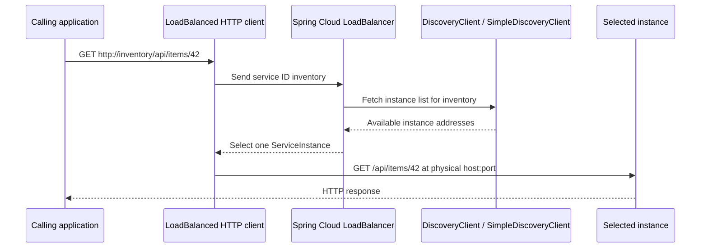

# HTTP Client Resolves Service Name as Regular DNS

When calling an internal service using a URL such as `http://inventory/api/items/42`, an application may fail with `UnknownHostException: inventory` even though the `inventory` service is registered in Eureka, Consul, or another service registry. The cause usually lies in the HTTP client: the client treats `inventory` as a hostname to resolve via DNS, whereas the application wants Spring Cloud to look up a `ServiceInstance` by service ID.

A service name in a URL does not automatically activate service discovery. For `RestClient`, `RestTemplate`, and `WebClient`, the application must use the exact bean/builder integrated with Spring Cloud LoadBalancer and annotated with `@LoadBalanced`. Feign has its own integration mechanism described later. If a plain HTTP client is used, Spring Cloud does not automatically change how the client resolves hostnames.

## 1. Distinguishing DNS from Service Discovery

DNS resolves a hostname into an IP address. For example, when a client sends a request to `https://api.example.com`, the OS/JVM name resolver finds the corresponding IP address; the HTTP client then connects to that address. DNS does not know the business meaning of a service ID in Eureka or Consul unless the DNS system is separately configured to publish those names.

Spring Cloud LoadBalancer performs a different job. It treats the host part of the URL as a logical service name, looks up instances with that matching service ID, selects an instance, and routes the request to that instance's physical address. The source of the instance list is normally `DiscoveryClient`, such as Eureka, Consul, or ZooKeeper; when no registry-backed discovery client is present, `SimpleDiscoveryClient` can supply the list from configuration.

| How Called | Meaning of `inventory` | Component Resolving Destination Address |
| --- | --- | --- |
| Regular HTTP client calling `http://inventory/...` | Hostname in URL | OS/JVM DNS resolver |
| `@LoadBalanced` HTTP client calling `http://inventory/...` | Service ID (virtual host) | Spring Cloud LoadBalancer and service discovery source |
| Client calling `http://inventory.default.svc.cluster.local/...` in Kubernetes | Kubernetes Service DNS name | Kubernetes DNS; Kubernetes networking then routes to backends |

Both mechanisms can coexist in one system. Once LoadBalancer chooses a `ServiceInstance`, the hostname in that instance's physical URI may still require DNS resolution. What gets replaced is resolving the **service ID** using the registry and instance-selection algorithm; LoadBalancer does not eliminate DNS from the entire network path.

### Processing Flow



If the client lacks a LoadBalancer interceptor or filter, the registry lookup step in the diagram does not happen. The HTTP connector receives the original URL and attempts to resolve `inventory` via DNS.

## 2. Configuring Spring Cloud LoadBalancer

Add the LoadBalancer starter to the application. Manage Spring Cloud versions via the BOM of the release train compatible with your Spring Boot version rather than specifying individual versions on each starter.

```kotlin
dependencies {
    implementation("org.springframework.cloud:spring-cloud-starter-loadbalancer")
}
```

The application also needs an instance source. In real environments, this usually comes from a starter for Eureka, Consul, ZooKeeper, or a discovery implementation suited to the deployment platform. In modern releases, simply having the discovery implementation on the classpath suffices; `@EnableDiscoveryClient` is no longer mandatory. For standalone testing, you can use `SimpleDiscoveryClient` and declare two instances in `application.yml`:

```yaml
spring:
  cloud:
    discovery:
      client:
        simple:
          instances:
            inventory:
              - uri: http://10.20.0.11:8081
              - uri: http://10.20.0.12:8081
```

Here `inventory` is the service ID. The two URIs below are physical addresses reachable by the client from the application's runtime environment. Replace the example addresses with actual hosts and ports; if an instance's host is a hostname, that hostname must still resolve and be reachable from the calling application.

## 3. Using RestClient Integrated with LoadBalancer

For new synchronous applications, you can use a `RestClient.Builder` annotated with `@LoadBalanced`. Spring Cloud configures this builder so `BlockingLoadBalancerClient` resolves the service ID before the request is sent through the HTTP connector.

```java
import org.springframework.cloud.client.loadbalancer.LoadBalanced;
import org.springframework.context.annotation.Bean;
import org.springframework.context.annotation.Configuration;
import org.springframework.web.client.RestClient;

@Configuration
class HttpClientConfiguration {

    @Bean
    @LoadBalanced
    RestClient.Builder loadBalancedRestClientBuilder() {
        return RestClient.builder();
    }
}
```

Inject the exact annotated builder and build the client from it:

```java
import org.springframework.cloud.client.loadbalancer.LoadBalanced;
import org.springframework.stereotype.Component;
import org.springframework.web.client.RestClient;

@Component
class InventoryClient {

    private final RestClient restClient;

    InventoryClient(@LoadBalanced RestClient.Builder builder) {
        this.restClient = builder.build();
    }

    Item findItem(long id) {
        return restClient.get()
                .uri("http://inventory/api/items/{id}", id)
                .retrieve()
                .body(Item.class);
    }
}
```

```java
// Illustrative DTO; actual structure must match the inventory service response.
record Item(long id, String name) {}
```

`inventory` in the URL is the service ID LoadBalancer looks up. After selecting an instance, the client preserves the `/api/items/{id}` path and sends the request to the chosen instance's host, port, and scheme.

Do not create a standalone client via `RestClient.create()` or `RestClient.builder().build()` and expect it to understand service IDs automatically. Clients constructed outside the LoadBalancer-configured builder do not receive the `@LoadBalanced` bean's interceptor.

## 4. Other HTTP Clients

### RestTemplate in Existing Applications

`RestTemplate` can still be used with LoadBalancer by annotating the `RestTemplate` bean itself with `@LoadBalanced`:

```java
import org.springframework.cloud.client.loadbalancer.LoadBalanced;
import org.springframework.context.annotation.Bean;
import org.springframework.context.annotation.Configuration;
import org.springframework.web.client.RestTemplate;

@Configuration
class LegacyHttpClientConfiguration {

    @Bean
    @LoadBalanced
    RestTemplate loadBalancedRestTemplate() {
        return new RestTemplate();
    }
}
```

Requests using this bean can call `http://inventory/api/items/42`. If the application has both a regular `RestTemplate` and a load-balanced one, inject the bean qualified with `@LoadBalanced` wherever service ID calls are needed. You can mark the regular bean as `@Primary` to avoid ambiguity when injecting without a qualifier.

### WebClient

For `WebClient`, add `spring-boot-starter-webflux` for WebClient and Reactor APIs, then annotate the builder with `@LoadBalanced` so Spring Cloud configures the filter integrating the reactive LoadBalancer:

```java
import org.springframework.cloud.client.loadbalancer.LoadBalanced;
import org.springframework.context.annotation.Bean;
import org.springframework.context.annotation.Configuration;
import org.springframework.web.reactive.function.client.WebClient;

@Configuration
class ReactiveHttpClientConfiguration {

    @Bean
    @LoadBalanced
    WebClient.Builder loadBalancedWebClientBuilder() {
        return WebClient.builder();
    }
}
```

Use the corresponding builder when building requests:

```java
import org.springframework.cloud.client.loadbalancer.LoadBalanced;
import org.springframework.stereotype.Component;
import org.springframework.web.reactive.function.client.WebClient;
import reactor.core.publisher.Mono;

@Component
class ReactiveInventoryClient {

    private final WebClient webClient;

    ReactiveInventoryClient(@LoadBalanced WebClient.Builder builder) {
        this.webClient = builder.build();
    }

    Mono<Item> findItem(long id) {
        return webClient.get()
                .uri("http://inventory/api/items/{id}", id)
                .retrieve()
                .bodyToMono(Item.class);
    }
}
```

In WebFlux setups, Spring Cloud provides `ReactorLoadBalancerExchangeFilterFunction`. If you create `WebClient` manually with `WebClient.create()` or strip filters from the builder, requests will bypass the reactive LoadBalancer.

### Spring Cloud OpenFeign

With Feign, the name in `@FeignClient` is used as both the client name and service ID. When Spring Cloud LoadBalancer is on the classpath, Feign can use a load-balanced client:

```java
import org.springframework.cloud.openfeign.FeignClient;
import org.springframework.web.bind.annotation.GetMapping;
import org.springframework.web.bind.annotation.PathVariable;

@FeignClient(name = "inventory")
interface InventoryFeignClient {

    @GetMapping("/api/items/{id}")
    Item findItem(@PathVariable("id") long id);
}
```

Enable interface scanning with `@EnableFeignClients` on a configuration/application class and add `spring-cloud-starter-openfeign`. The OpenFeign starter supports `spring-cloud-starter-loadbalancer`, yet LoadBalancer is an optional dependency. Declare the LoadBalancer starter if your application needs that capability. If you set a fixed URL in `@FeignClient(url = "...")` or configure a URL for the client via properties, Feign calls that URL directly and skips load balancing by service ID.

## 5. Diagnosing When a Service Name Goes Through DNS

Read the error type before modifying configuration. Different errors usually indicate that the request stopped at different layers.

| Symptom | Common Meaning | How to Check and Fix |
| --- | --- | --- |
| `UnknownHostException: inventory` | HTTP connector is resolving `inventory` as a hostname; LoadBalancer did not handle the request, or DNS lacks that record | Check whether the injected bean has the `@LoadBalanced` qualifier; check the LoadBalancer starter and client construction; verify you are not accidentally calling a plain client |
| No instances found for `inventory` or similar LoadBalancer error | LoadBalancer received the service ID yet discovery source returned no matching instances | Check service ID, service registration, instance health/status, discovery client, and `SimpleDiscoveryClient` config |
| `ConnectException`, connection refused, or timeout to a specific host/port | An instance address was found yet a connection could not be established | Check listening port, network policies, firewalls, routes, container network, and reachability from the client's exact machine/container |
| HTTP `404` | Connected to an HTTP server yet path or route does not exist | Check context path, endpoint mappings, gateway, and the path preserved after instance selection |
| `SSLHandshakeException` | TLS handshake to the instance failed | Check `https` scheme, certificate chain, trust store, and instance TLS configuration |

A short check sequence helps isolate the problem:

1. **Identify the actual injected bean.** Set a breakpoint or inspect bean configuration to confirm requests use the exact `RestClient.Builder`, `RestTemplate`, or `WebClient.Builder` marked `@LoadBalanced`. Placing the annotation on a different bean does not automatically load-balance the current client.
2. **Confirm dependencies.** Verify `spring-cloud-starter-loadbalancer` is on the runtime classpath. With Feign, remember that the LoadBalancer starter is not pulled in automatically in all setups.
3. **Confirm the discovery source.** Check that the discovery implementation is loaded, the registry returns the exact service ID, and instances are available. If using `SimpleDiscoveryClient`, inspect keys under `spring.cloud.discovery.client.simple.instances`.
4. **Check instance addresses.** From the exact container or host running the client, test resolving the hostname and connecting to the host/port in the instance URI. Service discovery returning an address does not mean that address is reachable from every network.
5. **Separate DNS from the registry.** Use environment DNS tools such as `nslookup` or `getent hosts` to check hostnames; simultaneously check the instance list via the discovery client or registry admin UI. Successful DNS does not prove LoadBalancer handled the service ID, and failed DNS does not prove the registry lacks instances.

## 6. Common Misconceptions

- **Assuming merely adding a service registry lets every HTTP client call service IDs.** The registry only stores or supplies instance metadata. HTTP clients still need LoadBalancer integration to look up and select instances when sending requests.
- **Assuming `@LoadBalanced` is an application-wide annotation.** It is a qualifier marking client/builder beans. You must inject the exact marked bean; a separately instantiated client does not inherit another bean's configuration.
- **Confusing a service ID with a physical hostname.** A service ID such as `inventory` is a lookup key in the registry. A physical address such as `inventory-7f9c:8081` is the connection target after instance selection; physical hostnames may still require DNS.
- **Treating Kubernetes DNS and Spring Cloud LoadBalancer as the same mechanism.** Kubernetes Service DNS usually returns the Service's ClusterIP, and Kubernetes networking distributes traffic to Pods. Spring Cloud LoadBalancer normally selects a `ServiceInstance` client-side. Choosing between them depends on architecture and routing requirements; avoid accidentally layering both load-balancing mechanisms without understanding the consequences.
- **Setting a static URL on Feign while expecting discovery to keep working.** A static URL causes Feign to call the configured target directly; omit the URL if you want `name` used as a service ID for load balancing.

## 7. Version Notes

The `RestClient.Builder` and `WebClient.Builder` examples must be checked against your project's Spring Cloud Commons version. `RestClient` was added in Spring Framework 6.1; applications on older Spring Framework releases may need to continue using `RestTemplate` or `WebClient` per their release train documentation. Current Spring Framework documentation recommends `RestClient` for new synchronous calls and marks `RestTemplate` as deprecated.

Spring Cloud follows release trains and requires compatibility with a specific Spring Boot generation. At the time this lesson was updated (18-11-2026), the Spring Cloud project page lists `2025.1.4` as the latest stable release train; this line is compatible with Spring Boot `4.0.x` and `4.1.x` (`2025.1.4` supports Boot `4.0.9` and `4.1.2`). The `2025.0.x` line is for Spring Boot `3.5.x`, and `2024.0.x` is for Boot `3.4.x`. `2026.0.0-RC2` remains a preview release, not a stable release. Choose the `spring-cloud-dependencies` BOM matching your application's Spring Boot version and consult docs for that exact release train; never upgrade a single Spring Cloud module to a version from a different train.

## 8. Official References

- [Spring Cloud Commons — Spring Cloud LoadBalancer](https://docs.spring.io/spring-cloud-commons/reference/spring-cloud-commons/loadbalancer.html): instance selection, `ServiceInstanceListSupplier`, caching, and HTTP client integration.
- [Spring Cloud Commons — Common Abstractions](https://docs.spring.io/spring-cloud-commons/reference/spring-cloud-commons/common-abstractions.html): `DiscoveryClient`, `SimpleDiscoveryClient`, `@LoadBalanced` for `RestClient`, `RestTemplate`, and `WebClient`.
- [Spring Cloud OpenFeign — Features](https://docs.spring.io/spring-cloud-openfeign/reference/spring-cloud-openfeign.html): `@FeignClient` service ID, optional LoadBalancer dependency, and behavior when configuring a URL.
- [Spring Framework — REST Clients](https://docs.spring.io/spring-framework/reference/integration/rest-clients.html): choosing HTTP clients, `RestClient`, `WebClient`, and the status of `RestTemplate`.
- [Spring Cloud — Release Trains](https://spring.io/projects/spring-cloud/): compatibility matrix between Spring Cloud release trains and Spring Boot.
