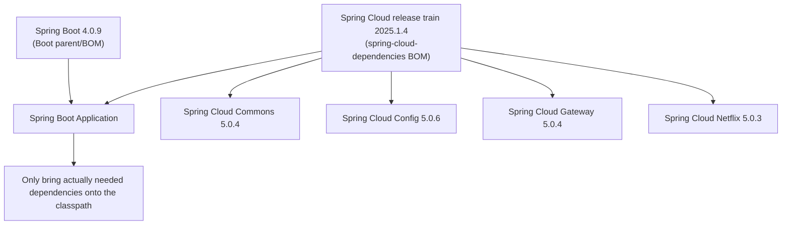
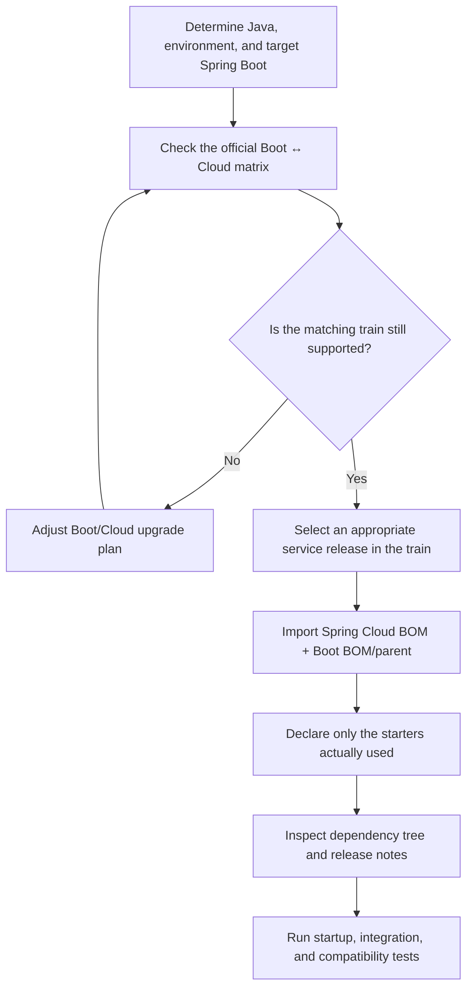

# Release Trains, Project Versions, and Service Releases

When starting a Spring Boot project that uses Spring Cloud, learners frequently encounter three different version numbers:

- The **Spring Boot** version the application runs on, for example `4.0.9`.
- The **Spring Cloud release train** version, for example `2025.1.4`.
- The version of **an individual Spring Cloud project**, for example Spring Cloud Commons `5.0.4` or Spring Cloud Config `5.0.6`.

All three numbers are meaningful and **do not need to be the same**. If you simply grab the latest version of each library and combine them in the same application, components may use incompatible APIs or configuration mechanisms. If you pin the entire system to a train that is too old, the application may miss bug fixes or exceed its support window.

This lesson belongs to the **Versions and Dependencies** chapter of the **SPRING_CLOUD_CORE** module. We will understand how Spring Cloud coordinates independent projects through a release train, how a BOM locks a dependency set, the meaning of a **service release (SR)**, and how to choose the right versions when working with Spring Cloud Commons, Context, externalized configuration, refresh scope, service discovery, registry, load balancing, and operational testing.

> **Data checkpoint:** the specific version numbers in this lesson are illustrated based on Spring documentation published up to **November 18, 2026**. They help explain the mechanism; when creating or upgrading a real project, always check the [official Spring Cloud page](https://spring.io/projects/spring-cloud/) and the release notes of the version you plan to use.

## 1. Learning Outcomes

After this lesson, you can:

1. Explain what a release train is, why Spring Cloud has a BOM, and why member projects do not necessarily share the same version.
2. Distinguish between **release train version**, **project/module version**, **dependency version**, and **service release**.
3. Choose a release train from the planned Spring Boot version and verify its support status.
4. Configure dependency management with Maven or Gradle without manually specifying versions for individual Spring Cloud starters.
5. Investigate causes of version mismatches in the dependency tree and identify overridden dependencies.
6. Distinguish maintenance upgrades within a train from switching to another train and plan testing accordingly.

## 2. Why Does Spring Cloud Need a Release Train?

**Spring Cloud is not a single library.** It is a family of projects addressing distributed system concerns. One application may simultaneously use:

- **Spring Cloud Commons/Context:** common abstractions such as `DiscoveryClient`, `ServiceInstance`, `ServiceRegistry`; context, configuration, and refresh scope.
- **Spring Cloud LoadBalancer:** the mechanism for selecting an instance when calling a service by logical name.
- **Spring Cloud Config:** retrieving and distributing externalized configuration when using the Config Server/Client model.
- **Spring Cloud Netflix:** Eureka integration for service registration and discovery, if the architecture chooses Eureka.
- **Spring Cloud Gateway:** request routing.
- Other projects such as Consul, Kubernetes, Stream, Bus, CircuitBreaker, Vault, and so on.

These projects have separate repositories, development schedules, features, and bug fixes. If an application manually picks the version of each project, the number of combinations grows rapidly and it becomes hard to verify compatibility with one another or with Spring Boot.

A **release train** solves that problem by releasing a **coordinated set of versions**. Spring Cloud publishes a BOM (Bill of Materials) carrying the train version. The BOM manages the versions of the corresponding dependencies; an application picks a train and adds only the modules it needs.



**Read the diagram accurately:** the BOM **manages versions**; it does not automatically add every Spring Cloud project into your application. Only starters/modules declared directly or pulled in transitively appear in the dependency graph. The displayed versions are examples from the `2025.1.4` train, not a rule that every train uses `5.0.x`.

### A Useful Analogy

Picture a release train as **a dispatch schedule of train cars tested together to run as one train**. Each car is maintained on its own schedule; the dispatch sheet states which version of each car is used. Swapping one car to a different version outside the sheet might run, but you have stepped outside the default combination maintained for that train and must take on extra verification work yourself.

## 3. Four Commonly Confused Version Levels

| Level | Example | What does it identify? | Who decides in an application project? |
| --- | --- | --- | --- |
| **Spring Boot version** | `4.0.9` | The Boot application baseline, auto-configuration, and corresponding base dependency set | Chosen by the development team based on environment and compatibility |
| **Spring Cloud release train** | `2025.1.4` | A coordinated set of dependency versions across the Spring Cloud project family | Chosen by the development team to match Boot |
| **Project/module version** | Commons `5.0.4`, Config `5.0.6` | Version of a project and the artifacts published from that project | Usually managed by the BOM; override only with justification |
| **Train service release** | `2025.1.4` after `2025.1.3` | A maintenance update of a release train line | Pick an appropriate SR, preferring the latest supported one after testing |

For example, `2025.1.4` does not mean `spring-cloud-commons` has version `2025.1.4`. Likewise, Config's version number does not have to equal Commons', because the two projects have different bug-fix schedules.

### 3.1. A Project Is Different from a Maven Artifact

A **project** can publish multiple artifacts. For instance, the Spring Cloud Commons project includes related modules `spring-cloud-commons` and `spring-cloud-context`; the modules have different responsibilities yet belong to the same project release line. A starter such as `spring-cloud-starter-loadbalancer` is an artifact designed to pull in the required dependencies, not the entirety of load-balancing capability itself.

Distinguish three concepts:

- **Project:** the development/release unit, for example *Spring Cloud Commons*.
- **Artifact:** library coordinates downloaded by the build tool, of the form `groupId:artifactId:version`.
- **Starter:** an artifact designed to aggregate dependencies and support auto-configuration for a capability.

You should not infer a project version from a starter name or from the release train version number. Check the BOM or the actual dependency tree instead.

### 3.2. A "Service Release" Is Not a Microservice Deployment

In Spring Cloud release documentation, a **service release (SR)** is a maintenance release of a **release train line**: typically fixing bugs, updating dependencies, and potentially adding backward-compatible features. The word "service" here **does not mean** a deployment of `order-service` or `payment-service` built by your team.

A business application may deploy version `1.8.7` while using Spring Boot `4.0.9` and Spring Cloud `2025.1.4`. These three release lifecycles are distinct.

## 4. Reading a Release Train with a Real Example

According to the [Spring Cloud Train Reference documentation](https://docs.spring.io/spring-cloud-release/reference/index.html) and the [release announcement on October 23, 2026](https://spring.io/blog/2026/10/23/spring-cloud-2025-1-4-has-been-released/), the stable `2025.1.4` train contains the following member versions:

| Component | Version published by train `2025.1.4` | Meaning |
| --- | --- | --- |
| Spring Cloud release train | **2025.1.4** | BOM version coordinating the entire train |
| Spring Cloud Commons | **5.0.4** | Common abstractions and context |
| Spring Cloud Config | **5.0.6** | Distributed configuration tooling |
| Spring Cloud Gateway | **5.0.4** | Routing/gateway |
| Spring Cloud Netflix | **5.0.3** | Integration for maintained Netflix OSS components |
| Spring Cloud Function | **5.0.5** | Function programming model |
| Spring Cloud CircuitBreaker | **5.0.3** | Circuit breaker abstraction/integrations |

This data demonstrates a core fact: **there is no rule that the fourth service release of a train must contain every project at patch version `.4`**. In the example above, Config is `5.0.6` while Netflix is `5.0.3`. Each member may have released more or fewer patches before being included in a train.

At the time of illustration, Spring documentation lists `2025.1.4` as the stable release; `2026.0.0-RC2` is a **release candidate**, not yet considered stable. A version with a larger year number is not automatically the more suitable production choice.

### 4.1. How to Read Version Formats

For calendar-style train names like `2025.1.4`:

- `2025.1` identifies the release train line.
- `.0` is the initial release of that line under standard numbering.
- `.1`, `.2`, `.3`, `.4` are subsequent updates/maintenance releases within the same line.

This is a **train version numbering convention**, not a promise that every project will share the same major/minor/patch. Older trains were also named with code names such as **Hoxton** and used labels like `Hoxton.SR5`. When reading older documentation, do not assume `SR5` is the version of individual artifacts.

### 4.2. Stable, GA, Milestone, RC, and Snapshot

| Type | Example | How to use |
| --- | --- | --- |
| **GA / stable release** | `2025.1.4` | Candidate for production deployment after checking compatibility, support, and release notes |
| **Milestone** | `2026.0.0-M1` | Early evaluation of APIs/features; no stability guarantee equivalent to GA |
| **Release candidate** | `2026.0.0-RC2` | Pre-GA testing; still subject to change |
| **Snapshot** | `2026.0.0-SNAPSHOT` | Continuous build that can change over time |
| **Service release** | `2025.1.4` vs. `2025.1.3` | Maintenance update within the same train; still requires running tests |

Builds from milestone, RC, or snapshot versions may require additional artifact repositories; that does not make them equivalent to stable releases. In a production pipeline, pin a specific released version to guarantee build reproducibility.

## 5. Choose Spring Cloud Based on Spring Boot First

The most important relationship in dependency management within the Spring ecosystem is that **a Spring Cloud release train only supports the published generations of Spring Boot**. Individual project names come after you determine the Boot–Cloud pairing.

The table below cites the compatibility matrix from the [Spring Cloud page](https://spring.io/projects/spring-cloud/) as of November 18, 2026:

| Release train | Corresponding Spring Boot | Notes |
| --- | --- | --- |
| **2025.1.x** | **4.0.x** and **4.1.x from train 2025.1.2** | For example, `2025.1.4` announces support for Boot `4.0.9` and `4.1.2` |
| **2025.0.x** | **3.5.x** | Older line; check support lifecycle before using |
| **2024.0.x** | **3.4.x** | Older line |
| **2023.0.x** | **3.2.x**, **3.3.x from train 2023.0.2** | Older line |
| **2022.0.x** | **3.0.x**, **3.1.x from train 2022.0.3** | Older line |

Footnotes and EOL statuses on the official page can change over time. Do not confuse **"was once compatible"** with **"is currently receiving security/maintenance support"**. Production decisions must consider the **support policy**, the patch version currently in use, and vulnerability advisories.

### 5.1. Version Selection Workflow



**Do not work backward:** do not pick a Spring Cloud version you just saw on Maven Central and try to force your current Spring Boot to match by overriding dozens of artifacts. That hides incompatibilities and hurts maintainability.

### 5.2. When Should You Pick the Latest Service Release?

The practice recommended by Spring Cloud is to pick the **latest service release within your chosen release train**. The reason is that SRs usually bring bug fixes and compatibility improvements. Even so, before upgrading production, review release notes, security advisories, and behavioral changes, and run your test suite; "updating within the same train" does not replace verifying the actual system.

## 6. Maven: Let the BOM Manage Versions Instead of Pinning Each Starter

The following example uses the **Spring Boot `4.0.9` + Spring Cloud `2025.1.4`** pairing, announced as compatible in the train release announcement. This is a compact `pom.xml` example for a learning application that wants to use Spring Cloud LoadBalancer and Config Client:

```xml
<?xml version="1.0" encoding="UTF-8"?>
<project xmlns="http://maven.apache.org/POM/4.0.0"
         xmlns:xsi="http://www.w3.org/2001/XMLSchema-instance"
         xsi:schemaLocation="http://maven.apache.org/POM/4.0.0
                             https://maven.apache.org/xsd/maven-4.0.0.xsd">
    <modelVersion>4.0.0</modelVersion>

    <parent>
        <groupId>org.springframework.boot</groupId>
        <artifactId>spring-boot-starter-parent</artifactId>
        <version>4.0.9</version>
        <relativePath/>
    </parent>

    <groupId>com.example</groupId>
    <artifactId>spring-cloud-core-demo</artifactId>
    <version>0.0.1-SNAPSHOT</version>

    <properties>
        <spring-cloud.version>2025.1.4</spring-cloud.version>
    </properties>

    <dependencyManagement>
        <dependencies>
            <dependency>
                <groupId>org.springframework.cloud</groupId>
                <artifactId>spring-cloud-dependencies</artifactId>
                <version>${spring-cloud.version}</version>
                <type>pom</type>
                <scope>import</scope>
            </dependency>
        </dependencies>
    </dependencyManagement>

    <dependencies>
        <dependency>
            <groupId>org.springframework.cloud</groupId>
            <artifactId>spring-cloud-starter-loadbalancer</artifactId>
        </dependency>
        <dependency>
            <groupId>org.springframework.cloud</groupId>
            <artifactId>spring-cloud-starter-config</artifactId>
        </dependency>
        <dependency>
            <groupId>org.springframework.boot</groupId>
            <artifactId>spring-boot-starter-test</artifactId>
            <scope>test</scope>
        </dependency>
    </dependencies>

    <build>
        <plugins>
            <plugin>
                <groupId>org.springframework.boot</groupId>
                <artifactId>spring-boot-maven-plugin</artifactId>
            </plugin>
        </plugins>
    </build>
</project>
```

Notes on runnability:

- `spring-boot-starter-parent` provides Boot's dependency management baseline, build configuration, and default plugins; a project that does not use the parent can import the corresponding `spring-boot-dependencies` BOM and manage plugins in its own way.
- `spring-cloud-dependencies` is the BOM managing Spring Cloud library versions; it **does not replace** the Boot parent/BOM.
- Both Cloud starters in `<dependencies>` omit `<version>` because they are managed by the BOM.
- Having `spring-cloud-starter-config` on the classpath requires appropriate Config Client configuration at runtime. To run a sample experiment without a Config Server, you can remove the Config Client dependency or configure the import mechanism as required by the version in use; the BOM does not spin up a server automatically.
- LoadBalancer can select instances when provided with an instance source (a discovery provider, a static list, or infrastructure integration). Merely declaring the starter **does not create a service registry**.

### 6.1. Why Use `dependencyManagement`?

In Maven, `dependencyManagement` supplies **default versions and managed dependency metadata** for dependencies that appear in the graph. It **is not equivalent** to declaring additional dependencies inside `<dependencies>`.

A single BOM import can manage many artifacts without pulling every corresponding JAR onto the runtime classpath. On the other hand, if you manually declare:

```xml
<dependency>
    <groupId>org.springframework.cloud</groupId>
    <artifactId>spring-cloud-context</artifactId>
    <version>5.0.0</version>
</dependency>
```

then this explicit version can drift from the Context version managed by the train. The snippet above **only illustrates an override to avoid**, not an instruction to use `5.0.0` with `2025.1.4`.

### 6.2. Where Should You Set Your Application Version?

The `<version>0.0.1-SNAPSHOT</version>` of `spring-cloud-core-demo` is the version of **the application developed by your team**, completely independent of Boot and Cloud versions. When the team deploys version `1.0.0` of the application, no rule requires changing the train to `1.0.0`.

## 7. Gradle: Importing the Same BOM with Dependency Management

With Gradle Groovy DSL, a common option is using the `io.spring.dependency-management` plugin alongside the Spring Boot plugin:

```groovy
plugins {
    id 'java'
    id 'org.springframework.boot' version '4.0.9'
    id 'io.spring.dependency-management' version '1.1.7'
}

group = 'com.example'
version = '0.0.1-SNAPSHOT'

repositories {
    mavenCentral()
}

ext {
    set('springCloudVersion', '2025.1.4')
}

dependencyManagement {
    imports {
        mavenBom "org.springframework.cloud:spring-cloud-dependencies:${springCloudVersion}"
    }
}

dependencies {
    implementation 'org.springframework.cloud:spring-cloud-starter-loadbalancer'
    testImplementation 'org.springframework.boot:spring-boot-starter-test'
}

tasks.named('test') {
    useJUnitPlatform()
}
```

The key point is that both Maven and Gradle pass the **release train version into the BOM**. If you later need Spring Cloud Config or Eureka, simply add the corresponding starter without assigning a new version to that starter manually.

Gradle also has native `platform(...)`/dependency constraints mechanisms. Development teams should standardize on one version-management approach per project and verify the resolved dependency graph. Do not mix multiple mechanisms or multiple BOMs controlling the same artifact without checking precedence rules.

## 8. How Do the Spring Boot BOM and Spring Cloud BOM Coexist?

View them as two management layers:

| Layer | Example artifacts | Primary responsibility |
| --- | --- | --- |
| **Spring Boot** | `spring-boot-dependencies`, Boot parent | Aligns base libraries: Spring Framework, logging, JSON, HTTP, testing, and dependencies managed by Boot |
| **Spring Cloud** | `spring-cloud-dependencies` | Coordinates Spring Cloud modules/projects and versions managed by the train |
| **Application** | `pom.xml`, `build.gradle` | Chooses starters, declares application-specific dependencies, configures the build, and applies strictly necessary overrides |

The Spring Cloud BOM does not serve as a replacement `spring-boot-starter-parent`. Conversely, having only the Spring Boot BOM does not give the application the coordinated set of Spring Cloud versions.

### 8.1. Ways You Can Accidentally Drift from Managed Versions

Common situations:

1. **A dependency with an explicit `<version>`** forces a Spring Cloud artifact up or down to a version different from the train.
2. **Another BOM** also manages the same coordinates and wins precedence according to the build tool's rules.
3. **Transitively imported dependencies** create two paths pulling a library at different versions; the resolver picks one version for the graph based on conflict-resolution rules.
4. **Build plugins** have their own versions. A BOM used for application dependencies does not mean every Gradle/Maven plugin updates automatically.
5. **Multi-module applications** declare trains in different submodules, producing inconsistent resolution results.

Therefore, saying "we already imported the BOM" only proves **version-management intent**; you must inspect the actual dependency graph to know which JARs are used at runtime.

### 8.2. Inspecting with Maven

```bash
# View the Spring Cloud dependency graph in a Maven application:
mvn dependency:tree -Dincludes=org.springframework.cloud

# Inspect versions produced by parent/BOM/properties:
mvn help:effective-pom

# Example isolating a single artifact:
mvn dependency:tree -Dincludes=org.springframework.cloud:spring-cloud-commons
```

The `effective-pom` command shows how Maven merged the parent, dependency management, and configuration; `dependency:tree` shows the path by which a dependency entered. If an artifact resolves to an unexpected version, trace directly declared dependencies, imported BOMs, and overrides.

### 8.3. Inspecting with Gradle

```bash
# Overview of runtime dependencies:
./gradlew dependencies --configuration runtimeClasspath

# Find why Gradle chose the resolved version of spring-cloud-commons:
./gradlew dependencyInsight   --dependency spring-cloud-commons   --configuration runtimeClasspath
```

On Windows, use `gradlew.bat` accordingly. `dependencyInsight` is helpful when multiple dependency paths reach the same artifact; it reveals the selected version and the reason for selection rather than guessing from starter versions written in the build file.

## 9. Specific Impact on Spring Cloud Core

In the **SPRING_CLOUD_CORE** module, learners encounter several abstractions that appear together yet belong to different packages, artifacts, and sometimes release projects. A train keeps them in a coordinated combination.

| Capability | API / integration point | What to watch when changing versions |
| --- | --- | --- |
| Service discovery | `DiscoveryClient`, `ReactiveDiscoveryClient`, `ServiceInstance` | Auto-configuration and discovery provider adapters may change across versions |
| Service registry | `ServiceRegistry`, `Registration` | Not every discovery implementation supports self-registration identically |
| Client-side load balancing | `@LoadBalanced`, Spring Cloud LoadBalancer | Integration with `RestClient`/`WebClient`/HTTP clients depends on framework line and starter |
| Context/refresh | `@RefreshScope`, refresh events | Bean lifecycle, refresh infrastructure, and endpoint configuration can change |
| Externalized config | Spring Boot `Environment`, `ConfigData`; Cloud Config Client when used | Config import/location syntax, bootstrap, and refresh must be checked for the exact version |
| Compatibility | Boot–Cloud compatibility verifier and auto-configuration conditions | Upgrading Boot may cause startup failure if the current train does not support it yet |

### 9.1. Commons and Context Are Not a Config Server

**Spring Cloud Commons** provides shared contracts and infrastructure used across Cloud projects. **Spring Cloud Context** provides application context and refresh capabilities such as `@RefreshScope`. These capabilities can arrive via transitive dependencies; an application does not necessarily declare both `spring-cloud-commons` and `spring-cloud-context` by hand.

**Spring Cloud Config** is a separate project for managing configuration from an external system via Config Server/Client. Having `@RefreshScope` does not mean you have a Config Server; having a Config Server does not guarantee every bean refreshes its values immediately when the configuration store changes.

When refresh behavior changes after an upgrade, check **Boot config infrastructure + Context/Commons + Config Client + deployment configuration**. Checking only the Config version is insufficient.

### 9.2. Discovery Is Not Synonymous with a Specific Registry

`DiscoveryClient` is a generic abstraction. Eureka, Consul, Kubernetes, or static instance sources can supply different implementations/adapters. A compatible train pairs the right library versions, while your architecture decides the provider and how registration, readiness awareness, failover, and timeouts work.

A frequent post-upgrade issue is keeping a starter or property that was replaced in the provider's newer version. Read the migration notes of the specific discovery project involved, not just the train's general release notes.

## 10. What Does a Service Release Actually Change?

A **service release** typically appears when the Spring Cloud team wants to deliver bug fixes, dependency updates, or compatibility improvements into a train applications are using. It may include:

- Behavioral fixes in discovery adapters, LoadBalancer, or refresh/Config.
- Updates to underlying dependencies and patches for disclosed vulnerabilities.
- Support adjustments for a corresponding Spring Boot patch or minor release.
- Updates to only a subset of projects; projects without changes do not have to bump their versions.

For example, the October 23, 2026 announcement for `2025.1.4` lists different member projects at different patch versions and announces support for Boot `4.0.9` and `4.1.2`. This illustrates that **a train is a coordinated set of versions**, not a single "uber-jar." Do not take `.4` from the train version and manually write `5.0.4` for every project.

### 10.1. Are SRs Always Backward-Compatible?

The usual goal of a service release is fixing bugs and keeping changes compatible. However, fixing a bug can expose a flawed assumption in the application; dependency updates can affect runtime behavior; security, timeout, or bean lifecycle defaults may be adjusted. **There is no guarantee that changing only an SR number allows skipping tests.**

Read the release notes and diff the dependency graph between the **currently used version** and the **target version**. Especially when a security-related dependency is updated, verify default settings and operational endpoints instead of merely checking whether the application starts.

### 10.2. Distinguishing Three Types of Upgrades

| Example upgrade path | Nature | Scope of verification needed |
| --- | --- | --- |
| Cloud `2025.1.3 → 2025.1.4`; Boot stays on a compatible version | Service release within the same train | Release notes, dependency graph, startup, behavior related to changed projects |
| Boot `4.0.x → 4.1.x` with Cloud `2025.1.4` | Minor Boot upgrade within Cloud's announced support range | Boot migration notes, Java/build plugins, context/integration tests, behavior |
| Boot `3.5.x → 4.0.x` and Cloud `2025.0.x → 2025.1.x` | Moving across Boot generation and Cloud train | Migration planning, API/dependency adjustments, multi-layer testing, and cautious rollout |

These upgrade examples **do not mean** every patch pair within each line is compatible. Check the specific release notes of both Boot and Cloud before choosing target versions.

## 11. Should You Override a Spring Cloud Project Version?

The default rule is **let the release train BOM choose**. Overriding should only be a controlled decision—for example, when:

- A critical patch is published independently and **official guidance** explains how to apply it alongside the current train.
- A fix must be verified before the next SR of the entire train is released.
- The maintaining team has evaluated compatibility impact, runtime constraints, and a rollback plan.

A minimum process:

1. Document the reason and reference the issue/release notes.
2. Identify the exact artifact overridden and all affected dependencies.
3. Read compatibility notes of the project and train; do not infer from major versions.
4. Run integration tests covering the behavior of the relevant abstraction.
5. Set a condition to remove the override once the next train includes the fix.

If `spring-cloud-context` is pinned to one version while `spring-cloud-commons` stays on an older version—even though both belong to the Spring Cloud ecosystem—API or auto-configuration differences can cause unpredictable failures. Therefore, whenever diverging from the BOM is necessary, evaluate **the entire group of modules released together by the same project** and their accompanying dependencies.

### Anti-pattern: "Bumping Commons to Fix a Context Bug"

A team hits a refresh bug and manually writes:

```xml
<!-- Anti-pattern illustration: overriding individually without verifying the BOM -->
<dependency>
    <groupId>org.springframework.cloud</groupId>
    <artifactId>spring-cloud-context</artifactId>
    <version>5.0.6</version>
</dependency>
```

You cannot conclude `5.0.6` is appropriate simply because it looks newer. This illustrative version also does not represent an official recommendation for train `2025.1.4`. You must check whether the artifact exists, which modules the Commons project publishes, and whether the target train supports that combination.

## 12. Safe Upgrade Workflow for a Spring Cloud Application

Suppose `orders-api` is running on an older release train and the team wants to update to get discovery/config fixes. You can follow this cycle.

### Step 1. Capture the Pre-Upgrade Baseline

Record the actual versions of Java, Spring Boot, the Spring Cloud BOM, starters, and the dependency graph; record current metrics: startup time, downstream call error rate, discovery instance count, timeouts, p95/p99 latency, and config refresh errors.

In particular, inspect artifacts on the **runtime classpath**, because a version written in a build file is not necessarily the version chosen by the resolver.

### Step 2. Determine the Target

Consult the Boot–Cloud matrix at [spring.io/projects/spring-cloud](https://spring.io/projects/spring-cloud/) and locate a **service release declared stable and still within its support lifecycle**. Cross-check migration guides/release notes for Boot, Cloud Commons, and every project actually in use. If moving to a new Boot line is needed, plan separately for major/minor changes.

### Step 3. Update Versions Centrally

Change the Spring Boot and Spring Cloud BOM versions in the shared management location. Remove redundant explicit starter versions if they are supposed to be managed by the BOM. In multi-module applications, ensure every module follows the same version policy.

Specify an exact, reproducible version for pipelines and release artifacts; avoid ambiguous version ranges for critical infrastructure.

### Step 4. Inspect the Dependency Graph and APIs

Diff the graph before and after, looking for version conflicts, duplicate classpath entries, removed modules, renamed artifacts, or starter changes. For Spring Cloud Core, pay special attention to:

- `DiscoveryClient`/provider implementations and how load balancing resolves instances.
- `@RefreshScope`, `Environment`, config import mechanisms, and removed properties.
- Package/API names of HTTP client integrations the application uses.
- Actuator endpoints, health/readiness, and security configuration.
- Test framework dependencies and Java runtime.

### Step 5. Test Behavior, Not Just Compilation

| Verification | Scenario | Passing criteria |
| --- | --- | --- |
| Context startup | Run with sample dev/staging/production configs | Bean wiring and auto-configuration are valid |
| Compatibility verification | Pair Boot–Cloud declared as supported | No real compatibility errors; do not disable the verifier to hide errors |
| Discovery | Service appears, disappears, empty instance list | Client handles zero-instance state cleanly and recovers |
| Load balancing | Multiple instances, one failing instance | No stale IP pinning; failover/retry follows policy |
| External config | Missing/invalid config source, config changes | Fail-fast/fallback works as designed; secrets are not misused |
| Refresh scope | Trigger refresh for selected beans | Refreshable beans read new values; resource lifecycle stays safe |
| Service communication | Timeouts, 503, lost responses, retries | No retry storm; idempotency handled properly |
| Observability | Health, metrics, tracing | Signals continue exporting accurately and remain inspectable |
| Rolling rollout | Old and new versions running concurrently | API/event/config contracts remain compatible during transition |

Not every project needs every test case. Choose based on the starters and abstractions your application actually uses, focusing on changes noted in release notes.

### Step 6. Release with a Rollback Path

Deploy to an appropriate environment, monitor metrics before/after, and use rolling or canary rollouts if infrastructure supports them. Prepare a rollback procedure for application/config versions. If the upgrade also changes data schemas, ensure a backward-compatible schema strategy; rolling back only the JAR may not be enough.

## 13. Troubleshooting Common Version-Mismatch Errors

### 13.1. Startup Reports Boot/Cloud Incompatibility

**Symptom:** the application context fails to start and the compatibility check reports a message about the version pair.

**Analysis:** the Boot and Cloud train are not in the officially supported set, or a newer Boot release is not yet accepted by the train in use.

**Resolution:** check the actual versions; use the compatibility table to pick an appropriate train or Boot version. Do not disable the compatibility verifier just to keep running, as API or auto-configuration failures may surface later.

### 13.2. `NoSuchMethodError`, `ClassNotFoundException`, or `NoClassDefFoundError`

**Symptom:** compilation may succeed, but runtime reports a missing method or class.

**Analysis:** an artifact was compiled against a different version than the one actually selected in the runtime graph; or a module is no longer present because starters/dependencies changed.

**Resolution:** inspect the dependency tree and effective POM/dependencyInsight. Look for explicit dependencies, duplicate BOM imports, transitively chosen library versions, and API changes in release notes. Do not fix it by randomly adding extra JAR versions onto the classpath.

### 13.3. Discovery Runs but Finds No Instances

**Symptom:** `DiscoveryClient` is injected yet returns an empty list; clients calling a service ID cannot resolve a destination.

**Analysis:** missing provider, registry not ready, misconfigured registration/discovery, or compatibility changes in the adapter.

**Resolution:** check the provider starter, BOM-managed versions, registration/readiness, and runtime configuration. Matching versions alone does not guarantee the provider is configured.

### 13.4. Old Properties Stop Working After an Upgrade

**Symptom:** the application still runs, yet timeouts, refresh, Config Client, or actuator behave differently.

**Analysis:** config keys may have changed, or defaults and auto-configuration conditions shifted. Refresh scope and external configuration can also have different lifecycles.

**Resolution:** read the migration notes of Boot and Cloud projects, inspect `Environment` sources, log configuration safely, and test reloading/refreshing individual beans; do not assume old property keys are always preserved.

### 13.5. "Maven Downloaded the Right Train Version, Yet the App Still Fails"

`spring-cloud-dependencies:2025.1.4` is BOM metadata, not a full-application health check. Failures can still stem from an unsupported Boot version, overridden dependencies, misconfiguration, an unstarted discovery provider, or business logic bugs. Trace the graph and call path rather than merely confirming the BOM is in the local cache.

## 14. Team Dependency Management Rules

To prevent recurring errors, a development team should adopt conventions:

- **Single source of version management:** centralize Boot and Cloud train versions in a parent POM, version catalog, or controlled shared Gradle configuration.
- **No arbitrary starter version pinning:** prefer the BOM and override only with a documented reason.
- **Contextualized update reviews:** each version-upgrade PR clearly states the Boot/Cloud pair, release notes, dependency diff, and key test cases.
- **Support lifecycle tracking:** identify when to leave an end-of-life train and prioritize appropriate security patches.
- **Reproducible builds:** do not use snapshots/dynamic versions in production unless explicitly required with strict controls.
- **Test the actual abstractions:** discovery, refresh/config, load balancing, and service-to-service communication need real behavioral tests.
- **Maintain cross-service consistency:** applications do not need to run identical versions at every instant, but API/event/config compatibility must hold throughout rollouts.

### Example Upgrade PR Review

A PR changing `2025.1.3` to `2025.1.4` should be able to answer:

1. Why is the upgrade needed? Which fixes or behavioral adjustments affect this application?
2. Is the current Spring Boot version supported by `2025.1.4`?
3. Which projects changed version (Commons, Config, Gateway, Netflix, etc.)? Is the runtime dependency tree clean?
4. Have startup, refresh, discovery, and service-to-service tests passed?
5. If a production issue occurs, how will we roll back?

Answering these questions turns editing a version number into an auditable infrastructure change.

## 15. Hands-on Exercises

### Exercise 1. Reading an Actual Release

From the [Spring Cloud Train Reference](https://docs.spring.io/spring-cloud-release/reference/index.html), identify:

- The stable release train version currently displayed.
- The versions of at least three projects: Commons, Config, Gateway.
- The Spring Boot version mentioned by the train's documentation.
- One piece of evidence proving project versions do not equal the release train version.

Then explain why you cannot take the Config version to infer the Commons version.

### Exercise 2. Spotting a Dependency Management Mistake

A project has:

```xml
<properties>
    <spring-cloud.version>2025.1.4</spring-cloud.version>
</properties>

<dependencyManagement>
    <dependencies>
        <dependency>
            <groupId>org.springframework.cloud</groupId>
            <artifactId>spring-cloud-dependencies</artifactId>
            <version>${spring-cloud.version}</version>
            <type>pom</type>
            <scope>import</scope>
        </dependency>
    </dependencies>
</dependencyManagement>

<dependencies>
    <dependency>
        <groupId>org.springframework.cloud</groupId>
        <artifactId>spring-cloud-starter-loadbalancer</artifactId>
        <version>5.0.0</version>
    </dependency>
</dependencies>
```

**Task:** explain why `<version>5.0.0</version>` should be considered for removal; describe the command to find the actual resolved version of LoadBalancer/Commons and explain how to confirm the project has returned to the BOM-managed combination.

### Exercise 3. Planning an Upgrade

A team uses Spring Boot `3.5.x` with Spring Cloud `2025.0.x` and wants to move to Boot `4.0.x`. Please:

1. Identify the appropriate target release train using the latest compatibility matrix.
2. Classify whether this is an intra-train service release or a train migration.
3. List the changes to evaluate across Commons/Context, Config Client, discovery provider, and LoadBalancer.
4. Select at least five key tests to verify the system works properly after the upgrade.

### Self-Check Questions

1. Does the Spring Cloud BOM automatically add every Spring Cloud library to the classpath? Why or why not?
2. Why can Commons `5.0.4` and Config `5.0.6` coexist inside train `2025.1.4`?
3. Which groups of dependencies are managed by the Spring Boot BOM vs. the Spring Cloud BOM?
4. How does a Spring Cloud "service release" differ from deploying a microservice in a business system?
5. What is the difference between `2025.1.4` and `2026.0.0-RC2` when preparing a production deployment?
6. When encountering `NoSuchMethodError` after an upgrade, which dependency resolver output should you inspect before manually adding a JAR?
7. Why does upgrading from Boot `3.5.x` to `4.0.x` require considering a Spring Cloud release train change?
8. Why is testing `@RefreshScope` and discovery after an upgrade more important than merely checking that the application compiles?

## 16. References and Takeaways

**Official sources** used in the version examples:

- [Spring Cloud project — release train and Spring Boot compatibility matrix](https://spring.io/projects/spring-cloud/).
- [Spring Cloud Train Reference — projects and versions in the train](https://docs.spring.io/spring-cloud-release/reference/index.html).
- [Spring Cloud 2025.1.4 release announcement, October 23, 2026 — BOM, module list, and Spring Boot support](https://spring.io/blog/2026/10/23/spring-cloud-2025-1-4-has-been-released/).

Remember the core rule: **choose target Spring Boot → pick a compatible and supported Spring Cloud release train → use the train's BOM to manage project versions → add only needed starters → inspect the dependency graph → run tests before upgrading**. A release train is a coordinated set of versions, projects have independent release schedules, and a service release updates that coordinated set in maintenance waves. Understanding these three layers makes developing and operating Spring Cloud's shared abstractions safer, easier to upgrade, and easier to trace.
