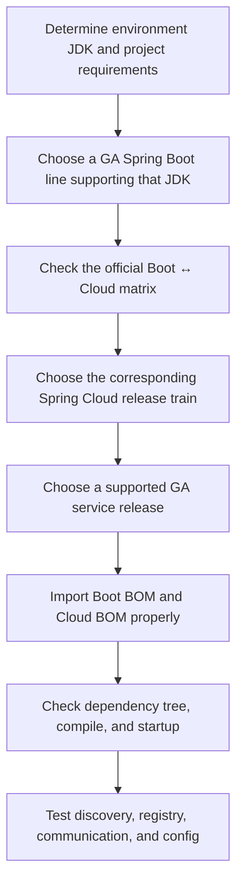

# Choosing Spring Cloud Compatible with Java and Spring Boot

When building distributed applications with **SPRING_CLOUD_CORE**, choosing versions is not just picking the latest Spring Cloud release. An application also depends on **Java**, **Spring Boot**, **Spring Framework**, the **Spring Cloud release train**, individual starters such as Commons, Context, Config, Discovery, and LoadBalancer, as well as build tool versions. If these components are mismatched, the application might compile yet fail to start, or only break when calling services and refreshing configuration.

This lesson belongs to the **Versions and Dependencies** chapter. We will learn how to choose a supported combination, set up Maven/Gradle with BOMs, analyze the dependency tree, and verify behavior using core capabilities: discovery, service registry, inter-service communication, and refresh scope. The goal is to establish a **repeatable selection and verification workflow**, rather than guessing versions by name or relying solely on a successful build.

> **Reference checkpoint:** the version examples in this lesson are cross-checked against official documentation as of **November 18, 2026**. Support lists and service releases change over time; when applying them to a real project, always verify the [Spring Cloud](https://spring.io/projects/spring-cloud/) page and [Supported Versions](https://github.com/spring-cloud/spring-cloud-release/wiki/Supported-Versions).

## 1. Learning Outcomes

After this lesson, you can:

1. Distinguish minimum Java requirements from the JDK used for building, bytecode target version, and the runtime JRE/JDK.
2. Read the **Spring Cloud release train ↔ Spring Boot** compatibility matrix and distinguish GA releases from milestones/RCs.
3. Explain why the Spring Boot BOM and Spring Cloud BOM must be managed consistently.
4. Create sample Maven or Gradle configurations without manually assigning versions to individual BOM-managed starters.
5. Use Maven/Gradle to find the exact resolved versions of dependencies.
6. Analyze version-incompatibility failures, from compilation errors and `UnsupportedClassVersionError` to startup compatibility verifier errors.
7. Build an upgrade and verification workflow for Spring Cloud's foundational capabilities in distributed systems.

## 2. Understanding Four Version Layers Before Choosing

A typical Spring Cloud application involves at least four layers:

| Component | Responsibility | Who decides the version? |
| --- | --- | --- |
| Java/JDK | Compiles and runs bytecode, provides Java platform APIs | Development team and deployment environment |
| Spring Boot | Auto-configures the app, provides starters, manages core libraries via Boot BOM | Boot version in parent/POM or Gradle plugin/BOM |
| Spring Cloud release train | Coordinates versions across multiple Spring Cloud projects | Version of the `spring-cloud-dependencies` BOM |
| Specific starter/library | Adds capabilities such as Commons, Context, Discovery, LoadBalancer, Config, Bus | Normally inherited from the corresponding BOM |

For example, `2025.1.4` is the **Spring Cloud release train version**, not the version number of every library inside it. Within that train, Spring Cloud Commons and Spring Cloud Config can have different module version numbers. The BOM maps modules to the combination released together.

### 2.1. Three Independent Questions About Java

- **JDK running Gradle/Maven:** the build tool must run on a Java version that the tool's version supports.
- **Java toolchain/target for compilation:** determines language level, APIs, and/or target bytecode of the application.
- **Container or host JRE/JDK:** must be able to run the generated bytecode and meet the minimum requirements of Spring Boot and dependent libraries.

For example: if a project uses JDK 21 to compile to Java 21 bytecode, an environment with only Java 17 cannot execute those `.class` files. Conversely, running Java 21 does not make an inherently incompatible Spring Boot and Spring Cloud combination valid.

**Distinguishing minimum requirements from verified support:** Spring Boot 3.5 and Spring Boot 4.1 both require a **minimum of Java 17** according to system documentation. However, using a newer Java release also depends on the support level of that exact Boot line, third-party libraries, monitoring agents, and build tools. Do not infer that "running on the latest Java" is always safe merely because it is newer than 17.

### 2.2. Spring Framework and Jakarta Are Indirect Dependency Layers

Spring Boot manages Spring Framework versions, starters, and many foundational libraries. Across the lines examined here:

- Spring Boot **3.5.x** belongs to the **Spring Framework 6.x** generation.
- Spring Boot **4.0/4.1** belongs to the **Spring Framework 7.x** generation.
- Upgrading from Boot 3 to Boot 4 can entail API, starter, module, and Jakarta/Servlet requirement changes. This is a **platform upgrade**, not merely bumping a Cloud version number in the BOM.

Do not independently bump `spring-core`, `spring-context`, `spring-web`, or other Spring Framework modules to arbitrary versions while the Boot BOM manages them, unless there is a verified reason and a corresponding test suite.

## 3. Reading the Spring Cloud ↔ Spring Boot Matrix

Spring Cloud releases by **release train**, such as `2025.1.x`. A train groups related compatible projects such as Spring Cloud Commons, Config, Consul, Netflix, Gateway, Kubernetes, and LoadBalancer. A *service release* such as `2025.1.4` is a patch/improvement release within the `2025.1` train.

### 3.1. Reference Matrix as of November 18, 2026

| Spring Cloud release train | Compatible Spring Boot line | Meaning when selecting |
| --- | --- | --- |
| **2025.1.x (Oakwood)** | **4.0.x**; **4.1.x from Cloud 2025.1.2 onward** | Current GA line for Boot 4 examples; choose the latest supported service release |
| 2025.0.x (Northfields) | 3.5.x | Older line, marked OSS end-of-support on the project page; check support policy before choosing for new projects |
| 2024.0.x (Moorgate) | 3.4.x | Older line, OSS end-of-support |
| 2023.0.x (Leyton) | 3.2.x; 3.3.x from Cloud 2023.0.2 | Older line, OSS end-of-support |
| 2022.0.x (Kilburn) | 3.0.x; 3.1.x from Cloud 2022.0.3 | Older line, OSS end-of-support |
| **2026.0.0-RC2 (Paddington)** | **4.2.0-RC2** | Only a **release candidate** at the reference date; for pre-release evaluation, not GA |

**Concrete GA combination example:** the [Spring Cloud 2025.1.4 release on October 23, 2026](https://spring.io/blog/2026/10/23/spring-cloud-2025-1-4-has-been-released/) was announced as built on **Spring Boot 4.0.9** and supporting **Spring Boot 4.1.2**. Therefore, **Java 21 + Boot 4.1.2 + Cloud 2025.1.4** is a sensible illustrative combination for this lesson.

**Non-GA example:** [Spring Cloud 2026.0.0-RC2 on November 5, 2026](https://spring.io/blog/2026/11/05/spring-cloud-2026-0-0-RC2-has-been-released/) is based on Boot `4.2.0-RC2`. When operational stability is needed, avoid upgrading production applications directly to an RC pair just because its version numbers are higher.

> **Do not read the table by simple numeric comparison.** `2025.0.x` and `2025.1.x` belong to two different release trains corresponding to different Boot generations; similarly, `2025.1.1` does not share the same Boot 4.1 support scope as `2025.1.2+`.

### 3.2. Bottom-Up Version Selection Process



When a project is already running Spring Boot, the workflow starts from the **current Boot version**, then looks up the matching Cloud train. For a brand-new project, typically pick an **organization-supported JDK**, then a **supported GA Boot line**, and only then choose Cloud.

### 3.3. Three Decision Scenarios

| Practical need | Reference option | Reason |
| --- | --- | --- |
| New app on Java 21 needing discovery and load balancing | Boot `4.1.2` + Cloud `2025.1.4` | GA pair announced compatible; Java 21 meets minimum requirements |
| Maintaining an app running Boot 3.5.x | Cloud `2025.0.x`, while planning migration to a supported line | Matches the compatible generation, though support/patch status must be checked |
| Project still on Java 11 and Boot 2.x | Plan Java and Boot upgrades before adopting modern Cloud | You cannot plug a Boot 4 release train onto a Java 11 platform |

You cannot migrate an application from Boot 3.5 to Boot 4.1 merely by changing `spring-cloud.version`. You must update the **Boot parent/plugin/BOM**, build configuration, code using changed APIs, and the deployment pipeline.

## 4. What Is a BOM and Why Are Two BOMs Needed?

A **BOM (Bill of Materials)** in Maven is a POM containing version constraints/recommendations so the dependency manager resolves versions consistently. Two common BOMs are:

- `org.springframework.boot:spring-boot-dependencies` manages Spring Boot, Spring Framework, and many foundational libraries.
- `org.springframework.cloud:spring-cloud-dependencies` manages Spring Cloud projects and starters in a release train.

If you use Maven's `spring-boot-starter-parent`, that parent already supplies Boot dependency management. When using Cloud, import the Cloud BOM under `<dependencyManagement>`. With Gradle, declare the BOM management mechanism explicitly; merely applying the Spring Boot plugin **does not implicitly** equate to importing both BOMs when using Gradle native platforms.

### 4.1. What a BOM Does and Does Not Do

| What a BOM helps with | What a BOM does not guarantee |
| --- | --- |
| Eliminates specifying versions for each managed dependency | Installing a registry, Config Server, or Gateway for you |
| Coordinates module versions within the same release train | That every third-party library is compatible with your application |
| Enables centralized patch upgrades via a single property | That application config and runtime APIs stay valid after a major upgrade |
| Helps reproduce the dependency graph when versions are pinned | Absence of conflicting overrides in parents, plugins, or transitive dependencies |

For example, within train `2025.1.4`, Spring Cloud Commons is released at `5.0.4` while Spring Cloud Config is at `5.0.6`. That is normal; **do not force every `spring-cloud-*` artifact to version `2025.1.4`**.

### 4.2. Difference Between a Starter and a BOM

The following declaration **only manages versions** and does not put all Cloud libraries onto the classpath:

```xml
<dependencyManagement>
    <dependencies>
        <dependency>
            <groupId>org.springframework.cloud</groupId>
            <artifactId>spring-cloud-dependencies</artifactId>
            <version>2025.1.4</version>
            <type>pom</type>
            <scope>import</scope>
        </dependency>
    </dependencies>
</dependencyManagement>
```

To use a specific capability, you still must declare its starter inside `<dependencies>`, such as `spring-cloud-starter-loadbalancer`, `spring-cloud-starter-consul-discovery`, or `spring-cloud-starter-config` as needed. Avoid adding multiple providers simultaneously just to "have all of Spring Cloud": each starter can activate auto-configuration and affect the application.

## 5. Sample Maven Configuration: Java 21 + Boot 4.1.2 + Cloud 2025.1.4

This example uses **Spring MVC** and **Spring Cloud LoadBalancer** to demonstrate dependency management. It **does not require Consul/Eureka** merely to build; real discovery integration is added when needed. Place the following in `pom.xml` of a Maven project containing Spring Boot application source code:

```xml
<?xml version="1.0" encoding="UTF-8"?>
<project xmlns="http://maven.apache.org/POM/4.0.0"
         xmlns:xsi="http://www.w3.org/2001/XMLSchema-instance"
         xsi:schemaLocation="http://maven.apache.org/POM/4.0.0
             https://maven.apache.org/xsd/maven-4.0.0.xsd">
    <modelVersion>4.0.0</modelVersion>

    <parent>
        <groupId>org.springframework.boot</groupId>
        <artifactId>spring-boot-starter-parent</artifactId>
        <version>4.1.2</version>
        <relativePath/>
    </parent>

    <groupId>com.example</groupId>
    <artifactId>cloud-version-demo</artifactId>
    <version>0.0.1-SNAPSHOT</version>

    <properties>
        <java.version>21</java.version>
        <spring-cloud.version>2025.1.4</spring-cloud.version>
    </properties>

    <dependencyManagement>
        <dependencies>
            <dependency>
                <groupId>org.springframework.cloud</groupId>
                <artifactId>spring-cloud-dependencies</artifactId>
                <version>${spring-cloud.version}</version>
                <type>pom</type>
                <scope>import</scope>
            </dependency>
        </dependencies>
    </dependencyManagement>

    <dependencies>
        <dependency>
            <groupId>org.springframework.boot</groupId>
            <artifactId>spring-boot-starter-webmvc</artifactId>
        </dependency>
        <dependency>
            <groupId>org.springframework.cloud</groupId>
            <artifactId>spring-cloud-starter-loadbalancer</artifactId>
        </dependency>
        <dependency>
            <groupId>org.springframework.boot</groupId>
            <artifactId>spring-boot-starter-test</artifactId>
            <scope>test</scope>
        </dependency>
    </dependencies>

    <build>
        <plugins>
            <plugin>
                <groupId>org.springframework.boot</groupId>
                <artifactId>spring-boot-maven-plugin</artifactId>
            </plugin>
        </plugins>
    </build>
</project>
```

**Exact explanation of key lines:**

1. `<parent>` selects **Spring Boot 4.1.2**, inheriting Boot dependency management and plugin defaults.
2. `<java.version>21</java.version>` sets the Java level for the build according to the parent convention. The actual JDK/Java runtime must still be installed and configured.
3. `<spring-cloud.version>2025.1.4</spring-cloud.version>` is the train version, separate from the Boot version.
4. `<scope>import</scope>` inside `<dependencyManagement>` instructs Maven to import version constraints from the Cloud BOM.
5. Starters **have no separate `<version>`** because they are managed by the BOMs.
6. `spring-boot-starter-webmvc` is the starter name for Spring MVC in Boot 4; the older `spring-boot-starter-web` was deprecated during the transition from Boot 3 to Boot 4.

If adding Spring Cloud Config Client, you can add the following dependency **without manually assigning a version**:

```xml
<dependency>
    <groupId>org.springframework.cloud</groupId>
    <artifactId>spring-cloud-starter-config</artifactId>
</dependency>
```

In that case, you must configure the corresponding config source, such as `spring.config.import`, and define behavior when Config Server is unavailable. Successfully adding the starter does not mean the application already has valid external configuration.

### 5.1. Maven Inspection Commands

```bash
java -version
./mvnw -version
./mvnw help:effective-pom
./mvnw dependency:tree
./mvnw dependency:tree -Dincludes=org.springframework.cloud
./mvnw test
```

If you do not have the Maven Wrapper, use `mvn` accordingly. `help:effective-pom` shows the POM model after combining parent/BOMs; `dependency:tree` reveals **actually selected versions** and transitive sources. Inspect the output rather than merely looking at `pom.xml` and guessing.

## 6. Sample Gradle Configuration: Two BOMs via Native Platform

A clean Gradle approach is using **Gradle native BOM support**. The following `build.gradle` (Groovy DSL) places both BOMs explicitly in `dependencies`:

```groovy
plugins {
    id 'java'
    id 'org.springframework.boot' version '4.1.2'
}

group = 'com.example'
version = '0.0.1-SNAPSHOT'

java {
    toolchain {
        languageVersion = JavaLanguageVersion.of(21)
    }
}

repositories {
    mavenCentral()
}

dependencies {
    implementation platform('org.springframework.boot:spring-boot-dependencies:4.1.2')
    implementation platform('org.springframework.cloud:spring-cloud-dependencies:2025.1.4')

    implementation 'org.springframework.boot:spring-boot-starter-webmvc'
    implementation 'org.springframework.cloud:spring-cloud-starter-loadbalancer'

    testImplementation platform('org.springframework.boot:spring-boot-dependencies:4.1.2')
    testImplementation 'org.springframework.boot:spring-boot-starter-test'
}

tasks.named('test') {
    useJUnitPlatform()
}
```

Key points to remember:

- The Spring Boot Gradle plugin provides build/repackage tasks and Boot integration; with **native platforms**, version constraints are declared using `platform(...)`.
- The example imports both the Boot BOM and Cloud BOM for `implementation`. `testImplementation` includes the Boot BOM as well to manage test dependencies when needed; real projects may configure configurations or dependency management per organizational conventions.
- You can replace the above with the `io.spring.dependency-management` plugin and `mavenBom 'org.springframework.cloud:spring-cloud-dependencies:2025.1.4'`. Pick **one consistent management strategy** per repository to avoid confusing overrides.
- `toolchain` lets Gradle select JDK 21 to compile/run toolchain-aware tasks; the Java version running the Gradle daemon and Gradle's own compatibility still need separate verification.

### 6.1. Gradle Inspection Commands

```bash
java -version
./gradlew --version
./gradlew dependencies --configuration runtimeClasspath
./gradlew dependencyInsight --dependency spring-cloud-commons --configuration runtimeClasspath
./gradlew dependencyInsight --dependency spring-core --configuration runtimeClasspath
./gradlew test
```

`dependencyInsight` is useful when the same library is requested by multiple starters or BOMs and you need to know **why** a version was picked. If a conflict is suspected, check both runtime and test classpaths depending on where the error occurs.

## 7. Avoiding Error-Prone Version Mixing Patterns

### 7.1. Setting Versions on Individual Starters

**Configuration to avoid:**

```xml
<dependencies>
    <dependency>
        <groupId>org.springframework.cloud</groupId>
        <artifactId>spring-cloud-starter-config</artifactId>
        <version>4.1.0</version>
    </dependency>
    <dependency>
        <groupId>org.springframework.cloud</groupId>
        <artifactId>spring-cloud-starter-loadbalancer</artifactId>
        <version>5.0.4</version>
    </dependency>
</dependencies>
```

The example above risks mixing Cloud module generations, even if Maven downloads every artifact. Once an appropriate BOM is imported, remove `<version>` from BOM-managed starters. Any intentional override must include a justification, the issue being patched, and compatibility testing.

### 7.2. Upgrading Only Cloud While Keeping Boot Too Old

For example: a project uses Boot `3.5.x`, and you change `spring-cloud-dependencies` to `2025.1.4`. That Cloud train targets Boot **4.0/4.1**, so this is not a valid upgrade according to the matrix. Either select Cloud from the Boot 3.5 line or upgrade the entire Boot baseline first.

### 7.3. Checking Java Only with `java -version`

In CI or developer machines with multiple JDKs, `java -version` does not guarantee Maven/Gradle and the Java toolchain are using the same Java installation; check `mvn -version`/`gradlew --version`, toolchain settings, and the Java runtime inside the deployment container.

### 7.4. Confusing Artifact Version with Release Train

Do not see Commons module `5.0.4` and write `<spring-cloud.version>5.0.4</spring-cloud.version>`. The **Cloud BOM** version is `2025.1.4`; the **module** version inside is a separate number selected by the BOM.

### 7.5. Mixing GA with Milestone, RC, or Snapshot

Suffixes `-M1`, `-RC2`, `-SNAPSHOT` indicate non-GA release states. Preview releases may require separate repositories and can change APIs before GA. Do not treat `2026.0.0-RC2` and `2025.1.4` as equivalent in stability merely because both appear on release pages.

## 8. Spring Cloud Compatibility Verifier

Spring Cloud Commons includes a **compatibility verification** mechanism designed to detect certain mismatched combinations at application startup. According to Spring Cloud Commons documentation, it **checks the Spring Boot version on the classpath** and can prevent startup if it is incompatible with the release train.

A typical message looks like:

```text
APPLICATION FAILED TO START

Your project setup is incompatible with our requirements due to:
- Spring Boot [x.y.z] is not compatible with this Spring Cloud release train

Action:
Consider changing Spring Boot to a compatible version.
```

This is an **illustrative** message; exact wording and suggested version lists vary across releases. Responsible remediation steps:

1. Check the actual resolved Boot version, not just declared properties.
2. Cross-reference the matrix and release notes of the Cloud train.
3. Choose a compatible GA pair and align parent/plugin/BOM.
4. Inspect the dependency tree for overrides or classpath conflicts.
5. Build, start up, and re-run integration tests.

The documentation also describes `spring.cloud.compatibility-verifier.enabled` to disable the check and `spring.cloud.compatibility-verifier.compatible-boot-versions` to alter the accepted list. **This is not a fix for incompatibility.** Disabling or overriding the verifier only alters the startup check; it does not fix API, bytecode, or runtime behavior mismatches across versions.

## 9. Technical Verification Across Three Levels

A version pair matching the matrix is only a **necessary condition**. A distributed system must also operate its core capabilities properly.

| Level | Checks | What kind of defects does it catch? |
| --- | --- | --- |
| **Dependency/build** | BOM, `effective-pom`, `dependency:tree`/`dependencyInsight`, Java toolchain, compile and tests | Version resolution, Java bytecode, classpath, compile-time APIs |
| **Application startup** | Spring context creation, auto-configuration, compatibility verifier, Actuator health | Missing beans, mismatched classes/methods, misconfiguration, unavailable providers |
| **Operational integration** | Discovery, service registration, HTTP load balancing, config import, and refresh scope | Bugs that only appear during real calls, state transitions, refresh, or scaling |

### 9.1. Testing Discovery and Registry

Suppose the application uses `DiscoveryClient` or `ReactiveDiscoveryClient` with a Consul/Eureka adapter:

- Verify the discovery bean exists in ApplicationContext when the starter and config are properly set.
- Start two instances of a service; confirm discovery returns the expected service ID, URI, port, and metadata.
- Stop one instance or fail its health check; observe the delay before that instance is evicted from results.
- Verify auto-registration and deregistration per the provider's mechanism; do not assume all providers share identical heartbeats.

Merely seeing a `DiscoveryClient` class on the classpath does not prove connectivity to a registry.

### 9.2. Testing Inter-Service Communication

With an HTTP client configured by service name and Spring Cloud LoadBalancer:

1. Stand up a service ID `inventory-service` with at least one running endpoint.
2. Send requests via `WebClient`, `RestClient`, or the client appropriate for the version in use.
3. Verify requests reach an address supplied by discovery rather than relying on a hardcoded physical host.
4. Simulate zero instances, timeouts, and sudden instance shutdown; verify error reporting, retries, and preservation of business behavior.

If an application adds only `spring-cloud-starter-loadbalancer` without an instance source, service-ID requests can still fail. **Version compatibility does not replace infrastructure configuration.**

### 9.3. Testing Externalized Config and Refresh Scope

When using Spring Cloud Context and Spring Cloud Config:

- Verify initial properties load from the expected `PropertySource` in the desired precedence order.
- Create a `@RefreshScope` bean, update a property at the source, and trigger the supported refresh mechanism.
- Verify new values appear after refresh; verify non-refreshable beans are handled by design.
- Test scenarios where Config Server/config source is unavailable, multiple replicas hold different configurations, and management endpoints are secured.

These tests catch behavioral changes when upgrading Commons/Context/Config that compilation tests alone cannot reveal.

## 10. Diagnosing Errors After Changing Versions

| Symptom | Causes to investigate | Verification and resolution |
| --- | --- | --- |
| `UnsupportedClassVersionError` | Runtime JDK cannot read the bytecode | Check build and runtime Java versions; align toolchain/target/runtime |
| `NoClassDefFoundError`/`ClassNotFoundException` | Missing dependency or module changed | Inspect `runtimeClasspath`, active starters, and release notes |
| `NoSuchMethodError` | Library modules are not binary/API-compatible together | Read the dependency tree, find overridden or duplicate versions |
| Compatibility verifier blocks startup | Boot lies outside the Cloud train's accepted range | Check the official matrix and re-select Boot + Cloud together |
| Missing `DiscoveryClient`/load-balancer bean | Starter, auto-configuration condition, or config mismatch | Inspect dependencies, bean conditions, and discovery configuration |
| HTTP `503` when calling a service ID | No eligible instances or downstream tier failure | Check registry, health, URIs, cache, timeouts, and downstream logs |
| Config Server updated but bean keeps old value | Config not fetched/refreshed or bean doesn't support rebinding | Check config source import, refresh event/scope, and bean lifecycle |
| Unit tests pass yet deployment fails | Different JDK, network, registry, profile, secrets, or runtime classpath | Reproduce in a production-like integration environment |

Do not treat `NoSuchMethodError` by randomly pinning a `spring-core` version in `pom.xml`. That is usually a sign to inspect the **entire dependency graph** and restore a uniformly managed set.

## 11. Controlled Upgrade: Boot 3.5/Cloud 2025.0 to Boot 4.1/Cloud 2025.1

This is an example of a **true platform upgrade**, not bumping a Cloud patch version:

1. **Snapshot current state:** record JDK, Boot, Cloud BOM, active starters, registry provider, external config, test suite, and build tool versions.
2. **Read the Boot 4 migration guide:** review module changes, APIs, old starters, Spring Framework/Jakarta requirements, and removed deprecations.
3. **Choose a supported pair:** e.g., Boot `4.1.2`, Cloud `2025.1.4`, Java `21` (or another Java version supported in documentation).
4. **Update dependency management centrally:** update Boot parent/plugin/BOM and Cloud BOM; drop unneeded version overrides.
5. **Update code and config:** replace changed starters/APIs, inspect auto-configuration, and update renamed or removed properties.
6. **Verify with build tools:** resolve dependency tree, compile, test, and start up; fix genuine missing APIs/beans.
7. **Test distributed behaviors:** service registration and discovery, load balancing, retries, external config, and refresh scope.
8. **Roll out in stages:** monitor startup errors, request success rate, discovery latency, and registry state; keep a rollback plan ready.

**Support note:** if an application sits on a release train past OSS support, "changing nothing" is also an operational choice carrying maintenance and security risks. Consider commercial support policies if an immediate upgrade isn't feasible.

### 11.1. Pre-Acceptance Checklist for a Version Combination

- [ ] Build Java and runtime Java satisfy Boot/Cloud and environment requirements.
- [ ] Spring Boot is a GA release supported throughout the planned operating window.
- [ ] Spring Cloud release train and **service release** match the actual Boot line.
- [ ] Boot BOM and Cloud BOM are properly imported; Cloud modules are not arbitrarily mixed.
- [ ] Maven/Gradle and build plugins support the chosen JDK and Boot generation.
- [ ] Dependency tree contains no unexplained overrides or classpath conflicts.
- [ ] Spring context boots past the compatibility verifier and required beans are created.
- [ ] Discovery, registry, load balancing, Config, and `@RefreshScope` (if used) integrations are tested.
- [ ] External adapters such as Consul, Eureka, Kubernetes, drivers, and monitoring agents are compatible with the target runtime.
- [ ] CI/staging evidence and an upgrade rollback plan are ready.

## 12. Practice Analysis Scenario

A team has an `order-service` application with these parameters:

```text
Java runtime: 17
Spring Boot: 3.5.x
Spring Cloud BOM: 2025.1.4
Discovery: Eureka
Symptom: compatibility verifier reports incompatibility
```

**Analysis:** Java 17 is not the primary culprit because it meets the minimum Java requirement for Boot 3.5/4.1. The problem is that **Boot 3.5.x is outside the support range of Cloud 2025.1.x**. Switching the JDK to 21 alone will not resolve this mismatch.

Two sound paths forward:

- **Keep Boot 3.5 during transition:** pick Cloud from the `2025.0.x` train meant for Boot 3.5, assess support/patch status, and plan an upgrade.
- **Upgrade the platform:** move Boot to a line supported by Cloud `2025.1.4` (such as `4.1.2`), follow the migration guide, and retest Eureka, web client, config/refresh, startup, and Java runtime.

Setting `spring.cloud.compatibility-verifier.enabled=false` merely hides the startup-blocking warning; it does not prove application code is safe at runtime and is not a real resolution.

## 13. Guiding Principles to Remember

When selecting Spring Cloud for a distributed system, the proper reasoning sequence is:

**Java environment → compatible GA Spring Boot → matching Spring Cloud release train → supported service release → BOM → needed starters → practical verification.**

Keep five core points in mind:

1. **The Spring Cloud release train is the system-level version unit**, whereas individual modules like Commons, Context, Config, Consul, or LoadBalancer carry their own version numbers.
2. **BOMs manage dependencies; starters provide functionality**; do not confuse importing a BOM with enabling discovery or a Config Server.
3. **Java 17 is the minimum for Boot 3.5 and 4.1 lines** in these examples; build JDK, bytecode, and runtime must be verified together.
4. **The compatibility verifier is only one check layer**, not a substitute for the compatibility matrix or operational tests.
5. **Compatibility does not equal working behavior**: verify discovery, service registry, inter-service communication, external config, and refresh scope on the target deployment environment.

## 14. Official Reference Sources

Use the following links to **re-check the latest versions before applying**, as support status changes over time:

- [Spring Cloud — release train compatibility table with Spring Boot](https://spring.io/projects/spring-cloud/)
- [Spring Cloud Supported Versions — lifecycle and module versions](https://github.com/spring-cloud/spring-cloud-release/wiki/Supported-Versions)
- [Spring Cloud 2025.1.4 — release announcement, October 23, 2026](https://spring.io/blog/2026/10/23/spring-cloud-2025-1-4-has-been-released/)
- [Spring Cloud 2026.0.0-RC2 — release announcement, November 5, 2026](https://spring.io/blog/2026/11/05/spring-cloud-2026-0-0-RC2-has-been-released/)
- [Spring Boot 4.1 — System Requirements](https://docs.spring.io/spring-boot/4.1/system-requirements.html)
- [Spring Boot 3.5 — System Requirements](https://docs.spring.io/spring-boot/3.5/system-requirements.html)
- [Spring Boot — Managing Dependencies with Gradle](https://docs.spring.io/spring-boot/gradle-plugin/managing-dependencies.html)
- [Spring Cloud Commons — Compatibility Verification](https://docs.spring.io/spring-cloud-commons/reference/spring-cloud-commons/common-abstractions.html)
- [Spring Initializr — generate projects with compatible dependencies](https://start.spring.io/)
