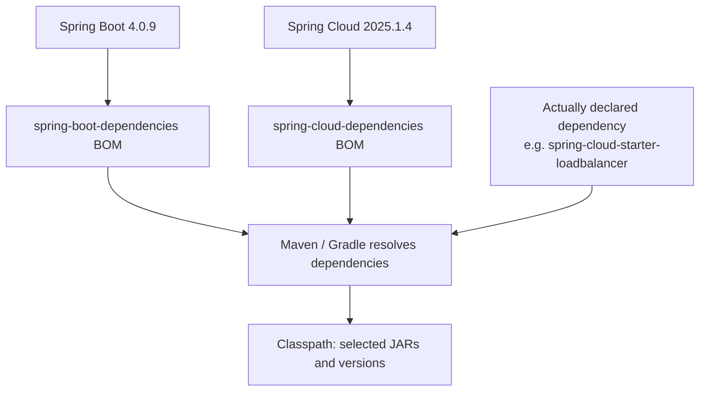
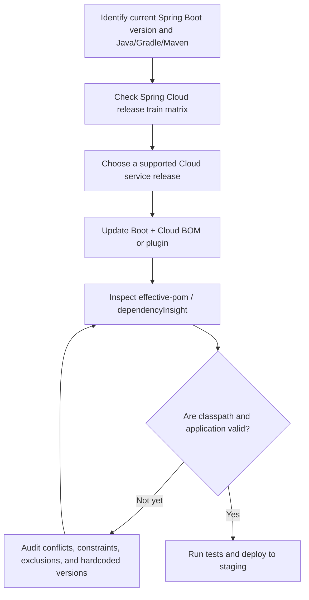

# Importing the BOM in Maven and Gradle

## 1. Objectives and Place of This Lesson

In the **SPRING_CLOUD_CORE** module, learners use Spring Cloud Commons, Context, and distributed-system abstractions such as discovery, service registry, service communication, externalized configuration, and refresh scope. These components are released under a **Spring Cloud release train**, while the application runs on **Spring Boot**. If library versions are declared piecemeal, a project easily runs into compatibility failures, runtime class/method errors, or transitive dependencies resolved to unexpected versions.

This lesson belongs to the **Versions and Dependencies** chapter and answers a specific question: **How do you import the Spring Cloud BOM into Maven or Gradle to manage dependency versions centrally and verify the resolved result?**

After this lesson, you can:

1. Explain what a **BOM** is, what problem it solves, and what it does not do automatically.
2. Distinguish the Spring Boot BOM from the Spring Cloud BOM and select a compatible release train.
3. Import the BOM in Maven using `dependencyManagement`, both with and without the Spring Boot parent.
4. Import the BOM in Gradle using **native `platform()`** or the **`io.spring.dependency-management` plugin**, in both Kotlin DSL and Groovy DSL.
5. Verify actual resolved versions, understand precedence between BOMs, and troubleshoot common dependency errors.

## 2. What Is a BOM and Why Does Spring Cloud Need One?

A **BOM (Bill of Materials)** in the Java ecosystem is a declaration set of coordinated dependency versions. In Maven, a typical BOM is a POM containing `dependencyManagement` that is imported with `<type>pom</type>` and `<scope>import</scope>`. Gradle can consume the same BOM as a *platform*.

For example: a Spring Cloud release train version manages the matching versions of `spring-cloud-commons`, `spring-cloud-context`, `spring-cloud-starter-loadbalancer`, `spring-cloud-starter-config`, and related Spring Cloud projects. Once a project selects a release train, modules managed by the BOM can be declared **without specifying individual version numbers**.



Distinguish two tasks:

| Task | Question | Illustrative syntax |
| --- | --- | --- |
| **Version management** | If the project uses library X, which version should be chosen? | Maven `dependencyManagement`; Gradle `platform(...)` or `dependencyManagement { ... }` |
| **Usage declaration** | Does the application actually need library X on the classpath? | Maven `<dependencies>`; Gradle `dependencies { implementation(...) }` |

**Importing a BOM does not automatically install every library inside the BOM.** If you import only the Spring Cloud BOM without declaring a specific Cloud starter or library, you do not automatically get service discovery, Config Client, or LoadBalancer on the classpath. Nor does a BOM replace `application.yml` configuration, application code, or setting up a registry/Config Server.

### 2.1. Two BOMs with Two Responsibilities

| BOM | Maven coordinates | Primarily manages |
| --- | --- | --- |
| **Spring Boot BOM** | `org.springframework.boot:spring-boot-dependencies` | Dependencies in the Boot ecosystem, Spring Framework, and many third-party libraries |
| **Spring Cloud BOM** | `org.springframework.cloud:spring-cloud-dependencies` | Spring Cloud project and starter versions belonging to the same release train |

BOMs manage **application dependencies**; they do not implicitly manage *build plugin* versions. For instance, `org.springframework.boot` in Gradle `plugins`, `spring-boot-maven-plugin`, and the Gradle Wrapper still require separate appropriate management.

### 2.2. Choosing a Compatible Spring Boot and Spring Cloud Pair

As of **November 18, 2026**, the official Spring Cloud page lists the stable release train **2025.1.4**, whose train documentation states **Supported Boot Version: 4.0.9**. Accordingly, this lesson uses the **Spring Boot 4.0.9 / Spring Cloud 2025.1.4** pair for consistent examples. This is an **illustrative pair cross-checked against documentation**, not a directive to pin every future project to these versions.

| Spring Boot line | Matching Spring Cloud release train per Spring table | Notes |
| --- | --- | --- |
| **4.0.x** | **2025.1.x** | Illustrative pair: Boot 4.0.9 + Cloud 2025.1.4 |
| **4.1.x** | **2025.1.x** | Supported from Cloud 2025.1.2 onward; verify specific service release |
| **3.5.x** | **2025.0.x** | Different release line; check current support status |
| **3.4.x** | **2024.0.x** | Different release line; check current support status |

Do not assume "any Boot works with the latest Cloud." When initializing a new project, you can use [Spring Initializr](https://start.spring.io/) to select Boot and Cloud starters; it generates a compatible BOM configuration. For existing projects, always check the [official release train table](https://spring.io/projects/spring-cloud/) alongside [the documentation for the selected version](https://docs.spring.io/spring-cloud-release/reference/index.html).

## 3. Maven: Importing the Spring Cloud BOM When Using the Spring Boot Parent

This is the standard route for Spring Boot applications. The `spring-boot-starter-parent` parent inherits `spring-boot-dependencies`, managing Boot dependency versions. You simply **add the Spring Cloud BOM import** inside `dependencyManagement`.

### 3.1. Complete `pom.xml` Example at the Dependency Configuration Level

```xml
<?xml version="1.0" encoding="UTF-8"?>
<project xmlns="http://maven.apache.org/POM/4.0.0"
         xmlns:xsi="http://www.w3.org/2001/XMLSchema-instance"
         xsi:schemaLocation="http://maven.apache.org/POM/4.0.0 https://maven.apache.org/xsd/maven-4.0.0.xsd">
    <modelVersion>4.0.0</modelVersion>

    <parent>
        <groupId>org.springframework.boot</groupId>
        <artifactId>spring-boot-starter-parent</artifactId>
        <version>4.0.9</version>
        <relativePath/>
    </parent>

    <groupId>com.example</groupId>
    <artifactId>spring-cloud-core-demo</artifactId>
    <version>0.0.1-SNAPSHOT</version>

    <properties>
        <java.version>17</java.version>
        <spring-cloud.version>2025.1.4</spring-cloud.version>
    </properties>

    <dependencyManagement>
        <dependencies>
            <dependency>
                <groupId>org.springframework.cloud</groupId>
                <artifactId>spring-cloud-dependencies</artifactId>
                <version>${spring-cloud.version}</version>
                <type>pom</type>
                <scope>import</scope>
            </dependency>
        </dependencies>
    </dependencyManagement>

    <dependencies>
        <dependency>
            <groupId>org.springframework.boot</groupId>
            <artifactId>spring-boot-starter</artifactId>
        </dependency>
        <dependency>
            <groupId>org.springframework.cloud</groupId>
            <artifactId>spring-cloud-starter-loadbalancer</artifactId>
        </dependency>
    </dependencies>

    <build>
        <plugins>
            <plugin>
                <groupId>org.springframework.boot</groupId>
                <artifactId>spring-boot-maven-plugin</artifactId>
            </plugin>
        </plugins>
    </build>
</project>
```

**Point-by-point explanation:**

- `<parent>` selects Spring Boot 4.0.9 and inherits dependency/plugin management, so `spring-boot-starter` does not need a manual version.
- `spring-cloud.version` holds the **release train version**, not the version of a `spring-cloud-commons` JAR.
- `<type>pom</type>` and `<scope>import</scope>` tell Maven to **import managed entries** from the Cloud BOM into the current `dependencyManagement`.
- `spring-cloud-starter-loadbalancer` inside `<dependencies>` is what actually brings functionality in; the BOM tells Maven the version of the starter and Cloud components belonging to that train.
- `spring-boot-maven-plugin` packages/runs the Boot app; the plugin version is managed by the parent, **a separate role from the Cloud BOM**.

Omitting `<version>` from a dependency works only when that dependency is managed by an active BOM/parent. For libraries outside the managed list, you still must specify a version or add appropriate management rules.

### 3.2. Separating Version Properties Enables Safe Upgrades

A change like the following bumps only the Spring Cloud release train:

```xml
<spring-cloud.version>2025.1.4</spring-cloud.version>
```

When upgrading Boot to another line, check the compatibility matrix before re-selecting `spring-cloud.version`. Updating both values together in a single change, running the build, and inspecting the dependency tree reduces the risk of accidentally mixing versions.

## 4. Maven: Importing Both Boot BOM and Cloud BOM Without Inheriting the Boot Parent

Some organizations have an internal parent POM and cannot inherit from `spring-boot-starter-parent`. In that case, you can import **both BOMs**. The snippet below goes inside the `pom.xml` of a project that has a different parent or no Boot parent:

```xml
<properties>
    <maven.compiler.release>17</maven.compiler.release>
    <spring-boot.version>4.0.9</spring-boot.version>
    <spring-cloud.version>2025.1.4</spring-cloud.version>
</properties>

<dependencyManagement>
    <dependencies>
        <dependency>
            <groupId>org.springframework.boot</groupId>
            <artifactId>spring-boot-dependencies</artifactId>
            <version>${spring-boot.version}</version>
            <type>pom</type>
            <scope>import</scope>
        </dependency>
        <dependency>
            <groupId>org.springframework.cloud</groupId>
            <artifactId>spring-cloud-dependencies</artifactId>
            <version>${spring-cloud.version}</version>
            <type>pom</type>
            <scope>import</scope>
        </dependency>
    </dependencies>
</dependencyManagement>

<dependencies>
    <dependency>
        <groupId>org.springframework.boot</groupId>
        <artifactId>spring-boot-starter</artifactId>
    </dependency>
    <dependency>
        <groupId>org.springframework.cloud</groupId>
        <artifactId>spring-cloud-starter-loadbalancer</artifactId>
    </dependency>
</dependencies>
```

**Note:** importing `spring-boot-dependencies` **is not equivalent** to inheriting `spring-boot-starter-parent`. You get dependency management, but you **do not automatically inherit** plugin management, compiler settings, resource filtering, and build defaults from the parent. If packaging the application is needed, configure `spring-boot-maven-plugin` appropriately, including its version/executions if your current parent does not manage it.

### 4.1. When Two BOMs Manage the Same Library

Under Maven rules, within the same `dependencyManagement`, **the BOM imported first takes precedence** when two imported BOMs manage the same dependency and the current POM does not declare its own managed entry. A managed entry declared directly in the current POM can override an imported entry; a managed entry in a child POM also takes precedence over the parent.

That means **import order matters in Maven**. The example above imports Boot first and Cloud second to make the two management layers explicit. If a real project hits an overlapping library between the two BOMs, inspect the **effective POM and dependency tree** rather than guessing solely from release train names.

## 5. Gradle: Approach A — Importing BOMs with Native `platform()`

Gradle directly supports Maven BOMs through its **platform** mechanism. This is a straightforward choice when you want dependency constraints without adding a Maven-style dependency management plugin.

> The following configurations use the Spring Boot Gradle Plugin and *native platforms*. Therefore, **you must explicitly import both the Boot BOM and Cloud BOM** in `dependencies`; simply applying the `org.springframework.boot` plugin does not cause Gradle to add these platform dependencies automatically.

### 5.1. Kotlin DSL — `build.gradle.kts`

```kotlin
plugins {
    java
    id("org.springframework.boot") version "4.0.9"
}

repositories {
    mavenCentral()
}

java {
    toolchain {
        languageVersion = JavaLanguageVersion.of(17)
    }
}

dependencies {
    implementation(platform("org.springframework.boot:spring-boot-dependencies:4.0.9"))
    implementation(platform("org.springframework.cloud:spring-cloud-dependencies:2025.1.4"))

    implementation("org.springframework.boot:spring-boot-starter")
    implementation("org.springframework.cloud:spring-cloud-starter-loadbalancer")

    testImplementation("org.springframework.boot:spring-boot-starter-test")
}
```

The two `implementation(platform(...))` entries create **version constraints** applied to dependencies in `implementation` and appropriate inheriting configurations. They do not download every JAR from the BOM.

### 5.2. Groovy DSL — `build.gradle`

```groovy
plugins {
    id 'java'
    id 'org.springframework.boot' version '4.0.9'
}

repositories {
    mavenCentral()
}

java {
    toolchain {
        languageVersion = JavaLanguageVersion.of(17)
    }
}

dependencies {
    implementation platform('org.springframework.boot:spring-boot-dependencies:4.0.9')
    implementation platform('org.springframework.cloud:spring-cloud-dependencies:2025.1.4')

    implementation 'org.springframework.boot:spring-boot-starter'
    implementation 'org.springframework.cloud:spring-cloud-starter-loadbalancer'

    testImplementation 'org.springframework.boot:spring-boot-starter-test'
}
```

**Important points when using native platforms:**

- `platform(...)` turns BOM versions into **constraints**. Unlike hard locks, the resolved version can still be upgraded if another dependency requests a higher version under Gradle's dependency resolution rules.
- `enforcedPlatform(...)` creates stronger constraints that can force the graph and leak to downstream consumers; avoid using it merely to "make sure the BOM wins" without understanding the impact.
- `implementation(platform(...))` must be declared in **each Gradle project/configuration where it applies**. A multi-module build does not automatically propagate a BOM from module A to module B just because they share a repository.
- `testImplementation` normally inherits constraints from `implementation` in Java projects, though custom configurations may require importing the platform separately.
- When using the Boot plugin alongside native `platform`, you **do not need** to also apply `io.spring.dependency-management`. Mixing two strategies makes tracing version sources harder to understand.

### 5.3. Multiple BOMs in Native Gradle

Gradle native `platform` **does not use Maven's "first-imported BOM wins" rule**. Versions from platforms participate in **dependency resolution**, alongside version selection rules and other version constraints. Therefore, if the Boot BOM and Cloud BOM both emit a constraint for the same coordinates, do not conclude that the later-listed BOM automatically wins. Run `dependencyInsight` to see which version was chosen and why.

## 6. Gradle: Approach B — `io.spring.dependency-management` Plugin

This plugin provides Maven-like syntax, especially useful when a project wants `dependencyManagement { imports { mavenBom(...) } }`. When **both the Spring Boot Gradle Plugin and the dependency-management plugin are applied**, the Spring Boot plugin automatically imports the **Boot BOM matching the Boot plugin version**. You only need to declare the **Cloud BOM** explicitly.

### 6.1. Groovy DSL — `build.gradle`

```groovy
plugins {
    id 'java'
    id 'org.springframework.boot' version '4.0.9'
    id 'io.spring.dependency-management' version '1.1.7'
}

repositories {
    mavenCentral()
}

ext {
    springCloudVersion = '2025.1.4'
}

dependencyManagement {
    imports {
        mavenBom "org.springframework.cloud:spring-cloud-dependencies:${springCloudVersion}"
    }
}

dependencies {
    implementation 'org.springframework.boot:spring-boot-starter'
    implementation 'org.springframework.cloud:spring-cloud-starter-loadbalancer'
    testImplementation 'org.springframework.boot:spring-boot-starter-test'
}
```

Here you **do not** need to add `implementation platform('org.springframework.boot:spring-boot-dependencies:...')` because the Boot BOM is already imported by the Spring Boot plugin via the dependency-management plugin.

### 6.2. Kotlin DSL — `build.gradle.kts`

```kotlin
plugins {
    java
    id("org.springframework.boot") version "4.0.9"
    id("io.spring.dependency-management") version "1.1.7"
}

repositories {
    mavenCentral()
}

val springCloudVersion = "2025.1.4"

dependencyManagement {
    imports {
        mavenBom("org.springframework.cloud:spring-cloud-dependencies:$springCloudVersion")
    }
}

dependencies {
    implementation("org.springframework.boot:spring-boot-starter")
    implementation("org.springframework.cloud:spring-cloud-starter-loadbalancer")
    testImplementation("org.springframework.boot:spring-boot-starter-test")
}
```

With this plugin mechanism, when **multiple BOMs are imported in the plugin DSL**, the managed entry from the **last-imported BOM** takes precedence on overlapping coordinates—**opposite to Maven's first-imported BOM wins rule**. In projects that do not apply the Spring Boot plugin, you must configure importing the Boot BOM yourself if you want Boot dependency management.

**Tooling compatibility:** Spring Boot 4.0.9 supports Gradle **8.14+ in the 8.x line and the 9.x line**. Documentation for `io.spring.dependency-management` plugin version 1.1.7 currently lists Gradle 6.8+, 7.x, and 8.x in its requirements. If your project uses Gradle 9, consider **native `platform()`** or verify that your dependency management plugin version fully supports your Gradle version before adopting it.

## 7. Comparing Maven and the Two Gradle Approaches

| Criterion | Maven | Gradle native platform | Gradle dependency-management plugin |
| --- | --- | --- | --- |
| Import syntax | `dependencyManagement` + `type=pom` + `scope=import` | `implementation(platform("group:artifact:version"))` | `dependencyManagement { imports { mavenBom(...) } }` |
| Where is the Boot BOM managed? | Inherit Boot parent or import explicitly | Imported explicitly via `platform` | Boot plugin imports Boot BOM automatically alongside dependency-management plugin |
| Where is the Cloud BOM managed? | `dependencyManagement` in POM | `platform` in the target configuration | `mavenBom` inside plugin DSL |
| Overlapping BOM version resolution | First-imported BOM takes priority within the same POM | Follows Gradle dependency/constraint resolution rules | Inside plugin DSL, last-imported BOM takes priority |
| Inspection tools | `effective-pom`, `dependency:tree` | `dependencies`, `dependencyInsight` | `dependencyManagement`, `dependencies`, `dependencyInsight` |
| When to choose? | Maven projects | Standard Gradle dependency management with fewer extra plugins | Gradle projects already using Spring's dependency-management model |

The options above are solely **dependency management choices**. They do not decide whether a service configures discovery, a registry, Config Server, or refresh scope. Those are application configuration and module integration steps.

## 8. Practicing Inspection of Resolved Versions

Reading build configuration is not enough to confirm which JAR versions **actually appear** on the classpath. Ask Maven/Gradle directly for the resolution result.

### 8.1. Maven

In the directory containing `pom.xml`, run:

```bash
mvn help:effective-pom
mvn dependency:tree
mvn dependency:tree -Dincludes=org.springframework.cloud
```

- `help:effective-pom` displays the POM configuration after parent inheritance and dependency management; use it to locate imported managed entries.
- `dependency:tree` displays actual dependencies, including transitive ones and the versions Maven selected.
- `-Dincludes=org.springframework.cloud` filters by group to inspect Cloud easily; afterward you can also inspect `org.springframework.boot`, `org.springframework`, or a specific artifact.

To inspect the effective POM via a file (only when you genuinely want file output):

```bash
mvn help:effective-pom -Doutput=effective-pom.xml
```

Do not confuse the `spring-cloud-dependencies` entry in `dependencyManagement` with a runtime JAR; the BOM is a POM used for version management.

### 8.2. Gradle

When using the wrapper, on Linux/macOS:

```bash
./gradlew dependencies --configuration runtimeClasspath
./gradlew dependencyInsight --dependency spring-cloud-commons --configuration runtimeClasspath
```

In Windows PowerShell:

```powershell
.\gradlew.bat dependencies --configuration runtimeClasspath
.\gradlew.bat dependencyInsight --dependency spring-cloud-commons --configuration runtimeClasspath
```

With the `io.spring.dependency-management` plugin, you can view the managed dependency list:

```bash
./gradlew dependencyManagement
```

- `dependencies` shows the dependency graph and selected versions.
- `dependencyInsight` explains why a specific version was picked, which is very helpful when native `platform` hits competing constraints.
- `dependencyManagement` lists managed versions controlled by **the plugin**; it is not a general command to inspect native `platform` if that plugin is not applied.

A build script that succeeds can still contain unexpected versions; pay special attention to `spring-cloud-commons`, `spring-cloud-context`, HTTP libraries, Spring Framework, and logging if the application shows signs of conflict.

### 8.3. Minimal Upgrade Workflow



## 9. Common Errors and Misconceptions

### Error 1: "I imported the BOM, why is there no `DiscoveryClient`?"

Because the BOM only manages versions. The application still needs an **appropriate starter/implementation** to realize discovery (such as Eureka or Consul) or `SimpleDiscoveryClient` via static configuration when the required components are present. Similarly, calling HTTP endpoints by service ID with client-side load balancing requires `spring-cloud-starter-loadbalancer` and appropriate client configuration.

### Error 2: "`spring-cloud-dependencies` specifies the version, why does Maven still require `<version>`?"

Check four possibilities:

1. That dependency is **not in the list** managed by the active Boot/Cloud BOM.
2. The BOM was mistakenly placed inside regular `<dependencies>` instead of `<dependencyManagement>`.
3. Missing `<type>pom</type>` or `<scope>import</scope>`.
4. The BOM was imported in another module, while the module being built does not inherit or import that dependency management.

### Error 3: "Gradle configuration is right, yet the version still got bumped"

With native `platform`, a version in the BOM is a constraint, not an absolute override. Another dependency can cause Gradle to pick a higher version. Run `dependencyInsight` to read the reason, then address the conflicting dependency or constraint; do not blindly switch everything to `enforcedPlatform`.

If using `io.spring.dependency-management`, inspect the BOM import order and overrides inside `dependencyManagement`. For Maven, inspect sibling BOM order and direct managed entries.

### Error 4: "The app reports Spring Boot incompatibility"

For example, Spring Cloud's **Compatibility Verifier** warning may state Spring Boot is incompatible with the current release train. The proper fix is selecting a **supported version pair**, verifying third-party starters, and re-running tests. A configuration option `spring.cloud.compatibility-verifier.enabled` exists to alter verifier behavior in some versions, yet disabling the check **does not make APIs compatible**.

### Error 5: "Once the BOM is imported, can we use any plugin version?"

No. BOMs primarily manage **project** dependencies, whereas Java, Maven, Gradle Wrapper, the Spring Boot build plugin, and third-party plugins have their own compatibility requirements. Specifically, Spring Boot 4.0.9 requires Java 17+ and Gradle 8.14+ (in the 8.x line) or Gradle 9.x. Do not force versions of Spring Framework, Jackson, Netty, Reactor, or other core libraries away from the Boot/Cloud-tested dependency set without concrete reasons and testing.

### Error 6: "One BOM in the Gradle root suffices for all subprojects"

Gradle multi-project builds do not automatically share every dependency declaration across subprojects. If `service-a` and `service-b` each declare their own dependencies, ensure every module receives the appropriate `platform` or plugin configuration, usually via a shared **convention plugin**. In multi-module Maven, check parent inheritance relationships and where `dependencyManagement` is declared.

## 10. Hands-on Exercise

**Context:** you are building an `order-service` in a distributed system, planning to use Spring Cloud Commons/Context with Spring Cloud LoadBalancer. The Spring Boot/Cloud pair chosen for the example is **4.0.9 / 2025.1.4**.

1. Create a Maven project using the Boot parent; import the Cloud BOM and declare `spring-cloud-starter-loadbalancer` **without specifying a version**.
2. Switch to a Gradle Kotlin DSL project with `platform()`; declare both Boot/Cloud BOMs and the same starter.
3. Repeat the exercise using `io.spring.dependency-management` (choosing a Gradle version supported by the plugin); compare where the Cloud BOM is imported.
4. Use `dependency:tree` or `dependencyInsight` to locate the version of `spring-cloud-commons`. Record the resolved version and why that version appeared.
5. Try removing the **starter dependency declaration** while keeping the BOM; observe the difference in the dependency graph.
6. Try adding a dependency with an incompatible hardcoded version on a sandbox branch, then investigate using the commands above and restore the valid configuration.

**Passing criteria:** accurately distinguish managed dependencies from declared dependencies; explain why the Cloud BOM must be paired with a compatible Boot version; identify where constraints apply; and read actual post-resolution versions.

## 11. Summary and Key Takeaways

- **Spring Boot BOM** manages the Boot dependency set; **Spring Cloud BOM** manages the release train of Cloud components.
- **Maven:** import the Spring Cloud BOM via `dependencyManagement`, `type=pom`, and `scope=import`. When using the Boot parent, re-importing the Boot BOM is usually unnecessary.
- **Gradle native:** declare `implementation(platform("org.springframework.boot:spring-boot-dependencies:..."))` and `implementation(platform("org.springframework.cloud:spring-cloud-dependencies:..."))`, then add the dependencies actually used.
- **Gradle dependency-management plugin:** use `mavenBom(...)`; the Boot BOM is imported automatically when the plugin works with the Spring Boot Gradle Plugin.
- **A BOM does not automatically add starters, configure a registry or refresh scope, or manage all build plugins.**
- **Always inspect actual versions** with `dependency:tree` or `dependencyInsight` before concluding a dependency issue is solved.

## 12. Official References

1. [Spring Cloud — release trains, compatibility matrix, and BOM examples](https://spring.io/projects/spring-cloud/).
2. [Spring Cloud Release Train Reference — versions and projects in the train](https://docs.spring.io/spring-cloud-release/reference/index.html).
3. [Spring Boot — Build Systems and dependency management](https://docs.spring.io/spring-boot/reference/using/build-systems.html).
4. [Spring Boot Gradle Plugin — Managing Dependencies](https://docs.spring.io/spring-boot/4.0/gradle-plugin/managing-dependencies.html).
5. [Spring Boot 4.0 — System Requirements](https://docs.spring.io/spring-boot/4.0/system-requirements.html).
6. [Gradle — Platforms, importing BOMs, and enforcedPlatform](https://docs.gradle.org/current/userguide/platforms.html).
7. [Spring Dependency Management Plugin — official documentation](https://docs.spring.io/dependency-management-plugin/docs/current/reference/html/).
8. [Apache Maven — Introduction to the Dependency Mechanism](https://maven.apache.org/guides/introduction/introduction-to-dependency-mechanism.html).

*Version information was cross-checked at the time of writing on November 18, 2026. Before upgrading or deploying to production, verify the current release train, support status, and tooling requirements for that exact version.*
