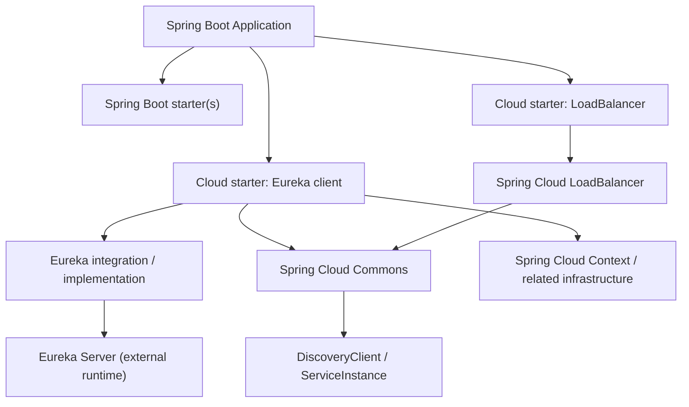
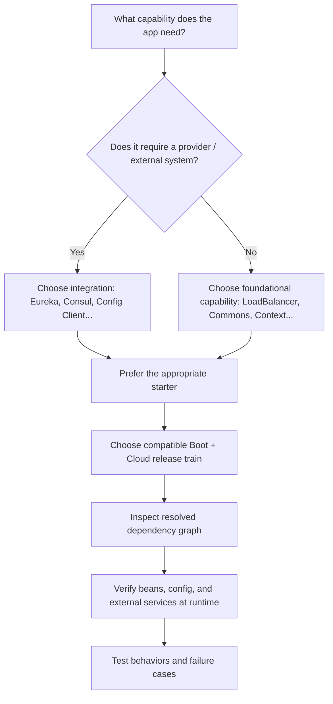

# Distinguishing Starters, Core Libraries, and Implementations

When starting with **Spring Cloud**, learners often encounter similar-looking dependency names: `spring-cloud-starter-loadbalancer`, `spring-cloud-loadbalancer`, `spring-cloud-commons`, or `spring-cloud-starter-netflix-eureka-client`. Without understanding the role of each, an application easily misses runtime components, pulls in unnecessary libraries, or triggers compatibility errors with Spring Boot.

This lesson belongs to the **Versions and Dependencies** chapter of the **SPRING_CLOUD_CORE** module. Its goal is to understand how Spring Cloud Commons, Spring Cloud Context, and integrations for discovery, service registry, load balancing, and externalized configuration collaborate through the dependency system. One capability can involve a common API layer, one or more implementations, a starter for convenient setup, and a BOM for version management.

## 1. Four Concepts to Separate Clearly

| Component | Question it answers | Primary role | Examples in the ecosystem |
| --- | --- | --- | --- |
| **Starter** | "Which dependency should I declare to start using a feature?" | Bundles commonly paired dependencies and activates the integration/auto-configuration path | `spring-cloud-starter-loadbalancer`, `spring-cloud-starter-netflix-eureka-client` |
| **Core library / abstraction** | "How does the system unify APIs and foundational behaviors?" | Supplies data types, interfaces, shared infrastructure, or foundational mechanics | `spring-cloud-commons`, `spring-cloud-context` |
| **Implementation / provider** | "Who actually executes the concrete behavior?" | Implements algorithms, talks to external systems, or supplies API implementation beans | Eureka client module, Consul discovery, `spring-cloud-loadbalancer` |
| **BOM (Bill of Materials)** | "Which dependency versions belong together?" | Manages versions for a coordinated artifact set via dependency management | `spring-cloud-dependencies` |

**Note:** these are **roles**, not four mutually exclusive artifact types. A core module may include a default implementation; a starter may pull in both an implementation and shared modules; a provider may own both a library and a starter. Classification should rest on runtime and dependency-graph effect, not artifact name prefixes alone.

For instance, `spring-cloud-starter-loadbalancer` is the convenient entry declaration; `spring-cloud-loadbalancer` contains client-side load-balancing logic; `spring-cloud-commons` holds shared abstractions for services and service discovery. All three can coexist in the same application without overlapping roles.

## 2. What Is a Starter and Why Use It?

A **starter** is an artifact designed as the **entry point to a capability**. Rather than forcing developers to memorize every needed library and assemble boilerplate wiring, a starter declares the companion dependencies a Spring Boot/Spring Cloud project needs to use a feature in common configurations.

For example, when you need the ability to select an instance by Service ID:

```xml
<dependency>
    <groupId>org.springframework.cloud</groupId>
    <artifactId>spring-cloud-starter-loadbalancer</artifactId>
</dependency>
```

This declaration adds Spring Cloud LoadBalancer components into the dependency graph at managed versions. During startup, Spring Boot/Spring Cloud can apply **auto-configuration** when conditions match: required classes are present, beans have not been replaced, configuration properties allow it, and so on.

A starter **does not automatically guarantee a feature works in every environment**. For example:

- Having LoadBalancer without any source of instance lists cannot select a valid endpoint.
- Having the Eureka client starter when the registry isn't running, is misconfigured, or is unreachable still results in failed registration/lookup.
- Having the Config Client starter without configuring a config source in the way the app expects will not automatically supply required properties.
- For HTTP clients, how the bean is declared or integrated determines whether a service name is resolved by LoadBalancer or treated as an ordinary hostname.

Starters **assemble dependencies**, while **configuration and runtime state** determine how those components actually behave.

### Spring Boot Starters and Spring Cloud Starters

Both groups commonly appear together:

```text
org.springframework.boot:spring-boot-starter-web
org.springframework.cloud:spring-cloud-starter-loadbalancer
org.springframework.cloud:spring-cloud-starter-netflix-eureka-client
```

`spring-boot-starter-web` provides the entry point for Spring Boot's servlet web stack. Starters under group `org.springframework.cloud` add distributed-system capabilities. A Spring Cloud starter does not replace the Spring Boot foundation; the application still needs appropriate Boot/framework modules.

## 3. Core Libraries: Shared APIs and Foundational Infrastructure

In Spring Cloud, "core library" is an architectural term. Two flagship artifacts are:

### 3.1. Spring Cloud Commons

`org.springframework.cloud:spring-cloud-commons` supplies shared abstractions across Spring Cloud projects. Examples:

- `DiscoveryClient`: queries services and instance lists by Service ID.
- `ServiceInstance`: represents an instance with service ID, host, port, URI, and metadata.
- `ServiceRegistry` and `Registration`: abstractions for service registration when supported by a provider.

Example code depending solely on the shared API:

```java
import java.util.List;
import org.springframework.cloud.client.ServiceInstance;
import org.springframework.cloud.client.discovery.DiscoveryClient;
import org.springframework.stereotype.Service;

@Service
public class ServiceDirectory {
    private final DiscoveryClient discoveryClient;

    public ServiceDirectory(DiscoveryClient discoveryClient) {
        this.discoveryClient = discoveryClient;
    }

    public List<ServiceInstance> getInstances(String serviceId) {
        return discoveryClient.getInstances(serviceId);
    }
}
```

`ServiceDirectory` mentions neither Eureka nor Consul. That independence matters when changing deployment environments: business logic works with `DiscoveryClient`, while how instance data is fetched is handled by a compatible implementation.

However, **an interface being on the classpath does not mean your desired provider is present**. The application needs an appropriate `DiscoveryClient` bean; selection depends on starters, auto-configuration, and the active discovery mechanism. Having only a static/local implementation does not magically turn it into a dynamic registry.

### 3.2. Spring Cloud Context

`org.springframework.cloud:spring-cloud-context` houses context-lifecycle and configuration mechanics in Spring Cloud. Two easily recognizable examples:

- `@RefreshScope`: supports recreating refresh-scoped beans to pick up updated configuration values under supported conditions.
- `EnvironmentChangeEvent`: an event tied to value changes in `Environment` and updating affected beans/configurations.

Example:

```java
import org.springframework.beans.factory.annotation.Value;
import org.springframework.cloud.context.config.annotation.RefreshScope;
import org.springframework.stereotype.Component;

@Component
@RefreshScope
public class BannerSettings {
    @Value("${app.banner:Welcome}")
    private String banner;

    public String getBanner() {
        return banner;
    }
}
```

This snippet illustrates the annotation and a refresh-scoped bean, **not the complete configuration-update workflow**. For the value to actually change, the application needs a new configuration source and an appropriate refresh trigger; exact behavior also depends on version, property types, and bean types.

`spring-cloud-context` is not a Config Server or a registry. It provides foundational mechanics; systems storing or distributing configuration live in other components, such as Spring Cloud Config Client/Server.

### 3.3. Not Every Core Library Contains Only Interfaces

A foundational library can provide utility classes, selection strategies, or default handlers alongside abstractions. For example, `spring-cloud-loadbalancer` contains client-side load-balancing execution logic as well as components that supply instance lists. Therefore, do not assume "core = API only, implementation = always in a separate artifact."

## 4. Implementations and Providers: Where Does Real Execution Happen?

An **implementation** is code that realizes a behavior. A **provider** commonly refers to the component supplying an implementation for an abstraction, especially when multiple options exist.

For service discovery:

```text
Shared interface:
  DiscoveryClient / ServiceInstance
          |
          +-- Eureka integration   --> communicates with Eureka Server
          |
          +-- Consul integration   --> communicates with Consul
          |
          +-- SimpleDiscoveryClient --> instance list declared via configuration
```

These implementations address the same need ("find instances by Service ID"), yet differ in how they fetch, refresh, and operate data. Not every system needs Eureka or Consul: an environment may rely on Kubernetes Service DNS or platform-provided discovery.

For **load balancing**, Spring Cloud LoadBalancer both executes instance selection and consumes instance lists from a suitable source. It **is not a registry storing instance information**. Wiring a selector without an endpoint list is a common configuration/architectural mistake.

For **externalized configuration**, Spring Cloud Context supplies the refresh infrastructure; Spring Cloud Config Client talks to the configuration system; Config Server serves the configuration data. An application using `@RefreshScope` is not automatically connected to Config Server.

### Real Dependency Chain Example



The diagram shows **conceptual roles and general dependency relationships**, without claiming every edge is a direct dependency in all versions. Exact dependency graphs must be inspected with your build tool. Eureka Server in the diagram is an external runtime service, not an artifact started automatically by the client starter.

## 5. Examples of Choosing Dependencies by Need

| Need | Common entry dependency | What else must be prepared |
| --- | --- | --- |
| Build a servlet REST app | `spring-boot-starter-web` | Controllers, configuration, and appropriate HTTP server |
| Call by Service ID with client-side instance selection | `spring-cloud-starter-loadbalancer` | Instance list and LoadBalancer-integrated HTTP client |
| Discover/register instances with Eureka | `spring-cloud-starter-netflix-eureka-client` | Eureka Server, connection config, and Service ID |
| Discover/register instances with Consul | `spring-cloud-starter-consul-discovery` | Consul agent/server and discovery configuration |
| Fetch config from Spring Cloud Config Server | `spring-cloud-starter-config` | Config Server, config source, and appropriate import/connection setup |
| Declare HTTP clients with Feign interfaces | `spring-cloud-starter-openfeign` | `@EnableFeignClients`, client interfaces, URL or Service ID, plus discovery/load-balancing if calling by logical name |
| Use `DiscoveryClient` / `ServiceInstance` APIs | `spring-cloud-commons` (often pulled transitively) | Implementation bean and instance data source |
| Use `@RefreshScope` | `spring-cloud-context` (often pulled transitively) | Changing config source and refresh trigger |

Not all rows above are "pick one of the options." An application calling instances via Eureka usually needs both a **discovery source** and a **request-distribution mechanism**. Conversely, an application calling a Kubernetes Service via stable DNS may not need client-side discovery or Spring Cloud LoadBalancer.

One important point: merely adding `spring-cloud-starter-netflix-eureka-client` does not spawn a Eureka Server. The client starter runs **inside the client application**; the registry server requires a separate process and configuration.

## 6. BOMs Manage Versions; Starters Supply Dependencies

In the Spring ecosystem, dependencies are typically managed across two layers:

1. **Spring Boot** manages many versions for the Spring Boot platform and foundational libraries.
2. The **Spring Cloud release train** groups Spring Cloud module versions released to work together and provides the `spring-cloud-dependencies` BOM.

With Maven, you commonly import the Spring Cloud BOM inside `dependencyManagement`, while Spring Boot dependency versions are managed by the Spring Boot parent or equivalent BOM mechanism.

Compact example of a `pom.xml` **that already configures a compatible Spring Boot parent**:

```xml
<properties>
    <!-- Replace with the release train confirmed by official docs
         as compatible with your project's Spring Boot version -->
    <spring-cloud.version>CLOUD_RELEASE_TRAIN</spring-cloud.version>
</properties>

<dependencyManagement>
    <dependencies>
        <dependency>
            <groupId>org.springframework.cloud</groupId>
            <artifactId>spring-cloud-dependencies</artifactId>
            <version>${spring-cloud.version}</version>
            <type>pom</type>
            <scope>import</scope>
        </dependency>
    </dependencies>
</dependencyManagement>

<dependencies>
    <dependency>
        <groupId>org.springframework.boot</groupId>
        <artifactId>spring-boot-starter-web</artifactId>
    </dependency>
    <dependency>
        <groupId>org.springframework.cloud</groupId>
        <artifactId>spring-cloud-starter-loadbalancer</artifactId>
    </dependency>
    <dependency>
        <groupId>org.springframework.cloud</groupId>
        <artifactId>spring-cloud-starter-netflix-eureka-client</artifactId>
    </dependency>
</dependencies>
```

`CLOUD_RELEASE_TRAIN` is a **placeholder**, not a literal version to build with. A real project must pick a release train from the **official Boot–Cloud compatibility matrix for its target version** and configure the Spring Boot parent/BOM. Never assume Boot and Cloud share the same version number or that the highest version of each group will be compatible.

**A BOM does not inject any runtime feature into the application**: it only governs the versions of dependencies actually declared or pulled transitively from other dependencies. Likewise, a starter can pull libraries without managing release train versions itself; the two mechanisms complement one another.

### With Gradle

A Gradle project that already has Spring Boot version management can apply the Spring Cloud BOM via the appropriate dependency management mechanism. Example using Gradle platforms:

```groovy
dependencies {
    implementation platform(
        "org.springframework.cloud:spring-cloud-dependencies:CLOUD_RELEASE_TRAIN"
    )

    implementation "org.springframework.boot:spring-boot-starter-web"
    implementation "org.springframework.cloud:spring-cloud-starter-loadbalancer"
    implementation "org.springframework.cloud:spring-cloud-starter-netflix-eureka-client"
}
```

This is likewise an illustrative snippet; replace the placeholder with a compatible release train, and ensure Spring Boot dependency management / Gradle plugin is configured in the project.

### How Is a Version Selected?

```text
Declare starter in application
         |
         v
Maven/Gradle reads dependency + BOM/constraints
         |
         v
Resolve starter and transitive versions
         |
         v
Assemble runtime classpath with core modules and implementations
         |
         v
Spring Boot auto-configuration registers beans if conditions match
```

If the BOM is wrong, the application can fail at build or startup. If a required artifact is missing from the graph, auto-configuration cannot provide the corresponding behavior. If beans fail to activate or the registry is unreachable, even with complete dependencies, the feature still will not work as expected.

## 7. How to Read the Dependency Graph Instead of Guessing from Names

Suppose `order-service` depends on the Eureka Client and LoadBalancer starters. To know which libraries actually appear, inspect the resolved dependency graph.

Maven:

```bash
./mvnw dependency:tree
```

You can filter by a relevant group:

```bash
./mvnw dependency:tree -Dincludes=org.springframework.cloud
```

Gradle:

```bash
./gradlew dependencies --configuration runtimeClasspath
```

To see why Gradle chose a version:

```bash
./gradlew dependencyInsight --dependency spring-cloud-commons --configuration runtimeClasspath
```

The commands above are **self-check instructions for a sample project**, not mandatory steps to read this lesson. Actual output depends on your POM/build script, versions, and other starters declared by the application.

When reading the dependency tree, ask step by step:

- Which **direct dependencies** does the application declare? Are they starters, core modules, or providers?
- Which **transitive dependencies** are pulled in? If Commons/Context modules already appear via a starter, do you also need direct declarations?
- **Which version wins in the end?** Was any version overridden elsewhere?
- **Does the classpath include a suitable implementation?** Did two discovery providers accidentally appear together?
- **Are runtime beans actually created?** Distinguish a library appearing on the classpath from an active bean.

If source code directly imports classes from Commons, declaring the API-owning library directly can make the compile contract explicit. Even so, when configuring by capability, starters usually remain the clean way to pull in runtime pieces. Avoid adding every core library just because an example imports an interface.

## 8. Confusing Combinations and How to Interpret Them Correctly

### Scenario A: `spring-cloud-commons` Is Present, Yet No Instances Are Found

Commons supplies `DiscoveryClient` and related types. It does not automatically guarantee the application is configured to talk to a real registry. Check where the `DiscoveryClient` bean originates, which provider is active, whether the Service ID is right, and whether the instance source has entries.

### Scenario B: LoadBalancer Is Present, Yet New Instances Are Not Discovered Automatically

LoadBalancer picks endpoints from whatever list source it receives. If using `SimpleDiscoveryClient` with manually configured URIs, that list is static for demo/test environments. When dynamic instances are spawned, you need an appropriate discovery provider or routing infrastructure capable of updating endpoints dynamically.

### Scenario C: Eureka Client Is Present, Yet Calls by Name Still Fail

Eureka can supply instance details, yet an HTTP client calling `http://inventory-service` as a Service ID also needs integration with an appropriate instance selection/resolution mechanism. With a plain unintegrated HTTP client, that name may go straight to DNS resolution and fail with `UnknownHostException`.

### Scenario D: `@RefreshScope` Is Present, Yet Config Values Never Change

`@RefreshScope` describes how a bean is recreated when refresh scope is triggered. It does not automatically fetch configuration from external systems or decide when to refresh. Check where configuration lives, the Environment refresh flow, and how refresh is triggered in your active version/infrastructure.

### Scenario E: Manually Pinning Versions on Individual Spring Cloud Artifacts

Hardcoding versions for certain starters/modules while importing a BOM from another release train risks pulling mismatched APIs or implementations. Errors like `NoSuchMethodError` or `ClassNotFoundException` can indicate classpath conflicts (among other causes). Inspect the resolved dependency graph and pick a matching Boot–Cloud matrix pair before tweaking individual modules.

## 9. Decision Workflow When Adding a Spring Cloud Dependency



Applying this to `order-service` calling `inventory-service`:

1. Identify the instance resolution mechanism: Eureka/Consul, local `SimpleDiscoveryClient`, or Kubernetes Service/DNS.
2. Pick the matching starter for client-side discovery; add LoadBalancer if client-side instance selection is needed.
3. Use a Spring Cloud BOM compatible with the application's Spring Boot version.
4. Inspect the dependency graph to see API modules, implementations, and transitive dependencies present.
5. Configure the HTTP client via the proper mechanism, test with multiple instances, and test instance disconnects.
6. Observe logs, health/readiness, network errors, and registry state to verify actual behavior.

Separating these steps clearly distinguishes **wrong dependency**, **wrong version**, **missing provider**, **missing config**, and **operational incident**. Each requires a different fix.

## 10. Self-Check Questions

**Question 1.** An application declares `spring-cloud-starter-loadbalancer` without Eureka or Consul. Is the dependency wrong?

Not necessarily. LoadBalancer can receive instance lists from `SimpleDiscoveryClient` or another provider. Identify the actual instance source; the LoadBalancer starter does not require Eureka.

**Question 2.** To use `DiscoveryClient`, must you add `spring-cloud-commons` directly to the POM?

Not strictly required if Commons is already pulled via a starter onto the compile classpath. However, declaring the direct dependency for APIs used in source code makes the compilation contract clearer. The core point is distinguishing **API availability** from **provider availability**.

**Question 3.** Does adding the `spring-cloud-dependencies` BOM make Eureka client run automatically?

No. The BOM only manages versions; you still must declare the runtime starter/modules, configure connection settings, and have an actual registry running if using Eureka.

**Question 4.** Is Spring Cloud Context a Config Server?

No. Context provides infrastructure mechanics such as refresh scope. Config Server is a dedicated configuration-serving component; Config Client is the application component that fetches configuration from it.

**Question 5.** Why shouldn't you arbitrarily pair the latest Spring Boot with an older Spring Cloud version?

Spring Cloud is released via release trains supporting defined Spring Boot version ranges. Combinations outside the support matrix can be incompatible at the API, auto-configuration, or base library level. Always choose according to official compatibility docs.

## Takeaways

When reading Spring Cloud dependencies, separate **starters that bring features into an application**, **Commons/Context and foundational libraries that supply abstractions/shared mechanics**, **implementations/providers that execute concrete behavior**, and **BOMs that manage compatible versions**. These layers typically appear together, yet answer different questions. Understanding their differences helps you choose the right dependencies, diagnose errors accurately, and operate Spring Cloud applications reliably on Spring Boot.
