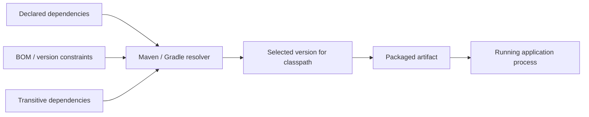

# Verifying Actual Resolved Versions with the Dependency Tree

In a **Spring Cloud Core** project, declaring Spring Boot and Spring Cloud versions in `pom.xml` or `build.gradle` only expresses **dependency management intent**. What the application actually runs on are the libraries **resolved by Maven or Gradle (dependency resolution)**, placed onto the classpath, and packaged for execution. Those two results can differ from what a developer expects—especially when transitive dependencies, BOMs, plugins, and submodules are involved.

The **dependency tree** is the primary tool to answer concrete questions:

- Which versions of `spring-cloud-commons`, `spring-cloud-context`, Spring Framework, and related starters did the application end up selecting?
- Which direct or transitive dependency pulled that library in?
- Why was one version selected over another?
- Are there version discrepancies across modules, test classpaths, and runtime classpaths?
- Does the selected version fall within a supported **Spring Boot – Spring Cloud release train** combination?

This lesson belongs to the **Versions and Dependencies** chapter of the `SPRING_CLOUD_CORE` module. Its goal is knowing how to **verify dependency resolution results**, then cross-check them against version management mechanisms and runtime environments. From there, learners gain a solid basis for diagnosing compatibility errors before diving deeper into Spring Cloud Commons, Context, externalized configuration, `@RefreshScope`, discovery, service registry, and inter-service communication.

## 1. Distinctions to Make Before Reading a Dependency Tree

| Concept | Meaning | Appropriate source to inspect |
| --- | --- | --- |
| **Declared version** | Version written directly or via a variable/property in build config | `pom.xml`, `build.gradle(.kts)`, parent/module configuration |
| **Managed version** | Version prescribed by a BOM, `dependencyManagement`, platform, or constraint | Maven effective POM; Gradle dependency constraints and insight |
| **Selected / resolved version** | Artifact/version the build tool actually picks for a dependency configuration | Maven `dependency:tree`; Gradle `dependencies` and `dependencyInsight` |
| **Compile / test / runtime classpath** | Set of libraries used at each phase; these can differ | `compileClasspath`, `runtimeClasspath`, `testRuntimeClasspath`; Maven scopes and packaged output |
| **Packaged version** | Library JAR bundled inside the distributable application, if packaged as an executable JAR/WAR | Listing contents of the built artifact |
| **Runtime loaded version** | Class/library actually loaded by the process's classloader | Inspecting the deployed artifact, startup/classpath, and runtime conditions |

For instance, a service declares `spring-cloud-starter-loadbalancer` **without specifying a version**. Omitting the version is completely valid when the Spring Cloud BOM is properly imported. In this case, the runtime version comes from resolution rather than being readable by looking at the starter declaration alone.



The diagram shows the typical path. The **dependency tree** proves resolution results for a project/configuration; confirming the production process uses those exact versions also requires checking the packaged artifact and deployment.

## 2. Why Are Spring Cloud Versions Easily Misunderstood?

### 2.1. A Spring Cloud Release Train Is Not a Shared Version for Every JAR

Spring Cloud releases by **release train**. A BOM like `org.springframework.cloud:spring-cloud-dependencies` manages a set of versions for related Spring Cloud projects. The **release train** version number of the BOM does not have to match the version numbers of `spring-cloud-commons`, `spring-cloud-context`, `spring-cloud-loadbalancer`, or starters.

Example phrasing **not tied to a specific release**:

```text
Spring Boot version:         <boot-version>
Spring Cloud release train:  <cloud-train-version>
spring-cloud-commons:        <resolved-commons-version>
spring-cloud-context:        <resolved-context-version>
spring-cloud-loadbalancer:   <resolved-loadbalancer-version>
```

Never conclude a library has the wrong version simply because the three version strings above differ. Cross-check **each actual artifact/version** against the BOM and the official compatibility table of the **Spring Boot – Spring Cloud line** your project uses.

### 2.2. A BOM Manages Versions; It Does Not Automatically Add Every Library

In Maven, a common configuration snippet is:

```xml
<!-- pom.xml excerpt; spring-cloud.version is declared in properties/parent. -->
<dependencyManagement>
    <dependencies>
        <dependency>
            <groupId>org.springframework.cloud</groupId>
            <artifactId>spring-cloud-dependencies</artifactId>
            <version>${spring-cloud.version}</version>
            <type>pom</type>
            <scope>import</scope>
        </dependency>
    </dependencies>
</dependencyManagement>

<dependencies>
    <dependency>
        <groupId>org.springframework.cloud</groupId>
        <artifactId>spring-cloud-starter-loadbalancer</artifactId>
    </dependency>
</dependencies>
```

`spring-cloud-dependencies` inside `dependencyManagement` supplies **version-selection rules**; it does not mean the project directly depends on every Spring Cloud module. Which artifacts actually appear still depends on declared dependencies, transitive paths, and scope configuration.

Similarly, in Gradle a BOM can be imported using a platform. Example Groovy DSL, assuming `springCloudVersion` is declared in `gradle.properties` or an equivalent mechanism:

```groovy
def springCloudVersion = providers.gradleProperty("springCloudVersion").get()

dependencies {
    implementation platform("org.springframework.cloud:spring-cloud-dependencies:${springCloudVersion}")
    implementation "org.springframework.cloud:spring-cloud-starter-loadbalancer"
}
```

This snippet illustrates a **native Gradle platform**. Projects using the `io.spring.dependency-management` plugin may import the BOM with different syntax; inspect the project's actual mechanism. The Spring Boot BOM and Spring Cloud BOM manage related dependency sets with distinct roles; a project needs consistency in how it manages **both**, avoiding unnecessary manual overrides.

### 2.3. Sources That Can Influence the Selected Version

A version appearing at runtime can be influenced by:

1. A version written directly on an application module's dependency.
2. Parent POM, `dependencyManagement`, or imported BOMs in Maven.
3. Gradle platforms, constraints, version catalogs, dependency management plugins, lockfiles, and resolution rules.
4. Transitive dependencies from starters or integration libraries.
5. Each build tool's version conflict-resolution rules.
6. The module being built, active profiles, queried scope/configuration, and packaged artifact.

Therefore, seeing `spring-cloud.version` in a properties file **is not enough** to confirm every module uses the libraries prescribed by that BOM.

## 3. Inspection Workflow with Maven

The examples below assume a Maven project. Commands are instructional: run them inside the **directory containing the target module's POM**, or specify the exact module in a multi-module project. You do not need production access to inspect build resolution on a developer machine, though project artifacts must be resolvable from the local or configured repositories.

### Step 1 — View the Full Dependency Tree

```bash
mvn dependency:tree
```

This command prints the transitive structure and typically displays coordinates in the format:

```text
groupId:artifactId:type:version:scope
```

Example output **illustrating the format, not a verified BOM of a specific release**:

```text
[INFO] com.example:catalog-service:jar:1.0.0
[INFO] +- org.springframework.cloud:spring-cloud-context:jar:<resolved-version-A>:compile
[INFO] \- org.springframework.cloud:spring-cloud-commons:jar:<resolved-version-B>:compile
```

What to read: `groupId`, `artifactId`, **selected version**, **scope**, and indentation levels showing which library pulled in which. The tree may display only the surviving path after Maven resolves conflicts; never assume no library requested another version simply because that version does not appear.

### Step 2 — Filter Spring Cloud Libraries to Observe

```bash
mvn dependency:tree '-Dincludes=org.springframework.cloud:*'
```

Single quotes preserve the `*` character across common shells such as Bash and PowerShell; on Windows Command Prompt, double quotes can be used per shell syntax. This query helps focus on the `org.springframework.cloud` group. When you need to know **what pulled an artifact in**, remove the filter to see the full path if filtered output looks abbreviated or unclear.

Example querying one specific artifact:

```bash
mvn dependency:tree '-Dincludes=org.springframework.cloud:spring-cloud-commons'
```

Do not filter only the Spring Cloud group if the failure originates from `org.springframework:spring-core`, `org.springframework.boot:spring-boot`, logging, or third-party libraries. The full dependency tree remains the primary reference.

### Step 3 — Inspect Scopes and Conflict Omissions

```bash
mvn dependency:tree -Dverbose
mvn dependency:tree -Dscope=runtime
```

Depending on the `maven-dependency-plugin` version, `-Dverbose` can include information about nodes omitted due to duplicates or conflicts. Detail level and output formatting vary by plugin version; do not rely on a single brittle text pattern to parse every project automatically.

Maven applies version-management and dependency-selection rules, where **dependency mediation** uses the *nearest definition* concept and declaration order for equal depths. Dependency management (`dependencyManagement`) can govern the selected version; directly specified dependency versions must also be checked. When conflicts occur, examine both the *source requesting a version* and the *rule causing the final version to win*.

### Step 4 — Cross-Check Against the Effective POM

```bash
mvn help:effective-pom
```

The **Effective POM** is the Maven configuration after merging parents, profiles, properties, and dependency management applicable to the module. Compare it with `dependency:tree` to answer two distinct questions:

| Question to verify | Tool |
| --- | --- |
| Which train version of `spring-cloud-dependencies` was imported? | Effective POM and parent/module configuration |
| Which version of `spring-cloud-commons` did a specific module resolve? | `dependency:tree` |
| Did a version come from `dependencyManagement` or direct declaration? | Cross-check effective POM, original POM, and dependency tree |
| Is the dependency in compile, runtime, or test? | Analyze scope in the tree and packaged artifact |

**Note:** If a dependency is unused, a version entry in `dependencyManagement` **does not prove the JAR is on the classpath**. Conversely, if a dependency appears in the tree, verify the corresponding classpath before blaming a runtime failure on it.

### Step 5 — Select the Right Module in a Multi-Module Maven Project

```bash
# Example if the application module's artifactId is catalog-service.
mvn -pl :catalog-service dependency:tree

# When related reactor modules must also be built:
mvn -pl :catalog-service -am dependency:tree
```

`:catalog-service` is only an illustrative name; replace it with the actual `artifactId`. `-am` expands the reactor to dependent modules, so output can contain trees for **multiple modules**. Read the tree of the module that actually packages and runs the application; do not inspect a shared library module's tree and treat it as the entire service's runtime classpath.

## 4. Inspection Workflow with Gradle

Gradle manages dependencies by **configuration**. The same artifact can be requested in `compileClasspath`, `runtimeClasspath`, or `testRuntimeClasspath` with different outcomes. Therefore, querying **the right configuration** is critical.

### Step 1 — View the Runtime Classpath Tree

On Linux/macOS:

```bash
./gradlew dependencies --configuration runtimeClasspath
```

On Windows PowerShell/CMD:

```powershell
.\gradlew.bat dependencies --configuration runtimeClasspath
```

For multi-module projects, invoke the task with the application module's full path:

```bash
./gradlew :catalog-service:dependencies --configuration runtimeClasspath
```

In Gradle's report, the notation `requested-version -> selected-version` indicates Gradle chose a different version than requested along that dependency path. A `(*)` marker typically means the subtree was already printed elsewhere; constraints or platforms may carry specific markers. Check the legend at the bottom of the report for your Gradle version.

Example **with hypothetical numbers solely to explain notation, not as recommended version pairs**:

```text
+--- com.example:some-library:1.0
|    \--- org.springframework.cloud:spring-cloud-commons:4.2.0 -> 4.2.1
\--- org.springframework.cloud:spring-cloud-commons:4.2.1
```

Here `4.2.0` is the version **requested** along one path, whereas `4.2.1` is the version **selected** for the inspected configuration. That alone does not prove `4.2.1` is compatible with the project's Boot version; verifying compatibility is a separate step.

### Step 2 — Use `dependencyInsight` to Trace an Artifact

```bash
./gradlew dependencyInsight --dependency spring-cloud-commons --configuration runtimeClasspath
```

For a specific submodule:

```bash
./gradlew :catalog-service:dependencyInsight --dependency spring-cloud-context --configuration runtimeClasspath
```

`dependencyInsight` reveals **why a version was selected**, the versions requested across each branch, and relevant constraints. Depending on the resolution mechanism, the report may cite conflict resolution, constraints, forced versions, or selection rules. Read the actual report conditions rather than assuming "Gradle always picks the newest": `strictly` constraints, version locking, force flags, and `enforcedPlatform` can alter the outcome.

### Step 3 — Compare Classpaths That May Differ

```bash
./gradlew dependencies --configuration compileClasspath
./gradlew dependencies --configuration runtimeClasspath
./gradlew dependencies --configuration testRuntimeClasspath
```

These configurations are typical for Java/JVM plugins; names may vary if the project uses other plugins or source sets. When failures appear only in tests, `testRuntimeClasspath` may carry extra dependencies. When failures occur only at runtime, focus on `runtimeClasspath` and the deployed artifact rather than compile output alone.

### Step 4 — Inspect the Active Gradle Version Management Mechanism

Gradle can receive versions from `platform(...)`, `enforcedPlatform(...)`, version catalogs, `constraints`, dependency management plugins, `resolutionStrategy`, or lockfiles. Do not assume a BOM was ignored just because the tree shows a selected version differing from a transitive request; run `dependencyInsight` and examine the rules applied to that configuration.

Specifically, the **Spring Boot plugin** and **dependency management BOM** serve two different roles. Enabling the Spring Boot packaging/running plugin does not automatically prove all Spring Cloud libraries are managed by a compatible release train. Verify explicitly how the Spring Boot BOM, Spring Cloud BOM, and any overrides are configured in the project.

## 5. Maven vs. Gradle: Which Tool Answers Which Question?

| Question | Maven | Gradle |
| --- | --- | --- |
| All selected dependencies of a module? | `mvn dependency:tree` | `./gradlew dependencies --configuration runtimeClasspath` |
| Only Spring Cloud libraries? | `-Dincludes=org.springframework.cloud:*` | Tree + `dependencyInsight` for relevant artifacts |
| Why was a version selected? | Tree (optionally `-Dverbose`) + effective POM | `dependencyInsight` + constraints/platform |
| Where do managed versions come from? | Parent, imported BOM, effective POM | Platform/BOM/plugin, constraints, version catalog, lockfile |
| Inspect a specific module? | `-pl :artifactId` | `:module:dependencies` or `:module:dependencyInsight` |
| Is the runtime classpath right? | Check scope and packaged archive | `runtimeClasspath` and `bootJar`/`bootWar` archive |

These commands give the **build tool's perspective**. No single command in the table can prove the state of a production container if that container was built from an older revision or modified externally.

## 6. Inspecting the Packaged Artifact and Actual Runtime

Suppose the tree on a developer machine looks right, yet the service still throws `NoSuchMethodError` in the deployment environment. The process might be running a different artifact, a dependency might be packaged differently, or the classloader might load classes from an unexpected source. Therefore, post-build verification is necessary.

With a standard-layout **Spring Boot executable JAR**, libraries normally live under `BOOT-INF/lib/`. In PowerShell, assuming the output filename is known:

```powershell
jar tf .\target\catalog-service.jar | Select-String 'BOOT-INF/lib/(spring-cloud|spring-boot|spring-core)'
```

In a Gradle build, the artifact may live in `build/libs/` instead of `target/`; substitute the right path and filename. Here `jar tf` **lists files inside the JAR** without launching the application. For WARs, thin JARs, custom packaging, container images, or deployments using an external classpath, library locations may differ; inspect according to your packaging format.

An evidence-backed verification checklist:

1. Record the **commit/tag**, build module, profile, and build flags.
2. Save the Boot version and Cloud release train configured in that exact build.
3. Capture the **resolved dependency tree** of the target classpath.
4. Confirm the JAR names/versions actually packaged inside the delivered artifact.
5. Cross-check the checksum or identifier of the deployed artifact/container image.
6. If still uncertain, inspect classpath/classloader details, startup logs, and libraries loaded by the live process.

In multi-instance deployments, individual instances may run **different images/tags** during a rolling rollout. A dependency tree at a single commit does not prove every live instance is currently loading that exact JAR set. Build version metadata, image digests, and rollout status are invaluable when analyzing differing behavior across nodes.

### Do Not Equate Test Versions with Runtime Versions

A test can pass thanks to a library present only in `testImplementation`, `testRuntimeOnly`, or `test` scope. If that library is absent from the application's runtime, startup fails. Conversely, a library excluded from the test tree may appear via another configuration during packaging. Reproduce the error on the corresponding classpath instead of looking only at the `test` tree.

## 7. Analyzing Real-World Conflict Scenarios

### Scenario A — Starters Have No Explicit Versions, Yet the Combination Fails

A Spring Cloud service declares starters without versions. The dependency tree shows Spring Cloud JARs resolving cleanly, yet startup reports an incompatible Spring Boot/Spring Cloud combination.

**Investigation:** verify the Boot version, Cloud release train, how BOMs are imported, and any overrides in the application module. Then check that combination against the **official Spring Cloud compatibility table** for that release train. Resolving dependencies cleanly **does not equal** runtime compatibility. If Spring Cloud's compatibility verifier reports an error, pick a compatible version pair rather than disabling the verifier to mask the cause.

### Scenario B — A Transitive Library Requests a Different Version

The project includes a third-party integration library requesting `spring-cloud-commons` at version X, while the BOM or constraints select version Y.

**Investigation:** use the Maven tree or Gradle `dependencyInsight` to trace the path requesting X and the reason Y was selected. Check the integration library's official support for your Boot/Cloud combination, avoiding blindly forcing the highest version without compatibility evidence. Prefer upgrading to a compatible integration library or removing unnecessary overrides; any forced version requires documented justification and regression tests.

### Scenario C — Only One Submodule Drifts

A monorepo contains `api`, `service`, and `shared` modules. `shared` builds with a different BOM, while `service` is the runnable module.

**Investigation:** generate the dependency tree of `service`, trace edges involving `shared`, and compare effective POMs or platforms/constraints across modules. Inspecting only `shared`'s tree can miss the version chosen **when `service` consumes** that module. The packaged archive of `service` provides the next piece of evidence.

### Scenario D — Failure Occurs Only When `@RefreshScope` Runs

The build succeeds, yet the application throws `NoSuchMethodError`, `ClassNotFoundException`, or bean initialization errors when refresh is triggered.

**Investigation:** check versions of `spring-cloud-context`, `spring-cloud-commons`, Spring Boot, Spring Framework, and related libraries; verify the running artifact matches the inspected classpath. The stack trace identifies which class/method failed; the dependency tree shows which JARs were selected. **Never conclude the root cause solely from an exception name**: configuration bugs, improper API usage, or other runtime faults are also possible.

### Scenario E — Two Instances Handle Discovery/Load Balancing Differently

During a rolling deployment, instance A works while instance B throws errors related to service discovery or load balancing. Comparing source code alone may be insufficient.

**Investigation:** record image digests and build versions of A and B; compare packaged `spring-cloud-commons`, `spring-cloud-context`, discovery/load-balancer modules, and Boot versions. Also check externalized configuration and startup environment. If two nodes run different versions during rollout, verify behavioral compatibility between coexisting versions.

### Scenario F — CI and Local Machine Produce Different Results

A build using dynamic versions/ranges, snapshots, differing repositories, or stale metadata caches can select different dependencies. Maven and Gradle also have their own cache and resolution behaviors.

**Investigation:** compare revisions, build flags, JDK, Gradle/Maven and plugin versions, repositories, lockfile status, and trees across **both environments**. Prefer fixed versions, proper dependency locking, and traceable artifacts. Refreshing the dependency cache helps diagnose stale metadata, yet **does not replace** pinning and verifying exact versions.

## 8. Reading a Dependency Tree Without Misdiagnosing

Execute these checks in order on the **right module** and **right classpath**:

1. **Write down the exact question.** For example: "What version of `spring-cloud-context` is in `catalog-service`'s runtime?"
2. **Identify the right output.** Maven: dependency tree with the matching scope; Gradle: `runtimeClasspath`.
3. **Locate the exact artifact.** Distinguish `spring-cloud-commons`, `spring-cloud-context`, starters, implementation modules, and sibling libraries with different group/artifact IDs.
4. **Read the selected version**, not just a version requested along one transitive edge.
5. **Trace the selection source.** In Maven, compare parent/BOM/effective POM; in Gradle, use `dependencyInsight` and constraints/platforms.
6. **Cross-check against the supported Boot/Cloud pair.** BOM train numbers do not have to match individual module numbers.
7. **Inspect the runnable archive** if the failure happens post-deploy or differs across instances.
8. **Record findings with evidence.** Include enough detail for a teammate to reproduce the exact same check.

### Result Recording Template

```text
Project/module:             <running-module>
Revision:                   <commit-or-tag>
Build tool/version:         <maven-or-gradle-version>
JDK:                        <jdk-version>
Build profile/parameters:   <profile-and-flags>
Spring Boot (managed):      <boot-version>
Spring Cloud release train: <cloud-train-version>
Examined configuration:     <runtime-classpath-or-scope>

Selected artifacts:
  spring-cloud-commons:     <resolved-version>
  spring-cloud-context:     <resolved-version>
  spring-cloud-loadbalancer:<resolved-version-or-not-present>

Resolution evidence:        <tree-or-insight-command-and-output>
Packaging evidence:         <artifact-name-and-contents>
Deployed artifact/image:    <build-id-or-digest>
Compatibility source:       <official-release-train-compatibility-entry>
Conclusion/action:          <verified-finding-and-next-step>
```

When writing a bug report, prefer statements like **"In `runtimeClasspath` of module X at commit Y, Gradle selects `spring-cloud-context` version Z under constraint W."** That statement is verifiable. Saying **"We declared the BOM so everything must be right"** ignores resolution outcomes and fails to reproduce the issue.

## 9. Connecting to Spring Cloud Core Abstractions

Inspecting the dependency tree carries different implications depending on which system capabilities are used:

| Feature | Artifacts / groups to watch | Why verification matters |
| --- | --- | --- |
| Shared abstractions | `spring-cloud-commons` | Covers shared abstractions such as discovery, service instances, and supporting components |
| Context/refresh | `spring-cloud-context` | Covers context and refresh scope mechanics; bugs may surface only when refresh runs |
| Client-side load balancing | `spring-cloud-loadbalancer` and related starters | Depends on declared/pulled modules; not present merely because the Spring Cloud BOM is imported |
| Discovery and service registry | Provider-specific integration modules plus shared abstractions | Actual behavior depends on the chosen implementation, not just Commons APIs |
| Externalized config sources | Spring Cloud config modules in use | Requires the right dependencies for config features to activate, plus a compatible Boot pairing |
| Service communication | HTTP clients, declarative clients, or chosen libraries | Starters, integrations, and transitive dependencies can introduce extra version constraints |
| Testing and operations | Spring Boot test/actuator and configured observability libraries | Test classpath and runtime classpath may contain different artifacts |

The table above is a **query guide**, not a mandatory dependency list for every application. A project only needs integrations matching features it actually uses. With `DiscoveryClient`, for example, a module with the shared abstraction still needs a compatible **implementation** to talk to the intended discovery system.

## 10. Evidence-Based Practice

Pick a Spring Boot service with Spring Cloud integration and complete these exercises. Do not change versions immediately; first record the project's true state.

**Exercise 1 — Record Resolved Versions**

1. Identify whether the project uses Maven or Gradle and which module produces the runnable artifact.
2. Run the dependency tree for that module.
3. Locate `spring-cloud-commons`, `spring-cloud-context`, and one Spring Cloud library the service actively uses.
4. Record the **selected version**, the dependency path introducing the artifact, and its scope/configuration.
5. Cross-check those versions against the project's BOM/imports/constraints.

**Exercise 2 — Investigate a Conflict in a Sandbox Branch**

On a **separate test branch**, add a dependency with a different version or an intentional constraint, then re-run tree/insight. Observe whether the selected version changes and whether a selection reason appears. Revert the test change when finished. Never treat a clean resolution result as proof that the combination works at runtime.

**Exercise 3 — Cross-Check the Packaged Artifact**

Build the executable JAR, list packaged libraries, and compare them against the runtime dependency tree. Note any differences in scope, artifact names, or versions. If the service deploys as a container, compare build ID/image digest to verify the running artifact comes from the exact build just inspected.

### Self-Check Questions

1. Why is looking only at `spring-cloud.version` in the POM insufficient to know which version of `spring-cloud-context` runs at runtime?
2. Does the `spring-cloud-dependencies` BOM automatically pull `spring-cloud-loadbalancer` into a project?
3. When Gradle prints `4.2.0 -> 4.2.1`, which version is selected in the inspected configuration?
4. Does the dependency tree of `shared` automatically represent the true runtime classpath of `service` that depends on it?
5. When the tree looks right yet container startup still fails, what extra evidence is needed?
6. Must a release train and individual Spring Cloud JARs share the exact same version number?

**Suggested answers:** (1) Because BOM/parent rules, overrides, and transitive resolution can alter the selected version; (2) No, a BOM primarily manages versions; (3) `4.2.1`; (4) No, you need the runnable module's tree; (5) Deployed artifact/image, packaged libraries, and actual classpath; (6) No, cross-check the mapping managed by the BOM.

## 11. Principles to Remember

- **Declaration does not equal outcome.** Always run Maven `dependency:tree` or Gradle `dependencies`/`dependencyInsight` to inspect selected versions on the target classpath.
- **Release train versions differ from individual module versions.** Verify against the Spring Cloud BOM and the Spring Boot/Spring Cloud compatibility matrix of the release line in use.
- **Filter the right module, right classpath, and right artifact.** Avoid confusing a requested version along one branch with the actually selected version.
- **The dependency tree is build-time evidence.** For operational issues, follow up by inspecting packaged JARs, container images, and the live process.
- **Resolve conflicts using evidence-backed root causes.** Prefer consistent BOMs/constraints, compatible integration libraries, and reproducible builds over arbitrary version forcing.

Reading a dependency tree verifies the foundation for subsequent topics in `SPRING_CLOUD_CORE`: externalized configuration, context refresh, discovery/registry, inter-service communication, testing, and operations. Once you know the exact JAR set in play, you have a solid footing to separate version issues from configuration or distributed-logic defects.
