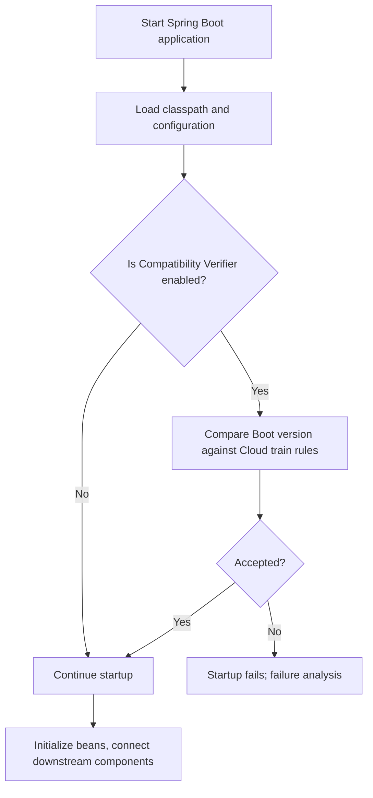
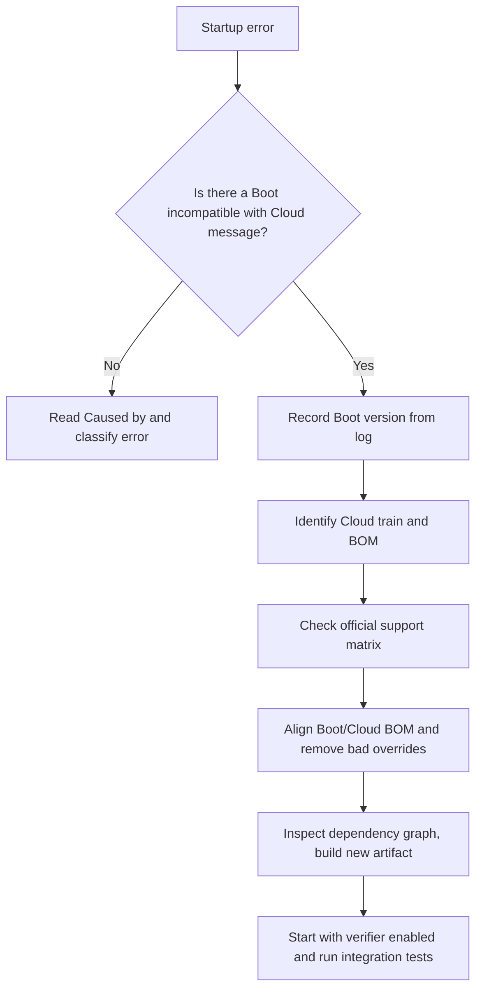

# Compatibility Verifier and Incompatibility Messages

> **Chapter:** Versions and Dependencies  
> **Module:** `SPRING_CLOUD_CORE` — core foundations of Spring Cloud in distributed systems: Spring Cloud Commons, Context, externalized configuration, discovery, service registry, inter-service communication, and Spring Boot compatibility management.  
> **Goal:** Understand why a Spring Cloud application may fail to start when using a mismatched version pair, how to read Compatibility Verifier messages, and how to resolve the root cause in dependency management.

## 1. Problem Scenario

Suppose `order-service` is a Spring Boot application integrating Spring Cloud Commons, Spring Cloud Context, and Spring Cloud LoadBalancer. The development team upgrades Spring Boot to get a security patch while still using an older Spring Cloud release train. Compilation and packaging may succeed, yet when running the JAR, the application halts with a message like:

```text
***************************
APPLICATION FAILED TO START
***************************

Description:

Your project setup is incompatible with our requirements
due to following reasons:

- Spring Boot [3.4.2] is not compatible with this Spring Cloud release train

Action:

Consider applying the following actions:

- Change Spring Boot version to one of the following versions [3.2.x, 3.3.x].
- Check Spring Cloud release train compatibility information.
- To disable the check:
  spring.cloud.compatibility-verifier.enabled=false
```

This is an **illustrative example** of the message structure; the version branches `3.2.x`, `3.3.x`, and `3.4.2` are used purely to set up the scenario. The real compatibility list depends on the active Spring Cloud release train and can change across releases.

The question to answer is: **Which version configuration caused the error, how do we find the versions actually loaded, and where should we fix it?**

### Learning Outcomes

After this lesson, learners can:

1. distinguish Spring Boot version, Spring Cloud release train, BOM, and Compatibility Verifier;
2. identify the conditions under which the verifier fails startup and how to read the message;
3. fix the Boot/Cloud pairing via Maven or Gradle dependency management;
4. use a dependency tree or effective POM to analyze overridden version cases;
5. explain the effects and limits of `enabled` and `compatible-boot-versions`;
6. verify versions across CI, containers, and environments using externalized configuration.

## 2. Foundations of Version Compatibility in Spring Cloud Core

### 2.1. Why Must Boot and Cloud Follow a Compatibility Matrix?

**Spring Boot** supplies the startup foundation, auto-configuration, dependency management, Spring Framework, and operational infrastructure. **Spring Cloud** builds distributed-system abstractions and integrations, such as `DiscoveryClient`, `ServiceInstance`, `ServiceRegistry`, Spring Cloud Context/RefreshScope, and Spring Cloud LoadBalancer.

Spring Cloud modules consume Spring Boot and Spring Framework APIs and behaviors. When Boot changes APIs, auto-configuration conditions, bean lifecycles, or underlying dependencies, an older Spring Cloud generation may become incompatible. Thus, you cannot assume **every Spring Cloud version runs on every Spring Boot version**, even when the Java compiler reports no errors.

Spring Cloud releases by **release train**: a set of Cloud versions coordinated and tested together. Supported Boot versions must be checked in official release documentation rather than chosen merely by matching major/minor numbers.

Release train names can look like `2024.0.x`, `2025.0.x`. These are examples of naming conventions; they do not mean every Boot version released in that same year will be compatible.

### 2.2. What Does a BOM Solve?

A BOM (*Bill of Materials*) manages dependency versions. When importing `spring-cloud-dependencies` for a release train, the project lets the BOM choose aligned versions for `spring-cloud-commons`, `spring-cloud-context`, `spring-cloud-starter-loadbalancer`, and components within the BOM's scope.

Spring Boot is typically managed via `spring-boot-starter-parent`, `spring-boot-dependencies`, or the corresponding Gradle management mechanism.

| Component | Responsibility | Example |
| --- | --- | --- |
| Spring Boot parent/BOM | Manages Boot foundational libraries | Spring Boot starters, Spring libraries, and Boot-managed dependencies |
| Spring Cloud release train/BOM | Manages versions of the Cloud module group | Commons, Context, LoadBalancer, Cloud starters |
| Compatibility Verifier | Checks compatibility rules at startup | Is the Boot version in the list accepted by the Cloud train? |
| Build tool / dependency graph | Resolves dependencies into concrete artifacts | Actual versions placed onto `runtimeClasspath` |
| Integration tests | Verify application behavior | Discovery, registry, refresh scope, and HTTP communication work properly |

**A BOM does not by itself verify that a Boot/Cloud pair is compatible.** A project can import a consistent Cloud BOM while picking the wrong Boot version. Conversely, the verifier may accept the Boot version while another overridden dependency triggers a runtime error.

### 2.3. The Java Runtime Is Another Compatibility Layer

Beyond Boot and Cloud, the JVM must satisfy Spring Boot's Java requirement and match the compiled bytecode. An `UnsupportedClassVersionError` typically points to a Java runtime too old for the class files, rather than a Compatibility Verifier message.

Hence you must check at least three layers: **Java runtime → Spring Boot → Spring Cloud release train**. The Compatibility Verifier mainly catches certain Boot/Cloud constraints; do not treat it as a tool validating all of these layers.

## 3. How Does the Spring Cloud Compatibility Verifier Work?

### 3.1. Purpose and Scope

Spring Cloud Commons provides the Compatibility Verifier mechanism to detect early when a version setup falls outside Spring Cloud's expected range. Across common generations of Spring Cloud Commons, a central check is the **Spring Boot version** the application is running.

When the setup is deemed incompatible, the verifier can cause Spring context startup to fail. Spring Boot then displays a failure analysis explaining the rejected version and suggested version branches.

This mechanism has three important limitations:

- **It does not download or upgrade JARs.** The checker only evaluates certain conditions and reports a conclusion.
- **It does not check every library on the classpath.** Transitive conflicts or code calling nonexistent APIs can still cause `NoSuchMethodError` and other errors.
- **Passing the check does not prove business behavior is correct.** The application still needs testing with Config Data, registries, load balancing, HTTP clients, retries, and live operations.

Whether the mechanism runs also depends on whether the application loads the relevant Spring Cloud components, auto-configuration, and the enable/disable property.

### 3.2. When Failures Are Detected



The diagram depicts the logic for learning purposes and does not guarantee exact bean ordering across all versions. From a diagnostic standpoint, if the verifier blocked startup, do not immediately blame the discovery server, service registry, or internal network: the application has not even reached a ready state yet.

### 3.3. Why Can the Build Still Succeed?

Compilation verifies syntax and partial binary compatibility of classes referenced at build time. Certain conditions inside the Spring context are evaluated only at startup; some code paths execute only afterward.

Consequently:

- `mvn package` or `gradle build` can succeed when tests do not start the real context;
- startup can fail due to the verifier;
- startup can succeed after disabling the verifier yet fail on another bean or API;
- both startup and the verifier succeeding still does not guarantee every downstream dependency works.

## 4. Reading Incompatibility Messages Properly

The message typically contains `APPLICATION FAILED TO START`, `Description`, and `Action`. The key line to recognize has the form:

```text
Spring Boot [x.y.z] is not compatible with this Spring Cloud release train
```

| Part in the log | Meaning | What to do |
| --- | --- | --- |
| `Spring Boot [x.y.z]` | Boot version detected by the verifier | Compare against the version resolved on the runtime classpath |
| `this Spring Cloud release train` | Rules from the Spring Cloud generation present in the app | Find the actual `spring-cloud-dependencies` and Cloud module versions |
| `Change Spring Boot version ...` | Boot branches accepted by the current check | Check the support matrix and release lifecycle before switching |
| `compatibility-verifier.enabled=false` | Way to bypass the check | Do not use as a default fix for dependency conflicts |
| `APPLICATION FAILED TO START` | Startup has halted | Read the exact reason; do not assume all startup failures come from the verifier |

Log formatting may vary across versions. The suggested list in the log helps orient you, yet **does not replace the official compatibility matrix and support status at upgrade time**.

### 4.1. Read the Root Cause First, Not Just the Outer Exception

Spring Boot may wrap the original failure inside `BeanCreationException` or a `Caused by` chain. When diagnosing:

1. locate `APPLICATION FAILED TO START` and the `Description` section;
2. check whether there is a line stating the Boot version is *not compatible* with the Cloud release train;
3. note the Boot version and suggested version set;
4. identify the loaded Cloud BOM/release train;
5. if there is no verifier-specific indicator, read `Caused by` and classify by class, bean, configuration, or network error.

Do not touch verifier properties if the real failure is a `ClassNotFoundException`, a missing bean, or an unreachable registry.

## 5. Common Causes of Incompatibility

### 5.1. Upgrading Boot While Leaving the Cloud Train Old

A team wants to upgrade Spring Boot for a security patch or new feature without upgrading `spring-cloud-dependencies`. As a result, the Boot version falls outside what the older Cloud train supports.

Resolution: check which train supports the desired Boot version, then upgrade the Cloud group accordingly. If no supported pair exists yet, revisit the upgrade plan instead of arbitrarily tweaking the verifier's accepted version list.

### 5.2. Upgrading Cloud While Keeping Boot Too Old

The reverse can also happen: switching the BOM to a new release train while keeping an older Boot parent or plugin branch. Even if starters resolve, startup may be blocked.

The resolution is identical: select a **Boot/Cloud pair** together rather than picking each version independently.

### 5.3. Version Overrides Bypassing the BOM

A module manually declares:

```xml
<!-- Risk illustration: replacing the Cloud version with an independent value -->
<dependency>
    <groupId>org.springframework.cloud</groupId>
    <artifactId>spring-cloud-commons</artifactId>
    <version>VERSION_OUTSIDE_BOM</version>
</dependency>
```

An explicit version can override the dependency-managed version. When multiple modules or libraries pull in different Cloud generations, the verifier can evaluate against an unintended version set; even if it passes, runtime can still hit class-linkage errors.

Resolution: remove unnecessary version overrides, inspect the dependency graph, and let a compatible BOM manage Cloud modules.

### 5.4. Multiple BOMs, Multiple Parents, or Multiple Modules

Large projects may involve a parent POM, `spring-boot-dependencies`, `spring-cloud-dependencies`, an internal organizational BOM, and direct dependencies. Gradle projects may likewise combine a dependency-management plugin, native platforms, and version catalogs.

A version written in one config file **is not guaranteed to be the final resolved version**. Inspect the effective POM or runtime dependency graph of the exact module that runs the application.

### 5.5. Running the Wrong Artifact or Different Environments

CI might build a new version while the container still runs an older image. Two environments might activate different profiles or pass a property disabling the verifier via environment variables.

When local succeeds and the server fails, compare **artifact, image digest, runtime classpath, Java runtime, and effective properties**, not just the commit hash.

## 6. Fixing the Version Pair in Maven

### 6.1. Correction Rules

A clean dependency-management setup is:

- pin the Spring Boot version in the Boot parent/BOM;
- import the `spring-cloud-dependencies` Spring Cloud BOM from a compatible release train;
- let the BOM decide Spring Cloud starter versions;
- avoid per-dependency version overrides;
- inspect actual resolved versions before deploying.

### 6.2. Illustrative POM

The snippet below is a **configuration skeleton**; uppercase placeholders must be replaced with real versions cross-checked against compatibility documentation.

```xml
<project xmlns="http://maven.apache.org/POM/4.0.0"
         xmlns:xsi="http://www.w3.org/2001/XMLSchema-instance"
         xsi:schemaLocation="http://maven.apache.org/POM/4.0.0
                             https://maven.apache.org/xsd/maven-4.0.0.xsd">
    <modelVersion>4.0.0</modelVersion>

    <parent>
        <groupId>org.springframework.boot</groupId>
        <artifactId>spring-boot-starter-parent</artifactId>
        <version>SUPPORTED_BOOT_VERSION</version>
        <relativePath/>
    </parent>

    <groupId>example</groupId>
    <artifactId>order-service</artifactId>
    <version>1.0.0-SNAPSHOT</version>

    <properties>
        <java.version>COMPATIBLE_JAVA_VERSION</java.version>
        <spring-cloud.version>COMPATIBLE_CLOUD_RELEASE_TRAIN</spring-cloud.version>
    </properties>

    <dependencyManagement>
        <dependencies>
            <dependency>
                <groupId>org.springframework.cloud</groupId>
                <artifactId>spring-cloud-dependencies</artifactId>
                <version>COMPATIBLE_CLOUD_RELEASE_TRAIN</version>
                <type>pom</type>
                <scope>import</scope>
            </dependency>
        </dependencies>
    </dependencyManagement>

    <dependencies>
        <dependency>
            <groupId>org.springframework.boot</groupId>
            <artifactId>spring-boot-starter-web</artifactId>
        </dependency>

        <dependency>
            <groupId>org.springframework.cloud</groupId>
            <artifactId>spring-cloud-starter-loadbalancer</artifactId>
        </dependency>
    </dependencies>
</project>
```

To avoid repetition, real projects can reference `${spring-cloud.version}` in the BOM version field. The skeleton repeats the placeholder label to avoid relying on interpolation details in the example.

`spring-boot-starter-parent` manages the Boot baseline; `spring-cloud-dependencies` manages the Cloud suite. Spring Cloud starter versions are omitted because the BOM picks them. If an application does not use the Boot parent, configure equivalent Boot dependency management.

To inspect the Maven configuration after resolution:

```bash
mvn help:effective-pom
mvn dependency:tree
```

In multi-module projects, run these commands targeting the module containing the application's `main` class; check versions of `org.springframework.boot`, `org.springframework.cloud`, and transitively pulled libraries.

## 7. Equivalent Approach with Gradle

Gradle projects can use the dependency-management plugin and import the Spring Cloud BOM:

```groovy
plugins {
    id 'java'
    id 'org.springframework.boot' version 'BOOT_PLUGIN_VERSION'
    id 'io.spring.dependency-management' version 'DEPENDENCY_MANAGEMENT_PLUGIN_VERSION'
}

repositories {
    mavenCentral()
}

dependencyManagement {
    imports {
        mavenBom "org.springframework.cloud:spring-cloud-dependencies:COMPATIBLE_CLOUD_RELEASE_TRAIN"
    }
}

dependencies {
    implementation 'org.springframework.boot:spring-boot-starter-web'
    implementation 'org.springframework.cloud:spring-cloud-starter-loadbalancer'
}
```

This is a layout skeleton showing configuration placement, not a ready-to-build file as-is. Add concrete versions, Java toolchain config, project metadata, and components as needed. With Gradle native platforms, the syntax differs, yet the principle stays the same: **centralized version management and `runtimeClasspath` verification**.

Inspection commands:

```bash
./gradlew dependencies --configuration runtimeClasspath
./gradlew dependencyInsight --configuration runtimeClasspath --dependency spring-cloud-commons
./gradlew dependencyInsight --configuration runtimeClasspath --dependency spring-boot
```

On Windows, run `gradlew.bat` instead of `./gradlew`. `dependencyInsight` is useful when you need to know why a specific version was selected or overridden. For multi-project builds, target the right application subproject and configuration.

## 8. Compatibility Verifier Properties

Two properties commonly used to control verifier behavior in Spring Cloud Commons are:

- `spring.cloud.compatibility-verifier.enabled`;
- `spring.cloud.compatibility-verifier.compatible-boot-versions`.

Check the documentation for your active Spring Cloud version to confirm defaults and accepted values.

### 8.1. Disabling the Check with `enabled=false`

Example in `application.yml`:

```yaml
spring:
  cloud:
    compatibility-verifier:
      enabled: false
```

Equivalent in `application.properties`:

```properties
spring.cloud.compatibility-verifier.enabled=false
```

When disabled, the application **skips that check** if configuration loads properly. It **does not change JAR versions**, fix changed APIs, upgrade the Cloud BOM, or guarantee the Spring context will run.

Disabling the verifier may be used in controlled experiments to evaluate a version combination alongside proper tests. In production or shared CI, keeping the check enabled is the sensible choice to catch version drift early.

### 8.2. Overriding the Accepted Boot Version Set

Example syntax:

```properties
# Illustrative value in a test environment, not an official matrix entry
spring.cloud.compatibility-verifier.compatible-boot-versions=3.4.x
```

This property alters the criteria the verifier uses to recognize acceptable Boot versions. The `3.4.x` pattern merely illustrates declaring a version branch in a hypothetical scenario; it **does not confirm that any given Cloud train supports Boot 3.4.x**.

Understand the difference:

| Action | What changes? | What does not change? |
| --- | --- | --- |
| Upgrade Boot per matrix | Boot version and resolved dependencies change | Does not automatically fix business logic |
| Upgrade Spring Cloud BOM | Managed Cloud version set changes | Does not automatically upgrade the Java runtime |
| Set `enabled=false` | Skips a startup check step | Does not change the classpath |
| Set `compatible-boot-versions` | Changes the Boot versions the verifier accepts | Does not make an untested library combination compatible |

Do not use the last two properties as long-term "workarounds" when official documentation confirms the versions are incompatible.

### 8.3. External Configuration Can Override Properties

Spring Boot uses externalized configuration; Spring Cloud applications can pull properties from multiple sources depending on configuration:

- `application.yml`, `application.properties`, and profiles;
- environment variables, command-line arguments;
- Config Data and remote configuration sources if integrated;
- legacy bootstrap or Spring Cloud Context mechanisms depending on application version.

As a result, a property in source code may differ from the **effective value at startup**. If local shows no error while CI is blocked, inspect every configuration source and active profile. Do not conclude from a single YAML line alone whether the verifier is enabled or disabled at runtime.

**RefreshScope does not change loaded JARs.** Refreshing certain beans/configurations does not replace rebuilding the artifact after changing the Boot or Cloud BOM.

## 9. Distinguishing the Verifier from Other Failure Categories

| Indicator | Common root cause to investigate | How to verify |
| --- | --- | --- |
| `Spring Boot [x] is not compatible...` | Spring Cloud Compatibility Verifier rejects the Boot version | Compare Boot version, Cloud train, and support matrix |
| `NoSuchMethodError` | API mismatch between compiled class and actual runtime dependency | Dependency tree, version overrides, and runtime classpath |
| `NoClassDefFoundError`/`ClassNotFoundException` | Class missing from classpath at runtime | Scope, starters, artifacts, and dependency versions |
| `UnsupportedClassVersionError` | JVM too old for class/bytecode | Check Java runtime and toolchain |
| `BeanCreationException` | Bean cannot be instantiated; wrapper exception | Find deepest `Caused by` and auto-configuration conditions |
| `UnsatisfiedDependencyException` | No bean satisfies dependency | Starters, profiles, bean conditions, and configuration |
| Cannot connect to registry | Registry, TLS, auth, or network | Check URLs, ports, secrets, health, and network |
| No service instances found | Discovery or load balancer finds no destination | Check service name, registration, and supplier/cache |

Seeing `APPLICATION FAILED TO START` without an incompatibility message is insufficient evidence to blame the verifier.

### 9.1. Why Is the Verifier's Message Valuable?

For example, when an app fails to boot after a Boot upgrade, a team might spend hours inspecting Eureka, Consul, Gateway, or LoadBalancer. Yet if the log states the Boot version is outside the Cloud train's supported set, fix **dependency management first**. Network checks only become meaningful once the app starts and actually attempts calls.

## 10. Two Real-World Troubleshooting Cases

### Case A — Boot Upgraded, Cloud BOM Lagging Behind

**Context:** A service using Spring Cloud Commons and LoadBalancer needs a Boot upgrade to a newer line. After changing the Boot parent, the service halts at startup.

**Investigation:**

1. Record the Boot version shown in the log.
2. Read the imported `spring-cloud-dependencies` configuration.
3. Find the Boot version set supported by this train in release documentation.
4. If the newer Boot version is required, choose the matching Cloud train; if no supported pair exists yet, adjust the upgrade plan.
5. Verify effective POM/dependency tree to ensure the right versions resolved.
6. Rebuild and run startup tests, then test the Cloud capabilities the service uses.

**Avoid:** simply adding `enabled=false` and pushing to production. That silences the warning without proving Cloud modules can work with the new Boot.

### Case B — Works Locally, Fails in CI

**Context:** On the exact same source code, the app boots on a developer machine yet CI reports incompatibility.

**Key questions:**

- Are the runtime Boot versions in both logs identical?
- Are the Cloud BOMs and dependency graphs identical?
- Did the executed artifact actually come from the same build?
- Does the local environment have a profile or environment variable disabling the verifier?
- Is CI using an older image, dependency lockfile, or different configuration?

If local disabled the verifier, "it runs locally" is insufficient proof of official support. If dependency graphs differ, fix the dependency management and artifact build process so results are deterministic.

## 11. Testing and Operations in Distributed Systems

### 11.1. What to Record During Version Upgrades

A service using Spring Cloud Core should maintain a clear version record:

| Information | Purpose |
| --- | --- |
| Effective Boot version | Identifies the startup platform |
| Cloud release train/BOM | Identifies compatibility rules and Cloud libraries |
| Java runtime | Prevents JVM/bytecode mismatches |
| Cloud starter versions | Detects overrides outside the BOM |
| Artifact or container image digest | Proves the exact build deployed |
| Verifier status and effective config | Reveals whether a check was disabled |
| Startup logs and smoke test results | Provides before/after upgrade evidence |

### 11.2. Testing Within the Scope of Spring Cloud Core

When changing Boot/Cloud trains, a meaningful test suite should cover:

1. **Dependency resolution:** inspect effective POM or `runtimeClasspath` to catch unintended overrides.
2. **Startup smoke test:** boot a representative Spring context with the verifier enabled.
3. **Discovery and registry:** if used, confirm instance registration and lookup work.
4. **Inter-service communication:** issue downstream calls via your HTTP client, LoadBalancer, and resilience policies.
5. **Externalized configuration:** confirm Config Data/profiles read required values.
6. **Context and refresh:** if using RefreshScope, test that beans refresh per design.
7. **Observability:** verify health, logs, tracing, and metrics post-upgrade.

A small patch bump may only need a concise smoke suite; when changing release trains, expand testing across every changed abstraction. **Passing the verifier is a helpful condition, not sufficient proof of deployment safety.**

### 11.3. Role of CI

Pipelines should keep Boot/Cloud versions centrally managed, inspect the dependency graph, and run startup tests with the verifier enabled. When incompatibility errors occur, CI should block builds/deployments until the version pair and integration behavior are verified.

Do not place `enabled=false` in CI configuration just to turn a pipeline green: doing so discards the very signal the verifier provides.

## 12. Misconceptions to Avoid

**"If the build succeeds, Boot and Cloud are compatible."**  
Not necessarily. Some constraints are checked only during Spring context creation or runtime calls.

**"The BOM will automatically adjust Boot to match Cloud."**  
No. The Spring Cloud BOM manages the Cloud suite; Boot has its own version source. Pick the right pair from support documentation.

**"Matching major versions is enough."**  
No. Release trains target specific Boot version sets. Do not infer compatibility merely by comparing version strings.

**"Passing the verifier means zero dependency bugs."**  
No. It does not inspect the entire classpath, registry providers, HTTP clients, or all runtime APIs.

**"`enabled=false` fixes compatibility."**  
No. It only skips a check; the libraries remain at their old versions.

**"`compatible-boot-versions` upgrades Spring Cloud."**  
No. That property only alters the verifier's acceptance criteria.

**"Every microservice must run the exact same Boot patch."**  
Not a default requirement. Services can upgrade independently when communication contracts and support policies permit; however, **within each individual service**, select a cohesive Boot/Cloud/dependency set.

## 13. Applied Exercises

### Exercise 1 — Identifying the Cause

A startup log states:

```text
Spring Boot [x.y.z] is not compatible with this Spring Cloud release train
```

List the version details to extract from the log, POM, and dependency tree. Why must you inspect the runtime classpath rather than reading only the Boot plugin version?

### Exercise 2 — Practicing BOM Management

A project has `spring-cloud-dependencies`, yet a submodule hardcodes its own version for `spring-cloud-context`. Explain the risk, fix the config so the BOM manages it, and describe how to confirm via `mvn dependency:tree` or Gradle `dependencyInsight`.

### Exercise 3 — Evaluating Disabling the Check

A team plans to set `spring.cloud.compatibility-verifier.enabled=false` after startup fails. Analyze what changes, what does not change, and what evidence is required before deploying an unverified version combination to production.

### Exercise 4 — Handling Environment Differences

Local boots cleanly; CI fails to start. Build an investigation checklist covering Boot version, Cloud BOM, runtime dependency graph, artifact, image digest, and external configuration to isolate the difference.

### Self-Check Questions

1. What constraint does Compatibility Verifier typically check? **The set of Boot versions supported by the Spring Cloud train.**
2. Why don't the BOM and the verifier replace each other? **The BOM manages dependency versions; the verifier evaluates startup conditions.**
3. Can you conclude the entire system is compatible if the verifier passes? **No, runtime and integration testing are still required.**
4. Does disabling the verifier modify JARs? **No.**
5. What is the reliable source for choosing a Boot/Cloud pair? **The official support matrix and release train docs at upgrade time.**

## 14. Quick Diagnostic Flow



When reading "Spring Boot is not compatible with this Spring Cloud release train" in the log, work through **actual versions → release train → BOM → dependency graph → startup test**. That solves the root cause instead of merely hiding the error message.

**References:** [Spring Cloud](https://spring.io/projects/spring-cloud), [Spring Cloud Commons Reference](https://docs.spring.io/spring-cloud-commons/reference/), [Spring Boot](https://spring.io/projects/spring-boot), and [Spring Initializr](https://start.spring.io/). Compatibility and support status change across release trains; always consult documentation matching the exact version your project uses.
