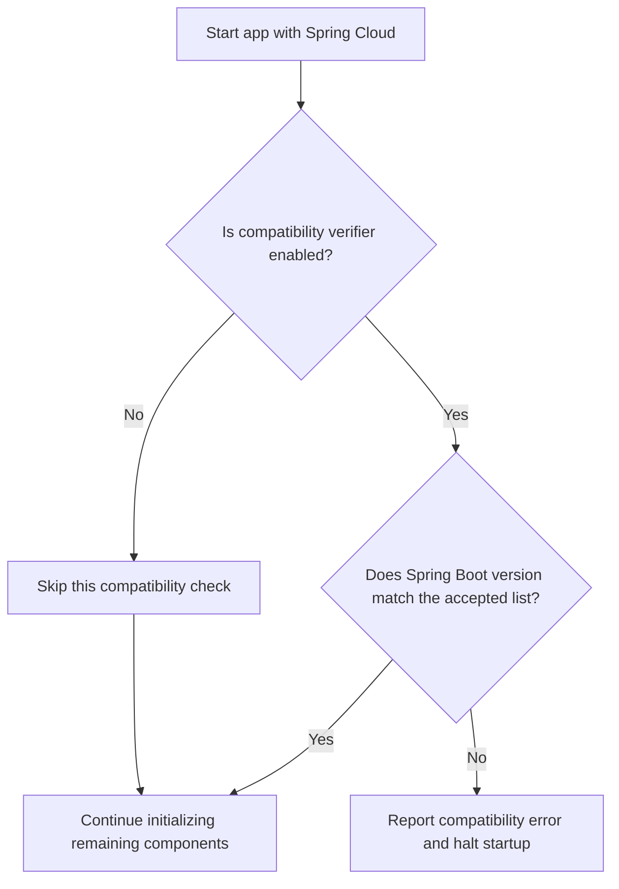
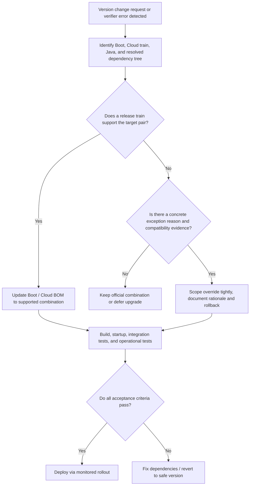

# Conditions for Overriding Versions and Limits of Disabling the Compatibility Verifier

## 1. Why Is Version Management Part of Spring Cloud Design?

In a distributed system, a Spring Boot service typically combines several components: Spring Cloud Commons and Context, Config Client, Discovery Client, Service Registry, LoadBalancer, OpenFeign, or inter-service communication libraries. These components share APIs, bean lifecycles, auto-configuration, and dependencies from Spring Boot/Spring Framework. **A version set that compiles cleanly does not guarantee a working runtime combination.**

Spring Cloud uses **release trains** and a **Bill of Materials (BOM)** to supply a coordinated set of versions. Normally, a project picks a Spring Boot version supported by Spring Cloud and imports the corresponding release train's BOM. Most Spring Cloud dependencies are then declared *without individual versions*.

Still, practical demands arise: patching a security vulnerability, avoiding a regression, integrating a library that hasn't released a compatible version yet, or performing a controlled upgrade. **Overriding a version** may be necessary, yet it is a decision that affects the entire dependency graph. Spring Cloud also provides a **compatibility verifier** to check certain compatibility conditions at application startup. Disabling this verifier only alters a check step; **it does not make libraries compatible**.

This lesson belongs to the **Versions and Dependencies** chapter of the **SPRING_CLOUD_CORE** module. The goal is knowing when a version override is justified, when a narrow exception for the verifier is acceptable, and how to verify impacts on Spring Cloud Commons, Context, externalized config, refresh scope, discovery, service registry, and inter-service communication.

After this lesson, learners can:

1. Distinguish Spring Boot version, Spring Cloud release train, and individual artifact versions.
2. Recognize when a version override is justified and when it must be rejected.
3. Understand what conditions the Spring Cloud compatibility verifier checks and what it does **not** check.
4. Know how to enable/disable the verifier, or adjust the accepted Spring Boot version list, strictly within scope.
5. Verify dependency resolution, startup, and critical business flows before operating in production.

## 2. Three Version Levels to Distinguish

| Level | Example targets | Role | Risk when overriding |
| --- | --- | --- | --- |
| **Spring Boot** | Spring Boot parent/BOM or Gradle plugin | Supplies auto-configuration, dependency management, and Spring Framework integration | Broad impact on APIs and initialization lifecycle of the whole app. |
| **Spring Cloud release train** | `spring-cloud-dependencies` BOM | Manages Cloud versions coordinated with one another and with Boot | Picking the wrong train can make multiple modules incompatible together. |
| **Individual artifact** | `spring-cloud-commons`, `spring-cloud-context`, Config Client, LoadBalancer… | Implements a specific functional slice | Can break contracts between Commons/Context and remaining Cloud modules. |

Spring Boot also manages many foundational libraries such as Spring Framework, Reactor, Micrometer, Jackson, Netty, and starters. Spring Cloud relies on those baseline versions. Therefore, overriding a transitive library can affect Spring Cloud even if the project doesn't change the Cloud BOM.

Specifically distinguish:

- A **release train** is a coordinated release bundle; the train name does not equal individual JAR versions.
- A **BOM** defines *managed* versions; **dependency resolution** decides the final versions appearing on the classpath after parents, BOMs, constraints, and build tool rules apply.
- A **version override** is an active step replacing a default version in the dependency graph.
- The **compatibility verifier** is an in-app startup check; it does not modify the BOM, alter dependencies, or override Maven/Gradle rules.

For instance, an app might import the right Spring Cloud BOM yet force `spring-cloud-context` to a version from another train. Maven can still resolve valid JARs and compile; API linkage or behavioral errors only surface at startup, during refresh, or under live load.

## 3. Conditions for Accepting a Version Override

Never use a simplistic rule like "pick the latest version" or "as long as the build passes." An override must satisfy **all** of the following conditions simultaneously.

### 3.1. Concrete Justification and Minimal Scope

Every override should tie to a verifiable reason:

- A published security patch affecting the exact artifact and version in use.
- A confirmed bug or regression with an issue/changelog and an appropriate fix release.
- A mandatory compatibility requirement of a dependency after analyzing the dependency path.
- A time-boxed transition window to unblock testing, with a plan to return to the official combination.

Avoid overriding multiple artifacts simultaneously just because newer versions exist. When an entire group of Spring Cloud components must change, **upgrading the full release train** is usually easier to control than pulling individual modules from disparate trains.

### 3.2. Do Not Step Outside a Compatible Combination Without Evidence

First check the **official Spring Cloud compatibility table with Spring Boot** at deployment time. Do not infer compatibility from close version numbers. Also inspect Java runtime requirements, Spring Framework, and limitations noted in release notes.

If you want a Spring Boot version not yet supported by the current release train, the preferred path is choosing a **Spring Cloud release train that supports that Boot version**. Changing Boot while freezing the Cloud train merely to avoid touching dependencies creates systemic risk.

When an artifact patch is confirmed by maintainers to be compatible within the same line without breaking API contracts, overriding a single artifact can be reasonable. Even then, conclude only after inspecting the **actually resolved** versions and running relevant tests.

### 3.3. Impact on Related Dependencies Has Been Verified

A change in `spring-cloud-commons` can affect discovery, service registry, and load-balancing abstractions; a change in `spring-cloud-context` can affect bootstrap, `EnvironmentChangeEvent`, or `@RefreshScope`. Config Client, Gateway, and HTTP clients may also consume those APIs.

Verify at minimum:

1. Which artifact changed and which release train that patch belongs to.
2. Which Spring Cloud modules depend on it together.
3. Whether any dependency gets downgraded or pulled too far from the BOM.
4. Whether there are conflicts across Spring Framework, Reactor, Jackson, Netty, Micrometer, or `jakarta.*`/`javax.*`.
5. Whether startup configuration, Config Data, and bootstrap behavior changed.

For dependencies carrying APIs used by other modules, a single `NoSuchMethodError`, `NoClassDefFoundError`, or `BeanCreationException` is enough to fail an upgrade even though all application source code compiles.

### 3.4. Test Evidence and Rollback Path Exist

Document old/new versions, justification, impacted application scope, test results, and rollback instructions. For critical patches, run smoke tests in a production-like environment covering startup, inter-service communication, config loading, discovery, and refresh if the application uses them.

**Decision rule:** an override is an evidence-backed exception, not the new default for the whole organization. Once the exception expires or an official BOM includes the fix, return to BOM-based version management.

## 4. Safe Version Declaration in Maven

The snippet below is a **configuration template**. Uppercase placeholders must be replaced with real versions verified against the compatibility matrix; do not copy verbatim to build.

```xml
<parent>
    <groupId>org.springframework.boot</groupId>
    <artifactId>spring-boot-starter-parent</artifactId>
    <version>VERIFIED_BOOT_VERSION</version>
    <relativePath/>
</parent>

<properties>
    <java.version>SUPPORTED_JAVA_VERSION</java.version>
    <spring-cloud.version>VERIFIED_CLOUD_TRAIN_VERSION</spring-cloud.version>
</properties>

<dependencyManagement>
    <dependencies>
        <dependency>
            <groupId>org.springframework.cloud</groupId>
            <artifactId>spring-cloud-dependencies</artifactId>
            <version>${spring-cloud.version}</version>
            <type>pom</type>
            <scope>import</scope>
        </dependency>
    </dependencies>
</dependencyManagement>

<dependencies>
    <dependency>
        <groupId>org.springframework.cloud</groupId>
        <artifactId>spring-cloud-starter-config</artifactId>
    </dependency>
    <dependency>
        <groupId>org.springframework.cloud</groupId>
        <artifactId>spring-cloud-starter-loadbalancer</artifactId>
    </dependency>
</dependencies>
```

The dependencies at the bottom **omit `version`**, letting the BOM decide. This is the baseline state to aim for before considering overrides.

### 4.1. When Overriding Exactly One Artifact Is Unavoidable

Suppose the project verified an appropriate `spring-cloud-context` patch. In the application's POM, you can declare dependency management directly for that exact artifact coordinates:

```xml
<dependencyManagement>
    <dependencies>
        <!-- Verified exception: state issue, review date, and rollback plan -->
        <dependency>
            <groupId>org.springframework.cloud</groupId>
            <artifactId>spring-cloud-context</artifactId>
            <version>VERIFIED_CONTEXT_PATCH_VERSION</version>
        </dependency>
        <dependency>
            <groupId>org.springframework.cloud</groupId>
            <artifactId>spring-cloud-dependencies</artifactId>
            <version>${spring-cloud.version}</version>
            <type>pom</type>
            <scope>import</scope>
        </dependency>
    </dependencies>
</dependencyManagement>
```

In Maven, a managed entry declared directly in the current POM takes precedence over versions imported from a BOM for the same coordinates. This snippet illustrates an **intentional override**; it does not imply every `spring-cloud-context` patch is safe to mix with the active BOM. Inspect the effective POM and resolved dependency tree. Do not place two separate `dependencyManagement` blocks in a real POM: merge the illustrative entry into the existing block.

### 4.2. Inspecting the Selected Version

```bash
./mvnw help:effective-pom
./mvnw dependency:tree -Dincludes=org.springframework.cloud
./mvnw dependency:tree -Dverbose
```

Depending on the Maven Dependency Plugin version, how conflicts/omitted dependencies render in verbose mode can vary. What matters is **inspecting the classpath and effective dependency management**, rather than merely reading raw text in `pom.xml`. These commands are examples for learners to run in their own projects; they are not pre-executed test results.

## 5. With Gradle: Controlling Platforms, Constraints, and Resolution

In Gradle, projects can manage BOMs via `platform(...)` or the `io.spring.dependency-management` plugin depending on existing setup. Pick one consistent approach and understand its precedence rules. Example with native Gradle platform:

```groovy
dependencies {
    implementation platform(
        "org.springframework.cloud:spring-cloud-dependencies:VERIFIED_CLOUD_TRAIN_VERSION"
    )

    implementation "org.springframework.cloud:spring-cloud-starter-config"
}
```

Spring Boot dependencies must also be managed appropriately by the existing build setup, such as the Boot BOM. The example above illustrates only the **Spring Cloud portion**.

When a specific exception is needed, `constraints` can document the version and rationale; the example below uses `strictly`, which will **fail if other constraints cannot be satisfied**, instead of silently accepting another version:

```groovy
dependencies {
    constraints {
        implementation("org.springframework.cloud:spring-cloud-context") {
            version {
                strictly("VERIFIED_CONTEXT_PATCH_VERSION")
            }
            because("Verified patch for recorded issue")
        }
    }
}
```

`strictly` does not guarantee runtime compatibility; it only expresses a resolution constraint. Avoid widespread use of `resolutionStrategy.force(...)`, since forcing can hide conflicts that need to be surfaced.

Verify resolved versions with:

```bash
./gradlew dependencies --configuration runtimeClasspath
./gradlew dependencyInsight --dependency spring-cloud-context --configuration runtimeClasspath
```

When a constraint conflicts with the BOM or a transitive dependency, explain **why** and decide on a clean fix. Never resolve it by turning off checks or blindly adding force rules.

## 6. What Does the Spring Cloud Compatibility Verifier Check?

The **Spring Cloud compatibility verifier** is a startup safety check supplied by Spring Cloud through Commons components. One key check verifies whether **the active Spring Boot version** is among those considered compatible by the active Spring Cloud release train.

If the combination is rejected, the application can fail startup and display a message explaining that the current Spring Boot version is incompatible with the Spring Cloud release train, along with suggestions for choosing an appropriate Boot or Cloud version.

Decision flow:



**Understand the exact scope:** the verifier is *an early guardrail*, not a complete validator for every artifact.

| What the verifier catches | What the verifier does not guarantee |
| --- | --- |
| Certain Spring Boot ↔ Spring Cloud pairs outside the accepted list | That all Spring Cloud modules come from the same BOM or weren't overridden |
| Compatibility conditions checked by verifiers present in the app | Absence of API/ABI, classpath, or transitive dependency conflicts |
| Compatibility issues caught right at startup | That refresh scope, Config Data, discovery, registry, HTTP clients, and business flows all work |
| Early warning before running an app with a rejected pair | Security, performance, multi-instance consistency, or official support |

An app that **passes the verifier can still fail at runtime**, and an app that **disables the verifier may run until it hits a harder-to-diagnose failure**. Thus, never treat the verifier's status as sole proof of compatibility.

## 7. Configuring the Verifier: Enabling, Disabling, and Boot Version List

Normally the verifier is enabled whenever the corresponding integration is present. The Spring Cloud configuration property used is:

```yaml
spring:
  cloud:
    compatibility-verifier:
      enabled: true
```

To **disable the checker** in a controlled testing scope:

```yaml
spring:
  cloud:
    compatibility-verifier:
      enabled: false
```

Equivalent in `application.properties`:

```properties
spring.cloud.compatibility-verifier.enabled=false
```

Another option is modifying the list of **Spring Boot versions the verifier treats as acceptable** via:

```properties
spring.cloud.compatibility-verifier.compatible-boot-versions=BOOT_MAJOR.MINOR.x
```

This is a **syntax-illustration placeholder**, not a validated value to use literally. Depending on the Spring Cloud version, this property supports comma-separated values and version patterns according to the syntax documented for that release. Adding a Boot version to the list only **changes the verifier's acceptance criteria**; it does not change BOMs, JARs, APIs, or official support status.

It is important to distinguish the two kinds of relaxation:

- `enabled=false` skips **this entire compatibility check mechanism** in the running version.
- `compatible-boot-versions=...` alters the list of Boot versions the checker matches against; it can allow an unverified combination to pass the check.

If an exception is unavoidable, narrowing the accepted list may be more targeted than disabling the entire verifier, yet **both require evidence**. Neither setting counts as fixing a dependency conflict.

## 8. When *Can* You Temporarily Disable the Verifier?

Legitimate cases typically have a **narrow scope**, **diagnostic intent**, or **independent evidence** showing the check blocks a combination that needs evaluation. For example:

1. **Investigating a startup failure:** disabling in an isolated development environment to observe what else fails after the version warning; restore the check once diagnosis finishes.
2. **Validating updated compatibility metadata:** maintainers already documented or confirmed support for the desired pair, yet the current artifact's verifier metadata hasn't caught up; document the confirmation source, scope, and tests.
3. **Controlled upgrade experiments:** CI or staging runs a candidate not yet officially supported, with clear ownership and explicit stop criteria.

Even in those cases, the **default operational recommendation** remains selecting an officially compatible Boot/Cloud pair and keeping the verifier enabled. Disabling the check only serves investigation or reviewed exceptions; it does not authorize production deployment on its own.

### When Should You Not Disable It?

- Simply because the app reports an invalid Boot version before you have checked the compatibility matrix.
- To run a newer Spring Boot major/minor while the Cloud release train does not yet support it and no compatibility evidence exists.
- To dodge `NoSuchMethodError`, `ClassNotFoundException`, `BeanCreationException`, Config Data failures, or service discovery failures; those errors must be investigated directly.
- To hide mismatches between BOM-selected dependencies and forced or overridden dependencies.
- To force a failing CI pipeline green without explanation, test evidence, or an expiration date to revoke the exception.

**Counter-example scenario:** an app using Boot version B and Cloud train T is rejected by the verifier. The team sets `spring.cloud.compatibility-verifier.enabled=false`; the service proceeds to Config Client bean creation and fails with a method linkage error. The right conclusion is not "the verifier broke it," but **the dependency combination is incompatible**; bypassing the first gate simply pushed the failure downstream.

## 9. Decision Workflow When Facing Version Errors



### Step 1. Capture Current State

Record Spring Boot version, Spring Cloud BOM, Java runtime, and actual resolved JARs. Save the effective POM or dependency report so failures can be reproduced. If an error occurs in only one environment, compare profiles, classpaths, container images, and config variables against CI.

### Step 2. Choose the Lowest-Risk Remediation Path

Prefer a compatible release train or patch upgrade per maintainer guidance. If only one artifact is buggy, check whether a fix exists within the same train or an updated BOM. Consider an individual version override only when the rest of the combination stays consistent and strong evidence backs it.

### Step 3. Keep the Verifier Enabled in Representative Tests

Do not test with compilation alone. Run at least one startup test with the **verifier enabled** for the combination you plan to deploy. If an experiment requires disabling the verifier, use a **dedicated profile or test-environment config** so other environments don't accidentally inherit it.

Example flag passed **only to a test process** for diagnostics:

```bash
java -jar app.jar --spring.cloud.compatibility-verifier.enabled=false
```

This command illustrates process-level scoping; never embed that flag into production startup scripts without approval and compatibility evidence.

### Step 4. Test the Abstractions Actually Used

| Functional area | Minimum checks needed |
| --- | --- |
| ApplicationContext / auto-configuration | Clean startup, key beans instantiated, no API linkage errors. |
| Spring Cloud Context | `Environment` receives expected config; events and `@RefreshScope` work if used. |
| Config Client / external config | Connects to Config Server or backing source; verifies profiles, imports, and property precedence. |
| Commons, discovery, service registry | Instances register/discover cleanly; unavailable registry and state updates handled properly. |
| LoadBalancer / inter-service calls | Resolves service ID, selects instances, honors timeouts/retries and connection error handling. |
| Actuator / operations | Health, metrics, logs, readiness, and endpoint security behave properly without leaking secrets. |
| Multi-instance | Configuration and behavior stay consistent as designed; detect unrefreshed instances. |

Tests should mirror features **actually used** by the project: there's no need to stand up a registry just for tests if the app doesn't use discovery; conversely, you cannot skip Config/Refresh flows if those were the reason for the upgrade.

### Step 5. Controlled Acceptance or Rollback

Predefine stop criteria: startup failures, rising HTTP 5xx rates, abnormal timeout spikes, service registration failures, Config Data load errors, or stale/wrong refresh values. When any criterion fails, roll back to the known-good build and BOM; do not keep disabling more checks to silence warnings.

## 10. Practice Scenarios

**Scenario:** `order-service` uses Spring Boot B, Spring Cloud release train T, and Spring Cloud Config Client. The team wants to update Boot to B' for a new feature; after upgrading, the compatibility verifier reports B' is not supported by Cloud T. The project still compiles.

**Sound analysis:**

1. Check which Cloud train officially supports B' in the corresponding compatibility matrix; check Java and related dependencies.
2. If a supporting train exists, update the BOM to that train, drop obsolete overrides, and rerun tests.
3. If no supporting train exists yet, consider keeping Boot B, deferring the B' upgrade, or conducting a tightly scoped, evidence-backed experiment.
4. Use `enabled=false` during investigation only when genuinely needed to bypass the version gate and observe downstream errors.
5. Run startup tests, call Config Server, test refreshing a bean, verify the service discovery/HTTP flows the app uses, and compare against the baseline.

**Common mistake:** making `enabled=false` the default config, seeing the service stay up for a few minutes, and declaring B' and T compatible. That skips rare execution paths like registry outages, config refreshes, connection failures, or high load.

**Second scenario:** a security patch for `spring-cloud-context` exists in the same branch confirmed by maintainers. The team may consider overriding that single artifact for early adoption, while documenting the issue and version, checking sibling Cloud modules, and testing `@RefreshScope` / Config Client flows. Once the official BOM includes the patch, remove the override to avoid accumulating dependency debt.

## 11. Checklist Before Accepting an Exception

A version change should have a concise record sufficient for reviewers to decide:

| Question | Expected evidence |
| --- | --- |
| Why change it? | Concrete issue, CVE, regression, or technical requirement. |
| What is the minimal scope? | List of artifacts/versions and why the default BOM cannot be used. |
| Are Boot/Cloud/Java within support scope? | Cross-check against compatibility docs for the exact release. |
| What are the actual resolved dependencies? | Saved effective POM or Gradle dependency insight output. |
| Is the verifier enabled on the target pair? | Startup logs and test results under production-equivalent configuration. |
| If disabled, who owns it and until when? | Experimental scope, exception rationale, expiration date, and re-enable criteria. |
| Which Cloud capabilities were tested? | Test report covering Context, Config, discovery/registry, communication, and operations as actually used. |
| Is there a rollback plan? | Pre-change build/BOM and verified rollback steps. |

## 12. Self-Check Questions

1. Why is a Spring Cloud BOM more valuable than manually specifying the newest version for every starter?
2. Under what conditions may you override a patch version for `spring-cloud-context`, and what must you verify with Commons/Config Client?
3. How does `spring.cloud.compatibility-verifier.enabled=false` differ from changing the Spring Cloud release train?
4. What happens if you only edit `compatible-boot-versions` to accept a Spring Boot minor not yet supported by the train?
5. Why can an application compile cleanly and pass the verifier yet still fail when calling a service or refreshing configuration?
6. Describe how to check which artifact version Maven/Gradle actually selected and how to roll back after a failed override.

---

**Takeaway:** release trains and BOMs are the starting point for a consistent Spring Boot/Spring Cloud pairing. Version overrides should happen only with clear justification, tight scope, and test evidence. The compatibility verifier is an early warning for unsupported combinations; disabling it **only removes the checkpoint** without fixing classpath or runtime incompatibilities. When in doubt, prefer returning to a supported version set and re-running verification.
