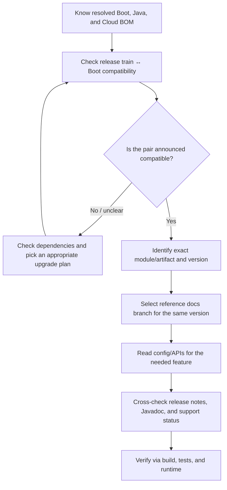
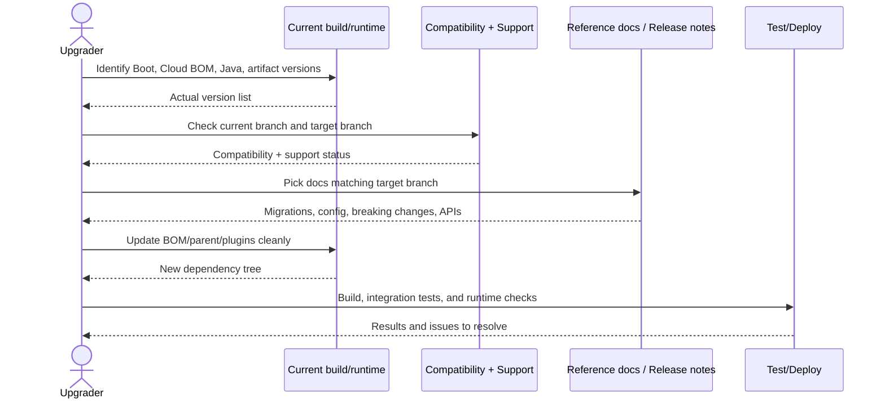

# Reading Documentation and Support Status for the Right Spring Cloud Version Branch

## 1. Why Must You Read the Right Version Branch?

When developing a distributed system with Spring Boot and Spring Cloud, finding a tutorial with familiar Java syntax, YAML, or annotation names **is not enough to confirm that the guide applies to your project**. An example on the current documentation page may describe APIs or configuration rules of a newer release train, while your application runs an older branch. Conversely, a blog post from a few years ago may prescribe a mechanism that has since been replaced.

Suppose a team maintains `order-service` and `inventory-service`. Both use Spring Boot, Spring Cloud Commons/Context for shared abstractions, Service Discovery to locate instances, and Config Client to load configuration. Someone reads the newest documentation and changes startup config, upgrades a single starter, or adopts `RestClient` following a newer example. The result can be build errors, missing beans, unloaded configuration, or startup failures because Spring Boot and Spring Cloud are incompatible.

Therefore, when reading documentation, answer **four questions in order**:

1. **Which versions does the project actually run?** Declared versions in build files and resolved versions can differ.
2. **Do those versions form a supported compatible combination?** Cross-check Spring Boot against the **Spring Cloud release train**, plus Java and related infrastructure components.
3. **Which product, module, and branch documentation are you reading?** The default docs page may point to the newest version rather than your project's version.
4. **What level of support does that branch currently receive?** Release status, active community patching, and commercial support are distinct concepts.

The goal of this lesson is to establish a repeatable verification process whenever deploying, debugging, researching `@RefreshScope`, `DiscoveryClient`, `ServiceRegistry`, Spring Cloud LoadBalancer, or upgrading the entire system.

## 2. Four Version Layers to Distinguish

Spring Cloud is a multi-project ecosystem, not a single Java library. These version layers commonly appear together:

| Layer | Example names | Meaning | Where to look? |
| --- | --- | --- | --- |
| **Java/JDK** | Java 17, Java 21 | Runtime and language/JVM level used by the application | Build configuration, `java -version`, runtime image |
| **Spring Boot** | `spring-boot`, `spring-boot-starter-web` | Startup platform, auto-configuration, and management of many dependencies | Boot parent/BOM/plugin, dependency resolution |
| **Spring Cloud release train** | `spring-cloud-dependencies` with version like `YYYY.N.patch` | Coordinated version set across multiple Spring Cloud projects | BOM or dependency management, official compatibility matrix |
| **Spring Cloud project/module** | `spring-cloud-commons`, `spring-cloud-context`, `spring-cloud-config-client`, `spring-cloud-loadbalancer` | Actual implementation or API entering the classpath | Maven/Gradle dependency tree, release notes, and module reference docs |

**A release train does not equal individual JAR versions.** As a historical example, a `2024.0.x` release train can manage `spring-cloud-commons` artifacts at `4.2.x`. Thus, seeing `spring-cloud-commons:4.x` does not let you conclude which release train the project runs merely by comparing numbers.

Additionally, `spring-boot-starter-*` and `spring-cloud-starter-*` are both **starters**—dependency bundles enabling a capability. A starter can pull many transitive libraries and versions. To know what code actually runs, inspect resolved dependencies rather than stopping at the starter name.

### 2.1. Three Compatibility Axes

A version change can impact three axes simultaneously:

- **Boot ↔ Cloud:** a Spring Cloud release train is published as compatible with one or a set of Spring Boot versions. Do not pair Boot and Cloud arbitrarily just because each library published a newer release.
- **JDK ↔ Boot/Cloud:** minimum Java version, tested versions, and toolchain settings must meet Boot's and other dependencies' requirements.
- **API/implementation ↔ configuration style:** annotations, beans, Spring Cloud Config setup, HTTP clients, LoadBalancer, and bootstrap mechanics can change across branches.

Beyond these three axes, projects can have specific compatibility rules for Eureka Server, Consul, Spring Cloud Gateway, Spring Security, Spring Framework, and third-party libraries. Always check according to the components **actually used**.

## 3. Gathering Version Evidence Before Consulting Docs

Do not open the "current" page first and then try to force the project to match examples on it. First compile a brief record of your build state:

| Information | What to record | Reason |
| --- | --- | --- |
| Spring Boot | Parent/BOM/plugin version and runtime version | Determines platform baseline, Framework APIs, and auto-configuration |
| Spring Cloud | Version of the `spring-cloud-dependencies` BOM | Identifies the release train for compatibility and docs lookup |
| Spring Cloud modules | **Resolved** versions of Commons, Context, Config, LoadBalancer, discovery starters | Ties docs/Javadoc snippets to the exact running code |
| Java | Toolchain, compiler target, and deployment JVM | Prevents building with one JDK and deploying on another |
| Build tool | Maven/Gradle and plugin versions | Affects BOM import behavior and dependency resolution |
| Runtime | Image/container, environment, profile | Ensures the live process matches the dependencies/config under study |

### 3.1. Maven Projects

Common state-inspection commands:

```bash
# Maven version and the Java installation Maven uses
mvn -version

# Effective POM after parent inheritance, profiles, and dependency management
mvn help:effective-pom

# Actual dependency tree of the application
mvn dependency:tree

# Optionally filter by the Spring Cloud group to focus investigation
mvn dependency:tree -Dincludes=org.springframework.cloud
```

In multi-module projects, run inside the application module or pass the appropriate Maven module selector. `effective-pom` shows version-management rules; `dependency:tree` shows artifact versions chosen after Maven dependency mediation.

**Do not confuse** "declared" versions with "resolved" versions. A direct dependency carrying an explicit version, misordered BOM imports, or overrides in a parent/profile can push a Spring Cloud module off its intended version set.

### 3.2. Gradle Projects

Analogous commands:

```bash
./gradlew --version

# Read resolved dependencies for the runtime configuration
./gradlew dependencies --configuration runtimeClasspath

# Trace where a specific dependency comes from and which version was chosen
./gradlew dependencyInsight --dependency spring-cloud-commons --configuration runtimeClasspath
```

On Windows, typically run `gradlew.bat` instead of `./gradlew`. In multi-subproject builds, specify the target subproject's task path. `compileClasspath`, `runtimeClasspath`, and `testRuntimeClasspath` can differ; inspect the configuration matching the failure under investigation.

### 3.3. Also Cross-Check Runtime Versions

POM or Gradle files might have changed while deployment still runs an older image. When in doubt:

1. Check the version/image tag and build metadata of the deployed artifact.
2. Cross-check commit revision and dependency lockfile/build artifact.
3. Check startup logs or build metadata if the app emits them.
4. Use Actuator `/actuator/info` or management endpoints only if configured and authorized in that environment; do not assume every version automatically exposes exact dependency sets there.

An error log containing a JAR path like `spring-cloud-context-...jar` or `spring-boot-autoconfigure-...jar` is a helpful clue for cross-checking runtime versions, though it does not replace the dependency tree and deployment metadata.

## 4. The Right Documentation Source: Product, Branch, and Page

No single URL covers Spring Boot, all of Spring Cloud, every module, and every release train. Each source serves a distinct purpose.

| Preferred source | What question does it answer? | How to use it |
| --- | --- | --- |
| [Spring Cloud project](https://spring.io/projects/spring-cloud) | Release trains, Boot relationship, docs, and release info | Verify the right release train for your Boot version |
| [Spring Boot project](https://spring.io/projects/spring-boot) | Releases, requirements, and Boot docs | Verify Boot branch and platform prerequisites |
| [Spring Cloud Commons reference](https://docs.spring.io/spring-cloud-commons/reference/) | `DiscoveryClient`, `ServiceRegistry`, LoadBalancer, and Context | Pick the reference version matching your artifact/module |
| [Spring Cloud Config reference](https://docs.spring.io/spring-cloud-config/reference/) | Config Server/Client, Config Data, and refresh | Pick the branch matching your release train and check bootstrapping |
| [Spring Cloud Netflix reference](https://docs.spring.io/spring-cloud-netflix/reference/) | Eureka integration and supported Netflix capabilities | Consult only if the project actually uses this implementation |
| [Spring Framework reference](https://docs.spring.io/spring-framework/reference/) | Foundational APIs like `RestClient`, bean lifecycle, HTTP/WebFlux | Pick the Framework version managed by Boot; avoid confusing with Cloud |
| [Spring support policy](https://spring.io/support) | Maintenance policy, support tiers, and timelines | Verify Open Source or commercial support at decision time |
| Release notes/changelog and Javadoc **for the exact version** | Which APIs were added, changed, deprecated, or removed? | Check when reference docs examples differ from running source code |

The reference links above are **starting points**. They may display or redirect to current-version documentation. Check the version selector, banner, and URL path on the site, then navigate to the **branch matching your application**. Never assume "current," "latest," or a versionless URL matches what is deployed.

### 4.1. Recommended Lookup Sequence



Each step answers a different question. **A compatibility table does not replace reference docs; reference docs do not replace support policies; and support policies do not prove your application runs properly.**

### 4.2. Checking Signs That Documentation Matches Your Branch

Before copying a configuration snippet or code example, inspect:

- **Product name:** is it Spring Cloud Commons, Context, Config, Netflix, or Spring Boot? A Config Server property does not necessarily mean anything in a service using only Commons.
- **Displayed version:** does the doc refer to an artifact version, a release branch, or just `current`? Cross-check against your dependency tree.
- **Applicability notes:** notes on minimum Java, Boot, Spring Framework, or required starters.
- **Activation prerequisites:** does the doc require an annotation, bean, dependency, profile, or exposed endpoint?
- **Change points:** migration sections, release notes, deprecations, removals, breaking changes, and default shifts.
- **Authoritativeness:** branch-matched reference docs/Javadoc take precedence over unversioned examples on blogs or Stack Overflow.

If newer docs no longer list older branches in the navigation bar, look up release notes/tags or Javadoc for the **exact artifact version**. If no matching source is found, note that gap and inspect the code/specs in your actual build rather than assuming newer examples are backward-compatible.

## 5. How Do "Released," "Stable," and "Supported" Differ?

A dependency may be downloadable from Maven Central yet no longer receive patches under current policy. Separate three layers: **release status**, **maintenance status**, and **support terms**.

| Label / concept | Practical meaning | What not to infer automatically |
| --- | --- | --- |
| Snapshot (`-SNAPSHOT`) | Development build, subject to change | Production-ready or compatibility guaranteed |
| Milestone (`M1`, `M2`...) | Experimental checkpoint on an active branch | API stability already committed |
| Release Candidate (`RC`) | Pre-GA candidate before official release | Same support policy as GA |
| GA / stable release | Official release of a specific version | That the branch will be maintained forever |
| Maintenance / patch release | Patch within a version branch | That every bug or CVE is backported to older branches |
| End of Open Source Support / EOL | End of published support/maintenance per policy | That artifacts disappear from repositories or stop running |
| Commercial / enterprise support | Support entitlements per vendor and contract | That every free user gets the same support window |
| Deprecated API | API still present yet recommended to migrate away from | That the API is already deleted in the current version |
| Removed / breaking change | Old behavior or API no longer compatible | That old code continues working without migration |

**A status must be tied to a verification date.** When preparing a release, check the current support policy, end dates of the relevant Spring Boot branch and Spring Cloud release train, and record the date, source URL, and conclusion in your upgrade notes. Support milestones change by policy and support tier; do not treat dates from an outdated article as fixed.

### 5.1. Four Things to Verify Before Claiming "Still Supported"

1. **Exact product:** Spring Boot or a specific Spring Cloud project? Policies can differ.
2. **Exact version line:** which `major.minor` or release train? A higher patch version does not necessarily extend the branch's end-of-life date.
3. **Exact support type:** community/OSS, commercial support, or which vendor's terms?
4. **Effective date:** the policy and lifecycle table at evaluation time, not the publication date of an old blog post.

"No longer supported" does not mean code immediately stops running, yet it impacts access to bug fixes and operational risk—especially when addressing security vulnerabilities. If a branch reaches OSS EOL while retaining commercial support, continuing to use it must rest on your organization's actual contract terms.

## 6. Choosing a Spring Cloud Release Train Compatible with Spring Boot

Spring Boot and Spring Cloud follow separate release cycles. The reliable way to pick a combination is checking the **official Spring Cloud compatibility matrix** at upgrade time. Do not infer compatibility from release dates, version ordering, or train names.

As a **historical illustration—not a recommendation for new projects**: the Spring Cloud `2024.0.x` line was designed for the Spring Boot `3.4.x` line. This only illustrates how two lines pair up; for a real project, still verify concrete patch versions, Java, support status, and current official notices.

A compatibility decision record should follow a template like:

| Field | Value to fill in |
| --- | --- |
| Verification date | YYYY-MM-DD |
| Active Spring Boot | Exact version, e.g., `B.M.P` |
| Spring Cloud BOM | Exact release train + patch |
| Java runtime | Version in production environment |
| Verification source | Compatibility matrix URL and date read |
| Support status | OSS/commercial, EOL date if published |
| Sensitive modules | Config, Commons/Context, LoadBalancer, discovery, and other modules in use |
| Decision | Keep current version, bump patch, or upgrade release train; owner |

Without this record, it is hard to distinguish "still compiles" from "running a supported combination."

### 6.1. Managing Versions in Maven with a BOM

In Maven, `spring-cloud-dependencies` is the Bill of Materials imported inside `dependencyManagement` to manage Spring Cloud versions matching a release train:

```xml
<!-- Define spring-cloud.version in project/parent properties;
     the value must come from the official compatibility matrix. -->
<dependencyManagement>
    <dependencies>
        <dependency>
            <groupId>org.springframework.cloud</groupId>
            <artifactId>spring-cloud-dependencies</artifactId>
            <version>${spring-cloud.version}</version>
            <type>pom</type>
            <scope>import</scope>
        </dependency>
    </dependencies>
</dependencyManagement>

<dependencies>
    <dependency>
        <groupId>org.springframework.cloud</groupId>
        <artifactId>spring-cloud-starter-loadbalancer</artifactId>
    </dependency>
</dependencies>
```

This template assumes the project already manages Spring Boot via a suitable parent or BOM. After importing the right Cloud BOM, you normally **do not need to pin versions on individual Spring Cloud starters**. If a project requires an override, document the rationale and test separately because overrides can break the BOM-managed combination.

**Do not paste `${spring-cloud.version}` literally into a project without defining the property.** In the example, it is a Maven property that must resolve to a verified release train/patch.

### 6.2. Managing Versions in Gradle

Example using Gradle Kotlin DSL and the Spring dependency BOM as a platform:

```kotlin
// gradle.properties contains springCloudVersion matching the active Boot version.
val springCloudVersion: String by project

dependencies {
    implementation(platform(
        "org.springframework.cloud:spring-cloud-dependencies:$springCloudVersion"
    ))

    implementation("org.springframework.cloud:spring-cloud-starter-loadbalancer")
}
```

The template above illustrates dependency management only; the project must declare plugins, repositories, and Spring Boot per its own build configuration. If using a Gradle version catalog, the Spring dependency-management plugin, or other BOM rules, verify how version constraints and overrides interact. Whether using Maven or Gradle, **only `dependencyInsight`/dependency tree reveals the final selected version**.

### 6.3. Avoiding Three Unsafe "Fixes"

- **Bumping just one starter to the latest version** while remaining artifacts stay on an older release train. That can create an unverified, incompatible combination.
- **Disabling the compatibility verifier to skip startup errors** without checking Boot/Cloud requirements. When the app reports incompatibility, treat it as a signal to investigate and choose a valid pair.
- **Copying dependency versions from a blog** without checking which Java, Boot, Cloud release train, and modules the post targeted.

The compatibility verifier is a guardrail catching certain mismatched pairings, **not exhaustive proof** that every module and third-party library is compatible. A clean build is not enough either; runtime behavior must still be tested.

## 7. Reading the Right Documentation Branch for Each Spring Cloud Abstraction

Once you know the versions, route each question to the right module. Topics in Spring Cloud Core are easily confused because shared APIs, integration mechanics, and underlying products reside in separate docs.

### 7.1. Spring Cloud Commons: `DiscoveryClient`, `ServiceRegistry`, and LoadBalancer

To learn "how the app finds instances by service ID," start from the **Spring Cloud Commons reference** at the matching version:

- `DiscoveryClient`: interface for querying `ServiceInstance` lists.
- `ServiceRegistry` and `Registration`: registration/deregistration contracts on supporting implementations; not every discovery mechanism supports them identically.
- Spring Cloud LoadBalancer: instance selection mechanics and client integrations like `@LoadBalanced`.

To check how **Eureka** configures `eureka.client.serviceUrl.defaultZone` or leases/heartbeats, switch to **Spring Cloud Netflix** docs for that same branch. Commons explains the shared contract; implementation docs explain how Eureka fulfills it.

Specifically, `@LoadBalanced RestClient.Builder` examples belong to Spring Framework/Spring Boot branches supporting `RestClient` and the matching Spring Cloud LoadBalancer. An app on an older generation may need a different HTTP client mechanism. Check the Boot-managed Framework version before copying code.

### 7.2. Spring Cloud Context: `Environment` and `RefreshScope`

When researching "when config changes at runtime, do beans get the new values?", consult **Spring Cloud Context** for your active branch:

- `Environment` and Spring Boot Config Data: property sources and precedence order.
- `@RefreshScope`: beans recreated on refresh where supported.
- `EnvironmentChangeEvent` and refresh mechanics: events and bean lifecycles.

Read the matching docs to know **what triggers a refresh**, which beans pick up changes, which properties do not support live refresh, and when a restart is required. Editing a file in Config Server does not automatically update every live bean to the new value.

### 7.3. Spring Cloud Config: Config Data and Bootstrap

This is the clearest example of branch-mismatch risk. Across Spring Boot/Spring Cloud generations, fetching config from Config Server may use **Config Data import** or the legacy **bootstrap context** mechanism. Reading current docs and putting `bootstrap.yml` into a newer project, or copying `spring.config.import` into a very old project without checking, can cause unexpected behavior.

Example configuration **for Config Data on a supporting branch**:

```yaml
spring:
  application:
    name: order-service
  config:
    import: "optional:configserver:http://localhost:8888"
```

The main meaning of `optional:` is allowing startup to skip errors when that imported config source is unreachable in appropriate cases. When centralized config is mandatory for safe operation, select fail-fast/validation policies supported by that branch's docs. Property precedence, profiles, labels, retries, Spring Cloud Bus, and Actuator refresh must also be checked against your exact Config Client version.

### 7.4. Spring Boot/Framework: Features Outside Spring Cloud

Do not look for every answer inside Spring Cloud docs. For example:

- `RestClient`, `WebClient`, HTTP request factories, and timeouts have their core APIs in Spring Framework.
- Spring Boot `application.yml`, Config Data, auto-configuration, and Actuator have their own Spring Boot documentation.
- Discovery integrations, `ServiceInstance`, and client-side LoadBalancer are the abstractions belonging to Spring Cloud Commons.

Identifying **who owns the API** is crucial for finding the right reference docs and release notes.

## 8. Practice Scenario: Two Conflicting Documentation Tips

Suppose a team needs centralized config for `order-service`, an existing stable system that now needs API path changes without restarting.

An old blog post says to write `bootstrap.yml`. A newer doc page says to use `spring.config.import=configserver:` and explains `@RefreshScope`. Never choose based on publication date alone. Do the following:

1. **Record current state:** inspect the dependency tree for actual Boot, Cloud BOM, and `spring-cloud-config-client`.
2. **Verify compatibility:** confirm the release train matches Boot, Java runtime, and support status.
3. **Select the matching doc branch:** in Config Client docs for that same branch, look up import/legacy bootstrap, property source ordering, and refresh conditions.
4. **Cross-check config style:** if the project uses Config Data, follow Config Data instructions for that branch; if using legacy bootstrap, review migration notes and required dependencies/flags before changing anything.
5. **Test behavior:** run tests with Config Server both reachable and unreachable, change `stock-path`, trigger the proper refresh mechanism, and verify the bean actually uses the new value.
6. **Document the decision:** save the doc link, version, date read, and rationale so teammates don't accidentally mix two generations.

Similarly, if one guide says to use `RestTemplate` while another uses `RestClient`, check the Spring Framework version and load-balancer integration on that exact release train; **no single example fits every Spring Cloud generation**.

## 9. When Upgrading Versions: In What Order Should You Read Docs?

Upgrading versions is a **chain of compatibility decisions**. Clarify the destination before editing build files.



Concrete steps:

1. **Lock a baseline.** Record current versions/runtime, dependency tree, profiles/configs, and tests before making edits.
2. **Pick a compatible target.** Use release-train compatibility and support windows while verifying Java/JDK requirements.
3. **Read release notes for every hop.** For major upgrades, read migration guides for Spring Boot, Spring Framework, and all used Spring Cloud projects.
4. **Update version management sources.** Bump Boot parent/plugin/BOM and Cloud BOM to the selected pair. Avoid unnecessary overrides.
5. **Verify actual dependencies.** Run dependency tree/insight; check duplicates, conflicts, and out-of-BOM dependencies.
6. **Re-read config for the new branch.** Check `spring.config.import`, Eureka settings, `@RefreshScope`, `@LoadBalanced`, actuator exposure, and renamed/removed properties.
7. **Test inter-service capabilities.** Verify config loads cleanly, registry returns instances, load balancer selects endpoints, and HTTP clients handle errors, timeouts, and retries as expected.
8. **Monitor rollout.** Watch startup failures, 4xx/5xx rates, registry connectivity, latency, and other signals in staging before broad rollout.

A major version jump may require code, YAML, or infrastructure changes. The compatibility table states **the combination was designed to work together**; it does not automatically guarantee all business code or third-party integrations continue running unchanged.

## 10. Troubleshooting "The Docs Say So, Yet the App Fails"

| Symptom | Branch-related hypothesis | How to verify |
| --- | --- | --- |
| Startup reports Boot/Cloud incompatibility | Boot paired with mismatched release train | Compare versions from effective POM/tree against compatibility matrix; pick a supported pair |
| Class or method not found | Docs describe API from another version; missing or overridden dependency | Inspect actual JARs, version-specific Javadoc, and compile classpath |
| `@LoadBalanced` doesn't work | Missing starter, wrong bean setup, or different client mechanism for that branch | Read LoadBalancer reference for the exact version; inspect beans and starters |
| Cannot load Config Server | Followed bootstrap guide from wrong branch or invalid `spring.config.import` | Cross-check Config Client reference and resolved dependencies |
| `@RefreshScope` misses new values | No refresh event triggered, or bean/property unsupported by mechanism | Read Context reference for the exact branch, logs, and test refresh |
| Discovery returns empty list | Wrong service ID, unregistered implementation, or changed config property | Check Commons contract and matching Eureka/Consul docs |
| Works on dev machine, fails in prod | Deployed Java runtime, image, or dependencies differ from test build | Compare build metadata, container, and runtime versions |
| CI flags old dependency with CVE | Branch may be EOL, or BOM retains older transitive version | Check advisories, maintained branches, and upgrade path |
| Blog mentions property X yet runtime ignores it | Property belongs to another version/implementation or was renamed | Inspect configuration metadata and version-specific docs |

Shortcuts like "disable compatibility verifier," "force newest version on one JAR," or "copy a property from search results" only hide immediate symptoms in a few cases without fixing incompatible version sets.

### 10.1. Reading Exceptions by Layer

When hitting an error, pinpoint where it occurs first:

```text
Build/compile       → versions/APIs and dependency management
Application startup → auto-configuration, Config Data, beans, verifier
Service registry    → discovery implementation, service ID, network
HTTP invocation     → client integration, instance selection, timeouts
Runtime refresh     → Environment, Context, RefreshScope, events
```

Then open the docs for that exact layer and **exact version**. For instance, `NoClassDefFoundError` usually calls for checking classpath/versions before debugging the registry; a 404 from a target API may stem from request mappings/paths rather than the release train.

## 11. Self-Check Exercises and Completion Criteria

### Exercise A: Build a "Version Profile"

Pick a Spring Boot app with at least one Spring Cloud dependency. Use Maven or Gradle to extract actual versions of Boot, Cloud BOM, Commons, Context, and (if present) Config Client/LoadBalancer. Note the Java runtime and deployment method. Present a concise table with a link to the consulted compatibility matrix.

**Passing criteria:** able to explain why release train versions differ from JAR versions and prove the actual artifacts appear in the dependency tree.

### Exercise B: Cross-Check a Documentation Example

Find documentation corresponding to `@RefreshScope`, `DiscoveryClient`, or `@LoadBalanced`. Record the module name, docs version, project dependency version, required dependencies, and prerequisites for the example to run. If current docs differ from your app's branch, locate the matching branch or explicitly note what still needs verification.

**Passing criteria:** able to distinguish Spring Framework/Boot docs from Spring Cloud Commons/Context docs and discovery implementation docs.

### Exercise C: Decide Whether to Maintain or Upgrade

Suppose a project sits on an older release train. Look up OSS support end dates for Boot/Cloud as of your evaluation date and check if commercial support applies. Draft a short decision: keep current version, apply an in-branch patch, or upgrade to a new release train with compatible Boot/Java; list mandatory migrations to test.

**Passing criteria:** never conclude support merely because an artifact is still downloadable, and never treat a stable release as supported indefinitely.

## 12. Checklist Before Applying an Example to a Project

- [ ] Know exact Boot, Cloud BOM, Java, and resolved artifact versions in the relevant environment.
- [ ] Consulted the official compatibility matrix at decision time.
- [ ] Opened the **exact product and branch** docs; did not use `latest/current` out of habit.
- [ ] Read release notes/migration guides if examples or properties changed between branches.
- [ ] Verified OSS/commercial support status and effective dates of the active branch.
- [ ] Inspected dependency tree/insight after updating BOM, parent, or plugins.
- [ ] Tested concrete features: config, refresh, discovery, registry, load balancer, and HTTP client where used.
- [ ] Saved doc links, lookup date, target versions, and test outcomes so others can reproduce the decision.

## 13. Principles to Remember

**Finding the right branch comes from checking evidence**, not clicking whichever page has the newest layout. For Spring Cloud Core, combine at least four information sources: **actual dependencies/runtime → Boot–Cloud compatibility matrix → version/module-matched reference docs → support policy and release notes**.

Even under the single task of "reading documentation," looking up `@RefreshScope` differs from looking up Eureka or `RestClient` because each API sits in a different layer. Once you identify API ownership, version branch, and support status, you can write configurations, select starters, design tests, and make upgrade decisions on solid evidence. Reference lookups must always be anchored to a version and verification date—especially in distributed systems meant to run reliably over the long term.
