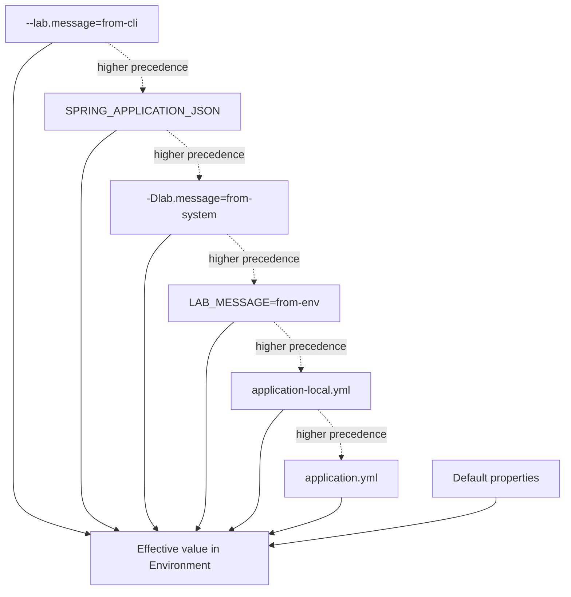

# Comparing the Same Property from Files, Environment Variables, and Command Line

## 1. Lab Objectives

In a Spring Boot application, the same property can be declared in multiple sources: the `application.yml` file, profile-specific files, environment variables, Java system properties, and command-line arguments. Spring Boot merges these sources into a single `Environment` and selects values according to precedence order.

In this lab, you build a small REST application to directly observe the effective value of the same property as each source changes. The application has two properties:

- `lab.message`: the message returned via the API.
- `lab.timeout-seconds`: a demonstration timeout value, in seconds.

You will test the following cases:

1. Values present only in `application.yml`.
2. The `local` profile overriding the base file.
3. Environment variables overriding file values.
4. Java system properties overriding environment variables.
5. Command-line arguments overriding system properties.
6. Actuator displaying the PropertySource and the origin of values.
7. Extending the exercise to retrieve configuration from Spring Cloud Config Server.

The lab uses Spring Boot `4.1.2` and Spring Cloud BOM `2025.1.4`. Boot 4.1.2 requires Java 17 or later; the Cloud BOM is declared so the Config Client extension uses the matching release train. You can use Maven 3.6.3 or later, or Maven Wrapper.

## 2. Understanding Precedence Order Before Running

Among the sources used in this exercise, the precedence order from highest to lowest is:

| Order | Source | Example |
| --- | --- | --- |
| 1 | Command-line arguments | `--lab.message=from-cli` |
| 2 | `SPRING_APPLICATION_JSON` | JSON in an environment variable or system property |
| 3 | Java system properties | `-Dlab.message=from-system` |
| 4 | OS environment variables | `LAB_MESSAGE=from-env` |
| 5 | Config Data | `application-local.yml`, `application.yml` |
| 6 | `@PropertySource` | Properties added via annotation |
| 7 | Default properties | Default values in `SpringApplication` |

The table above focuses on the sources observed in this project. Spring Boot also has other sources such as test properties, servlet parameters, JNDI, and Devtools global settings; their positions depend on the runtime environment.

Two key points to remember:

- `application-local.yml` is loaded when the `local` profile is active and can override `application.yml` within the Config Data group.
- Environment variables and command-line arguments have higher precedence than Config Data files. Therefore, editing `application.yml` while `LAB_MESSAGE` remains set in the terminal will not change the API value.



Spring Boot looks up properties starting from the highest-precedence PropertySource first. Once a matching value is found, that value is used by `Environment.getProperty(...)` and the binding mechanism.

## 3. Preparing the Environment

Install and verify:

- JDK 17 or later.
- Maven 3.6.3 or later, or Maven Wrapper.
- A PowerShell terminal on Windows or Bash on Linux/macOS.
- `curl` or `curl.exe` to call REST endpoints.

Check versions:

```bash
java -version
mvn -version
```

If using Maven Wrapper:

```bash
./mvnw -version
```

On Windows PowerShell, use `mvnw.cmd` instead of `./mvnw`.

## 4. Creating the Project Structure

Create a Maven project named `property-precedence-lab` with this structure:

```text
property-precedence-lab/
├── pom.xml
└── src/
    ├── main/
    │   ├── java/
    │   │   └── vn/example/configlab/
    │   │       ├── PropertyPrecedenceApplication.java
    │   │       ├── config/
    │       │       │   └── LabProperties.java
    │       │       └── web/
    │       │           └── ConfigController.java
    │   └── resources/
    │       ├── application.yml
    │       └── application-local.yml
    └── test/
        └── java/
            └── vn/example/configlab/config/
                └── LabPropertiesTests.java
```

Subpackages are placed under the main package `vn.example.configlab` so component scanning and configuration properties scanning can discover all project classes.

## 5. Declaring Maven and Spring Cloud BOM

Create `pom.xml`:

```xml
<project xmlns="http://maven.apache.org/POM/4.0.0"
         xmlns:xsi="http://www.w3.org/2001/XMLSchema-instance"
         xsi:schemaLocation="http://maven.apache.org/POM/4.0.0 https://maven.apache.org/xsd/maven-4.0.0.xsd">
    <modelVersion>4.0.0</modelVersion>

    <parent>
        <groupId>org.springframework.boot</groupId>
        <artifactId>spring-boot-starter-parent</artifactId>
        <version>4.1.2</version>
        <relativePath/>
    </parent>

    <groupId>vn.example</groupId>
    <artifactId>property-precedence-lab</artifactId>
    <version>0.0.1-SNAPSHOT</version>
    <name>property-precedence-lab</name>
    <description>Compare Spring Boot property sources</description>

    <properties>
        <java.version>17</java.version>
        <spring-cloud.version>2025.1.4</spring-cloud.version>
    </properties>

    <dependencyManagement>
        <dependencies>
            <dependency>
                <groupId>org.springframework.cloud</groupId>
                <artifactId>spring-cloud-dependencies</artifactId>
                <version>${spring-cloud.version}</version>
                <type>pom</type>
                <scope>import</scope>
            </dependency>
        </dependencies>
    </dependencyManagement>

    <dependencies>
        <dependency>
            <groupId>org.springframework.boot</groupId>
            <artifactId>spring-boot-starter-webmvc</artifactId>
        </dependency>

        <dependency>
            <groupId>org.springframework.boot</groupId>
            <artifactId>spring-boot-starter-actuator</artifactId>
        </dependency>

        <dependency>
            <groupId>org.springframework.boot</groupId>
            <artifactId>spring-boot-configuration-processor</artifactId>
            <optional>true</optional>
        </dependency>

        <dependency>
            <groupId>org.springframework.boot</groupId>
            <artifactId>spring-boot-starter-test</artifactId>
            <scope>test</scope>
        </dependency>
    </dependencies>

    <profiles>
        <profile>
            <id>with-config-client</id>
            <dependencies>
                <dependency>
                    <groupId>org.springframework.cloud</groupId>
                    <artifactId>spring-cloud-starter-config</artifactId>
                </dependency>
            </dependencies>
        </profile>
    </profiles>

    <build>
        <plugins>
            <plugin>
                <groupId>org.springframework.boot</groupId>
                <artifactId>spring-boot-maven-plugin</artifactId>
            </plugin>
        </plugins>
    </build>
</project>
```

`spring-boot-starter-webmvc` provides Spring MVC and embedded Tomcat. `spring-boot-starter-actuator` provides diagnostic endpoints. The Spring Cloud BOM manages Cloud module versions; the Config Client dependency is added only when the `with-config-client` Maven profile is activated.

This profile separation allows the base project to run standalone. When working on the Config Server extension, you then add Config Client to the runtime classpath.

## 6. Creating the Startup Class

Create `PropertyPrecedenceApplication.java`:

```java
package vn.example.configlab;

import org.springframework.boot.SpringApplication;
import org.springframework.boot.autoconfigure.SpringBootApplication;
import org.springframework.boot.context.properties.ConfigurationPropertiesScan;

@SpringBootApplication
@ConfigurationPropertiesScan
public class PropertyPrecedenceApplication {

    public static void main(String[] args) {
        SpringApplication.run(PropertyPrecedenceApplication.class, args);
    }
}
```

`@ConfigurationPropertiesScan` registers classes annotated with `@ConfigurationProperties` in the current package and its subpackages.

## 7. Declaring a Typed Property Group

Create `LabProperties.java`:

```java
package vn.example.configlab.config;

import org.springframework.boot.context.properties.ConfigurationProperties;

@ConfigurationProperties(prefix = "lab")
public record LabProperties(
        String message,
        int timeoutSeconds
) {
}
```

Spring Boot binds the two properties `lab.message` and `lab.timeout-seconds` into the record. Using the `int` type helps you observe type conversion from strings in YAML, environment variables, or the command line into an integer.

With a record, Spring Boot uses constructor binding. You do not need to write setters for each field.

## 8. Creating a REST Endpoint to Read the Effective Value

Create `ConfigController.java`:

```java
package vn.example.configlab.web;

import org.springframework.web.bind.annotation.GetMapping;
import org.springframework.web.bind.annotation.RequestMapping;
import org.springframework.web.bind.annotation.RestController;
import vn.example.configlab.config.LabProperties;

@RestController
@RequestMapping("/api/config")
public class ConfigController {

    private final LabProperties properties;

    public ConfigController(LabProperties properties) {
        this.properties = properties;
    }

    @GetMapping
    public ConfigResponse currentConfiguration() {
        return new ConfigResponse(
                properties.message(),
                properties.timeoutSeconds()
        );
    }

    public record ConfigResponse(
            String message,
            int timeoutSeconds
    ) {
    }
}
```

The `/api/config` endpoint returns the values after Spring has resolved the precedence order and bound them into `LabProperties`. The controller does not need to know whether a value came from YAML, the environment, or the command line.

## 9. Declaring Values in application.yml

Create `src/main/resources/application.yml`:

```yaml
spring:
  application:
    name: property-precedence-lab

lab:
  message: "Value from application.yml"
  timeout-seconds: 3
```

This is the base configuration source packaged on the application classpath. When no higher-precedence source is present, the API returns:

```json
{
  "message": "Value from application.yml",
  "timeoutSeconds": 3
}
```

## 10. Adding the local Profile to Observe Config Data

Create `src/main/resources/application-local.yml`:

```yaml
lab:
  message: "Value from application-local.yml"
  timeout-seconds: 5

server:
  address: 127.0.0.1

management:
  endpoints:
    web:
      exposure:
        include: health,env
  endpoint:
    env:
      show-values: always
```

When the `local` profile is active, `application-local.yml` is loaded alongside `application.yml`. Values in the profile-specific file override the corresponding values in the base file.

In this profile, the Actuator `env` endpoint is enabled to view the PropertySource and origin of `lab.message`. `show-values: always` is configured solely for this local lab. The server binds only to loopback `127.0.0.1`, preventing diagnostic endpoints from being exposed to external networks during practice.

Do not carry configuration that exposes all Environment values into production. The `env` endpoint can reveal configuration details and should only be exposed in controlled environments with proper authentication and authorization.

## 11. Testing Configuration Properties Binding

Create `LabPropertiesTests.java`:

```java
package vn.example.configlab.config;

import static org.assertj.core.api.Assertions.assertThat;

import org.junit.jupiter.api.Test;
import org.springframework.beans.factory.annotation.Autowired;
import org.springframework.boot.test.context.SpringBootTest;

@SpringBootTest(properties = {
        "lab.message=from-test",
        "lab.timeout-seconds=7"
})
class LabPropertiesTests {

    @Autowired
    private LabProperties properties;

    @Test
    void bindsValuesFromTestProperties() {
        assertThat(properties.message()).isEqualTo("from-test");
        assertThat(properties.timeoutSeconds()).isEqualTo(7);
    }
}
```

Test properties declared in `@SpringBootTest` have high precedence in the test context. This test verifies that the record binds with the right data types and that controller dependencies can be instantiated. Comparing precedence across files, environment, and command line will be performed by running the real process in the following steps.

Run the test:

```bash
mvn clean test
```

The expected result is that all tests pass.

## 12. Packaging and Running the Application

Package the executable JAR:

```bash
mvn clean package
```

The artifact is generated at:

```text
target/property-precedence-lab-0.0.1-SNAPSHOT.jar
```

You can run it with Maven:

```bash
mvn spring-boot:run
```

Or run the JAR:

```bash
java -jar target/property-precedence-lab-0.0.1-SNAPSHOT.jar
```

To inspect the local profile configuration and Actuator `env`, start the application with the `local` profile.

PowerShell:

```powershell
$env:SPRING_PROFILES_ACTIVE = "local"
java -jar target/property-precedence-lab-0.0.1-SNAPSHOT.jar
```

Bash:

```bash
SPRING_PROFILES_ACTIVE=local java -jar target/property-precedence-lab-0.0.1-SNAPSHOT.jar
```

Call the API in a second terminal:

```bash
curl http://127.0.0.1:8080/api/config
```

Expected output:

```json
{
  "message": "Value from application-local.yml",
  "timeoutSeconds": 5
}
```

The `local` profile has overridden the base values in `application.yml`.

## 13. Testing Overrides with Environment Variables

Spring Boot supports relaxed binding for environment variables. The rules to convert a canonical property name to an environment variable name are:

1. Replace dots `.` with underscores `_`.
2. Remove dashes `-`.
3. Convert the entire name to uppercase.

For the two properties in this lab:

| Property | Environment variable |
| --- | --- |
| `lab.message` | `LAB_MESSAGE` |
| `lab.timeout-seconds` | `LAB_TIMEOUTSECONDS` |

Note that the second variable name is not `LAB_TIMEOUT_SECONDS`: dashes in the property name are removed when converting to an environment variable name.

### 13.1. PowerShell

Open a new terminal or stop the previous process, then run:

```powershell
$env:SPRING_PROFILES_ACTIVE = "local"
$env:LAB_MESSAGE = "from-env"
$env:LAB_TIMEOUTSECONDS = "8"
java -jar target/property-precedence-lab-0.0.1-SNAPSHOT.jar
```

Call the API:

```powershell
curl.exe http://127.0.0.1:8080/api/config
```

Output:

```json
{
  "message": "from-env",
  "timeoutSeconds": 8
}
```

Environment variables have higher precedence than Config Data, so both values from `application-local.yml` are overridden.

### 13.2. Bash

Run the application with environment variables scoped to that single process:

```bash
SPRING_PROFILES_ACTIVE=local LAB_MESSAGE=from-env LAB_TIMEOUTSECONDS=8 \
java -jar target/property-precedence-lab-0.0.1-SNAPSHOT.jar
```

The endpoint output matches the PowerShell case.

## 14. Testing Overrides with Java System Properties

Java system properties are passed via the `-D` flag. This argument must appear before `-jar`:

```bash
java -Dlab.message=from-system \
     -Dlab.timeout-seconds=10 \
     -jar target/property-precedence-lab-0.0.1-SNAPSHOT.jar
```

If the local profile is active and `LAB_MESSAGE`/`LAB_TIMEOUTSECONDS` are also set, system properties win over environment variables.

Example output:

```json
{
  "message": "from-system",
  "timeoutSeconds": 10
}
```

If you place `-D` after the JAR filename, Java will no longer treat it as a JVM system property; it may be passed to `main(String[] args)` as an application argument and will not behave equivalently.

## 15. Testing Overrides with Spring Boot Command-Line Arguments

Spring Boot accepts command-line properties in the `--key=value` format.

Run:

```bash
java -Dlab.message=from-system \
     -Dlab.timeout-seconds=10 \
     -jar target/property-precedence-lab-0.0.1-SNAPSHOT.jar \
     --lab.message=from-cli \
     --lab.timeout-seconds=12
```

Output:

```json
{
  "message": "from-cli",
  "timeoutSeconds": 12
}
```

Command-line arguments have higher precedence than system properties, environment variables, and Config Data. Therefore, `from-cli` wins over `from-system`, `from-env`, and the YAML values.

On PowerShell, you can run the same command on a single line:

```powershell
java -Dlab.message=from-system -Dlab.timeout-seconds=10 -jar target/property-precedence-lab-0.0.1-SNAPSHOT.jar --lab.message=from-cli --lab.timeout-seconds=12
```

## 16. Comparing Multiple Sources Simultaneously

Run the following test with the `local` profile active:

- `application.yml` sets message to `Value from application.yml`.
- `application-local.yml` sets message to `Value from application-local.yml`.
- `LAB_MESSAGE` sets message to `from-env`.
- `-Dlab.message=from-system` sets message to `from-system`.
- `--lab.message=from-cli` sets message to `from-cli`.

The API value must be `from-cli`.

Result table:

| Source | `lab.message` Value | Wins? |
| --- | --- | --- |
| Command line | `from-cli` | Yes |
| Java system property | `from-system` | No |
| Environment variable | `from-env` | No |
| `application-local.yml` | `Value from application-local.yml` | No |
| `application.yml` | `Value from application.yml` | No |

Modify the command to remove `--lab.message=from-cli`. The value should now be `from-system`. Next, remove `-Dlab.message=from-system`; the result should be `from-env`. Finally, unset `LAB_MESSAGE`, and the result returns to `application-local.yml`.

This lets you verify each layer without modifying source code.

## 17. Inspecting PropertySource and Origin with Actuator

When running with the `local` profile, call:

```bash
curl http://127.0.0.1:8080/actuator/env/lab.message
```

On PowerShell, use `curl.exe`:

```powershell
curl.exe http://127.0.0.1:8080/actuator/env/lab.message
```

The Actuator `env` response contains the effective property and the list of PropertySources declaring that property. Depending on the source, the response may display an origin such as the file, line, or provider of the value.

Observe the common source names:

| PropertySource | Meaning |
| --- | --- |
| `commandLineArgs` | Argument `--lab.message=...` |
| `systemProperties` | Java `-Dlab.message=...` |
| `systemEnvironment` | Environment variable `LAB_MESSAGE` |
| Config resource `application-local.yml` | Profile configuration file |
| Config resource `application.yml` | Base configuration file |

The list may include additional internal PropertySources or other resource names depending on how the app is launched. Check the actual order in your application's own response.

Actuator is useful when an application has many configuration files or is deployed with multiple override sources. It helps answer two questions: which value is the property using, and which source supplied that value.

## 18. Changing Profiles and Restoring Values

Profiles are also part of Config Data. Test these cases:

- Without `SPRING_PROFILES_ACTIVE`: `application.yml` supplies the values.
- With `SPRING_PROFILES_ACTIVE=local`: `application-local.yml` overrides `application.yml`.
- Also setting `LAB_MESSAGE=from-env`: environment overrides both files.
- Also passing `--lab.message=from-cli`: command line overrides all lower sources.

PowerShell commands to clear the variables after testing:

```powershell
Remove-Item Env:LAB_MESSAGE -ErrorAction SilentlyContinue
Remove-Item Env:LAB_TIMEOUTSECONDS -ErrorAction SilentlyContinue
Remove-Item Env:SPRING_PROFILES_ACTIVE -ErrorAction SilentlyContinue
```

After stopping and restarting the application, confirm that the values return to the base configuration. A running process does not automatically pick up terminal environment changes made after the process was started; you must launch a new process to test again.

## 19. Extension: Adding Spring Cloud Config Client

Spring Cloud Config Client integrates remote configuration into the Config Data system. When a Config Server is available, certain values can be fetched from the server by application name, profile, and label.

The Cloud BOM is already declared in `pom.xml`. Activate the `with-config-client` Maven profile to include the starter:

```bash
mvn -Pwith-config-client clean package
```

Add `src/main/resources/application-cloud.yml` for the `cloud` profile:

```yaml
spring:
  config:
    import: "optional:configserver:http://localhost:8888"
```

Start with both `local` and `cloud` profiles active:

```bash
java -jar target/property-precedence-lab-0.0.1-SNAPSHOT.jar \
     --spring.profiles.active=local,cloud
```

If Config Server is not running, the `optional:` prefix allows the application to continue using local configuration. If the server is running and returns `lab.message`, observe the new PropertySource in `/actuator/env/lab.message`.

A Config Data import is inserted directly beneath the document declaring the import. In this lab, that document is `application-cloud.yml`; therefore, the remote source can override the local profile configuration loaded before it. Command-line arguments, `SPRING_APPLICATION_JSON`, system properties, and environment variables still take higher precedence than Config Data.

For example, if Config Server returns `lab.message=from-config-server`:

| Source | Value |
| --- | --- |
| Command line | `from-cli` |
| Environment | `from-env` |
| Config Server | `from-config-server` |
| Profile file | `Value from application-local.yml` |
| Base file | `Value from application.yml` |

When no CLI or environment variable is passed, the remote Config Server can supply the effective value. When `LAB_MESSAGE` or `--lab.message` is provided, the higher-precedence local sources win.

Do not pass Config Server passwords or tokens directly on the command line in production environments. Use a secret manager, mounted secrets, or appropriate authentication mechanisms; the command line in this lab is used only for non-sensitive demonstration values.

## 20. Troubleshooting During Practice

| Symptom | Possible Cause | How to Check |
| --- | --- | --- |
| Edited `application.yml` but API did not change | Environment or CLI is overriding it | Check `LAB_MESSAGE`, `-D`, and `--lab.message` |
| Local profile has no effect | `SPRING_PROFILES_ACTIVE` not set or misspelled | Check active profiles in startup logs and Actuator |
| Environment variable does not bind | Variable name violates relaxed binding rules | Use `LAB_MESSAGE`, `LAB_TIMEOUTSECONDS` |
| Timeout value fails to convert to number | Value is not an integer | Use a value like `8`, not `eight` |
| `-D` has no effect | `-D` placed after `-jar` | Move system properties before `-jar` |
| CLI does not override | Missing double dash or wrong key | Use `--lab.message=from-cli` |
| Cannot access `/actuator/env` | Local profile not active or endpoint not exposed | Check `SPRING_PROFILES_ACTIVE=local` |
| Actuator hides values | `show-values` not enabled in local profile | Check `management.endpoint.env.show-values` |
| Config Client reports missing `spring.config.import` | Import not supplied when Config Client Maven profile is active | Add `--spring.config.import=optional:configserver:http://localhost:8888` |
| Config Server unreachable | Server not running or wrong address | Check host, port, network, and startup logs |

## 21. Extension Exercises

After completing the main part, implement these additional tasks:

1. Add `lab.banner` and declare it in `application.yml`, `application-local.yml`, environment, and command line.
2. Add a boolean property `lab.feature-enabled`; test relaxed binding from `LAB_FEATUREENABLED`.
3. Use `SPRING_APPLICATION_JSON` to set `lab.message`, then compare it with system properties and command line.
4. Use `--spring.config.additional-location` to load a YAML file outside the classpath.
5. Add a `staging` profile and create `application-staging.yml`.
6. Enable the Config Client extension and compare the origin of a local file with remote Config Server.
7. Write a separate integration test that launches the application with different environment variables and command-line arguments.

Record the result of each run, including the command used, the API output returned, and the PropertySource supplying the effective value.

## 22. Completion Criteria

- [ ] The project builds successfully with Spring Boot `4.1.2`.
- [ ] `LabProperties` binds `lab.message` and `lab.timeout-seconds`.
- [ ] The `/api/config` API returns the expected values from configuration.
- [ ] `application-local.yml` overrides `application.yml` when the local profile is active.
- [ ] `LAB_MESSAGE` overrides values from files.
- [ ] `-Dlab.message` overrides the environment variable.
- [ ] `--lab.message` overrides the Java system property.
- [ ] Actuator `/actuator/env/lab.message` shows the corresponding PropertySource in the local environment.
- [ ] You can explain why the API value does not change while a higher-precedence source still exists.
- [ ] The Config Client extension can be enabled via Maven profile without requiring a running Config Server when using `optional:`.

## 23. Self-Check Questions

1. Why can command-line arguments override values in `application.yml`?
2. Which canonical property does `LAB_MESSAGE` map to?
3. Why does `lab.timeout-seconds` map to `LAB_TIMEOUTSECONDS`?
4. Where must `-Dlab.message=...` be placed in a `java -jar` command?
5. When is `application-local.yml` loaded, and what is its precedence relationship with `application.yml`?
6. How does the Actuator `env` endpoint help locate the source of a property?
7. Why should the `env` endpoint be exposed only in the local profile?
8. When Config Client imports remote Config Data, can environment variables and command-line arguments still override it?
9. Why does changing an environment variable in the terminal not automatically update an already running process?
10. When should you use Config Server instead of passing many values via the command line?

## 24. Official References

- [Spring Boot — Externalized Configuration](https://docs.spring.io/spring-boot/reference/features/external-config.html) — PropertySource precedence order, Config Data, environment variables, command-line arguments, and `SPRING_APPLICATION_JSON`.
- [Spring Boot — Type-safe Configuration Properties](https://docs.spring.io/spring-boot/reference/features/external-config.html) — `@ConfigurationProperties`, relaxed binding, and type conversion.
- [Spring Boot — Actuator Endpoints](https://docs.spring.io/spring-boot/reference/actuator/endpoints.html) — exposing the `env` endpoint, endpoint security, and displaying values.
- [Spring Boot — Build Systems and Starters](https://docs.spring.io/spring-boot/reference/using/build-systems.html) — Web MVC starter, dependency management, and builds.
- [Spring Boot — System Requirements](https://docs.spring.io/spring-boot/system-requirements.html) — Java and Maven/Gradle compatibility with Spring Boot 4.1.2.
- [Spring Cloud — Release Train Compatibility](https://spring.io/projects/spring-cloud/) — matching Spring Cloud release trains with Spring Boot.
- [Spring Cloud Config — Config Client](https://docs.spring.io/spring-cloud-config/reference/client.html) — `spring.config.import`, Config Data, and remote property sources.
- [Spring Cloud Config — Property Overrides](https://docs.spring.io/spring-cloud-config/reference/server/environment-repository/property-overrides.html) — how Config Server provides property overrides to clients.

*This hands-on guide lets you directly observe how Spring Boot selects effective values across multiple configuration sources. When debugging a Spring Cloud application, inspect the PropertySource and origin before concluding that a config file or Config Server is not being read.*
