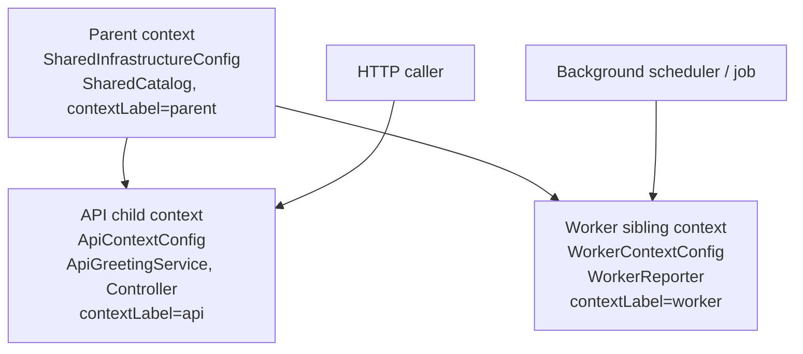
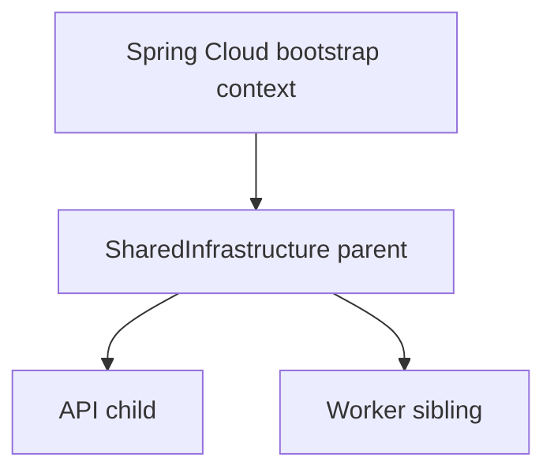

# Experimenting with Parent, Child, and Sibling Contexts

This hands-on lab builds an application composed of three Spring ApplicationContexts: a parent context holding shared infrastructure, a child context running an HTTP API, and a sibling context running background tasks. You will observe initialization order, bean visibility scope, how a child shadows a bean of the same name in the parent, how siblings share beans from the parent, and how to close contexts safely.

This is a lab on **Spring ApplicationContext hierarchy** in Spring Boot, connected to Spring Cloud Context. Context hierarchy is a Spring Framework capability supported by Spring Boot via `SpringApplicationBuilder`. Spring Cloud can add a bootstrap context, remote property sources, and refresh scope into individual contexts within that hierarchy.

Expected outcomes:

- The parent creates a single `SharedCatalog` bean.
- Both the API child and the worker sibling access that exact same `SharedCatalog` instance.
- The parent defines a `contextLabel=parent` bean; API and worker define beans with the same name and their own values.
- API sees only its own beans and beans from the parent; worker sees only its own beans and beans from the parent.
- The parent does not see beans declared inside a child.
- API and worker share the same parent, yet cannot see each other's local beans.
- On shutdown, children are closed first and the parent is closed last.

## 1. Problem Statement and Context Diagram

Suppose an application needs to share a catalog cache and connection configuration, while keeping its HTTP API separate from a background worker. You can place shared beans into the parent context, while HTTP-facing beans and batch-processing beans live in two independent child contexts.



The parent is the root context of the application in this lab. API and worker are sibling contexts because they share the same parent. Sibling is not a distinct class type; it is a relationship between contexts that have the same parent.

Relationships to verify:

| Relationship | Result |
| --- | --- |
| Parent → child | The child looks up local beans first, then searches the parent |
| Child → parent | The parent cannot find beans declared inside a child |
| API ↔ worker | Two siblings do not automatically see each other's local beans |
| Parent → both children | A singleton bean in the parent is shared by both children |
| Child bean sharing name with parent bean | The child uses its local bean; the parent retains its own bean |
| Closing parent | Children lose their parent context and can no longer use beans provided by the parent |

## 2. Project Setup

Create a Maven project with this structure:

```text
context-hierarchy-lab/
├── pom.xml
└── src/
    ├── main/
    │   └── java/
    │       └── com/example/contextlab/
    │           ├── ContextHierarchyApplication.java
    │           ├── shared/
    │           │   ├── SharedInfrastructureConfig.java
    │           │   └── SharedCatalog.java
    │           ├── api/
    │           │   ├── ApiContextConfig.java
    │           │   ├── ApiGreetingService.java
    │           │   └── ApiController.java
    │           └── worker/
    │               ├── WorkerContextConfig.java
    │               └── WorkerReporter.java
    └── test/
        └── java/
            └── com/example/contextlab/
                └── ContextHierarchyTest.java
```

### 2.1. Dependencies and BOM

Use a Spring Boot and Spring Cloud release train pair declared compatible in the compatibility matrix at the time of execution. The versions below are passed via Maven properties so the lab is not locked to one specific release train.

```xml
<project xmlns="http://maven.apache.org/POM/4.0.0"
         xmlns:xsi="http://www.w3.org/2001/XMLSchema-instance"
         xsi:schemaLocation="http://maven.apache.org/POM/4.0.0
         https://maven.apache.org/xsd/maven-4.0.0.xsd">
    <modelVersion>4.0.0</modelVersion>

    <groupId>com.example</groupId>
    <artifactId>context-hierarchy-lab</artifactId>
    <version>1.0.0-SNAPSHOT</version>

    <properties>
        <java.version>17</java.version>
        <maven.compiler.release>17</maven.compiler.release>
        <project.build.sourceEncoding>UTF-8</project.build.sourceEncoding>
    </properties>

    <dependencyManagement>
        <dependencies>
            <dependency>
                <groupId>org.springframework.boot</groupId>
                <artifactId>spring-boot-dependencies</artifactId>
                <version>${boot.version}</version>
                <type>pom</type>
                <scope>import</scope>
            </dependency>
            <dependency>
                <groupId>org.springframework.cloud</groupId>
                <artifactId>spring-cloud-dependencies</artifactId>
                <version>${cloud.version}</version>
                <type>pom</type>
                <scope>import</scope>
            </dependency>
        </dependencies>
    </dependencyManagement>

    <dependencies>
        <dependency>
            <groupId>org.springframework.boot</groupId>
            <artifactId>spring-boot-starter-web</artifactId>
        </dependency>

        <dependency>
            <groupId>org.springframework.cloud</groupId>
            <artifactId>spring-cloud-context</artifactId>
        </dependency>

        <dependency>
            <groupId>org.springframework.boot</groupId>
            <artifactId>spring-boot-starter-test</artifactId>
            <scope>test</scope>
        </dependency>
    </dependencies>

    <build>
        <plugins>
            <plugin>
                <groupId>org.apache.maven.plugins</groupId>
                <artifactId>maven-compiler-plugin</artifactId>
                <version>3.14.1</version>
                <configuration>
                    <release>${maven.compiler.release}</release>
                </configuration>
            </plugin>
            <plugin>
                <groupId>org.apache.maven.plugins</groupId>
                <artifactId>maven-surefire-plugin</artifactId>
                <version>3.5.4</version>
            </plugin>
            <plugin>
                <groupId>org.springframework.boot</groupId>
                <artifactId>spring-boot-maven-plugin</artifactId>
                <version>${boot.version}</version>
            </plugin>
        </plugins>
    </build>
</project>
```

`spring-cloud-context` has its version managed by the Cloud BOM. The project uses `spring-boot-starter-web` to run the API child and `spring-boot-starter-test` to verify the hierarchy. Eureka or Config Server is not needed because the primary objective is observing context relationships within the same JVM.

Replace `boot.version` and `cloud.version` with concrete versions from the compatibility matrix. Keep the JDK/toolchain aligned with the requirements of the chosen Spring Boot version. If the target Boot version requires a Java version newer than 17, update `maven.compiler.release` and the JDK running Maven accordingly.

Example build command:

```bash
mvn -Dboot.version=YOUR_BOOT_VERSION -Dcloud.version=YOUR_CLOUD_TRAIN_VERSION clean test
```

## 3. Creating Shared Beans in the Parent Context

The parent context holds `SharedCatalog`. This is a singleton created once in the parent and used by both API and worker.

### 3.1. The SharedCatalog Class

File `src/main/java/com/example/contextlab/shared/SharedCatalog.java`:

```java
package com.example.contextlab.shared;

import java.util.UUID;

public class SharedCatalog {

    private final String instanceId = UUID.randomUUID().toString();

    public String instanceId() {
        return instanceId;
    }

    public String describe() {
        return "shared-catalog@" + instanceId;
    }
}
```

The random ID helps identify whether children are using the exact same object. If the parent creates the singleton once, every access to this bean from API or worker returns the same instance.

### 3.2. Parent Configuration

File `src/main/java/com/example/contextlab/shared/SharedInfrastructureConfig.java`:

```java
package com.example.contextlab.shared;

import org.springframework.context.annotation.Bean;
import org.springframework.context.annotation.Configuration;

@Configuration(proxyBeanMethods = false)
public class SharedInfrastructureConfig {

    @Bean
    SharedCatalog sharedCatalog() {
        return new SharedCatalog();
    }

    @Bean(name = "contextLabel")
    String parentContextLabel() {
        return "parent";
    }
}
```

The parent provides two beans:

- `sharedCatalog`: the shared resource.
- `contextLabel`: a default value demonstrating how a child defines a bean with the same name.

The parent does not declare controllers, servlets, schedulers, or beans that depend on a specific child. A parent should contain components usable by multiple children without any reverse dependency back to a child.

## 4. Creating the API Child Context

The API child has its own business bean and a REST controller. This child will override the `contextLabel` bean within its own scope.

### 4.1. API Service

File `src/main/java/com/example/contextlab/api/ApiGreetingService.java`:

```java
package com.example.contextlab.api;

import com.example.contextlab.shared.SharedCatalog;

import java.util.Map;

public class ApiGreetingService {

    private final SharedCatalog sharedCatalog;
    private final String contextLabel;

    public ApiGreetingService(
            SharedCatalog sharedCatalog,
            String contextLabel) {
        this.sharedCatalog = sharedCatalog;
        this.contextLabel = contextLabel;
    }

    public Map<String, String> describe() {
        return Map.of(
                "context", contextLabel,
                "sharedCatalogId", sharedCatalog.instanceId(),
                "sharedCatalog", sharedCatalog.describe()
        );
    }
}
```

The constructor receives `SharedCatalog` from the parent and `contextLabel` from the API child. When a child resolves a bean by name, the child's local bean takes precedence over a bean with the same name in the parent.

### 4.2. REST Controller

File `src/main/java/com/example/contextlab/api/ApiController.java`:

```java
package com.example.contextlab.api;

import org.springframework.web.bind.annotation.GetMapping;
import org.springframework.web.bind.annotation.RequestMapping;
import org.springframework.web.bind.annotation.RestController;

import java.util.Map;

@RestController
@RequestMapping("/api")
public class ApiController {

    private final ApiGreetingService greetingService;

    public ApiController(ApiGreetingService greetingService) {
        this.greetingService = greetingService;
    }

    @GetMapping("/context")
    public Map<String, String> context() {
        return greetingService.describe();
    }
}
```

### 4.3. API Context Configuration

File `src/main/java/com/example/contextlab/api/ApiContextConfig.java`:

```java
package com.example.contextlab.api;

import com.example.contextlab.shared.SharedCatalog;
import org.springframework.beans.factory.annotation.Qualifier;
import org.springframework.boot.autoconfigure.EnableAutoConfiguration;
import org.springframework.context.annotation.Bean;
import org.springframework.context.annotation.Configuration;

@Configuration(proxyBeanMethods = false)
@EnableAutoConfiguration
public class ApiContextConfig {

    @Bean(name = "contextLabel")
    String apiContextLabel() {
        return "api";
    }

    @Bean
    ApiGreetingService apiGreetingService(
            SharedCatalog sharedCatalog,
            @Qualifier("contextLabel") String contextLabel) {
        return new ApiGreetingService(sharedCatalog, contextLabel);
    }

    @Bean
    ApiController apiController(ApiGreetingService greetingService) {
        return new ApiController(greetingService);
    }
}
```

`@EnableAutoConfiguration` activates the auto-configuration needed for the web server and Spring MVC. We use `@Configuration` instead of `@SpringBootApplication` to avoid component-scanning the entire package. Beans are registered explicitly so it is clear which bean belongs to which context.

## 5. Creating the Worker Sibling Context

Worker is an independent context sharing the same parent as API. Worker uses `SharedCatalog` from the parent but has its own service and `contextLabel` bean.

### 5.1. Worker Reporter

File `src/main/java/com/example/contextlab/worker/WorkerReporter.java`:

```java
package com.example.contextlab.worker;

import com.example.contextlab.shared.SharedCatalog;

public class WorkerReporter {

    private final SharedCatalog sharedCatalog;
    private final String contextLabel;

    public WorkerReporter(
            SharedCatalog sharedCatalog,
            String contextLabel) {
        this.sharedCatalog = sharedCatalog;
        this.contextLabel = contextLabel;
    }

    public String report() {
        return "context=" + contextLabel
                + ", sharedCatalogId=" + sharedCatalog.instanceId();
    }
}
```

### 5.2. Worker Context Configuration

File `src/main/java/com/example/contextlab/worker/WorkerContextConfig.java`:

```java
package com.example.contextlab.worker;

import com.example.contextlab.shared.SharedCatalog;
import org.springframework.beans.factory.annotation.Qualifier;
import org.springframework.context.annotation.Bean;
import org.springframework.context.annotation.Configuration;

@Configuration(proxyBeanMethods = false)
public class WorkerContextConfig {

    @Bean(name = "contextLabel")
    String workerContextLabel() {
        return "worker";
    }

    @Bean
    WorkerReporter workerReporter(
            SharedCatalog sharedCatalog,
            @Qualifier("contextLabel") String contextLabel) {
        return new WorkerReporter(sharedCatalog, contextLabel);
    }
}
```

Worker does not declare a web server. It only contains beans for background processing. Because `SharedCatalog` is not redeclared inside worker, worker's bean factory walks up to the parent to obtain that bean.

## 6. Building Parent, Child, and Sibling with SpringApplicationBuilder

`SpringApplicationBuilder` provides `parent()`, `child()`, and `sibling()` methods to build a context hierarchy. In this lab:

1. Create the root builder with `SharedInfrastructureConfig`.
2. Create the API child from the root builder.
3. Run the API child first.
4. Call `sibling()` on the API builder to create the worker sharing the same parent.
5. Run the worker sibling.
6. Observe beans and parent relationships.

File `src/main/java/com/example/contextlab/ContextHierarchyApplication.java`:

```java
package com.example.contextlab;

import com.example.contextlab.api.ApiContextConfig;
import com.example.contextlab.api.ApiGreetingService;
import com.example.contextlab.shared.SharedCatalog;
import com.example.contextlab.shared.SharedInfrastructureConfig;
import com.example.contextlab.worker.WorkerContextConfig;
import com.example.contextlab.worker.WorkerReporter;
import org.springframework.boot.WebApplicationType;
import org.springframework.boot.builder.SpringApplicationBuilder;
import org.springframework.context.ConfigurableApplicationContext;

public class ContextHierarchyApplication {

    public static void main(String[] args) {
        SpringApplicationBuilder rootBuilder =
                new SpringApplicationBuilder(SharedInfrastructureConfig.class)
                        .web(WebApplicationType.NONE)
                        .registerShutdownHook(false);

        SpringApplicationBuilder apiBuilder =
                rootBuilder.child(ApiContextConfig.class)
                        .web(WebApplicationType.SERVLET)
                        .properties(
                                "spring.application.name=api-context",
                                "server.port=8081"
                        )
                        .registerShutdownHook(false);

        ConfigurableApplicationContext apiContext =
                apiBuilder.run(args);

        ConfigurableApplicationContext workerContext;
        try {
            SpringApplicationBuilder workerBuilder =
                    apiBuilder.sibling(WorkerContextConfig.class)
                            .web(WebApplicationType.NONE)
                            .properties("spring.application.name=worker-context")
                            .registerShutdownHook(false);

            workerContext = workerBuilder.run(args);
        } catch (RuntimeException startupFailure) {
            apiContext.close();
            closeParent(apiContext);
            throw startupFailure;
        }

        ConfigurableApplicationContext parentContext =
                (ConfigurableApplicationContext) apiContext.getParent();

        printDiagnostics(parentContext, apiContext, workerContext);

        Runtime.getRuntime().addShutdownHook(new Thread(() -> {
            closeIfActive(workerContext);
            closeIfActive(apiContext);
            closeIfActive(parentContext);
        }, "context-hierarchy-shutdown"));
    }

    private static void printDiagnostics(
            ConfigurableApplicationContext parent,
            ConfigurableApplicationContext api,
            ConfigurableApplicationContext worker) {

        SharedCatalog parentCatalog = parent.getBean(SharedCatalog.class);
        SharedCatalog apiCatalog = api.getBean(SharedCatalog.class);
        SharedCatalog workerCatalog = worker.getBean(SharedCatalog.class);

        System.out.println("parent.label="
                + parent.getBean("contextLabel"));
        System.out.println("api.label="
                + api.getBean("contextLabel"));
        System.out.println("worker.label="
                + worker.getBean("contextLabel"));

        System.out.println("api.parent.sameAs.worker.parent="
                + (api.getParent() == worker.getParent()));

        System.out.println("sharedCatalog.sameInstance="
                + (parentCatalog == apiCatalog
                && apiCatalog == workerCatalog));

        System.out.println("api.hasLocalSharedCatalog="
                + api.getBeanFactory().containsLocalBean("sharedCatalog"));

        System.out.println("parent.hasApiGreetingService="
                + parent.containsBean("apiGreetingService"));

        System.out.println("api.hasWorkerReporter="
                + api.containsBean("workerReporter"));

        System.out.println("worker.hasApiGreetingService="
                + worker.containsBean("apiGreetingService"));

        System.out.println("api.response="
                + api.getBean(ApiGreetingService.class).describe());

        System.out.println("worker.report="
                + worker.getBean(WorkerReporter.class).report());
    }

    private static void closeParent(
            ConfigurableApplicationContext child) {
        if (child.getParent() instanceof ConfigurableApplicationContext parent) {
            closeIfActive(parent);
        }
    }

    private static void closeIfActive(
            ConfigurableApplicationContext context) {
        if (context != null && context.isActive()) {
            context.close();
        }
    }
}
```

### 6.1. Why Run API Before Calling sibling()?

`sibling()` creates a new application sharing the same parent as the current builder. Spring Boot's API specifies a side effect of this method: the current application and parent will be started if they are not already running. If you need to pass command-line arguments to that startup, there is a `sibling(Class[], String...)` overload.

In this example, the API child is already started with `apiBuilder.run(args)` before creating the worker sibling. Therefore, calling `sibling()` does not unintentionally start API and parent with an empty argument array.

### 6.2. Why Does Parent Use WebApplicationType.NONE?

The parent only holds shared beans and contains no controllers or servlet components. The API child is the only context that initializes a web server. This layout keeps web-specific infrastructure inside the context that needs it and avoids starting a server in the parent.

The worker sibling also uses `WebApplicationType.NONE` because it only handles background work. If you want an additional web sibling, assign it a distinct port and check each web server's lifecycle.

### 6.3. Why Disable Default Shutdown Hooks?

This lab manages three contexts in a parent-child relationship. We disable each builder's individual shutdown hook and register a single hook to close them in order:

1. Worker sibling.
2. API child.
3. Parent.

Closing the parent first would deprive children of shared beans while they may still be handling requests or jobs. In real applications, let a lifecycle manager or process owner close the hierarchy once in an explicit order.

## 7. Running the Application and Observing Results

Run the application:

```bash
mvn -Dboot.version=YOUR_BOOT_VERSION -Dcloud.version=YOUR_CLOUD_TRAIN_VERSION -Dspring-boot.run.main-class=com.example.contextlab.ContextHierarchyApplication spring-boot:run
```

Call the API endpoint:

```bash
curl http://localhost:8081/api/context
```

The response looks like:

```json
{
  "context": "api",
  "sharedCatalogId": "a-random-uuid",
  "sharedCatalog": "shared-catalog@a-random-uuid"
}
```

The ID is randomly generated on each run. Compare the ID in the response with the `worker.report` and `sharedCatalog.sameInstance` lines in the logs. API and worker must share the same ID because both access the singleton in the parent.

Diagnostic output looks like:

```text
parent.label=parent
api.label=api
worker.label=worker
api.parent.sameAs.worker.parent=true
sharedCatalog.sameInstance=true
api.hasLocalSharedCatalog=false
parent.hasApiGreetingService=false
api.hasWorkerReporter=false
worker.hasApiGreetingService=false
api.response={context=api, sharedCatalogId=..., sharedCatalog=shared-catalog@...}
worker.report=context=worker, sharedCatalogId=...
```

These lines confirm:

- The `contextLabel` bean resolves from each application's local context.
- API and worker share the exact same parent object.
- API does not create a local `sharedCatalog` bean.
- Parent does not know about `apiGreetingService`.
- API does not know about `workerReporter`.
- Worker does not know about `apiGreetingService`.

## 8. Adding a JUnit Test to Verify the Hierarchy

Do not rely solely on logs. We will verify context and bean relationships with a test that constructs the hierarchy itself.

File `src/test/java/com/example/contextlab/ContextHierarchyTest.java`:

```java
package com.example.contextlab;

import com.example.contextlab.api.ApiContextConfig;
import com.example.contextlab.shared.SharedCatalog;
import com.example.contextlab.shared.SharedInfrastructureConfig;
import com.example.contextlab.worker.WorkerContextConfig;
import org.junit.jupiter.api.Test;
import org.springframework.boot.WebApplicationType;
import org.springframework.boot.builder.SpringApplicationBuilder;
import org.springframework.context.ConfigurableApplicationContext;

import static org.assertj.core.api.Assertions.assertThat;

class ContextHierarchyTest {

    @Test
    void parentChildAndSiblingHaveExpectedBeanVisibility() {
        SpringApplicationBuilder rootBuilder =
                new SpringApplicationBuilder(SharedInfrastructureConfig.class)
                        .web(WebApplicationType.NONE)
                        .registerShutdownHook(false);

        SpringApplicationBuilder apiBuilder =
                rootBuilder.child(ApiContextConfig.class)
                        .web(WebApplicationType.NONE)
                        .registerShutdownHook(false);

        ConfigurableApplicationContext api =
                apiBuilder.run("--spring.main.banner-mode=off");

        ConfigurableApplicationContext parent =
                (ConfigurableApplicationContext) api.getParent();

        ConfigurableApplicationContext worker = null;

        try {
            SpringApplicationBuilder workerBuilder =
                    apiBuilder.sibling(WorkerContextConfig.class)
                            .web(WebApplicationType.NONE)
                            .registerShutdownHook(false);

            worker = workerBuilder.run("--spring.main.banner-mode=off");

            assertThat(api.getParent()).isSameAs(worker.getParent());

            assertThat(parent.getBean("contextLabel"))
                    .isEqualTo("parent");
            assertThat(api.getBean("contextLabel"))
                    .isEqualTo("api");
            assertThat(worker.getBean("contextLabel"))
                    .isEqualTo("worker");

            SharedCatalog parentCatalog =
                    parent.getBean(SharedCatalog.class);
            SharedCatalog apiCatalog =
                    api.getBean(SharedCatalog.class);
            SharedCatalog workerCatalog =
                    worker.getBean(SharedCatalog.class);

            assertThat(apiCatalog).isSameAs(parentCatalog);
            assertThat(workerCatalog).isSameAs(parentCatalog);

            assertThat(parent.getBeanFactory()
                    .containsLocalBean("sharedCatalog")).isTrue();
            assertThat(api.getBeanFactory()
                    .containsLocalBean("sharedCatalog")).isFalse();
            assertThat(worker.getBeanFactory()
                    .containsLocalBean("sharedCatalog")).isFalse();

            assertThat(parent.containsBean("apiGreetingService"))
                    .isFalse();
            assertThat(api.containsBean("workerReporter"))
                    .isFalse();
            assertThat(worker.containsBean("apiGreetingService"))
                    .isFalse();
        } finally {
            if (worker != null && worker.isActive()) {
                worker.close();
            }
            if (api.isActive()) {
                api.close();
            }
            if (parent.isActive()) {
                parent.close();
            }
        }
    }
}
```

Run the test:

```bash
mvn -Dboot.version=YOUR_BOOT_VERSION -Dcloud.version=YOUR_CLOUD_TRAIN_VERSION clean test
```

The test does not start a web server because both children are configured with `WebApplicationType.NONE`. The API config can still contain controller beans; the test focuses on the bean factory hierarchy.

## 9. Experimenting with Bean Visibility and Shadowing

### 9.1. Child Searches Local Beans Before Parent

Both parent and API define a bean named `contextLabel`. When API calls `getBean("contextLabel")`, Spring returns `"api"`. The identically named bean in the parent is neither removed nor altered; when the parent calls `getBean("contextLabel")`, the result remains `"parent"`.

This is shadowing via the context hierarchy. Two beans with the same name exist in two different bean factories, so they are not conflicting bean definitions within the same context.

### 9.2. Parent Cannot Inject Beans from a Child

The parent initializes before its children. The parent's bean factory does not look downward into children to resolve dependencies.

For example, the parent cannot inject `ApiGreetingService` because that service exists only in the API child. If a shared bean needs to invoke API behavior, design an interface in a shared module and let the child interact through an appropriate boundary; never create a reverse dependency from parent to child.

### 9.3. Siblings Do Not See Each Other's Beans

API and worker share a parent but have no parent-child relationship with each other. When API calls `containsBean("workerReporter")`, the result is `false`. Worker likewise cannot find `apiGreetingService`.

If two siblings need to communicate, use a clear boundary such as HTTP, a message broker, an event bus, or a service placed in the parent if the logic is genuinely shared. Do not use a context hierarchy as a mechanism for cross-sibling bean calls.

### 9.4. Parent Singletons Are Shared

`SharedCatalog` is created in the parent. When API and worker resolve the bean from the parent, they receive the exact same object reference.

This has concurrency implications: if the parent supplies a mutable singleton, multiple children can invoke it concurrently. Shared beans must be thread-safe, properly synchronized, and have a lifecycle independent of any single child.

## 10. Experimenting with Environment and Profiles

Bean visibility and property sources are two distinct aspects. A parent-child hierarchy allows a child to look up beans from its parent; that does not mean every context necessarily shares the same `Environment` object.

Spring Cloud Context notes that `SpringApplicationBuilder` can share an `Environment` across an entire hierarchy, though sharing is not the default in the model described in the documentation. The builder also provides `environment(ConfigurableEnvironment)` to assign an `Environment` to an application.

Check at runtime:

```java
System.out.println(
    "api and worker share Environment object: "
        + (api.getEnvironment() == worker.getEnvironment())
);
```

Do not write a test asserting a fixed identity result unless your project explicitly dictates how `Environment` instances are created. The outcome depends on how builders are configured and the platform version in use.

If you need to share a single `Environment` object, create a `ConfigurableEnvironment` and assign it explicitly to the intended builders:

```java
import org.springframework.core.env.ConfigurableEnvironment;
import org.springframework.core.env.StandardEnvironment;

ConfigurableEnvironment sharedEnvironment =
        new StandardEnvironment();

SpringApplicationBuilder apiBuilder =
        new SpringApplicationBuilder(ApiContextConfig.class)
                .parent(parentContext)
                .environment(sharedEnvironment)
                .web(WebApplicationType.NONE);

SpringApplicationBuilder workerBuilder =
        new SpringApplicationBuilder(WorkerContextConfig.class)
                .parent(parentContext)
                .environment(sharedEnvironment)
                .web(WebApplicationType.NONE);
```

This is an example of assigning an `Environment` explicitly. In a real hierarchy, attach each builder to the same parent context and verify property source ordering after refresh.

When sharing an `Environment`, modifying a property source in one context can affect other contexts because they share the same object. If each sibling needs its own profiles or remote configuration, keep separate `Environment` instances and verify how property sources are merged in your version.

### 10.1. Child Property Sources Can Override Parent

Spring Cloud Context describes property resolution rules in a hierarchy: a child's properties can override properties from the parent. If a child has a property source with the same name as one in the parent, the parent's identically named source is not included in the child as an independent source.

This matters when each context fetches configuration from a Config Server. Do not inspect only keys and values; inspect property source names, application names, and profiles as well.

### 10.2. Separating Profiles by Role

API and worker can use separate profiles when their builders are configured accordingly. However, profiles added to a builder may propagate to parent or child depending on the method and how the hierarchy is built. Verify active profiles for each context:

```java
System.out.println(
    "api profiles: "
        + String.join(",", api.getEnvironment().getActiveProfiles())
);

System.out.println(
    "worker profiles: "
        + String.join(",", worker.getEnvironment().getActiveProfiles())
);
```

Do not assume two siblings have the same profiles merely because they share a parent. Nor assume they are completely isolated if builders are sharing an `Environment`.

## 11. Extending with Spring Cloud Bootstrap and Config Server

Spring Boot context hierarchies can operate without Config Server. When legacy Spring Cloud bootstrap is enabled, Spring Cloud adds a bootstrap context as the parent of the root context created by the application.



The bootstrap context is responsible for loading certain external property sources and configuring bootstrap settings. Distinguish between:

- The parent/API/worker hierarchy created by the application via `SpringApplicationBuilder`.
- The bootstrap context created by Spring Cloud's legacy bootstrap mechanism.
- Config Data import, which is a different configuration loading mechanism and should not be assumed to create an extra bootstrap context like legacy mode.

If you want to enable legacy bootstrap in the project, add the `org.springframework.cloud:spring-cloud-starter-bootstrap` dependency with its version managed by the Cloud BOM. This dependency is not in the lab's base POM; add it only when intentionally experimenting with a bootstrap hierarchy. Within a hierarchy, each context has its own bootstrap property source (which may be empty). A child can have its own `spring.application.name` and remote property source. A child's property source can override the parent's property source; if property source names match, the parent's source of that name is not added to the child as a separate source.

### 11.1. Each Context Can Have Its Own Remote Configuration

When using Config Server with a context hierarchy, each context can have a distinct `spring.application.name` and receive its own remote property source. For example:

| Context | Application name | Configuration Served |
| --- | --- | --- |
| Parent | shared-infrastructure | Shared endpoints, connection policies |
| API child | catalog-api | HTTP, pagination, API feature flags |
| Worker sibling | catalog-worker | Batch size, schedule, retry policy |

This separates configuration by role. Avoid letting the worker accidentally inherit the API's profile or application name just because both contexts were constructed from one builder chain.

### 11.2. Checking Property Sources per Context

When remote configuration looks wrong, inspect each context individually:

- Actual application name.
- Active profiles.
- Config Server label.
- Property source list and ordering.
- Overlapping property keys between parent and child.
- Identical source names across contexts.
- Whether the `Environment` object is shared.

Do not inspect `/actuator/env` on the API alone and assume the worker uses the same configuration. If each context exposes its own management endpoint, secure and inspect each context's endpoint independently.

### 11.3. Notes When Using sibling()

The `sibling()` method creates an application sharing the same parent as the current builder. If the current builder is not yet running, the method may start it and the parent without command-line arguments; use the overload accepting arguments when you need to control that startup.

When using Config Server, pass the appropriate application name and profiles to each builder and verify actual Config Server requests. Do not share a single remote configuration solely because two contexts share a parent.

## 12. Extending with Spring Cloud RefreshScope

`RefreshScope` creates a lazy proxy for beans whose configuration needs refreshing. On refresh, the current target is evicted from the cache; the next method call recreates the target using the new effective configuration.

In a hierarchy, identify which context owns each bean:

| Bean Location | Owning Context | Impact on Refresh |
| --- | --- | --- |
| SharedCatalog in parent | Parent | Children both access that parent bean/proxy |
| ApiGreetingService in API | API child | Refresh scope in API affects beans belonging to API |
| WorkerReporter in worker | Worker sibling | Refresh scope in worker affects beans belonging to worker |
| Shadowing local bean in child | Corresponding child | Refreshing the local bean does not alter the parent's identically named bean |

If you place a `@RefreshScope` bean in the parent and both API and worker use that parent bean, refreshing the target in the parent can affect both children because they access the same parent proxy. If beans are created separately inside each child, you must refresh each corresponding context.

The context owning the bean must have `RefreshScope` infrastructure registered. In the base project, the API child has `@EnableAutoConfiguration`; if you move a refresh-scoped bean into the parent, enable auto-configuration or register `RefreshScope` infrastructure in that parent. Do not assume enabling the scope in one child automatically registers the scope in every other context.

Example of a configuration bean placed in the API child:

```java
import java.time.Duration;

import org.springframework.beans.factory.annotation.Value;
import org.springframework.cloud.context.config.annotation.RefreshScope;
import org.springframework.context.annotation.Bean;
import org.springframework.context.annotation.Configuration;

@Configuration(proxyBeanMethods = false)
public class ApiRefreshConfig {

    @Bean
    @RefreshScope
    ApiEndpointPolicy apiEndpointPolicy(
            @Value("${catalog.api.timeout:2s}") Duration timeout) {
        return new ApiEndpointPolicy(timeout);
    }
}

record ApiEndpointPolicy(Duration timeout) {
}
```

Register this configuration in the API child with `@Import(ApiRefreshConfig.class)` or add `ApiRefreshConfig` to the builder's sources. To run this example, Spring Cloud Context auto-configuration must be enabled in the context holding the bean along with properly version-managed dependencies. If you want to invoke the refresh endpoint over HTTP, configure Actuator, exposure policies, and appropriate security. Never expose the refresh endpoint publicly without access control.

Notes:

- Refresh only refreshes beans belonging to the corresponding scope/context.
- Updating `Environment`, property sources, and bean targets are related steps, not identical ones.
- Do not assume refreshing the API child automatically refreshes the worker sibling.
- Shared beans created in the parent must be refreshed at the parent if both children should see the new target.
- Not every bean or resource can be refreshed safely; verify lifecycle and thread-safety.

## 13. Common Errors

| Symptom | Common Cause | How to Check |
| --- | --- | --- |
| API cannot inject SharedCatalog | Parent config not added to hierarchy or bean not registered | Check `api.getParent()` and beans in parent |
| Parent cannot find ApiGreetingService | Attempting to look up a child bean from the parent | Move shared dependency to parent or change communication boundary |
| Worker cannot see ApiGreetingService | Siblings cannot see another sibling's local beans | Use an API/message/event boundary |
| API receives contextLabel=parent | Child did not register a bean with the same name or wrong qualifier | Check local bean and qualifier |
| Two children have different SharedCatalog IDs | Each child created its own bean or they do not share a parent | Check parent configuration and local beans |
| Parent starts a web server | Parent auto-detects web type from classpath | Set `WebApplicationType.NONE` on parent |
| Worker opens an extra HTTP port | Sibling inherits API's web type or NONE was not set | Set `WebApplicationType.NONE` on worker builder |
| Siblings do not share a parent | Called `sibling` on a different builder or created a separate parent | Compare parents of API and worker |
| Sibling runs with empty arguments | Called `sibling()` before current application was running | Run builder first or use the overload with arguments |
| Context shutdown causes errors | Parent closed before children or shared resource closed too early | Close sibling, child, then parent |
| Config Server returns wrong config | Incorrect application name/profile/label in one context | Check each context and remote request |
| Refresh affects only part of the app | Bean lives in another context or scope not registered there | Identify owning context of the bean and `RefreshScope` |

## 14. Practice Checklist

### Before running

- [ ] Select compatible Spring Boot and Spring Cloud versions.
- [ ] Use the proper JDK for the target Boot version.
- [ ] Parent config does not component-scan the entire package.
- [ ] Parent contains only shared beans.
- [ ] API config enables web auto-configuration.
- [ ] Worker config does not start a web server.
- [ ] Each context has clear bean names and responsibilities.

### During initialization

- [ ] Parent is created before the API child.
- [ ] API child is started before calling `sibling()`.
- [ ] Worker sibling uses the same parent as API.
- [ ] `WebApplicationType` is explicitly configured for each context.
- [ ] Sibling does not accidentally start the parent with unintended arguments.

### When verifying beans

- [ ] API and worker obtain the exact same `SharedCatalog` instance.
- [ ] A child bean with the same name shadows the parent bean within the child's scope.
- [ ] Parent cannot see API beans.
- [ ] API cannot see worker beans.
- [ ] Worker cannot see API beans.
- [ ] No reverse dependency exists from parent down to child.

### On shutdown

- [ ] Stop accepting new work in children.
- [ ] Close worker sibling.
- [ ] Close API child.
- [ ] Close parent last.
- [ ] Do not close shared resources while another child is still using them.

## 15. Extension Challenges

After the basic test passes, try the following experiments.

### Challenge 1 — Changing a Shadowed Bean

Change the `contextLabel` value in API to `api-v2`, re-run the test, and confirm API receives `api-v2`, worker still receives `worker`, and parent still receives `parent`. Explain why the change in API does not affect the identically named beans in the other two contexts.

### Challenge 2 — Moving a Service to the Parent

Create `SharedClock` in the parent and inject it into both API and worker. Compare object identity. Next, try placing an API-only bean into the parent and explain why that design forces the parent to depend on child-specific details.

### Challenge 3 — Adding a Second Worker Sibling

Create `AuditWorkerConfig` and call `sibling(AuditWorkerConfig.class)` from the API or worker builder configured with the same parent. Confirm that all three children see `SharedCatalog` yet do not see one another's local beans.

Note that `sibling()` creates a context sharing the same parent as the builder it is called on. Calling it on a builder from a different branch may produce an unintended hierarchy.

### Challenge 4 — Separating Environments

Log active profiles and a property value in parent, API, and worker. Try assigning the same `ConfigurableEnvironment` to two builders, then modify a property source. Observe which contexts see the change.

Repeat with separate `Environment` instances. Record the results and explain how sharing an `Environment` affects property sources and profiles.

### Challenge 5 — Adding Config Server

Configure distinct application names for API and worker. Set two different values for the same property in the Config Server repository, then inspect the effective value in each context.

If using legacy bootstrap, enable bootstrap according to your release train's documentation and determine where the bootstrap context sits in the hierarchy.

### Challenge 6 — Refreshing Beans

Create a `@RefreshScope` bean in the parent and another in the API child. Modify a property source and refresh parent/API step by step. Record which beans are recreated and which contexts receive the new values.

## 16. Self-Check Questions

1. What is a sibling context?
2. Why can a child look up beans from its parent?
3. Why cannot a parent look up beans from a child?
4. Can two siblings directly inject each other's local beans?
5. When both parent and child define a bean with the same name, which bean does the child receive?
6. Why is `SharedCatalog` instantiated only once in the parent?
7. When should a bean be placed in the parent?
8. Why should the parent use `WebApplicationType.NONE` in this project?
9. What side effect does `sibling()` have if the current builder is not yet running?
10. Why must children be closed before the parent?
11. Are bean visibility and `Environment` sharing the same thing?
12. When using Spring Cloud bootstrap, where is the bootstrap context located?
13. Can each child have its own `spring.application.name` and remote property source?
14. Does refreshing a bean in API automatically refresh a local bean in worker?
15. How can siblings communicate while maintaining clear boundaries?

**Answer hints:** (1) Two contexts sharing the same parent; (2) A child's `BeanFactory` searches locally first, then delegates to the parent; (3) Lookup does not travel downward from parent to child; (4) No, they are not in the same bean factory hierarchy; (5) The child's local bean shadows the parent's identically named bean when looked up from the child; (6) The parent owns the singleton and both children resolve that same instance; (7) When the bean is genuinely shared and independent of any single child; (8) So web infrastructure is created only in the API child; (9) It can start the current application and parent without arguments if they are not already running; (10) So shared beans/resources are not closed while a child is still active; (11) No, bean lookup and `Environment` are separate mechanisms; (12) As the parent of the root context created by the application in legacy bootstrap; (13) Yes, if bootstrap/Config Client configuration is set up accordingly; (14) No, refresh must target the context owning the bean; (15) Use HTTP, a message broker, an event bus, or an explicitly designed communication boundary.

## 17. Key Design Principles

- Place shared beans in the parent; keep business-specific beans in the appropriate child.
- Treat parent-child as a one-way bean lookup direction: child can use parent, parent cannot use child.
- Siblings share a parent, not each other's local beans.
- A bean with the same name in a child can shadow a parent bean without deleting the parent bean.
- Parent singletons are shared across multiple children; they must be thread-safe and have an appropriate lifecycle.
- Keep web servers and servlet-specific components in the web child.
- Avoid broad component scanning in the parent that blurs context boundaries.
- Do not assume all contexts share the same `Environment` object; configure it intentionally and verify identity.
- When enabling legacy bootstrap, account for the bootstrap context in your hierarchy diagram.
- Identify which context owns each `RefreshScope` bean and trigger refresh in the right place.
- Close siblings/children before the parent to protect shared resources during shutdown.

The experiment is complete when tests prove three things: the parent supplies shared resources, each child maintains its own bean scope, and siblings share only what sits in the parent or crosses an intentional boundary. This provides the foundation for deciding when an application needs multiple contexts, when a single context suffices, and how to keep configuration and lifecycles manageable with Spring Cloud.

## References

- [Spring Boot — SpringApplicationBuilder and Fluent Builder API](https://docs.spring.io/spring-boot/reference/features/spring-application.html)
- [Spring Boot — SpringApplicationBuilder Javadoc](https://docs.spring.io/spring-boot/api/java/org/springframework/boot/builder/SpringApplicationBuilder.html)
- [Spring Cloud Commons — Application Context Services and Context Hierarchies](https://docs.spring.io/spring-cloud-commons/reference/spring-cloud-commons/application-context-services.html)
- [Spring Cloud — Spring Cloud Context: Application Context Services](https://docs.spring.io/spring-cloud/docs/current/reference/htmlsingle/#spring-cloud-context-application-context-services)
- [Spring Framework — IoC Container and BeanFactory Hierarchy](https://docs.spring.io/spring-framework/reference/core/beans/basics.html)
