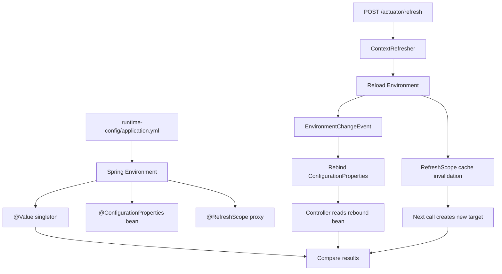

# Comparing @Value, ConfigurationProperties Rebind, and Refresh Scope

## 1. Project Objectives

In Spring Cloud Context, there are three common ways to bring configuration into beans:

- **@Value on a standard singleton:** values are injected when the bean is instantiated. When the `Environment` changes, fields or constructor arguments holding old values are not automatically re-injected.
- **@ConfigurationProperties:** Spring Cloud Context can rebind the bean when it receives an `EnvironmentChangeEvent`. The bean is updated on the same instance; there is no need to recreate the entire `ApplicationContext`.
- **@RefreshScope:** the bean is wrapped by a proxy with a target cache. When the refresh scope is invalidated, the next method call creates a new target and injects the current configuration.

This project builds a small application where the same properties are read in all three ways. Learners modify an external configuration file outside the JAR, call the refresh endpoint, and observe:

1. The standard `@Value` bean retains its startup snapshot.
2. The `@ConfigurationProperties` bean is updated on the same instance.
3. The `@RefreshScope` bean gets a new target instance and receives the updated values.

This belongs to the **Hands-on Project** chapter of the **SPRING_CLOUD_CORE** module. The module helps learners understand Spring Cloud Commons, Spring Cloud Context, externalized configuration, and Spring Boot compatibility, while practicing refresh scope, discovery, service registry, service communication, testing, and operating common abstractions.

After completing the project, learners will be able to:

- Build a Spring Boot application with Spring Cloud Context.
- Inject the same configuration via `@Value`, `@ConfigurationProperties`, and `@RefreshScope`.
- Update configuration while the application is running.
- Distinguish in-place rebinding from target bean recreation.
- Verify results using REST endpoints and JUnit.
- Choose the right mechanism based on each bean's lifecycle and consistency requirements.

## 2. Architecture and Versions Used

The lab uses an external configuration file so learners can clearly see when changes take effect. No Config Server or message broker setup is required; Spring Cloud Context still provides refresh and rebinding mechanisms for the application.

| Component | Version |
| --- | --- |
| Java | 17 |
| Spring Boot | 4.1.2 |
| Spring Cloud release train | 2025.1.4 |
| Spring Cloud Context | Version managed by Spring Cloud BOM |
| Build | Maven |

Boot 4.1.x is supported by Spring Cloud 2025.1.x starting from train 2025.1.2. Use a single BOM to align all Spring Cloud modules.

Processing flow:



## 3. Creating the Project

Create the directory layout:

```text
refresh-comparison-lab/
├── pom.xml
├── runtime-config/
│   └── application.yml
└── src/
    ├── main/
    │   ├── java/
    │   │   └── com/example/refreshlab/
    │   │       ├── RefreshComparisonApplication.java
    │   │       ├── config/
    │   │       │   ├── DemoProperties.java
    │   │       │   ├── ValueSettings.java
    │   │       │   └── RefreshScopedSettings.java
    │   │       └── web/
    │   │           └── ComparisonController.java
    │   └── resources/
    │       └── application.yml
    └── test/
        └── java/
            └── com/example/refreshlab/
                └── RefreshBehaviorTests.java
```

### 3.1. Maven Dependencies

Create `pom.xml`:

```xml
<?xml version="1.0" encoding="UTF-8"?>
<project xmlns="http://maven.apache.org/POM/4.0.0"
         xmlns:xsi="http://www.w3.org/2001/XMLSchema-instance"
         xsi:schemaLocation="http://maven.apache.org/POM/4.0.0
         https://maven.apache.org/xsd/maven-4.0.0.xsd">
    <modelVersion>4.0.0</modelVersion>

    <parent>
        <groupId>org.springframework.boot</groupId>
        <artifactId>spring-boot-starter-parent</artifactId>
        <version>4.1.2</version>
        <relativePath/>
    </parent>

    <groupId>com.example</groupId>
    <artifactId>refresh-comparison-lab</artifactId>
    <version>1.0.0</version>
    <name>refresh-comparison-lab</name>

    <properties>
        <java.version>17</java.version>
        <spring-cloud.version>2025.1.4</spring-cloud.version>
    </properties>

    <dependencyManagement>
        <dependencies>
            <dependency>
                <groupId>org.springframework.cloud</groupId>
                <artifactId>spring-cloud-dependencies</artifactId>
                <version>${spring-cloud.version}</version>
                <type>pom</type>
                <scope>import</scope>
            </dependency>
        </dependencies>
    </dependencyManagement>

    <dependencies>
        <dependency>
            <groupId>org.springframework.boot</groupId>
            <artifactId>spring-boot-starter-webmvc</artifactId>
        </dependency>
        <dependency>
            <groupId>org.springframework.boot</groupId>
            <artifactId>spring-boot-starter-actuator</artifactId>
        </dependency>
        <dependency>
            <groupId>org.springframework.cloud</groupId>
            <artifactId>spring-cloud-context</artifactId>
        </dependency>
        <dependency>
            <groupId>org.springframework.boot</groupId>
            <artifactId>spring-boot-starter-test</artifactId>
            <scope>test</scope>
        </dependency>
    </dependencies>

    <build>
        <plugins>
            <plugin>
                <groupId>org.springframework.boot</groupId>
                <artifactId>spring-boot-maven-plugin</artifactId>
            </plugin>
        </plugins>
    </build>
</project>
```

The Spring Cloud BOM manages the version of `spring-cloud-context`. Do not declare a separate version for this artifact.

### 3.2. Default Configuration Inside the JAR

Create `src/main/resources/application.yml`:

```yaml
server:
  address: 127.0.0.1
  port: 8080

demo:
  banner: packaged-v1
  routing:
    timeout: 2s

management:
  endpoints:
    web:
      exposure:
        include: health,refresh
```

The application binds only to loopback so the lab does not expose the refresh endpoint over the network. The file inside the JAR provides initial fallback values.

### 3.3. Configuration Outside the JAR

Create `runtime-config/application.yml`:

```yaml
demo:
  banner: external-v1
  routing:
    timeout: 3s
```

This file will be loaded as an additional location and takes higher precedence than the default configuration file inside the JAR.

## 4. Writing the Three Comparison Beans

All three beans read the same two keys:

- `demo.banner`
- `demo.routing.timeout`

### 4.1. Bean Using Standard @Value

Create `ValueSettings.java`:

```java
package com.example.refreshlab.config;

import java.time.Duration;
import java.util.concurrent.atomic.AtomicLong;

import org.springframework.beans.factory.annotation.Value;
import org.springframework.stereotype.Component;

@Component
public class ValueSettings {

    private static final AtomicLong IDS = new AtomicLong();

    private final String banner;
    private final Duration timeout;
    private final long instanceId = IDS.incrementAndGet();

    public ValueSettings(
            @Value("${demo.banner:default-banner}") String banner,
            @Value("${demo.routing.timeout:2s}") Duration timeout) {
        this.banner = banner;
        this.timeout = timeout;
    }

    public String getBanner() {
        return banner;
    }

    public Duration getTimeout() {
        return timeout;
    }

    public long instanceId() {
        return instanceId;
    }
}
```

This bean is a standard singleton. Spring resolves placeholders when creating the bean and passes the values to the constructor. Once the constructor finishes, the final fields hold that snapshot. Environment changes do not automatically re-invoke the constructor.

If you need to use `@Value` and want the bean to pick up updated configuration, place that bean itself in `@RefreshScope`. The lab demonstrates this with the third bean.

### 4.2. Bean Using @ConfigurationProperties

Create `DemoProperties.java`:

```java
package com.example.refreshlab.config;

import java.time.Duration;
import java.util.concurrent.atomic.AtomicLong;

import org.springframework.boot.context.properties.ConfigurationProperties;

@ConfigurationProperties(prefix = "demo")
public class DemoProperties {

    private static final AtomicLong IDS = new AtomicLong();

    private String banner = "default-banner";
    private Routing routing = new Routing();
    private final long instanceId = IDS.incrementAndGet();

    public String getBanner() {
        return banner;
    }

    public void setBanner(String banner) {
        this.banner = banner;
    }

    public Routing getRouting() {
        return routing;
    }

    public void setRouting(Routing routing) {
        this.routing = routing;
    }

    public long instanceId() {
        return instanceId;
    }

    public static class Routing {

        private Duration timeout = Duration.ofSeconds(2);

        public Duration getTimeout() {
            return timeout;
        }

        public void setTimeout(Duration timeout) {
            this.timeout = timeout;
        }
    }
}
```

This is a mutable JavaBean using setter binding. Spring Cloud Context can rebind `@ConfigurationProperties` beans when `EnvironmentChangeEvent` is published. Rebinding updates fields on the same instance without replacing the object with a new instance.

Getters/setters and default values allow the Binder to construct the object, convert `Duration`, and reapply values. Do not turn this class into a Java record or constructor-bound configuration in this lab: constructor-bound/record `@ConfigurationProperties` cannot be refreshed via this rebinding mechanism.

### 4.3. Bean Using @RefreshScope and @Value

Create `RefreshScopedSettings.java`:

```java
package com.example.refreshlab.config;

import java.time.Duration;
import java.util.concurrent.atomic.AtomicLong;

import org.springframework.beans.factory.annotation.Value;
import org.springframework.cloud.context.config.annotation.RefreshScope;
import org.springframework.stereotype.Component;

@Component
@RefreshScope
public class RefreshScopedSettings {

    private static final AtomicLong IDS = new AtomicLong();

    private final String banner;
    private final Duration timeout;
    private final long instanceId = IDS.incrementAndGet();

    public RefreshScopedSettings(
            @Value("${demo.banner:default-banner}") String banner,
            @Value("${demo.routing.timeout:2s}") Duration timeout) {
        this.banner = banner;
        this.timeout = timeout;
    }

    public String getBanner() {
        return banner;
    }

    public Duration getTimeout() {
        return timeout;
    }

    public long instanceId() {
        return instanceId;
    }
}
```

The bean is injected into other components as a proxy. The real target is created lazily on the first method invocation. When refresh scope is invalidated, the old target is evicted from cache; the next call creates a new target whose constructor receives the latest values from `Environment`.

In this example, `@Value` still injects only once per target instance. What allows it to pick up new values is that Refresh Scope creates a brand-new target.

## 5. Registering Configuration and Creating the Comparison Endpoint

### 5.1. Application Class

Create `RefreshComparisonApplication.java`:

```java
package com.example.refreshlab;

import org.springframework.boot.SpringApplication;
import org.springframework.boot.autoconfigure.SpringBootApplication;
import org.springframework.boot.context.properties.ConfigurationPropertiesScan;

@SpringBootApplication
@ConfigurationPropertiesScan
public class RefreshComparisonApplication {

    public static void main(String[] args) {
        SpringApplication.run(RefreshComparisonApplication.class, args);
    }
}
```

`@ConfigurationPropertiesScan` registers `DemoProperties` as a bean in the `ApplicationContext`.

### 5.2. REST Endpoint

Create `ComparisonController.java`:

```java
package com.example.refreshlab.web;

import java.time.Duration;

import com.example.refreshlab.config.DemoProperties;
import com.example.refreshlab.config.RefreshScopedSettings;
import com.example.refreshlab.config.ValueSettings;
import org.springframework.web.bind.annotation.GetMapping;
import org.springframework.web.bind.annotation.RequestMapping;
import org.springframework.web.bind.annotation.RestController;

@RestController
@RequestMapping("/demo")
public class ComparisonController {

    private final ValueSettings valueSettings;
    private final DemoProperties demoProperties;
    private final RefreshScopedSettings refreshScopedSettings;

    public ComparisonController(
            ValueSettings valueSettings,
            DemoProperties demoProperties,
            RefreshScopedSettings refreshScopedSettings) {
        this.valueSettings = valueSettings;
        this.demoProperties = demoProperties;
        this.refreshScopedSettings = refreshScopedSettings;
    }

    @GetMapping("/comparison")
    public ComparisonResponse comparison() {
        return new ComparisonResponse(
                snapshot(valueSettings.getBanner(), valueSettings.getTimeout(),
                        valueSettings.instanceId()),
                snapshot(demoProperties.getBanner(),
                        demoProperties.getRouting().getTimeout(),
                        demoProperties.instanceId()),
                snapshot(refreshScopedSettings.getBanner(),
                        refreshScopedSettings.getTimeout(),
                        refreshScopedSettings.instanceId()));
    }

    private BeanSnapshot snapshot(String banner, Duration timeout, long instanceId) {
        return new BeanSnapshot(banner, timeout.toString(), instanceId);
    }

    public record BeanSnapshot(String banner, String timeout, long instanceId) {
    }

    public record ComparisonResponse(
            BeanSnapshot value,
            BeanSnapshot configurationProperties,
            BeanSnapshot refreshScope) {
    }
}
```

The `GET /demo/comparison` endpoint returns all three snapshots together. The `instanceId` field tracks object identity to distinguish in-place rebinding from creating a new target.

## 6. Running the Application

From the project root directory:

```bash
mvn clean package
java -jar target/refresh-comparison-lab-1.0.0.jar --spring.config.additional-location=file:./runtime-config/
```

The `spring.config.additional-location` argument adds the external configuration directory alongside default locations. The working directory must be the project root so the relative path `./runtime-config/` resolves to the right file.

Verify:

```bash
curl http://127.0.0.1:8080/actuator/health
curl http://127.0.0.1:8080/demo/comparison
```

The initial response looks like:

```json
{
  "value": {
    "banner": "external-v1",
    "timeout": "PT3S",
    "instanceId": 1
  },
  "configurationProperties": {
    "banner": "external-v1",
    "timeout": "PT3S",
    "instanceId": 1
  },
  "refreshScope": {
    "banner": "external-v1",
    "timeout": "PT3S",
    "instanceId": 1
  }
}
```

The `instanceId` numbers are illustrative. The three beans may have independent identities initially; what matters is each bean's identity before and after refresh.

## 7. Modifying the File and Refreshing

### 7.1. Recording Initial State

Call `GET /demo/comparison` and note the three entries:

| Bean | Banner | Timeout | Identity |
| --- | --- | --- | --- |
| ValueSettings | external-v1 | PT3S | value-id |
| DemoProperties | external-v1 | PT3S | properties-id |
| RefreshScopedSettings | external-v1 | PT3S | refresh-id |

### 7.2. Modifying Configuration Outside the JAR

Keep the application running and edit `runtime-config/application.yml`:

```yaml
demo:
  banner: external-v2
  routing:
    timeout: 5s
```

Simply saving the file does not update running beans automatically. The updated file must be reloaded into `Environment` via the refresh mechanism.

### 7.3. Calling the Refresh Endpoint

In another terminal:

```bash
curl -X POST http://127.0.0.1:8080/actuator/refresh
```

Spring Cloud Context refreshes the `Environment`, emits change events, and processes refresh scope. The response usually lists changed keys, such as `demo.banner` and `demo.routing.timeout`; the exact list depends on which properties actually changed.

Call again:

```bash
curl http://127.0.0.1:8080/demo/comparison
```

Expected outcome:

| Bean | Banner After Refresh | Timeout After Refresh | Identity |
| --- | --- | --- | --- |
| ValueSettings (@Value singleton) | external-v1 | PT3S | Unchanged |
| DemoProperties (@ConfigurationProperties) | external-v2 | PT5S | Unchanged |
| RefreshScopedSettings (@RefreshScope) | external-v2 | PT5S | Changed |

This is the core takeaway of the project:

- `@Value` singletons retain the snapshot injected at startup.
- `@ConfigurationProperties` is rebound in place on the same bean instance.
- `@RefreshScope` invalidates the target cache; the subsequent method call creates a new target and injects the current values.

## 8. Verifying Rebinding with JUnit

In addition to HTTP testing, you can test both Spring Cloud Context mechanisms directly using `EnvironmentChangeEvent` and `RefreshScope`.

Create `RefreshBehaviorTests.java`:

```java
package com.example.refreshlab;

import java.time.Duration;
import java.util.Map;
import java.util.Set;

import com.example.refreshlab.config.DemoProperties;
import com.example.refreshlab.config.RefreshScopedSettings;
import com.example.refreshlab.config.ValueSettings;
import org.junit.jupiter.api.Test;
import org.springframework.beans.factory.annotation.Autowired;
import org.springframework.boot.test.context.SpringBootTest;
import org.springframework.cloud.context.environment.EnvironmentChangeEvent;
import org.springframework.cloud.context.scope.refresh.RefreshScope;
import org.springframework.context.ApplicationEventPublisher;
import org.springframework.core.env.ConfigurableEnvironment;
import org.springframework.core.env.MapPropertySource;

import static org.assertj.core.api.Assertions.assertThat;

@SpringBootTest
class RefreshBehaviorTests {

    @Autowired
    ConfigurableEnvironment environment;

    @Autowired
    ApplicationEventPublisher eventPublisher;

    @Autowired
    DemoProperties demoProperties;

    @Autowired
    ValueSettings valueSettings;

    @Autowired
    RefreshScopedSettings refreshScopedSettings;

    @Autowired
    RefreshScope refreshScope;

    @Test
    void comparesValueInjectionRebindingAndRefreshScope() {
        String originalBanner = environment.getProperty("demo.banner");
        long propertiesIdentity = demoProperties.instanceId();
        long valueIdentity = valueSettings.instanceId();
        long refreshIdentity = refreshScopedSettings.instanceId();
        String valueSnapshot = valueSettings.getBanner();

        MapPropertySource override = new MapPropertySource(
                "testOverride",
                Map.of(
                        "demo.banner", "test-v2",
                        "demo.routing.timeout", "7s"));

        try {
            environment.getPropertySources().addFirst(override);
            eventPublisher.publishEvent(new EnvironmentChangeEvent(
                    Set.of("demo.banner", "demo.routing.timeout")));

            assertThat(demoProperties.getBanner()).isEqualTo("test-v2");
            assertThat(demoProperties.getRouting().getTimeout())
                    .isEqualTo(Duration.ofSeconds(7));
            assertThat(demoProperties.instanceId()).isEqualTo(propertiesIdentity);

            assertThat(valueSettings.getBanner()).isEqualTo(valueSnapshot);
            assertThat(valueSettings.instanceId()).isEqualTo(valueIdentity);

            refreshScope.refreshAll();

            assertThat(refreshScopedSettings.getBanner()).isEqualTo("test-v2");
            assertThat(refreshScopedSettings.getTimeout())
                    .isEqualTo(Duration.ofSeconds(7));
            assertThat(refreshScopedSettings.instanceId()).isNotEqualTo(refreshIdentity);
        }
        finally {
            environment.getPropertySources().remove("testOverride");
            eventPublisher.publishEvent(new EnvironmentChangeEvent(
                    Set.of("demo.banner", "demo.routing.timeout")));
            refreshScope.refreshAll();
        }

        assertThat(demoProperties.getBanner()).isEqualTo(originalBanner);
    }
}
```

The test programmatically inserts a highest-precedence `PropertySource` into `Environment`, then publishes `EnvironmentChangeEvent` to trigger rebinding. Next, the test calls `refreshAll` to clear the Refresh Scope target cache. Assertions confirm:

1. `DemoProperties` receives the new values while its identity remains unchanged.
2. `ValueSettings` retains its original values and identity.
3. `RefreshScopedSettings` receives the new values and its target identity changes.
4. The `finally` block cleans up the test `PropertySource` and restores initial values so other tests are unaffected.

Run the test:

```bash
mvn test
```

## 9. Comparing the Three Mechanisms

| Criterion | @Value singleton | @ConfigurationProperties rebind | @RefreshScope |
| --- | --- | --- | --- |
| How config is received | Injected when bean is created | Binder binds into bean | Target receives config when created |
| After EnvironmentChangeEvent | Not automatically updated | Rebinds fields on same instance | Not necessarily updated until scope is invalidated |
| After refresh scope invalidation | Unchanged if bean is not in scope | No need to replace instance | New target created on next call |
| Bean/target identity | Preserved | Preserved | Target changes; injected proxy remains stable |
| Structure | Placeholders on fields/constructors | POJO with clear prefix, types, and structure | Bean wrapped by a refresh-scoped proxy |
| Best fit | Values constant for bean lifetime | Structured configuration groups needing rebind | Stateful beans needing consistent recreation on refresh |
| Caveats | Does not auto-update | Rebind mutates in place | Target is lazy; requires non-final bean and proxiable methods |

### 9.1. Rebinding Is Not Creating a New Bean

Spring Cloud Context uses `ConfigurationPropertiesRebinder` to update `@ConfigurationProperties` beans. Rebinding occurs on the same object and updates its properties. This keeps identity unchanged, though another thread could observe an intermediate state while multiple fields are being updated.

If the application requires reads to see a consistent snapshot across a refresh, `@RefreshScope` is a better fit: the scope coordinates reads with target bean refresh.

### 9.2. Refresh Scope Is a Caching Proxy

`@RefreshScope` does not recreate the entire `ApplicationContext`. The proxy holds the target in a scope cache. Refresh evicts the cached target; when the proxy receives the next method invocation, a new target is instantiated.

This gives in-flight operations using the old target a chance to finish before a new target is created for subsequent calls. However, dependencies holding direct references to internal objects inside the target or other beans outside refresh scope are not automatically rebuilt.

### 9.3. @Value Can Be Used Together with Refresh Scope

`@Value` has no standalone rebinding mechanism. However, if a bean using `@Value` is annotated with `@RefreshScope`, the new target runs injection again when instantiated. The third bean in this lab illustrates this exact case.

## 10. Limitations to Know

- **Constructor binding and Java records:** `@ConfigurationProperties` beans using constructor binding, including Java records, are not refreshed by the standard rebind mechanism. For dynamically updated configuration, use a mutable JavaBean with setters or design an appropriate refresh-scoped bean.
- **Removing properties:** when rebinding `@ConfigurationProperties`, Spring Cloud resets the bean to class-level defaults before rebinding so values removed from `Environment` do not linger unintentionally. With `@RefreshScope`, documentation notes that deleting a property and refreshing does not guarantee property presence transitions behave as expected. Represent absence with an explicit default or sentinel value and test both mechanisms separately.
- **Non-recreatable beans:** some beans hold resources or special lifecycles unsuitable for refreshing. Review the never-refreshable and extra-refreshable lists before applying.
- **Class-level configuration does not mean all its beans refresh:** placing `@RefreshScope` on a `@Configuration` class does not automatically put all beans produced by that class into refresh scope.
- **AOT and native images:** Context Refresh is not supported for Spring AOT transformations and native images; check the requirements of your Spring Cloud version before designing runtime refresh.
- **Administrative endpoints:** `/actuator/refresh` can change an instance's runtime behavior. Expose it only on management networks, protect it with authentication/authorization, and audit operations.
- **Multiple instances:** calling `/actuator/refresh` refreshes only the instance receiving the request. For multiple replicas, you need a broadcast mechanism such as Spring Cloud Bus or controlled orchestration.

## 11. Extension Exercises

1. Add a boolean property `demo.routing.enabled` and compare the behavior of all three beans.
2. Add a nested object to `DemoProperties`, such as `demo.retry.max-attempts` and `demo.retry.backoff`.
3. Record `instanceId` before and after multiple consecutive refreshes to confirm Refresh Scope creates a new target only when the bean is next invoked.
4. Try changing only `banner`, then only `timeout`; verify the list of changed keys returned by the endpoint.
5. Try deleting a property from the external file and observe behavior after refresh.
6. Add another service injecting `DemoProperties` and verify it sees the post-rebind values.
7. Add a regular bean holding a reference to another configuration object, and determine when that reference gets updated.
8. Write a concurrent test reading configuration during refresh to observe why consistent snapshots matter.
9. Call refresh twice without editing the file; compare changed keys and instance identities.
10. Design a health/readiness endpoint indicating whether an instance has loaded the expected configuration.

## 12. Completion Criteria

| Criterion | Evidence |
| --- | --- |
| Project uses one Spring Cloud BOM | Maven POM imports Cloud 2025.1.4 |
| Configuration outside JAR is loaded | Initial response contains external-v1 |
| @Value singleton is compared | Value and identity remain unchanged after refresh |
| ConfigurationProperties is rebound | Values change, identity remains unchanged |
| Refresh Scope target is recreated | Values change and target identity changes |
| Refresh endpoint works | POST /actuator/refresh returns changed keys |
| Automated tests | JUnit assertions for all three mechanisms |
| Endpoint is restricted | Server binds to 127.0.0.1 in the lab |

## 13. Official References

- [Spring Cloud Commons — Application Context Services and Refresh Scope](https://docs.spring.io/spring-cloud-commons/reference/spring-cloud-commons/application-context-services.html)
- [Spring Cloud Commons — Environment Changes](https://docs.spring.io/spring-cloud-commons/reference/spring-cloud-commons/application-context-services.html#environment-changes)
- [Spring Cloud Bus — Bus Refresh Endpoint](https://docs.spring.io/spring-cloud-bus/reference/spring-cloud-bus/bus-endpoints.html)
- [Spring Boot 4.1 — Build Systems and Application Starters](https://docs.spring.io/spring-boot/reference/using/build-systems.html)
- [Spring Boot — Externalized Configuration](https://docs.spring.io/spring-boot/reference/features/external-config.html)
- [Spring Boot — Actuator Endpoints](https://docs.spring.io/spring-boot/reference/actuator/endpoints.html)

The project is complete when learners observe three distinct behaviors against the same `Environment`: `@Value` singletons hold their snapshot, `@ConfigurationProperties` rebinds on the same instance, and `@RefreshScope` creates a new target when invoked after refresh. This forms the basis for choosing a dynamic configuration mechanism tailored to each bean's lifecycle and consistency requirements.
