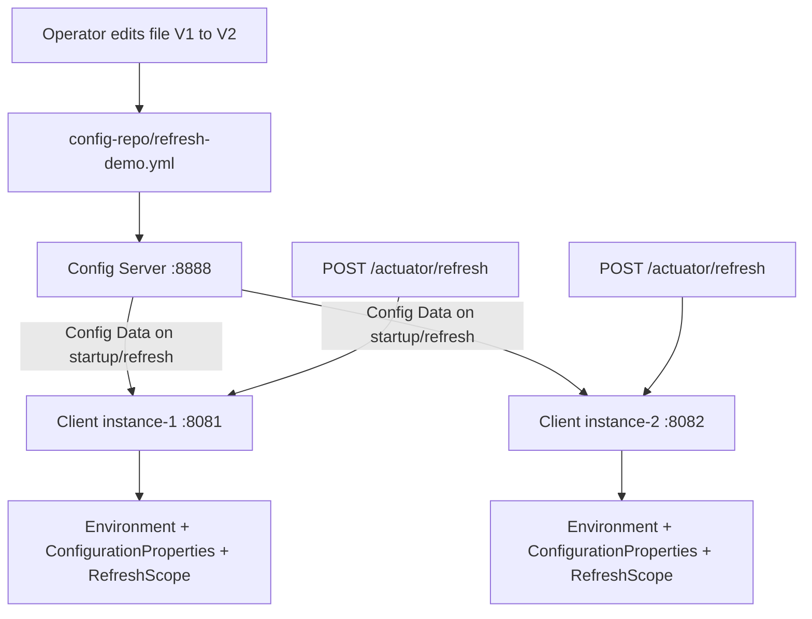

# Updating Configuration Across Two Instances and Verifying Refresh Scope

> **Chapter:** Hands-on Project
> **Module:** `SPRING_CLOUD_CORE` — understand the core foundations of Spring Cloud in distributed systems, especially Spring Cloud Commons, Context, externalized configuration, and version compatibility with Spring Boot. Learners explore refresh scope, discovery, service registry, service communication, and how to test and operate common abstractions.
> **Focus:** Build a Config Server and two instances of the same Config Client. Change properties in the centralized configuration source, refresh each instance one by one, and compare ConfigurationProperties, RefreshScope, and a singleton holding the initial Value. This verifies that refresh operates within each instance's ApplicationContext.

## 1. Project Objectives

In a distributed system, multiple instances of a service typically share business configuration. When a property changes, operations teams need to know which instances received the new value, which instances still hold the old value, and which beans inside each instance were updated.

This project sets up a Config Server and two Config Client processes running with the same application name on different ports. Config Server reads configuration from a local directory so files can be edited while the applications are running.

You will observe three ways of reading the same configuration:

- **ConfigurationProperties:** a mutable configuration bean rebound by Spring Cloud on refresh.
- **RefreshScope:** a bean behind a scoped proxy; the current target is destroyed on refresh and recreated on the next access.
- **Singleton holding Value at startup:** values injected into the object at startup retain their old values unless the bean has its own update mechanism.

After editing the configuration file, you call `POST /actuator/refresh` only on the first instance. The expected result is that the first instance updates while the second instance keeps the old configuration. Once you call refresh on the second instance, both display the new values.

This is direct per-instance refresh. The lab does not use Spring Cloud Bus, so there is no automatic broadcast message to replicas.

### Expected Outcomes

1. Start a Config Server serving the application name `refresh-demo`.
2. Run two Config Client instances on ports 8081 and 8082.
3. Read the same initial configuration from both instances.
4. Change a remote property without rebuilding the client.
5. Refresh only the first instance and prove the second instance has not changed.
6. Refresh the second instance and confirm both instances are synchronized.
7. Distinguish `ConfigurationProperties`, `RefreshScope`, and a singleton holding initial values.
8. Explain why refreshing one `ApplicationContext` does not automatically refresh another `ApplicationContext`.

## 2. Architecture and Flow



Both clients share the application name `refresh-demo`, profile `default`, Config Server `http://localhost:8888`, and configuration source `config-repo/refresh-demo.yml`.

Each process has its own `ApplicationContext` and bean registry. Therefore, instance 1's refresh endpoint only refreshes instance 1's context. Instance 2 receives new configuration only when it refreshes itself or when a broadcast mechanism such as Spring Cloud Bus is deployed.

## 3. Preparing the Environment

### 3.1. Requirements

- A JDK supported by your chosen Spring Boot release; for example, this lab uses Java 21.
- Maven 3.9 or later.
- Compatible Spring Boot and Spring Cloud release trains.
- Two free ports: 8081, 8082; plus port 8888 for Config Server.
- One terminal for Config Server and two terminals for the two clients.

```bash
java -version
mvn -version
```

Select the Spring Boot version and Spring Cloud BOM from the official compatibility matrix. Do not mix Config Server, Config Client, and Spring Cloud Commons versions from different release trains.

### 3.2. Directory Structure

Create a multi-module Maven project:

```text
refresh-lab/
├── pom.xml
├── config-repo/
│   └── refresh-demo.yml
├── config-server/
│   ├── pom.xml
│   └── src/main/
│       ├── java/com/example/configserver/ConfigServerApplication.java
│       └── resources/application.yml
└── demo-client/
    ├── pom.xml
    └── src/main/
        ├── java/com/example/refreshdemo/
        │   ├── DemoClientApplication.java
        │   ├── config/DemoConfiguration.java
        │   ├── config/DemoProperties.java
        │   ├── model/RefreshableGreeting.java
        │   ├── model/StartupSnapshot.java
        │   └── web/DemoController.java
        └── resources/application.yml
```

Run Maven commands from the `refresh-lab` root directory. Config Server uses the `native` profile to read files in `config-repo`; you can edit properties directly without committing to Git.

## 4. Declaring Maven Dependencies

### 4.1. Root POM

Create `pom.xml` in the root directory. Replace the two placeholder version values with a compatible pair from the release train matrix:

```xml
<project xmlns="http://maven.apache.org/POM/4.0.0"
         xmlns:xsi="http://www.w3.org/2001/XMLSchema-instance"
         xsi:schemaLocation="http://maven.apache.org/POM/4.0.0 https://maven.apache.org/xsd/maven-4.0.0.xsd">
    <modelVersion>4.0.0</modelVersion>
    <groupId>com.example</groupId>
    <artifactId>refresh-lab</artifactId>
    <version>1.0.0-SNAPSHOT</version>
    <packaging>pom</packaging>
    <modules>
        <module>config-server</module>
        <module>demo-client</module>
    </modules>
    <properties>
        <java.version>21</java.version>
        <maven.compiler.release>${java.version}</maven.compiler.release>
        <spring-boot.version>REPLACE_WITH_COMPATIBLE_BOOT_VERSION</spring-boot.version>
        <spring-cloud.version>REPLACE_WITH_COMPATIBLE_CLOUD_TRAIN</spring-cloud.version>
    </properties>
    <dependencyManagement>
        <dependencies>
            <dependency>
                <groupId>org.springframework.boot</groupId>
                <artifactId>spring-boot-dependencies</artifactId>
                <version>${spring-boot.version}</version>
                <type>pom</type>
                <scope>import</scope>
            </dependency>
            <dependency>
                <groupId>org.springframework.cloud</groupId>
                <artifactId>spring-cloud-dependencies</artifactId>
                <version>${spring-cloud.version}</version>
                <type>pom</type>
                <scope>import</scope>
            </dependency>
        </dependencies>
    </dependencyManagement>
    <build>
        <pluginManagement>
            <plugins>
                <plugin>
                    <groupId>org.springframework.boot</groupId>
                    <artifactId>spring-boot-maven-plugin</artifactId>
                    <version>${spring-boot.version}</version>
                    <executions>
                        <execution>
                            <goals>
                                <goal>repackage</goal>
                            </goals>
                        </execution>
                    </executions>
                </plugin>
                <plugin>
                    <groupId>org.apache.maven.plugins</groupId>
                    <artifactId>maven-compiler-plugin</artifactId>
                    <version>3.13.0</version>
                    <configuration>
                        <release>${java.version}</release>
                    </configuration>
                </plugin>
            </plugins>
        </pluginManagement>
    </build>
</project>
```

The two BOMs keep dependency versions synchronized. Submodules inherit dependency management from the root POM and do not need to specify individual starter versions.

### 4.2. Config Server Module

Create `config-server/pom.xml`:

```xml
<project xmlns="http://maven.apache.org/POM/4.0.0"
         xmlns:xsi="http://www.w3.org/2001/XMLSchema-instance"
         xsi:schemaLocation="http://maven.apache.org/POM/4.0.0 https://maven.apache.org/xsd/maven-4.0.0.xsd">
    <modelVersion>4.0.0</modelVersion>
    <parent>
        <groupId>com.example</groupId>
        <artifactId>refresh-lab</artifactId>
        <version>1.0.0-SNAPSHOT</version>
        <relativePath>../pom.xml</relativePath>
    </parent>
    <artifactId>config-server</artifactId>
    <dependencies>
        <dependency>
            <groupId>org.springframework.cloud</groupId>
            <artifactId>spring-cloud-config-server</artifactId>
        </dependency>
        <dependency>
            <groupId>org.springframework.boot</groupId>
            <artifactId>spring-boot-starter-web</artifactId>
        </dependency>
    </dependencies>
    <build>
        <plugins>
            <plugin>
                <groupId>org.springframework.boot</groupId>
                <artifactId>spring-boot-maven-plugin</artifactId>
            </plugin>
        </plugins>
    </build>
</project>
```

### 4.3. Config Client Module

Create `demo-client/pom.xml`:

```xml
<project xmlns="http://maven.apache.org/POM/4.0.0"
         xmlns:xsi="http://www.w3.org/2001/XMLSchema-instance"
         xsi:schemaLocation="http://maven.apache.org/POM/4.0.0 https://maven.apache.org/xsd/maven-4.0.0.xsd">
    <modelVersion>4.0.0</modelVersion>
    <parent>
        <groupId>com.example</groupId>
        <artifactId>refresh-lab</artifactId>
        <version>1.0.0-SNAPSHOT</version>
        <relativePath>../pom.xml</relativePath>
    </parent>
    <artifactId>demo-client</artifactId>
    <dependencies>
        <dependency>
            <groupId>org.springframework.cloud</groupId>
            <artifactId>spring-cloud-starter-config</artifactId>
        </dependency>
        <dependency>
            <groupId>org.springframework.boot</groupId>
            <artifactId>spring-boot-starter-web</artifactId>
        </dependency>
        <dependency>
            <groupId>org.springframework.boot</groupId>
            <artifactId>spring-boot-starter-actuator</artifactId>
        </dependency>
    </dependencies>
    <build>
        <plugins>
            <plugin>
                <groupId>org.springframework.boot</groupId>
                <artifactId>spring-boot-maven-plugin</artifactId>
            </plugin>
        </plugins>
    </build>
</project>
```

The Config Client starter provides Config Data and Spring Cloud Context integration. Actuator provides administrative endpoints; this dependency is required to expose the refresh endpoint in this lab.

## 5. Building Config Server

### 5.1. Main Class

Create `ConfigServerApplication.java`:

```java
package com.example.configserver;

import org.springframework.boot.SpringApplication;
import org.springframework.boot.autoconfigure.SpringBootApplication;
import org.springframework.cloud.config.server.EnableConfigServer;

@SpringBootApplication
@EnableConfigServer
public class ConfigServerApplication {

    public static void main(String[] args) {
        SpringApplication.run(ConfigServerApplication.class, args);
    }
}
```

### 5.2. Configuring the Native Repository

Create `config-server/src/main/resources/application.yml`:

```yaml
server:
  port: 8888
spring:
  application:
    name: config-server
  profiles:
    active: native
  cloud:
    config:
      server:
        native:
          search-locations: "file:${user.dir}/config-repo"
```

`user.dir` is the JVM's current working directory. Start Config Server from the `refresh-lab` root directory so the path resolves to `refresh-lab/config-repo`.

The native backend is suited for local labs. In production systems, replace it with Git or an organization-managed backend. Do not use the native file backend as a production configuration store without version control, access control, auditing, and secure distribution.

### 5.3. Creating the Initial Configuration Version

Create `config-repo/refresh-demo.yml`:

```yaml
demo:
  message: "Hello from V1 configuration"
  limit: 10
```

The filename matches the application name `refresh-demo`. When a client requests the `default` profile, Config Server merges shared configuration files and matching application/profile files.

Test Config Server via the URL:

```text
http://localhost:8888/refresh-demo/default
```

The response is an Environment JSON containing a list of property sources. Confirm that the response contains `demo.message` as `"Hello from V1 configuration"` and `demo.limit` as `10` before starting the clients.

## 6. Building Config Client

### 6.1. Main Class and Config Data Import

Create `DemoClientApplication.java`:

```java
package com.example.refreshdemo;

import org.springframework.boot.SpringApplication;
import org.springframework.boot.autoconfigure.SpringBootApplication;
import org.springframework.boot.context.properties.ConfigurationPropertiesScan;

@SpringBootApplication
@ConfigurationPropertiesScan
public class DemoClientApplication {

    public static void main(String[] args) {
        SpringApplication.run(DemoClientApplication.class, args);
    }
}
```

Create `demo-client/src/main/resources/application.yml`:

```yaml
spring:
  application:
    name: refresh-demo
  config:
    import: "configserver:http://localhost:8888"

management:
  endpoints:
    web:
      exposure:
        include: health,info,refresh
```

The import does not have the `optional:` prefix, so the client fails startup if Config Server cannot supply the required configuration. This is an intentional choice for the lab: both instances must receive remote configuration immediately on startup.

The refresh endpoint is exposed for invocation in the local environment. Do not expose this endpoint publicly in production; protect it with authentication, authorization, network policies, and a dedicated management interface.

### 6.2. Creating the ConfigurationProperties Bean

Create `config/DemoProperties.java`:

```java
package com.example.refreshdemo.config;

import org.springframework.boot.context.properties.ConfigurationProperties;

@ConfigurationProperties(prefix = "demo")
public class DemoProperties {

    private String message;
    private int limit;

    public String getMessage() {
        return message;
    }

    public void setMessage(String message) {
        this.message = message;
    }

    public int getLimit() {
        return limit;
    }

    public void setLimit(int limit) {
        this.limit = limit;
    }
}
```

`@ConfigurationPropertiesScan` on the main class registers this bean. Spring Cloud can rebind mutable configuration beans when `Environment` changes.

### 6.3. Creating the Refresh-Scoped Bean

Create `model/RefreshableGreeting.java`:

```java
package com.example.refreshdemo.model;

public class RefreshableGreeting {

    private final String message;
    private final int limit;

    public RefreshableGreeting(String message, int limit) {
        this.message = message;
        this.limit = limit;
    }

    public String getMessage() {
        return message;
    }

    public int getLimit() {
        return limit;
    }
}
```

Create `config/DemoConfiguration.java`:

```java
package com.example.refreshdemo.config;

import com.example.refreshdemo.model.RefreshableGreeting;
import com.example.refreshdemo.model.StartupSnapshot;
import org.springframework.beans.factory.annotation.Value;
import org.springframework.cloud.context.config.annotation.RefreshScope;
import org.springframework.context.annotation.Bean;
import org.springframework.context.annotation.Configuration;

@Configuration(proxyBeanMethods = false)
public class DemoConfiguration {

    @Bean
    @RefreshScope
    RefreshableGreeting refreshableGreeting(DemoProperties properties) {
        return new RefreshableGreeting(
                properties.getMessage(),
                properties.getLimit()
        );
    }

    @Bean
    StartupSnapshot startupSnapshot(
            @Value("${demo.message}") String message,
            @Value("${demo.limit}") int limit) {
        return new StartupSnapshot(message, limit);
    }
}
```

`RefreshableGreeting` is created through a `RefreshScope` proxy. When a refresh occurs, the old target is invalidated. The next call through the proxy creates a new target from the current `DemoProperties`.

`StartupSnapshot` is a standard singleton. Its `@Value` parameters are resolved when the bean is first created. Spring Cloud does not automatically recreate this singleton when refresh scope is refreshed, so the snapshot retains V1. This acts as the control group for observing the scope of refresh.

### 6.4. Creating the Startup Snapshot

Create `model/StartupSnapshot.java`:

```java
package com.example.refreshdemo.model;

public record StartupSnapshot(String message, int limit) {
}
```

This record preserves the values from startup. Do not annotate this bean with `@RefreshScope` because the goal is to observe a non-refreshed singleton.

### 6.5. Creating the Observation Endpoint

Create `web/DemoController.java`:

```java
package com.example.refreshdemo.web;

import com.example.refreshdemo.config.DemoProperties;
import com.example.refreshdemo.model.RefreshableGreeting;
import com.example.refreshdemo.model.StartupSnapshot;
import java.util.Map;
import org.springframework.core.env.Environment;
import org.springframework.web.bind.annotation.GetMapping;
import org.springframework.web.bind.annotation.RequestMapping;
import org.springframework.web.bind.annotation.RestController;

@RestController
@RequestMapping("/demo")
public class DemoController {

    private final DemoProperties properties;
    private final RefreshableGreeting greeting;
    private final StartupSnapshot startupSnapshot;
    private final Environment environment;

    public DemoController(
            DemoProperties properties,
            RefreshableGreeting greeting,
            StartupSnapshot startupSnapshot,
            Environment environment) {
        this.properties = properties;
        this.greeting = greeting;
        this.startupSnapshot = startupSnapshot;
        this.environment = environment;
    }

    @GetMapping("/state")
    public Map<String, Object> state() {
        return Map.of(
                "instanceId", environment.getProperty("app.instance-id", "unknown"),
                "port", environment.getProperty("server.port", "unknown"),
                "configurationPropertiesMessage", properties.getMessage(),
                "configurationPropertiesLimit", properties.getLimit(),
                "refreshScopeMessage", greeting.getMessage(),
                "refreshScopeLimit", greeting.getLimit(),
                "startupSnapshotMessage", startupSnapshot.message(),
                "startupSnapshotLimit", startupSnapshot.limit()
        );
    }
}
```

The `GET /demo/state` endpoint returns all three views of the same configuration, along with the instance ID and port. These fields help compare the two independent processes.

## 7. Building and Starting the Three Processes

### 7.1. Building the Project

From the `refresh-lab` root directory:

```bash
mvn clean package -DskipTests
```

Verify that both executable JARs are generated:

- `config-server/target/config-server-1.0.0-SNAPSHOT.jar`;
- `demo-client/target/demo-client-1.0.0-SNAPSHOT.jar`.

If your artifact names or versions differ, use the exact filenames produced by Maven.

### 7.2. Terminal A — Config Server

Open a terminal at the project root and run:

```bash
java -jar config-server/target/config-server-1.0.0-SNAPSHOT.jar
```

Wait for logs indicating the application has started. Check the configuration endpoint:

```bash
curl http://localhost:8888/refresh-demo/default
```

The response should contain the two keys:

```json
{
  "name": "refresh-demo",
  "profiles": ["default"],
  "propertySources": [
    {
      "name": "...",
      "source": {
        "demo.message": "Hello from V1 configuration",
        "demo.limit": 10
      }
    }
  ]
}
```

This is an illustrative response; metadata and the number of property sources may vary by Config Server version.

### 7.3. Terminal B — First Instance

Open a second terminal, also at the project root:

```bash
java -jar demo-client/target/demo-client-1.0.0-SNAPSHOT.jar --server.port=8081 --app.instance-id=instance-1
```

The client connects to Config Server and receives V1 at startup.

### 7.4. Terminal C — Second Instance

Open a third terminal:

```bash
java -jar demo-client/target/demo-client-1.0.0-SNAPSHOT.jar --server.port=8082 --app.instance-id=instance-2
```

Both instances share the same application name and profile, while each instance uses its own port and instance ID.

If a client fails to start, verify that Config Server is ready, the import URL is correct, active profiles match, and `/refresh-demo/default` responds properly.

## 8. Measuring Initial State Across Both Instances

Call the endpoint on instance 1:

```bash
curl http://localhost:8081/demo/state
```

Call the endpoint on instance 2:

```bash
curl http://localhost:8082/demo/state
```

On Windows PowerShell, you can read the JSON with:

```powershell
Invoke-RestMethod http://localhost:8081/demo/state | ConvertTo-Json -Depth 5
Invoke-RestMethod http://localhost:8082/demo/state | ConvertTo-Json -Depth 5
```

Expected output:

| Field | Instance 1 | Instance 2 |
| --- | --- | --- |
| instanceId | instance-1 | instance-2 |
| port | 8081 | 8082 |
| configurationPropertiesMessage | Hello from V1 configuration | Hello from V1 configuration |
| configurationPropertiesLimit | 10 | 10 |
| refreshScopeMessage | Hello from V1 configuration | Hello from V1 configuration |
| refreshScopeLimit | 10 | 10 |
| startupSnapshotMessage | Hello from V1 configuration | Hello from V1 configuration |
| startupSnapshotLimit | 10 | 10 |

Save the initial responses to compare after each step. All three bean types read V1 because they were instantiated or bound while both clients started up.

## 9. Changing Centralized Configuration from V1 to V2

Open `config-repo/refresh-demo.yml` and update its contents:

```yaml
demo:
  message: "Hello from V2 configuration"
  limit: 25
```

Save the file. Do not rebuild or restart any of the three processes.

Before refreshing the clients, query Config Server again:

```bash
curl http://localhost:8888/refresh-demo/default
```

Confirm the response now shows `demo.message` as `"Hello from V2 configuration"` and `demo.limit` as `25`.

After the file changes, Config Server serves V2 for new requests, yet the two running clients still retain their V1 `Environment` until refreshed. Editing the configuration source does not automatically push new properties to running processes.

### 9.1. If Config Server Still Returns V1

Check:

- whether the file is named `refresh-demo.yml`;
- whether the file is inside the exact `config-repo` directory Config Server reads from;
- whether the Config Server JVM was started from the project root directory;
- whether the profile and application name in the URL are accurate;
- whether the file was completely saved before calling the endpoint.

Proceed only once Config Server confirms V2. This isolates configuration-source issues from client-side refresh issues.

## 10. Refreshing Only the First Instance

Call the refresh endpoint on port 8081:

```bash
curl -X POST http://localhost:8081/actuator/refresh
```

In PowerShell you can run:

```powershell
Invoke-RestMethod -Method Post -Uri http://localhost:8081/actuator/refresh
```

The response usually lists the changed keys, such as `demo.message` and `demo.limit`. The exact list depends on the property sources and version.

Check instance 1 again:

```bash
curl http://localhost:8081/demo/state
```

Expected output on instance 1:

| Field | Value After Refresh |
| --- | --- |
| configurationPropertiesMessage | Hello from V2 configuration |
| configurationPropertiesLimit | 25 |
| refreshScopeMessage | Hello from V2 configuration |
| refreshScopeLimit | 25 |
| startupSnapshotMessage | Hello from V1 configuration |
| startupSnapshotLimit | 10 |

The first two groups show that `Environment` was updated and `ConfigurationProperties` was rebound. The `RefreshScope` bean was recreated when its proxy was invoked. `StartupSnapshot` stays at V1 because it is a regular singleton initialized once.

### 10.1. Checking the Unrefreshed Second Instance

Call the endpoint on port 8082:

```bash
curl http://localhost:8082/demo/state
```

All values on instance 2 are still expected to be V1. This proves that refreshing instance 1 does not alter the `Environment` or beans in instance 2's `ApplicationContext`.

## 11. Refreshing the Second Instance and Verifying Synchronization

Refresh instance 2 independently:

```bash
curl -X POST http://localhost:8082/actuator/refresh
```

Or in PowerShell:

```powershell
Invoke-RestMethod -Method Post -Uri http://localhost:8082/actuator/refresh
```

Query both endpoints again:

```bash
curl http://localhost:8081/demo/state
curl http://localhost:8082/demo/state
```

Now both instances should have:

| Field | Instance 1 | Instance 2 |
| --- | --- | --- |
| configurationPropertiesMessage | V2 | V2 |
| configurationPropertiesLimit | 25 | 25 |
| refreshScopeMessage | V2 | V2 |
| refreshScopeLimit | 25 | 25 |
| startupSnapshotMessage | V1 | V1 |
| startupSnapshotLimit | 10 | 10 |

Both instances have updated their configuration to the same version, while the singleton snapshot still retains its startup values. To update a snapshot, you must design a bean capable of updating or recreating itself on an appropriate lifecycle; refresh scope does not replace every singleton automatically.

## 12. Analyzing Refresh Scope

### 12.1. RefreshScope Scopes Beans Within One ApplicationContext

`RefreshScope` creates a proxy for a bean and manages target instances within the refresh scope. When refresh scope is invalidated, the cached target is destroyed. The next call through the proxy creates a new target.

In this lab:

- `RefreshableGreeting` is recreated in instance 1 when instance 1 refreshes;
- the `RefreshableGreeting` target in instance 2 remains intact until instance 2 refreshes;
- the two proxies reside in two separate `ApplicationContext` instances.

Therefore, refresh scope governs target bean lifecycles within a single `ApplicationContext`. It is not a cluster-wide configuration synchronization mechanism across all replicas.

### 12.2. ConfigurationProperties Are Rebound

`DemoProperties` is a mutable bean registered via `@ConfigurationProperties`. When `EnvironmentChangeEvent` is published, Spring Cloud rebinds this bean through configuration properties rebinding.

This is why `configurationPropertiesMessage` and `configurationPropertiesLimit` switch to V2 immediately after the corresponding instance refreshes.

Constructor-bound or immutable configuration beans require separate consideration because not every binding style can be rebound like the mutable bean in this example.

### 12.3. Singletons Holding Value Do Not Auto-Update

`StartupSnapshot` receives two values via `@Value` parameters when the bean is created. Afterward, it has no setters, listeners, or update lifecycle. Consequently, the object retains V1.

If you want a singleton to update on `EnvironmentChangeEvent`, explicitly design a listener or state synchronization mechanism. Never assume fields injected with `@Value` automatically change after refresh.

### 12.4. Summary Table

| Component | After One Instance Refreshes | Scope |
| --- | --- | --- |
| That instance's Environment | Reloaded from reloadable configuration sources | Current ApplicationContext |
| Mutable ConfigurationProperties | Rebound against the updated Environment | Bean in current context |
| RefreshScope target | Invalidated and recreated on next call | RefreshScope of current context |
| Singleton holding Value at startup | Retains old values unless custom update logic exists | Singleton lifecycle |
| Other instances | Unchanged automatically | Independent ApplicationContext |

## 13. Verifying via Logs and Actuator

### 13.1. Refresh Logs

When invoking refresh, watch client logs for entries about `Environment` changes, changed keys, and refresh scope processing. Exact log output varies by release train and logging level.

Do not log entire property sources in real environments because they may contain passwords, tokens, or sensitive data.

### 13.2. Health Endpoint

Check the health of each instance:

```bash
curl http://localhost:8081/actuator/health
curl http://localhost:8082/actuator/health
```

`UP` health only indicates that configured health contributors satisfy their checks. It does not prove every property or bean holds the expected values. The `/demo/state` endpoint in this lab is the direct measurement of all three bean groups.

### 13.3. The Refresh Endpoint Is Not a Broadcast

`POST /actuator/refresh` executes inside the process receiving the request. Sending the request to port 8081 refreshes only instance 1's context.

In production, never expose this administrative endpoint through public ingress. Restrict the management port, and protect it with Spring Security, network policies, and dedicated operational permissions.

## 14. Extended Practice: Changing V2 to V3

Update the Config Server file:

```yaml
demo:
  message: "Hello from V3 configuration"
  limit: 50
```

Then refresh only instance 2 first:

1. Verify Config Server returns V3.
2. Send `POST` refresh to port 8082.
3. Call `/demo/state` on both ports.
4. Confirm instance 1 is still on V2 while instance 2 is now on V3.
5. Refresh instance 1.
6. Confirm both are now on V3.
7. Observe that startup snapshot still remains V1 on both.

This extension demonstrates that for a period of time, replicas can run with different configuration versions. If configuration affects contracts or shared data, you need a rollout and compatibility strategy so two versions can safely process business logic concurrently during the transition.

## 15. Optional: Broadcasting Refresh with Spring Cloud Bus

In systems with many instances, calling the refresh endpoint manually on each replica can be inconvenient. Spring Cloud Bus can broadcast a refresh event over a supported broker, such as RabbitMQ or Kafka, so instances connected to the bus all receive the event.

Conceptually:

- direct refresh: sends requests to individual instances; each request refreshes only the receiving context;
- bus refresh: broadcasts a single event over a broker; bus-connected instances process the refresh event according to configuration and topology;
- the bus does not modify configuration sources; Config Server must already return the updated data;
- the broker, security, event routing, and permissions to invoke the bus endpoint must be operated properly.

If extending the lab with Bus, add the starter matching your broker, run a local broker, configure each client to join the bus, and use the bus refresh endpoint according to your release's documentation. Do not include Bus in the core lab so the direct per-instance refresh results remain clear.

## 16. Troubleshooting

| Symptom | Possible Cause | Resolution |
| --- | --- | --- |
| Client fails startup | Config Server not ready or wrong import URL | Start server first, test `/refresh-demo/default`, verify URL |
| Config Server returns 404 | Wrong application name, profile, or filename | Confirm `refresh-demo.yml` and `/refresh-demo/default` endpoint |
| Config Server still returns V1 after editing file | Wrong search location or file unsaved | Check `user.dir`, `config-repo` path, and file contents |
| POST refresh returns 404 | Missing Actuator or endpoint not exposed | Check Actuator starter and `management.endpoints.web.exposure.include` |
| POST refresh returns 401/403 | Endpoint protected by security | Use credentials/admin permissions configured for the lab environment |
| Instance 1 updates but instance 2 does not | Expected local refresh behavior | Refresh instance 2 separately |
| ConfigurationProperties stays V1 | Bean not registered/rebound or key unchanged in Environment | Check `ConfigurationPropertiesScan`, changed keys, and bean binding |
| RefreshScope stays V1 | Bean not accessed through refresh-scoped proxy or proxy not invoked again | Check annotations and bean declaration |
| StartupSnapshot stays V1 | Singleton retains startup `@Value` values | Expected outcome; design custom update logic if needed |
| Both instances use the same port | Missing distinct `--server.port` argument | Restart each process with ports 8081 and 8082 |
| Both instances share the same instance ID | Missing `--app.instance-id` argument | Assign a unique ID per process |
| Refresh endpoint reports no changed keys | File unchanged or Config Server returns same properties | Verify Config Server response before refreshing |
| One instance fails to pick up V2 | Process cannot reach Config Server or refresh failed | Check logs, network, health, and Config Server endpoint |

## 17. Completion Checklist

- [ ] Root Maven project imports compatible Spring Boot BOM and Spring Cloud BOM.
- [ ] Config Server has `@EnableConfigServer`.
- [ ] Config Server uses the `native` profile and reads from the correct `config-repo` directory.
- [ ] `refresh-demo.yml` serves V1 at startup.
- [ ] Both clients share the application name `refresh-demo`.
- [ ] Both clients run independently on ports 8081 and 8082.
- [ ] Both initial `/demo/state` responses show V1.
- [ ] Config Server returns V2 after the file is edited.
- [ ] Only instance 1 switches to V2 after the first refresh.
- [ ] Instance 2 stays at V1 until refreshed separately.
- [ ] After the second refresh, both instances display V2.
- [ ] `ConfigurationProperties` and `RefreshScope` both hold the new values.
- [ ] `StartupSnapshot` retains V1.
- [ ] You can explain why refreshing one `ApplicationContext` does not affect the other context.
- [ ] The refresh endpoint is exposed only in the local lab or protected appropriately.

## 18. Assessment Questions and Exercises

### Exercise 1 — Proving Refresh Is Local

Call `POST /actuator/refresh` only on port 8081. Save the responses of both instances before and after refresh. Explain why port 8082 does not change even though Config Server already serves V2.

### Exercise 2 — Analyzing the Three Bean Types

For the same property, explain why `DemoProperties` is rebound, `RefreshableGreeting` gets a new target, and `StartupSnapshot` keeps the old values. Identify the corresponding Spring Cloud Context mechanisms.

### Exercise 3 — Designing Refresh for a Singleton

Suppose a singleton manages an HTTP endpoint and holds a connection pool. The endpoint property changes after refresh. Propose how to update the client, close old resources, and create new resources without letting requests observe a half-old, half-new state.

### Exercise 4 — Handling Incompatible Configuration Between Two Instances

Instance 1 has received V3 while instance 2 is still on V2 during a rollout. The new property changes a format that V2 code does not understand. Propose a deployment/config rollout strategy so both versions operate safely during the transition window.

### Exercise 5 — Extending with Spring Cloud Bus

Add a message broker and Spring Cloud Bus so a single refresh event reaches both instances. Describe the dependencies, broker configuration, broadcast endpoint, and how to verify each instance processed the event. Compare this with calling each refresh endpoint directly.

### Exercise 6 — Recovering from a Failed Refresh

Suppose Config Server returns an invalid endpoint causing the `RefreshScope` target to fail instantiation. Describe how to detect the error, keep the instance out of traffic, fix the configuration, and re-refresh or restart following operational procedures.

## 19. Quick Self-Check

1. Why do both clients share the same application name? **So Config Server returns the same application configuration group to both.**
2. Why does each client need a different port? **Each instance is an independent process on the same local machine.**
3. Does editing the Config Server file automatically update a client's `Environment`? **No; clients require refresh or an appropriate event mechanism.**
4. Does `POST` refresh on instance 1 refresh instance 2? **No.**
5. How are mutable `ConfigurationProperties` handled? **They are rebound against the updated `Environment`.**
6. What does `RefreshScope` do? **Invalidates the target bean and creates a new target when the proxy is next invoked.**
7. Why does `StartupSnapshot` remain V1? **It is a singleton holding values injected at startup.**
8. Is refresh scope a cluster-wide scope? **No, it belongs to each instance's `ApplicationContext`.**
9. How can multiple replicas be refreshed via a single event? **Deploy Spring Cloud Bus with an appropriate broker and secure endpoints/events.**
10. Does health `UP` prove all beans received V2? **No; you must inspect specific properties and bean behavior.**

**Core takeaway:** A change in Config Server becomes the new state inside a client only when that client reloads configuration. Refresh executes within the `ApplicationContext` of the instance receiving the command; `ConfigurationProperties` is rebound, `RefreshScope` targets are recreated, and regular singletons retain their previous state unless custom update logic exists. When operating multiple replicas, verify each instance has received the same configuration version before considering a rollout complete.

**References:**

- [Spring Cloud Config — Config Client and Refresh](https://docs.spring.io/spring-cloud-config/reference/client.html)
- [Spring Cloud Config — Native Environment Repository](https://docs.spring.io/spring-cloud-config/reference/server/environment-repository/native-backend.html)
- [Spring Cloud Commons — Refresh Scope](https://docs.spring.io/spring-cloud-commons/reference/spring-cloud-commons/application-context-services.html)
- [Spring Boot — Externalized Configuration](https://docs.spring.io/spring-boot/reference/features/external-config.html)
- [Spring Boot — Actuator Endpoints](https://docs.spring.io/spring-boot/reference/actuator/endpoints.html)
- [Spring Cloud Bus — Broadcasting Configuration Changes](https://docs.spring.io/spring-cloud-bus/reference/)

Property names, endpoint access policies, and configuration syntax depend on the release train. Cross-check the Spring Boot/Spring Cloud documentation matching the versions declared in your POM before applying outside a local environment.
