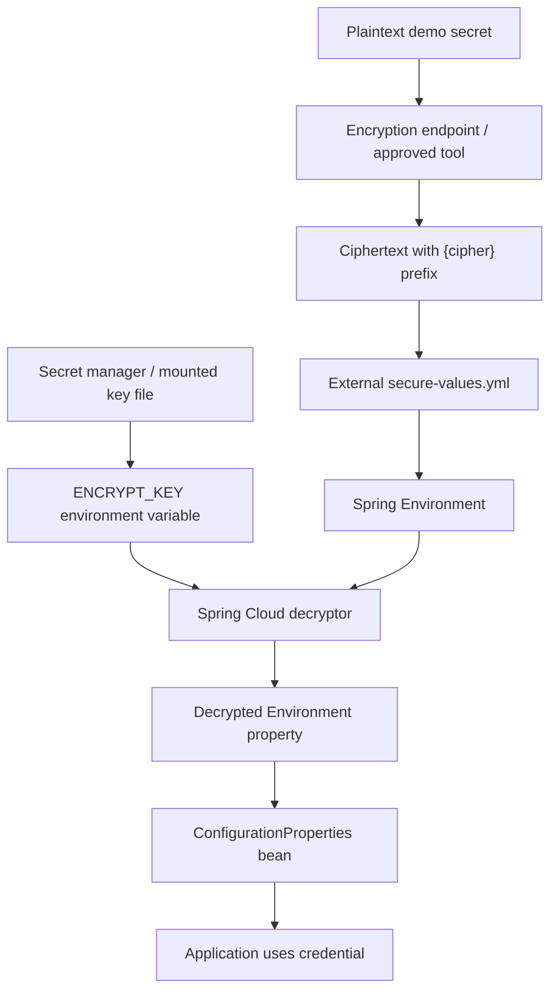

# Local Configuration Decryption with an External Key

Spring Cloud can decrypt encrypted properties directly while preparing the `Environment`. The application reads configuration containing values prefixed with `{cipher}`, uses an externally supplied key to decrypt them, and places the plaintext values into `Environment` before business beans receive configuration.

This hands-on lab builds a Spring Boot application that reads a configuration file located outside the JAR. The file contains only ciphertext; the symmetric key is supplied through the `ENCRYPT_KEY` environment variable from a secret file or secret manager. The application uses `@ConfigurationProperties` to receive the decrypted values and verifies via tests that configuration is processed before beans are created.

This lesson belongs to the **Hands-on Project** chapter of the **SPRING_CLOUD_CORE** module. The focus is on where ciphertext is stored, where the key is supplied, bootstrap decryption, how to verify results, common errors, and how to extend to client-side decryption when using Spring Cloud Config Server.

## 1. Lab Objectives

Upon completing this lesson, learners will be able to:

- Explain Spring Cloud Context's local decryption flow.
- Separate ciphertext from the decryption key and from the application artifact.
- Configure a YAML file outside the JAR using Spring Boot Config Data.
- Enable bootstrap processing so Spring Cloud runs the `Environment` decryption step.
- Supply a symmetric key via the `ENCRYPT_KEY` environment variable.
- Use `spring-security-rsa` to activate Spring Cloud's encryption/decryption components.
- Bind decrypted values into a `@ConfigurationProperties` bean.
- Write tests without logging secrets or exposing them on public endpoints.
- Analyze failures caused by wrong keys, corrupted ciphertext, missing dependencies, or disabled bootstrap.
- Extend to an RSA keystore and the model where Config Server sends ciphertext for the client to decrypt itself.

## 2. Lab Architecture

We separate three components:

1. **Ciphertext** lives in a configuration file outside the JAR. The file can be managed in a config repository or deployed alongside the workload, without containing the key.
2. **The decryption key** is stored in a secret file or secret manager and injected into the process as the `ENCRYPT_KEY` environment variable.
3. **The Spring Boot application** uses Spring Cloud Context to decrypt properties before binding them to beans.

Processing flow:



The key is not stored in source code, committed configuration files, or the JAR. The application receives the key only at runtime from the deployment environment.

## 3. Distinguishing Encryption and Local Decryption

Encrypting configuration keeps secret values in ciphertext at rest. Local decryption means the client application receives ciphertext and decrypts it before configuration is consumed.

Spring Cloud Context provides an `Environment` preprocessor. It detects properties shaped like `{cipher}...`, uses `encrypt.*` configuration to locate the key, and places the decrypted values into `Environment` before the main application context consumes configuration.

This is a Spring Cloud mechanism; plain Spring Boot does not decrypt `{cipher}` values on its own. The application needs Spring Cloud Context, the `spring-security-rsa` dependency, and an appropriate bootstrap/legacy processing setup.

Do not confuse these three scenarios:

| Scenario | Who Decrypts? | Where Is the Key? |
| --- | --- | --- |
| Config Server default decryption | Config Server before returning the response | Config Server |
| Client decrypts configuration received from Config Server | Client application | External to each client or client's secret manager |
| Client decrypts local configuration file | Client application while initializing Environment | External to the application, e.g. environment variable or mounted keystore |

The main lab uses the third scenario. Config Server may be used merely as a tool to generate ciphertext; the application does not need to connect to Config Server at runtime.

## 4. Preparing the Project and Dependencies

Use a compatible Spring Boot and Spring Cloud release train from the official compatibility matrix. Manage versions through the Spring Cloud BOM; do not pick arbitrary versions of Spring Cloud Context or Spring Security RSA.

Declare the `spring-cloud.version` property in the POM according to the release train compatible with your Spring Boot version. Do not copy an illustrative version from another project without checking the compatibility matrix.

Required dependencies for the lab:

```xml
<dependencyManagement>
    <dependencies>
        <dependency>
            <groupId>org.springframework.cloud</groupId>
            <artifactId>spring-cloud-dependencies</artifactId>
            <version>${spring-cloud.version}</version>
            <type>pom</type>
            <scope>import</scope>
        </dependency>
    </dependencies>
</dependencyManagement>

<dependencies>
    <dependency>
        <groupId>org.springframework.boot</groupId>
        <artifactId>spring-boot-starter</artifactId>
    </dependency>

    <dependency>
        <groupId>org.springframework.cloud</groupId>
        <artifactId>spring-cloud-starter-bootstrap</artifactId>
    </dependency>

    <dependency>
        <groupId>org.springframework.security</groupId>
        <artifactId>spring-security-rsa</artifactId>
    </dependency>

    <dependency>
        <groupId>org.springframework.boot</groupId>
        <artifactId>spring-boot-starter-test</artifactId>
        <scope>test</scope>
    </dependency>
</dependencies>
```

`spring-cloud-starter-bootstrap` enables the bootstrap context. In some setups `spring.cloud.bootstrap.enabled=true` can be used instead of the starter, but that property must be provided early enough via system property or environment variable. For this lab, use the starter for explicit configuration.

`spring-security-rsa` supplies the encryption/decryption components needed by Spring Cloud Context. Check the dependency tree if the project already brings in this library transitively.

## 5. Creating the File Structure

Create an application named `local-encryption-lab` with this structure:

```text
local-encryption-lab/
├── src/
│   └── main/
│       ├── java/
│       │   └── com/example/encryption/
│       │       ├── LocalEncryptionApplication.java
│       │       └── ApiCredentials.java
│       └── resources/
│           ├── application.yml
│           └── bootstrap.yml
├── config/
│   └── secure-values.yml
└── pom.xml
```

The `config/` directory sits alongside the JAR at runtime. Do not place `secure-values.yml` inside `src/main/resources` if the goal is to change ciphertext without rebuilding the artifact.

In container environments, `config/` can be mounted from a read-only volume. The path must exist when the application starts.

## 6. Configuring Bootstrap and File Import

In `src/main/resources/bootstrap.yml`, declare the reference to the external key:

```yaml
encrypt:
  key: ${ENCRYPT_KEY}
  fail-on-error: true
```

`encrypt.key` reads its value from the `ENCRYPT_KEY` environment variable. The bootstrap file contains only the variable reference, never the key value itself.

`encrypt.fail-on-error: true` instructs initialization to fail if a ciphertext cannot be decrypted. This prevents the application from continuing to run with undecrypted credentials.

In `src/main/resources/application.yml`, declare the local configuration file:

```yaml
spring:
  application:
    name: local-encryption-lab
  config:
    import: "file:./config/secure-values.yml"
```

Do not add the `optional:` prefix for a file containing required credentials. If the file is missing, the application should fail with a configuration error rather than starting without secrets.

`spring.config.import` is Spring Boot's Config Data mechanism for loading external files. The bootstrap starter provides the bootstrap phase and Spring Cloud's decryptor to process encrypted properties.

## 7. Generating Ciphertext for a Sample Value

In this lab, use a dummy string, for example:

```text
demo-token-123
```

You can use the `/encrypt` endpoint of a Config Server configured with the same symmetric key to generate ciphertext. Config Server must receive the key via secret/environment just like the client. This endpoint must be secured and restricted to authorized configuration encryptors.

Example with `curl`:

```bash
curl --fail --silent --show-error \
  -H "Content-Type: text/plain" \
  --data-binary "demo-token-123" \
  http://localhost:8888/encrypt
```

The command returns the ciphertext. Use that result to replace the placeholder in `secure-values.yml`. When plaintext contains special characters such as plus signs, Spring Cloud documentation recommends using `--data-urlencode` with the value prefixed by an equals sign, or sending an explicit `Content-Type: text/plain` header so `curl` does not alter the payload.

Do not pass production secrets on the command line or leave them in shell history. The string in the example is solely dummy test data. In real environments, use a controlled encryption workflow and never log request bodies or plaintext responses.

### 7.1. Contents of secure-values.yml

Once you have the ciphertext, `config/secure-values.yml` looks like:

```yaml
demo:
  api:
    username: lab-user
    token: '{cipher}CIPHERTEXT_FROM_ENCRYPT_ENDPOINT'
```

Replace `CIPHERTEXT_FROM_ENCRYPT_ENDPOINT` with the actual ciphertext generated in the previous step. Keep the `{cipher}` prefix intact.

In YAML, wrap the encrypted value in single quotes so the parser treats the entire string as a scalar. If stored in `.properties`, `{cipher}...` values must not be wrapped in quotes; otherwise Config Server/Cloud decryption rules may fail to recognize the value properly.

Never commit keys, secret files, or plaintext to the repository. Ciphertext may be stored alongside configuration if project policy permits.

## 8. Supplying the Key Externally

On a local machine, store the key in a separate file outside the project directory or in a secret manager. Example path:

```text
C:\secure\local-encryption-lab\encrypt-key.txt
```

When running in PowerShell, read the file and set the value in the process environment:

```powershell
$env:ENCRYPT_KEY = (
    Get-Content -Raw -LiteralPath 'C:\secure\local-encryption-lab\encrypt-key.txt'
).Trim()

java -jar .\target\local-encryption-lab.jar
```

If running from an IDE, configure `ENCRYPT_KEY` in the Run Configuration or use the IDE's secret integration. Never put the raw key value into a shared Run Configuration or a committed configuration file.

In Kubernetes, you can load the key from a Secret:

```yaml
env:
  - name: ENCRYPT_KEY
    valueFrom:
      secretKeyRef:
        name: local-encryption-key
        key: encrypt-key
```

Secrets must be created and managed separately by the deployment pipeline. Restrict read permissions on the Secret and grant access only to workloads that must decrypt.

Environment variables are not an absolute secret vault: processes with equivalent privileges or administrative tools can inspect process environments. For higher security requirements, consider mounted secrets/keystores with tight permissions or dedicated secret manager integration.

## 9. Creating a Bean to Receive Decrypted Configuration

Create the `ApiCredentials` class:

```java
package com.example.encryption;

import org.springframework.boot.context.properties.ConfigurationProperties;

@ConfigurationProperties(prefix = "demo.api")
public class ApiCredentials {

    private String username;
    private String token;

    public String getUsername() {
        return username;
    }

    public void setUsername(String username) {
        this.username = username;
    }

    public String getToken() {
        return token;
    }

    public void setToken(String token) {
        this.token = token;
    }
}
```

Register the class with `@ConfigurationPropertiesScan` on the application class:

```java
package com.example.encryption;

import org.springframework.boot.SpringApplication;
import org.springframework.boot.autoconfigure.SpringBootApplication;
import org.springframework.boot.context.properties.ConfigurationPropertiesScan;

@SpringBootApplication
@ConfigurationPropertiesScan
public class LocalEncryptionApplication {

    public static void main(String[] args) {
        SpringApplication.run(LocalEncryptionApplication.class, args);
    }
}
```

When Spring binds `demo.api.token`, the decryptor has already replaced the ciphertext with plaintext in `Environment`. The bean receives the decrypted value like any ordinary property; services do not need to call a decrypt API or write a custom `TextEncryptor` for the standard flow.

### 9.1. Do Not Log Credentials

If you want to confirm the application received configuration, log only a boolean presence status:

```java
import org.springframework.boot.ApplicationRunner;
import org.springframework.context.annotation.Bean;
import org.springframework.context.annotation.Configuration;
import org.springframework.util.StringUtils;

@Configuration
public class CredentialStartupCheck {

    @Bean
    ApplicationRunner credentialCheck(ApiCredentials credentials) {
        return args -> {
            boolean configured = StringUtils.hasText(credentials.getToken());
            System.out.println("API credential configured: " + configured);
        };
    }
}
```

Never log `credentials.getToken()`, never include the token in exception messages, and never return the token from REST endpoints. Successful decryption does not make plaintext safe to log.

## 10. Testing Decryption Before Binding

Create an integration test to verify the bean receives the sample plaintext:

```java
package com.example.encryption;

import org.junit.jupiter.api.Test;
import org.springframework.beans.factory.annotation.Autowired;
import org.springframework.boot.test.context.SpringBootTest;

import static org.assertj.core.api.Assertions.assertThat;

@SpringBootTest
class ApiCredentialsIntegrationTest {

    @Autowired
    private ApiCredentials credentials;

    @Test
    void decryptsExternalConfigurationBeforeBinding() {
        assertThat(credentials.getUsername()).isEqualTo("lab-user");
        assertThat(credentials.getToken()).isEqualTo("demo-token-123");
    }
}
```

The test must run in an environment that has:

- `config/secure-values.yml` containing ciphertext encrypted from that exact sample string.
- The `ENCRYPT_KEY` environment variable holding the same key used for encryption.
- Bootstrap processing and `spring-security-rsa` enabled.

The test verifies the value received by the bean without printing plaintext to the console. When running tests in CI, supply the key through the CI secret store and do not echo the environment variable.

## 11. Verifying the Running Application

After starting the application, verify:

1. The process starts successfully.
2. The configuration file outside the JAR was loaded.
3. The `demo.api.token` property was decrypted.
4. The `ApiCredentials` bean receives the expected values.
5. Logs show only the configured status of the credential.
6. The JAR contains no key files or plaintext.
7. The repository contains no real keys.

You can inspect the JAR contents with an archive tool to confirm `config/secure-values.yml` and the key were not accidentally packaged inside. If configuration is imported via a relative path, launch the application from the correct working directory or use an absolute path suited to the environment.

Do not enable Actuator `env` just to print secrets. If diagnostic endpoints must be used, restrict access permissions and keep default masking for sensitive values intact.

## 12. Why Is Bootstrap Processing Needed?

Spring Cloud uses the bootstrap context and initializers to prepare property sources. The environment decryptor runs only when proper bootstrap/legacy processing is enabled. If an application does not enable bootstrap processing, `{cipher}...` properties may remain undecrypted or initialization may fail because no encryptor is found.

This lab uses `spring-cloud-starter-bootstrap` to activate the bootstrap context. When not using the starter, the `spring.cloud.bootstrap.enabled=true` environment variable or system property can be used in some configurations, but it must be available early enough for the bootstrap listener to read; placing it in an `application` file loaded later is too late.

`encrypt.key` must also be available during the bootstrap phase. Therefore, reference `ENCRYPT_KEY` in `bootstrap.yml` and supply the environment variable before launching the JVM.

## 13. Variant: Using an RSA Keystore Instead of a Symmetric Key

A symmetric key is simple for a lab because both encryption and decryption sides share a single key. In exchange, both sides must protect the same shared secret.

With RSA, Config Server or the encryption tool only needs the public key; the client application holds the private key to decrypt. The private key never needs to leave the client environment. This fits well when only a subset of clients should be able to read secrets and you do not want Config Server holding decryption private keys.

Spring Cloud supports keystore configuration via these properties:

| Property | Meaning |
| --- | --- |
| encrypt.key-store.location | Resource location of the keystore |
| encrypt.key-store.password | Password to unlock the keystore |
| encrypt.key-store.alias | Alias of the key/certificate to use |
| encrypt.key-store.type | Keystore type; defaults to JKS |

Example client referencing a private keystore mounted outside the JAR:

```yaml
encrypt:
  key-store:
    location: file:/run/secrets/client-decrypt.p12
    password: ${ENCRYPT_KEYSTORE_PASSWORD}
    alias: client-decrypt
    type: PKCS12
  fail-on-error: true
```

The keystore and password must be supplied from a secret volume or secret manager. With PKCS12, use key and store password settings compatible with the running JDK; modern JDKs typically require both passwords to match.

On the encryption side, the server's keystore may contain only the public certificate. On the client side, the keystore holds the matching private key. Both must use matching aliases and compatible algorithms. Never place the client's private keystore inside Config Server's image or repository.

## 14. Variant: Config Server Sends Ciphertext for Client-Side Decryption

By default, Spring Cloud Config Server decrypts properties prefixed with `{cipher}` before sending them over HTTP. If you want clients to decrypt on their own, configure Config Server:

```yaml
spring:
  cloud:
    config:
      server:
        encrypt:
          enabled: false
```

This property must be placed in Config Server's `bootstrap.yml` or `bootstrap.properties` per the Spring Cloud Config documentation. As long as `encrypt.*` remains configured, the `/encrypt` and `/decrypt` endpoints can still function; the flag above controls decryption of outgoing properties.

On the client side:

- Include `spring-cloud-starter-config` to connect to Config Server.
- Include `spring-security-rsa` and bootstrap/decryption processing.
- Provide the decryption key via `encrypt.key` or `encrypt.key-store.*` keystore settings.
- Config Server returns property sources still containing ciphertext; the client decrypts them in its environment before beans consume them.

With a symmetric key, server and client must share the same key. With RSA, the server needs only the public key to encrypt while the client holds the private key. The RSA model reduces the number of places holding the private key, at the cost of strict certificate, alias, and key lifecycle management.

Do not set `spring.cloud.config.server.encrypt.enabled=false` on the client; that property configures Config Server's outgoing behavior.

## 15. Troubleshooting Decryption Failures

When the application fails to decrypt properties, check in this order:

1. Was `ENCRYPT_KEY` supplied before the JVM started?
2. Does `encrypt.key` resolve to a non-empty value in the bootstrap context?
3. Is the key the exact same key used to create the ciphertext?
4. Was the ciphertext truncated, altered, or given trailing newlines during copy-paste?
5. Does the YAML file preserve the `{cipher}` prefix and quotes?
6. Is `spring-security-rsa` present on the runtime classpath?
7. Is the bootstrap starter or bootstrap-enabled property actually active?
8. If using RSA, do the alias, keystore password, and private/public keys match?
9. If encountering algorithm or key-size errors, does the JDK support the required cryptographic policies?

With `encrypt.fail-on-error: true`, decryption failures must abort startup. Keep this behavior for required credentials so the application never silently runs with undecrypted configuration.

Never replace ciphertext with plaintext as a quick workaround in the repository. Fix key provisioning or re-encrypt the value using the managed key.

## 16. Symptom and Cause Reference Table

| Symptom | Possible Cause | Resolution |
| --- | --- | --- |
| Application reports no encryptor | Missing `spring-security-rsa` or missing `encrypt.key`/keystore | Check runtime dependencies and bootstrap properties |
| Property still holds `{cipher}` string | Bootstrap/legacy processing disabled or initializer did not run | Add bootstrap starter or enable bootstrap early |
| Decryption error at startup | Wrong key, corrupted ciphertext, or incompatible algorithm | Re-encrypt ciphertext with the right key/algorithm |
| `ENCRYPT_KEY` resolves to empty | Secret not mounted or env var not passed to process | Check secret reference and process environment |
| `secure-values` file not loaded | Wrong working directory or import path | Check `spring.config.import` and file location |
| YAML parse error on `{cipher}` | Value is unquoted | Wrap ciphertext in single quotes |
| Secret does not bind to bean | Wrong prefix, property name, or scan | Check `ConfigurationPropertiesScan` and prefix |
| Config Server returns plaintext when client decrypt was expected | Server still has outgoing decryption enabled | Set `spring.cloud.config.server.encrypt.enabled=false` in server's bootstrap config |
| RSA decrypt reports key not found | Wrong alias or private keystore | Check alias, certificate, and keystore path |

## 17. Key Operations and Rotation

Decryption keys are security assets independent of ciphertext. In operations:

- Supply keys from a secret manager or secret volume.
- Restrict which workloads and accounts may read the key.
- Never store keys in source code, JARs, container images, Docker build arguments, or CI logs.
- Rotate keys through a tested process with rollback capability.
- Track when ciphertext was encrypted, the key version, and which applications require each key.
- Revoke old keys after all ciphertext and clients have migrated.
- Protect backups containing keystores with the same rigor as credential backups.

With a single symmetric key, values must be re-encrypted with the new key and deployed in sync with the new key. When a multi-key transition window is needed, use a keystore with aliases and proper key identifiers. Spring Cloud Config supports the `{cipher}{key:alias}CIPHERTEXT` format so the locator picks the corresponding key; all affected clients must have the needed alias before switching configuration.

Key rotation requires a rollback plan. Do not delete the old key until you confirm every environment is using the new ciphertext.

## 18. Protecting Plaintext After Decryption

Local decryption protects configuration at rest; once decrypted, plaintext resides in `Environment` and is accessible to beans inside the application.

Therefore:

- Grant process access only to workloads that need the secret.
- Use TLS when calling external APIs.
- Never log `Environment`, credentials, request headers, or exceptions containing secrets.
- Restrict heap dumps and thread dumps; they can contain plaintext.
- Lock down Actuator `env`, `configprops`, and diagnostic endpoints.
- Never expose `/encrypt` or `/decrypt` publicly; require authentication and network policies.
- Use Vault or a secret manager when dynamic secrets, auditing, leases, and rotation are required instead of maintaining encrypted files manually.

Encrypting ciphertext in a repository does not replace access control over keys or protection of data after decryption.

## 19. Extension Exercises

After finishing the symmetric-key lab, complete these exercises:

1. Rename the property to `demo.api.client-secret` and confirm binding still works.
2. Run the application without setting `ENCRYPT_KEY`; confirm startup fails with `fail-on-error`.
3. Supply an incorrect key and observe the exception. Do not log the key value.
4. Corrupt the ciphertext by removing a few characters and confirm decryption fails.
5. Move `secure-values.yml` to another directory and update `spring.config.import`.
6. Write an integration test verifying the bean receives the dummy plaintext.
7. Use an RSA key pair, keep the private keystore outside the JAR, and configure the public key for the encryption tool.
8. Configure Config Server to return ciphertext using `spring.cloud.config.server.encrypt.enabled=false` and confirm the client decrypts it.
9. Practice key rotation with a new alias, re-encrypt the property, and deploy the client with the matching key.
10. Inspect the JAR, container image, logs, and repository to verify no unintended keys or plaintext exist.

**Completion criteria:** the application reads configuration outside the JAR, decrypts properties with an externally supplied key, binds plaintext into beans, passes tests, fails startup on invalid keys, and never logs secrets.

## 20. Key Takeaways

- Spring Cloud Context decrypts `{cipher}...` properties in `Environment` before the main application context consumes them.
- Requires the `spring-security-rsa` dependency and appropriate bootstrap/legacy processing.
- Configuration files can store ciphertext; keys are supplied separately via `ENCRYPT_KEY` or a keystore.
- `encrypt.key` configures a symmetric key; `encrypt.key-store.*` configures an RSA keystore.
- In YAML, wrap ciphertext in single quotes; in `.properties`, do not wrap ciphertext in quotes.
- `spring.config.import` can load configuration files outside the JAR.
- `encrypt.fail-on-error=true` ensures the application aborts when required credentials fail to decrypt.
- Config Server decrypts outgoing properties by default; `spring.cloud.config.server.encrypt.enabled=false` shifts decryption to the client.
- RSA lets the server hold the public key while the client holds the private key.
- Never log plaintext, package keys inside artifacts, or expose encryption/decryption endpoints publicly.
- Key rotation must be paired with ciphertext re-encryption and coordinated client rollout.

## 21. References

- [Spring Cloud Commons — Application Context Services](https://docs.spring.io/spring-cloud-commons/reference/spring-cloud-commons/application-context-services.html): Environment pre-processor, bootstrap context, local decryption, encrypt properties, and `spring-security-rsa` requirements.
- [Spring Cloud Config — Key Management](https://docs.spring.io/spring-cloud-config/reference/server/key-management.html): symmetric keys, RSA key pairs, and keystore properties.
- [Spring Cloud Config — Encryption and Decryption](https://docs.spring.io/spring-cloud-config/reference/server/encryption-and-decryption.html): `{cipher}` prefix, encrypt/decrypt endpoints, and ciphertext formatting.
- [Spring Cloud Config — Serving Encrypted Properties](https://docs.spring.io/spring-cloud-config/reference/server/serving-encrypted-properties.html): disabling server-side decryption for client-side decryption.
- [Spring Cloud Config — Using Multiple Keys and Key Rotation](https://docs.spring.io/spring-cloud-config/reference/server/using-multiple-keys-and-key-rotation.html): key aliases and multi-key rotation workflows.
- [Spring Boot — Externalized Configuration](https://docs.spring.io/spring-boot/reference/features/external-config.html): Config Data imports and external configuration files.
