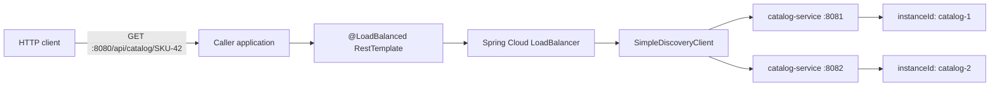

# Calling a Service by Name Using an @LoadBalanced HTTP Client

## 1. Project Objectives

In distributed systems, a single service often runs multiple instances. If a client calls `http://localhost:8081` directly, the code is coupled to a physical address. Whenever an instance moves to another host, changes port, or scales replicas up or down, the client must know and update its address list.

Spring Cloud LoadBalancer lets clients call a service by service ID, such as `http://catalog-service`, and select an instance from a discovery source. The `@LoadBalanced` annotation marks an HTTP client bean to be integrated with LoadBalancer.

In this lab, we build a Spring Boot application with two roles:

- **Catalog provider:** runs two instances on ports `8081` and `8082`, each returning its own identifier.
- **Caller:** runs on port `8080`, receives requests from users, and calls `catalog-service` via a `@LoadBalanced` `RestTemplate`.

To stay focused on routing, the caller uses `SimpleDiscoveryClient` with two statically configured URIs. The lab does not require setting up Eureka or Consul. When moving to a real registry, you swap the discovery source for the corresponding starter; the service ID URI in the HTTP calling code remains unchanged.

Upon completion, you will be able to:

1. Declare Spring Cloud LoadBalancer in the project.
2. Configure a list of instances for a service ID.
3. Create a `@LoadBalanced` `RestTemplate` bean.
4. Inject the client into a service via constructor.
5. Send requests to a service ID instead of a physical address.
6. Observe LoadBalancer distributing requests across multiple instances.
7. Test discovery configuration and troubleshoot common errors.

## 2. Lab Architecture



Processing flow:

1. A client sends a request to the caller on port `8080`.
2. `CatalogGateway` calls `http://catalog-service/catalog/{sku}`.
3. The LoadBalancer interceptor resolves the service ID `catalog-service`.
4. LoadBalancer fetches the instance list from the discovery client.
5. The instance selection strategy picks a physical URI, such as `http://localhost:8082`.
6. The request is forwarded to the chosen provider and the result is returned to the caller.

In this lab, `SimpleDiscoveryClient` reads both URIs from the caller's configuration. The two providers do not register themselves with an external registry.

## 3. Preparing the Project and Dependencies

### 3.1. Directory Structure

Create a Maven project with package `com.example.loadbalancedlab`:

```text
loadbalanced-lab/
├── pom.xml
└── src/
    ├── main/
    │   ├── java/com/example/loadbalancedlab/
    │   │   ├── LoadBalancedLabApplication.java
    │   │   ├── CatalogItem.java
    │   │   ├── catalog/
    │   │   │   └── CatalogController.java
    │   │   └── caller/
    │   │       ├── LoadBalancedClientConfiguration.java
    │   │       ├── CatalogGateway.java
    │   │       └── CatalogProxyController.java
    │   └── resources/
    │       ├── application.yml
    │       ├── application-catalog.yml
    │       └── application-caller.yml
    └── test/
        └── java/com/example/loadbalancedlab/
            └── LoadBalancedClientConfigurationTests.java
```

A single project and a single JAR can run multiple processes with different profiles. The `catalog` profile registers only the provider controller; the `caller` profile registers only the HTTP client and proxy controller.

### 3.2. Declaring Dependencies

Use your project's Spring Boot parent/BOM and import a Spring Cloud BOM compatible with the chosen Spring Boot version. Do not assign separate manual versions to individual Spring Cloud starters.

Example properties and dependency management in `pom.xml`:

```xml
<properties>
    <java.version>17</java.version>
    <!-- Select a release train compatible with your project's Spring Boot version. -->
    <spring-cloud.version>YOUR_COMPATIBLE_RELEASE_TRAIN</spring-cloud.version>
</properties>

<dependencyManagement>
    <dependencies>
        <dependency>
            <groupId>org.springframework.cloud</groupId>
            <artifactId>spring-cloud-dependencies</artifactId>
            <version>${spring-cloud.version}</version>
            <type>pom</type>
            <scope>import</scope>
        </dependency>
    </dependencies>
</dependencyManagement>
```

Replace `YOUR_COMPATIBLE_RELEASE_TRAIN` with a release train published as compatible with your Spring Boot parent/BOM. Keep Spring Boot and Spring Cloud on the same compatibility matrix.

Add dependencies for the MVC application, LoadBalancer, and tests:

```xml
<dependencies>
    <dependency>
        <groupId>org.springframework.boot</groupId>
        <artifactId>spring-boot-starter-webmvc</artifactId>
    </dependency>

    <dependency>
        <groupId>org.springframework.cloud</groupId>
        <artifactId>spring-cloud-starter-loadbalancer</artifactId>
    </dependency>

    <dependency>
        <groupId>org.springframework.boot</groupId>
        <artifactId>spring-boot-starter-test</artifactId>
        <scope>test</scope>
    </dependency>
</dependencies>
```

With Spring Boot 3.x, use `spring-boot-starter-web` for Spring MVC applications instead of `spring-boot-starter-webmvc`. The `RestTemplate` and Spring Cloud LoadBalancer code does not change due to the web starter name.

`spring-cloud-starter-loadbalancer` provides the integration needed for `@LoadBalanced RestTemplate` to resolve service IDs. No Eureka/Consul starter is needed for this exercise because the caller uses `SimpleDiscoveryClient`.

### 3.3. Shared Configuration

Create `application.yml`:

```yaml
spring:
  application:
    name: loadbalanced-lab
```

`application-catalog.yml` and `application-caller.yml` override properties specific to each role.

## 4. Creating the Spring Boot Application

### 4.1. Main Class

Create `LoadBalancedLabApplication.java`:

```java
package com.example.loadbalancedlab;

import org.springframework.boot.SpringApplication;
import org.springframework.boot.autoconfigure.SpringBootApplication;

@SpringBootApplication
public class LoadBalancedLabApplication {

    public static void main(String[] args) {
        SpringApplication.run(LoadBalancedLabApplication.class, args);
    }
}
```

`@EnableDiscoveryClient` is not needed just to turn on discovery. In this lab, the Spring Cloud Commons/LoadBalancer dependencies and `SimpleDiscoveryClient` configuration supply the instance source to LoadBalancer.

### 4.2. Shared DTO

Create `CatalogItem.java`:

```java
package com.example.loadbalancedlab;

public record CatalogItem(
        String sku,
        String description,
        String instanceId
) {
}
```

The `instanceId` field lets us observe which provider handled each request. In real applications, response DTOs generally do not need to expose this instance identifier.

## 5. Building the Catalog Provider

The provider receives a SKU and returns item data along with its instance ID. Create `catalog/CatalogController.java`:

```java
package com.example.loadbalancedlab.catalog;

import com.example.loadbalancedlab.CatalogItem;
import org.springframework.beans.factory.annotation.Value;
import org.springframework.context.annotation.Profile;
import org.springframework.web.bind.annotation.GetMapping;
import org.springframework.web.bind.annotation.PathVariable;
import org.springframework.web.bind.annotation.RequestMapping;
import org.springframework.web.bind.annotation.RestController;

@RestController
@RequestMapping("/catalog")
@Profile("catalog")
public class CatalogController {

    private final String instanceId;

    public CatalogController(
            @Value("${demo.instance-id:catalog-unknown}") String instanceId) {
        this.instanceId = instanceId;
    }

    @GetMapping("/{sku}")
    public CatalogItem find(@PathVariable String sku) {
        return new CatalogItem(
                sku,
                "Item " + sku,
                instanceId
        );
    }
}
```

`@Profile("catalog")` registers this controller only when the `catalog` profile is active. Both processes run the same code while receiving different `instanceId` values via configuration.

Create `application-catalog.yml`:

```yaml
server:
  port: 8081

demo:
  instance-id: catalog-1
```

The second process will override the port and instance ID on the command line at startup.

## 6. Configuring the @LoadBalanced HTTP Client

### 6.1. Declaring the RestTemplate Bean

Create `caller/LoadBalancedClientConfiguration.java`:

```java
package com.example.loadbalancedlab.caller;

import org.springframework.cloud.client.loadbalancer.LoadBalanced;
import org.springframework.context.annotation.Bean;
import org.springframework.context.annotation.Configuration;
import org.springframework.context.annotation.Profile;
import org.springframework.web.client.RestTemplate;

@Configuration(proxyBeanMethods = false)
@Profile("caller")
public class LoadBalancedClientConfiguration {

    @Bean
    @LoadBalanced
    RestTemplate loadBalancedRestTemplate() {
        return new RestTemplate();
    }
}
```

Three essentials must be in place:

- A `@Bean` method registers `RestTemplate` in the Spring container.
- `@LoadBalanced` marks the bean for integration with Spring Cloud LoadBalancer.
- `spring-cloud-starter-loadbalancer` must be on the runtime classpath.

Spring Boot does not auto-create a `RestTemplate` bean merely because Spring Web is present. To inject the client via constructor, the application must declare the bean as shown above.

`@LoadBalanced` is a qualifier, not a registry address and not an annotation that enables Eureka/Consul. It tells Spring Cloud which client beans need an interceptor to handle URIs containing service IDs.

### 6.2. Injecting the Client into CatalogGateway

Create `caller/CatalogGateway.java`:

```java
package com.example.loadbalancedlab.caller;

import com.example.loadbalancedlab.CatalogItem;
import org.springframework.cloud.client.loadbalancer.LoadBalanced;
import org.springframework.context.annotation.Profile;
import org.springframework.stereotype.Service;
import org.springframework.web.client.RestOperations;

@Service
@Profile("caller")
public class CatalogGateway {

    private final RestOperations restOperations;

    public CatalogGateway(
            @LoadBalanced RestOperations restOperations) {
        this.restOperations = restOperations;
    }

    public CatalogItem find(String sku) {
        return restOperations.getForObject(
                "http://catalog-service/catalog/{sku}",
                CatalogItem.class,
                sku
        );
    }
}
```

Here the constructor accepts `RestOperations`, the interface implemented by `RestTemplate`. Injecting by interface also avoids certain proxy issues that can arise when injecting the concrete `RestTemplate` class directly.

The key element is the URI:

```text
http://catalog-service/catalog/{sku}
```

`catalog-service` is the logical service ID. Never hard-code `localhost:8081` in HTTP calling code. LoadBalancer retrieves a `ServiceInstance` for this ID and replaces the logical host with the chosen instance's physical URI.

### 6.3. Creating the Caller Endpoint

Create `caller/CatalogProxyController.java`:

```java
package com.example.loadbalancedlab.caller;

import com.example.loadbalancedlab.CatalogItem;
import org.springframework.context.annotation.Profile;
import org.springframework.web.bind.annotation.GetMapping;
import org.springframework.web.bind.annotation.PathVariable;
import org.springframework.web.bind.annotation.RequestMapping;
import org.springframework.web.bind.annotation.RestController;

@RestController
@RequestMapping("/api/catalog")
@Profile("caller")
public class CatalogProxyController {

    private final CatalogGateway catalogGateway;

    public CatalogProxyController(CatalogGateway catalogGateway) {
        this.catalogGateway = catalogGateway;
    }

    @GetMapping("/{sku}")
    public CatalogItem find(@PathVariable String sku) {
        return catalogGateway.find(sku);
    }
}
```

The caller knows only `CatalogGateway`; the controller neither knows which port the provider runs on nor picks an instance itself.

## 7. Configuring SimpleDiscoveryClient

Create `application-caller.yml`:

```yaml
server:
  port: 8080

spring:
  application:
    name: catalog-caller
  cloud:
    discovery:
      client:
        simple:
          instances:
            catalog-service:
              - uri: http://localhost:8081
              - uri: http://localhost:8082
```

The property prefix is `spring.cloud.discovery.client.simple.instances`. The `catalog-service` key matches the service ID used in `CatalogGateway`'s URI. Each entry in the list represents an instance with its physical URI.

`SimpleDiscoveryClient` is used when no service-registry-based `DiscoveryClient` is on the classpath. Because this lab adds only the Spring Cloud LoadBalancer starter, the instance list comes from this static configuration.

If the URI uses `catalog-service` as the service ID while YAML declares `catalog`, LoadBalancer will fail to find any instances. Both names must match exactly.

## 8. Building and Running the Three Processes

### 8.1. Building the Project

From the root directory:

```bash
./mvnw clean package
```

On Windows PowerShell, run:

```powershell
.\mvnw.cmd clean package
```

Ensure the release train placeholder in `pom.xml` has been replaced with a compatible version before building.

### 8.2. Running the First Catalog Instance

Open a first terminal:

```bash
java -jar target/loadbalanced-lab-0.0.1-SNAPSHOT.jar \
  --spring.profiles.active=catalog \
  --server.port=8081 \
  --demo.instance-id=catalog-1
```

On PowerShell, you can run the entire command on one line:

```powershell
java -jar target/loadbalanced-lab-0.0.1-SNAPSHOT.jar --spring.profiles.active=catalog --server.port=8081 --demo.instance-id=catalog-1
```

### 8.3. Running the Second Catalog Instance

Open a second terminal:

```bash
java -jar target/loadbalanced-lab-0.0.1-SNAPSHOT.jar \
  --spring.profiles.active=catalog \
  --server.port=8082 \
  --demo.instance-id=catalog-2
```

On PowerShell:

```powershell
java -jar target/loadbalanced-lab-0.0.1-SNAPSHOT.jar --spring.profiles.active=catalog --server.port=8082 --demo.instance-id=catalog-2
```

Both processes run the `catalog` profile, each with its own port and instance ID.

### 8.4. Running the Caller

Open a third terminal:

```bash
java -jar target/loadbalanced-lab-0.0.1-SNAPSHOT.jar \
  --spring.profiles.active=caller
```

On PowerShell:

```powershell
java -jar target/loadbalanced-lab-0.0.1-SNAPSHOT.jar --spring.profiles.active=caller
```

The `caller` profile loads `application-caller.yml`, creating the load-balanced `RestTemplate` and the proxy controller. Because the `catalog` profile is not active, the provider controller is absent in the caller process.

## 9. Sending Requests and Observing LoadBalancer

### 9.1. Calling Each Provider Directly

Confirm both providers work independently:

```bash
curl http://localhost:8081/catalog/SKU-42
curl http://localhost:8082/catalog/SKU-42
```

The response looks like:

```json
{
  "sku": "SKU-42",
  "description": "Item SKU-42",
  "instanceId": "catalog-1"
}
```

Requests to port `8082` return `instanceId` as `catalog-2`.

### 9.2. Calling via Service ID

Call the caller:

```bash
curl -i http://localhost:8080/api/catalog/SKU-42
```

The caller sends an internal request to the logical URI `http://catalog-service/catalog/SKU-42`. The final response includes the `instanceId` of whichever provider LoadBalancer chose.

Send multiple requests:

```bash
for i in {1..8}; do
  curl -s http://localhost:8080/api/catalog/SKU-42
  echo
done
```

In Windows PowerShell, run:

```powershell
for ($i = 0; $i -lt 8; $i++) {
    curl.exe -s http://localhost:8080/api/catalog/SKU-42
}
```

With the default configuration, Spring Cloud LoadBalancer uses a round-robin strategy. When both instances are available, consecutive requests are distributed across the instances. Do not rely on the very first request always hitting `catalog-1` or `catalog-2`; order can vary with other LoadBalancer configurations.

### 9.3. Comparing with Physical URLs

The two calling approaches have distinct meanings:

| URI | Meaning |
| --- | --- |
| `http://localhost:8081/catalog/SKU-42` | Calls a specific instance directly |
| `http://catalog-service/catalog/SKU-42` | Calls a service ID so LoadBalancer selects an instance |

Business code should use service IDs when routing through discovery and LoadBalancer. Physical URLs fit direct diagnostics or external endpoints outside the internal registry.

## 10. Testing Discovery Configuration and Client Bean

Create `LoadBalancedClientConfigurationTests.java`:

```java
package com.example.loadbalancedlab;

import java.net.URI;
import java.util.List;

import org.junit.jupiter.api.Test;
import org.springframework.beans.factory.annotation.Autowired;
import org.springframework.boot.test.context.SpringBootTest;
import org.springframework.cloud.client.ServiceInstance;
import org.springframework.cloud.client.discovery.DiscoveryClient;
import org.springframework.cloud.client.loadbalancer.LoadBalanced;
import org.springframework.test.context.ActiveProfiles;
import org.springframework.web.client.RestOperations;

import static org.assertj.core.api.Assertions.assertThat;

@SpringBootTest(
        classes = LoadBalancedLabApplication.class,
        webEnvironment = SpringBootTest.WebEnvironment.NONE
)
@ActiveProfiles("caller")
class LoadBalancedClientConfigurationTests {

    @Autowired
    DiscoveryClient discoveryClient;

    @Autowired
    @LoadBalanced
    RestOperations restOperations;

    @Test
    void simpleDiscoveryContainsBothCatalogInstances() {
        List<ServiceInstance> instances =
                discoveryClient.getInstances("catalog-service");

        assertThat(instances).hasSize(2);
        assertThat(instances.stream()
                .map(ServiceInstance::getUri)
                .toList())
                .containsExactlyInAnyOrder(
                        URI.create("http://localhost:8081"),
                        URI.create("http://localhost:8082")
                );
    }

    @Test
    void loadBalancedRestOperationsBeanIsAvailable() {
        assertThat(restOperations).isNotNull();
    }
}
```

The test activates the `caller` profile, so Spring loads the two-instance list from `application-caller.yml`. It confirms that the discovery source returns both URIs and that the `@LoadBalanced`-qualified bean is successfully injected.

This is a context configuration test; it does not yet verify HTTP requests reaching a live provider. End-to-end routing verification is performed with the three processes and requests in Section 9. You can upgrade this test by starting a provider on a random port and supplying its URI in a test property source.

## 11. Extending from SimpleDiscoveryClient to a Real Registry

In this lab, the instance list lives in the caller's configuration file. Whenever providers change addresses or scale replicas, that static list must be updated.

In production, you can replace `SimpleDiscoveryClient` with a discovery implementation such as Eureka or Consul:

1. Add the corresponding discovery starter to both caller and provider.
2. Configure the registry address and registration metadata for each application.
3. Let providers register their instances with the registry according to the integration lifecycle.
4. Remove the `spring.cloud.discovery.client.simple.instances` list from the caller.
5. Keep `@LoadBalanced RestTemplate` and the `http://catalog-service/...` URI unchanged.

When a registry-backed discovery client is present, Spring Cloud LoadBalancer retrieves instances from the active `DiscoveryClient` on the classpath. Business code does not need to know whether the underlying registry is Eureka or Consul.

## 12. Common Errors

| Symptom | Possible Cause | Resolution |
| --- | --- | --- |
| `NoSuchBeanDefinitionException` for `RestOperations` | `RestTemplate` bean not declared or `caller` profile inactive | Check `LoadBalancedClientConfiguration` and active profile |
| `UnknownHostException: catalog-service` | Request used a plain client without LoadBalancer interceptor | Inject the bean qualified with `@LoadBalanced` |
| `No servers available for service: catalog-service` | Wrong service ID or empty instance list | Match the host in the URI with the YAML key |
| Caller returns `503` or connection error | Provider stopped, wrong port, or unreachable | Check logs and call the provider directly |
| Only one provider receives requests | Only one instance declared or one process not running | Check both URIs and call each port directly |
| Two `RestTemplate` beans cause ambiguous injection | Plain and load-balanced clients exist without qualifier at injection point | Add `@LoadBalanced` at the injection point or `@Primary` on the default bean |
| Added Eureka and SimpleDiscoveryClient is no longer picked | A registry-backed `DiscoveryClient` is now on the classpath | Check instances in the registry and discovery client ordering |
| Requests still hit one instance after editing YAML | Caller not restarted or LoadBalancer using cached instance list | Restart the caller in the lab; check TTL/cache with a real registry |
| Provider returns `catalog-unknown` | Missing `demo.instance-id` | Pass `--demo.instance-id` or define it in the profile |

## 13. Extension Exercises

Once the lab runs successfully, try these tasks:

1. Stop the provider on port `8081` and observe requests to the caller. Distinguish connection failures from discovery removing the instance from the list.
2. Add a third instance on port `8083` and update the `SimpleDiscoveryClient` configuration.
3. Change LoadBalancer's strategy to random via a custom `ReactorLoadBalancer` configuration.
4. Add a regular (non-load-balanced) client to call an external physical URL while keeping the load-balanced client for `catalog-service`.
5. Replace `RestTemplate` with a `@LoadBalanced` `RestClient.Builder` if your project's Spring Framework baseline supports it.
6. Replace `SimpleDiscoveryClient` with Eureka or Consul and verify `CatalogGateway` requires no changes.
7. Add timeouts and controlled retries and observe behavior when one instance fails.

When testing retries, do not assume every HTTP method is safe to retry. For write operations, use idempotency keys or safeguards to prevent duplicate execution.

## 14. Completion Criteria

- [ ] The project builds cleanly with compatible Spring Boot/Spring Cloud BOMs.
- [ ] Both providers run independently on ports `8081` and `8082`.
- [ ] The caller runs on port `8080` with the `caller` profile.
- [ ] `SimpleDiscoveryClient` returns both instances of `catalog-service`.
- [ ] The Spring context creates a `RestTemplate` bean qualified with `@LoadBalanced`.
- [ ] `CatalogGateway` calls the URI `http://catalog-service/...`.
- [ ] Requests through the caller return the `instanceId` of the handling provider.
- [ ] Multiple requests are distributed across instances according to LoadBalancer's strategy.
- [ ] Configuration tests verify the instance list and client bean.
- [ ] You can explain how to replace static discovery with a real registry.

## 15. References

- [Spring Cloud Commons — Common Abstractions](https://docs.spring.io/spring-cloud-commons/reference/spring-cloud-commons/common-abstractions.html): `SimpleDiscoveryClient`, `DiscoveryClient`, `@LoadBalanced RestTemplate`, and using service IDs.
- [Spring Cloud LoadBalancer](https://docs.spring.io/spring-cloud-commons/reference/spring-cloud-commons/loadbalancer.html): instance selection algorithms, HTTP client integration, and caching.
- [Spring Boot — Build Systems](https://docs.spring.io/spring-boot/reference/using/build-systems.html): starters and dependency management.
- [Spring Cloud Release Train Reference](https://docs.spring.io/spring-cloud-release/reference/index.html): choosing a Spring Cloud release train compatible with Spring Boot.

In this lab, providers do not need to know which address callers use. The caller depends only on the `catalog-service` service ID; `SimpleDiscoveryClient` supplies the instance list, and Spring Cloud LoadBalancer selects a physical address for each request. That is the core benefit of combining discovery with an `@LoadBalanced` HTTP client.
