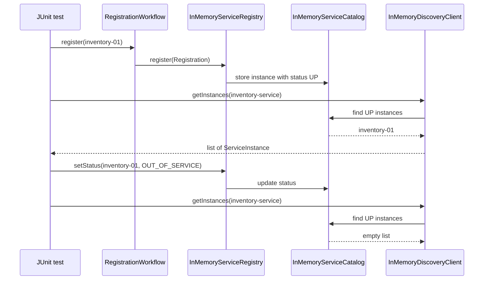

# Testing ServiceRegistry with a Mock Implementation

When building a service registry integration, you often want to test how an application registers, updates status, and deregisters a service instance before connecting to Eureka, Consul, ZooKeeper, or another live registry. Bringing a real registry into every test makes tests depend on networking, containers, security configuration, and external infrastructure startup times.

Spring Cloud Commons provides the `ServiceRegistry` contract to standardize registration operations. You can create a mock implementation backed by in-memory storage, inject it into a Spring context, and test behavior deterministically. This lab also builds a mock `DiscoveryClient` sharing the same store so you can observe how registered instances appear in discovery results.

One key distinction to keep clear throughout: `ServiceRegistry` manages recording and the lifecycle of registrations; `DiscoveryClient` provides lookups for service IDs and instances. The two abstractions are related but are not the same interface. A mock implementation helps verify contracts and application flows, while protocol compatibility, heartbeats, TTLs, network partitions, and persistence must still be verified against a real provider.

## 1. Lab Objectives

Upon completing this lab, you will be able to:

- Read and explain the `ServiceRegistry<R extends Registration>` contract.
- Create a `Registration` type containing instance ID, service ID, host, port, scheme, and metadata.
- Write `InMemoryServiceRegistry` to implement register, deregister, setStatus, getStatus, and close.
- Store registrations in a synchronized in-memory store.
- Create a mock `DiscoveryClient` to query available instances.
- Register mock implementations as Spring beans and inject them by interface.
- Write tests for registration, status updates, discovery, deregistration, and closing the registry.
- Distinguish what belongs to the Spring Cloud contract from policies specific to the sample implementation.
- Understand the limitations of a fake registry and how to swap it for a real provider's implementation.

## 2. Expected Outcomes

We simulate an application named `inventory-service` with two instances:

| Instance ID | Service ID | Host | Port | Initial Status |
| --- | --- | --- | ---: | --- |
| `inventory-01` | `inventory-service` | `10.10.0.11` | 8081 | UP |
| `inventory-02` | `inventory-service` | `10.10.0.12` | 8081 | UP |

After registration, the mock `DiscoveryClient` must return both instances. When `inventory-02` transitions to `OUT_OF_SERVICE`, it no longer appears in this lab's discovery results. When transitioned back to `UP`, it reappears. When deregistered, the instance is removed from the store.

Test flow:



## 3. Understanding the Contract Before Writing the Implementation

In Spring Cloud Commons, `ServiceRegistry` is a generic interface accepting a type `R` extending `Registration`. The current contract defines five methods:

| Method | Role |
| --- | --- |
| `register(R registration)` | Registers an instance |
| `deregister(R registration)` | Deregisters an instance |
| `close()` | Closes the registry; lifecycle method |
| `setStatus(R registration, String status)` | Updates the registration status |
| `getStatus(R registration)` | Retrieves the registration status |

Abbreviated form of the interface:

```java
public interface ServiceRegistry<R extends Registration> {

    void register(@Nullable R registration);

    void deregister(@Nullable R registration);

    void close();

    void setStatus(R registration, String status);

    <T> T getStatus(R registration);
}
```

Two points to note:

- The parameters of `register` and `deregister` are marked nullable in the current API. Providers may define their own policy when registration is absent; the sample implementation below ignores null values.
- `getStatus` is a generic method. The concrete return type is decided by the implementation. Our fake registry returns strings such as `UP` or `OUT_OF_SERVICE`; other providers may represent status differently.

`Registration` is a marker interface extending `ServiceInstance`. It adds no fields or methods of its own, serving to mark a service instance used in registration operations.

`ServiceInstance` provides descriptive instance metadata:

| Getter | Meaning |
| --- | --- |
| `getInstanceId()` | Unique instance ID |
| `getServiceId()` | Logical service name |
| `getHost()` | Host or address of the instance |
| `getPort()` | Serving port |
| `isSecure()` | Whether the instance uses HTTPS |
| `getUri()` | Physical URI of the instance |
| `getMetadata()` | Key/value metadata |
| `getScheme()` | Scheme if supplied by implementation |

`ServiceRegistry` does not define `getServices()` or `getInstances(serviceId)`. Those read operations belong to `DiscoveryClient`. In this lab, both implementations share one data store so registrations recorded via the registry can be queried via discovery.

## 4. Distinguishing the Three Components

| Component | Responsibility | In This Lab |
| --- | --- | --- |
| `Registration` | Describes an instance to register | `DemoRegistration` |
| `ServiceRegistry` | Writes, updates, deletes registrations and manages registry lifecycle | `InMemoryServiceRegistry` |
| `DiscoveryClient` | Returns service IDs and instance lists | `InMemoryDiscoveryClient` |

A real registry typically has two integration sides: writing registrations into the provider's store and reading instance lists from that same store. Spring Cloud separates both sides into abstractions so application clients do not couple directly to Eureka, Consul, or ZooKeeper.

A fake registry needs to model this data relationship. If you only implement `ServiceRegistry` without a way to read data, you can still test register/deregister against internal state, yet cannot test how instances appear in discovery.

## 5. Preparing the Project

Use Java 17 or later and choose a Spring Cloud release train compatible with your project's Spring Boot version. Manage dependencies via the Spring Cloud BOM; do not assign an arbitrary Commons version from outside the release train.

Example Gradle dependencies when BOMs are imported in dependency management:

```kotlin
dependencies {
    implementation(platform("org.springframework.boot:spring-boot-dependencies:<boot-version>"))
    implementation(platform("org.springframework.cloud:spring-cloud-dependencies:<compatible-release-train>"))
    implementation("org.springframework.cloud:spring-cloud-commons")

    testImplementation("org.junit.jupiter:junit-jupiter")
    testImplementation("org.assertj:assertj-core")
}

tasks.test {
    useJUnitPlatform()
}
```

If the project has not imported the BOM yet, add `spring-cloud-dependencies` matching your current Spring Boot version to dependency management. `spring-cloud-commons` supplies the abstractions and APIs used here; tests use JUnit 5 and AssertJ.

Package structure:

```text
src/
├── main/
│   └── java/
│       └── com/example/registrydemo/
│           ├── DemoRegistration.java
│           ├── DemoStatus.java
│           ├── InMemoryServiceCatalog.java
│           ├── InMemoryServiceRegistry.java
│           ├── InMemoryDiscoveryClient.java
│           ├── RegistrationWorkflow.java
│           └── RegistryDemoConfiguration.java
└── test/
    └── java/
        └── com/example/registrydemo/
            └── InMemoryServiceRegistryTests.java
```

Examples use the `com.example.registrydemo` package. Keep the package consistent across files.

## 6. Creating DemoRegistration

Create `DemoRegistration.java`. This record implements `Registration` and holds instance metadata.

```java
package com.example.registrydemo;

import java.net.URI;
import java.util.Map;
import java.util.Objects;

import org.springframework.cloud.client.ServiceInstance;
import org.springframework.cloud.client.serviceregistry.Registration;

public record DemoRegistration(
        String instanceId,
        String serviceId,
        String host,
        int port,
        boolean secure,
        Map<String, String> metadata
) implements Registration {

    public DemoRegistration {
        instanceId = requireText(instanceId, "instanceId");
        serviceId = requireText(serviceId, "serviceId");
        host = requireText(host, "host");

        if (port < 1 || port > 65535) {
            throw new IllegalArgumentException(
                    "port must be between 1 and 65535");
        }

        metadata = metadata == null ? Map.of() : Map.copyOf(metadata);
    }

    @Override
    public String getInstanceId() {
        return instanceId;
    }

    @Override
    public String getServiceId() {
        return serviceId;
    }

    @Override
    public String getHost() {
        return host;
    }

    @Override
    public int getPort() {
        return port;
    }

    @Override
    public boolean isSecure() {
        return secure;
    }

    @Override
    public URI getUri() {
        return ServiceInstance.createUri(this);
    }

    @Override
    public Map<String, String> getMetadata() {
        return metadata;
    }

    @Override
    public String getScheme() {
        return secure ? "https" : "http";
    }

    private static String requireText(String value, String field) {
        Objects.requireNonNull(value, field + " must not be null");

        if (value.isBlank()) {
            throw new IllegalArgumentException(
                    field + " must not be blank");
        }

        return value;
    }
}
```

A record generates accessors like `instanceId()`, whereas `ServiceInstance` requires getters named `getInstanceId()`, `getServiceId()`, and so on. Therefore, the class must implement those getters.

The compact constructor validates ID, host, and port before an instance enters the registry. Metadata is copied into an immutable map so callers cannot mutate registration data after creation.

`ServiceInstance.createUri(this)` builds the URI from host, port, and secure flag. For instance, a non-secure instance yields `http://10.10.0.11:8081`.

## 7. Defining Statuses for the Fake Registry

Create `DemoStatus.java`:

```java
package com.example.registrydemo;

enum DemoStatus {
    UP,
    DOWN,
    OUT_OF_SERVICE,
    UNKNOWN
}
```

These statuses were chosen for this lab to easily simulate available and unavailable instances. They are not a mandatory status list for all providers. For example, Spring Cloud documentation notes that Eureka supports `UP`, `DOWN`, `OUT_OF_SERVICE`, and `UNKNOWN`; other providers may follow different conventions.

The fake discovery client will return only instances with status `UP`. This is a policy of the sample implementation, not a universal rule enforced by `ServiceRegistry`.

## 8. Creating the Shared Data Store

Create `InMemoryServiceCatalog.java`. This class stores registrations and statuses in a map. Both the fake registry and fake discovery client access this shared catalog.

```java
package com.example.registrydemo;

import java.util.Comparator;
import java.util.HashMap;
import java.util.List;
import java.util.Locale;
import java.util.Map;
import java.util.Objects;

import org.jspecify.annotations.Nullable;

final class InMemoryServiceCatalog {

    private final Map<RegistryKey, Entry> entries = new HashMap<>();

    private boolean closed;

    synchronized void register(@Nullable DemoRegistration registration) {
        ensureOpen();

        if (registration == null) {
            return;
        }

        RegistryKey key = keyOf(registration);
        Entry current = entries.get(key);

        DemoStatus status = current == null
                ? DemoStatus.UP
                : current.status();

        entries.put(key, new Entry(registration, status));
    }

    synchronized void deregister(@Nullable DemoRegistration registration) {
        ensureOpen();

        if (registration == null) {
            return;
        }

        entries.remove(keyOf(registration));
    }

    synchronized void setStatus(
            DemoRegistration registration,
            String status) {

        ensureOpen();
        Objects.requireNonNull(registration, "registration must not be null");

        DemoStatus nextStatus = parseStatus(status);
        RegistryKey key = keyOf(registration);
        Entry current = entries.get(key);

        if (current == null) {
            throw new IllegalStateException(
                    "Registration does not exist: " + key);
        }

        entries.put(key, new Entry(current.registration(), nextStatus));
    }

    synchronized String getStatus(DemoRegistration registration) {
        Objects.requireNonNull(registration, "registration must not be null");

        Entry entry = entries.get(keyOf(registration));

        if (entry == null) {
            throw new IllegalStateException(
                    "Registration does not exist: " + keyOf(registration));
        }

        return entry.status().name();
    }

    synchronized List<DemoRegistration> findAvailableInstances(
            String serviceId) {

        if (closed || serviceId == null) {
            return List.of();
        }

        return entries.values().stream()
                .filter(entry -> entry.status() == DemoStatus.UP)
                .map(Entry::registration)
                .filter(registration ->
                        registration.getServiceId().equals(serviceId))
                .sorted(Comparator.comparing(
                        DemoRegistration::getInstanceId))
                .toList();
    }

    synchronized List<String> findAvailableServices() {
        if (closed) {
            return List.of();
        }

        return entries.values().stream()
                .filter(entry -> entry.status() == DemoStatus.UP)
                .map(entry -> entry.registration().getServiceId())
                .distinct()
                .sorted()
                .toList();
    }

    synchronized void close() {
        if (!closed) {
            entries.clear();
            closed = true;
        }
    }

    private void ensureOpen() {
        if (closed) {
            throw new IllegalStateException(
                    "In-memory service catalog is closed");
        }
    }

    private static DemoStatus parseStatus(String status) {
        if (status == null || status.isBlank()) {
            throw new IllegalArgumentException(
                    "status must not be null or blank");
        }

        try {
            return DemoStatus.valueOf(status.trim().toUpperCase(Locale.ROOT));
        }
        catch (IllegalArgumentException ex) {
            throw new IllegalArgumentException(
                    "Unsupported demo status: " + status, ex);
        }
    }

    private static RegistryKey keyOf(DemoRegistration registration) {
        return new RegistryKey(
                registration.getServiceId(),
                registration.getInstanceId());
    }

    private record RegistryKey(String serviceId, String instanceId) {
    }

    private record Entry(
            DemoRegistration registration,
            DemoStatus status) {
    }
}
```

### 8.1. Why Key by Both Service ID and Instance ID?

A service can have multiple instances. The instance ID must be unique within the service so the registry can update or delete the exact entry.

The catalog uses the pair `serviceId` and `instanceId` as the key. Re-registering the same key updates the registration's metadata while preserving its current status. On first registration, the initial status is `UP`.

This is an upsert rule chosen by our fake registry. Real providers may handle duplicate registrations with different semantics.

### 8.2. Why Are Methods Synchronized?

The lab uses a `HashMap` and synchronizes reads/writes so tests never observe a partially mutated map. This is straightforward and sufficient for a small fake registry.

In production, synchronization choices depend on load, consistency requirements, and the provider's storage engine. Never use this catalog as a high-throughput distributed registry.

### 8.3. Why Does Discovery Only See UP?

The catalog keeps `DOWN` or `OUT_OF_SERVICE` instances so their statuses can be inspected and updated. However, `findAvailableInstances` returns only instances with status `UP`.

This lets tests clearly show the difference between "registered" and "considered available for traffic." Real providers may also consider health checks, TTLs, heartbeats, or provider-specific states when deciding which instances to return.

## 9. Implementing InMemoryServiceRegistry

Create `InMemoryServiceRegistry.java`:

```java
package com.example.registrydemo;

import org.jspecify.annotations.Nullable;
import org.springframework.cloud.client.serviceregistry.ServiceRegistry;

public final class InMemoryServiceRegistry
        implements ServiceRegistry<DemoRegistration> {

    private final InMemoryServiceCatalog catalog;

    public InMemoryServiceRegistry(InMemoryServiceCatalog catalog) {
        this.catalog = catalog;
    }

    @Override
    public void register(@Nullable DemoRegistration registration) {
        catalog.register(registration);
    }

    @Override
    public void deregister(@Nullable DemoRegistration registration) {
        catalog.deregister(registration);
    }

    @Override
    public void close() {
        catalog.close();
    }

    @Override
    public void setStatus(
            DemoRegistration registration,
            String status) {
        catalog.setStatus(registration, status);
    }

    @Override
    @SuppressWarnings("unchecked")
    public <T> T getStatus(DemoRegistration registration) {
        return (T) catalog.getStatus(registration);
    }
}
```

This implementation delegates every operation to the catalog. It has no knowledge of how the discovery client queries data and has no dependency on HTTP, Eureka, or Consul.

### 9.1. Why Does getStatus Need a Cast?

The interface declares `<T> T getStatus(R registration)`. Our fake registry stores statuses as `String`, so the catalog returns a string. The implementation must cast that string to the generic type `T` per the contract.

When using it, consume the result with the exact type provided by the fake registry:

```java
String status = registry.getStatus(registration);
```

If a caller requests an incompatible type, a cast error will occur. Real providers may return other types; do not write application logic dependent on the fake registry's status type.

## 10. Creating InMemoryDiscoveryClient

Create `InMemoryDiscoveryClient.java`:

```java
package com.example.registrydemo;

import java.util.List;

import org.springframework.cloud.client.ServiceInstance;
import org.springframework.cloud.client.discovery.DiscoveryClient;

public final class InMemoryDiscoveryClient implements DiscoveryClient {

    private final InMemoryServiceCatalog catalog;

    public InMemoryDiscoveryClient(InMemoryServiceCatalog catalog) {
        this.catalog = catalog;
    }

    @Override
    public String description() {
        return "In-memory demo discovery client";
    }

    @Override
    public List<ServiceInstance> getInstances(String serviceId) {
        return catalog.findAvailableInstances(serviceId)
                .stream()
                .map(registration -> (ServiceInstance) registration)
                .toList();
    }

    @Override
    public List<String> getServices() {
        return catalog.findAvailableServices();
    }
}
```

The discovery client reads from the same catalog as the service registry. As a result, when the registry registers an instance or changes its status, discovery results reflect that shared state immediately.

`DiscoveryClient` also has a default `probe()` method in current versions; that default verifies query capability via `getServices()`. The sample implementation does not need to override it.

## 11. Creating a Workflow Using the Interface

Create `RegistrationWorkflow.java`:

```java
package com.example.registrydemo;

import java.util.Map;

import org.springframework.cloud.client.serviceregistry.ServiceRegistry;

public final class RegistrationWorkflow {

    private final ServiceRegistry<DemoRegistration> serviceRegistry;

    public RegistrationWorkflow(
            ServiceRegistry<DemoRegistration> serviceRegistry) {
        this.serviceRegistry = serviceRegistry;
    }

    public DemoRegistration register(
            String instanceId,
            String serviceId,
            String host,
            int port) {

        DemoRegistration registration = new DemoRegistration(
                instanceId,
                serviceId,
                host,
                port,
                false,
                Map.of(
                        "environment", "test",
                        "registered-by", "manual-workflow"));

        serviceRegistry.register(registration);

        return registration;
    }

    public void markOutOfService(DemoRegistration registration) {
        serviceRegistry.setStatus(registration, "OUT_OF_SERVICE");
    }

    public void markUp(DemoRegistration registration) {
        serviceRegistry.setStatus(registration, "UP");
    }

    public void deregister(DemoRegistration registration) {
        serviceRegistry.deregister(registration);
    }
}
```

The workflow depends solely on `ServiceRegistry<DemoRegistration>`. It does not know the concrete bean is `InMemoryServiceRegistry`. When swapping in a real provider's registry, the workflow can stay intact as long as the registration type and status semantics align.

## 12. Registering Beans in the Spring Context

Create `RegistryDemoConfiguration.java`:

```java
package com.example.registrydemo;

import org.springframework.cloud.client.serviceregistry.ServiceRegistry;
import org.springframework.context.annotation.Bean;
import org.springframework.context.annotation.Configuration;

@Configuration(proxyBeanMethods = false)
public class RegistryDemoConfiguration {

    @Bean
    InMemoryServiceCatalog inMemoryServiceCatalog() {
        return new InMemoryServiceCatalog();
    }

    @Bean(destroyMethod = "close")
    InMemoryServiceRegistry inMemoryServiceRegistry(
            InMemoryServiceCatalog catalog) {
        return new InMemoryServiceRegistry(catalog);
    }

    @Bean
    InMemoryDiscoveryClient inMemoryDiscoveryClient(
            InMemoryServiceCatalog catalog) {
        return new InMemoryDiscoveryClient(catalog);
    }

    @Bean
    RegistrationWorkflow registrationWorkflow(
            ServiceRegistry<DemoRegistration> serviceRegistry) {
        return new RegistrationWorkflow(serviceRegistry);
    }
}
```

Spring creates one catalog, one service registry, one discovery client, and one workflow. The workflow bean is injected via the generic `ServiceRegistry<DemoRegistration>` interface.

The `destroyMethod = "close"` attribute tells Spring to invoke `close()` on the registry when the context closes. This lets us verify the lifecycle method in the `ServiceRegistry` contract.

### 12.1. Why Not Inject InMemoryServiceRegistry Directly?

Injecting through the interface keeps business code coupled to Spring Cloud's abstraction. If the workflow injected the mock class directly, swapping providers would force changes to both the workflow and its tests.

In tests, you can still fetch the concrete `InMemoryServiceRegistry` bean to assert fake-specific details. In business code, stick to the interface.

## 13. Writing Registration and Discovery Tests

Create `InMemoryServiceRegistryTests.java`:

```java
package com.example.registrydemo;

import org.junit.jupiter.api.Test;
import org.springframework.context.annotation.AnnotationConfigApplicationContext;

import static org.assertj.core.api.Assertions.assertThat;
import static org.assertj.core.api.Assertions.assertThatThrownBy;

class InMemoryServiceRegistryTests {

    @Test
    void registrationCanBeDiscovered() {
        try (var context = new AnnotationConfigApplicationContext(
                RegistryDemoConfiguration.class)) {

            RegistrationWorkflow workflow =
                    context.getBean(RegistrationWorkflow.class);

            InMemoryDiscoveryClient discovery =
                    context.getBean(InMemoryDiscoveryClient.class);

            InMemoryServiceRegistry registry =
                    context.getBean(InMemoryServiceRegistry.class);

            DemoRegistration registration = workflow.register(
                    "inventory-01",
                    "inventory-service",
                    "10.10.0.11",
                    8081);

            String status = registry.getStatus(registration);

            assertThat(status).isEqualTo("UP");
            assertThat(discovery.getServices())
                    .containsExactly("inventory-service");
            assertThat(discovery.getInstances("inventory-service"))
                    .containsExactly(registration);
        }
    }
}
```

The test boots a real Spring context without running Eureka, Consul, or an HTTP server. It verifies both bean wiring and the behavior of both abstractions.

Expected outcomes:

- The workflow calls `register` on the interface.
- The registry stores the registration in the catalog.
- Initial status is `UP`.
- The discovery client returns the expected service ID.
- The discovery client returns the expected instance.

## 14. Testing Status Transitions

Add the following test to the same class:

```java
@Test
void outOfServiceInstanceIsNotReturnedByDiscovery() {
    try (var context = new AnnotationConfigApplicationContext(
            RegistryDemoConfiguration.class)) {

        RegistrationWorkflow workflow =
                context.getBean(RegistrationWorkflow.class);

        InMemoryDiscoveryClient discovery =
                context.getBean(InMemoryDiscoveryClient.class);

        InMemoryServiceRegistry registry =
                context.getBean(InMemoryServiceRegistry.class);

        DemoRegistration registration = workflow.register(
                "inventory-02",
                "inventory-service",
                "10.10.0.12",
                8081);

        workflow.markOutOfService(registration);

        assertThat(registry.getStatus(registration))
                .isEqualTo("OUT_OF_SERVICE");

        assertThat(discovery.getInstances("inventory-service"))
                .isEmpty();

        workflow.markUp(registration);

        assertThat(registry.getStatus(registration))
                .isEqualTo("UP");

        assertThat(discovery.getInstances("inventory-service"))
                .containsExactly(registration);
    }
}
```

This test verifies two separate behaviors:

1. The registration still exists in the catalog and its status can be queried.
2. The discovery client returns only instances with status `UP` per the fake's policy.

This simulates an instance that is registered yet temporarily should not receive traffic.

## 15. Testing Deregistration

Add the test:

```java
@Test
void deregisterRemovesInstanceFromRegistryAndDiscovery() {
    try (var context = new AnnotationConfigApplicationContext(
            RegistryDemoConfiguration.class)) {

        RegistrationWorkflow workflow =
                context.getBean(RegistrationWorkflow.class);

        InMemoryDiscoveryClient discovery =
                context.getBean(InMemoryDiscoveryClient.class);

        InMemoryServiceRegistry registry =
                context.getBean(InMemoryServiceRegistry.class);

        DemoRegistration registration = workflow.register(
                "inventory-03",
                "inventory-service",
                "10.10.0.13",
                8081);

        workflow.deregister(registration);

        assertThatThrownBy(() -> registry.getStatus(registration))
                .isInstanceOf(IllegalStateException.class);
        assertThat(discovery.getInstances("inventory-service"))
                .isEmpty();
        assertThat(discovery.getServices()).isEmpty();
    }
}
```

Deregistering deletes the key composed of service ID and instance ID. Once no available instances remain for a service, the fake discovery client omits that service ID from `getServices()`.

In a real registry, deregistering may send a request to a remote server or delete a node in a distributed store. This test verifies only the in-memory catalog outcome.

## 16. Testing Multiple Instances and Multiple Services

A service commonly has multiple instances. Add the test:

```java
@Test
void discoveryReturnsAllAvailableInstancesForService() {
    try (var context = new AnnotationConfigApplicationContext(
            RegistryDemoConfiguration.class)) {

        RegistrationWorkflow workflow =
                context.getBean(RegistrationWorkflow.class);

        InMemoryDiscoveryClient discovery =
                context.getBean(InMemoryDiscoveryClient.class);

        DemoRegistration first = workflow.register(
                "inventory-01",
                "inventory-service",
                "10.10.0.11",
                8081);

        DemoRegistration second = workflow.register(
                "inventory-02",
                "inventory-service",
                "10.10.0.12",
                8081);

        workflow.register(
                "billing-01",
                "billing-service",
                "10.10.1.11",
                8090);

        assertThat(discovery.getServices())
                .containsExactly("billing-service", "inventory-service");

        assertThat(discovery.getInstances("inventory-service"))
                .containsExactly(first, second);

        assertThat(discovery.getInstances("billing-service"))
                .hasSize(1);
    }
}
```

The catalog sorts service IDs and instance IDs for deterministic test results. Spring Cloud does not require every `DiscoveryClient` to return results in this order; sorting is merely a convenience of the fake.

## 17. Testing Invalid Statuses

The fake registry accepts only values defined in `DemoStatus`. Add the test:

```java
@Test
void unsupportedStatusIsRejected() {
    try (var context = new AnnotationConfigApplicationContext(
            RegistryDemoConfiguration.class)) {

        RegistrationWorkflow workflow =
                context.getBean(RegistrationWorkflow.class);

        InMemoryServiceRegistry registry =
                context.getBean(InMemoryServiceRegistry.class);

        DemoRegistration registration = workflow.register(
                "inventory-04",
                "inventory-service",
                "10.10.0.14",
                8081);

        assertThatThrownBy(() ->
                registry.setStatus(registration, "MAINTENANCE"))
                .isInstanceOf(IllegalArgumentException.class);

        assertThat(registry.getStatus(registration))
                .isEqualTo("UP");
    }
}
```

This check ensures an invalid status leaves the current status intact. When working with a real provider, use the statuses documented by that provider rather than applying the fake's enum.

## 18. Testing Closing the Registry

The `close()` method is part of the `ServiceRegistry` lifecycle. Our fake catalog clears all data and rejects new writes once closed.

Add the test:

```java
@Test
void closeClearsCatalogAndRejectsNewRegistrations() {
    try (var context = new AnnotationConfigApplicationContext(
            RegistryDemoConfiguration.class)) {

        RegistrationWorkflow workflow =
                context.getBean(RegistrationWorkflow.class);

        InMemoryServiceRegistry registry =
                context.getBean(InMemoryServiceRegistry.class);

        InMemoryDiscoveryClient discovery =
                context.getBean(InMemoryDiscoveryClient.class);

        DemoRegistration registration = workflow.register(
                "inventory-05",
                "inventory-service",
                "10.10.0.15",
                8081);

        registry.close();

        assertThat(discovery.getServices()).isEmpty();

        assertThatThrownBy(() -> registry.register(registration))
                .isInstanceOf(IllegalStateException.class);
    }
}
```

The test closes the registry directly to verify behavior. When the context closes, Spring also calls the `close` destroy method; the sample implementation makes `close()` idempotent so a second invocation causes no error.

## 19. Running the Test Suite

With Gradle:

```bash
./gradlew test
```

With Maven:

```bash
./mvnw test
```

Tests do not require installing or starting a registry server. If a test fails, check in this order:

1. Did the Spring context create all beans?
2. Did the workflow inject `ServiceRegistry<DemoRegistration>` properly?
3. Does the registration contain a valid instance ID and service ID?
4. Did the registry store the exact service ID/instance ID key?
5. Was the status updated as expected?
6. Does the discovery client share the same catalog as the registry?
7. Did the test inadvertently close the context or registry before asserting?

## 20. Inspecting Data While Debugging

You can set breakpoints at:

- `InMemoryServiceRegistry.register`.
- `InMemoryServiceRegistry.setStatus`.
- `InMemoryServiceRegistry.deregister`.
- `InMemoryServiceCatalog.findAvailableInstances`.
- `InMemoryDiscoveryClient.getInstances`.

Track three key pieces of data:

| Data | Question to Answer |
| --- | --- |
| Registration | Are instance ID, service ID, host, and port correct? |
| Status | What status is the instance currently in? |
| Discovery result | Which instances are returned for the queried service ID? |

A registration can exist yet not appear in discovery because its status is not `UP`. If a registration does not exist, verify that the keys used to register and deregister share the exact same service ID and instance ID.

## 21. Key Points About Auto-Registration

This lab invokes the workflow explicitly to control registration timing. It does not implement `AutoServiceRegistration` and does not auto-register the server on startup.

In real provider integrations, Spring Cloud typically includes an implementation managing registration lifecycles. These implementations can register once the web server starts and deregister when the application shuts down. Spring Cloud Commons provides `AbstractAutoServiceRegistration` to support common lifecycle logic.

By default, service registry implementations may auto-register the running application. That behavior can be disabled via configuration:

```yaml
spring:
  cloud:
    service-registry:
      auto-registration:
        enabled: false
```

Or use `@EnableDiscoveryClient(autoRegister = false)` if the application uses that annotation. In current versions, `@EnableDiscoveryClient` is no longer mandatory if a `DiscoveryClient` implementation is already on the classpath.

When testing with a real provider, clarify whether the application uses manual registration or auto-registration. Having both write the same instance can cause duplicate registrations or unexpected status transitions.

## 22. ServiceRegistry Actuator Endpoint

Spring Cloud Commons provides the `/serviceregistry` Actuator endpoint to read or update the current registration's status. The endpoint relies on a `Registration` bean in the Spring `ApplicationContext`.

When using Actuator with the default management base path, the endpoint is typically exposed at `/actuator/serviceregistry`. `GET` returns the status; `POST` accepts JSON with a `status` field to update the status. Valid values depend on the registry implementation.

The fake registry in this lab does not create a `Registration` bean representing the local server and does not enable Actuator on its own. Therefore, this endpoint is not required to run the tests. You can extend the project by exposing the current registration as a bean and adding Spring Boot Actuator to experiment with the management endpoint.

Never expose a status-mutating endpoint on a public network. Protect it with authentication, authorization, and appropriate network policies.

## 23. Testing Edge Cases

After testing the main flows, try these cases:

| Case | Fake Policy | What to Observe |
| --- | --- | --- |
| Register same service ID and instance ID a second time | Upserts registration, preserves current status | No duplicate entry created |
| Register same instance ID with a different service ID | Creates a distinct key | Two services do not overwrite each other |
| Deregister a non-existent registration | No data change | Repeated calls do not corrupt the registry |
| Deregister with null | Ignored | No exception thrown |
| Register with null | Ignored | No entry created |
| Get status for non-existent registration | Throws `IllegalStateException` | Caller detects instance was removed or never registered |
| Set status for unregistered registration | Throws `IllegalStateException` | Does not create status for a missing entry |
| Set invalid status | Throws `IllegalArgumentException` | Previous status remains intact |
| Register after close | Throws `IllegalStateException` | Registry rejects new operations |
| Query after close | Returns empty list | Does not return stale data |

These semantics are defined by our sample implementation. When writing adapters for Eureka, Consul, or other providers, verify real provider semantics rather than assuming identical edge-case behavior.

## 24. Limitations of a Mock Implementation

A fake registry is valuable for testing logic and wiring, yet it cannot replace a distributed registry.

| What the Fake Registry Simulates | What the Fake Registry Does Not Simulate |
| --- | --- |
| register/deregister/status/close contract | Provider HTTP/gRPC protocols |
| Instance data and metadata | Heartbeats and TTLs |
| Availability status per demo policy | Server-side health checks and eviction |
| Multiple instances in one process | Multiple nodes and cross-process shared state |
| Deterministic query ordering | Network partitions, retries, and timeouts |
| Spring bean injection | Provider authentication, TLS, and authorization |
| Close lifecycle | Registry replication, persistence, and consistency |

Never use a fake to conclude that a real provider offers the same availability, latency, or consistency semantics. Run integration tests against a provider container or test environment before shipping an adapter.

## 25. Extending the Lab

After finishing the basics, you can extend the lab in these directions:

1. **Add a metadata filter:** return only instances whose metadata matches a region or version.
2. **Add a DRAINING status:** stop accepting new traffic before deregistering.
3. **Add TTL:** automatically evict instances that miss heartbeats within a configured interval.
4. **Add events:** emit events on register, status change, or deregister.
5. **Add metrics:** count instances by service and status.
6. **Add persistence:** back the catalog with a repository or database in a test environment.
7. **Write contract tests:** run the same test suite against both the fake and a real provider adapter.
8. **Try a real provider:** replace mock beans with Eureka, Consul, or ZooKeeper and verify discovery from another application.

If adding TTLs or heartbeats, use a controllable clock in tests to avoid wall-clock flakiness. If adding events, publish events only after state mutation succeeds so subscribers observe consistent state.

## 26. Completion Checklist

- [ ] Spring Cloud Commons dependency is managed via a compatible BOM.
- [ ] `DemoRegistration` fully implements `Registration`.
- [ ] Registration validates instance ID, service ID, host, and port.
- [ ] `InMemoryServiceCatalog` stores entries keyed by service ID and instance ID.
- [ ] `InMemoryServiceRegistry` implements all five interface methods.
- [ ] Statuses are validated against the fake's enum.
- [ ] `InMemoryDiscoveryClient` reads from the same catalog.
- [ ] Discovery returns only instances with status `UP` per the demo policy.
- [ ] Spring context injects the workflow via `ServiceRegistry<DemoRegistration>`.
- [ ] Registration and discovery test passes.
- [ ] Status transition and restoration test passes.
- [ ] Deregistration removal test passes.
- [ ] Multiple instances and multiple services test passes.
- [ ] Invalid status test passes.
- [ ] Close and post-close operations test passes.
- [ ] You understand the fake registry does not simulate heartbeats, TTLs, networking, or persistence.
- [ ] You have defined the auto-registration policy for real provider integration.

## 27. Summary

`ServiceRegistry` provides a common contract to register, deregister, update status, and close a registry. `Registration` describes a service instance through `ServiceInstance`. `DiscoveryClient` provides read operations for service IDs and instance lists.

In this lab, `InMemoryServiceRegistry` writes registrations to an in-memory catalog, while `InMemoryDiscoveryClient` reads from the same catalog. This design allows testing the full registration lifecycle without running a registry server. Because the workflow depends only on interfaces, the mock implementation can be swapped for a provider adapter when needed.

A fake registry is a tool for verifying logic and contracts. Before going to production, integration tests against a real provider remain essential to validate heartbeats, TTLs, health checks, network failures, security, and cross-node consistency.

## 28. References

- [Spring Cloud Commons — Common Abstractions](https://docs.spring.io/spring-cloud-commons/reference/spring-cloud-commons/common-abstractions.html): `ServiceRegistry` contract, auto-registration, events, and Actuator endpoint.
- [Spring Cloud Commons — ServiceRegistry.java](https://github.com/spring-cloud/spring-cloud-commons/blob/main/spring-cloud-commons/src/main/java/org/springframework/cloud/client/serviceregistry/ServiceRegistry.java): current API signature of `ServiceRegistry`.
- [Spring Cloud Commons — ServiceInstance.java](https://github.com/spring-cloud/spring-cloud-commons/blob/main/spring-cloud-commons/src/main/java/org/springframework/cloud/client/ServiceInstance.java): fields describing a service instance.
- [Spring Cloud Commons — DiscoveryClient.java](https://github.com/spring-cloud/spring-cloud-commons/blob/main/spring-cloud-commons/src/main/java/org/springframework/cloud/client/discovery/DiscoveryClient.java): service and instance query contract.
- [Spring Cloud Commons — DefaultServiceInstance.java](https://github.com/spring-cloud/spring-cloud-commons/blob/main/spring-cloud-commons/src/main/java/org/springframework/cloud/client/DefaultServiceInstance.java): default implementation of `ServiceInstance`.
