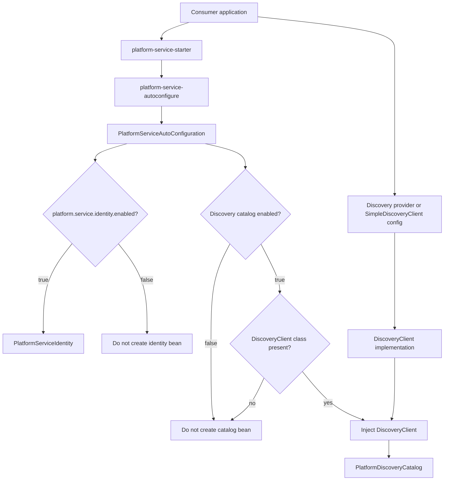

# Packaging a Foundation Starter and Testing Auto-Configuration

In microservices systems, multiple applications frequently duplicate the same foundational setup: service identification, reading deployment metadata, querying instance lists, and providing shared utilities. If each service declares these beans and configurations on its own, bug fixes or convention changes must be repeated across many repositories.

Spring Boot allows packaging default configuration as **auto-configuration** and distributing it through a **starter**. Applications simply add a single dependency to receive default beans; classpath conditions, properties, and user-defined beans determine which features are activated. Spring Cloud Commons supplies abstractions such as `DiscoveryClient`, `ServiceInstance`, `Registration`, and `ServiceRegistry` so shared code does not depend directly on Eureka or Consul.

In this project, we build a foundation starter with two capabilities:

- Provide `PlatformServiceIdentity` from typed configuration under a dedicated `platform.*` namespace.
- Provide `PlatformDiscoveryCatalog` as a read-only facade over `DiscoveryClient` when the application explicitly enables the feature and has a discovery provider.

The starter does not create registrations or invoke `ServiceRegistry.register()` itself. The discovery provider retains ownership of its instance registration lifecycle. This separation keeps the starter compatible with multiple providers and prevents duplicate registrations.

This lesson belongs to the **Hands-on Project** chapter of **SPRING_CLOUD_CORE**. Learners will build an auto-configure module, a starter module, `AutoConfiguration.imports`, tests using `ApplicationContextRunner`, checks for classpath conditions and bean overrides, and run a small consumer to confirm the starter is discovered from the packaged JAR.

## 1. Expected Outcomes

The project is complete when you can:

1. Distinguish an API/auto-configuration module from a starter module that only aggregates dependencies.
2. Create `@ConfigurationProperties` with a dedicated namespace and IDE support metadata.
3. Define default beans using `@AutoConfiguration`, `@ConditionalOnProperty`, and `@ConditionalOnMissingBean`.
4. Ensure discovery functionality loads only when `DiscoveryClient` is on the classpath.
5. Register auto-configuration via `META-INF/spring/org.springframework.boot.autoconfigure.AutoConfiguration.imports`.
6. Allow applications to override default beans without forking the starter.
7. Test cases for property disabled, property enabled, missing class, missing provider, and custom bean override.
8. Verify that the starter JAR pulls in the right dependencies and Spring Boot discovers its auto-configuration.
9. Confirm the starter does not replace the auto-registration mechanism of Eureka, Consul, or other providers.

## 2. Problem Statement and Architecture

Suppose multiple platform services all need to know their service name, instance ID, zone, and deployment metadata. Some services need to query the service catalog through Spring Cloud `DiscoveryClient`; some use a registry like Eureka/Consul, while others may use `SimpleDiscoveryClient` with a static instance list.

If the starter always requires a provider or always instantiates every bean, it will pull in unnecessary dependencies and may prevent applications from starting. We design two independent features, each controlled by its own toggle property:

| Feature | Toggle Property | Additional Condition |
| --- | --- | --- |
| Service identity | `platform.service.identity.enabled=true` | No discovery provider required |
| Discovery catalog | `platform.discovery.catalog.enabled=true` | `DiscoveryClient` on the classpath and an implementing bean present; may be a registry-backed client or `SimpleDiscoveryClient` |

When neither property is declared, both features remain disabled. An application adding the starter can enable just the identity feature without connecting to Eureka or Consul.



`PlatformServiceIdentity` holds service identity data that business code can inject. `PlatformDiscoveryCatalog` is solely a read facade over discovery data. It does not replace LoadBalancer, send HTTP requests, or mutate registrations in a registry.

## 3. Creating the Multi-Module Structure

Create a Maven reactor with two library modules and a consumer application to verify packaging:

```text
platform-foundation/
├── pom.xml
├── platform-service-autoconfigure/
│   ├── pom.xml
│   └── src/
│       ├── main/
│       │   ├── java/com/example/platform/service/
│       │   │   ├── PlatformServiceIdentity.java
│       │   │   ├── PlatformServiceIdentityProperties.java
│       │   │   ├── discovery/PlatformDiscoveryCatalog.java
│       │   │   └── autoconfigure/PlatformServiceAutoConfiguration.java
│       │   └── resources/META-INF/spring/
│       │       └── org.springframework.boot.autoconfigure.AutoConfiguration.imports
│       └── test/java/com/example/platform/service/autoconfigure/
│           └── PlatformServiceAutoConfigurationTests.java
├── platform-service-starter/
│   └── pom.xml
└── sample-consumer/
    ├── pom.xml
    └── src/
        ├── main/java/com/example/sample/InventoryApplication.java
        └── test/java/com/example/sample/StarterPackagingTests.java
```

Module names use your organization's namespace and must not start with `spring-boot`. `platform-service-autoconfigure` contains the auto-configuration code and conditions. `platform-service-starter` is the dependency-aggregating JAR. `sample-consumer` confirms that the packaged JAR works when consumed by another application.

## 4. Declaring Versions in the Parent POM

The illustrative project uses Spring Boot `4.1.2` and Spring Cloud `2025.1.4`. Spring Cloud 2025.1.4 supports Spring Boot 4.1.2. In real projects, substitute patch versions approved by your organization and always cross-check the compatibility matrix before upgrading.

The parent POM manages dependency versions centrally:

```xml
<project xmlns="http://maven.apache.org/POM/4.0.0"
         xmlns:xsi="http://www.w3.org/2001/XMLSchema-instance"
         xsi:schemaLocation="http://maven.apache.org/POM/4.0.0 https://maven.apache.org/xsd/maven-4.0.0.xsd">
    <modelVersion>4.0.0</modelVersion>

    <parent>
        <groupId>org.springframework.boot</groupId>
        <artifactId>spring-boot-starter-parent</artifactId>
        <version>4.1.2</version>
        <relativePath/>
    </parent>

    <groupId>com.example.platform</groupId>
    <artifactId>platform-foundation</artifactId>
    <version>1.0.0-SNAPSHOT</version>
    <packaging>pom</packaging>

    <properties>
        <java.version>17</java.version>
        <spring-cloud.version>2025.1.4</spring-cloud.version>
    </properties>

    <dependencyManagement>
        <dependencies>
            <dependency>
                <groupId>org.springframework.cloud</groupId>
                <artifactId>spring-cloud-dependencies</artifactId>
                <version>${spring-cloud.version}</version>
                <type>pom</type>
                <scope>import</scope>
            </dependency>
        </dependencies>
    </dependencyManagement>

    <modules>
        <module>platform-service-autoconfigure</module>
        <module>platform-service-starter</module>
        <module>sample-consumer</module>
    </modules>
</project>
```

The Spring Boot parent manages Spring Boot dependencies. The Spring Cloud BOM manages `spring-cloud-commons` and providers if consumers opt into them. Do not declare individual versions for Spring Cloud modules.

## 5. Configuring the autoconfigure Module

`platform-service-autoconfigure/pom.xml` declares the libraries needed to compile the auto-configuration:

```xml
<project xmlns="http://maven.apache.org/POM/4.0.0"
         xmlns:xsi="http://www.w3.org/2001/XMLSchema-instance"
         xsi:schemaLocation="http://maven.apache.org/POM/4.0.0 https://maven.apache.org/xsd/maven-4.0.0.xsd">
    <modelVersion>4.0.0</modelVersion>

    <parent>
        <groupId>com.example.platform</groupId>
        <artifactId>platform-foundation</artifactId>
        <version>1.0.0-SNAPSHOT</version>
    </parent>

    <artifactId>platform-service-autoconfigure</artifactId>

    <dependencies>
        <dependency>
            <groupId>org.springframework.boot</groupId>
            <artifactId>spring-boot-autoconfigure</artifactId>
        </dependency>

        <dependency>
            <groupId>org.springframework.cloud</groupId>
            <artifactId>spring-cloud-commons</artifactId>
            <optional>true</optional>
        </dependency>

        <dependency>
            <groupId>org.springframework.boot</groupId>
            <artifactId>spring-boot-configuration-processor</artifactId>
            <optional>true</optional>
        </dependency>

        <dependency>
            <groupId>org.springframework.boot</groupId>
            <artifactId>spring-boot-autoconfigure-processor</artifactId>
            <optional>true</optional>
        </dependency>

        <dependency>
            <groupId>org.springframework.boot</groupId>
            <artifactId>spring-boot-starter-test</artifactId>
            <scope>test</scope>
        </dependency>
    </dependencies>

    <build>
        <plugins>
            <plugin>
                <groupId>org.apache.maven.plugins</groupId>
                <artifactId>maven-compiler-plugin</artifactId>
                <configuration>
                    <annotationProcessorPaths>
                        <path>
                            <groupId>org.springframework.boot</groupId>
                            <artifactId>spring-boot-autoconfigure-processor</artifactId>
                        </path>
                        <path>
                            <groupId>org.springframework.boot</groupId>
                            <artifactId>spring-boot-configuration-processor</artifactId>
                        </path>
                    </annotationProcessorPaths>
                </configuration>
            </plugin>
        </plugins>
    </build>
</project>
```

`spring-cloud-commons` is marked `optional` in the autoconfigure module. Applications using only the identity portion can consume this module without mandatorily pulling in Spring Cloud Commons. The discovery section sits inside a nested configuration annotated with `@ConditionalOnClass`, so it is skipped if `DiscoveryClient` is absent from the classpath.

The two annotation processors serve distinct roles:

- `spring-boot-configuration-processor` generates `spring-configuration-metadata.json` for IDE property autocomplete.
- `spring-boot-autoconfigure-processor` generates auto-configuration condition metadata so Spring Boot can filter inapplicable configurations earlier.

## 6. Creating Typed Configuration Properties

Create `PlatformServiceIdentityProperties.java`:

```java
package com.example.platform.service;

import java.util.Map;

import org.springframework.boot.context.properties.ConfigurationProperties;

/**
 * Properties that control the optional platform service identity bean.
 *
 * @param enabled Whether the identity bean is enabled.
 * @param serviceName Service name to expose; falls back to spring.application.name.
 * @param instanceId Instance identifier supplied by the deployment environment.
 * @param zone Deployment zone associated with the instance.
 * @param metadata Metadata labels owned by the platform application.
 */
@ConfigurationProperties(prefix = "platform.service.identity")
public record PlatformServiceIdentityProperties(
        boolean enabled,
        String serviceName,
        String instanceId,
        String zone,
        Map<String, String> metadata) {

    public PlatformServiceIdentityProperties {
        metadata = metadata == null ? Map.of() : Map.copyOf(metadata);
    }
}
```

Using a record makes configuration immutable once bound. Spring Boot supports constructor binding for records with a single canonical constructor. `@EnableConfigurationProperties` in the auto-configuration registers this record without requiring `@ConfigurationPropertiesScan` in consumer applications.

Properties under the `platform.*` namespace are owned by the starter. Never place custom library properties under `spring.*`, `server.*`, or `management.*`, as those namespaces belong to Spring Boot and Spring Cloud.

### 6.1. Creating the Immutable Service Identity

Create `PlatformServiceIdentity.java`:

```java
package com.example.platform.service;

import java.util.Map;

import org.springframework.util.Assert;

public record PlatformServiceIdentity(
        String serviceName,
        String instanceId,
        String zone,
        Map<String, String> metadata) {

    public PlatformServiceIdentity {
        Assert.hasText(serviceName, "serviceName must not be blank");
        metadata = Map.copyOf(metadata);
    }
}
```

This bean holds no registry connection. It merely describes the identity the service exposes to internal code. `instanceId` and `zone` may be absent if not supplied by the environment; metadata is copied into an unmodifiable map.

Never put passwords, tokens, credentials, or secrets into metadata. If such fields must later be passed to a registration provider, use dedicated security configuration and never expose them to discovery clients.

## 7. Creating the DiscoveryClient Facade

Create `PlatformDiscoveryCatalog.java`:

```java
package com.example.platform.service.discovery;

import java.util.List;

import org.springframework.cloud.client.ServiceInstance;
import org.springframework.cloud.client.discovery.DiscoveryClient;
import org.springframework.util.Assert;

public class PlatformDiscoveryCatalog {

    private final DiscoveryClient discoveryClient;

    public PlatformDiscoveryCatalog(DiscoveryClient discoveryClient) {
        this.discoveryClient = discoveryClient;
    }

    public List<String> getServices() {
        return List.copyOf(discoveryClient.getServices());
    }

    public List<ServiceInstance> getInstances(String serviceId) {
        Assert.hasText(serviceId, "serviceId must not be blank");
        return List.copyOf(discoveryClient.getInstances(serviceId));
    }
}
```

The facade preserves an API that platform code can rely on without allowing multiple modules to inject and call the provider directly. `List.copyOf` returns an unmodifiable snapshot for callers. Registry connection errors propagate so callers can decide whether to retry, fall back, or log errors.

`ServiceInstance` has optional fields—for instance, `instanceId`, `scheme`, or `metadata` may be null depending on the provider. Consumers must handle those fields per the Spring Cloud Commons contract. Service or instance lists with no results must be treated as empty lists.

## 8. Writing the Auto-Configuration

Create `PlatformServiceAutoConfiguration.java`:

```java
package com.example.platform.service.autoconfigure;

import org.springframework.boot.autoconfigure.AutoConfiguration;
import org.springframework.boot.autoconfigure.condition.ConditionalOnClass;
import org.springframework.boot.autoconfigure.condition.ConditionalOnMissingBean;
import org.springframework.boot.autoconfigure.condition.ConditionalOnProperty;
import org.springframework.boot.context.properties.EnableConfigurationProperties;
import org.springframework.context.annotation.Bean;
import org.springframework.context.annotation.Configuration;
import org.springframework.core.env.Environment;
import org.springframework.util.StringUtils;

import com.example.platform.service.PlatformServiceIdentity;
import com.example.platform.service.PlatformServiceIdentityProperties;
import com.example.platform.service.discovery.PlatformDiscoveryCatalog;

@AutoConfiguration
@EnableConfigurationProperties(PlatformServiceIdentityProperties.class)
public class PlatformServiceAutoConfiguration {

    @Bean
    @ConditionalOnProperty(
            prefix = "platform.service.identity",
            name = "enabled",
            havingValue = "true")
    @ConditionalOnMissingBean
    PlatformServiceIdentity platformServiceIdentity(
            PlatformServiceIdentityProperties properties,
            Environment environment) {

        String serviceName = properties.serviceName();

        if (!StringUtils.hasText(serviceName)) {
            serviceName = environment.getProperty("spring.application.name");
        }

        if (!StringUtils.hasText(serviceName)) {
            throw new IllegalStateException(
                    "Set platform.service.identity.service-name "
                    + "or spring.application.name");
        }

        return new PlatformServiceIdentity(
                serviceName,
                properties.instanceId(),
                properties.zone(),
                properties.metadata());
    }

    @Configuration(proxyBeanMethods = false)
    @ConditionalOnClass(
            name = "org.springframework.cloud.client.discovery.DiscoveryClient")
    @ConditionalOnProperty(
            prefix = "platform.discovery.catalog",
            name = "enabled",
            havingValue = "true")
    static class DiscoveryCatalogConfiguration {

        @Bean
        @ConditionalOnMissingBean
        PlatformDiscoveryCatalog platformDiscoveryCatalog(
                org.springframework.cloud.client.discovery.DiscoveryClient discoveryClient) {

            return new PlatformDiscoveryCatalog(discoveryClient);
        }
    }
}
```

Four design decisions stand out:

1. `@AutoConfiguration` marks the class for Spring Boot auto-loading.
2. `@EnableConfigurationProperties` registers the typed configuration.
3. `@ConditionalOnProperty` creates the identity or discovery catalog bean only when the user enables the feature.
4. `@ConditionalOnMissingBean` lets applications replace the default bean with a custom implementation.

The nested configuration isolates the `DiscoveryClient` dependency. If that class is absent from the classpath, Spring Boot skips the nested configuration before evaluating its bean methods. If the class is present and the discovery property is enabled while the context has no `DiscoveryClient` bean at all, the context fails clearly. In typical Spring Cloud Commons applications, `SimpleDiscoveryClient` can be auto-configured when no registry-backed provider exists; thus the absence of Eureka/Consul does not automatically mean `DiscoveryClient` is missing.

### 8.1. Why Not Use Component Scanning?

Do not place `@ComponentScan` on auto-configurations. Auto-configurations must be loaded via metadata imports. Keep the library package separate so application component scanning does not accidentally instantiate beans duplicating auto-configuration.

When sub-configurations are needed, use nested `@Configuration` classes or explicit `@Import` declarations. This makes enablement conditions and load ordering straightforward to test.

## 9. Registering AutoConfiguration.imports

Create the file:

```text
platform-service-autoconfigure/
└── src/main/resources/
    └── META-INF/spring/
        └── org.springframework.boot.autoconfigure.AutoConfiguration.imports
```

The file contains only the fully qualified class names of auto-configuration classes, one per line:

```text
com.example.platform.service.autoconfigure.PlatformServiceAutoConfiguration
```

Spring Boot reads this file from the JAR to discover auto-configurations. Do not register this class via `@ComponentScan` or add a legacy Boot 2 style `spring.factories` entry for auto-configuration. `AutoConfiguration.imports` is the standard mechanism for modern Spring Boot.

## 10. Creating the Starter Module

`platform-service-starter/pom.xml` only aggregates the required dependencies:

```xml
<project xmlns="http://maven.apache.org/POM/4.0.0"
         xmlns:xsi="http://www.w3.org/2001/XMLSchema-instance"
         xsi:schemaLocation="http://maven.apache.org/POM/4.0.0 https://maven.apache.org/xsd/maven-4.0.0.xsd">
    <modelVersion>4.0.0</modelVersion>

    <parent>
        <groupId>com.example.platform</groupId>
        <artifactId>platform-foundation</artifactId>
        <version>1.0.0-SNAPSHOT</version>
    </parent>

    <artifactId>platform-service-starter</artifactId>

    <dependencies>
        <dependency>
            <groupId>com.example.platform</groupId>
            <artifactId>platform-service-autoconfigure</artifactId>
            <version>1.0.0-SNAPSHOT</version>
        </dependency>

        <dependency>
            <groupId>org.springframework.boot</groupId>
            <artifactId>spring-boot-starter</artifactId>
        </dependency>

        <dependency>
            <groupId>org.springframework.cloud</groupId>
            <artifactId>spring-cloud-commons</artifactId>
        </dependency>
    </dependencies>
</project>
```

The starter module does not need any Java classes. It brings in the auto-configuration JAR, the core Spring Boot starter, and the Spring Cloud Commons API. It does not drag Eureka or Consul into every application.

Applications that need a real registry add their matching provider starter themselves, such as `spring-cloud-starter-consul-discovery` or `spring-cloud-starter-netflix-eureka-client`. Include only the provider the application actually uses.

## 11. Configuring the Consumer Application

In the `inventory-api` application, add the `platform-service-starter` dependency:

```xml
<dependency>
    <groupId>com.example.platform</groupId>
    <artifactId>platform-service-starter</artifactId>
    <version>1.0.0-SNAPSHOT</version>
</dependency>
```

Configure `application.yml`:

```yaml
spring:
  application:
    name: inventory-api

platform:
  service:
    identity:
      enabled: true
      service-name: inventory-api
      instance-id: inventory-api-01
      zone: zone-a
      metadata:
        team: supply-chain
        tier: backend
  discovery:
    catalog:
      enabled: false
```

The application now has `PlatformServiceIdentity` without requiring a discovery provider. To enable the catalog, add a provider starter and set `platform.discovery.catalog.enabled` to `true`.

For instance, if using Consul, declare the provider dependency in the consumer:

```xml
<dependency>
    <groupId>org.springframework.cloud</groupId>
    <artifactId>spring-cloud-starter-consul-discovery</artifactId>
</dependency>
```

Consul connection configuration and service registration still belong to the provider. The foundation starter does not create `ConsulRegistration` or call `ServiceRegistry.register()`.

## 12. Writing Basic Tests with ApplicationContextRunner

`ApplicationContextRunner` spins up a minimal `ApplicationContext` containing only the selected auto-configurations. It tests conditions and bean creation without launching a web server, registry, or full application.

Create `PlatformServiceAutoConfigurationTests.java`:

```java
package com.example.platform.service.autoconfigure;

import org.junit.jupiter.api.Test;

import org.springframework.boot.autoconfigure.AutoConfigurations;
import org.springframework.boot.test.context.runner.ApplicationContextRunner;
import org.springframework.context.annotation.Bean;
import org.springframework.context.annotation.Configuration;

import com.example.platform.service.PlatformServiceIdentity;

import static org.assertj.core.api.Assertions.assertThat;

class PlatformServiceAutoConfigurationTests {

    private final ApplicationContextRunner contextRunner =
            new ApplicationContextRunner()
                    .withConfiguration(
                            AutoConfigurations.of(
                                    PlatformServiceAutoConfiguration.class));

    @Test
    void identityIsDisabledByDefault() {
        contextRunner.run(context ->
                assertThat(context)
                        .doesNotHaveBean(PlatformServiceIdentity.class));
    }

    @Test
    void createsIdentityFromPlatformProperties() {
        contextRunner
                .withPropertyValues(
                        "platform.service.identity.enabled=true",
                        "platform.service.identity.service-name=inventory-api",
                        "platform.service.identity.instance-id=inventory-01",
                        "platform.service.identity.zone=zone-a",
                        "platform.service.identity.metadata.team=warehouse")
                .run(context -> {
                    assertThat(context)
                            .hasSingleBean(PlatformServiceIdentity.class);

                    PlatformServiceIdentity identity =
                            context.getBean(PlatformServiceIdentity.class);

                    assertThat(identity.serviceName())
                            .isEqualTo("inventory-api");
                    assertThat(identity.instanceId())
                            .isEqualTo("inventory-01");
                    assertThat(identity.zone()).isEqualTo("zone-a");
                    assertThat(identity.metadata())
                            .containsEntry("team", "warehouse");
                });
    }

    @Test
    void fallsBackToSpringApplicationName() {
        contextRunner
                .withPropertyValues(
                        "platform.service.identity.enabled=true",
                        "spring.application.name=stock-service")
                .run(context -> {
                    PlatformServiceIdentity identity =
                            context.getBean(PlatformServiceIdentity.class);

                    assertThat(identity.serviceName())
                            .isEqualTo("stock-service");
                });
    }

    @Test
    void customIdentityOverridesDefaultBean() {
        contextRunner
                .withUserConfiguration(CustomIdentityConfiguration.class)
                .withPropertyValues(
                        "platform.service.identity.enabled=true",
                        "spring.application.name=inventory-api")
                .run(context -> {
                    assertThat(context)
                            .hasSingleBean(PlatformServiceIdentity.class);

                    assertThat(context.getBean(PlatformServiceIdentity.class)
                            .serviceName())
                            .isEqualTo("custom-inventory");
                });
    }

    @Configuration(proxyBeanMethods = false)
    static class CustomIdentityConfiguration {

        @Bean
        PlatformServiceIdentity customPlatformServiceIdentity() {
            return new PlatformServiceIdentity(
                    "custom-inventory",
                    "inventory-custom-01",
                    "zone-custom",
                    java.util.Map.of("owner", "inventory-team"));
        }
    }
}
```

These tests verify:

- The feature is disabled by default.
- Enabling the property creates a single bean.
- `service-name` is bound properly.
- `spring.application.name` acts as fallback.
- A user-declared bean takes precedence over the default bean.

## 13. Testing the Discovery Catalog with a Mock Provider

You do not need to start Eureka or Consul to test auto-configuration conditions. We can supply a stub `DiscoveryClient` in tests. Create `PlatformDiscoveryCatalogAutoConfigurationTests.java`:

```java
package com.example.platform.service.autoconfigure;

import java.util.List;

import org.junit.jupiter.api.Test;

import org.springframework.boot.autoconfigure.AutoConfigurations;
import org.springframework.boot.test.context.runner.ApplicationContextRunner;
import org.springframework.cloud.client.ServiceInstance;
import org.springframework.cloud.client.discovery.DiscoveryClient;
import org.springframework.context.annotation.Bean;
import org.springframework.context.annotation.Configuration;

import com.example.platform.service.discovery.PlatformDiscoveryCatalog;

import static org.assertj.core.api.Assertions.assertThat;

class PlatformDiscoveryCatalogAutoConfigurationTests {

    private final ApplicationContextRunner contextRunner =
            new ApplicationContextRunner()
                    .withConfiguration(AutoConfigurations.of(
                            PlatformServiceAutoConfiguration.class));

    @Test
    void createsCatalogOnlyWhenEnabledAndDiscoveryClientExists() {
        contextRunner
                .withUserConfiguration(StubDiscoveryConfiguration.class)
                .withPropertyValues("platform.discovery.catalog.enabled=true")
                .run(context -> {
                    assertThat(context)
                            .hasSingleBean(PlatformDiscoveryCatalog.class);

                    PlatformDiscoveryCatalog catalog =
                            context.getBean(PlatformDiscoveryCatalog.class);

                    assertThat(catalog.getServices())
                            .containsExactly("inventory-api", "order-api");
                    assertThat(catalog.getInstances("inventory-api"))
                            .isEmpty();
                });
    }

    @Test
    void catalogIsDisabledByDefault() {
        contextRunner
                .withUserConfiguration(StubDiscoveryConfiguration.class)
                .run(context ->
                        assertThat(context)
                                .doesNotHaveBean(PlatformDiscoveryCatalog.class));
    }

    @Test
    void enablingCatalogWithoutDiscoveryClientBeanFailsFastInIsolatedContext() {
        contextRunner
                .withPropertyValues("platform.discovery.catalog.enabled=true")
                .run(context -> assertThat(context).hasFailed());
    }

    @Configuration(proxyBeanMethods = false)
    static class StubDiscoveryConfiguration {

        @Bean
        DiscoveryClient discoveryClient() {
            return new DiscoveryClient() {
                @Override
                public String description() {
                    return "Stub discovery";
                }

                @Override
                public List<ServiceInstance> getInstances(String serviceId) {
                    return List.of();
                }

                @Override
                public List<String> getServices() {
                    return List.of("inventory-api", "order-api");
                }
            };
        }
    }
}
```

The last test simulates an `ApplicationContextRunner` that loads only the starter's auto-configuration without providing a `DiscoveryClient` bean; when the catalog is enabled, the context fails with a missing dependency error. This does not imply production applications must always have Eureka or Consul: Spring Cloud Commons can supply `SimpleDiscoveryClient` when no registry-backed provider is present. For static discovery, declare instances via `spring.cloud.discovery.client.simple.instances`.

Example consumer using the catalog without a registry server:

```yaml
spring:
  cloud:
    discovery:
      client:
        simple:
          instances:
            order-api:
              - uri: http://order-1.internal:8080
              - uri: http://order-2.internal:8080

platform:
  discovery:
    catalog:
      enabled: true
```

In this configuration, `SimpleDiscoveryClient` serves as the `DiscoveryClient` bean used by `PlatformDiscoveryCatalog`. When an Eureka or Consul provider is added, the registry-backed implementation handles instance queries.

## 14. Testing When DiscoveryClient Is Absent from the Classpath

`@ConditionalOnClass` must be tested using a filtering classloader. Spring Boot provides `FilteredClassLoader` for this scenario:

Add the following import and test method to `PlatformDiscoveryCatalogAutoConfigurationTests` from the previous section:

```java
import org.springframework.boot.test.context.FilteredClassLoader;

@Test
void discoveryConfigurationIsSkippedWhenCommonsIsAbsent() {
    contextRunner
            .withClassLoader(new FilteredClassLoader(DiscoveryClient.class))
            .withPropertyValues("platform.discovery.catalog.enabled=true")
            .run(context ->
                    assertThat(context)
                            .doesNotHaveBean(PlatformDiscoveryCatalog.class));
}
```

Crucially, the configuration referencing `DiscoveryClient` resides in a nested class guarded by `@ConditionalOnClass(name = "...")`. Placing that optional type directly in a method signature on the outer auto-configuration class can force the JVM to load the type before the condition has a chance to skip the configuration.

That is why optional-library integrations should be isolated in nested configuration classes or separate auto-configuration classes.

## 15. Testing Bean Overrides for Discovery Catalog

Applications should also be able to replace the default facade—for example, if a service wants to add custom caching or metrics:

Add the following snippets to `PlatformDiscoveryCatalogAutoConfigurationTests` from the previous section. Since `PlatformDiscoveryCatalog` is extensible, the test can subclass it to add metrics:

```java
import java.util.concurrent.atomic.AtomicInteger;

static class AuditedPlatformDiscoveryCatalog extends PlatformDiscoveryCatalog {

    private final AtomicInteger reads = new AtomicInteger();

    AuditedPlatformDiscoveryCatalog(DiscoveryClient discoveryClient) {
        super(discoveryClient);
    }

    @Override
    public List<String> getServices() {
        reads.incrementAndGet();
        return super.getServices();
    }

    int readCount() {
        return reads.get();
    }
}

@Configuration(proxyBeanMethods = false)
static class CustomCatalogConfiguration {

    @Bean
    PlatformDiscoveryCatalog platformDiscoveryCatalog(
            DiscoveryClient discoveryClient) {
        return new AuditedPlatformDiscoveryCatalog(discoveryClient);
    }
}

@Test
void customCatalogOverridesDefaultBean() {
    contextRunner
            .withUserConfiguration(
                    StubDiscoveryConfiguration.class,
                    CustomCatalogConfiguration.class)
            .withPropertyValues("platform.discovery.catalog.enabled=true")
            .run(context -> {
                assertThat(context).hasSingleBean(PlatformDiscoveryCatalog.class);
                assertThat(context.getBean(PlatformDiscoveryCatalog.class))
                        .isInstanceOf(AuditedPlatformDiscoveryCatalog.class);
            });
}
```

In real projects, a custom catalog can extend the facade or implement a platform-defined catalog interface. With `@ConditionalOnMissingBean`, auto-configuration backs off whenever a custom bean already exists.

Avoid creating a default bean unconditionally and forcing users to disambiguate it with `@Primary`. Back-off conditions express intent cleanly and avoid keeping two beans of the same type in the context.

## 16. Verifying the Packaged JAR with a Consumer Smoke Test

`ApplicationContextRunner` passes the auto-configuration class directly, so it does not prove that `AutoConfiguration.imports` is packaged properly and auto-discovered by Spring Boot.

To verify the full path, create a consumer application depending on `platform-service-starter`.

`InventoryApplication.java`:

```java
package com.example.sample;

import org.springframework.boot.SpringApplication;
import org.springframework.boot.autoconfigure.SpringBootApplication;

@SpringBootApplication
public class InventoryApplication {

    public static void main(String[] args) {
        SpringApplication.run(InventoryApplication.class, args);
    }
}
```

`StarterPackagingTests.java`:

```java
package com.example.sample;

import org.junit.jupiter.api.Test;

import org.springframework.beans.factory.annotation.Autowired;
import org.springframework.boot.test.context.SpringBootTest;

import com.example.platform.service.PlatformServiceIdentity;

import static org.assertj.core.api.Assertions.assertThat;

@SpringBootTest(properties = {
        "spring.application.name=inventory-api",
        "platform.service.identity.enabled=true"
})
class StarterPackagingTests {

    @Autowired
    private PlatformServiceIdentity identity;

    @Test
    void starterAutoConfigurationIsDiscoveredFromJar() {
        assertThat(identity.serviceName()).isEqualTo("inventory-api");
    }
}
```

`sample-consumer/pom.xml` needs the starter dependency and test support:

```xml
<dependencies>
    <dependency>
        <groupId>com.example.platform</groupId>
        <artifactId>platform-service-starter</artifactId>
        <version>1.0.0-SNAPSHOT</version>
    </dependency>
    <dependency>
        <groupId>org.springframework.boot</groupId>
        <artifactId>spring-boot-starter-test</artifactId>
        <scope>test</scope>
    </dependency>
</dependencies>
```

This test does not invoke `AutoConfigurations.of`. It starts the consumer as a regular application, letting Spring Boot read `AutoConfiguration.imports` from the dependency JAR and create the bean.

If unit tests pass while the smoke test fails, inspect the JAR contents, dependency graph, and whether the metadata files made it into the artifact.

## 17. Inspecting Artifact Dependencies and Metadata

After building, verify the autoconfigure JAR contains the imports file:

```bash
jar tf platform-service-autoconfigure/target/platform-service-autoconfigure-1.0.0-SNAPSHOT.jar
```

The output must include:

```text
META-INF/spring/org.springframework.boot.autoconfigure.AutoConfiguration.imports
```

Open the file inside the JAR to verify the class name matches the actual package. If the file is empty, misnamed, or placed in the wrong directory, Spring Boot will not discover the configuration.

Also check the property metadata file:

```text
META-INF/spring-configuration-metadata.json
```

This file enables IDE autocomplete for keys such as:

- `platform.service.identity.enabled`
- `platform.service.identity.service-name`
- `platform.service.identity.instance-id`
- `platform.service.identity.zone`
- `platform.service.identity.metadata`
- `platform.discovery.catalog.enabled`

If metadata is not generated, verify that `spring-boot-configuration-processor` is on the annotation processor path and that properties classes carry the proper annotations.

## 18. Running Builds and Tests

From the `platform-foundation` root directory, run the entire reactor:

```bash
mvn clean verify
```

Or build only the starter and its internal dependencies:

```bash
mvn -pl platform-service-starter -am clean install
```

Run the consumer smoke test after starter modules are built:

```bash
mvn -pl sample-consumer -am test
```

Expected results to observe:

| Check | Expected Result |
| --- | --- |
| Identity property disabled by default | No `PlatformServiceIdentity` bean |
| Identity enabled with service name | Exactly one identity bean |
| Identity enabled with only `spring.application.name` | Bean uses application name |
| User declares custom identity | Auto-configuration backs off |
| Discovery catalog disabled by default | No catalog bean |
| Discovery catalog enabled with DiscoveryClient | Catalog bean exists |
| Discovery class absent from classpath | Nested configuration skipped |
| Catalog enabled without provider bean | Context fails with configuration error |
| Consumer smoke test | Starter discovered via JAR metadata |

## 19. Do Not Let the Starter Own the Registration Lifecycle

Spring Cloud Commons provides `ServiceRegistry` with `register`, `deregister`, and `setStatus` operations. Each provider supplies its own `Registration` implementation, such as Eureka, Consul, or Zookeeper.

In applications using default auto-registration, the provider registers the service when the web server becomes ready and manages deregistration when the context closes. The foundation starter must not invoke `register()` a second time for the same instance.

If a platform requirement genuinely calls for manual registration, design it as a separate provider-integration module accepting the proper `Registration` type, intentionally disable auto-registration, and thoroughly test its lifecycle. Never embed such logic inside a shared starter without a consistent cross-provider contract.

`PlatformServiceIdentity` also does not automatically become metadata in Eureka or Consul. To publish zone, team, or version into a registry, map them to the provider's supported metadata configuration or use a provider-specific extension point. Creating the identity bean alone does not alter the registry registration record.

## 20. Common Errors

| Symptom | Cause | Resolution |
| --- | --- | --- |
| Starter is in dependency tree but creates no beans | Missing or wrong `AutoConfiguration.imports` | Check path and fully qualified class name inside JAR |
| Bean created twice | Auto-config class was component-scanned or missing `@ConditionalOnMissingBean` | Load only via imports metadata and add back-off condition |
| Identity properties do not bind | Missing `@EnableConfigurationProperties` or wrong prefix | Check annotation and `platform.service.identity` namespace |
| App fails startup when identity is enabled | Missing `service-name` and `spring.application.name` | Configure at least one of the two values |
| Missing DiscoveryClient causes linkage error | Optional type referenced outside class-conditioned nested class | Isolate integration using `@ConditionalOnClass` |
| Catalog enabled but no DiscoveryClient bean exists | Discovery auto-configuration not loaded or test context lacks a client | Check Commons/provider config; for SimpleDiscoveryClient, declare static instances |
| Catalog returns only empty lists without a registry | Missing `spring.cloud.discovery.client.simple.instances` | Declare URIs per service or add a registry-backed provider |
| Auto-config overrides user bean | Missing or misconfigured `@ConditionalOnMissingBean` | Add condition on the default bean |
| Properties lack IDE autocomplete | Configuration processor did not run | Check annotation processor paths and JAR metadata |
| Registry records two anomalous instances | Both starter and provider call register | Let provider manage auto-registration or designate a single owner |
| Unit tests pass yet consumer misses bean | Tests invoke `AutoConfigurations.of` directly without checking JAR imports | Add a consumer smoke test |
| Discovery catalog returns stale data | Provider or client caches results | Check provider and LoadBalancer cache/refresh policies |

## 21. Pre-Release Checklist for Starters

- [ ] Module and package names use the organization's namespace.
- [ ] Auto-configuration lives in a separate module when optional integrations exist.
- [ ] Starter module only aggregates required dependencies.
- [ ] Provider dependencies are not pulled in unless the consumer chooses them.
- [ ] Properties have a dedicated prefix, Javadoc, and configuration metadata.
- [ ] Features default to disabled or have carefully considered defaults.
- [ ] Default beans use `@ConditionalOnMissingBean`.
- [ ] Optional integrations use nested `@ConditionalOnClass`.
- [ ] Auto-configurations are listed in `AutoConfiguration.imports`.
- [ ] Component scanning is not used to load auto-configurations.
- [ ] Property binding and fallbacks are tested.
- [ ] User bean overrides are tested.
- [ ] Classpath missing optional libraries is tested.
- [ ] Property enabled without provider is tested.
- [ ] Consumer smoke test verifies JAR metadata discovery.
- [ ] Starter does not invoke register/deregister redundantly alongside providers.
- [ ] Discovery catalog or sensitive metadata is not inadvertently exposed over HTTP.
- [ ] Dependency tree and Spring Cloud BOM are verified.

## 22. Extension Exercises

### Exercise 1. Add PlatformServiceInfoContributor

Create an optional Actuator integration module that exposes service name, instance ID, and zone in `/actuator/info`. Use `@ConditionalOnClass(InfoContributor.class)` and `@ConditionalOnProperty` so applications without Actuator still start normally.

### Exercise 2. Add a Provider-Specific Metadata Adapter

Create a separate module for Eureka or Consul that maps `PlatformServiceIdentity.metadata` onto the provider's registration metadata. Verify that only a single component owns the registration lifecycle.

### Exercise 3. Create a Test Starter

Create `platform-service-starter-test` providing shared test fixtures and `@TestConfiguration`. Never include test dependencies inside the production starter.

### Exercise 4. Inspect the Condition Evaluation Report

Use `ConditionEvaluationReportLoggingListener` in `ApplicationContextRunner` to display why auto-configurations matched or did not match. Write tests for disabled properties and missing optional classes.

### Exercise 5. Check Native Image Support

Evaluate reflection, configuration binding, and auto-configuration metadata when packaging a native image. Run dedicated native tests because `ApplicationContextRunner` is not supported inside native images.

## 23. Self-Check Questions

1. Why should the autoconfigure module be separated from the starter module?
2. Does a starter module need to contain Java classes?
3. How does `@AutoConfiguration` differ in intended purpose from regular `@Configuration`?
4. Through which file does Spring Boot locate auto-configurations inside a JAR?
5. Why should you avoid component-scanning the auto-configuration package?
6. What problem does `@ConditionalOnClass` solve for optional dependencies?
7. How does `@ConditionalOnMissingBean` help users customize a starter?
8. Why do library properties need their own namespace?
9. What metadata do the configuration processor and autoconfigure processor generate?
10. Which combinations of conditions does `ApplicationContextRunner` test?
11. Why is `FilteredClassLoader` needed in tests?
12. Why is a consumer smoke test needed alongside auto-configuration unit tests?
13. How does Spring Cloud Commons `DiscoveryClient` differ from `ServiceRegistry`?
14. Why should a starter not register the same instance alongside a provider?
15. When should provider-specific integrations be split into separate modules?

## 24. References

- [Spring Boot 4.1 — Creating Your Own Auto-configuration](https://docs.spring.io/spring-boot/reference/features/developing-auto-configuration.html): `@AutoConfiguration`, condition annotations, imports metadata, starter structure, and optional dependencies.
- [Spring Boot — Testing Auto-configuration](https://docs.spring.io/spring-boot/reference/features/developing-auto-configuration.html#features.developing-auto-configuration.testing): `ApplicationContextRunner`, `AutoConfigurations`, bean overrides, classpath filtering, and condition reports.
- [Spring Cloud Commons — Common Abstractions](https://docs.spring.io/spring-cloud-commons/reference/spring-cloud-commons/common-abstractions.html): `DiscoveryClient`, `ServiceRegistry`, auto-registration, and provider-specific registration.
- [DiscoveryClient.java — Spring Cloud Commons source](https://github.com/spring-cloud/spring-cloud-commons/blob/main/spring-cloud-commons/src/main/java/org/springframework/cloud/client/discovery/DiscoveryClient.java): service query contract, probe, and ordering.
- [Spring Cloud Compatibility Matrix](https://spring.io/projects/spring-cloud/): mapping release trains to Spring Boot.
- [Spring Cloud 2025.1.4 release announcement](https://spring.io/blog/2026/10/23/spring-cloud-2025-1-4-has-been-released/): confirms release train 2025.1.4 compatibility with Spring Boot 4.1.2.

## Key Takeaway

A well-designed foundation starter provides useful defaults while letting applications control feature enablement and swap beans when needed. The autoconfigure module holds typed properties, conditions, and default beans; the starter module aggregates dependencies; `AutoConfiguration.imports` lets Spring Boot discover configurations inside the JAR. `ApplicationContextRunner` verifies individual conditions quickly, while a consumer smoke test proves the real artifact is discovered. With Spring Cloud, let the discovery provider own the registration lifecycle and use `DiscoveryClient` as the read abstraction for the service catalog; never register the same instance a second time inside the starter.
