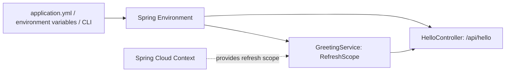
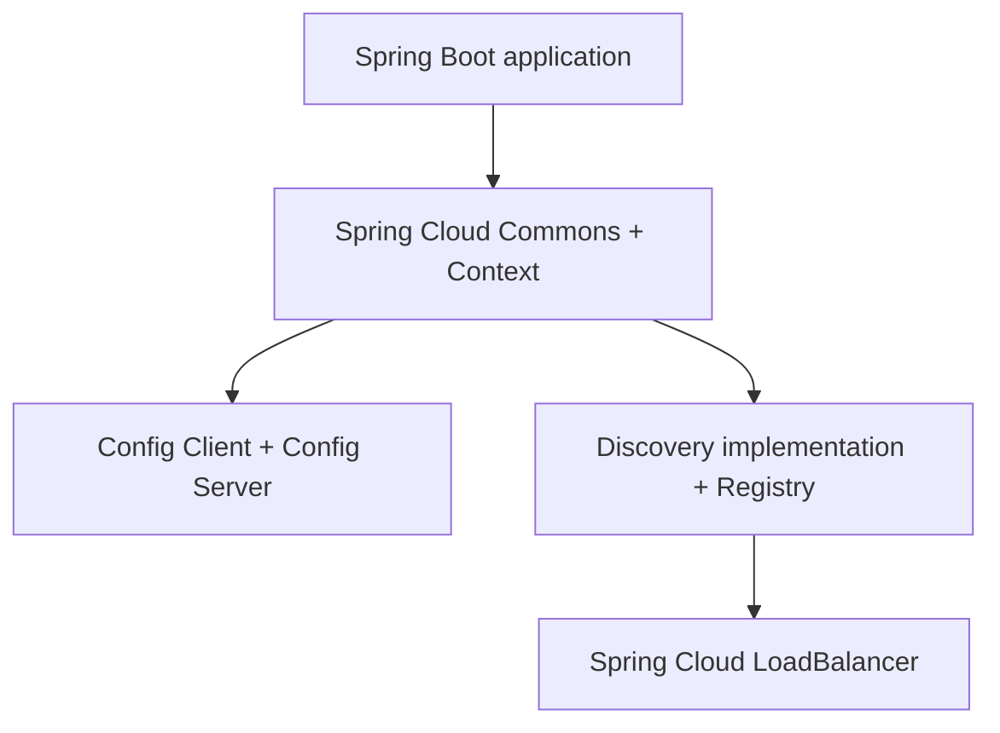

# Creating a Minimal Spring Boot Application with Spring Cloud

In a distributed system, Spring Boot helps create a Java application that can start up, serve HTTP requests, load configuration, and provide observability. Spring Cloud extends that foundation with shared abstractions such as `DiscoveryClient`, `ServiceRegistry`, an `Environment` integrated with Cloud configuration, `@RefreshScope`, and components that support inter-service communication. Before adding a Config Server, registry, or API Gateway, you need to create **a small Spring Boot service with Spring Cloud on the classpath that starts up cleanly and whose behavior can be verified**.

This lesson belongs to the **Initialization** chapter of the **SPRING_CLOUD_CORE** module. The example focuses on the Spring Cloud Commons/Context foundation, how to manage compatible versions with Spring Boot, externalized configuration, refresh readiness, and testing/operations. You do not need to stand up an entire microservice system to complete this first step.

## 1. Learning Outcomes

After following this lesson, learners can:

- Create a Maven project with Spring Boot, Spring Cloud starter, and Actuator.
- Understand how to use the Spring Boot parent, Spring Cloud BOM, and why not to manually assign separate versions to individual Cloud dependencies.
- Write an HTTP endpoint that uses configuration retrieved from the Spring `Environment` and a bean using `@RefreshScope` from Spring Cloud Context.
- Start the application, call the API, inspect the health check, and change configuration via environment variables or startup arguments.
- Distinguish between an application that has Spring Cloud libraries and an application actually connected to a Config Server, service registry, or load balancer.
- Identify the verification steps required before expanding into a service running in a distributed system.

The example is named `spring-cloud-core-demo` and provides:

```text
GET http://localhost:8080/api/hello
GET http://localhost:8080/actuator/health
```

Sample response from `/api/hello`:

```json
{
  "service": "spring-cloud-core-demo",
  "message": "Hello from Spring Cloud Core"
}
```

## 2. Preparing Tools and Understanding the Example's Scope

The development machine requires:

- **JDK 17 or later**, verified with `java -version`.
- **Apache Maven** compatible with the chosen Spring Boot version, verified with `mvn -version`. You can use the Maven Wrapper (`mvnw`) if the project is generated with a wrapper.
- A Java editor/IDE and an HTTP client tool such as `curl`, Postman, or PowerShell's `Invoke-RestMethod`.
- Access to a Maven repository on the first run to download dependencies.

**Illustrative version pair:** Spring Boot `3.4.2` and Spring Cloud `2024.0.0`. This is a pair from two compatible release lines used to illustrate project structure, **not a claim that these are the latest versions**. In a real project, check the official Spring Cloud compatibility matrix at the time of project creation, select a supported patch release, then update both versions together and run tests. Spring Boot 3.x uses Jakarta packages such as `jakarta.servlet` and `jakarta.validation`; upgrading across major generations may require API or configuration changes.

### Spring Boot and Spring Cloud Have Different Roles

| Component | Role in the example | Required at this step? |
| --- | --- | --- |
| `spring-boot-starter-web` | Creates HTTP APIs with Spring MVC and an embedded server | Yes |
| `spring-cloud-starter` | Adds the Spring Cloud foundation, including Commons/Context components matching the BOM | Yes, to demonstrate Cloud Core |
| `spring-boot-starter-actuator` | Provides health checks for observability | Yes in this guide |
| `spring-boot-starter-test` | Provides JUnit, Spring Test, and MockMvc | Used for the testing step |
| Spring Cloud Config Client | Reads configuration from Config Server | Not needed yet |
| Eureka/Consul/Zookeeper Discovery Client | Registers or discovers instances via a registry | Not needed yet |
| Spring Cloud LoadBalancer | Selects a target instance when calling a service by logical name | Not needed yet |

The name `spring-cloud-starter` does not mean the application automatically has an active Config Server or registry. Those features require the appropriate starters, backends, and configuration.

## 3. Creating the Project Structure

You can generate a skeleton with Spring Initializr and then adjust Maven as shown below, or create the files manually as follows. When using Initializr, select Maven, Java, an appropriate Spring Boot version, and the Spring Web and Actuator dependencies; then add the Cloud BOM and `spring-cloud-starter` in `pom.xml`.

```text
spring-cloud-core-demo/
├── pom.xml
└── src/
    ├── main/
    │   ├── java/
    │   │   └── com/example/cloudcore/
    │   │       ├── SpringCloudCoreApplication.java
    │   │       ├── GreetingService.java
    │   │       └── HelloController.java
    │   └── resources/
    │       └── application.yml
    └── test/
        └── java/
            └── com/example/cloudcore/
                └── HelloControllerTest.java
```

Place the class annotated with `@SpringBootApplication` in the root package `com.example.cloudcore` so default component scanning finds controllers and services in the same package or subpackages.

## 4. Declaring Maven with the Spring Cloud BOM

Create `pom.xml`:

```xml
<?xml version="1.0" encoding="UTF-8"?>
<project xmlns="http://maven.apache.org/POM/4.0.0"
         xmlns:xsi="http://www.w3.org/2001/XMLSchema-instance"
         xsi:schemaLocation="http://maven.apache.org/POM/4.0.0
                             https://maven.apache.org/xsd/maven-4.0.0.xsd">
    <modelVersion>4.0.0</modelVersion>

    <parent>
        <groupId>org.springframework.boot</groupId>
        <artifactId>spring-boot-starter-parent</artifactId>
        <version>3.4.2</version>
        <relativePath/>
    </parent>

    <groupId>com.example</groupId>
    <artifactId>spring-cloud-core-demo</artifactId>
    <version>0.0.1-SNAPSHOT</version>
    <name>spring-cloud-core-demo</name>
    <description>Minimal Spring Boot with Spring Cloud Core</description>

    <properties>
        <java.version>17</java.version>
        <spring-cloud.version>2024.0.0</spring-cloud.version>
    </properties>

    <dependencyManagement>
        <dependencies>
            <dependency>
                <groupId>org.springframework.cloud</groupId>
                <artifactId>spring-cloud-dependencies</artifactId>
                <version>${spring-cloud.version}</version>
                <type>pom</type>
                <scope>import</scope>
            </dependency>
        </dependencies>
    </dependencyManagement>

    <dependencies>
        <dependency>
            <groupId>org.springframework.boot</groupId>
            <artifactId>spring-boot-starter-web</artifactId>
        </dependency>
        <dependency>
            <groupId>org.springframework.cloud</groupId>
            <artifactId>spring-cloud-starter</artifactId>
        </dependency>
        <dependency>
            <groupId>org.springframework.boot</groupId>
            <artifactId>spring-boot-starter-actuator</artifactId>
        </dependency>
        <dependency>
            <groupId>org.springframework.boot</groupId>
            <artifactId>spring-boot-starter-test</artifactId>
            <scope>test</scope>
        </dependency>
    </dependencies>

    <build>
        <plugins>
            <plugin>
                <groupId>org.springframework.boot</groupId>
                <artifactId>spring-boot-maven-plugin</artifactId>
            </plugin>
        </plugins>
    </build>
</project>
```

**Why configure it this way?**

1. `spring-boot-starter-parent` manages versions of many Spring Boot libraries, Maven plugins, and common build settings.
2. `spring-cloud-dependencies` is the **Bill of Materials (BOM)** for a Spring Cloud release train. Importing it in `dependencyManagement` lets Maven align the versions of Cloud modules within that release train.
3. Individual Spring Cloud dependencies do not need to declare `<version>`. Maven resolves the appropriate version from the BOM.
4. Do not assign an arbitrary Spring Cloud version just because it is newer than Spring Boot. The two projects release independently; an incompatible version can cause context startup failures, missing classes, or startup rejection by the compatibility verifier.

You can inspect the dependency tree after Maven finishes downloading:

```bash
mvn dependency:tree
```

Look for modules from `org.springframework.cloud` (especially `spring-cloud-commons` and `spring-cloud-context`) alongside Spring Boot. If the dependency tree shows multiple versions of the same module due to overrides or transitive dependencies, review the BOM before expanding the project.

## 5. Writing the Spring Boot Startup Class

Create `src/main/java/com/example/cloudcore/SpringCloudCoreApplication.java`:

```java
package com.example.cloudcore;

import org.springframework.boot.SpringApplication;
import org.springframework.boot.autoconfigure.SpringBootApplication;

@SpringBootApplication
public class SpringCloudCoreApplication {

    public static void main(String[] args) {
        SpringApplication.run(SpringCloudCoreApplication.class, args);
    }
}
```

`@SpringBootApplication` combines application configuration, component scanning, and auto-configuration. Spring Boot detects dependencies present on the classpath and auto-configures the appropriate components. Spring Cloud auto-configurations can also participate once the Cloud starter is added.

There is no need yet for `@EnableDiscoveryClient`, `@EnableConfigServer`, or manually constructing an `ApplicationContext`: this application does not deploy a registry or Config Server yet.

## 6. Creating a Bean Using Spring Cloud Context

Create `src/main/java/com/example/cloudcore/GreetingService.java`:

```java
package com.example.cloudcore;

import org.springframework.beans.factory.annotation.Value;
import org.springframework.cloud.context.config.annotation.RefreshScope;
import org.springframework.stereotype.Component;

@Component
@RefreshScope
public class GreetingService {

    private final String message;

    public GreetingService(
            @Value("${demo.message:Default hello}") String message) {
        this.message = message;
    }

    public String message() {
        return message;
    }
}
```

Here:

- `@Component` registers the class with the Spring container.
- `@Value` reads the `demo.message` key from `Environment`. The part after the colon is the fallback value when the property does not exist.
- `@RefreshScope` is an annotation from **Spring Cloud Context**, demonstrating a bean that can be recreated after the configuration environment is refreshed by an appropriate refresh mechanism.

**Note on refresh:** the annotation does not cause the application to automatically watch and apply every change to YAML files or environment variables. In this minimal example, when changing an environment variable, you will **restart the process** to see the new value. Later, when integrated with Config Server and a secured refresh trigger, refresh scope fulfills its full role. Do not assume that every bean, cache, or connection pool will refresh automatically.

## 7. Creating the HTTP Endpoint

Create `src/main/java/com/example/cloudcore/HelloController.java`:

```java
package com.example.cloudcore;

import java.util.Map;

import org.springframework.core.env.Environment;
import org.springframework.web.bind.annotation.GetMapping;
import org.springframework.web.bind.annotation.RequestMapping;
import org.springframework.web.bind.annotation.RestController;

@RestController
@RequestMapping("/api")
public class HelloController {

    private final GreetingService greetingService;
    private final Environment environment;

    public HelloController(
            GreetingService greetingService,
            Environment environment) {
        this.greetingService = greetingService;
        this.environment = environment;
    }

    @GetMapping("/hello")
    public Map<String, String> hello() {
        return Map.of(
            "service", environment.getProperty(
                "spring.application.name", "unknown"),
            "message", greetingService.message()
        );
    }
}
```

`HelloController` uses constructor injection to receive Spring-managed dependencies. `Environment` is an abstraction from Spring Framework shared by both Spring Boot and Spring Cloud. This allows the controller to retrieve the application name from the effective configuration source; `GreetingService` provides the message.

Application flow diagram:



In projects with many configuration settings, prefer `@ConfigurationProperties` to bind and validate properties as a group. For a single illustrative property, `@Value` keeps the example concise.

## 8. Configuring the Application

Create `src/main/resources/application.yml`:

```yaml
spring:
  application:
    name: spring-cloud-core-demo

server:
  port: 8080

demo:
  message: Hello from Spring Cloud Core

management:
  endpoints:
    web:
      exposure:
        include: health,info
```

Key properties:

| Key | Meaning |
| --- | --- |
| `spring.application.name` | Logical name of the application; later also used when fetching configuration from Config Server or participating in service discovery |
| `server.port` | Local HTTP port; the embedded server default is typically `8080`, declared explicitly for visibility |
| `demo.message` | Value injected into `GreetingService` |
| `management.endpoints.web.exposure.include` | Exposes only the listed Actuator endpoints over HTTP, here `health` and `info` |

Do not enable all Actuator endpoints just for quick testing. Diagnostic endpoints for configuration, refresh, or beans can leak system information or alter application behavior; expose them only when needed, with appropriate authentication and network restrictions.

## 9. Running the Application and Verifying the Result

Open a terminal in the `spring-cloud-core-demo` directory:

```bash
java -version
mvn -version
mvn spring-boot:run
```

Upon successful startup, the logs typically show the embedded web server running on port `8080` and the application name loaded. Open a second terminal:

```bash
curl -i http://localhost:8080/api/hello
curl -i http://localhost:8080/actuator/health
```

On Windows PowerShell, you can use:

```powershell
Invoke-RestMethod http://localhost:8080/api/hello
Invoke-RestMethod http://localhost:8080/actuator/health
```

Expected results:

- `GET /api/hello` returns HTTP `200 OK`, with JSON containing `service=spring-cloud-core-demo` and `message=Hello from Spring Cloud Core`.
- `GET /actuator/health` returns overall status `UP` if the health indicators are functioning normally. When an actual failure occurs, the status value and HTTP status may differ.

After testing, stop the process with `Ctrl+C`.

### Packaging and Running the JAR File

```bash
mvn clean package
java -jar target/spring-cloud-core-demo-0.0.1-SNAPSHOT.jar
```

`mvn clean package` runs the configured Maven tests and builds an executable JAR using `spring-boot-maven-plugin`. Moving the JAR to another machine only requires ensuring a compatible Java runtime and the required environment configurations/dependencies.

## 10. Changing Configuration Without Modifying Source Code

Keep `application.yml` unchanged and override the message via an environment variable before startup.

PowerShell:

```powershell
$env:DEMO_MESSAGE = 'Hello from staging environment'
mvn spring-boot:run
```

Bash:

```bash
DEMO_MESSAGE="Hello from staging environment" mvn spring-boot:run
```

Calling `/api/hello` again will show the `message` field receiving the value from the environment variable. Spring Boot supports environment-style property names like `DEMO_MESSAGE` for the `demo.message` key via externalized configuration and relaxed binding.

Another approach is passing command-line arguments to the JAR file:

```bash
java -jar target/spring-cloud-core-demo-0.0.1-SNAPSHOT.jar --demo.message="Message from CLI"
```

Under normal precedence rules, command-line arguments take higher priority than environment variables and `application.yml`. What matters when troubleshooting is **the final resolved value received by the application and which source supplied it**.

Key reminders:

1. Environment variables are read by the process at startup. Changing a variable in another terminal while the JVM is still running does not automatically change the value inside a bean.
2. If a variable is set in the current terminal session, subsequent runs may continue using it. In PowerShell, remove it with `Remove-Item Env:DEMO_MESSAGE`; in Bash, use `unset DEMO_MESSAGE`.
3. For real secrets (passwords, API tokens), do not commit them directly into YAML in source control; use a secret manager or the deployment platform's secret injection mechanism.

### Using Profiles for Multiple Environments

When separating environments, you can add profile-specific files (this is an **example structure for learners to create in the sample project**, not files required outside the current lesson):

```text
src/main/resources/
  application.yml
  application-dev.yml
  application-prod.yml
```

Sample content for `application-dev.yml`:

```yaml
demo:
  message: Hello from dev
```

Sample content for `application-prod.yml`:

```yaml
demo:
  message: Hello from prod
```

Run the JAR with the `dev` profile:

```bash
java -jar target/spring-cloud-core-demo-0.0.1-SNAPSHOT.jar --spring.profiles.active=dev
```

Spring Boot loads the common configuration along with the configuration for the active profile. Do not treat profiles as a security mechanism; production differences also require controlling connectivity, secrets, permissions, network configuration, and observability.

## 11. Writing a Minimal Test

Create `src/test/java/com/example/cloudcore/HelloControllerTest.java`:

```java
package com.example.cloudcore;

import static org.springframework.test.web.servlet.request.MockMvcRequestBuilders.get;
import static org.springframework.test.web.servlet.result.MockMvcResultMatchers.jsonPath;
import static org.springframework.test.web.servlet.result.MockMvcResultMatchers.status;

import org.junit.jupiter.api.Test;
import org.springframework.beans.factory.annotation.Autowired;
import org.springframework.boot.test.autoconfigure.web.servlet.AutoConfigureMockMvc;
import org.springframework.boot.test.context.SpringBootTest;
import org.springframework.test.web.servlet.MockMvc;

@SpringBootTest(properties = "demo.message=hello-from-test")
@AutoConfigureMockMvc
class HelloControllerTest {

    @Autowired
    private MockMvc mvc;

    @Test
    void shouldReturnApplicationNameAndConfiguredMessage() throws Exception {
        mvc.perform(get("/api/hello"))
            .andExpect(status().isOk())
            .andExpect(jsonPath("$.service").value("spring-cloud-core-demo"))
            .andExpect(jsonPath("$.message").value("hello-from-test"));
    }
}
```

`@SpringBootTest` starts the Spring application context; `@AutoConfigureMockMvc` provides a mock HTTP client in tests without needing to run a real server. The value `demo.message=hello-from-test` is scoped to the test, avoiding dependency on external environment variables.

Run:

```bash
mvn test
```

This test catches bean registration, property binding, and endpoint mapping errors. It does **not** prove the application can discover services, call Config Server, or refresh across multiple instances; those features require separate tests when added.

## 12. When to Add Other Spring Cloud Components?

The current application uses Spring Boot to serve HTTP and Spring Cloud Context for refresh scope. Other distributed capabilities only appear when the corresponding dependencies and target systems are present.

### 12.1. Spring Cloud Config

When multiple services need a unified configuration management policy, add Config Client in `pom.xml`:

```xml
<dependency>
    <groupId>org.springframework.cloud</groupId>
    <artifactId>spring-cloud-starter-config</artifactId>
</dependency>
```

Then you can add to `application.yml`, once an actual Config Server is running at that address:

```yaml
spring:
  config:
    import: "configserver:http://localhost:8888"
```

With a mandatory Config Server, if the server is unreachable at startup, the client typically fails to start with a configuration error. The `optional:configserver:...` syntax allows continuing with remaining configuration sources, but only makes sense when the application can still operate safely with those values.

Do not blindly add `spring-cloud-starter-config` just to "have Spring Cloud": depending on the version, a missing import declaration can cause warnings or errors about the Config Server source, while the basic example does not need that server.

### 12.2. Discovery and Service Registry

Spring Cloud Commons defines abstractions such as `DiscoveryClient` and `ServiceRegistry`. To actually discover instances, you need to choose a compatible implementation, such as Eureka or Consul, and configure the connection to the registry. Adding `spring-cloud-starter` **does not automatically create a list of service instances**.



The diagram illustrates possible extension paths, not a mandatory dependency chain. LoadBalancer can be used with other `ServiceInstance` sources without necessarily requiring an external registry.

### 12.3. Service Communication and Resilience

HTTP communication between services can start with Spring Framework's `RestClient` or `WebClient`. Consider Spring Cloud LoadBalancer only when you need to call services by logical name rather than a fixed host. Retries and circuit breakers require dedicated policies: appropriate timeouts, retry count limits, classification of retryable errors, and protection for non-idempotent operations. Do not enable retries for all requests without assessing business consequences.

## 13. Troubleshooting Common Issues

| Symptom | Cause to check | Resolution |
| --- | --- | --- |
| Maven cannot find Cloud dependency or reports missing version | BOM not imported, wrong artifact, or missing repository | Check `spring-cloud-dependencies` and the dependency tree |
| App stops with Spring Boot/Spring Cloud incompatible message | Incompatible release train selected | Check the compatibility matrix, update the version pair, and re-run tests |
| `ClassNotFoundException` or `NoSuchMethodError` | Dependency overridden or incompatible transitive version | Inspect `mvn dependency:tree` and remove incorrect overrides |
| Port `8080` is already in use | Another service is listening on that port | Stop the other service or use `--server.port=8081` |
| `GET /api/hello` returns 404 | Wrong path, wrong package scanning, controller not registered | Check `@RequestMapping`, `@GetMapping`, and class location |
| Message does not change after editing environment variable | Variable changed while JVM was running, or overridden by higher-priority source | Restart and verify the actual value and CLI arguments |
| `/actuator/health` is unreachable | Actuator not added, wrong base path, different management port, or blocked by security | Check dependency, endpoint exposure, and security configuration |
| Expecting `@RefreshScope` to auto-update when editing YAML | No refreshable configuration source and proper refresh event | Use restart in the basic example; design controlled refresh when scaling up |
| Config Client reports missing `spring.config.import` | Config starter added without configuring how to load the source | Declare a valid import or remove the unused dependency |
| Calling discovery returns no instances | No discovery implementation/backend or wrong service name | Add and configure a registry/instance source before calling |

If the root cause is unclear, start from the first startup error in the logs and the dependency version pair. Do not log secret values or sensitive environment contents in diagnostic logs.

## 14. Practice Exercises

1. Build the `spring-cloud-core-demo` project following the structure above, run `mvn test`, and then `mvn spring-boot:run`.
2. Call `/api/hello` and `/actuator/health`, and record the HTTP status codes and JSON responses.
3. Set the `DEMO_MESSAGE` variable, restart the application, and confirm the message changes. Then run with `--demo.message=...` to observe configuration source precedence.
4. Add `application-dev.yml` with a new message, run `--spring.profiles.active=dev`; explain which source wins if the CLI also supplies the same key.
5. Inspect `mvn dependency:tree` and identify which artifact provides `@RefreshScope`. Explain why the example is not yet a system with real service discovery.
6. Try changing `server.port` to `8081`; test the endpoints on the new port and describe how the deployment platform's health check configuration must change accordingly.

**Completion criteria:** Build and tests succeed; both APIs return the expected data; configuration values can be changed across restarts without editing Java code; clearly distinguish the Spring Boot runtime from Spring Cloud abstractions and explain why a compatible BOM is chosen.

## 15. Summary

- The first step of **SPRING_CLOUD_CORE** is running a Spring Boot app with Spring Cloud Commons/Context on the classpath and verifying that beans, configuration, and endpoints work.
- **Spring Boot parent + Spring Cloud BOM** form the dependency management foundation; version pairs must follow the compatibility matrix rather than being mixed arbitrarily.
- `spring-cloud-starter` provides common infrastructure; Config Server, service discovery, load balancing, and other distributed capabilities require additional selection and configuration.
- `Environment` unifies configuration sources; `@RefreshScope` supports bean refresh when paired with an appropriate update mechanism, but does not automatically detect every change.
- A service can use the same artifact across multiple environments via externalized configuration, profiles, and deployment mechanisms; testing, health checks, and secret management are required before running in production.
