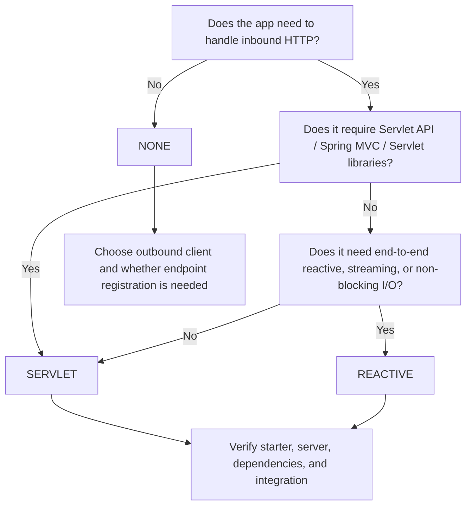

# Choosing a Servlet, Reactive, or Non-Web Server Application

## 1. Why Does Choosing the Right Application Type Matter?

When initializing a Spring Boot application, a key architectural decision is whether the application needs to handle incoming HTTP requests and, if so, whether it should run on the Servlet or Reactive model. This choice affects the application context type, the auto-configured web server, the request-processing model, the libraries pulled onto the classpath, and how the application is tested.

In the **SPRING_CLOUD_CORE** ecosystem, this decision also relates to how discovery, service registry, and inter-service communication are integrated. Spring Cloud provides shared abstractions so applications can locate and call services; it does not dictate that every application must use Servlet or Reactive. Developers need to understand the Spring Boot foundation before adding the appropriate Cloud integrations.

After this lesson, learners can:

- Distinguish between `WebApplicationType.SERVLET`, `WebApplicationType.REACTIVE`, and `WebApplicationType.NONE`.
- Explain how Spring Boot infers the application type from the classpath and how to configure it explicitly.
- Choose the appropriate dependencies, application context, and web server for each use case.
- Understand the impact of this choice on Spring Cloud Commons, discovery, load balancing, externalized configuration, and testing.
- Avoid putting an HTTP server inside a worker application or choosing Reactive simply because of an assumption that it is always faster than Servlet.

## 2. Three Spring Boot Application Types

Spring Boot represents the web application type using the `WebApplicationType` enum:

| Type | Purpose | Typical application context | Web server |
| --- | --- | --- | --- |
| `SERVLET` | Web application based on the Servlet API, typically using Spring MVC | `ServletWebServerApplicationContext` | Includes an embedded Servlet web server |
| `REACTIVE` | Web application using the reactive model, typically using Spring WebFlux | `ReactiveWebServerApplicationContext` | Includes a reactive web server |
| `NONE` | Application that does not start a web server | Non-web context, e.g., `AnnotationConfigApplicationContext` | No embedded web server |

These three choices describe **how Spring Boot initializes the application**, not three different programming languages or three independent deployment models. All three can still use the Spring Framework IoC container, dependency injection, configuration properties, logging, scheduling, messaging, and suitable client libraries.

### 2.1. Servlet: The Traditional Web Model

With `SERVLET`, Spring Boot initializes a web application built on the Servlet API. When using Spring MVC, requests typically pass through `DispatcherServlet` and are then routed to controllers and handler components.

Controller example:

```java
@RestController
@RequestMapping("/orders")
class OrderController {

    @GetMapping("/{id}")
    OrderView getOrder(@PathVariable String id) {
        return new OrderView(id, "ACCEPTED");
    }
}

record OrderView(String id, String status) {}
```

Common dependency:

```xml
<dependency>
    <groupId>org.springframework.boot</groupId>
    <artifactId>spring-boot-starter-web</artifactId>
</dependency>
```

Under common default configuration, this starter puts Spring MVC and embedded Tomcat on the classpath. Boot auto-configures the Servlet web server and MVC infrastructure. Tomcat is not a mandatory requirement of the Servlet API: depending on dependencies and configuration, it can be replaced with another supported Servlet server.

The Servlet model is usually a good fit when:

- The application uses Spring MVC, Servlet Filters, the Servlet API, or Servlet-dependent libraries.
- Most processing is standard request/response work and blocking database or client calls.
- The team's library ecosystem, observability tools, and operational experience are built around Servlet.
- There is no clear need to convert the entire I/O path to reactive.

Servlet does not mean every request must block a thread for its entire lifecycle. The Servlet stack supports async processing and Spring MVC can work with several asynchronous return types. However, MVC's programming model and abstractions still differ from WebFlux.

### 2.2. Reactive: Non-Blocking Model with Spring WebFlux

With `REACTIVE`, Boot initializes a reactive web application. Spring WebFlux uses `DispatcherHandler` and reactive abstractions such as `Mono` and `Flux` to process asynchronous data streams with backpressure support.

Example endpoint returning a stream of results:

```java
@RestController
@RequestMapping("/events")
class EventController {

    @GetMapping
    Flux<EventView> recentEvents() {
        return Flux.just(
                new EventView("created"),
                new EventView("paid")
        );
    }
}

record EventView(String type) {}
```

Common dependency:

```xml
<dependency>
    <groupId>org.springframework.boot</groupId>
    <artifactId>spring-boot-starter-webflux</artifactId>
</dependency>
```

Under default configuration, Spring Boot typically uses Reactor Netty as the reactive web server. The reactive stack can also run on certain compatible Servlet containers; therefore, "Reactive" describes the application model and web stack, not an assertion that every underlying component is Netty.

Reactive fits systems with heavy asynchronous I/O, continuous data streams, streaming, or a need to maintain high concurrency without dedicating a waiting thread to every I/O operation. The benefits depend on whether the components along the execution path are genuinely non-blocking.

**Reactive is not automatically faster than Servlet.** If a controller invokes blocking JDBC directly on the event-loop, the processing thread can become blocked and reduce throughput across requests. If the business logic is primarily CPU-bound or relies on blocking libraries, MVC may be simpler and more appropriate. Reactive requires deliberate design of the thread model, timeouts, backpressure, and consistent client integrations.

### 2.3. NONE: Applications Without a Web Server

With `NONE`, Boot does not start an embedded web server. The application can still be a full-featured Spring application: creating beans, loading configuration, running background tasks, consuming messages, running batch jobs, or executing scheduled work.

Example using `CommandLineRunner`:

```java
@SpringBootApplication
public class ReconciliationApplication {

    public static void main(String[] args) {
        SpringApplication.run(ReconciliationApplication.class, args);
    }

    @Bean
    CommandLineRunner reconcile(ReconciliationService service) {
        return args -> service.runOnce();
    }
}
```

Explicitly configuring the non-web type:

```yaml
spring:
  main:
    web-application-type: none
```

A `NONE` application can still call APIs of other systems via `RestClient` or `WebClient` if the appropriate dependencies/clients are added. `NONE` only means the application does not open a web server to accept inbound requests; it does not forbid outbound network communication.

Commonly suitable scenarios:

- Workers consuming messages from a broker.
- Batch jobs or scheduled data synchronization processes.
- Operational CLI/tools using Spring to manage configuration and dependencies.
- Orchestration processes or background processing workers that do not expose an HTTP API.

If a worker needs health/management endpoints over HTTP, consider a separate management architecture or switching to the appropriate web type. Do not assume Actuator will automatically expose HTTP endpoints when the application runs as `NONE`.

## 3. How Does Spring Boot Choose the Application Type?

### 3.1. Inference from the Classpath

When not explicitly configured, `SpringApplication` infers `WebApplicationType` from the classes present on the classpath. Consequently, a transitive dependency can influence the application type even if your source code does not directly import that library.

Common practical rules:

- Spring MVC/Servlet web stack present: Boot typically selects `SERVLET`.
- WebFlux present without Spring MVC/Servlet MVC: Boot typically selects `REACTIVE`.
- Required web classes absent: Boot selects `NONE`.

This is a simplified summary. Actual inference checks for the presence or absence of specific classes, not just starter names. Therefore, when the application type differs from expectations, inspect the dependency tree and auto-configuration conditions.

### 3.2. When Both MVC and WebFlux Are on the Classpath

A common scenario is a project adding `spring-boot-starter-webflux` solely to use `WebClient` while keeping `spring-boot-starter-web`. When both Spring MVC and WebFlux are present, Spring Boot defaults to **Servlet/MVC**.

This can be intentional: the application continues serving HTTP via MVC while using `WebClient` as an outbound HTTP client. Having `WebClient` does not force the application to become a reactive web server.

If the real goal is to run WebFlux, inspect the dependencies and optionally set `spring.main.web-application-type=reactive`. However, forcing Reactive while still pulling in Servlet-only libraries can lead to redundant configuration or conflicts. Remove unnecessary dependencies and verify compatible starters.

## 4. Configuring the Application Type Choice

### 4.1. Configuring via application.yml

You can choose the application type using the `spring.main.web-application-type` property:

```yaml
spring:
  main:
    web-application-type: servlet
```

The valid values correspond to `servlet`, `reactive`, and `none` (case-insensitive under Spring Boot's binding mechanism).

Worker application example:

```yaml
spring:
  main:
    web-application-type: none
```

WebFlux application example:

```yaml
spring:
  main:
    web-application-type: reactive
```

This property can be placed in a configuration file or an appropriate externalized configuration source. If using profiles, ensure the right profile is active during deployment; avoid having production accidentally inherit `none` or `servlet` from another profile file.

### 4.2. Configuring in Java

You can set the application type before calling `run`:

```java
import org.springframework.boot.SpringApplication;
import org.springframework.boot.WebApplicationType;

public class GatewayApplication {
    public static void main(String[] args) {
        SpringApplication application =
                new SpringApplication(GatewayApplication.class);

        application.setWebApplicationType(WebApplicationType.REACTIVE);
        application.run(args);
    }
}
```

This approach is useful when the decision depends on startup logic. In most standard applications, property-based configuration is easier to observe and manage across environments. There should be a single clear source of truth; if both properties and code set a value, verify the behavior according to the application's startup path to avoid confusing operators.

## 5. What Components Does the Application Type Determine?

| Aspect | SERVLET | REACTIVE | NONE |
| --- | --- | --- | --- |
| Inbound HTTP handling | Yes | Yes | No embedded web server |
| Typical web framework | Spring MVC | Spring WebFlux | No web framework required |
| Central handler | `DispatcherServlet` | `DispatcherHandler` | No web dispatcher |
| Web context | `ServletWebServerApplicationContext` | `ReactiveWebServerApplicationContext` | Non-web context |
| Common default server | Tomcat | Reactor Netty | None |
| Common controller style | `@RestController`, synchronous or async return types | `@RestController`, `Mono`, `Flux` | No inbound controllers |
| Outbound HTTP client | `RestClient`, `WebClient` | `WebClient`, or blocking client if appropriate | Both `RestClient` and `WebClient` if dependencies are present |
| Background tasks / messaging | Yes | Yes | Yes |
| Spring Framework DI/configuration | Yes | Yes | Yes |

This table describes typical configurations, not absolute restrictions. For example, an MVC application can use `WebClient` outbound; a Reactive application can still invoke a blocking library if blocking is explicitly isolated; a `NONE` application can still use multiple clients to communicate with external systems.

## 6. Impact on Spring Cloud Core

Spring Cloud Core provides abstractions for configuration, discovery, and service communication. The Boot application type is the initialization foundation; Cloud features are added based on requirements and implementation capabilities.

### 6.1. Discovery and Service Registry Are Not Synonymous with Web Application Type

Spring Cloud Commons includes abstractions such as:

- `DiscoveryClient`: looks up service IDs and lists of `ServiceInstance` via a blocking API.
- `ReactiveDiscoveryClient`: the reactive variant of discovery.
- `ServiceRegistry`: contract for registration/deregistration operations and registration status depending on implementation capabilities.
- Spring Cloud LoadBalancer: selects an appropriate instance for calls by service ID.

Either a Servlet or Reactive application can use discovery to call other services. A `NONE` application can also act as a **discovery client** to resolve outbound service addresses, provided the right dependencies and configuration are in place.

Conversely, if an application has no HTTP server and exposes no inbound endpoints, automatically registering it as an HTTP service may not make sense. Decide clearly on the service ID and what type of endpoint is advertised. If auto-registration is not needed, disable the common mechanism where supported by the implementation:

```yaml
spring:
  cloud:
    service-registry:
      auto-registration:
        enabled: false
```

This property only controls auto-registration for the corresponding Spring Cloud integration; it does not prevent the application from looking up services via `DiscoveryClient`. A worker might not register an HTTP endpoint yet still need to discover `payment-service` to send processing requests.

### 6.2. Blocking and Reactive Communication

Choosing Servlet or Reactive affects how outbound HTTP paths are structured:

| Need | Common approach |
| --- | --- |
| MVC controller calling a service via blocking API | `RestClient` with LoadBalancer configuration if calling by service ID |
| WebFlux controller calling a service via reactive API | `WebClient` with matching reactive LoadBalancer configuration |
| `NONE` worker performing an outbound task | Choose `RestClient` or `WebClient` based on processing model and dependencies |
| Using discovery API in a reactive flow | Prefer `ReactiveDiscoveryClient`/reactive integration if supported by the provider |
| Using discovery API in synchronous code | `DiscoveryClient` is the appropriate blocking abstraction |

Example configuring `WebClient.Builder` with Spring Cloud LoadBalancer in a reactive application:

```java
@Configuration
class OutboundClientConfiguration {

    @Bean
    @LoadBalanced
    WebClient.Builder inventoryWebClientBuilder() {
        return WebClient.builder();
    }
}

@Service
class InventoryClient {
    private final WebClient webClient;

    InventoryClient(@LoadBalanced WebClient.Builder builder) {
        this.webClient = builder.build();
    }

    Mono<InventoryView> find(String sku) {
        return webClient.get()
                .uri("http://inventory-service/api/items/{sku}", sku)
                .retrieve()
                .bodyToMono(InventoryView.class);
    }
}

record InventoryView(String sku, boolean available) {}
```

For this call to work, the application needs Spring Cloud LoadBalancer and a valid instance source from discovery or supported configuration. Simply writing the hostname `inventory-service` in the URL does not create discovery by itself. `@LoadBalanced` marks the builder so Spring Cloud's integration resolves the service ID when sending requests.

In an MVC application, a `RestClient.Builder` annotated with `@LoadBalanced` can be used for blocking calls. Do not invoke a blocking client directly on a reactive event-loop; if a blocking library must be used, isolate it on an appropriate scheduler/executor and manage concurrency limits.

### 6.3. Externalized Configuration and Refresh Scope

Loading externalized configuration does not require the application to have a web server. Spring Boot can read properties at startup across all three application types. Spring Cloud Config Client can also be used to fetch centralized configuration if the dependency and import mechanism are configured.

Example:

```yaml
spring:
  application:
    name: reconciliation-worker
  config:
    import: optional:configserver:http://config-server:8888
  main:
    web-application-type: none
```

Here, the worker receives centralized configuration without opening an HTTP server. `optional:` is an option that allows the application to handle Config Server unavailability according to Config Data import semantics; for business-critical configuration, consider removing `optional:` and defining a fail-fast policy.

`@RefreshScope` belongs to Spring Cloud Context and manages recreating certain beans when a refresh is triggered. It does not depend on whether the application is Servlet or Reactive. However, if the refresh trigger is exposed via an HTTP Actuator endpoint, a `NONE` application has no HTTP endpoint by default to receive that command; another trigger mechanism such as events, platform management, or a custom management mechanism must be chosen. Never assume that changing a property automatically updates every bean.

### 6.4. Cloud Integrations with Specific Requirements

Not every Spring Cloud module supports all application types equally. For instance, gateway components have specific web stack requirements; a WebFlux-based gateway requires a Reactive application. Modules like Config, Commons discovery, or Context have a different scope and can be used in applications without an inbound web server.

Before choosing a starter, check the module documentation and the release train version compatible with Spring Boot. Do not add a starter merely because its name contains "Cloud" and expect it to work automatically with every application type.

## 7. Decision Process

You can decide using the following questions:



Ask yourself:

1. Must the application serve inbound HTTP or only run in the background?
2. If serving HTTP, does it depend on the Servlet API or Spring MVC?
3. If choosing Reactive, do the main database drivers, HTTP clients, and I/O libraries support non-blocking execution?
4. Is any transitive starter pulling both MVC and WebFlux onto the classpath?
5. Does the chosen Spring Cloud module support the corresponding application type and client model?
6. If using a service registry, does the application have inbound endpoints that need to be advertised?
7. How are readiness, health checks, and shutdown used by the deployment infrastructure?

Example choices:

| Application | Typically sensible choice | Reason |
| --- | --- | --- |
| Order management REST API using Spring MVC and JDBC | SERVLET | Matches the blocking ecosystem, simpler model |
| Streaming API combining WebFlux and reactive data drivers | REACTIVE | Benefits from non-blocking I/O across the entire path |
| Worker consuming Kafka and writing to a database | NONE | No need to open an inbound HTTP server unless management needs require it |
| Batch job reading Config Server and calling external APIs | NONE | Externalized config and outbound HTTP clients do not require a web server |
| Gateway handling routing with the WebFlux model | REACTIVE | Reactive gateway components require the corresponding web stack |
| MVC application calling multiple APIs with WebClient | SERVLET | Can use outbound WebClient while still serving via MVC |

## 8. Checking Dependencies and Runtime Application Type

### 8.1. Inspecting the Dependency Tree

If Boot initializes the wrong type, first check the starters and transitive dependencies. With Maven:

```bash
mvn dependency:tree
```

Look for artifacts related to `spring-webmvc`, `spring-webflux`, `spring-boot-starter-web`, `spring-boot-starter-webflux`, and server runtimes. With Gradle, check the dependency report for the corresponding runtime configuration. Do not remove dependencies by guesswork; identify which library pulls them in and whether the source code actually needs them.

### 8.2. Verifying the Initialization Type

You can log the configured `WebApplicationType` when constructing `SpringApplication` or assert the context type in an integration test. Example:

```java
@SpringBootTest(
    properties = "spring.main.web-application-type=none"
)
class WorkerApplicationTests {

    @Autowired
    ApplicationContext context;

    @Test
    void startsWithoutWebServer() {
        assertThat(context)
                .isNotInstanceOf(WebServerApplicationContext.class);
    }
}
```

This example illustrates how to test that a worker application does not start a web server. Add real assertions and business logic tests according to project requirements; verifying that the context is not a `WebServerApplicationContext` does not prove the worker processed messages or batches successfully.

## 9. Testing by Application Type

Spring Boot supports different `@SpringBootTest` modes:

| WebEnvironment | General behavior | Suitable for |
| --- | --- | --- |
| `MOCK` | Creates a mock web application context if a web stack is present; does not start a real server | Testing MVC/WebFlux context and controllers with mock infrastructure |
| `RANDOM_PORT` | Starts a real server on a random port | Integration tests over real HTTP |
| `DEFINED_PORT` | Starts a real server on the configured port | Testing environments requiring a fixed port |
| `NONE` | Does not start a web environment | Testing workers, batches, or non-web applications |

Example HTTP test on a random port:

```java
@SpringBootTest(webEnvironment = SpringBootTest.WebEnvironment.RANDOM_PORT)
class OrderApiIntegrationTest {

    @LocalServerPort
    int port;

    @Test
    void serverStartsOnRandomPort() {
        assertThat(port).isPositive();
    }
}
```

For `NONE` applications, use `webEnvironment = SpringBootTest.WebEnvironment.NONE` or set `spring.main.web-application-type=none` in tests to ensure a test dependency pulling a web stack onto the classpath does not accidentally start a server.

Testing discovery and LoadBalancer should be split into two groups:

- **Application tests:** verify beans, client builders, properties, and controllers are configured for the intended Servlet/Reactive model.
- **Discovery integration tests:** verify service IDs resolve to instances, the client selects instances, and empty lists/connection errors are handled properly.

Mocking `DiscoveryClient` cannot prove a real registry registered the instance properly. Similarly, `RANDOM_PORT` only proves the web server can start and accept requests; it does not verify other callers can discover the instance's address.

## 10. Common Pitfalls

| Symptom | Possible cause | Resolution |
| --- | --- | --- |
| Expected Reactive but context is Servlet | MVC is on the classpath and Boot prefers Servlet | Check dependency tree, remove unneeded starters, or explicitly configure application type |
| Worker application unexpectedly opens a port | A web starter is present via transitive dependencies | Set `web-application-type: none` if intended and review dependencies |
| `ServletWebServerFactory` not found | Forced Servlet but missing a compatible server implementation | Add a compatible Servlet starter/server |
| `ReactiveWebServerFactory` not found | Forced Reactive but missing a compatible reactive web server/runtime | Add a Boot-compatible reactive server dependency |
| WebFlux appears slow under load | Blocking calls on the event-loop, missing backpressure, or concurrency limits | Identify blocking paths, switch to non-blocking clients, or isolate blocking safely |
| Discovery returns an address but requests fail to arrive | Instance has no server, wrong port, or stale registration record | Check application type, actual port, registration, and caller cache |
| `NONE` worker still tries to register as an HTTP service | Auto-registration enabled while the worker has no inbound endpoints | Disable auto-registration appropriately or intentionally configure a dedicated endpoint |
| Config refresh endpoint is unreachable | `NONE` application has no HTTP server or endpoint is not exposed | Use a trigger suited to the deployment model and secure administrative access |

## 11. Principles to Remember

- Choose the application type based on **inbound interface and I/O model**, not hype or project names.
- `SERVLET` usually pairs with Spring MVC; `REACTIVE` usually pairs with WebFlux; `NONE` is still a Spring application without an embedded web server.
- Boot infers application type from the classpath; transitive dependencies can change the outcome. Configure explicitly when needed while keeping dependencies clean.
- Outbound web clients do not dictate the inbound web server. An MVC app can use `WebClient`; a `NONE` worker can still call other services.
- Discovery, service registration, and readiness are independent concerns. If an application has no HTTP endpoint, explicitly decide whether it should register as an HTTP service.
- Verify the application type requirements of each Spring Cloud module and select a release train compatible with Spring Boot.
- Startup tests, HTTP tests, discovery tests, and business logic tests validate different properties; do not treat one check as a substitute for all.

## 12. References

- [Spring Boot — Web](https://docs.spring.io/spring-boot/reference/web/index.html): choosing and configuring web applications.
- [Spring Boot — Servlet Web Applications](https://docs.spring.io/spring-boot/reference/web/servlet.html): Spring MVC, Servlet context, and embedded servers.
- [Spring Boot — Reactive Web Applications](https://docs.spring.io/spring-boot/reference/web/reactive.html): Spring WebFlux and reactive servers.
- [Spring Boot — Application Events and Listeners](https://docs.spring.io/spring-boot/reference/features/spring-application.html): application lifecycle and startup events.
- [Spring Cloud Commons](https://docs.spring.io/spring-cloud-commons/reference/): discovery, service registry, and load balancing abstractions.
- [Spring Cloud Config](https://docs.spring.io/spring-cloud-config/reference/): centralized configuration integration.
- [Spring Cloud — Project and Release Trains](https://spring.io/projects/spring-cloud): selecting a Spring Cloud version compatible with Spring Boot.

**Key takeaway:** `SERVLET` is for Servlet-based web applications, `REACTIVE` is for reactive web stacks, and `NONE` is for Spring applications that do not need an inbound web server. Decide based on inbound request needs, I/O model, and actual dependencies, then layer on the appropriate Spring Cloud abstractions.
