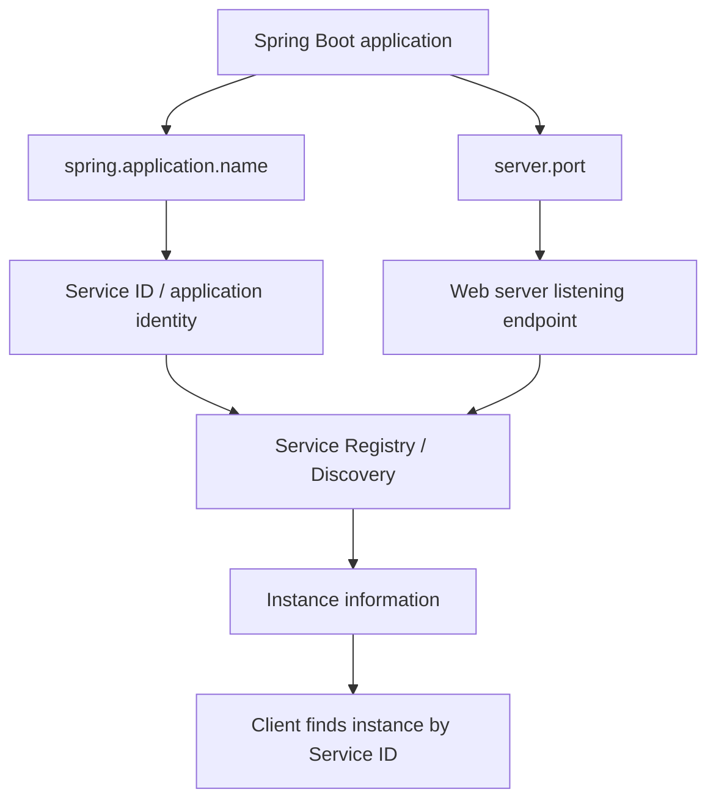

# Setting spring.application.name and Server Port

When initializing a Spring Boot service in a Spring Cloud system, two properties should be clearly defined from the start: `spring.application.name` and `server.port`. The first sets the **logical identity of the application**; the second sets the **port that the application's embedded web server listens on**. These two values often appear side by side in configuration, but they solve two different problems.

In the **SPRING_CLOUD_CORE** module, learners need to understand Spring Cloud Commons, Spring Cloud Context, externalized configuration, discovery, service registry, inter-service communication, and how to test common abstractions. Setting the application name and listening port is the fundamental initialization step so these components can accurately identify the service and connect to the right endpoint.

## 1. Two Properties, Two Responsibilities

| Property | Meaning | Example | Commonly used by |
| --- | --- | --- | --- |
| `spring.application.name` | Logical name of the application/service | `order-service` | Spring Cloud Discovery, service registry, Config Client, and observability integrations |
| `server.port` | Port of the embedded web server in the application | `8081` | Spring Boot web server and clients connecting directly to the endpoint |

A quick way to remember:

- **Application name answers:** "Which service is this?"
- **Server port answers:** "Which port is this process's web server listening on?"

For example, three instances of the same service can share the logical name `inventory-service` while running at different addresses:

```text
inventory-service
  ├── instance A: 10.0.1.11:8080
  ├── instance B: 10.0.1.12:8080
  └── instance C: 10.0.2.15:8082
```

Sharing the same Service ID allows callers to locate the right kind of service; the endpoint and instance metadata allow routing to a specific running replica. There is no need to give each replica a different `spring.application.name`. Each replica belongs to the same logical service, while instance information must be sufficient to distinguish individual endpoints.

## 2. Setting spring.application.name

`spring.application.name` is a property in the Spring Environment, typically declared in Spring Boot configuration. Spring Cloud and related libraries can use this value as the application name or Service ID during service registration and discovery.

For example, an order-processing service declares:

```yaml
spring:
  application:
    name: order-service
```

Or using `application.properties`:

```properties
spring.application.name=order-service
```

Choose a short, stable, easily recognizable name, usually lowercase with hyphens:

| Role | Suggested name |
| --- | --- |
| Order management | `order-service` |
| Inventory management | `inventory-service` |
| Payment processing | `payment-service` |
| Account management | `account-service` |

This name should describe the **service's role**, not a host machine or replica. When scaling from one instance to multiple instances, the Service ID stays the same. When deploying a new version, the logical name usually remains unchanged as long as the service performs the same role and remains compatible with its communication contract.

### 2.1. Where Is the Application Name Used?

In a Spring Cloud application, the name may be used in several contexts:

- **Discovery and service registry:** discovery integrations typically use the application name as the Service ID when registering instances or looking up instances of a service.
- **Service communication:** an HTTP client integrated with Spring Cloud LoadBalancer can use a logical name like `http://inventory-service` to resolve an instance before sending a request.
- **Externalized configuration:** Spring Cloud Config Client can use the application name to identify the configuration set meant for the application.
- **Logs, traces, and metrics:** observability integrations can use the application name as an identifying label or resource attribute.

Exact usage depends on the provider and configuration. Simply setting `spring.application.name` **does not create a registry, register an instance with Eureka/Consul, or automatically enable load balancing**. The application needs the corresponding dependencies, configuration, and infrastructure services.

### 2.2. Distinguishing Application Name and Instance Name

The application name is the shared identity of the service. The Instance ID is the identity of a specific running instance.

```text
Application / Service ID: inventory-service
  ├── Instance ID: inventory-service-node-a
  ├── Instance ID: inventory-service-node-b
  └── Instance ID: inventory-service-node-c
```

Each registry has its own rules for generating instance IDs. Do not assume the instance ID is always equal to `spring.application.name`, and do not manually assign duplicate instance IDs to multiple replicas. If configuring an instance ID manually, ensure it is unique within the registry scope and fits the deployment lifecycle.

## 3. Setting server.port

For a Spring Boot application with an embedded web server, `server.port` defines the server's HTTP/HTTPS listening port. If unconfigured, the common default port for the embedded web server is `8080`.

Example:

```yaml
server:
  port: 8081
```

Or:

```properties
server.port=8081
```

When the application starts successfully, the web server binds to this port on the configured network address. Another application on the same machine cannot bind to the same IP address and port simultaneously without a socket-sharing mechanism. Therefore, running multiple services locally usually requires different ports.

Example configuration for services running on the same machine:

```text
order-service      -> localhost:8081
inventory-service  -> localhost:8082
payment-service    -> localhost:8083
```

Each service can have its own logical name and local port. When deploying multiple replicas on separate machines or containers, the replicas can use the same internal port because each instance has its own network namespace or IP address.

### 3.1. server.port Is Not Another Service's Port

Suppose `order-service` calls `inventory-service`. The `server.port` setting in `order-service` only controls `order-service`'s own web server. It does not determine the destination port when calling `inventory-service`.

The target address is determined by the URL, DNS, Service ID combined with discovery/load balancing, or an access point provided by infrastructure. Similarly, `server.port` is not the port of Eureka Server, Consul, or Spring Cloud Config Server.

### 3.2. Using an Ephemeral Port with server.port=0

When running multiple test applications or multiple instances on the same machine, you can ask the operating system to allocate an available port by setting:

```yaml
server:
  port: 0
```

Spring Boot will start the web server on an available random port. This is useful in integration tests because it avoids depending on a fixed port.

Do not assume the actual port is the configured `0`. After the server starts, retrieve the actual port from the web server initialization event, logs, or the corresponding test mechanism. When registering an instance in a service registry, verify that the registry advertises the **actual reachable port**, rather than letting callers mistakenly receive `0`.

### 3.3. Application Port and Management Port

If Spring Boot Actuator is enabled and you want to separate the management port, you can configure `management.server.port`:

```yaml
server:
  port: 8081

management:
  server:
    port: 9091
```

In this example, the application API port is 8081; the management port is 9091. Separating ports does not automatically restrict access. Appropriate security and network policies must be configured for management endpoints.

## 4. Declaring Both Properties in application.yml

A simple startup configuration for `order-service`:

```yaml
spring:
  application:
    name: order-service

server:
  port: 8081
```

This configuration tells Spring that the application has the logical name `order-service` and its web server listens on port 8081.

You can combine a placeholder to accept the port from the environment while keeping a local default:

```yaml
spring:
  application:
    name: order-service

server:
  port: ${SERVER_PORT:8080}
```

If the `SERVER_PORT` environment variable exists, Spring uses that value; otherwise, the default port in this example is 8080. For `spring.application.name`, it can likewise be passed via the `SPRING_APPLICATION_NAME` environment variable.

## 5. Environment-Specific Configuration: Profiles, Environment Variables, and Command Line

A service may run in local, test, staging, and production environments. You should not have to edit the main configuration file every time you switch environments. Spring Boot supports multiple configuration sources, allowing you to keep the service name stable and adjust the port per deployment target.

### 5.1. Using Profiles

The `application.yml` file holds shared configuration:

```yaml
spring:
  application:
    name: order-service

server:
  port: 8080
```

The `application-dev.yml` file overrides the port when the `dev` profile is active:

```yaml
server:
  port: 8081
```

Activating the profile:

```bash
java -jar order-service.jar --spring.profiles.active=dev
```

When the `dev` profile is active, Spring Boot loads the corresponding profile configuration. The application name remains `order-service`, while the port is selected from the profile configuration. Profiles are a way to organize configuration; they do not automatically create a separate network environment or registry.

### 5.2. Using Environment Variables

You can set them directly in the runtime environment:

```bash
SPRING_APPLICATION_NAME=order-service
SERVER_PORT=8082
```

Environment variable names use uppercase letters and underscores according to Spring Boot's relaxed binding mapping rules:

| Property | Environment variable |
| --- | --- |
| `spring.application.name` | `SPRING_APPLICATION_NAME` |
| `server.port` | `SERVER_PORT` |
| `spring.profiles.active` | `SPRING_PROFILES_ACTIVE` |

How environment variables are set depends on the shell, operating system, or container platform. In Docker/Kubernetes, variables can be declared via deployment specs or secrets/config maps according to system policy.

### 5.3. Overriding via Command Line

Spring Boot allows passing properties when running the application:

```bash
java -jar order-service.jar \
  --spring.application.name=order-service \
  --server.port=8083
```

Command-line arguments normally have higher precedence than corresponding values in configuration files. Thus, if `application.yml` sets port 8080 but the startup argument passes `--server.port=8083`, the application will use port 8083.

When debugging configuration, inspect the **effective value in the Environment**, not just a single YAML file. The value may come from a profile, environment variable, command-line argument, or an external configuration source.

### 5.4. Externalized Configuration and Spring Cloud Config

Spring Boot supports externalized configuration: the same artifact can run across multiple environments with different configuration values. Spring Cloud Config can provide properties from a Config Server, but using Config Server requires the client, server, and import/connection setup appropriate for the Spring Boot/Spring Cloud version.

Some guidelines:

- Keep `spring.application.name` stable so components can identify the application and, when using Config Server, look up configuration by the right name.
- Set the port per deployment environment via profile files, environment variables, or a managed configuration source.
- Understand property source precedence for the specific version and Config Data mechanism in use.
- Never store secrets such as passwords, tokens, or private keys directly in configuration files committed to source control.

With Spring Cloud, configuration loading timing and the bootstrap/config import mechanism depend on the release train. Follow the documentation matching your project's version rather than copying configuration from another Spring Cloud generation.

## 6. Relationship to Discovery and Service Registry

When an application uses discovery, the application name and actual port are two crucial pieces of information for publishing an instance:



Example:

- `inventory-service` starts with the name `inventory-service` and port 8082.
- The discovery integration registers the instance with the corresponding Service ID and reachable endpoint.
- `order-service` looks up instances by Service ID `inventory-service`.
- The client-side load balancer selects an instance and sends the request to that endpoint.

In this example, the service name helps the caller find the **group of instances**, while host/port helps connect to a **specific instance**. Setting only the name without configuring a discovery provider will not populate a registry. Setting a port when the server fails to start or is unreachable over the network does not guarantee requests will succeed either.

### 6.1. Sample Configuration with Eureka Client

In a project with a compatible Eureka Client dependency, the configuration might look like this:

```yaml
spring:
  application:
    name: inventory-service

server:
  port: 8082

eureka:
  client:
    service-url:
      defaultZone: http://localhost:8761/eureka/
```

This is an example client configuration connecting to a local Eureka Server. For it to work, an actual Eureka Server must be running at that address along with the proper dependencies and network/configuration conditions. `spring.application.name` sets the application name; `server.port` is the inventory web server's port; `defaultZone` is the registry URL. All three values play distinct roles.

Exact Eureka property names and registration behavior depend on the Spring Cloud Netflix version in use. In real deployments, inspect registration logs and instance metadata in the registry to confirm the advertised endpoint is correct.

### 6.2. Same Name, Multiple Instances

When running multiple replicas, each replica normally shares the same Service ID:

```text
Service ID: inventory-service
  ├── replica 1 -> 10.0.0.11:8080
  ├── replica 2 -> 10.0.0.12:8080
  └── replica 3 -> 10.0.0.13:8080
```

Replicas do not need to have different ports. They can all listen on internal port 8080 because their IP addresses or network namespaces differ. Locally on the same host/network namespace, processes typically need distinct ports to avoid bind conflicts.

## 7. Ports in Docker and Kubernetes

Distinguish between the application port inside a container and the port published externally.

For example, a container runs a web server on port 8080 while the host exposes port 18080:

```text
Host machine:   localhost:18080
                    |
                    | port mapping
                    v
Container:      0.0.0.0:8080
                    |
                    v
             Spring Boot server.port=8080
```

In this setup, `server.port` remains 8080. Docker port mapping connects host port 18080 to container port 8080. Another container on the same network typically connects via the service/container address and internal port 8080, not host port 18080, unless the architecture specifically requires routing through the host.

In Kubernetes, a Service can expose a stable `port` and forward traffic to a Pod's `targetPort`. The Spring Boot application normally listens on `server.port` matching `targetPort`. The Service port and the container port are two separate configuration layers.

Therefore, when a service registry registers an instance on an internal network, ensure the endpoint clients receive is reachable from the clients' network location. Accidentally advertising the host port, Service port, or management port can cause requests to fail even while the application is running.

## 8. Testing Application Name and Port

You can verify both properties using the Spring Environment:

```java
import org.springframework.core.env.Environment;
import org.springframework.stereotype.Component;

@Component
public class ApplicationIdentity {
    private final Environment environment;

    public ApplicationIdentity(Environment environment) {
        this.environment = environment;
    }

    public String applicationName() {
        return environment.getProperty("spring.application.name");
    }
}
```

For web applications, integration tests can use a random port to avoid depending on a fixed port:

```java
import static org.assertj.core.api.Assertions.assertThat;

import org.junit.jupiter.api.Test;
import org.springframework.beans.factory.annotation.Autowired;
import org.springframework.boot.test.context.SpringBootTest;
import org.springframework.boot.test.web.server.LocalServerPort;
import org.springframework.core.env.Environment;

@SpringBootTest(webEnvironment = SpringBootTest.WebEnvironment.RANDOM_PORT)
class ApplicationStartupTest {
    @LocalServerPort
    int actualPort;

    @Autowired
    Environment environment;

    @Test
    void exposesApplicationNameAndStartsWebServer() {
        assertThat(environment.getProperty("spring.application.name"))
                .isEqualTo("order-service");
        assertThat(actualPort).isPositive();
    }
}
```

This illustrative test verifies the application name property and that the server was assigned an actual port. If the project uses an older Spring Boot version, the package or port injection mechanism in tests may differ; check the test APIs for the version in use.

Checklist when running locally:

1. Start the application and check logs to confirm the web server started on the expected port.
2. Call the health endpoint or a test endpoint using the exact host/port.
3. Check `spring.application.name` in the Environment or in logs/registry metadata.
4. If using discovery, verify that the Service ID and instance endpoint are registered accurately.
5. Stop an instance or change its port in a test environment to verify callers do not rely on a stale hardcoded address.

## 9. Common Errors and How to Handle Them

| Symptom | Possible cause | Troubleshooting direction |
| --- | --- | --- |
| Application reports port already in use | Another process is bound to the same address/port | Find the process using the port; pick a different port or stop the old process |
| Registry displays a generic or wrong name | Missing `spring.application.name`, overridden value, or provider uses different rules | Inspect effective Environment, environment variables, startup args, and provider config |
| Client cannot find the service | Caller's Service ID differs from the registered name, or registry has no instances | Compare `spring.application.name`, Service ID, registration status, and namespace |
| Registry lists instance but calls fail | Advertised host/port unreachable from client, firewall, or readiness not passing | Test connectivity from the client's network; verify port mapping, endpoint, and health |
| Application runs on an unexpected port | Profile, environment variable, or command line overrides configuration | Check active profiles and higher-precedence property sources |
| Test fails due to fixed port | Test port is occupied by another process | Use `RANDOM_PORT` and retrieve the actual port via `@LocalServerPort` |
| API works but Actuator is unreachable on main port | A separate `management.server.port` is configured | Check the management port and its corresponding network/security policies |

### Distinguishing Configuration Errors from Network Errors

If the logs indicate the server started on 8081 but a caller cannot connect, inspect the address and network path the caller is using. A server binding successfully only confirms the process is listening on a local address/port; it does not prove every machine or container can reach it.

If discovery returns an empty list, check the Service ID and the discovery data source. If discovery returns an endpoint but requests time out or hit connection refused, check the endpoint, port, firewall, readiness, and instance status. These two situations have different root causes.

## 10. Misconceptions to Avoid

**Setting `spring.application.name` means the application has already registered as a service.** Incorrect. The property only provides an identity; a provider/registry and integration configuration are required to register.

**Setting `server.port` sets the port used to call other services.** Incorrect. This is the current application's web server port. Outbound target addresses are determined by the client URL, DNS, discovery, or infrastructure.

**Every replica must have a different application name.** Normally no. Replicas of the same service share a Service ID; each instance has its own endpoint and instance identifier.

**Containers must use different ports.** Not necessarily. Containers with separate network namespaces can all listen on internal port 8080. Conflicts depend on the address and network namespace where binding occurs.

**The host port, container port, and Kubernetes Service port are the same.** They can differ. Trace port mappings or the Service `targetPort` to know the actual port the application listens on.

**Configuration in application.yml is always the final value.** Incorrect. Profiles, environment variables, command-line arguments, and external configuration sources can override it. Always check the value in the Environment.

## Key Takeaway

`spring.application.name` defines the logical identity that Spring Cloud components can use to recognize the application and service. `server.port` defines the web server port of the current process. When combined with discovery and a service registry, the application name locates the right group of instances, while the host/port endpoint connects to a specific instance. Setting both properties explicitly, managing them through environment configuration, and verifying the actual endpoint helps Spring Cloud applications initialize, register, and communicate reliably.
