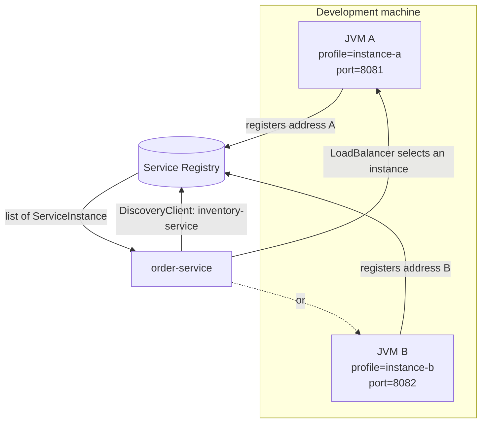
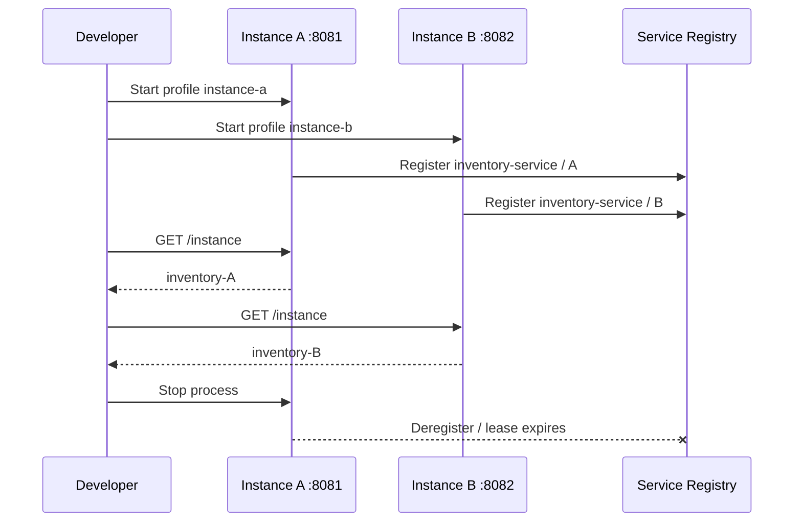

# Launching Multiple Instances with Different Profiles and Ports

## 1. Why Run Multiple Instances?

In a distributed system, a service is typically deployed as multiple **instances** to increase availability, scale load, and limit the blast radius when a single process fails. When developing locally, you can simulate this model by launching multiple Spring Boot processes from the same application, each using its own **profile** and **HTTP port**.

For example, the same `inventory-service.jar` artifact is launched twice:

| Property | Instance A | Instance B |
| --- | --- | --- |
| Logical service name | `inventory-service` | `inventory-service` |
| Profile | `instance-a` | `instance-b` |
| HTTP port | `8081` | `8082` |
| Observation label | `inventory-A` | `inventory-B` |
| Process | JVM A | JVM B |

Both instances share the same service name so the discovery system treats them as replicas of the same service. They have different profiles and ports for independent configuration and access.

Within **SPRING_CLOUD_CORE**, this exercise bridges Spring Boot profiles and externalized configuration with Spring Cloud Commons: when integrated with a service registry, each instance can register its own address; clients can discover and select an instance to call. Running two processes locally is the first step to observing that mechanism.

**Distinguish three concepts:**

- **Application/service name** identifies the logical service, e.g., `inventory-service`.
- **Profile** selects the configuration set for a given run, e.g., `instance-a`.
- **Port** specifies the network port the process listens on, e.g., `8081`.

Enabling two profiles in **one JVM** does not create two instances. To run two independent servers on the same machine, you must launch two application processes and give them non-overlapping ports.

## 2. Preparing Shared and Profile-Specific Configuration

Spring Boot automatically reads the shared configuration file `application.yml` and profile-specific files named `application-{profile}.yml`. Put shared values in the first file and per-instance differences in the profile files.

Example layout:

```text
src/
└── main/
    └── resources/
        ├── application.yml
        ├── application-instance-a.yml
        └── application-instance-b.yml
```

### 2.1. Shared Configuration — `application.yml`

```yaml
spring:
  application:
    name: inventory-service

server:
  # Can be omitted entirely so every profile must declare its own port.
  # The value below is only a fallback when no profile with a port is selected.
  port: 8080

app:
  inventory:
    description: Inventory service for local multi-instance practice
```

`spring.application.name` remains identical across instances. This is the application name used by Spring Cloud integrations as the basis for service identification where applicable.

### 2.2. Configuration for Instance A — `application-instance-a.yml`

```yaml
server:
  port: 8081

app:
  instance:
    label: inventory-A
```

### 2.3. Configuration for Instance B — `application-instance-b.yml`

```yaml
server:
  port: 8082

app:
  instance:
    label: inventory-B
```

When the `instance-a` profile is active, Spring Boot loads `application.yml` and the corresponding profile configuration. Values in the profile file override shared values when the same property is declared. Instance B behaves the same way with `application-instance-b.yml`.

You can define distinct observable values in each profile, such as an instance label, log level, mock service URL, or feature flag. Keep secrets such as passwords, tokens, and private keys in a secure configuration source; never commit them into project profile files.

**Note:** do not set `spring.profiles.active` inside a profile-specific file such as `application-instance-a.yml`. Activate profiles from a profile-unconditional config file, environment variables, or command-line arguments. In this exercise, we use command-line arguments so each process gets its own profile.

## 3. Launching Two Instances from the Same Artifact

The easiest approach to control is building the application once, then running the same JAR file in two terminals. Both processes run the same code and dependencies, while receiving different startup arguments.

### 3.1. Building the Application

With Maven Wrapper:

```bash
./mvnw clean package
```

On Windows PowerShell:

```powershell
.\mvnw.cmd clean package
```

With Gradle Wrapper:

```bash
./gradlew clean bootJar
```

On Windows PowerShell:

```powershell
.\gradlew.bat clean bootJar
```

The JAR filename depends on `artifactId`, version, and build configuration. Subsequent examples assume `target/inventory-service-0.0.1-SNAPSHOT.jar` for Maven or `build/libs/inventory-service-0.0.1-SNAPSHOT.jar` for Gradle. Replace with the actual artifact name in your project.

### 3.2. Running Instance A

Open the first terminal in the project directory:

```bash
java -jar target/inventory-service-0.0.1-SNAPSHOT.jar --spring.profiles.active=instance-a
```

If using the JAR built by Gradle:

```bash
java -jar build/libs/inventory-service-0.0.1-SNAPSHOT.jar --spring.profiles.active=instance-a
```

The application activates the `instance-a` profile, loads `application-instance-a.yml`, and starts the web server on port `8081`.

### 3.3. Running Instance B

Open a second terminal and run the same artifact:

```bash
java -jar target/inventory-service-0.0.1-SNAPSHOT.jar --spring.profiles.active=instance-b
```

If using Gradle, change the JAR path to `build/libs/...jar` accordingly.

The second process loads `application-instance-b.yml` and starts on port `8082`. Keep both terminals open so both processes continue running. If a process exits, that instance will no longer accept requests.

### 3.4. Overriding the Port Directly from the Command Line

You do not have to create a dedicated profile file just to change the port. Command-line arguments can override properties in configuration files:

```bash
java -jar target/inventory-service-0.0.1-SNAPSHOT.jar --spring.profiles.active=instance-a --server.port=8181
```

In this run, the `instance-a` profile is still active, but the server listens on port `8181` instead of `8081`. Properties passed via the command line have higher precedence than properties of the same name in configuration files.

This is useful when running multiple test runs or when CI assigns different ports per job. If a port is a fixed part of the local setup, placing it in the profile file makes configuration easier for developers to read and reuse.

## 4. Running Directly with Maven or Gradle

During development, you can use the build plugin instead of packaging a JAR after every code edit. Each instance still must run in a separate terminal or process.

### 4.1. Maven Spring Boot Plugin

First terminal:

```bash
./mvnw spring-boot:run -Dspring-boot.run.arguments="--spring.profiles.active=instance-a"
```

Second terminal:

```bash
./mvnw spring-boot:run -Dspring-boot.run.arguments="--spring.profiles.active=instance-b"
```

On Windows, use `.\mvnw.cmd` instead of `./mvnw`. The `spring-boot.run.arguments` parameter passes application arguments to `main`, so profiles and ports are handled the same way as with `java -jar`.

If you want to specify the port directly:

```bash
./mvnw spring-boot:run -Dspring-boot.run.arguments="--spring.profiles.active=instance-a --server.port=8181"
```

### 4.2. Gradle Boot Run

With Kotlin DSL or Groovy DSL, the `bootRun` task accepts application arguments via `--args`.

First terminal:

```bash
./gradlew bootRun --args="--spring.profiles.active=instance-a"
```

Second terminal:

```bash
./gradlew bootRun --args="--spring.profiles.active=instance-b"
```

On Windows PowerShell:

```powershell
.\gradlew.bat bootRun --args="--spring.profiles.active=instance-a"
```

And in another terminal:

```powershell
.\gradlew.bat bootRun --args="--spring.profiles.active=instance-b"
```

The commands above assume the Spring Boot plugin is applied and the `bootRun` task exists. In multi-module Gradle builds, you may need to specify the project path, such as `:inventory-service:bootRun`.

## 5. Verifying Both Instances Are Active

Do not rely solely on a terminal showing no errors. Verify the profile, port, and HTTP response of each process.

### 5.1. Observing Startup Logs

Spring Boot normally logs the active profiles and reports that the web server has started. Logs should show:

- Instance A uses profile `instance-a` and Tomcat/Jetty/Netty (depending on stack) listening on port `8081`.
- Instance B uses profile `instance-b` and the server listening on port `8082`.
- Both applications start cleanly with no port binding or configuration errors.

Exact web server names and log formats depend on dependencies; focus on the active profile and actual listening port.

### 5.2. Verifying over HTTP

If the project includes Spring Boot Actuator and the health endpoint is enabled, call:

```bash
curl http://localhost:8081/actuator/health
curl http://localhost:8082/actuator/health
```

On Windows PowerShell, use `curl.exe` to invoke the real curl binary:

```powershell
curl.exe http://localhost:8081/actuator/health
curl.exe http://localhost:8082/actuator/health
```

A successful health result indicates each process's endpoint is responding. If Actuator has not been added, call a business API exposed by the application, such as `GET /api/items/42`. Do not assume `/actuator/health` exists without adding the Actuator dependency.

### 5.3. Creating an Endpoint to Display the Instance Label

To observe which process handles a request, you can create a test endpoint. For example, using `@Value` to read the label property:

```java
package com.example.inventory;

import org.springframework.beans.factory.annotation.Value;
import org.springframework.web.bind.annotation.GetMapping;
import org.springframework.web.bind.annotation.RestController;

import java.util.Map;

@RestController
public class InstanceController {

    private final String instanceLabel;

    public InstanceController(
            @Value("${app.instance.label:inventory-default}") String instanceLabel) {
        this.instanceLabel = instanceLabel;
    }

    @GetMapping("/instance")
    public Map<String, String> instance() {
        return Map.of(
                "service", "inventory-service",
                "instance", instanceLabel
        );
    }
}
```

Call both addresses:

```bash
curl http://localhost:8081/instance
curl http://localhost:8082/instance
```

The expected responses contain distinct labels, such as `inventory-A` and `inventory-B`. This API is for practice purposes; do not expose internal instance metadata in unprotected endpoints in production.

## 6. Profiles, Ports, and Externalized Configuration

### 6.1. A Profile Is a Configuration Group, Not a Process

A profile is a way to select a set of configuration settings for a run. Profiles can serve many purposes:

- `local`: connecting to local databases and mock services on a developer machine.
- `test`: configuration for integration tests.
- `staging`: pre-production environment settings.
- `instance-a`, `instance-b`: distinguishing two runs in this exercise.

Multiple profiles can be activated simultaneously via a comma-separated list, yet **that still creates only one ApplicationContext and one process**. If two profiles both define `server.port`, the outcome depends on loading rules and configuration precedence; avoid designing ambiguous overlapping profiles. For this lesson, each process activates only one instance profile.

### 6.2. Configuration Sources and Precedence

Configuration values can come from YAML/properties files, environment variables, Java system properties, and command-line arguments. When the same property is declared in multiple sources, Spring Boot applies externalized configuration precedence rules. In the commands above, `--server.port=8181` passed via the command line overrides the port from the profile file.

You can use environment variables if you prefer running without long command-line flags:

On Linux/macOS:

```bash
SPRING_PROFILES_ACTIVE=instance-a SERVER_PORT=8081 java -jar target/inventory-service.jar
```

On Windows PowerShell:

```powershell
$env:SPRING_PROFILES_ACTIVE = "instance-a"
$env:SERVER_PORT = "8081"
java -jar target\inventory-service.jar
```

Environment variables are inherited by child processes within that terminal. When opening a new terminal, variables previously set in another PowerShell session will not automatically exist unless set in the new terminal. To launch two instances from the same terminal, pass per-process values or use command-line arguments; avoid mutating a shared environment variable between two active launches.

### 6.3. Using an External Configuration Directory

In deployment environments, configuration can live next to the artifact or in a mounted directory instead of being packaged inside the JAR. For example:

```text
deployment/
├── inventory-service.jar
└── config/
    ├── application.yml
    ├── application-instance-a.yml
    └── application-instance-b.yml
```

You can add an external configuration location via `spring.config.additional-location`:

```bash
java -jar inventory-service.jar --spring.config.additional-location=optional:file:./config/ --spring.profiles.active=instance-a
```

The additional directory is included during Config Data loading. Use the proper URL/file location syntax and check configuration logs upon deployment. If you use `spring.config.location` instead of `spring.config.additional-location`, you may replace the default search locations; therefore use it only when intentionally controlling all configuration locations.

## 7. Connecting to Spring Cloud Commons and Service Registry

When running two local instances, both share the same `spring.application.name` of `inventory-service` while having separate addresses:

- `inventory-service` at `localhost:8081`.
- `inventory-service` at `localhost:8082`.

This is the fundamental model of a multi-instance service. In a system with a registry such as Eureka or Consul, each process can register its own instance details. Clients use Spring Cloud Commons abstractions to look up a service ID and obtain a list of `ServiceInstance` objects; Spring Cloud LoadBalancer can then select an instance to send requests to.



A **registry implementation and corresponding configuration** are required for automatic registration. Commons provides abstractions such as `ServiceRegistry`, `Registration`, and `DiscoveryClient`; it does not automatically spin up a registry server just because you started two processes.

When registering multiple instances, ensure **each instance has a distinct identifier** according to the registry implementation's requirements. Some registries require configuring an instance ID; syntax and ID-generation rules depend on the specific integration. If two processes share the same ID, one registration may overwrite or shadow the other. Check the registry dashboard/CLI to verify there are two records under the same service name with distinct instance identities and addresses.

**Do not confuse `SimpleDiscoveryClient` with self-registration:** configuring a static list of instances for `SimpleDiscoveryClient` mainly helps clients look up known addresses. It does not replace a registry server and does not auto-register running processes like an Eureka/Consul client.

### 7.1. Registered Addresses Must Be Reachable by Clients

In the example above, `localhost` is only suitable when client and server run on the same host/network namespace. If the application runs in Docker or across different machines, the advertised address must be a hostname/IP that clients can actually reach. Registering `localhost` from inside a container typically prevents clients outside that container from calling the instance.

With a real registry, verify:

- Advertised host and port are reachable from the client's network.
- Each instance has a unique identity.
- Health checks and heartbeats align with the registry.
- Stopped instances deregister or expire their lease within expected timeframes.
- Clients observe all active instances.

## 8. Common Collisions When Running Multiple Processes

Running multiple instances on the same machine can produce conflicts beyond the HTTP port.

| Symptom | Common cause | Resolution |
| --- | --- | --- |
| `Port already in use` or `Address already in use` | Two processes bind to the same address/port | Assign distinct ports; check which process holds the port |
| Both logs show the same profile | Same `spring.profiles.active` passed or shared environment variable | Check startup arguments and environment of each process |
| Profile is right but port is still the same | Profile file not loaded, wrong filename, or higher-precedence override | Check `application-{profile}.yml` naming, active profile, and CLI/env overrides |
| Registry shows only one instance | Duplicate instance ID or misconfigured registration | Generate unique IDs per implementation; verify registered host/port |
| Client can call one instance but not the other | Advertised address unreachable, firewall, or backend not ready | Check registry address from the client's network perspective |
| Both processes execute the same job | Scheduler or message listener runs on every instance | Use leader/single-consumer/distributed locking or design idempotent jobs |
| Two processes overwrite files | Shared log path, upload path, PID/temp file, or data directory | Separate paths per instance or use controlled shared storage |
| DB migrations run concurrently | Every instance triggers migration at startup | Use locking/migration runner coordination and test concurrency |

### 8.1. Checking Which Process Holds a Port

On Windows PowerShell:

```powershell
Get-NetTCPConnection -LocalPort 8081 -State Listen
Get-NetTCPConnection -LocalPort 8082 -State Listen
```

On Linux:

```bash
ss -ltnp | grep -E ':8081|:8082'
```

If a port is occupied by another application, pick a different port or stop that process using proper procedures. Never blindly kill an unidentified process as it could be another critical service.

### 8.2. Actuator Management Port

By default, Actuator endpoints can share the main web server port. If configuring a dedicated `management.server.port`, each instance on the same host must also have its own management port. Example:

```yaml
# application-instance-a.yml
server:
  port: 8081
management:
  server:
    port: 9081
```

```yaml
# application-instance-b.yml
server:
  port: 8082
management:
  server:
    port: 9082
```

The health endpoints (if Actuator is added and exposed) will then be at `http://localhost:9081/actuator/health` and `http://localhost:9082/actuator/health`. If you do not need to separate the management port, omit this configuration so Actuator uses the application port by default.

### 8.3. Multiple Instances Can Duplicate Side Effects

A common mistake is assuming running two instances only doubles the number of HTTP servers. In reality, each process may also initialize components such as:

- `@Scheduled` jobs;
- message consumers/listeners;
- cache warm-up or data synchronization tasks;
- database migrations or maintenance routines;
- file generation and notification dispatch logic.

If two processes concurrently run a task meant to execute only once, they can create duplicate records, send duplicate emails, or mutate the same resource simultaneously. Use appropriate coordination mechanisms (such as distributed locks, leader election, consumer groups, or lock-aware job schedulers) and design operations to be safely repeatable where needed.

## 9. Using Random Ports in Tests

When starting an application for testing without depending on a fixed port, Spring Boot supports `server.port=0` to have the OS allocate an available port:

```bash
java -jar inventory-service.jar --server.port=0
```

In integration tests, you can use `@SpringBootTest(webEnvironment = SpringBootTest.WebEnvironment.RANDOM_PORT)` so the framework starts the server on a random port and injects `@LocalServerPort` to read the actual port.

Example:

```java
import org.junit.jupiter.api.Test;
import org.springframework.boot.test.context.SpringBootTest;
import org.springframework.boot.test.web.server.LocalServerPort;

import static org.junit.jupiter.api.Assertions.assertTrue;

@SpringBootTest(webEnvironment = SpringBootTest.WebEnvironment.RANDOM_PORT)
class InventoryHttpTest {

    @LocalServerPort
    int port;

    @Test
    void serverStartsOnRandomPort() {
        assertTrue(port > 0);
    }
}
```

This approach suits isolated tests and prevents port conflicts across test runs. If an instance registers with a service registry, ensure the implementation captures and advertises the **actual port** after the server binds; never register `0` as a reachable port.

## 10. Complete Hands-On Workflow

Follow these steps in order for reproducible verification:

1. Confirm the project has a Spring Boot application running an HTTP server and builds an artifact cleanly.
2. Add the shared `spring.application.name` in `application.yml`.
3. Create `application-instance-a.yml` with port 8081 and label `inventory-A`.
4. Create `application-instance-b.yml` with port 8082 and label `inventory-B`.
5. Build the JAR once.
6. Open two terminals and launch the same JAR with their respective profiles.
7. Check logs to confirm active profiles and ports.
8. Call `/instance` or an actual API on both ports to confirm the two processes return different labels.
9. If registry integration is present, verify the registry shows two records for `inventory-service` with distinct instance identities and addresses.
10. Stop each process and observe how the registry and clients react when an instance becomes unavailable.



## 11. Self-Check Questions

1. Why must two processes be used to simulate two instances on the same machine?
2. Should `spring.application.name` differ between two instances of the same service? Explain.
3. When is `application-instance-a.yml` loaded?
4. If a profile declares port 8081 but the startup command passes `--server.port=8181`, which port will the server listen on?
5. What problems can arise when two instances share the same service name and duplicate instance ID in a registry?
6. Why is `SimpleDiscoveryClient` with a static address list not equivalent to a service registry with auto-registration?
7. If configuring a separate `management.server.port`, what must you watch out for when running multiple instances?
8. Why can `@Scheduled` tasks or message listeners cause side effects when running multiple processes?

## 12. Official References

- [Spring Boot — Profiles](https://docs.spring.io/spring-boot/reference/features/profiles.html) — activating profiles and profile-specific configuration files.
- [Spring Boot — Externalized Configuration](https://docs.spring.io/spring-boot/reference/features/external-config.html) — configuration sources and precedence order.
- [Spring Boot — Running Your Application](https://docs.spring.io/spring-boot/reference/using/running-your-application.html) — running packaged applications and command-line arguments.
- [Spring Boot Maven Plugin — Run](https://docs.spring.io/spring-boot/maven-plugin/run.html) — running applications with Maven.
- [Spring Boot Gradle Plugin — Running Your Application](https://docs.spring.io/spring-boot/gradle-plugin/running.html) — the `bootRun` task and arguments.
- [Spring Cloud Commons — Common Abstractions](https://docs.spring.io/spring-cloud-commons/reference/spring-cloud-commons/common-abstractions.html) — `DiscoveryClient`, `ServiceRegistry`, and service registration.
- [Spring Cloud LoadBalancer](https://docs.spring.io/spring-cloud-commons/reference/spring-cloud-commons/loadbalancer.html) — instance selection when calling services.

*The example uses the same artifact and two local ports to simulate multiple instances. Specific registry, health check, and advertised address configurations must be adapted to the actual implementation and deployment environment.*
