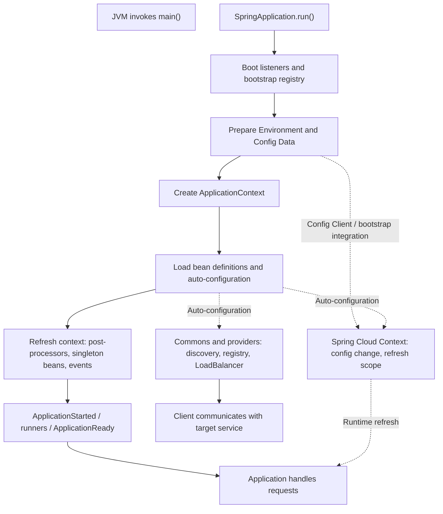
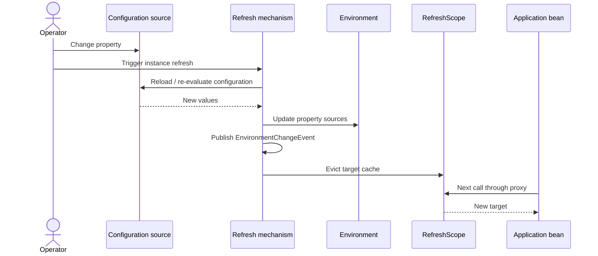
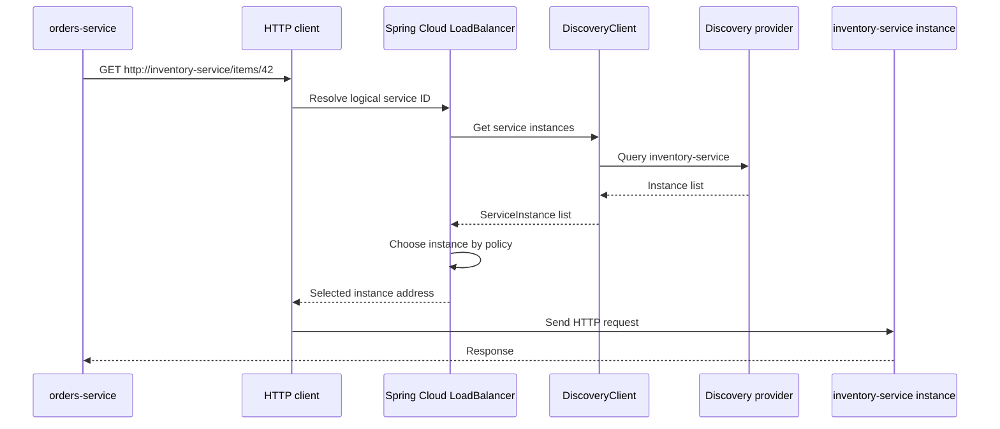

# Path from SpringApplication to Spring Cloud Components

## 1. The Big Picture

A Spring Cloud application still starts with **Spring Boot**. The familiar entry point is `SpringApplication.run(...)`; Spring Boot prepares the environment, creates and refreshes the `ApplicationContext`, and then runs the application components. Spring Cloud participates at the appropriate stages through Spring and Boot extension mechanisms: configuration loading, auto-configuration, beans, events, scopes, and runtime abstractions.

To understand the platform architecture, you need to trace the path from process startup to the point where a request is routed to a target service:

1. The JVM invokes the `main` method and the application creates a `SpringApplication`.
2. Spring Boot prepares the `Environment` and property sources.
3. Boot creates and refreshes the application context; Spring Cloud auto-configuration registers beans when conditions match.
4. Configuration, discovery, service registry, load balancing, and communication client components are wired through abstractions.
5. At runtime, the application handles events, health, refreshes, and requests according to each component's lifecycle.

**SpringApplication orchestrates the startup process; ApplicationContext manages beans; Spring Cloud provides shared components and contracts so distributed applications can integrate with infrastructure.** There is no separate "Spring Cloud container" replacing Boot's application context.

This lesson belongs to the **SPRING_CLOUD_CORE** module: the shared foundation of Spring Cloud in distributed systems, including Spring Cloud Commons, Context, externalized configuration, version compatibility with Spring Boot, refresh scope, discovery, service registry, service-to-service communication, testing, and operations.

## 2. Components and Responsibilities

| Component | Role | Examples or extension points |
| --- | --- | --- |
| `SpringApplication` | Orchestrates Spring Boot startup | `run(args)`, listeners, initializers |
| `Environment` | Provides effective properties | Configuration files, environment variables, Config Data, remote sources |
| `ApplicationContext` | Container managing beans and lifecycle | Dependency injection, events, scopes, auto-configuration |
| Spring Cloud Context | Adds configuration integration and refresh support | Bootstrap integration, `EnvironmentChangeEvent`, `@RefreshScope` |
| Spring Cloud Commons | Provides shared abstractions for cloud systems | `DiscoveryClient`, `ServiceRegistry`, LoadBalancer API |
| Config Client | Fetches configuration from Config Server | Config Data import or legacy bootstrap |
| Discovery provider | Discovers and registers instances | Eureka, Consul, Kubernetes, or other providers |
| Spring Cloud LoadBalancer | Selects an instance from available candidates | Service instance supplier, instance selection algorithm |
| Communication client | Sends requests to target services | RestClient, WebClient, OpenFeign, or corresponding integrations |
| Actuator | Exposes observability/management endpoints | Health, metrics, and exposed endpoints |

Spring Cloud Commons defines contracts that libraries or providers can implement. For example, an application can use `DiscoveryClient` without writing logic coupled directly to Eureka- or Consul-specific APIs. The concrete provider still needs to be on the classpath and properly configured.

## 3. Path Inside SpringApplication.run

The application entry point code is usually very short:

```java
@SpringBootApplication
public class OrdersApplication {
    public static void main(String[] args) {
        SpringApplication.run(OrdersApplication.class, args);
    }
}
```

That single call orchestrates many phases. The table below describes the typical conceptual order in Spring Boot; internal callback names and details may vary across Boot generations.

| Phase | What Spring Boot does | Where Spring Cloud participates |
| --- | --- | --- |
| 1. Create application | Determines primary source, web application type, listeners, and initializers | Starters and metadata on the classpath enable integrations to be discovered. |
| 2. Start startup | Creates Boot's bootstrap registry and publishes early startup events | Library listeners can observe startup. Boot's bootstrap registry is not the traditional Cloud bootstrap context. |
| 3. Prepare Environment | Loads and merges property sources, processes profiles and Config Data | Config Client can load remote configuration via Config Data; legacy bootstrap can prepare a parent context/property sources. |
| 4. Create application context | Selects the appropriate context type for the application | Appropriate initializers and integrations can prepare the context. |
| 5. Load bean definitions | Reads source configuration, component scan, and auto-configuration | Spring Cloud auto-configuration registers bean definitions conditionally. |
| 6. Refresh context | Runs post-processors, creates beans, injects dependencies, applies `BeanPostProcessor`s, and publishes events | Config, discovery, registry, LoadBalancer, Context, and clients complete integration via beans. |
| 7. Startup complete | Publishes started/ready events and invokes runners | Cloud components can react to lifecycle events; readiness and deployment configuration determine when an instance receives traffic. |

Conceptual flow:



This diagram is an architectural model, not a guarantee that every Cloud bean is created in a fixed order. Actual ordering also depends on dependencies, auto-configuration conditions, event listeners, and the active provider.

## 4. Environment Preparation Phase: Configuration Before Beans

### 4.1. Why is the Environment prepared early?

Spring Boot needs configuration before creating many beans: active profiles, HTTP port, application name, Config Server address, feature flags, and auto-configuration parameters. `Environment` aggregates `PropertySource`s in precedence order; beans read effective properties from this environment.

Spring Cloud Config Client can bring configuration from Config Server into the `Environment` right during the Config Data phase. For example:

```yaml
spring:
  application:
    name: orders-service
  config:
    import: "optional:configserver:http://config-server:8888"

server:
  port: 8080

app:
  checkout:
    enabled: true
```

When using the Config Data API, Spring Boot processes `spring.config.import` while preparing configuration, before refreshing the application context. Therefore, auto-configuration and beans created afterward can read the loaded values. The `optional:` prefix allows startup to continue if the remote source is unavailable; in that case, the application can run with local/default configuration and requires appropriate monitoring.

### 4.2. Config Data and the Traditional Bootstrap Context

Two concepts have similar names but are different:

- **Spring Boot bootstrap registry:** the mechanism Boot uses during startup to manage certain objects needed before the application context. It belongs to Boot's lifecycle.
- **Spring Cloud bootstrap context:** Spring Cloud's traditional bootstrap mechanism, which typically creates a parent context to prepare property sources and infrastructure beans before the main context.

With the legacy Spring Cloud bootstrap model, applications could use `bootstrap.yml` and components such as `PropertySourceLocator`. Starting from Spring Cloud 2020.0, traditional bootstrap is no longer enabled by default in standard setups; modern versions generally prefer Config Data via `spring.config.import`. Some integrations may still require enabling bootstrap via the appropriate dependency/configuration for that specific release.

| Characteristic | Modern Config Data | Traditional Spring Cloud Bootstrap |
| --- | --- | --- |
| Orchestration mechanism | Spring Boot Config Data API | Spring Cloud bootstrap lifecycle |
| Typical configuration | `spring.config.import=configserver:...` in application config | `bootstrap.yml` or corresponding source |
| Timing | Before refreshing the application context | Creates a bootstrap context earlier than the main context |
| Separate parent context | Not required | Typically has a parent context in the legacy model |
| Selection | Standard approach for modern applications | Used when required by version/integration |

Do not add both mechanisms out of habit. Check the documentation for your actual Spring Boot, Spring Cloud, and Config Client versions to avoid loading the same configuration twice or creating unexpected precedence order.

### 4.3. Precedence Order and Effective Values

Multiple sources can declare `app.checkout.enabled` at the same time. The final value depends on `PropertySource` order, profiles, and Boot/Cloud precedence rules. When debugging, inspect the **effective value** and the source that provided it, rather than looking only at local config files.

Never log the entire `Environment` in production, as that can expose tokens, passwords, connection strings, or internal details. Use controlled Actuator/config diagnostics and display only non-sensitive keys.

## 5. Runtime Refresh: Responsibility of Spring Cloud Context

Loading configuration at startup and updating configuration while the application is running are two distinct phases.

Spring Cloud Context adds mechanisms to notify changes and refresh eligible beans. When a configuration source changes, a supported refresh mechanism can update the `Environment`, publish an `EnvironmentChangeEvent`, and refresh beans in `RefreshScope`. Beans annotated with `@RefreshScope` are typically accessed through a proxy; after the old target is evicted from the cache, the next call creates a new target with the current configuration.

Example:

```java
@Service
@RefreshScope
public class CheckoutPolicy {
    private final boolean enabled;

    public CheckoutPolicy(
            @Value("${app.checkout.enabled:true}") boolean enabled) {
        this.enabled = enabled;
    }

    public boolean isEnabled() {
        return enabled;
    }
}
```

A regular singleton retains values injected at initialization and will not automatically re-run its constructor just because the `Environment` changed. `@RefreshScope` allows recreating the target for eligible beans; it does not restart the whole process, does not replace every singleton, and does not guarantee that all instances in a cluster update simultaneously.

Conceptual runtime flow:



The `/actuator/refresh` endpoint is only available when the required components are included in the application and the endpoint is exposed by configuration. In production, secure the endpoint with proper authentication, authorization, and management network controls. Refreshing one instance does not automatically propagate to all instances; a distribution/coordination mechanism such as Spring Cloud Bus is needed if the architecture requires it.

## 6. Auto-Configuration: How Spring Cloud Registers Beans in the Context

Spring Cloud starters typically bundle required dependencies. When those JARs are on the classpath, Boot can discover auto-configurations and apply conditions such as:

- Whether required classes are present (`@ConditionalOnClass`).
- Whether a property enables a feature (`@ConditionalOnProperty`).
- Whether the application has already declared an equivalent bean (`@ConditionalOnMissingBean`).
- Whether the application has the required context type or web environment.

Auto-configuration does not mean every bean from every Cloud library is always created. A starter may bring along multiple modules, yet specific beans only appear when conditions and configuration match.

In modern Spring Boot generations, the list of auto-configurations is typically declared via:

```text
META-INF/spring/org.springframework.boot.autoconfigure.AutoConfiguration.imports
```

Older Boot versions used `spring.factories` for many registration types, including auto-configuration. Some extension points and listeners may still use corresponding metadata/factories depending on the version. When writing an integration library, follow the exact mechanism required by the target Boot version.

### 6.1. Example of Starters and Conditions

Suppose an application declares Config Client and a discovery provider. The starters bring the necessary modules onto the classpath; auto-configuration can register Config Data integration, the discovery implementation, health contributors, and related infrastructure beans. If the application does not declare a discovery provider, the Commons API may still be present, but it will not create a registry out of thin air.

When the application defines its own bean of the same type, `@ConditionalOnMissingBean` on the auto-configuration can yield to the custom configuration. This is an important extension point, though overriding beans requires understanding the lifecycle and contract of the abstraction.

## 7. From Spring Cloud Commons to Discovery and Service Registry

In distributed applications, two needs are often mentioned together yet remain distinct:

- **Instance registration:** letting infrastructure know that an instance exists, along with its address and status.
- **Instance discovery:** looking up the currently available instances of a service to select a communication target.

Spring Cloud Commons provides common abstractions for both directions.

| Abstraction | Purpose | Common operations |
| --- | --- | --- |
| `ServiceRegistry<R>` | Register and deregister instances | `register(registration)`, `deregister(registration)` |
| `Registration` | Describes registered instance information | Service ID, host, port, and metadata |
| `DiscoveryClient` | Look up services and instances | `getServices()`, `getInstances(serviceId)` |
| `ReactiveDiscoveryClient` | Look up using reactive APIs | Returns publishers of services/instances |
| Auto-registration integration | Coordinates registration with application lifecycle | Registers when the application is ready according to provider/configuration |

Concrete providers such as Eureka or Consul implement the appropriate contracts. In Kubernetes, some discovery information may come from services and endpoints managed by the platform; the registration model and lifecycle do not necessarily match Eureka. Therefore, do not assume every provider registers instances the same way.

Example of reading the instance list through the abstraction:

```java
import java.util.List;
import org.springframework.cloud.client.ServiceInstance;
import org.springframework.cloud.client.discovery.DiscoveryClient;
import org.springframework.stereotype.Service;

@Service
public class InventoryLookup {
    private final DiscoveryClient discoveryClient;

    public InventoryLookup(DiscoveryClient discoveryClient) {
        this.discoveryClient = discoveryClient;
    }

    public List<ServiceInstance> instances() {
        return discoveryClient.getInstances("inventory-service");
    }
}
```

This example assumes a discovery provider is configured and supplies a `DiscoveryClient` bean. If the list is empty, causes may include an unready provider, an unregistered instance, a wrong service ID, mismatched metadata/profiles, or the target service not running in the environment.

## 8. From Service ID to Request: Spring Cloud LoadBalancer

Applications should not hardcode an instance's IP/port in code when the goal is to call a logical service. Instead, the client uses a **service ID**, and the LoadBalancer integration retrieves the instance list and selects an appropriate target.

Conceptual flow:



This diagram is simplified; some providers cache or supply instance lists via suppliers, and client integrations may perform instance selection at different points. What matters is distinguishing:

1. `DiscoveryClient` answers "which instances exist for this service?"
2. `ServiceRegistry` and the provider manage instance registration and status according to their respective mechanisms.
3. `Spring Cloud LoadBalancer` decides which instance to pick for a specific request.
4. The HTTP client executes the request to the selected address, applying configured timeouts, retries, and error handling.

Spring Cloud can integrate LoadBalancer with `RestClient`, `WebClient`, OpenFeign, or other clients via the appropriate starter/annotation/configuration. Exact syntax varies by version and client type; consult the documentation for your release train before choosing a builder or interceptor. Adding Commons alone does not make every HTTP client automatically understand service IDs.

## 9. Putting the Paths Together into a Real Startup

Consider `orders-service` with externalized configuration, discovery, and a client calling `inventory-service`. The logical sequence can be understood as follows:

1. `SpringApplication.run(...)` begins startup and Boot prepares the `Environment`.
2. Config Client processes Config Data imports (or legacy bootstrap integration if enabled), bringing service configuration into the `Environment`.
3. Boot creates the application context and reads component scans/auto-configuration.
4. Spring Cloud Context and Commons register the required beans when classpath and property conditions are met.
5. The discovery provider prepares its client and coordinates instance registration according to the provider's lifecycle.
6. Business beans are created; controllers/services receive dependencies via constructor injection.
7. The application finishes startup; readiness/health and deployment mechanisms determine when the instance receives traffic.
8. When handling requests, the client uses a service ID; LoadBalancer fetches instances through the discovery abstraction and sends the request.
9. When configuration needs to change, the runtime refresh mechanism updates the `Environment`/eligible beans; this is a separate post-startup flow.

### 9.1. Illustrative Configuration Example

```yaml
spring:
  application:
    name: orders-service
  config:
    import: "optional:configserver:http://config-server:8888"

app:
  inventory:
    service-id: inventory-service

management:
  endpoints:
    web:
      exposure:
        include: "health,info"
```

The snippet above only illustrates the service name and Config Data import. To actually have discovery and load balancing, the project also needs the appropriate provider dependency, LoadBalancer integration for the HTTP client, and required address/metadata configuration. You cannot infer that merely declaring `spring.application.name` automatically gives an application a registry.

### 9.2. Boundary Between Startup and Runtime

| Timing | Main activity | Operational question |
| --- | --- | --- |
| Before context refresh | Prepare Environment and Config Data | Does Config Server return the right profile/properties? |
| During context refresh | Create beans and apply auto-configuration | Are the required provider, discovery, and client beans present? |
| After context refresh | Complete lifecycle, runners, readiness | Is the instance ready to receive traffic? |
| Per request | Discovery/LoadBalancer/client select and call target | Does the service ID have healthy instances and appropriate timeouts? |
| During runtime refresh | Reload changes, publish events, refresh bean targets | Which beans actually received new values and which instances refreshed? |

## 10. Testing Each Layer Along the Path

Do not test the entire platform with only a single `@SpringBootTest`. Splitting along boundaries helps pinpoint whether an error belongs to configuration, the container, the provider, or communication.

| Layer | Test style | What to prove |
| --- | --- | --- |
| SpringApplication and config | Context startup test | Application starts, profiles and properties are correct. |
| Config Data | Integration test with a fake/lab Config Server | Remote properties are loaded before beans needing them initialize. |
| Auto-configuration | Application context test | Beans are present/absent based on classpath and property conditions; custom beans take precedence when intended. |
| Spring Cloud Context | Environment and RefreshScope test | Property changes, events, and bean targets match the design. |
| DiscoveryClient | Test with test provider or mock | Service ID returns expected instance list; empty list is handled. |
| ServiceRegistry | Integration test | Instance is registered/deregistered with correct metadata per provider. |
| LoadBalancer | Instance selection test | Client calls a valid instance from the set, honoring configured policy. |
| HTTP client | Contract/integration test | Logical URL is resolved, timeout/error/retry and serialization behave properly. |
| Operations | Health/metrics/readiness test | Instance does not receive traffic before ready; management endpoints are secured. |

Tests should isolate external dependencies when verifying logic, complemented by targeted integration tests to confirm real contracts with the chosen provider. You do not need to spin up a real cluster for every unit test.

## 11. Diagnosing Failures by Phase

When startup or a request fails, identify **which phase the failure occurs in** before changing dependencies or configuration.

| Symptom | Phase to inspect | Investigation direction |
| --- | --- | --- |
| Remote property missing | Environment preparation | `spring.config.import`, Config Server, profile, label, optional/fail-fast, and property precedence |
| Bean not created | Auto-configuration/context refresh | Starter on classpath, condition evaluation, enable/disable properties, package scan, and custom beans |
| `NoSuchBeanDefinitionException` for DiscoveryClient | Provider auto-configuration | Provider dependency, conditional beans, configuration, and BOM version |
| Discovery returns empty list | Runtime discovery | Service ID, registration, network, provider health, namespace/zone, and cache |
| Calling service ID fails | LoadBalancer/client | Whether client has LoadBalancer integration, correct service ID, instance list, and timeout |
| Refresh does not change output | Runtime refresh | Whether config source changed, Environment has new value, bean supports refresh/rebind |
| App ready too early or too late | Lifecycle/health | Startup events, readiness state, external dependencies, and health indicators |
| Only some instances fail | Cluster distribution and config | Image version, profile, registry state, property sources, and refresh state across instances |

Useful observability tools include startup logs, the condition evaluation report, Actuator health/metrics, and Maven/Gradle dependency reports. Only expose necessary endpoints and protect them; never put credentials or the entire `Environment` into logs.

## 12. Common Architectural Misconceptions

**Confusing SpringApplication with ApplicationContext.** `SpringApplication` orchestrates startup. `ApplicationContext` is the container created and refreshed during that process; the two objects have different responsibilities.

**Confusing Boot's bootstrap registry with Spring Cloud's bootstrap context.** One belongs to Boot's internal lifecycle; the other is Spring Cloud's traditional parent-context model.

**Assuming all Spring Cloud beans are created before context refresh.** Config Data can be loaded before refresh, but most auto-configured beans are registered/created while building and refreshing the application context.

**Assuming Commons provides a registry by itself.** Commons defines abstractions; a provider or platform integration is needed to implement the actual functionality.

**Assuming DiscoveryClient picks the instance for every request.** Discovery returns the instance list; LoadBalancer selects an instance; the HTTP client sends the request.

**Assuming adding a starter is enough to call a service by service ID.** The client must have LoadBalancer integration and proper configuration.

**Assuming refresh is the same as restart.** Refresh updates the `Environment` and supported beans; restart rebuilds the process/context and re-runs the entire startup sequence.

## 13. Summary and Self-Check Questions

The architecture can be read as a continuous chain: **SpringApplication orchestrates startup → Environment is prepared → ApplicationContext is created and refreshed → auto-configuration registers Spring Cloud beans → provider implements discovery/registry → LoadBalancer and client handle communication → Context supports runtime configuration changes**.

This chain also guides troubleshooting: wrong configuration usually starts at `Environment`; missing beans relate to classpath/auto-configuration; missing instances belong to discovery/provider; wrong target selection belongs to LoadBalancer; failed requests belong to client/network or target service; stale config values belong to the refresh flow and bean lifecycle.

Self-check questions:

1. What main phases does `SpringApplication.run()` orchestrate before the application is ready to receive traffic?
2. Why is Config Data processed before the application context refreshes, and how does it differ from the traditional Spring Cloud bootstrap context?
3. What conditions does Spring Cloud auto-configuration rely on to register beans?
4. Distinguish the responsibilities of `DiscoveryClient`, `ServiceRegistry`, and Spring Cloud LoadBalancer.
5. Why is `spring.application.name` alone not enough for a service to be registered and called by other services via service ID?
6. Through what flow does a `@RefreshScope` bean receive new values, and why does that not guarantee all instances update simultaneously?
7. When a request to a target service fails, in what order should you inspect from discovery down to the HTTP client to isolate the fault?
