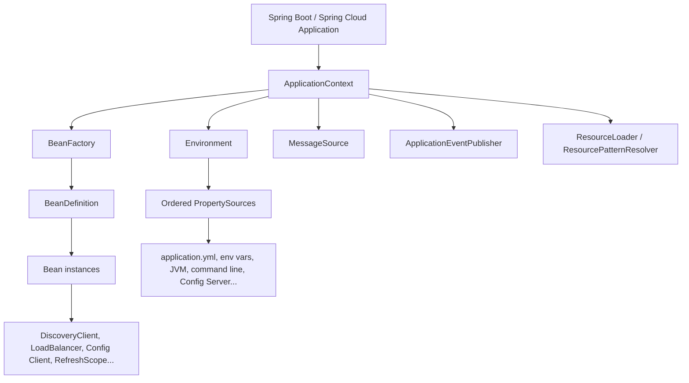
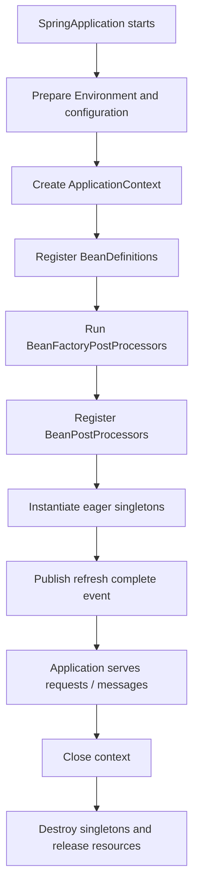
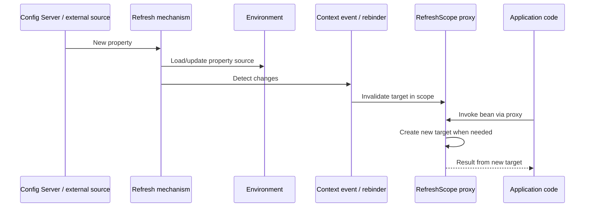

# Roles of ApplicationContext, BeanFactory, and Environment

In a Spring Cloud application, components such as the discovery client, service registry, HTTP clients, externalized configuration, and refresh scope all need to be created, wired, and managed throughout the application lifecycle. Three concepts—**`BeanFactory`**, **`ApplicationContext`**, and **`Environment`**—form the foundation for that work:

- `BeanFactory` is the core that manages and supplies beans.
- `ApplicationContext` is the application-level container, extending `BeanFactory` with events, resources, messages, and lifecycle integration.
- `Environment` provides the ability to read configuration properties and profiles from different sources.

For **SPRING_CLOUD_CORE**, understanding these three roles accurately helps explain why a starter can auto-register beans, why profiles determine which configuration is loaded, and why changing a property does not mean every running bean automatically receives the new value. This lesson belongs to the **Platform Architecture** chapter, focusing on the boundaries between the container, configuration, and Spring Cloud extension mechanisms.

## 1. Learning Objectives

After this lesson, you will be able to:

1. Explain the inheritance relationship and responsibilities of `BeanFactory`, `ApplicationContext`, and `Environment`.
2. Describe how Spring creates beans, injects dependencies, and orchestrates object lifecycles.
3. Distinguish between bean definitions, bean instances, scopes, and `FactoryBean`.
4. Explain how `Environment` aggregates property sources, profiles, and type conversion.
5. Distinguish configuration loading, configuration reading, configuration binding, and bean refresh.
6. Describe how Spring Boot and Spring Cloud extend the container to integrate externalized configuration and `@RefreshScope`.
7. Design tests for beans, profiles, and configuration without depending on a real registry.

## 2. Architectural Big Picture

Spring is not merely a collection of annotations. When an application starts, the framework builds a container, reads configuration, registers bean descriptions, creates objects according to the dependency graph, and manages their lifecycles.



This diagram is a conceptual model: `ApplicationContext` provides many capabilities to the application, while `BeanFactory` is the bean-container part that it extends. `Environment` is a configuration object exposed by the context; it is not a bean store replacing `BeanFactory`.

### 2.1. Quick Comparison of the Three Components

| Component | Key question | Responsibilities |
| --- | --- | --- |
| `BeanFactory` | How are application objects created and retrieved? | Stores bean definitions, creates and manages beans, resolves dependencies, supplies beans by name/type |
| `ApplicationContext` | How is the whole application integrated and managed? | Extends the bean factory, manages events, messages, resources, lifecycle, and framework integrations |
| `Environment` | Which configuration and profiles are currently active? | Reads properties across ordered property sources, checks active profiles, converts value types |

A helpful way to remember:

- `BeanFactory` manages **objects**.
- `Environment` manages **configuration data and profiles**.
- `ApplicationContext` ties those capabilities together into **the application's runtime environment**.

## 3. BeanFactory: The Core of the Container

`org.springframework.beans.factory.BeanFactory` is the core interface for accessing the bean container. It provides operations such as retrieving beans by name or type, checking whether a bean exists, and obtaining providers for on-demand dependency resolution.

```java
Object bean = beanFactory.getBean("inventoryClient");
InventoryClient client = beanFactory.getBean(InventoryClient.class);
```

Typical Spring applications do not manually call `getBean()` for every usage. The common approach is declaring dependencies via constructors and letting the container inject the objects:

```java
@Service
public class StockService {
    private final InventoryClient inventoryClient;

    public StockService(InventoryClient inventoryClient) {
        this.inventoryClient = inventoryClient;
    }
}
```

Constructor injection makes dependencies explicit in the class signature, supports immutable objects, and makes unit testing simpler.

### 3.1. Bean Definition and Bean Instance

The container distinguishes two things:

- **Bean definition:** the recipe describing how to create a bean—class, constructor/factory method, scope, dependencies, instantiation conditions, and related metadata.
- **Bean instance:** the actual object created from that definition.

Bean definitions can come from component scanning (`@Component`, `@Service`, `@Repository`, `@Controller`), `@Bean` methods, XML, or programmatic registration. Spring Boot and Spring Cloud contribute many bean definitions via auto-configuration.

Example:

```java
@Configuration
public class InventoryConfiguration {

    @Bean
    InventoryClient inventoryClient(WebClient.Builder builder) {
        return new InventoryClient(builder);
    }
}
```

Here, the `@Bean` method describes how to create a bean whose default name is `inventoryClient`. The container resolves the `WebClient.Builder` parameter from matching beans in the context and invokes the factory method. If multiple beans share the same type, `@Qualifier` or `@Primary` may be needed.

### 3.2. Scope Determines Instance Lifecycle

Scope is not the number of bean definitions; it specifies how the container manages instances created from a definition.

| Scope | General behavior | Common use cases |
| --- | --- | --- |
| `singleton` | One instance per bean definition within a container | Stateless services, repositories, shared clients |
| `prototype` | Creates a new instance each time the bean is requested from the container | Short-lived objects created on demand |
| `request` | One instance per HTTP request | Data belonging solely to a single web request |
| `session` | One instance per HTTP session | State tied to a user session |
| `application` | One instance per `ServletContext` | Data tied to the web application |

Web scopes require a web-aware application context. `singleton` is the default scope, but **singleton does not mean thread-safe**. If a singleton bean holds mutable state shared across multiple requests or threads, the application must protect that data itself.

An important detail: the container does not automatically invoke `destroy` callbacks for prototype instances when the application stops using them; post-retrieval cleanup of prototypes is the caller's responsibility. For singletons, the container can coordinate destruction callbacks when the context closes.

### 3.3. FactoryBean Differs from BeanFactory

The two names look similar, yet their roles are distinct:

- `BeanFactory` is the container interface.
- `FactoryBean<T>` is a special bean with a `getObject()` method to create or supply another object to the container.

Conceptually, a `FactoryBean<SomeClient>` can construct a client from complex configuration. When retrieving the bean by its regular name, the application receives the object produced by the factory; prefixing the bean name with `&` requests the factory object itself.

In framework integrations, factory beans can be used to create proxies, clients, or resources requiring specialized initialization. Do not confuse `FactoryBean` with `BeanFactory` just because both contain the word "Factory".

### 3.4. BeanFactoryPostProcessor and BeanPostProcessor

Spring provides two key extension points:

- `BeanFactoryPostProcessor` operates on **metadata/bean definitions** before regular beans are instantiated.
- `BeanPostProcessor` operates on **bean instances** before and/or after initialization; many proxy and annotation mechanisms are implemented through this extension point.

For example, processing `@Configuration`, registering beans from component scans, and creating proxies for certain annotations require the appropriate processors. `ApplicationContext` automatically detects and registers such processors when properly declared in the context. If using a plain `BeanFactory`, the developer must configure the needed processors manually; do not expect all application context integrations to appear automatically.

## 4. ApplicationContext: The Application-Level Container

`org.springframework.context.ApplicationContext` extends the `ListableBeanFactory` and `HierarchicalBeanFactory` contracts while also providing:

- `MessageSource`: message lookup and internationalization support.
- `ApplicationEventPublisher`: event publishing within the context scope.
- `ResourcePatternResolver`: reading resources by path or pattern.
- `EnvironmentCapable`: access to `Environment`.

`ConfigurableApplicationContext` adds lifecycle configuration operations such as `refresh()`, `close()`, setting a parent, adding bean factory post-processors, and accessing `ConfigurableEnvironment`.

In a Boot application, `SpringApplication` creates the appropriate context type for the application mode (non-web, servlet web, or reactive web), loads and prepares configuration, and then refreshes the context to complete the container.

### 4.1. Conceptual Lifecycle of the Context



This is a simplified flow. During `refresh`, Spring also prepares the message source, event multicaster, listeners, lifecycle processor, and other callbacks. Actual ordering matters because certain beans must be registered before eager singletons are created.

### 4.2. Why Does Spring Cloud Care About ApplicationContext?

Spring Cloud starters do not merely add a library for application code to call directly. They commonly contribute:

- Configuration beans and provider connection clients.
- `@Configuration` classes and conditional auto-configurations.
- `BeanFactoryPostProcessor` or `BeanPostProcessor` implementations when needed.
- Listeners reacting to configuration change or lifecycle events.
- Proxies, scopes, and per-service configured clients.

For example, when adding a compatible discovery starter, auto-configuration can register an appropriate `DiscoveryClient` if dependencies, properties, and environment conditions are met. When adding Spring Cloud LoadBalancer, the context can create the components needed so an HTTP client marked with `@LoadBalanced` can resolve service IDs.

Therefore, when a Spring Cloud bean does not appear, inspect **bean creation conditions in the ApplicationContext**, present dependencies, active profiles, and `Environment` configuration—rather than merely searching for class names in source code.

### 4.3. Parent and Child ApplicationContext

Spring supports hierarchical contexts. A child context can look up beans in its parent context when resolving dependencies; a parent context does not look downward into beans that exist only in a child context. A bean with the same name in a child context can shadow the same-named bean in the parent according to hierarchy rules.

This model is useful when an application needs to group configuration by scope. Some Spring Cloud components use per-service-name child contexts to isolate each client's configuration. For example, load-balancer settings for `inventory-service` can differ from `payment-service` without placing all specialized beans into the main context.

Do not create child contexts manually for every module. Use them only when a genuine configuration/lifecycle boundary is required, because multiple contexts increase complexity in initialization, bean inspection, and event handling.

## 5. Environment: Configuration and Profiles

`org.springframework.core.env.Environment` is the interface for querying properties and checking profiles. `ConfigurableEnvironment` adds capabilities to change the active profile set and manage `PropertySource`s.

```java
String serviceName = environment.getProperty("spring.application.name");
String region = environment.getProperty("service.region", "local");
Duration timeout = environment.getProperty(
        "service.timeout", Duration.class, Duration.ofSeconds(2));
```

`Environment` does not create `InventoryClient`, does not register services, and does not refresh beans on its own. It answers the question: **what configuration value is resolved at the time of query?**

### 5.1. PropertySource and Precedence Order

A `PropertySource` is a source supplying name–value pairs. An application can aggregate configuration from multiple sources:

| Common source | Example | Purpose |
| --- | --- | --- |
| Configuration files | `application.yml`, `application.properties` | Default and per-environment configuration |
| Environment variables | `SERVICE_REGION=ap-southeast-1` | Deployment/container configuration |
| JVM system properties | `-Dservice.region=local` | JVM runtime customization |
| Command-line arguments | `--service.region=local` | Startup overrides |
| JSON or custom sources | `SPRING_APPLICATION_JSON`, app-provided `PropertySource` | Passing structured config or integrating external systems |
| External configuration | Spring Cloud Config, Consul Config, or platform sources | Centralized per-environment management |

Property sources have a **precedence order**. When multiple sources declare the same key, the value from the higher-precedence source wins according to the established order. The exact order is governed by Spring Framework, Spring Boot, and configuration integrations; do not guess it solely from the file layout you see in the repository.

You can inspect which sources are present in the environment:

```java
ConfigurableEnvironment configurableEnvironment =
        (ConfigurableEnvironment) applicationContext.getEnvironment();

for (PropertySource<?> source : configurableEnvironment.getPropertySources()) {
    System.out.println(source.getName());
}
```

This snippet prints only source names for diagnostics. Avoid printing all values because property sources can contain passwords, tokens, private keys, or sensitive data.

### 5.2. Profiles Select Configuration by Environment

A profile represents a group of configuration/beans activated only when the corresponding profile is active. Example:

```yaml
# application.yml
spring:
  application:
    name: checkout-service
  profiles:
    default: local
```

```yaml
# application-local.yml
service:
  region: local
  timeout: 2s
```

```yaml
# application-prod.yml
service:
  region: ap-southeast-1
  timeout: 800ms
```

When running with the `prod` profile, configuration for `prod` is included according to Boot's Config Data rules. Profiles can be selected via properties, environment variables, or command-line arguments matching the launch method.

Beans can also carry profile conditions:

```java
@Configuration
public class InventoryClientConfiguration {

    @Bean
    @Profile("local")
    InventoryEndpoint localInventoryEndpoint() {
        return new InventoryEndpoint(URI.create("http://localhost:8082"));
    }

    @Bean
    @Profile("prod")
    InventoryEndpoint productionInventoryEndpoint(
            Environment environment) {
        URI endpoint = environment.getRequiredProperty(
                "inventory.base-url", URI.class);
        return new InventoryEndpoint(endpoint);
    }
}
```

In real systems, production configuration should be supplied by deployment sources or an appropriate secret/config management solution. Never put credentials or sensitive internal endpoints into publicly committed config files.

### 5.3. `@Value` and `@ConfigurationProperties`

Two common ways to bring properties into beans:

**`@Value`** fits a few individual values:

```java
@Component
public class InventoryTimeout {
    private final Duration timeout;

    public InventoryTimeout(
            @Value("${inventory.timeout:2s}") Duration timeout) {
        this.timeout = timeout;
    }
}
```

**`@ConfigurationProperties`** fits a structured group of settings that need validation:

```java
@ConfigurationProperties(prefix = "inventory")
@Validated
public record InventoryProperties(
        @NotNull URI baseUrl,
        @NotNull Duration timeout,
        @Min(1) int maxAttempts) {
}
```

Enable binding via scanning:

```java
@SpringBootApplication
@ConfigurationPropertiesScan
public class CheckoutApplication {
    public static void main(String[] args) {
        SpringApplication.run(CheckoutApplication.class, args);
    }
}
```

With configuration:

```yaml
inventory:
  base-url: https://inventory.internal
  timeout: 2s
  max-attempts: 3
```

The application gets an `InventoryProperties` bean bound under the `inventory` prefix. This groups related configuration, supports relaxed binding, type conversion, and validation. Depending on application structure, `@EnableConfigurationProperties(InventoryProperties.class)` can be used instead of scanning.

**Distinction:** `Environment` resolves values; `@Value` injects a single value into a bean; `@ConfigurationProperties` binds a group of values into a structured object. They are related, not the same layer of functionality.

## 6. How Does Spring Boot Prepare the Environment?

Spring Boot adds a configuration-loading phase before `ApplicationContext` completes refresh. In modern Boot versions, the **Config Data** mechanism processes configuration files and imports external configuration sources.

Example using Spring Cloud Config Client:

```yaml
spring:
  application:
    name: checkout-service
  config:
    import: optional:configserver:http://localhost:8888
```

The application needs a compatible Config Client dependency and an available Config Server matching the configuration. `spring.config.import` declares external configuration sources to load during the Config Data flow. The `optional:` prefix adjusts behavior when that source is unavailable at import time; it does not mean subsequent changes are automatically polled continuously.

In older architectures, Spring Cloud used a **bootstrap context** to load certain remote properties before the application context. In modern Spring Cloud releases, Config Data is the standard configuration approach; bootstrap may still appear in applications using legacy compatibility or extra configuration. When maintaining a system, determine clearly which mechanism the application uses to avoid duplicate configuration or relying on precedence from the legacy model.

### 6.1. Why Does Configuration Loading Order Matter?

Certain decisions must be made very early, before business beans are created:

- Application name and active profiles.
- External configuration sources to import.
- Logging configuration and appropriate bootstrap settings.
- Properties controlling auto-configuration or bean registration conditions.

If a property is only loaded after related beans have initialized, those beans may not be created as expected. Thus, not every configuration source can be added arbitrarily at any point in time.

For instance, `@PropertySource` is processed during context refresh, making it unsuitable for every property required before the context begins. With Boot configuration, prefer Config Data and supported import mechanisms for the corresponding use case.

## 7. Spring Cloud Context: From Environment to Refresh Scope

Spring Cloud Context extends Spring's context foundation to support distributed application scenarios, especially runtime configuration changes.

Three concepts to distinguish:

1. **Configuration loading:** property sources are placed into `Environment`.
2. **Change awareness:** the application receives an event or executes a refresh operation to learn about new configuration.
3. **Applying to beans:** beans are rebound, recreated via scope, or updated via a dedicated mechanism.

Completing one step does not automatically guarantee the other two. The Config Server source may have changed while an instance has not reloaded; `Environment` may hold the new value while an already instantiated singleton retains old state.

### 7.1. How Does `@RefreshScope` Work?

Spring Cloud Context's `@RefreshScope` creates a scoped proxy for the bean. When the bean is accessed, the proxy retrieves the target from the refresh scope. When a supported refresh mechanism invalidates the scope, the old target is evicted from the cache and a new target is created on the next access.

Example:

```java
@Component
@RefreshScope
public class CheckoutPolicy {
    private final int maximumItems;

    public CheckoutPolicy(
            @Value("${checkout.maximum-items:20}") int maximumItems) {
        this.maximumItems = maximumItems;
    }

    public int maximumItems() {
        return maximumItems;
    }
}
```

When `checkout.maximum-items` changes and the application performs a proper refresh, the next target of `CheckoutPolicy` can be created with the new value.

`@RefreshScope` **does not reach out to Config Server by itself**, does not watch files for changes, and does not turn every singleton into a dynamic bean. You still need a configuration source, a reload/refresh mechanism, and beans within supported boundaries.

### 7.2. EnvironmentChangeEvent and Structured Configuration

Spring Cloud Context includes components that detect `Environment` changes and support updating certain configuration beans, such as those managed with `@ConfigurationProperties`. A configuration change event can trigger updates to eligible values, but it does not mean every existing object is reconstructed.

Categorize beans by behavior:

| Bean category | Handling when configuration changes |
| --- | --- |
| Beans reading config only at initialization | Need rebind, refresh scope, or controlled recreation |
| Updatable `@ConfigurationProperties` beans | Can be rebound according to the active Spring Cloud Context mechanism |
| `@RefreshScope` beans | Target is invalidated and recreated on the next access |
| Connection pools, sockets, thread pools, or stateful resources | Require safe replacement/shutdown procedures; a simple property refresh may be insufficient |
| Beans holding mutable business state | Require dedicated synchronization and lifecycle design; do not default to refresh scope as a solution |

### 7.3. Refresh Endpoint and Operational Safeguards

In some applications, refresh is triggered via an Actuator endpoint or via events delivered by an orchestration system. The endpoint works only when the corresponding module, mechanism, and exposure settings allow it.

If a management endpoint is exposed, enforce authentication, authorization, and network exposure controls. A refresh can affect many beans at once; a misdirected or overly frequent refresh can cause disruption, mass connection recreation, or temporary configuration drift across instances.

For multiple replicas, establish a propagation strategy—such as Spring Cloud Bus or platform orchestration. One refresh call on a single instance does not mean the entire cluster is updated.

### 7.4. Relationship Between Environment, Context, and RefreshScope



This is a conceptual flow; exact ordering and components depend on Config Client, Spring Cloud Context, endpoints, or event mechanisms in use. The key takeaway is that **updating the Environment and recreating a bean target are two related but distinct operations**.

## 8. Applying to Discovery and Service Communication

Spring Cloud's common abstractions rely on the container to register beans and fetch appropriate configuration:

| Component | Role of ApplicationContext/BeanFactory | Role of Environment |
| --- | --- | --- |
| `DiscoveryClient` | Registers the appropriate client via auto-configuration | Configures registry address, service name, namespace, or provider properties |
| `ServiceRegistry` | Provides integration beans for registration when supported by provider | Configures instance, health checks, metadata, and registration |
| Spring Cloud LoadBalancer | Creates suppliers, load-balancers, and client configuration | Configures strategies, caches, and per-service properties |
| Spring Cloud Config Client | Registers components to fetch remote configuration | Loads external property sources into Environment |
| `@RefreshScope` | Creates scoped proxies and manages targets in refresh scope | Supplies new values when targets are recreated |

For example, a service uses a `WebClient.Builder` annotated with `@LoadBalanced`. Auto-configuration and bean configuration produce a client capable of resolving service IDs. The discovery client fetches the instance list from the active source; `Environment` supplies provider and service configuration. Switching from one discovery adapter to another can leave business code intact if it depends only on shared contracts and the configuration is updated.

### 8.1. Application Configuration Example

```yaml
spring:
  application:
    name: checkout-service
  cloud:
    consul:
      host: localhost
      port: 8500

inventory:
  timeout: 2s
  max-attempts: 3
```

Here, `spring.application.name` and `spring.cloud.consul.*` are properties consumed by Spring Boot/Spring Cloud components while configuring beans. The `inventory.*` group is application configuration, which can be bound to `InventoryProperties`.

If migrating to Eureka or Kubernetes Discovery, provider-specific property groups may change; the `DiscoveryClient` contract and business code do not necessarily have to change. This illustrates the separate roles of container and `Environment`: the container creates the right implementation, while `Environment` supplies configuration inputs to that implementation.

## 9. Testing the Container and Environment

Testing should separate the question "are the beans created properly?" from "are configuration values resolved properly?" and "does the real provider work?".

### 9.1. Testing Environment in Isolation

With Spring Framework, `MockEnvironment` and `MockPropertySource` can test property-dependent logic without starting a server:

```java
MockEnvironment environment = new MockEnvironment()
        .withProperty("inventory.timeout", "3s")
        .withProperty("inventory.max-attempts", "2");

Duration timeout = environment.getProperty(
        "inventory.timeout", Duration.class);

assertThat(timeout).isEqualTo(Duration.ofSeconds(3));
```

This testing style fits configuration-reading logic. With Spring Boot, `ApplicationContextRunner` can spin up a lightweight context, load properties, and verify auto-configuration conditions or whether beans are created.

### 9.2. Testing Beans in ApplicationContext

Example verifying `InventoryProperties` binding:

```java
@SpringBootTest(properties = {
        "inventory.base-url=http://localhost:8082",
        "inventory.timeout=1500ms",
        "inventory.max-attempts=2"
})
class InventoryPropertiesTest {

    @Autowired
    InventoryProperties properties;

    @Test
    void bindsInventoryProperties() {
        assertThat(properties.baseUrl())
                .isEqualTo(URI.create("http://localhost:8082"));
        assertThat(properties.timeout())
                .isEqualTo(Duration.ofMillis(1500));
        assertThat(properties.maxAttempts()).isEqualTo(2);
    }
}
```

This snippet assumes the configuration class is scanned or enabled. `@SpringBootTest(properties = ...)` adds properties to the test context, letting you verify binding without modifying real environment config files.

### 9.3. Testing Profiles

`@ActiveProfiles("test")` selects a profile for the test context. You can test profile-specific beans by asserting that expected implementations are present and mismatched implementations are not registered. For applications requiring multiple profile combinations, write dedicated tests for each critical combination rather than testing only the default profile.

### 9.4. Testing Refresh

For `@RefreshScope` beans, test in two stages:

1. Create the context with initial properties and call the bean to confirm the initial value.
2. Update the property source via a supported refresh mechanism, trigger refresh, and call the bean through its proxy again to verify the new target receives the new value.

Tests should also verify what is **not** unexpectedly refreshed, especially open resources and business state. Do not assert solely that an event was published and conclude all beans updated successfully.

### 9.5. Testing with a Real Provider

`MockEnvironment` or `ApplicationContextRunner` does not prove Consul/Eureka/Kubernetes works properly. Separate integration tests are required to verify:

- Registry connectivity and access permissions.
- Auto-registration, discovery, and deregistration.
- Metadata and health states.
- Timeouts, caching, and load-balancing configuration.
- External config loading and refresh across multiple instances.

## 10. Common Design Pitfalls

| Practice | Problem | Better approach |
| --- | --- | --- |
| Calling `context.getBean()` everywhere | Hides dependencies, complicates unit tests, increases container coupling | Use constructor injection |
| Injecting `Environment` into business logic for every lookup | Mixes config access with business rules, hard to test | Bind config into `@ConfigurationProperties` or dedicated objects |
| Treating `BeanFactory` and `ApplicationContext` as identical | Overlooks events, resources, messages, and automatic context processors | Understand ApplicationContext extends BeanFactory |
| Assuming singletons are always thread-safe | Multiple requests concurrently access one mutable instance | Design stateless beans or synchronize state properly |
| Changing a property source and expecting singletons to auto-update | Values read at initialization may already be stored in fields | Choose rebinding, refresh scope, or explicit update mechanisms |
| Putting `@RefreshScope` on every bean | Unnecessarily recreates resources, risking disruption | Refresh only beans with compatible lifecycles |
| Printing the entire Environment to logs | Can leak secrets and tokens | Log only source names or non-sensitive keys |
| Creating too many parent/child contexts | Hard to track beans, events, and lifecycles | Use hierarchy only when clear configuration boundaries are needed |
| Using profiles as a security mechanism | Profiles only select config/beans, not access rights | Use proper secret management and security policies |

## 11. Real-World Scenario: Config Changed, Yet Service Uses Old Value

A `checkout-service` reads `inventory.timeout=2s` from Config Server. Later, operations updates the value to `800ms`, yet requests still time out with the old value.

Analyze layer by layer:

1. **Source:** Has Config Server stored `800ms`?
2. **Loading:** Has the application imported that source and does it have a mechanism to pull new properties?
3. **Environment:** Does `Environment#getProperty("inventory.timeout")` on the instance return `800ms`?
4. **Binding:** Was `InventoryProperties` rebound according to the application's mechanism?
5. **Bean:** Was the HTTP client or timeout object built from the old value safely updated or recreated?
6. **Scope:** Did the refresh operation reach all replicas, or only one instance?

If step 3 returns `800ms` while the client still times out after `2s`, the issue lies in binding/bean/resource handling rather than the property source. If step 3 still returns `2s`, inspect Config Data, property source precedence, and the refresh mechanism. This layered approach pinpoints where to fix instead of blindly restarting the entire system.

## 12. Design Principles

- Let the container manage bean lifecycles; favor constructor injection and explicit dependencies.
- Use `ApplicationContext` when application-level capabilities such as events, resources, messages, profiles, and framework integrations are needed.
- Treat `Environment` as a precedence-ordered configuration lookup interface; do not treat it as an automatic updater for every object.
- Group structured properties into `@ConfigurationProperties` and place validation at configuration boundaries.
- Clearly distinguish configuration loading, `Environment` changes, rebinding, and bean target refresh.
- Use `@RefreshScope` selectively, exercising extra caution with connections, pools, and stateful resources.
- Test the container, configuration, and providers at distinct levels; a unit test does not replace an integration test.
- Keep secrets out of logs and repositories; profiles are not security boundaries.

## 13. Summary

`BeanFactory`, `ApplicationContext`, and `Environment` are three foundational parts with distinct responsibilities. `BeanFactory` manages bean definitions and instances; `ApplicationContext` adds the capabilities required for a Spring application to operate and integrate; `Environment` resolves properties and profiles across configuration sources.

In Spring Cloud, auto-configuration uses the container to register discovery clients, load-balancers, config clients, and supporting components. Spring Cloud Context extends that model to react to configuration changes and manage refresh scopes. Ensuring a configuration change genuinely affects live requests requires tracing the full path from property source to `Environment`, binding, and bean lifecycle.

When troubleshooting, ask in order: **which bean was created, which configuration created it, which source provided the property, and what mechanism causes the bean to receive new values?** Answering those four questions accurately narrows down many configuration and integration issues in distributed systems.

## 14. References

- [Spring Framework — The IoC Container](https://docs.spring.io/spring-framework/reference/core/beans.html)
- [Spring Framework — The BeanFactory API](https://docs.spring.io/spring-framework/reference/core/beans/beanfactory.html)
- [Spring Framework — ApplicationContext](https://docs.spring.io/spring-framework/reference/core/beans/basics.html)
- [Spring Framework — Environment Abstraction](https://docs.spring.io/spring-framework/reference/core/beans/environment.html)
- [Spring Boot — Externalized Configuration](https://docs.spring.io/spring-boot/reference/features/external-config.html)
- [Spring Boot — Profiles](https://docs.spring.io/spring-boot/reference/features/profiles.html)
- [Spring Boot — Configuration Metadata and Properties](https://docs.spring.io/spring-boot/reference/features/external-config.html)
- [Spring Cloud Context — Application Context Services](https://docs.spring.io/spring-cloud-commons/reference/spring-cloud-commons/application-context-services.html)
- [Spring Cloud Config — Client Side Usage](https://docs.spring.io/spring-cloud-config/reference/client.html)
