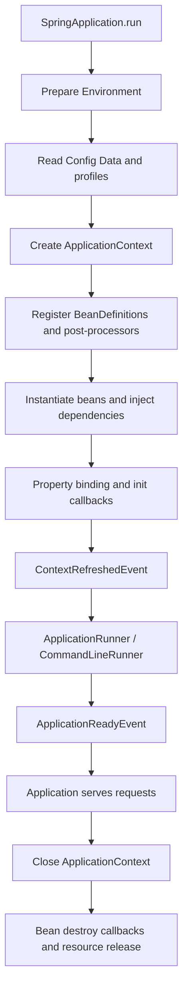

# Bean Instantiation, Property Binding, and Lifecycle Handling

A Spring Cloud application is not just a collection of beans created when the JVM starts. Spring Boot prepares the configuration environment, builds the `ApplicationContext`, registers bean definitions, injects dependencies, initializes components, and publishes lifecycle events. Spring Cloud Context adds mechanisms to refresh part of the configuration state and beans in certain scenarios. To operate Spring Cloud Commons and Context abstractions properly, you must understand **when a value is read, when a bean is created, and what actually happens when an application refreshes or shuts down**.

This lesson belongs to the **Platform Architecture** chapter of `SPRING_CLOUD_CORE`. It focuses on three relationships: **bean instantiation**, **configuration property binding**, and **ApplicationContext lifecycle**. This forms the foundation for understanding externalized configuration, `@ConfigurationProperties`, `@RefreshScope`, discovery, service registry, service-to-service communication, and testing in a distributed system.

## 1. Overall Model: From Configuration to Running Beans

A Spring Boot application typically progresses through the following general phases:

1. Receives startup arguments and prepares the `Environment`.
2. Reads applicable configuration sources, including external configuration and active profiles.
3. Creates and prepares the `ApplicationContext`.
4. Registers `BeanDefinition`s, configures the `BeanFactory`, and registers `BeanPostProcessor`s.
5. Creates beans, injects dependencies, binds properties, and runs initialization callbacks.
6. Completes context refresh, runs post-startup tasks, and transitions the application to a ready state.
7. On shutdown, invokes bean destruction callbacks and closes context-managed resources.



This diagram is a conceptual sequence for locating activities. Internal details may vary depending on the Spring Boot version, application context type, lazy initialization settings, and installed extensions. For example, a lazy bean might not yet be created when the context finishes refreshing; a web application also has its own server and request lifecycles.

The key takeaway is that **reading configuration and creating beans are related but distinct activities**. `Environment` can already hold a value before the bean consuming it is created. Property binding typically occurs during managed bean initialization, whereas refreshing a bean afterward is a separate mechanism.

## 2. ApplicationContext, BeanFactory, and Environment

### 2.1. ApplicationContext Manages the Bean Container

`ApplicationContext` is Spring's high-level IoC container. It extends the capabilities of `BeanFactory` while also providing resource management, event publishing, message source access, and integration with the application environment.

Each `ApplicationContext` manages bean definitions and objects within its own scope. A bean with the default `singleton` scope means **one instance per corresponding bean factory/context**, not a single instance across every JVM or every service replica.

Example:

```java
import org.springframework.stereotype.Component;

@Component
public class RequestCounter {
    private long value;

    public synchronized long next() {
        return ++value;
    }
}
```

If the application runs two replicas, each JVM has its own `ApplicationContext` and each context has its own `RequestCounter`. Here, `synchronized` only coordinates threads accessing the same object inside one JVM; it does not synchronize the counter across two replicas. Data that must be shared needs to be stored or coordinated via an external mechanism appropriate to business requirements.

### 2.2. BeanDefinition Describes How to Create a Bean

Spring usually does not instantiate all objects immediately during component scanning. Configuration scanning and annotation processing first register **bean definitions** (`BeanDefinition`) describing the class, scope, dependencies, factory method, and related metadata. When it is time to create a bean, `BeanFactory` uses that definition to instantiate the object and apply processors.

Common ways to register beans:

```java
import org.springframework.context.annotation.Bean;
import org.springframework.context.annotation.Configuration;

@Configuration
public class ClientConfiguration {
    @Bean
    CatalogGateway catalogGateway(CatalogClientProperties properties) {
        return new CatalogGateway(properties.getBaseUrl());
    }
}
```

`@Component`, `@Service`, `@Repository`, `@Controller`, and `@Bean` can all produce bean definitions. With `@Bean`, Spring invokes the factory method to create the object; method parameters can be resolved from other beans in the context.

### 2.3. Environment and PropertySource

`Environment` provides access to configuration properties and active profiles. Values can come from many `PropertySource`s, such as:

- Application configuration files like `application.properties` or `application.yml`.
- External configuration files, config directories, and locations specified at startup.
- Operating system environment variables.
- Java system properties.
- Command-line arguments.
- Configuration JSON and property sources added by the application or integrations.
- Remote configuration sources when integrated with Spring Cloud Config or an equivalent solution.

Spring Boot defines a precedence order among sources. Profiles, config locations, config imports, and launch methods can change the final value. Therefore, do not guess the effective value simply by looking at a single YAML file; inspect the configuration sources and actual process arguments.

You can query a value resolved by `Environment`:

```java
import org.springframework.core.env.Environment;
import org.springframework.stereotype.Component;

@Component
public class StartupConfigurationReporter {
    public StartupConfigurationReporter(Environment environment) {
        String region = environment.getProperty("catalog.region", "local");
        // Use the value for appropriate diagnostic logging; avoid writing secrets to logs.
    }
}
```

This snippet illustrates reading a value; a constructor should not become a place that dumps the entire configuration, especially when passwords, tokens, or sensitive data are present.

## 3. Loading External Configuration and Profiles

Spring Boot supports externalized configuration so the same artifact can run in local, test, staging, and production environments with different values. Example:

```yaml
spring:
  application:
    name: catalog-service

catalog:
  client:
    base-url: https://catalog.internal
    connect-timeout-ms: 1500
```

Profiles allow adding or overriding configuration per environment:

```yaml
# application-prod.yml
catalog:
  client:
    connect-timeout-ms: 800
```

Profiles are activated through application config, environment variables, system properties, or startup arguments depending on the deployment method. Multiple profiles can be active simultaneously; combination rules should be understood according to your project's Spring Boot version and Config Data layout.

In Spring Cloud Config applications, remote configuration can be imported via Config Client integration. The declaration syntax and behavior when Config Server is unavailable depend on the Spring Cloud version and the application's fail-fast/optional configuration. Do not treat the mere presence of a Config Client dependency as proof that all remote values were loaded successfully; check startup logs, import declarations, and connection status.

Several operational principles:

1. Separate secrets from committed configuration files; use a secret store or secure environment provisioning.
2. Explicitly specify required profiles and config sources at startup to prevent production from accidentally running on local defaults.
3. Define clear behavior when external configuration sources are unavailable: fail startup, use cached/fallback values, or skip the import if business rules permit.
4. Track the active configuration version without exposing sensitive values.
5. Test both missing required properties and malformed property values.

## 4. Property Binding: From Configuration Keys to Java Objects

### 4.1. Why Use ConfigurationProperties?

When a configuration group has multiple related fields, `@ConfigurationProperties` groups them into a strongly typed object. The Spring Boot Binder maps keys from `Environment` to Java properties, supporting type conversion and relaxed binding.

YAML example:

```yaml
catalog:
  client:
    base-url: https://catalog.internal
    connect-timeout-ms: 1500
    enabled: true
```

Class receiving configuration:

```java
import jakarta.validation.constraints.Min;
import jakarta.validation.constraints.NotBlank;
import org.springframework.boot.context.properties.ConfigurationProperties;
import org.springframework.validation.annotation.Validated;

@Validated
@ConfigurationProperties(prefix = "catalog.client")
public class CatalogClientProperties {
    @NotBlank
    private String baseUrl;

    @Min(1)
    private int connectTimeoutMs = 1000;

    private boolean enabled = true;

    public String getBaseUrl() {
        return baseUrl;
    }

    public void setBaseUrl(String baseUrl) {
        this.baseUrl = baseUrl;
    }

    public int getConnectTimeoutMs() {
        return connectTimeoutMs;
    }

    public void setConnectTimeoutMs(int connectTimeoutMs) {
        this.connectTimeoutMs = connectTimeoutMs;
    }

    public boolean isEnabled() {
        return enabled;
    }

    public void setEnabled(boolean enabled) {
        this.enabled = enabled;
    }
}
```

Registering the configuration class via dedicated component scanning:

```java
import org.springframework.boot.SpringApplication;
import org.springframework.boot.autoconfigure.SpringBootApplication;
import org.springframework.boot.context.properties.ConfigurationPropertiesScan;

@SpringBootApplication
@ConfigurationPropertiesScan
public class CatalogApplication {
    public static void main(String[] args) {
        SpringApplication.run(CatalogApplication.class, args);
    }
}
```

`@ConfigurationPropertiesScan` discovers annotated classes within the scan scope. Another option is declaring `@EnableConfigurationProperties(CatalogClientProperties.class)` on a configuration class. Placing the annotation on the properties class without registering it through one of the appropriate mechanisms is not enough to ensure the object is created and bound.

The example above uses the `jakarta.validation` package as in modern Spring Boot applications. Projects on older Spring Boot lines may use a different validation namespace; pick dependencies and imports matching your actual version.

### 4.2. Relaxed Binding and Type Conversion

The Binder supports multiple equivalent spellings for the same property under relaxed binding rules. For example, the YAML key `connect-timeout-ms` can map to the Java field `connectTimeoutMs`. The Binder also supports common type conversions such as strings to numbers, booleans, enums, `Duration`, `DataSize`, collections, and types handled by registered converters.

Example using `Duration`:

```yaml
catalog:
  client:
    connect-timeout: 2s
    read-timeout: 750ms
```

```java
import java.time.Duration;
import org.springframework.boot.context.properties.ConfigurationProperties;

@ConfigurationProperties(prefix = "catalog.client")
public class CatalogTimeoutProperties {
    private Duration connectTimeout = Duration.ofSeconds(2);
    private Duration readTimeout = Duration.ofMillis(750);

    public Duration getConnectTimeout() {
        return connectTimeout;
    }

    public void setConnectTimeout(Duration connectTimeout) {
        this.connectTimeout = connectTimeout;
    }

    public Duration getReadTimeout() {
        return readTimeout;
    }

    public void setReadTimeout(Duration readTimeout) {
        this.readTimeout = readTimeout;
    }
}
```

Explicit units like `s` and `ms` make configuration easier to read. If a value omits units or needs a different default unit, specify the exact semantics of the type and converter in use.

### 4.3. Validation Catches Misconfiguration Early

Annotations like `@NotBlank`, `@Min`, `@Max`, `@NotNull`, and custom validators can check bound data. When using `@Validated`, the application needs a suitable Bean Validation implementation on the classpath. If required configuration is invalid, startup should fail with a diagnostic message rather than running the application in a half-valid state.

Example:

```java
@Validated
@ConfigurationProperties(prefix = "catalog.client")
public class CatalogClientProperties {
    @NotBlank
    private String baseUrl;

    @Min(100)
    @Max(10000)
    private int connectTimeoutMs = 1500;

    // Getters and setters omitted.
}
```

Validation should express genuine business/configuration constraints. Setting overly broad defaults or overly loose validation can cause configuration bugs to surface only when requests hit rare code paths.

### 4.4. Constructor Binding and Immutable Configuration

For settings that should not change after creation, immutable types prevent fields on the bean from being mutated at runtime. Spring Boot supports constructor binding for `@ConfigurationProperties` under version-specific rules; Java `record` types are also a natural choice in compatible Java/Spring Boot lines.

Example illustrating a record:

```java
import java.time.Duration;
import org.springframework.boot.context.properties.ConfigurationProperties;

@ConfigurationProperties(prefix = "catalog.client")
public record CatalogClientSettings(
        String baseUrl,
        Duration connectTimeout,
        boolean enabled) {
}
```

Record/constructor binding must be registered via properties scanning or enable-properties and must match the project's Spring Boot version. Do not add `@ConstructorBinding` mechanically: the annotation and constructor selection rules have changed across Boot versions.

## 5. How Do @Value and ConfigurationProperties Differ?

`@Value` is suitable when a bean needs a few isolated values:

```java
import org.springframework.beans.factory.annotation.Value;
import org.springframework.stereotype.Component;

@Component
public class CatalogEndpoint {
    private final String baseUrl;

    public CatalogEndpoint(
            @Value("${catalog.client.base-url}") String baseUrl) {
        this.baseUrl = baseUrl;
    }
}
```

Comparison:

| Criterion | `@Value` | `@ConfigurationProperties` |
| --- | --- | --- |
| Purpose | Injects a single value or expression into a bean | Groups and binds a structured set of properties |
| Nested structures/collections | Possible, but expressions get complex easily | Conveniently supports binding objects, collections, and maps |
| Relaxed binding | Supports placeholders, but lacks Binder-style bulk binding experience | Supports relaxed binding per Boot rules |
| Group validation | Usually requires manual checks or custom integration | Supports Bean Validation directly on the properties class |
| SpEL | Supports `#{...}` expressions | Does not use SpEL as the primary binding mechanism |
| Type control | Placeholders are converted via conversion service | Binder converts using metadata and conversion service |

You do not need to convert every simple value into a large properties class. Choose based on configuration structure and maintainability. For a group of configuration settings with multiple related fields, `@ConfigurationProperties` usually makes the configuration contract clearer.

## 6. Lifecycle of a Spring Bean

### 6.1. Typical Initialization Steps

For a typical singleton bean, the general sequence includes:

1. Spring instantiates the object via a constructor or factory method.
2. Spring populates managed dependencies and properties.
3. Applicable `Aware` callbacks are invoked if the bean implements corresponding interfaces.
4. `BeanPostProcessor`s can process the bean before initialization.
5. Initialization callbacks are invoked.
6. `BeanPostProcessor`s run after initialization; some processors may return a proxy instead of the original object.
7. The bean is ready for use by other components.

Example of a bean with callbacks:

```java
import jakarta.annotation.PostConstruct;
import jakarta.annotation.PreDestroy;
import org.springframework.stereotype.Component;

@Component
public class CatalogConnectionManager {
    @PostConstruct
    public void initialize() {
        // Check local state or prepare lightweight resources.
    }

    @PreDestroy
    public void close() {
        // Release resources owned by the bean.
    }
}
```

When a bean has multiple callback styles, the typical order is `@PostConstruct`, `InitializingBean.afterPropertiesSet()`, and then a custom init method; on destruction, `@PreDestroy`, `DisposableBean.destroy()`, and then a custom destroy method. Pick one consistent mechanism for clarity. In modern Spring versions, callback annotations live in the Jakarta package; older projects may use the previous namespace.

### 6.2. BeanPostProcessor and Proxies

`BeanPostProcessor` allows intercepting beans before and after initialization. Features such as AOP, transactions, method validation, and certain post-processed annotations can create proxies to add behavior.

This explains several common mistakes:

- Calling a transactional method from `@PostConstruct` may execute before AOP proxies are fully applied to the bean.
- Self-invocation (one method inside a bean directly calling another method on the same object) generally bypasses the proxy in proxy-based AOP.
- Storing a reference to the raw target object too early can cause code to bypass proxy-provided behavior.

Avoid using initialization callbacks to make deep calls to remote services, run business migrations, or execute tasks with long retries. Prefer separating lightweight setup from post-startup tasks, and design explicit timeouts/failure handling for I/O operations.

### 6.3. Constructor Injection and Dependency Ordering

Constructor injection explicitly states required dependencies and allows objects to be immutable after construction:

```java
import org.springframework.stereotype.Service;

@Service
public class CatalogService {
    private final CatalogRepository repository;
    private final CatalogClientProperties properties;

    public CatalogService(
            CatalogRepository repository,
            CatalogClientProperties properties) {
        this.repository = repository;
        this.properties = properties;
    }
}
```

Spring resolves dependencies along the bean graph. If A requires B in its constructor and B also requires A in its constructor, the application hits a circular dependency that cannot be instantiated normally. Rather than using `@Lazy` or setters to mask every cycle, review responsibilities and extract shared components.

When one bean depends on another, declaring the dependency via constructor is usually enough for Spring to know the creation order. `@DependsOn` should only be used when there is an indirect initialization dependency that cannot be expressed via dependency injection; it does not replace dependency contracts and does not guarantee completion order for asynchronous tasks.

## 7. Scope and Resource Lifecycle

### 7.1. Singleton and Prototype

`singleton` is the default scope. One bean is created and managed per context; Spring normally eagerly instantiates non-lazy singletons during refresh.

`prototype` creates a new instance every time the container is asked to resolve that bean. Spring manages creation and dependency injection, but **does not fully manage destruction lifecycle** of prototype instances after handing them to the caller. If a prototype owns closeable resources, the caller is responsible for releasing them.

| Scope | Boundary | Implications to note |
| --- | --- | --- |
| `singleton` | One instance per bean factory/context | Suits stateless services; mutable state requires concurrency care |
| `prototype` | New instance on each resolution | Caller owns lifecycle after retrieval |
| `request` | One HTTP request in a compatible web context | Do not use arbitrarily outside request scope; requires proxy when injected into longer-lived beans |
| `session` | One HTTP session | Not shared across multiple instances by default; requires session store if shared |
| `application` | One ServletContext | Web application scope, still not cluster-wide |

Web scopes are only meaningful when the context type and environment support them. Do not use request/session-scoped beans to store business data that needs durability.

### 7.2. Resources That Need Closing

Beans managing connection pools, executors, clients, or file handles must have a clear shutdown mechanism. You can use `@PreDestroy`, `DisposableBean`, a custom destroy method, or dedicated lifecycle mechanisms. Avoid closing resources owned by other beans or closing twice without idempotent design.

For background components requiring ordered start/stop, Spring provides `Lifecycle` and `SmartLifecycle`. `SmartLifecycle` lets you control auto-startup, phase, and stop callbacks—well suited when a component must stop accepting work before closing executors or connections. This is a single-context lifecycle mechanism, not cluster-wide graceful shutdown orchestration.

### 7.3. Shutdown in Distributed Systems

When a container stops, the process may receive a shutdown signal and Spring Boot closes the context. A proper shutdown should:

1. Stop accepting new work according to server/deployment orchestration mechanisms.
2. Give in-flight requests or tasks a bounded window to complete.
3. Stop consumers/schedulers to avoid picking up new work while dependencies are closing.
4. Close executors, connection pools, and clients in the appropriate order.
5. Log shutdown status and let the orchestration platform know the process has exited.

The application's graceful shutdown timeout must align with the deployment platform's termination grace period. `@PreDestroy` callbacks cannot guarantee work completes if the process is forcefully killed or the grace period expires. Business tasks requiring crash recovery should rely on durable state and retry/claim mechanisms rather than shutdown callbacks.

## 8. Spring Cloud Context and the Limits of Refresh

### 8.1. Changing Environment Does Not Automatically Change Every Bean

Suppose a service binds configuration at startup:

```yaml
catalog:
  client:
    base-url: https://catalog-v1.internal
```

A bean receives the value in its constructor:

```java
@Service
public class CatalogEndpoint {
    private final String baseUrl;

    public CatalogEndpoint(CatalogClientProperties properties) {
        this.baseUrl = properties.getBaseUrl();
    }
}
```

If the configuration source changes later, the existing `CatalogEndpoint` object still holds the assigned `baseUrl`. The fact that `Environment` can read a new value does not mean every field on every bean has been reassigned. **A configuration value copied into an object becomes that object's state**, with its own lifecycle.

### 8.2. RefreshScope Refreshes Bean Targets by Scope

Spring Cloud Context provides `@RefreshScope` for beans that should be recreated after a valid refresh. This mechanism uses a scoped proxy and caches bean targets; when the refresh scope is refreshed, the current target is evicted from the cache and the next access can create a new target with current dependencies/configuration.

```java
import org.springframework.beans.factory.annotation.Value;
import org.springframework.cloud.context.config.annotation.RefreshScope;
import org.springframework.stereotype.Component;

@Component
@RefreshScope
public class RemoteCatalogSettings {
    private final String baseUrl;

    public RemoteCatalogSettings(
            @Value("${catalog.client.base-url}") String baseUrl) {
        this.baseUrl = baseUrl;
    }

    public String baseUrl() {
        return baseUrl;
    }
}
```

This example illustrates a bean depending on a configuration value. For refresh to take effect, the instance must receive the new value in `Environment` and the refresh scope must be triggered properly. Beans outside refresh scope, other objects holding copies of the old value, or resources kept outside the target may still retain old state.

Do not place `@RefreshScope` on every service. Recreating targets can close/reopen resources and introduce overhead or disruption. Choose only beans with clear recreation semantics; for connections, caches, and clients, examine how old targets are destroyed, new targets created, and in-flight requests handled.

### 8.3. Refresh Is Not a Full Context Restart

Refresh scope does not mean recreating the entire `ApplicationContext`, restarting the JVM, or synchronizing business state across replicas. It affects beans within the scope according to Spring Cloud Context mechanisms. Beans outside the scope and settings consumed in ways that do not support rebinding may remain unchanged.

Some `@ConfigurationProperties` beans have rebinding mechanisms tied to Spring Cloud Context depending on version and configuration. Do not assume all properties objects change automatically in the same way. With immutable configuration, explicitly determine which beans are recreated, which need rebinding, and whether consuming code keeps its own copies.

### 8.4. Refresh Across Multiple Instances

Each replica has its own JVM and context. If A handles a refresh event successfully while B has not received it or fails processing, two instances may temporarily use different configuration versions. Spring Cloud Bus can broadcast refresh events over a broker when added and configured, but event broadcast does not create an atomic transaction forcing every instance to switch at the exact same instant.

For configuration affecting business decisions, manage configuration versions, backward compatibility during rollout, per-instance refresh monitoring, and rollback plans. If decisions must be immediately consistent, consider querying an authoritative source instead of relying on locally refreshed values that can drift in timing.

## 9. Lifecycle Events and Post-Startup Tasks

Spring provides several events and callbacks so applications can react to startup progress:

| Mechanism | Timing/meaning | Suitable use cases |
| --- | --- | --- |
| `@PostConstruct` | After dependencies are injected and before bean is fully exposed | Local state checks, lightweight setup |
| `ContextRefreshedEvent` | Context has been refreshed | Components needing to know context refresh completed |
| `ApplicationRunner` | After context is refreshed, receives `ApplicationArguments` | Controlled startup data loading, post-startup checks |
| `CommandLineRunner` | After context is refreshed, receives raw arguments | Startup tasks needing command-line arguments |
| `ApplicationReadyEvent` | Application is ready per Spring Boot lifecycle | Recording readiness or emitting internal signals |
| `@PreDestroy` | When bean is destroyed during context close | Releasing resources |

Do not treat all callbacks as interchangeable. `@PostConstruct` runs during bean initialization, while runners execute after the context has refreshed. If you need to call an external service or perform an operation that can fail, a runner usually expresses post-startup intent better, though it still needs timeouts, retries, and a clear policy on whether the application should fail or run degraded.

Runner example:

```java
import org.springframework.boot.ApplicationArguments;
import org.springframework.boot.ApplicationRunner;
import org.springframework.stereotype.Component;

@Component
public class CatalogStartupCheck implements ApplicationRunner {
    private final CatalogHealthProbe healthProbe;

    public CatalogStartupCheck(CatalogHealthProbe healthProbe) {
        this.healthProbe = healthProbe;
    }

    @Override
    public void run(ApplicationArguments args) {
        healthProbe.checkConfiguredEndpoint();
    }
}
```

This example is only appropriate if checking the endpoint is an intentional startup requirement. If the external endpoint is temporarily unavailable while the service can still operate in a degraded mode, do not let a probe arbitrarily fail startup.

## 10. Common Initialization and Binding Pitfalls

### 10.1. Properties Bean Not Found

**Symptom:** a constructor requires `CatalogClientProperties`, but the context reports no matching bean.

**Common causes:** missing `@ConfigurationPropertiesScan`, missing `@EnableConfigurationProperties`, class outside the scan scope, or registration configuration not imported.

**How to check:** inspect the application class package, properties class location, and registration mechanism. Do not manually create a duplicate bean alongside a scanned one without understanding the consequences.

### 10.2. Property Not Binding as Expected

**Symptom:** value remains `null`, default, or differs from the value in YAML.

**Common causes:** wrong prefix, mismatched key name, inactive profile, higher-precedence config source overriding it, object not registered, or unconvertible data type.

**How to check:** verify active profiles, config imports/locations, property name, data type, and winning source. In protected environments, Actuator `env`/`configprops` endpoints can help diagnose; these endpoints can expose sensitive data, so enforce strict access limits and proper masking.

### 10.3. Application Starts Even with Invalid Business Configuration

**Symptom:** the service starts, but the first request fails due to an empty URL, negative timeout, or missing credentials.

**Cause:** missing validation or defaults hiding required configuration.

**How to check:** classify required vs. optional fields, add appropriate Bean Validation, and test profiles and missing properties. Provide defaults only when those defaults are safe for business behavior.

### 10.4. Bean Uses Old Value After Refresh

**Symptom:** `Environment`/configuration source already holds the new value, yet the service still uses the old endpoint or timeout.

**Cause:** bean is not in refresh scope, lacks a suitable rebind mechanism, another bean holds a copy of the old value, or the instance did not receive the refresh.

**How to check:** trace the beans consuming the property, verify each instance's refresh status, and check proxy/scope and resource lifecycles. Do not check only whether the refresh endpoint returned an HTTP success code.

### 10.5. Bean Initialized Too Early or Making Network Calls in Constructor

**Symptom:** slow startup, external dependency prevents application startup, or errors appear before the health endpoint is ready.

**Cause:** constructor or `@PostConstruct` performs I/O, long retries, or side effects.

**How to fix:** keep constructors focused on dependencies and object state setup; extract external operations into components with explicit timeouts and failure policies. If an operation is mandatory to serve requests, express it as an intentional startup check.

### 10.6. Repeating Background Tasks on Every Replica

**Symptom:** every time another instance scales out, startup tasks or schedulers run an extra time.

**Cause:** initialization callbacks and `@Scheduled` run per `ApplicationContext`/JVM. They do not inherently execute "once across the cluster".

**How to fix:** use job-claiming mechanisms, distributed schedulers, queues, or appropriate idempotency. Lifecycle callbacks manage only the local lifecycle of beans.

## 11. Testing Binding and Lifecycle

Configuration tests should cover both valid and invalid cases, while separating unit tests from real-context integration tests.

| Goal | Testing approach | What to verify |
| --- | --- | --- |
| Basic key binding | Use `ApplicationContextRunner` or suitable context test | YAML/property keys map to the right fields |
| Relaxed binding | Supply the same value using supported spellings | Key names normalize as expected |
| Defaults | Omit an optional property | Defaults take expected values |
| Validation | Supply empty URL or out-of-range timeout | Startup/binding reports a clear error |
| Profiles | Start context with different profiles | Correct configuration sources apply |
| Bean lifecycle | Use spy/fake or callback tests | Init/destroy run according to context lifecycle |
| Refresh scope | Supply value, refresh scope, update Environment via test mechanism | Target is recreated and new value is actually used |
| Multiple instances | Run two independent contexts/processes | Refresh or startup of A is not assumed to affect B automatically |

Conceptual test example with `ApplicationContextRunner`:

```java
import org.junit.jupiter.api.Test;
import org.springframework.boot.test.context.runner.ApplicationContextRunner;

class CatalogPropertiesTest {
    private final ApplicationContextRunner contextRunner =
            new ApplicationContextRunner()
                    .withUserConfiguration(TestPropertiesConfiguration.class)
                    .withPropertyValues(
                            "catalog.client.base-url=https://catalog.test",
                            "catalog.client.connect-timeout-ms=900");

    @Test
    void bindsCatalogClientProperties() {
        contextRunner.run(context -> {
            CatalogClientProperties properties =
                    context.getBean(CatalogClientProperties.class);
            // Assert baseUrl and connectTimeoutMs match the supplied values.
        });
    }
}
```

This is an illustrative skeleton; `TestPropertiesConfiguration` must register `CatalogClientProperties` with `@EnableConfigurationProperties`, and the test needs the appropriate Boot test dependencies. When testing validation, add a Bean Validation provider to the test/runtime classpath.

### Testing Lifecycle with Context Closing

A test can create a context, retrieve a bean, then close the context and assert that destruction callbacks ran. In Spring Boot tests, contexts are often cached between tests; do not assume `@PreDestroy` runs after every test method if the context has not closed. Use an isolated context or explicit closing when testing destruction.

For `@RefreshScope`, tests must verify that **the bean target is actually recreated**, not just that `Environment` reads the new property. For multi-replica applications, test separate processes or independent contexts to observe that refresh state does not propagate automatically.

## 12. Hands-On: Tracing a Property from YAML to Bean

Build a small service with `CatalogClientProperties` and `CatalogService`.

1. Declare `catalog.client.base-url` and `catalog.client.connect-timeout-ms` in YAML.
2. Register the `@ConfigurationProperties` class via scanning or enable-properties.
3. Inject the properties class into the service via constructor injection.
4. Set an invalid timeout value and enable validation to observe the startup error.
5. Re-run with a different profile and verify that bound values change according to active configuration.
6. If experimenting with `@RefreshScope`, place a property-consuming bean in that scope and verify the target is recreated after a valid refresh.
7. Run two independent instances, refresh only one instance, and observe the divergence until the other instance is updated.

### Self-Check Questions

1. How do `ApplicationContext` and `Environment` differ in responsibility?
2. Why does `@ConfigurationProperties` need to be registered with the context?
3. When should you use `@Value`, and when should you group configuration with `@ConfigurationProperties`?
4. Why does constructor injection express dependencies more clearly?
5. Is `@PostConstruct` equivalent to `ApplicationRunner`?
6. Why does `@RefreshScope` not mean restarting the entire application?
7. When one replica receives a successful refresh, can you conclude the remaining replicas are already using the new configuration?
8. Why is `@PreDestroy` insufficient to guarantee in-flight business tasks finish when a pod is killed?

**Answer hints:** (1) `ApplicationContext` manages beans and events; `Environment` provides profiles/properties; (2) Because the annotation describes binding, yet the bean still needs to be registered; (3) `@Value` for single values, `@ConfigurationProperties` for structured configuration groups; (4) Required dependencies are explicit and objects are easier to make immutable; (5) No, runners execute after context refresh; (6) Refresh scope only refreshes bean targets inside the scope; (7) No, each replica has its own context; (8) The process can be forcefully killed or exceed the graceful shutdown timeout.

## 13. Principles to Remember

- `ApplicationContext` manages beans within the scope of that context; a singleton bean is not a cluster-wide singleton.
- `Environment` resolves properties and profiles; inspect all configuration sources and actual precedence order.
- `@ConfigurationProperties` fits structured, typed, validatable configuration groups; `@Value` fits simple individual values.
- Bean lifecycle includes instantiation, dependency injection, initialization callbacks, post-processing, and destruction callbacks; avoid long or hard-to-recover side effects in constructors.
- `@RefreshScope` enables recreating bean targets by scope upon valid refresh; it does not automatically update every bean or synchronize multiple replicas.
- Tests must verify bound values, validation behavior, lifecycle callbacks, and refresh outcomes on real contexts/instances.

Understanding the path from configuration to beans helps you interpret Spring Cloud Context behavior accurately, assess configuration refresh capabilities, and purposefully design discovery, service registry, service-to-service communication, and multi-instance testing/operations.
