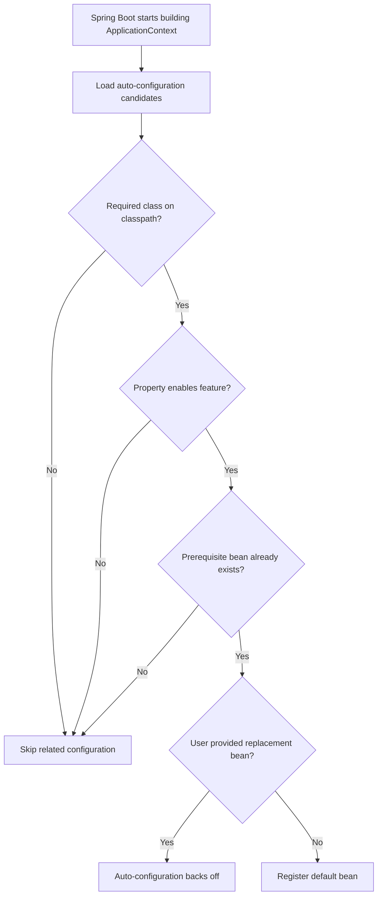
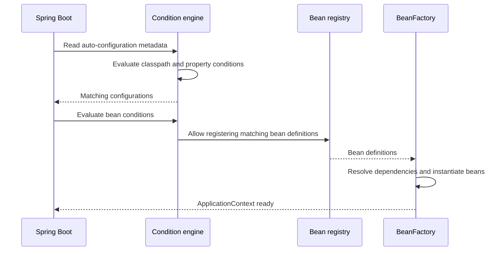

# Activation Conditions by Classpath, Bean, and Property

When you add a starter to a Spring Boot application, many beans can appear even though the developer wrote no configuration for them. When you declare your own replacement bean, part of the default configuration can step aside automatically. When you remove a library from the classpath or change a property, a group of features may stop activating. These behaviors come from **conditional configuration**.

Spring Boot and Spring Cloud projects use conditions to decide whether a configuration or bean should be registered in the `ApplicationContext`. The three most common signals are:

- **Classpath:** libraries and classes the application can actually load.
- **Bean:** beans already declared or registered in the `ApplicationContext`.
- **Property:** configuration values present in the Spring `Environment`.

This lesson belongs to the **Platform Architecture** chapter of **SPRING_CLOUD_CORE**. We will examine how these conditions collaborate in auto-configuration, how Spring Cloud Commons/Context uses them for discovery and refresh integration, how to avoid ordering bugs, and how to inspect activation decisions when the application starts.

## 1. Learning Objectives

After this lesson, you will be able to:

1. Explain why Spring Boot needs conditions to enable or skip auto-configuration.
2. Distinguish classpath, bean, property, and additional condition types.
3. Read and write annotations such as `@ConditionalOnClass`, `@ConditionalOnBean`, `@ConditionalOnMissingBean`, and `@ConditionalOnProperty`.
4. Explain the impact of bean definition registration order on bean conditions.
5. Distinguish condition evaluation during `ApplicationContext` creation from refreshing a running bean.
6. Use the Condition Evaluation Report and `ApplicationContextRunner` to diagnose and test configuration branches.

## 2. Why Is Conditional Configuration Needed?

Imagine a service discovery integration library. It wants to provide an adapter so applications can use Spring Cloud Commons' `DiscoveryClient`. However, not every application adds the Commons library or a discovery implementation. Some applications supply their own custom adapter, and some disable discovery via configuration.

If the library always created the adapter in every scenario, applications could fail with missing classes, missing dependency beans, or conflicts with user-provided beans. Conditional configuration lets the library determine on its own when default configuration should apply.

For example, the adapter configuration should only register when all of the following hold simultaneously:

- The `DiscoveryClient` API is on the classpath.
- A `DiscoveryClient` bean has been supplied by a discovery implementation.
- The `app.discovery.bridge.enabled` property is set to `true`.
- The user has not defined a replacement `DiscoveryBridge` bean.

This is a logical conjunction of conditions. If any required condition fails, the default bean will not be created.



This diagram illustrates an example logical flow. Actual evaluation order depends on condition types, configuration processing phases, and how auto-configurations are ordered.

**Conditions govern configuration/bean registration.** They do not prove that external services are healthy, that the registry has data, that business configuration is valid, or that network connections succeed. Those runtime concerns require health checks, validation, timeouts, and dedicated tests.

## 3. Auto-Configuration and Where Conditions Live

### 3.1. What Is Auto-Configuration?

Spring Boot auto-configuration is a set of configurations applied based on the libraries and components the application provides. For example:

- When JDBC libraries and related conditions match, Spring Boot can configure `DataSource` infrastructure.
- When a servlet web library is present, the application can receive corresponding web configuration.
- When a technology library is present and no user-supplied replacement bean exists, the library's default configuration can apply.

Applications typically enable this mechanism via `@SpringBootApplication` or `@EnableAutoConfiguration`. An auto-configuration class is annotated with `@AutoConfiguration` and discovered by Spring Boot according to the registration mechanism of that Boot version.

In modern Spring Boot, a library's auto-configuration classes are listed in:

```text
META-INF/spring/org.springframework.boot.autoconfigure.AutoConfiguration.imports
```

Each line contains the fully qualified name of an auto-configuration class. For example:

```text
com.example.discovery.autoconfigure.DiscoveryBridgeAutoConfiguration
com.example.discovery.autoconfigure.DiscoveryHealthAutoConfiguration
```

Annotating a class with `@AutoConfiguration` alone is not enough for Boot to discover it automatically. The class must be registered via the proper mechanism. Auto-configuration classes should live in a dedicated package and not be picked up accidentally by component scanning; registration should be explicit via the imports file or the corresponding platform-version mechanism.

### 3.2. Where Can Conditions Be Placed?

Conditions can be applied at the configuration-class level or at the bean-method level:

```java
@Configuration(proxyBeanMethods = false)
@ConditionalOnProperty(
    prefix = "app.features",
    name = "metrics",
    havingValue = "true"
)
class MetricsConfiguration {

    @Bean
    MetricsReporter metricsReporter() {
        return new MetricsReporter();
    }

    @Bean
    MetricsHealthIndicator metricsHealthIndicator() {
        return new MetricsHealthIndicator();
    }
}
```

In this example, the property is checked on the configuration class. If the condition does not match, the entire `MetricsConfiguration` is not registered as an active configuration and the beans inside it are not declared from that class.

If the condition is placed on a `@Bean` method, only that specific bean is affected; other beans in the same class can still be registered:

```java
@Configuration(proxyBeanMethods = false)
class MetricsConfiguration {

    @Bean
    @ConditionalOnProperty(
        prefix = "app.features",
        name = "metrics",
        havingValue = "true"
    )
    MetricsReporter metricsReporter() {
        return new MetricsReporter();
    }

    @Bean
    MetricsHealthIndicator metricsHealthIndicator() {
        return new MetricsHealthIndicator();
    }
}
```

Condition placement should reflect feature scope. If every bean in a configuration needs the same optional library, a class-level condition is usually clearer. If only one bean requires a specific condition, it can be placed at the method level.

## 4. Classpath Conditions

The classpath is the set of libraries and classes visible to the application's classloader. Starters, direct dependencies, transitive dependencies, exclusions, and dependency scopes can all alter the final classpath.

### 4.1. `@ConditionalOnClass`

`@ConditionalOnClass` allows a configuration to apply only when one or more specified classes exist:

```java
@Configuration(proxyBeanMethods = false)
@ConditionalOnClass(name = "com.example.codec.JsonCodec")
class JsonCodecConfiguration {

    @Bean
    JsonMessageConverter jsonMessageConverter() {
        return new JsonMessageConverter();
    }
}
```

In this example, Boot processes the configuration only when `com.example.codec.JsonCodec` can be found. Using the `name` attribute lets you specify the class name as a string; this is useful when an integration library handles optional dependencies.

You can use a class literal when the auto-configuration module has the corresponding compile-time dependency:

```java
@AutoConfiguration
@ConditionalOnClass(DiscoveryClient.class)
class DiscoveryBridgeAutoConfiguration {
    // DiscoveryClient integration beans
}
```

`DiscoveryClient` is an abstraction in Spring Cloud Commons. If the dependency containing this class is absent, the discovery integration configuration can be skipped.

### 4.2. `@ConditionalOnMissingClass`

`@ConditionalOnMissingClass` is the inverse: configuration activates when the specified class is **not** on the classpath.

```java
@Configuration(proxyBeanMethods = false)
@ConditionalOnMissingClass("com.example.nativeclient.NativeClient")
class FallbackClientConfiguration {

    @Bean
    FallbackClient fallbackClient() {
        return new FallbackClient();
    }
}
```

This pattern is useful when a library supplies a fallback implementation if a specialized implementation is not installed. However, ensure the fallback can actually fulfill the contract; missing a class does not mean the system is ready for every operating mode.

### 4.3. Caution About Optional Classes in Method Signatures

A subtle bug arises when an optional class is referenced directly in a configuration's method signature while the classpath condition is placed only on the `@Bean` method itself. The JVM may need to load the return type or method reference before the method's condition is evaluated.

Example of how **not** to design for optional dependencies:

```java
@Configuration(proxyBeanMethods = false)
class OptionalClientConfiguration {

    @Bean
    @ConditionalOnClass(name = "com.example.optional.OptionalClient")
    com.example.optional.OptionalClient optionalClient() {
        return new com.example.optional.OptionalClient();
    }
}
```

When `OptionalClient` is absent, the method signature still references that class. A safer approach is isolating references inside a nested configuration guarded at the class level:

```java
@AutoConfiguration
class OptionalClientAutoConfiguration {

    @Configuration(proxyBeanMethods = false)
    @ConditionalOnClass(name = "com.example.optional.OptionalClient")
    static class OptionalClientPresentConfiguration {

        @Bean
        @ConditionalOnMissingBean
        OptionalClientAdapter optionalClientAdapter() {
            return new OptionalClientAdapter(
                new com.example.optional.OptionalClient()
            );
        }
    }
}
```

This example assumes the adapter class and required APIs are provided in the corresponding module. The key point is that the optional class is only referenced inside the nested configuration guarded by the class-level classpath condition.

Spring Boot reads annotation metadata to evaluate class conditions before needing to process nested configurations. When creating composed annotations (custom annotations carrying another condition), Boot documentation notes that you should use the `name` attribute for class conditions rather than relying on class literals.

### 4.4. Classpath Does Not Equal Declared Dependencies

A dependency listed in a build file is not guaranteed to appear on the runtime classpath:

- A dependency may carry a compile-only or test-only scope.
- A dependency may be excluded by another dependency.
- A starter may pull in numerous transitive libraries.
- Two libraries may conflict and the resolver picks one version.
- A library may be present in the build yet hidden by a custom classloader at runtime.

When a classpath condition does not match, inspect the actual dependency tree and classloader before editing annotations. Do not add random dependencies just to force a condition to match.

## 5. Bean Conditions in ApplicationContext

Classpath tells you whether a class can be loaded; a **bean condition** answers a different question: does the `ApplicationContext` currently contain a bean satisfying the condition?

### 5.1. `@ConditionalOnBean`

`@ConditionalOnBean` allows a configuration or bean to appear only when a prerequisite bean exists:

```java
@Bean
@ConditionalOnBean(DiscoveryClient.class)
DiscoveryHealthContributor discoveryHealthContributor(
        DiscoveryClient discoveryClient) {
    return new DiscoveryHealthContributor(discoveryClient);
}
```

The health contributor bean is registered only when the `ApplicationContext` contains a bean of type `DiscoveryClient`. Merely having the `DiscoveryClient` class on the classpath is not enough to satisfy this condition.

You can check by type or by name:

```java
@ConditionalOnBean(name = "discoveryClient")
class DiscoveryMonitoringConfiguration {
    // ...
}
```

Checking by type is generally more resilient when bean names might change. Checking by name is useful when the integration contract specifically relies on a particular bean name.

### 5.2. `@ConditionalOnMissingBean`

`@ConditionalOnMissingBean` is commonly used to let users override a library's default bean:

```java
@AutoConfiguration
class DiscoveryBridgeAutoConfiguration {

    @Bean
    @ConditionalOnMissingBean(DiscoveryBridge.class)
    DiscoveryBridge discoveryBridge() {
        return new DefaultDiscoveryBridge();
    }
}
```

If the application already defines a `DiscoveryBridge` bean, Boot will not register this default bean. That mechanism is called **back-off**: auto-configuration backs off to respect the application's choice.

This is one of Spring Boot's core principles: provide useful defaults while still allowing user customization.

You can specify type, name, annotation, or other search criteria depending on the version's API. When placed on a `@Bean` method, the default target type is inferred from the method's return type. Therefore, the return type should convey enough information for the condition engine to identify the bean.

For example, if a method returns a generic interface while the actual object has a more specific concrete type, a condition checking the concrete type may not get the expected information from the method signature. Declare a return type matching the contract to check, and specify the type explicitly when needed.

### 5.3. `@ConditionalOnSingleCandidate`

Some integrations require exactly one candidate to inject a dependency. `@ConditionalOnSingleCandidate` activates when only one matching bean exists or when one primary candidate is designated (e.g., marked with `@Primary`):

```java
@Bean
@ConditionalOnSingleCandidate(LoadBalancerClientFactory.class)
DiscoveryAwareRequestCustomizer requestCustomizer(
        LoadBalancerClientFactory factory) {
    return new DiscoveryAwareRequestCustomizer(factory);
}
```

If multiple beans of the same type exist and none is marked primary, the condition fails. This prevents an auto-configuration from picking arbitrarily among multiple candidates.

### 5.4. Bean Definition Registration Order Matters Greatly

Bean conditions evaluate against bean definitions already processed at the moment the condition is checked. Thus, the outcome can depend on configuration order.

Suppose an auto-configuration checks `@ConditionalOnBean(DiscoveryClient.class)`, yet the configuration creating `DiscoveryClient` is processed later. At evaluation time, the bean may not be registered yet, so the condition does not match—even though the context could ultimately contain such a bean if configurations were ordered differently.

That is why Spring Boot recommends using `@ConditionalOnBean` and `@ConditionalOnMissingBean` primarily inside **auto-configuration**: they are applied after user-declared bean definitions. For auto-configurations that depend on one another, you can declare ordering relationships:

```java
@AutoConfiguration(after = DiscoveryProviderAutoConfiguration.class)
class DiscoveryBridgeAutoConfiguration {
    // Beans depending on DiscoveryProviderAutoConfiguration
}
```

The class name in this example is an illustrative name for a provider auto-configuration. In a real project, reference an ordering class only if that dependency is genuinely present within the same compatibility boundary; you can use class names via `afterName` when you need to avoid compile-time references.

Keep in mind:

- Auto-configuration order governs the order in which bean definitions are declared.
- It is not the constructor invocation order of all beans; instantiation still depends on the dependency graph and `@DependsOn` relationships.
- Class-level vs. method-level `@ConditionalOnBean`/`@ConditionalOnMissingBean` have different scopes of impact: class-level can prevent registering the configuration class itself; method-level decides only the corresponding bean.
- Do not use configuration ordering as a cure-all for dependency injection bugs. Inspect actual conditions and dependencies.

## 6. Property Conditions in Spring Environment

Classpath and beans show what components the application has. **Property conditions** let operators or applications select features through configuration.

### 6.1. `@ConditionalOnProperty`

Example:

```java
@Configuration(proxyBeanMethods = false)
@ConditionalOnProperty(
    prefix = "app.discovery.bridge",
    name = "enabled",
    havingValue = "true",
    matchIfMissing = false
)
class DiscoveryBridgeConfiguration {

    @Bean
    DiscoveryBridgeMetrics discoveryBridgeMetrics() {
        return new DiscoveryBridgeMetrics();
    }
}
```

This configuration matches only when `app.discovery.bridge.enabled` equals `true`. Because `matchIfMissing = false`, if the property is not declared, the configuration does not activate either.

Key attributes:

| Attribute | Meaning |
| --- | --- |
| `prefix` | Property prefix |
| `name` | Property name(s) to check; multiple names can be specified |
| `havingValue` | Expected string value |
| `matchIfMissing` | Whether to allow matching when the property is absent |
| `value` | Alias for `name` in the annotation API |

By default in `@ConditionalOnProperty`, the property must exist and have a value other than the string `false` for the condition to match. Therefore, to explicitly enable a feature, it is usually better to specify `havingValue = "true"` rather than relying on the default behavior.

If multiple names are specified in `name`, **all** properties must satisfy the condition for the annotation to match.

### 6.2. Illustrative Truth Table

With the annotation:

```java
@ConditionalOnProperty(
    prefix = "app.discovery",
    name = "enabled",
    havingValue = "true",
    matchIfMissing = false
)
```

the results are:

| Property value | Condition matches? | Reason |
| --- | --- | --- |
| Not present | No | `matchIfMissing=false` |
| `true` | Yes | Equals required value |
| `false` | No | Differs from required value |
| `yes` | No | Does not equal string `true` |
| Empty string | No | Does not equal string `true` |

If `havingValue` is omitted, the default only checks that the property exists and is not `false`. Understand this distinction when a property can take multiple string values or comes from environment variables.

### 6.3. Where Do Property Conditions Read Data From?

`@ConditionalOnProperty` reads properties from Spring's `Environment`. Values can come from configuration sources loaded by Spring Boot, such as:

- `application.yml` or `application.properties`.
- Profile-specific configuration files.
- Environment variables.
- Java system properties.
- Command-line arguments.
- Config Data from configured external sources.

If the same property appears in multiple sources, precedence rules determine the effective value. When a condition does not match as expected, verify **the effective value in Environment**, not just a single YAML file.

Configuration file example:

```yaml
app:
  discovery:
    bridge:
      enabled: true
      observation:
        include-instance-id: false
```

Can be overridden in the deployment environment:

```bash
APP_DISCOVERY_BRIDGE_ENABLED=false
```

Spring Boot's environment variable syntax and property name binding rules must be applied consistently. When multiple files/profiles or environment variables exist, the final value depends on configuration precedence order.

### 6.4. When Should You Use `@ConfigurationProperties`?

`@ConditionalOnProperty` fits yes/no decisions or matching a few values. If a feature has many settings, data types, validation, and defaults, use `@ConfigurationProperties` to bind structured configuration.

```java
@ConfigurationProperties(prefix = "app.discovery.bridge")
public record DiscoveryBridgeProperties(
        boolean enabled,
        Duration refreshInterval,
        int maxInstances
) {
}
```

Then register the properties bean and use it in business components. A condition can check an enable/disable property, while detailed values are bound into a strongly typed object.

Avoid building a complex condition across many scattered properties when a properties class expresses the configuration model cleanly. That makes validation, configuration documentation, and testing easier.

### 6.5. Limitations with Collection Properties

`@ConditionalOnProperty` is not a general-purpose tool for checking arbitrary data structures, especially checking for elements inside collections. For example, checking `app.discovery.zones[0]` is not equivalent to checking the root property `app.discovery.zones`.

If a condition depends on lists or nested structures, bind with `@ConfigurationProperties` and apply validation or appropriate configuration logic. Do not rely on indexed property keys to infer that a collection is completely configured.

## 7. Other Common Conditions

Beyond the three main groups, Spring Boot includes context-specific conditions:

| Annotation | Activation condition | Usage example |
| --- | --- | --- |
| `@ConditionalOnResource` | Specified resource exists | Load config only if a schema file or resource is present |
| `@ConditionalOnWebApplication` | Running context is a web application | Configure HTTP endpoints or web filters |
| `@ConditionalOnNotWebApplication` | Application is not a web app | Configure background tasks |
| `@ConditionalOnWarDeployment` | Application is deployed via traditional WAR packaging | Servlet container-dependent integrations |
| `@ConditionalOnJava` | Java version meets condition | Choose implementation based on Java runtime |
| `@ConditionalOnCloudPlatform` | Environment is detected as a cloud platform | Customize per deployment platform |
| `@ConditionalOnExpression` | SpEL expression evaluates to true | Special cases requiring expressions |

Some conditions depend on the environment or Boot's detection mechanisms. Do not use them as substitutes for real runtime checks. For instance, `@ConditionalOnWebApplication` indicates the application context type; it does not prove that the HTTP port is open or that the service can accept network traffic.

### 7.1. Be Careful with `@ConditionalOnExpression`

`@ConditionalOnExpression` allows using SpEL to evaluate a condition. However, referencing beans in an expression can force those beans to initialize very early during context refresh, before post-processing steps like configuration binding have completed.

Therefore, if you only need to check a property, prefer `@ConditionalOnProperty`. If you need to check a class, use a class condition; if you need to check a bean, use a bean condition. Expressions should be reserved for cases that truly require an expression and where bean lifecycle implications are understood.

### 7.2. Combining Multiple Conditions

When multiple independent conditions are placed on the same configuration, they combine with **AND** logic: all conditions must match. Example:

```java
@AutoConfiguration
@ConditionalOnClass(DiscoveryClient.class)
@ConditionalOnProperty(
    prefix = "app.discovery",
    name = "enabled",
    havingValue = "true"
)
class DiscoveryFeatureAutoConfiguration {
    // ...
}
```

The configuration is considered only when the class is present and the property is enabled. When you need OR logic or complex negation, Spring Boot provides helper classes such as `AnyNestedCondition`, `AllNestedConditions`, and `NoneNestedConditions` to compose conditions. Name them clearly and write tests for every branch so readers understand the rules.

## 8. Combining Classpath, Bean, and Property in Spring Cloud

Let's build a small integration for Spring Cloud Commons. The goal is to supply `DiscoveryBridge` using `DiscoveryClient` when the dependency and provider are present, the feature is enabled, and the application has not provided its own bridge.

### 8.1. Declaring Auto-Configuration

```java
package com.example.discovery.autoconfigure;

import org.springframework.boot.autoconfigure.AutoConfiguration;
import org.springframework.boot.autoconfigure.condition.ConditionalOnClass;
import org.springframework.boot.autoconfigure.condition.ConditionalOnMissingBean;
import org.springframework.boot.autoconfigure.condition.ConditionalOnBean;
import org.springframework.boot.autoconfigure.condition.ConditionalOnProperty;
import org.springframework.context.annotation.Bean;
import org.springframework.cloud.client.discovery.DiscoveryClient;

@AutoConfiguration
@ConditionalOnClass(DiscoveryClient.class)
@ConditionalOnProperty(
    prefix = "app.discovery.bridge",
    name = "enabled",
    havingValue = "true",
    matchIfMissing = false
)
public class DiscoveryBridgeAutoConfiguration {

    @Bean
    @ConditionalOnBean(DiscoveryClient.class)
    @ConditionalOnMissingBean(DiscoveryBridge.class)
    DiscoveryBridge discoveryBridge(DiscoveryClient discoveryClient) {
        return new DefaultDiscoveryBridge(discoveryClient);
    }
}
```

This is an illustrative example of condition design; `DiscoveryBridge` and `DefaultDiscoveryBridge` are library-defined types. A real implementation must also choose a discovery provider, handle empty registries, and control errors when calling services.

Each condition plays a distinct role:

1. `@ConditionalOnClass` protects the integration when Spring Cloud Commons is absent.
2. `@ConditionalOnProperty` lets operators explicitly enable/disable the bridge.
3. `@ConditionalOnBean` requires the provider to have supplied a `DiscoveryClient`.
4. `@ConditionalOnMissingBean` lets the application replace the default bridge.

None of these conditions checks whether the remote registry is healthy or has matching instances. They only decide whether the bean is registered in the `ApplicationContext`.

### 8.2. Registering Auto-Configuration

In the JAR containing the class above, add the class name to:

```text
META-INF/spring/org.springframework.boot.autoconfigure.AutoConfiguration.imports
```

Content:

```text
com.example.discovery.autoconfigure.DiscoveryBridgeAutoConfiguration
```

Without this registration, Boot may fail to discover the class even if it has the annotation and all conditions match. In older Boot versions, auto-configuration registration used `spring.factories`; when developing a library, follow the exact documentation for the target Boot line.

### 8.3. Property to Control the Feature

```yaml
app:
  discovery:
    bridge:
      enabled: true
```

When `enabled` is `false` or the property is absent, the configuration will not match because `matchIfMissing` is `false`. If users want to enable it again, they can declare the property in an appropriate configuration source.

This is an example feature flag. When building a shared starter, choose a dedicated namespace owned by the library rather than placing arbitrary keys under Spring Boot reserved namespaces like `server`, `management`, or `spring`.

## 9. Conditions Do Not Replace Configuration Refresh Mechanisms

In Spring Cloud Context, `@RefreshScope` enables certain beans to be recreated when the scope refreshes. That involves properties, yet two moments must be distinguished:

- **Conditional evaluation:** occurs while building the `ApplicationContext` to decide whether to register a configuration or bean.
- **Refresh scoped target recreation:** recreates the target of a refresh-scoped bean via Spring Cloud Context mechanisms.

Example:

```java
@Component
@RefreshScope
class DiscoveryEndpointLabel {

    private final String label;

    DiscoveryEndpointLabel(Environment environment) {
        this.label = environment.getProperty(
            "app.discovery.label",
            "discovery"
        );
    }

    String currentLabel() {
        return label;
    }
}
```

When the configuration source changes and a valid refresh is triggered, the target of a refresh-scoped bean can be recreated to read the new value. However, if an auto-configuration was initially excluded because `app.discovery.bridge.enabled=false`, simply changing the property to `true` and refreshing a bean does not automatically re-run all auto-configuration as at startup.

If changing a property alters **bean existence** or `ApplicationContext` structure, consider restarting/recreating the context or using an explicit lifecycle management mechanism. Do not use `@RefreshScope` as a toggle mechanism for all active auto-configurations.

Also note that refresh does not guarantee every resource is safely recreated. Connection pools, clients with background threads, schedulers, and caches require proper lifecycle design.

## 10. When Are Conditions Evaluated?

An `ApplicationContext` is constructed across multiple stages: reading configuration, parsing bean definitions, evaluating conditions, registering definitions, and only then instantiating required singletons.

You can visualize it as:



This is a general model. Conditions can be evaluated across different phases of configuration processing; Spring Boot uses metadata and auto-configuration ordering to ensure required conditions are checked at the right time.

Several consequences follow:

- A matching condition does not mean the bean's constructor has run successfully.
- Bean conditions rely on bean definitions known at evaluation time, not arbitrary queries into future runtime state.
- A property changed after context startup does not automatically force all conditions to re-evaluate.
- Auto-configuration ordering affects which bean definitions a condition sees.

## 11. Diagnosing Why Configuration Did Not Activate

When an expected bean does not appear, look for **why the condition did not match** instead of guessing and repeatedly adding dependencies/configuration.

### 11.1. Enable the Condition Evaluation Report

You can start the application with `--debug`:

```bash
java -jar application.jar --debug
```

Or set the corresponding system property:

```bash
java -Ddebug=true -jar application.jar
```

Spring Boot prints the Condition Evaluation Report with positive matches and negative matches. Find the relevant auto-configuration name and inspect which conditions matched and which failed.

### 11.2. Actuator Conditions Endpoint

If the application includes Spring Boot Actuator and the conditions endpoint is enabled/exposed under appropriate security settings, you can query:

```text
GET /actuator/conditions
```

This endpoint provides condition evaluation details for runtime investigation. Do not expose management endpoints to the public internet. Expose only as needed and protect them with authentication, authorization, and network policies.

### 11.3. Quick Diagnostic Table

| Symptom | Check first | Resolution path |
| --- | --- | --- |
| Auto-configuration missing from report | Imports file, component scan, dependency JAR | Verify the class is registered via the right mechanism |
| `@ConditionalOnClass` does not match | Runtime dependency tree, classloader | Check starter, scope, exclusions, versions |
| `@ConditionalOnBean` does not match | Provider bean definition and config ordering | Verify provider is loaded and ordering is appropriate |
| `@ConditionalOnMissingBean` does not match | Bean supplied by app or another library | Check bean type, name, primary status, and context hierarchy |
| `@ConditionalOnProperty` does not match | Actual value in Environment, profile, and precedence | Fix prefix/name, value, or config source |
| Bean exists yet fails to initialize | Constructor, dependency graph, external resource | Investigate runtime exception; conditions only govern registration |
| Property changed yet no new bean appears | `ApplicationContext` lifecycle | Consider context recreation/restart when bean structure changes |

### 11.4. Distinguish Condition Mismatch from Bean Creation Failure

These two errors are often confused:

- **Condition mismatch:** Spring decides not to register the bean. The condition report usually explains why.
- **Bean creation failure:** the bean definition was registered, yet instantiation fails—for example, due to a missing dependency, connection error, or an exception thrown in the constructor.

If the report shows the condition matched while the application still fails, inspect the bean-creation stack trace. Tweaking properties in that case may not address the actual root cause.

## 12. Testing Auto-Configuration with ApplicationContextRunner

Auto-configuration can be affected by many factors: classpath, properties, user beans, and configuration order. Therefore, tests should build a lightweight `ApplicationContext` for each intentional combination of conditions.

Spring Boot provides `ApplicationContextRunner` for this purpose. It is a fast way to test without starting a full web server or connecting to a real registry.

### 12.1. Setting Up the Runner

```java
import org.junit.jupiter.api.Test;
import org.springframework.boot.autoconfigure.AutoConfigurations;
import org.springframework.boot.test.context.runner.ApplicationContextRunner;

class DiscoveryBridgeAutoConfigurationTests {

    private final ApplicationContextRunner contextRunner =
        new ApplicationContextRunner()
            .withConfiguration(
                AutoConfigurations.of(
                    DiscoveryBridgeAutoConfiguration.class
                )
            );

    @Test
    void disabledByDefault() {
        contextRunner.run(context -> {
            assertThat(context)
                .doesNotHaveBean(DiscoveryBridge.class);
        });
    }
}
```

This example assumes the auto-configuration class and business types are defined in the module under test. Add the appropriate test dependencies and AssertJ static imports according to your project setup.

### 12.2. Testing Enable/Disable Properties

```java
@Test
void propertyMustBeEnabled() {
    contextRunner
        .withPropertyValues("app.discovery.bridge.enabled=false")
        .run(context -> {
            assertThat(context)
                .doesNotHaveBean(DiscoveryBridge.class);
        });
}

@Test
void missingPropertyDoesNotEnableBridge() {
    contextRunner.run(context -> {
        assertThat(context)
            .doesNotHaveBean(DiscoveryBridge.class);
    });
}
```

These two tests verify both the disabled-property case and the undeclared-property case. If the default changes to `matchIfMissing=true`, update the missing-property test to reflect the new contract.

### 12.3. Testing User-Provided Beans

```java
@Configuration(proxyBeanMethods = false)
static class UserDiscoveryBridgeConfiguration {

    @Bean
    DiscoveryBridge customDiscoveryBridge() {
        return new CustomDiscoveryBridge();
    }
}

@Test
void userBeanTakesPrecedence() {
    contextRunner
        .withUserConfiguration(UserDiscoveryBridgeConfiguration.class)
        .withPropertyValues("app.discovery.bridge.enabled=true")
        .run(context -> {
            assertThat(context)
                .hasSingleBean(DiscoveryBridge.class);
            assertThat(context.getBean(DiscoveryBridge.class))
                .isInstanceOf(CustomDiscoveryBridge.class);
        });
}
```

This test verifies that `@ConditionalOnMissingBean` caused auto-configuration to back off when the user supplied a custom bean. This is one of the most important behaviors of customizable starters.

### 12.4. Testing Absent Optional Dependencies

```java
import org.springframework.boot.test.context.FilteredClassLoader;

@Test
void missingDiscoveryApiDisablesConfiguration() {
    contextRunner
        .withClassLoader(new FilteredClassLoader(DiscoveryClient.class))
        .withPropertyValues("app.discovery.bridge.enabled=true")
        .run(context -> {
            assertThat(context)
                .doesNotHaveBean(DiscoveryBridge.class);
        });
}
```

`FilteredClassLoader` simulates a class being absent at runtime. This test is especially valuable for starters with optional dependencies, because the auto-configuration module's compile classpath may differ from the consumer application's runtime classpath.

### 12.5. Condition Test Matrix

A thorough test suite should cover the following cases:

| Classpath | Property | Prerequisite bean | Replacement bean | Expected outcome |
| --- | --- | --- | --- | --- |
| Present | true | Present | Absent | Create default bean |
| Absent | true | Absent | Absent | Do not activate configuration |
| Present | false | Present | Absent | Do not create default bean |
| Present | true | Absent | Absent | Do not create discovery-dependent bean |
| Present | true | Present | Present | Use user-provided bean |
| Present | Undeclared | Present | Absent | Follow chosen `matchIfMissing` |

You do not need to test every permutation if it represents no distinct behavior. However, every critical condition should have at least one matching test and one non-matching test.

## 13. Common Design Mistakes

**Checking only the classpath and assuming a bean exists.** The library may be present while the provider is unconfigured or has not created a bean. Use a bean condition when the integration genuinely depends on that bean.

**Using bean conditions in user configurations expecting all future beans to be visible.** Bean conditions rely on already-processed definitions. Place appropriate logic in auto-configuration and manage ordering.

**Placing a classpath condition on a method whose signature references an optional class.** The JVM may need to load the type before the method condition is evaluated. Isolate references inside a nested configuration guarded at the class level.

**Failing to specify the expected property value.** A property with value `yes` or an empty string may not have the semantics the author expected. For boolean flags, specify `havingValue` and `matchIfMissing` explicitly.

**Using property conditions to inspect collections.** Use `@ConfigurationProperties` for lists, maps, and nested structures.

**Assuming changing a property at runtime creates new beans.** Conditional configuration is evaluated while building the context; refreshing a bean does not mean re-running all auto-configurations.

**Forgetting to register auto-configuration.** An annotated class missing from the imports file will not be discovered by Boot under modern mechanisms.

**Assuming a matching condition means the system is healthy.** Conditions only check configuration signals. They do not replace health checks, readiness, timeouts, discovery lookups, or integration tests.

## 14. Applying to Spring Cloud Core Architecture

Across Spring Cloud abstractions, conditions ensure integration libraries activate only when the application has the necessary dependencies, beans, and configuration.

| Component | Conditions that may be checked | Architectural significance |
| --- | --- | --- |
| Spring Cloud Commons | Shared classes/APIs on classpath | Load integration only when the Commons module is present |
| Discovery provider | Compatible `DiscoveryClient` or `Registration` bean registered | Create provider-dependent components only when a provider is available in context |
| Spring Cloud LoadBalancer | LoadBalancer classes and required integration beans | Enable client adapters only when dependencies and beans match |
| Spring Cloud Context | Context classes/beans and feature-control properties | Keep refresh support separate from applications not using that capability |
| Spring Cloud Config Client | Dependencies and matching import/config settings | Enable external configuration integration when opted in |
| Actuator/Observation | Observability classes and beans | Enable health/metrics integration based on dependencies and config |

Exact property names, auto-configuration classes, and specific conditions may vary across release trains. When investigating real behavior, inspect the source and reference docs of the **exact Spring Boot/Spring Cloud versions** your project uses. This lesson presents the mental model and condition categories; do not treat the table as a guarantee that every module uses one fixed annotation or property.

### An Operational Example: Discovery Disabled

Suppose a development environment does not need a service registry. The team can disable discovery integration via a property. When the context is built, the bridge configuration with the property condition does not match, so the bridge bean is not registered.

In staging, the property is enabled and a discovery provider is added at runtime. When the context is built with the required classes and beans, the bridge can be registered. If the application supplies a custom bridge bean, the default auto-configuration backs off.

Environments must agree clearly on properties and dependencies. If you enable the property yet forget the starter/provider, the bean condition will fail to match. If the dependency exists yet there is no registry instance, the bean may be created while discovery lookups still find no services. Those are two separate layers of issues.

## 15. Checklist When Writing a Conditional Auto-Configuration

Before releasing a starter or integration module, ask:

1. **Which classes are optional?** Do classpath conditions guard every reference to optional APIs?
2. **Which beans are prerequisites?** Is `@ConditionalOnBean` needed, or is class presence enough?
3. **Can users replace the default bean?** Is `@ConditionalOnMissingBean` applied with the right type/name?
4. **Which properties toggle the feature?** Is the namespace owned by the library? Is the missing-property default safe?
5. **Does auto-configuration ordering matter?** Do you need before/after declarations or separated nested configurations?
6. **Is auto-configuration properly registered?** Does the imports file contain the class name?
7. **Are all branches tested?** Are missing classpath, disabled property, missing prerequisite bean, and user override tested?
8. **Can operators see why it didn't match?** Can they inspect the Condition Evaluation Report and necessary logs?
9. **Is refresh properly understood?** Is target refresh distinguished from changing the context's bean structure?
10. **Is version compatibility documented?** Does the starter declare compatible Spring Boot/Spring Cloud versions?

## 16. Self-Check Questions and Exercise

### Questions

1. Why does `@ConditionalOnClass(DiscoveryClient.class)` not prove a `DiscoveryClient` bean exists in the `ApplicationContext`?
2. What is the difference between `@ConditionalOnBean` and `@ConditionalOnMissingBean`?
3. If `app.discovery.bridge.enabled` does not exist, what is the outcome of a condition with `matchIfMissing=false`?
4. Why can a bean condition fail to match if the prerequisite bean is declared in an auto-configuration processed later?
5. What can happen if a `@Bean` method directly references an optional class even though that method carries `@ConditionalOnClass`?
6. Why does `@RefreshScope` not automatically re-create an auto-configuration that was initially excluded due to a property condition?
7. Which tools do you use to inspect the classpath and see why an auto-configuration did not match?
8. Does a matching condition prove the registry or downstream services are healthy? Why or why not?

### Exercise: Design an Adapter for Service Discovery

Design an auto-configuration for `InventoryDiscoveryAdapter` with these requirements:

- Activates only when Spring Cloud Commons is present.
- Requires a `DiscoveryClient` bean provided by a discovery provider.
- Enables only when `app.inventory.discovery.enabled=true`.
- Allows the application to provide its own adapter to override the default.
- Does not break the application merely because optional discovery dependencies are omitted.

Write the auto-configuration class, indicate where each condition is placed, and describe how to register the class in the imports file. Then outline test cases with `ApplicationContextRunner` to verify:

- Missing Commons class.
- Class present without provider bean.
- Property disabled or missing.
- All conditions met to create the default adapter.
- Application already provides a custom adapter.

Finally, explain what must be done if the enable/disable property changes after the application has already started.

## 17. References

- [Spring Boot Reference — Creating Your Own Auto-configuration](https://docs.spring.io/spring-boot/reference/features/developing-auto-configuration.html): auto-configuration registration, class conditions, bean conditions, property conditions, ordering, and testing.
- [Spring Boot Reference — Auto-configuration](https://docs.spring.io/spring-boot/reference/using/auto-configuration.html): principles of automatic configuration based on dependencies and application config.
- [Spring Cloud Commons](https://docs.spring.io/spring-cloud-commons/reference/): shared discovery, registry, and load-balancing abstractions in the Spring Cloud ecosystem.
- [Spring Cloud Context](https://docs.spring.io/spring-cloud-commons/reference/spring-cloud-commons/application-context-services.html): context services and refresh scope.

## Key Takeaways

Activation conditions are the mechanism that lets auto-configuration adapt to the real application. **Classpath** answers whether a library is present; **bean conditions** answer whether prerequisites are already registered in the context; **property conditions** express the environment's configuration choices. Combining these three signals properly lets Spring Cloud Commons, Context, and other integrations supply helpful defaults while still permitting application customization. To keep systems operable, clarify configuration ordering, inspect the Condition Evaluation Report, and test every branch with `ApplicationContextRunner`.
