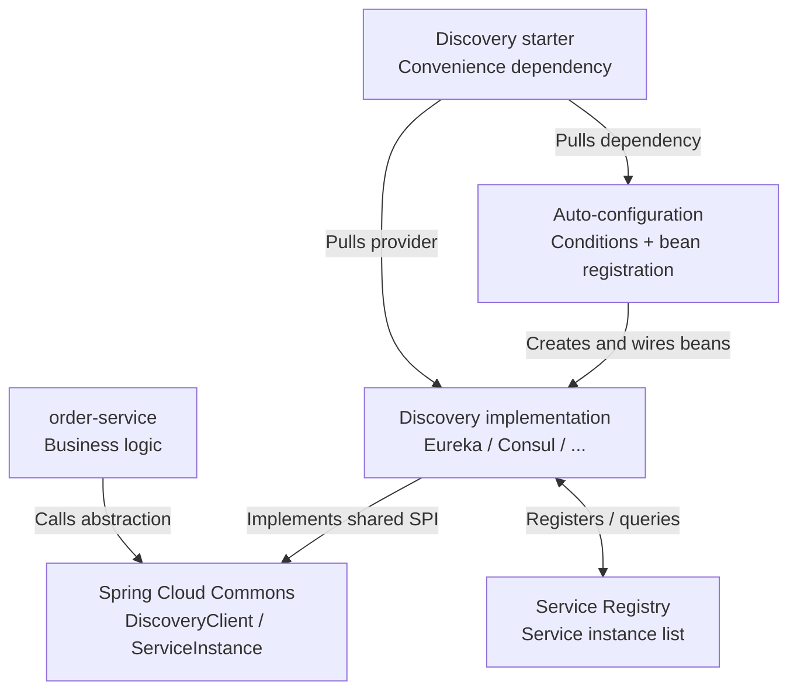
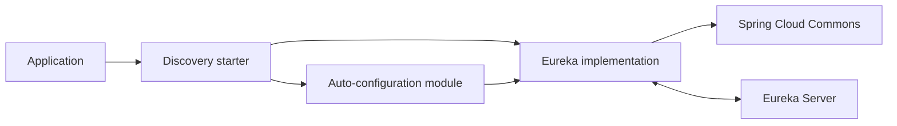
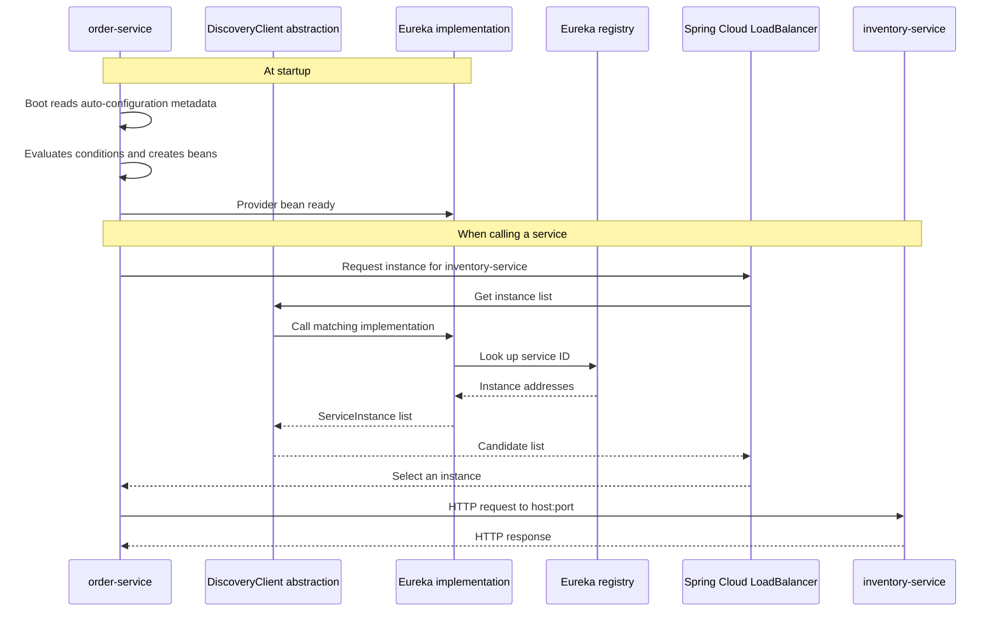

# Distinguishing SPI, Auto-Configuration, and Implementation Components in Spring Cloud

## 1. Three Concepts Often Lumped Together

Spring Cloud is designed around sharing common contracts and allowing concrete infrastructure components to be swapped out. An application can write service-calling logic based on service IDs without coupling business code directly to Eureka, Consul, or a custom service registry.

To achieve this, the ecosystem separates responsibilities across distinct layers:

- **SPI (Service Provider Interface):** an extension contract that a component can implement to supply a capability to the framework or application.
- **Auto-configuration:** the mechanism that evaluates conditions and automatically creates and wires Spring beans when dependencies and configuration match.
- **Implementation:** the code that fulfills the contract and connects to a concrete technology or system.

For example, Spring Cloud Commons defines the `DiscoveryClient` contract for looking up instances of a service ID. A discovery provider such as Eureka provides an implementation that queries the registry. Spring Boot auto-configuration detects the required classes, evaluates classpath/property/bean conditions, and registers the beans for the application to use.

These three concepts complement each other without replacing one another. **SPI states which contract a component must obey; implementation states who fulfills the contract; auto-configuration states when and how beans enter the Spring ApplicationContext.**

After this lesson, you will be able to trace a dependency from starter to provider, identify which auto-configuration created a bean, distinguish business-facing APIs from provider-facing SPIs, and diagnose failures when an implementation is not loaded.

## 2. Architectural Picture from Application to Provider

Suppose `order-service` needs to find the address of `inventory-service`. The application calls a shared abstraction. The provider queries Eureka or another registry. Auto-configuration assembles the provider and supporting components based on dependencies and configuration.



This diagram shows dependency and responsibility relationships, not network request order. A starter is typically just an aggregator dependency. Auto-configuration may live in a separate artifact or inside the provider module; the provider is what contains integration logic for the discovery system. The application may call `DiscoveryClient` directly, or use a load-balancer-integrated HTTP client to call a service ID.

| Layer | Question | Examples in Spring Cloud |
| --- | --- | --- |
| Shared API / SPI | Which contract do app code and providers communicate through? | `DiscoveryClient`, `ServiceInstance`, `ServiceRegistry`, `Registration` |
| Implementation | Who queries/registers with the concrete system? | Eureka Discovery Client, Consul Discovery, Zookeeper Discovery |
| Auto-configuration | When are the provider's beans created? | Configuration classes with `@ConditionalOnClass`, `@ConditionalOnProperty`, `@ConditionalOnMissingBean` |
| Starter | Which dependency brings in all related pieces? | Starter for Eureka Client, Config Client, or LoadBalancer |
| Application | How does business code use the shared capability? | Looking up service IDs or calling URLs via load-balanced clients |

## 3. SPI Is an Extension Contract

### 3.1. SPI Differs from API in Intended Audience

An API is usually viewed from the **caller's** side: which methods an application invokes to use a feature. An SPI is usually viewed from the **provider's** side: which contract a module must implement so the framework can use it.

One interface can play both roles depending on perspective. For example, `DiscoveryClient` is both an API that applications can call to perform lookups and an SPI that discovery providers implement to supply instance lists. An interface is not an SPI merely by name; look at who calls the interface and who is responsible for providing implementations.

| Perspective | Responsibility owner | Example |
| --- | --- | --- |
| Consumer / API | Application invokes capability | `discoveryClient.getInstances("inventory-service")` |
| Provider / SPI | Integration module supplies behavior | Eureka provider implements `DiscoveryClient` |
| Framework integration | Framework discovers and configures provider | Auto-configuration creates beans from provider if conditions match |

### 3.2. SPI Does Not Mean Only Java ServiceLoader

In Java, the term SPI is often associated with `ServiceLoader` and provider files in `META-INF/services`. That is one common provider-loading mechanism, but **not the only mechanism Spring uses to discover extensions**.

In a Spring application, an extension can be wired via:

- Spring beans declared via `@Bean` or `@Component`.
- Auto-configuration imported from metadata.
- `@Import`, `ImportSelector`, or Spring configuration registration mechanisms.
- `SpringFactoriesLoader` for extension points that use Spring factories.
- Java `ServiceLoader` when a specific API or library chooses that mechanism.

Therefore, reading an SPI interface without checking how providers are discovered is not enough to understand its lifecycle. Inspect **the contract**, **the provider-loading mechanism**, and **bean creation conditions**.

### 3.3. Representative Contracts in Spring Cloud Commons

Spring Cloud Commons provides abstractions so implementation modules and applications communicate without direct coupling to a specific registry.

| Contract | Core responsibility | Typical consumers |
| --- | --- | --- |
| `DiscoveryClient` | Returns `ServiceInstance`s by service ID | Applications, LoadBalancer, and platform components |
| `ReactiveDiscoveryClient` | Provides discovery with reactive APIs | WebFlux applications and reactive components |
| `ServiceInstance` | Describes a service endpoint: service ID, host, port, URI, metadata | Providers, LoadBalancer, HTTP client integrations |
| `Registration` | Describes instance information to register | Discovery providers |
| `ServiceRegistry<R extends Registration>` | Registers, deregisters, or manages status per provider capabilities | Instance lifecycle and management components |
| `LoadBalancerClient` | Selects an instance and executes requests through it | HTTP client integrations and service-calling code |

`DiscoveryClient` answers **which instances exist?**; `ServiceRegistry` represents the ability to **register or deregister instances** where supported by the implementation. The two contracts are related yet not synonymous. An environment using DNS or another discovery mechanism may supply endpoint lists without sharing Eureka's registration model.

An SPI tries to keep the contract stable, yet that does not mean every provider shares identical features. Metadata, health states, dynamic registration, reactive lookup, access permissions, and error handling can vary across implementations.

## 4. Implementations Turn Contracts into Real Behavior

### 4.1. One Contract, Multiple Providers

Discovery modules can implement the same shared abstraction while talking to different infrastructure systems:

| Provider / mechanism | Where instance list comes from | Specifics to read in dedicated docs |
| --- | --- | --- |
| Eureka Discovery Client | Eureka Server | Registration, heartbeat/lease, instance status, metadata, and client configuration |
| Consul Discovery | Consul agent/server | Health checks, service catalog, tags, and registration |
| Zookeeper Discovery | Apache Zookeeper | Node structure, registration, and watching changes |
| Simple Discovery Client | Instance list preconfigured in properties | Suits simple/testing scenarios; does not create a dynamic registry |
| Kubernetes discovery integration | Kubernetes API/service metadata, depending on integration style | Distinguish DNS/Service from Spring `DiscoveryClient`; RBAC permissions and cluster config |

This list shows architectural options, not that all must be added together. Kubernetes modules and other providers have their own release trains or compatibility matrices; always check docs for the exact version.

### 4.2. Why Not Call Eureka Directly from Business Code?

If `OrderService` uses the Eureka client API directly, business code becomes coupled to Eureka's registry model, response types, and configuration style. Switching to Consul could force changes across many business classes.

If `OrderService` depends on `DiscoveryClient`, the provider can be swapped while calling code still uses service IDs. Concrete integration remains isolated inside the discovery module. This is the benefit of abstraction and dependency inversion: business logic depends on the contract it needs, while adapters/providers depend on external technology.

Even so, abstractions cannot hide every difference. If business logic relies on provider-specific metadata, health check semantics, or a proprietary provider feature, switching still requires appropriate design and testing.

### 4.3. Example of a Minimal Provider

The following snippet illustrates how an implementation can provide a `DiscoveryClient` for a test environment. It returns a fixed address, not a production registry:

```java
import java.util.List;

import org.springframework.cloud.client.DefaultServiceInstance;
import org.springframework.cloud.client.ServiceInstance;
import org.springframework.cloud.client.discovery.DiscoveryClient;

public final class StaticInventoryDiscoveryClient implements DiscoveryClient {

    @Override
    public String description() {
        return "Static inventory discovery for local testing";
    }

    @Override
    public List<ServiceInstance> getInstances(String serviceId) {
        if (!"inventory-service".equals(serviceId)) {
            return List.of();
        }

        return List.of(new DefaultServiceInstance(
                "inventory-local-1",
                "inventory-service",
                "127.0.0.1",
                8081,
                false
        ));
    }

    @Override
    public List<String> getServices() {
        return List.of("inventory-service");
    }
}
```

Here:

- `DiscoveryClient` is the shared contract the implementation must satisfy.
- `DefaultServiceInstance` is the data object describing an instance.
- This class does not register instances into a registry; it merely returns a static list.
- In real deployments, a provider must handle instance lifecycle, address updates, connection errors, and platform security/health-check requirements.

If you register this class with `@Component` in a test application, Spring can place it into the context via component scanning. That is ordinary bean creation, **not yet a complete auto-configured starter**.

## 5. Auto-Configuration Performs Assembly

### 5.1. From Dependencies to Beans

Spring Boot auto-configuration checks classpath, properties, existing beans, and other conditions to decide which configuration applies. It allows an application to add a dependency and receive default beans without manually declaring every component.

An auto-configuration class typically:

1. Is registered in metadata so Boot can discover it.
2. Checks whether mandatory classes exist on the classpath.
3. Checks enable/disable properties or environment conditions.
4. Checks whether other beans have already been created by the application/provider.
5. Declares default beans and wires them to required dependencies.

Auto-configuration **is not the discovery implementation itself**. It may create a provider bean, client, factory, or adapter; the registry lookup behavior still lives in the corresponding implementation.

### 5.2. Common Conditional Annotations

| Annotation | Purpose | Question to ask |
| --- | --- | --- |
| `@AutoConfiguration` | Marks an auto-configuration class under modern Boot conventions | Is this class registered in metadata? |
| `@Configuration` | Defines a Spring configuration source | Where is it imported or component-scanned from? |
| `@ConditionalOnClass` | Applies only when required classes are on the classpath | Which dependency provides that class? |
| `@ConditionalOnMissingBean` | Creates default bean only if no matching bean exists | Will a custom bean cause default config to back off? |
| `@ConditionalOnBean` | Applies only when a prerequisite bean already exists | Which auto-configuration must run before this? |
| `@ConditionalOnProperty` | Enables/disables configuration based on properties | Which property name, default, and active profile apply? |
| `@ConditionalOnWebApplication` | Restricts configuration to matching web application types | Is the app running servlet or reactive? |
| `@ConfigurationProperties` | Binds a group of properties into a config object | Do prefix and types match this branch's docs? |

Example illustrating an auto-configuration for the static provider:

```java
import org.springframework.boot.autoconfigure.AutoConfiguration;
import org.springframework.boot.autoconfigure.condition.ConditionalOnClass;
import org.springframework.boot.autoconfigure.condition.ConditionalOnMissingBean;
import org.springframework.boot.autoconfigure.condition.ConditionalOnProperty;
import org.springframework.context.annotation.Bean;
import org.springframework.cloud.client.discovery.DiscoveryClient;

@AutoConfiguration
@ConditionalOnClass(DiscoveryClient.class)
@ConditionalOnProperty(
        prefix = "demo.discovery",
        name = "enabled",
        havingValue = "true"
)
public class DemoDiscoveryAutoConfiguration {

    @Bean
    @ConditionalOnMissingBean(DiscoveryClient.class)
    DiscoveryClient demoDiscoveryClient() {
        return new StaticInventoryDiscoveryClient();
    }
}
```

This example only explains bean creation conditions. A real provider must consider auto-configuration ordering, relationships with other providers, property metadata, lifecycle, logging, and whether to create a standalone `DiscoveryClient` or integrate via a composite. If Eureka/Consul is already on the classpath, a static configuration could compete with that provider; do not include multiple providers at once "just in case".

### 5.3. Auto-Configuration Discovery Metadata

In modern Spring Boot versions, auto-configuration is usually registered via:

```text
META-INF/spring/org.springframework.boot.autoconfigure.AutoConfiguration.imports
```

The file contains fully qualified configuration class names, one per line:

```text
com.example.discovery.DemoDiscoveryAutoConfiguration
```

In older Spring Boot generations, auto-configuration was declared under the `EnableAutoConfiguration` key in `META-INF/spring.factories`. Spring Boot 2.7 served as a transition period supporting the new metadata mechanism; starting with Spring Boot 3, `spring.factories` is no longer used to register auto-configuration lists the old way. However, `spring.factories` and `SpringFactoriesLoader` may still be used for **other extension points**. Do not conclude that all Spring factories mechanisms have disappeared.

Because metadata and configuration loading depend on version, check the exact Spring Boot reference and migration notes when writing a starter. Adding `@AutoConfiguration` in source code while forgetting the metadata file prevents Boot from discovering that class automatically.

### 5.4. Ordering and Back-Off

Auto-configurations are typically ordered so foundational configuration appears before dependent configuration. Annotations such as `@AutoConfigureBefore`, `@AutoConfigureAfter`, and `@AutoConfigureOrder` express ordering where needed.

`@ConditionalOnMissingBean` provides **back-off**: if the application supplies its own bean matching the type or name checked by the condition, default configuration can skip creating that bean. This is a key extension point allowing applications to swap implementations without modifying the starter.

Do not overuse ordering to solve every conflict. If two providers both register the same contract, clarify the architecture: pick one provider, use a composite if supported, or create distinct qualifiers/beans for each purpose. When multiple beans of the same type exist, unqualified injection can fail with `NoUniqueBeanDefinitionException`.

## 6. A Starter Is Just Dependency Packaging

A starter gives users a convenient way to add a dependency. It usually pulls in:

- Required APIs/implementations.
- Auto-configuration modules.
- Supporting dependencies.
- Accompanying metadata and property configurations.

A starter **is not synonymous** with an implementation, nor does it guarantee every auto-configuration always activates. If an optional dependency is missing from the classpath or a property disables the feature, corresponding beans may not be created.

Conceptual dependency architecture example:



Exact artifact names depend on provider and release train. When reading a starter's POM, inspect the dependency tree to see which modules, versions, and optional modules it pulls in. Do not guess a starter's contents from its artifact name.

### 6.1. Distinguishing Three Operations

| Operation | What actually happens | Example |
| --- | --- | --- |
| Adding a starter | Alters the dependency graph | Adding the Eureka Client starter |
| Loading auto-configuration | Boot reads metadata and evaluates conditions | Eureka client beans are configured if conditions match |
| Selecting an implementation | Concrete provider is created and used | Eureka provider supplies instance info |

If the application added a starter yet has no bean, check metadata and conditions. If the bean exists yet finds no instances, check the implementation, registry, service ID, and network. If instances are found yet HTTP fails, move to the LoadBalancer/HTTP client layer.

## 7. Tracing a Request Through the Layers



This is a conceptual sequence. In some configurations, LoadBalancer may use a `ServiceInstanceListSupplier` or cache instance lists, so it does not necessarily query the registry on every request. Auto-configuration primarily runs when building the application context; it is not a network hop inside each request.

This helps classify failures:

- **No bean:** inspect dependencies, metadata, and condition evaluation.
- **Bean exists but list is empty:** inspect provider, registry, and service ID.
- **List exists but call fails:** inspect selected instance, routing, timeouts, TLS, and HTTP client.
- **Request succeeds but business logic is wrong:** inspect API contract and target service logic.

## 8. Inspecting Dependencies and Auto-Configuration Conditions

### 8.1. Maven and Gradle

With Maven, run:

```bash
mvn dependency:tree -Dincludes=org.springframework.cloud
mvn help:effective-pom
```

With Gradle:

```bash
./gradlew dependencies --configuration runtimeClasspath
./gradlew dependencyInsight --dependency spring-cloud-commons --configuration runtimeClasspath
```

These commands answer: did the starter pull in the implementation module? Are Commons and the provider on the runtime classpath? Are there version overrides outside the BOM? Are two discovery providers present at once?

### 8.2. Condition Evaluation Report

When running the application in Spring Boot debug mode, the auto-configuration condition report shows which configurations matched or failed to match and why. If the Actuator conditions endpoint is enabled in your current version and configuration, you can use it in a secured environment to investigate.

Do not open diagnostic endpoints to the public network just to debug. In production environments, follow security policies, restrict access permissions, and avoid leaking classpath or internal configuration details.

## 9. Testing SPI and Auto-Configuration

Test provider contracts, bean creation conditions, and connectivity to real systems separately.

### 9.1. Testing an SPI Implementation

For the static provider, unit tests can verify service IDs and returned instances:

```java
import static org.assertj.core.api.Assertions.assertThat;

import java.util.List;

import org.junit.jupiter.api.Test;
import org.springframework.cloud.client.ServiceInstance;

class StaticInventoryDiscoveryClientTests {

    private final StaticInventoryDiscoveryClient client =
            new StaticInventoryDiscoveryClient();

    @Test
    void returnsInventoryInstanceForKnownService() {
        List<ServiceInstance> instances =
                client.getInstances("inventory-service");

        assertThat(instances).hasSize(1);
        assertThat(instances.get(0).getServiceId())
                .isEqualTo("inventory-service");
        assertThat(instances.get(0).getPort()).isEqualTo(8081);
    }

    @Test
    void returnsNoInstanceForUnknownService() {
        assertThat(client.getInstances("unknown-service")).isEmpty();
    }
}
```

This unit test verifies the implementation follows the example's expectations. It does not prove registration, heartbeats, or lookups over Eureka/Consul work.

### 9.2. Testing Auto-Configuration with ApplicationContextRunner

`ApplicationContextRunner` lets you test configuration conditions in a minimal context without starting the whole application:

```java
import static org.assertj.core.api.Assertions.assertThat;

import org.junit.jupiter.api.Test;
import org.springframework.boot.autoconfigure.AutoConfigurations;
import org.springframework.boot.test.context.runner.ApplicationContextRunner;
import org.springframework.cloud.client.discovery.DiscoveryClient;

class DemoDiscoveryAutoConfigurationTests {

    private final ApplicationContextRunner contextRunner =
            new ApplicationContextRunner()
                    .withConfiguration(
                            AutoConfigurations.of(DemoDiscoveryAutoConfiguration.class));

    @Test
    void createsClientWhenEnabled() {
        contextRunner
                .withPropertyValues("demo.discovery.enabled=true")
                .run(context ->
                        assertThat(context).hasSingleBean(DiscoveryClient.class));
    }

    @Test
    void doesNotCreateClientWhenDisabled() {
        contextRunner
                .withPropertyValues("demo.discovery.enabled=false")
                .run(context ->
                        assertThat(context).doesNotHaveBean(DiscoveryClient.class));
    }
}
```

This tests the illustrative auto-configuration from section 5.2. Real-world tests should also verify `@ConditionalOnMissingBean` back-off when users declare custom implementations, missing-class conditions, default properties, and ordering when other providers are present.

### 9.3. Integration Testing with a Registry

With Eureka/Consul or real platforms, test behaviors that unit tests cannot prove:

1. Provider registers the instance with the right service ID.
2. Registry returns the instance list after registration.
3. Application discovery client sees the instance within expected update intervals.
4. When an instance stops or disconnects, lists and requests update per health/lease/cache policies.
5. LoadBalancer selects an instance and the HTTP client successfully calls the endpoint.

Use an isolated test environment, containers, or appropriate test infrastructure. Never assume `ApplicationContextRunner` can replace network and registry lifecycle testing.

## 10. Common Errors When the Three Layers Misalign

| Symptom | Layer to check first | Investigation direction |
| --- | --- | --- |
| Starter added yet no bean created | Auto-configuration | Dependency tree, metadata file, `@ConditionalOnClass`, `@ConditionalOnProperty` |
| Two `DiscoveryClient` beans cause injection failure | Implementation + auto-configuration | Which providers coexist, back-off, qualifiers, and config ordering |
| Bean exists yet returns empty list | SPI implementation | Service ID, provider, registry state, permissions, and cache |
| Discovery works yet HTTP calls fail | LoadBalancer/HTTP client | `@LoadBalanced`, instance URI, network, timeout, TLS |
| Custom bean not used | Auto-configuration | `@ConditionalOnMissingBean`, bean type, package scan, and ordering |
| Auto-configuration class not discovered | Metadata/version | `AutoConfiguration.imports`, `spring.factories` per Boot generation, class name |
| Breaks only after upgrading Boot | Compatibility and metadata | Compatibility matrix, migration notes, dependency alignment |
| Config/refresh does not behave like examples | Provider and Context | Right Config Client, Config Data/bootstrap mechanism, refresh events, and scope |
| Discovery provider missing required classes | Implementation dependency | Did starter pull provider module, is dependency scope right for runtime? |

A `NoSuchBeanDefinitionException` does not automatically mean the SPI is wrong. The interface may be right yet lack a provider, or the provider may exist yet auto-configuration failed to match. Conversely, a bean being present does not prove the provider can reach the registry.

## 11. Design Boundaries When Adding Providers or Writing Starters

When building a new integration, keep responsibilities clean:

1. **Shared contract:** use an existing SPI if it accurately expresses the needed capability. Avoid inventing duplicate interfaces just to rename things.
2. **Implementation:** keep external-system communication logic inside the adapter/provider; avoid coupling business code to a registry's proprietary client SDK.
3. **Auto-configuration:** create beans under clear conditions; use `@ConditionalOnMissingBean` to support sensible customization; avoid opening unnecessary external connections in every context.
4. **Starter:** pull only necessary dependencies and manage versions via an appropriate BOM. Avoid bundling multiple competing providers into a default starter.
5. **Configuration:** define properties under a dedicated prefix, document defaults and enable/disable conditions; use `@ConfigurationProperties` for structured config groups.
6. **Observability:** log enough to know which provider was selected, which service ID is queried, and which layer failed; never log secrets or sensitive info.
7. **Testing:** test SPI contracts, auto-configuration conditions, back-off, dependency metadata, and registry integration.

If multiple implementations must be supported, explicitly decide whether that means swappable alternatives, composite discovery, or distinct clients per use case. Do not rely on arbitrary bean ordering to select a registry.

## 12. Key Takeaways

- **SPI is an extension contract**, not necessarily loaded via Java `ServiceLoader`.
- **Implementation is where the contract is executed**, such as a provider connecting to Eureka or Consul.
- **Auto-configuration is the bean-assembly mechanism**, conditional on classpath, properties, and context.
- **A starter is a convenience dependency bundle**; it does not guarantee every bean is created or every connection succeeds.
- **Spring Cloud Commons holds shared abstractions** like `DiscoveryClient`, `ServiceInstance`, and `ServiceRegistry`; provider modules implement concrete integration.
- **Version determines how auto-configuration is discovered and which APIs exist.** Check docs for your exact Spring Boot/Spring Cloud release train before copying metadata or code.

When an application cannot find a service, trace the chain: does the dependency include a provider → was auto-configuration discovered and matched → which bean was created → does the implementation return instances → can LoadBalancer/HTTP client call the endpoint. Distinguishing SPI, auto-configuration, and implementation lets you pinpoint faults at the right layer, keep business code loosely coupled from infrastructure, and replace providers safely.
