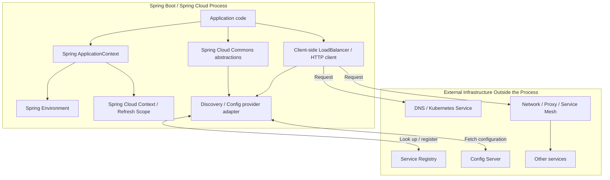
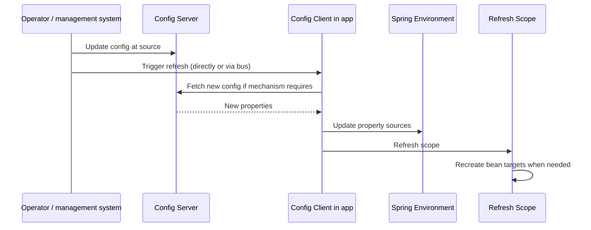
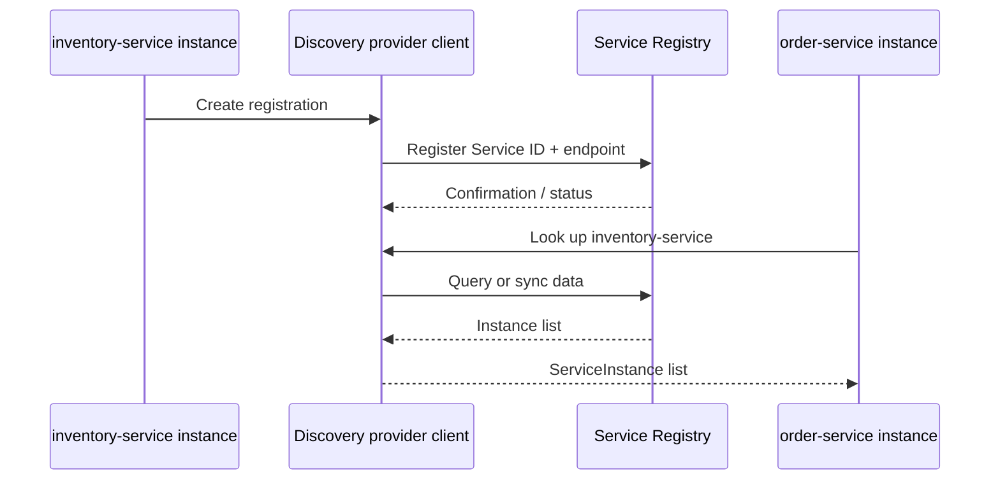

# Boundary Between In-Process Mechanisms and External Infrastructure

A Spring Cloud application runs inside a Spring Boot process, yet it participates in a distributed system made up of multiple processes, servers, containers, and infrastructure services. Inside the application live mechanisms such as the Spring `ApplicationContext`, `Environment`, beans, events, refresh scope, `DiscoveryClient`, and instance selection. Outside the application live the registry, Config Server, DNS, container orchestrators, networks, proxies, message brokers, and other services.

To design and operate properly, you need to know **which mechanisms execute in-process**, **which data comes from external systems**, and **which communication paths bridge the two sides**. This boundary is central to Spring Cloud's platform architecture: Commons and Context provide shared abstractions/mechanisms inside the application; providers and external infrastructure supply actual data or services.

## 1. Mental Model: The Application Is One Node in a Distributed System

A Spring Boot process can contain multiple collaborating components:

- **Spring container:** creates and manages beans, dependency injection, lifecycles, and internal events.
- **Spring Environment:** aggregates property sources so the application can read effective configuration.
- **Spring Cloud Context:** adds context, refresh, and scope mechanisms for the application.
- **Spring Cloud Commons:** provides shared abstractions such as `DiscoveryClient`, `ServiceInstance`, and `ServiceRegistry`.
- **Clients and selectors:** HTTP clients, Spring Cloud LoadBalancer, or other integrated clients select targets and create requests.
- **Adapters/providers:** connect in-app abstractions to a concrete system, such as Eureka or Consul.

Outside the process are components with independent lifecycles and failure modes:

- Registries or discovery systems storing service/instance information.
- Config Server or configuration management systems supplying properties.
- DNS, Kubernetes Services, proxies, or service meshes resolving names and routing traffic.
- Networks carrying requests between processes.
- Message brokers and storage systems serving communication or data persistence.

Overall diagram:



This is a conceptual diagram. A specific architecture might not use Config Server, Eureka, Consul, or a client-side LoadBalancer. For example, Kubernetes DNS and Services can handle resolution/routing without the application querying a registry itself. The essential skill is identifying where each responsibility executes.

## 2. What Belongs to the Application Process

### 2.1. Spring ApplicationContext and Beans

The Spring `ApplicationContext` lives inside the JVM process. It manages beans, dependency injection, bean configuration, lifecycle callbacks, and events published within the context. When the application starts, Spring creates the context and instantiates required beans per configuration.

Example:

```java
import org.springframework.stereotype.Service;

@Service
public class OrderPolicy {
    public boolean canSubmit(int itemCount) {
        return itemCount > 0;
    }
}
```

`OrderPolicy` is a Spring-managed bean. It does not need an external service registry in order to exist. If the process stops, the bean and its in-memory state disappear with the process unless that state is stored in an external durable system.

A bean can call external services, yet the object itself, its proxy, its dependencies, and the calling logic live inside the application's JVM.

### 2.2. Environment and Property Sources

Spring `Environment` is the in-process API for reading effective configuration. Properties can come from many sources: config files, profiles, environment variables, command-line arguments, Config Data, or an integrated external configuration source.

```java
import org.springframework.core.env.Environment;
import org.springframework.stereotype.Component;

@Component
public class RuntimeIdentity {
    private final Environment environment;

    public RuntimeIdentity(Environment environment) {
        this.environment = environment;
    }

    public String serviceName() {
        return environment.getProperty("spring.application.name");
    }

    public int serverPort() {
        return environment.getProperty("server.port", Integer.class, 8080);
    }
}
```

The `Environment` object is read in-process. However, **the origin of a property does not have to be in-process**. If a property is fetched from Config Server, the external system supplies data over the network; the integrated client loads that data into the application's `Environment`.

Distinguish three questions:

1. Where is the configuration data stored or managed?
2. How is configuration loaded or synchronized into the process?
3. Where does application code read the effective value?

In many cases, business code simply reads `Environment` without needing to know whether a property came from a local file, an environment variable, or Config Server.

### 2.3. Internal Events and In-Memory State

Spring `ApplicationEvent` and listeners can pass information between components within the same `ApplicationContext`. For instance, one component publishes a business event and a listener in the same process receives it.

```java
import org.springframework.context.ApplicationEventPublisher;
import org.springframework.stereotype.Service;

@Service
public class OrderNotifier {
    private final ApplicationEventPublisher publisher;

    public OrderNotifier(ApplicationEventPublisher publisher) {
        this.publisher = publisher;
    }

    public void orderAccepted(String orderId) {
        publisher.publishEvent(new OrderAcceptedEvent(orderId));
    }
}
```

Internal events do not cross the network on their own, are not durably persisted, and do not reach listeners in another JVM. To send events to another process, you need a transport mechanism such as Kafka, RabbitMQ, HTTP, or a configured bus.

Similarly, in-memory caches, singleton beans, and objects usually have single-process scope. Two replicas have two separate memories; updating a cache on replica A does not automatically update the cache on replica B.

## 3. Spring Cloud Context: The Refresh Mechanism Lives Inside the Application

Spring Cloud Context provides mechanisms supporting context management and configuration updates on the application side. One example is `@RefreshScope`, which allows beans in the refresh scope to be refreshed when refresh is triggered through an appropriate mechanism.

```java
import org.springframework.beans.factory.annotation.Value;
import org.springframework.cloud.context.config.annotation.RefreshScope;
import org.springframework.stereotype.Component;

@Component
@RefreshScope
public class CheckoutSettings {
    @Value("${checkout.banner:Default banner}")
    private String banner;

    public String banner() {
        return banner;
    }
}
```

The `CheckoutSettings` bean, its proxy, and refresh scope management run in-process. When the scope is refreshed, the bean target can be recreated to read new values from `Environment`.

Yet refresh scope **is not a configuration store**, is not Config Server, and is not an automatic change detector across external systems. You still need a new property source and a way to trigger refresh. The source and trigger may be a management endpoint, an event sent over a messaging system, or another integration.

### 3.1. Distinguish Bean Refresh from Configuration Distribution

| Responsibility | Typical component | Location |
| --- | --- | --- |
| Store/manage shared configuration | Git, Config Server, or configuration management system | Outside the application process |
| Fetch properties into the app | Config Client or corresponding integration | Client running in-process, communicating over network |
| Hold effective properties for code to read | Spring Environment | In-process |
| Recreate bean targets in refresh scope | Spring Cloud Context | In-process |
| Broadcast refresh signals to multiple apps | Message broker/bus or orchestration mechanism | External messaging components plus listeners in each process |

A general flow looks like this:



This diagram illustrates only one common coordination pattern. Actual loading mechanisms, endpoints, events, and processing order depend on Spring Boot/Spring Cloud versions and deployment architecture. Not every setting refreshes automatically just because a file on Config Server changed.

### 3.2. Refresh Does Not Replace Restart for All Changes

Some properties can be re-read when beans are recreated; others are consumed very early in bootstrap or govern server/container structure. Changing `server.port`, already-created thread pool sizes, socket listeners, or infrastructure components may require a restart/redeploy instead of merely refreshing a bean.

Before designing hot updates, determine:

- When is the property read?
- Which bean holds that value, and is it in refresh scope?
- Do any proxies or caches hold old state?
- Does the change require reinitializing OS resources or connections?
- How is consistency across multiple replicas ensured?

Do not view refresh as an "apply all new config" button for the entire process.

## 4. Spring Cloud Commons: Abstractions In-App, Registry Outside

Spring Cloud Commons provides abstractions so application code works with service metadata with minimal coupling to a specific provider. For example:

- `DiscoveryClient` queries services and instances by Service ID.
- `ServiceInstance` represents an instance with host, port, URI, and metadata.
- `ServiceRegistry` and `Registration` describe register/deregister operations when supported by the provider.

These interfaces and objects are used in-process. Yet when integrated with Eureka or Consul, registration data is typically stored and managed by the external registry system.

Example using the abstraction:

```java
import java.util.List;
import org.springframework.cloud.client.ServiceInstance;
import org.springframework.cloud.client.discovery.DiscoveryClient;
import org.springframework.stereotype.Service;

@Service
public class InventoryDirectory {
    private final DiscoveryClient discoveryClient;

    public InventoryDirectory(DiscoveryClient discoveryClient) {
        this.discoveryClient = discoveryClient;
    }

    public List<ServiceInstance> instances() {
        return discoveryClient.getInstances("inventory-service");
    }
}
```

This code calls a method on the `DiscoveryClient` bean inside the current JVM. If the bean is supplied by Eureka integration, that implementation communicates with Eureka or uses client-synchronized data. With Consul, the path and protocol differ. With `SimpleDiscoveryClient`, the list may come from local configuration instead of a dynamic registry.

### 4.1. DiscoveryClient Is Not the Registry

| Component | Role | Scope |
| --- | --- | --- |
| `DiscoveryClient` | API for the app to query instances | In-process abstraction |
| DiscoveryClient implementation | Performs queries, may cache or call provider | In-process code, connects outward depending on provider |
| Eureka Server / Consul | Stores and serves registry data | External infrastructure |
| `ServiceRegistry` | Register/deregister API | In-process abstraction |
| Registration client/provider | Sends registration and heartbeats per provider mechanism | In-process code talking to infrastructure |

Having a `DiscoveryClient` in an application does not mean it has its own registry. It only has the ability to call the abstraction; concrete data and behavior depend on the implementation bean and discovery source.

### 4.2. Service Registration Has Two Sides

An instance can send registration info from the application to the registry. The registry stores or distributes that info for other clients to look up. When the instance stops, the provider and registry must coordinate removing or marking the instance unavailable.



Depending on the provider, the client may poll, maintain a connection, send heartbeats, or receive notifications. Thus, do not assume every `getInstances` call triggers a direct HTTP request to the registry.

## 5. Load Balancing and Network Communication: Decision in Client, Request Over Network

Spring Cloud LoadBalancer is a client-side component that picks an instance from an available list. The selector and policy configuration run inside the client process. After selecting an endpoint, the request travels over the network to the target instance.

Example:

```java
import org.springframework.cloud.client.loadbalancer.LoadBalanced;
import org.springframework.context.annotation.Bean;
import org.springframework.context.annotation.Configuration;
import org.springframework.web.reactive.function.client.WebClient;

@Configuration
public class ClientConfiguration {
    @Bean
    @LoadBalanced
    WebClient.Builder loadBalancedWebClientBuilder() {
        return WebClient.builder();
    }
}
```

The client can then use a Service ID in a logical URI:

```java
WebClient client = loadBalancedWebClientBuilder
        .baseUrl("http://inventory-service")
        .build();
```

When properly configured, Spring Cloud LoadBalancer picks the corresponding instance before the request is sent. **Instance selection logic is in the client**, whereas packet delivery, DNS, routing, firewalls, and socket connections belong to network/infrastructure layers.

### 5.1. Discovery and Load Balancing Are Two Responsibilities

Discovery answers: "Which instances are known for this Service ID?"

Load balancing answers: "Which instance should this call pick?"

A selector does not invent instances. If the list is empty, LoadBalancer cannot pick a valid endpoint. If the list contains stale endpoints, selection can still fail when an instance has stopped before data refreshed.

### 5.2. Client-Side and Server-Side Routing

| Model | Where target is chosen | In-app components | External infrastructure |
| --- | --- | --- | --- |
| Client-side load balancing | Calling application client | Discovery integration, LoadBalancer, HTTP client | Registry or instance list source; network to instances |
| Server-side routing | Proxy, load balancer, or orchestrator | HTTP client calling a stable address | Proxy, Kubernetes Service, service mesh, or load balancer |
| DNS-based service addressing | Resolver and network infrastructure by design | Client using hostname | DNS and endpoint routing |

Not every application needs Spring Cloud LoadBalancer. If a Kubernetes Service or proxy already provides a stable address and handles routing, clients can call that entry point with an ordinary HTTP client.

### 5.3. Do Not Confuse Logical Names with DNS Hostnames

The string `http://inventory-service` is interpreted as a Service ID only when the HTTP client is integrated with an appropriate discovery/load-balancing mechanism. Otherwise, a standard HTTP client treats `inventory-service` as a hostname and asks OS/network DNS to resolve it.

Hence, an `UnknownHostException` can indicate that the client is using DNS resolution when the developer expected Spring Cloud LoadBalancer to handle the Service ID. Inspect the `WebClient`/`RestClient` type, `@LoadBalanced` bean, dependencies, and provider configuration.

## 6. Distinguishing In-Process vs. External Across Each Function

| Function | In-process part | External part | Boundary to verify |
| --- | --- | --- | --- |
| Bean management | `ApplicationContext`, beans, proxies, lifecycle | No dedicated external infra required | Are beans created and injected properly? |
| Reading config | `Environment`, loaded property sources | Config Server, Git, container env, secret store | Which property source provides the effective value? |
| Refresh | Refresh scope, event listeners, context updates | Config source, bus, or trigger if any | Were new values loaded and the right beans refreshed? |
| Discovery | `DiscoveryClient` API, provider client, cache | Eureka, Consul, or discovery platform | Where does the instance list come from and when does it update? |
| Service registration | `Registration` object, client lifecycle | Registry receiving and storing registration | Are advertised Service ID/host/port accurate? |
| Load balancing | Instance selection, policy, client filters | Registry/endpoint list, network | An endpoint was picked, but is it reachable? |
| HTTP communication | HTTP client, request/response, timeouts | DNS, network, proxies, target service | Did failure occur at resolution, connection, or request processing? |
| Observability | Logs, metrics, trace instrumentation | Collectors, dashboards, tracing backends | Where is telemetry exported and ingested? |

This table helps you ask the right questions while debugging. For instance, "`DiscoveryClient` returned instances" is evidence at the lookup layer, not evidence that the network path to those instances works. "Bean refreshed" does not prove Config Server was updated properly. Each boundary must be verified separately.

## 7. Externalized Configuration Is Not an In-Process Mechanism

Externalized configuration is the practice of feeding configuration from appropriate sources into the application. Sources can be files, environment variables, runtime arguments, Config Server, or other configuration management systems.

Example application configuration:

```yaml
spring:
  application:
    name: order-service

server:
  port: ${SERVER_PORT:8080}
```

At runtime, Spring Boot reads properties and builds the `Environment` in-process. If `SERVER_PORT` is supplied by a container orchestrator, the value originates outside the process, yet binding the web server and using that value still happens inside the process.

With Spring Cloud Config, Config Server is an external component; Config Client runs inside the application and fetches configuration per configured rules. Spring Cloud Context can assist bean refresh, yet does not replace storage repositories or property distribution pipelines.

### 7.1. Separating Configuration by Ownership

- Application settings such as logical name, ports, timeouts, and feature flags can be managed in files/profiles or external config systems.
- Deployment settings such as replica count, port mapping, resource limits, and network policies are typically managed by the deployment platform.
- Secrets such as passwords, tokens, and private keys should be managed via dedicated secret management with restricted access.
- Sensitive runtime configuration needs clear change procedures, auditing, and explicit refresh/restart workflows.

Avoid placing the same setting in multiple places with ambiguous intent. If config files, environment variables, and Config Server all declare a property, know the precedence rules to determine the effective value.

## 8. Common Errors from Confusing Boundaries

### 8.1. "Commons Is Present, So the Registry Must Exist Too"

Commons supplies APIs and abstractions. Registries such as Eureka Server or Consul are separate systems with their own deployments and lifecycles. Inspect the provider client, registry address, connectivity, and registration state.

### 8.2. "Refresh Scope Watches External Config Files Automatically"

Refresh scope manages bean targets inside the process. Detecting configuration changes and loading new values into `Environment` requires a separate update flow. Check Config Client, property sources, refresh triggers, and bean state after refresh.

### 8.3. "An Instance in the Registry Means It Is Reachable"

The registry may hold stale entries or endpoints unreachable from the client's network. Verify readiness, host, port, firewalls, routing, timeouts, and target process status.

### 8.4. "Spring Events Automatically Propagate to Other Replicas"

Spring `ApplicationEvent` operates strictly within a context/process. To broadcast to other JVMs, use a broker, HTTP, a bus, or a distributed protocol.

### 8.5. "A Cache in One Replica Automatically Syncs with Other Replicas"

A local cache is in-process memory state. If synchronization is needed, design invalidation/distribution mechanisms or use a shared store/cache. Do not rely on singleton beans to hold cluster-wide state.

### 8.6. "LoadBalancer Fixes All Network Errors"

LoadBalancer selects an endpoint. It does not guarantee the endpoint is alive, the network is unblocked, or the request succeeds. Timeouts, retries, circuit breakers, bulkheads, idempotency, and observability remain separate concerns.

## 9. Procedure for Tracing an End-to-End Flow

When a request from `order-service` to `inventory-service` fails, trace across boundaries in order:

1. **Client configuration:** Is the Service ID correct? Is the HTTP client configured for discovery/load balancing, or is it resolving the hostname via DNS?
2. **Discovery source:** Is an appropriate provider present? Has the registry or platform registered instances?
3. **Instance data:** Does the list contain valid, fresh host/port entries? Is the instance ready for traffic?
4. **Selection decision:** Did LoadBalancer receive the list and pick an instance?
5. **Network path:** Can the client resolve the address, open a connection, and traverse firewalls/proxies?
6. **Target service:** Is the server listening on the right port? Does the endpoint exist and handle requests?
7. **Response:** Is the error from timeout, connection failure, HTTP status code, or business logic?

For configuration refresh, follow a similar sequence:

1. Does the external source hold the new value?
2. Did the client fetch the new property?
3. Does the in-process `Environment` contain the new value?
4. Was the refresh trigger received?
5. Is the bean in refresh scope or covered by a corresponding update mechanism?
6. Does the consuming component actually re-read the value?
7. Is a restart required because the change affects resources or startup structure?

Both sequences classify faults by layer, avoiding changing infrastructure when the fault lies in a bean, or vice versa.

## 10. Testing Along Boundaries

Never test only one layer and assume the whole system works. Each test type has a different objective:

| Test type | Scope | Can prove | Does not prove on its own |
| --- | --- | --- | --- |
| Unit test | Individual class, bean, or logic | Logic and data handling with mocked dependencies | Real registry, DNS, or network |
| Spring context test | `ApplicationContext` and auto-configuration | Beans, properties, condition evaluation, injection | External systems actually ready |
| Integration test | Application and one or more dependent services | Protocols, connection config, register/lookup in test env | Full production behavior at all times |
| Contract test | Contract between client and provider | Request/response and schema compatibility | Production network, registry, and performance |
| Deployment/smoke test | Deployed app alongside infrastructure | Connectivity, health, discovery, and live request paths | Every high-load or rare failure scenario |

### 10.1. Testing Abstractions with Test Doubles

A class depending on `DiscoveryClient` can be unit-tested with mocks or fakes to verify how it handles instance lists. This verifies the class's logic without starting Eureka/Consul.

```java
import static org.assertj.core.api.Assertions.assertThat;
import static org.mockito.Mockito.when;

import java.util.List;
import org.junit.jupiter.api.Test;
import org.springframework.cloud.client.ServiceInstance;
import org.springframework.cloud.client.discovery.DiscoveryClient;

class InventoryDirectoryTest {
    @Test
    void returnsInstancesFromDiscoveryClient() {
        DiscoveryClient discoveryClient =
                org.mockito.Mockito.mock(DiscoveryClient.class);

        ServiceInstance instance =
                org.mockito.Mockito.mock(ServiceInstance.class);

        when(discoveryClient.getInstances("inventory-service"))
                .thenReturn(List.of(instance));

        InventoryDirectory directory =
                new InventoryDirectory(discoveryClient);

        assertThat(directory.instances()).containsExactly(instance);
    }
}
```

Test doubles verify how the class uses the abstraction. They do not verify that the Eureka client, Consul client, or real network works.

### 10.2. Integration Testing with Real Infrastructure

When testing a registry or Config Server, run isolated test infrastructure using containers or an integration environment. Tests should verify:

- The application starts with the expected name and configuration.
- The instance registers with a reachable endpoint.
- Clients look up the Service ID and receive matching lists.
- Requests through the client/load balancer reach the target service.
- When an instance stops or is removed from the registry, the system handles stale data and connection errors.
- New configuration loads and refreshes according to the designed workflow.

Test both success and failure scenarios: unavailable registry, empty lists, timeouts, abrupt instance termination, missing properties, or untriggered refreshes.

## 11. Architectural Boundaries and Deployment Decisions

When organizing architecture, consider who owns each responsibility:

- If you want **clients to choose instances**, applications need a discovery provider, instance lists, and an appropriate LoadBalancer.
- If you want **infrastructure to choose instances**, use stable addresses from proxies, Kubernetes Services, or service meshes; applications can stay simpler.
- If you want **centralized configuration changes**, use a config management system and corresponding client; clearly separate properties that can refresh from those requiring restarts.
- If you want **cross-process events**, use messaging or distributed protocols; do not treat internal Spring events like a message broker.
- If you want **shared state**, store it in an external system or use a designed synchronization mechanism; do not treat one replica's memory as cluster memory.

There is no single right choice for every system. One application might use Config Server for properties, Eureka for discovery, LoadBalancer for instance selection, and Kafka for events; another might use Kubernetes DNS/Services and a different configuration system. What must remain explicit is execution location, data ownership, and communication paths across each boundary.

## Key Takeaways

Spring `ApplicationContext`, `Environment`, beans, events, refresh scope, the `DiscoveryClient` abstraction, and instance-selection logic are mechanisms operating inside the application process. The registry, Config Server, DNS, message brokers, proxies, and network are external components or services with their own lifecycles, states, and failure modes. Providers inside the application bridge the two sides. When debugging or designing, trace data from external sources, through adapters and abstractions, to beans/clients in the JVM, and across the network to target services. Clearly distinguishing these boundaries helps select the right dependencies, design purposeful refresh/discovery flows, and scope tests accurately.
