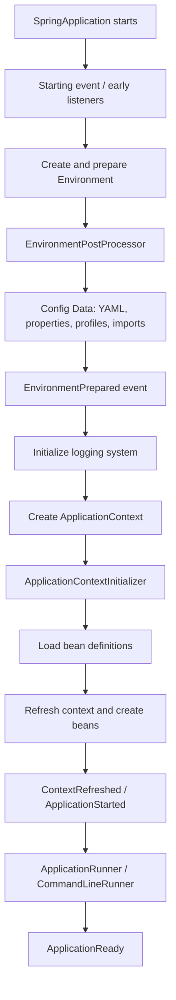

# Impact of Initialization Order on Configuration and Logging

> **Chapter:** Platform Architecture  
> **Module:** `SPRING_CLOUD_CORE` — core foundations of Spring Cloud in distributed systems, especially Spring Cloud Commons, Context, externalized configuration, discovery, service registry, service-to-service communication, and testability/operations.  
> **Focus:** Configuration takes effect only from the moment it is loaded. The order in which Spring Boot prepares the Environment, initializes logging, creates the ApplicationContext, and refreshes beans determines which properties can control which phases.

## 1. Why Does Initialization Order Matter?

A Spring Cloud application typically receives configuration from multiple places: YAML files packaged in the JAR, external files, environment variables, command-line arguments, Config Server, or the deployment platform's configuration system. The same application may also use a logging framework, discovery client, service registry, and refresh-capable beans.

Without understanding initialization order, you easily encounter puzzling symptoms:

- `logging.level.root` is set in a file, yet the earliest log lines still use the default level;
- configuration from Config Server takes effect in business beans, yet part of logging was already initialized earlier;
- a `@PropertySource` makes a property readable inside beans, yet fails to change logging choices at startup;
- an `ApplicationContextInitializer` adds a property to `Environment`, yet some component read that property beforehand;
- refreshing configuration recreates a `@RefreshScope` bean, yet does not restart the whole application or reload every Logback appender.

This is a matter of **timing and scope of configuration usage**. A property can exist in `Environment` and still arrive too late for a component that has already initialized.

### Learning Outcomes

After this lesson, you will be able to:

1. describe the main stages of Spring Boot startup and where `Environment`, Config Data, `ApplicationContext`, and logging fit;
2. distinguish early-loaded configuration from configuration that appears only when beans are created;
3. explain why `logging.*` must be available before the logging system initializes;
4. choose Config Data, Spring Cloud Config, or legacy bootstrap appropriate to the version;
5. understand the roles of `EnvironmentPostProcessor`, `ApplicationContextInitializer`, `@PropertySource`, and event listeners;
6. distinguish refresh scope, log level updates, and reloading full logging configuration;
7. diagnose differences between local, CI, and production using evidence from `Environment`, logs, and startup events.

## 2. Startup Lifecycle Map

### 2.1. Phases to Recognize

Conceptually, a Spring Boot application progresses through these phases:

1. **Starting:** `SpringApplication` begins running; early listeners can receive events before `Environment` and `ApplicationContext` are complete.
2. **Prepare Environment:** creates `Environment`, applies initial configuration, and runs `EnvironmentPostProcessor`s. The Config Data mechanism loads config files, profiles, and imported sources.
3. **EnvironmentPrepared:** publishes an event indicating `Environment` is prepared. The logging system is configured at this very early stage, before `ApplicationContext` refresh.
4. **Create and prepare ApplicationContext:** creates the context, attaches `Environment`, runs `ApplicationContextInitializer`s, and loads bean sources.
5. **Refresh context:** processes bean definitions, runs bean factory post-processors, instantiates non-lazy singletons, performs bean initialization, and publishes context events.
6. **Started and Ready:** after context refresh succeeds, the application publishes `started`; after `ApplicationRunner`/`CommandLineRunner`s finish, it publishes `ready`.
7. **Failed:** if an initialization phase fails, the application publishes the corresponding failure event and startup halts.

Common event names include `ApplicationStartingEvent`, `ApplicationEnvironmentPreparedEvent`, `ApplicationContextInitializedEvent`, `ApplicationPreparedEvent`, `ContextRefreshedEvent`, `ApplicationStartedEvent`, `ApplicationReadyEvent`, and `ApplicationFailedEvent`. Some events belong specifically to Spring Boot; others are Spring Framework events.

### 2.2. Overall Diagram



The exact order of internal callbacks depends on the Spring Boot version and application configuration. What to remember for this lesson:

- Config Data and `EnvironmentPostProcessor` run before `ApplicationContext` is refreshed.
- Logging is prepared very early, before the bean refresh phase.
- Initializers and bean-based configurations run after `Environment` has been prepared.
- `ApplicationRunner` and `ApplicationReadyEvent` occur once most initialization is complete.

If using the legacy Spring Cloud bootstrap context, there is an additional bootstrap phase before the main `ApplicationContext`. Section 5.3 explains that difference.

### 2.3. Environment Is Not a Single Config File

Spring `Environment` is a precedence-ordered collection of `PropertySource`s. When queried for a key like `spring.application.name` or `logging.level.com.example`, `Environment` searches across active sources in precedence order.

A property can come from:

- application-supplied default properties;
- `application.properties` or `application.yml` files;
- external configuration files and profiles;
- Config Data imports from remote sources;
- system properties or environment variables;
- command-line arguments;
- sources added by the application or frameworks.

Do not memorize an abbreviated precedence list and apply it blindly to every application. Check the Spring Boot documentation for your exact version and inspect effective values at runtime. Higher-precedence sources can override values from packaged files.

**Key takeaway:** A property can only be used if the source containing it was loaded before the moment the component needs to read that property.

## 3. Logging Is Initialized Very Early

### 3.1. Why Doesn't Logging Wait for ApplicationContext?

Spring Boot needs logging to record the very process of creating `Environment`, loading configuration, and initializing the context. If logging had to wait until all beans were created to start working, critical startup errors would lack proper logs.

Therefore, the logging system is prepared before `ApplicationContext` refresh. Spring Boot uses the prepared `Environment` to apply early logging settings, including properties such as:

- `logging.config`: location of the logging configuration file;
- `logging.level.*`: log levels per logger or package;
- `logging.file.name` and `logging.file.path`: log file configuration;
- `logging.pattern.*`: patterns supported by Spring Boot.

Specific values and interpretation depend on the logging system and Spring Boot version. Do not assume every property starting with `logging.` can change after startup without additional mechanisms.

### 3.2. Why Is @PropertySource Usually Too Late?

`@PropertySource` is processed when Spring reads configuration classes and bean definitions during `ApplicationContext` refresh. Meanwhile, logging was already initialized in an earlier phase.

Example:

```java
@Configuration
@PropertySource("classpath:late-logging.properties")
class LateLoggingConfiguration {
}
```

Contents of `late-logging.properties`:

```properties
logging.level.root=DEBUG
logging.level.com.example.order=TRACE
```

These properties may appear in `Environment` once the configuration class is processed, yet you should not expect them to govern initial logging setup. That is why Spring Boot recommends placing early logging settings in Config Data or configuration sources available prior to logging initialization.

### 3.3. ApplicationContextInitializer Is Not the Initial Logging Setup Point Either

`ApplicationContextInitializer` runs once `ApplicationContext` has been created and `Environment` has been prepared. It can add property sources or customize the context before bean refresh, yet the logging system was already configured earlier.

Illustrative example:

```java
public class ExampleInitializer
        implements ApplicationContextInitializer<ConfigurableApplicationContext> {

    @Override
    public void initialize(ConfigurableApplicationContext context) {
        // Properties added during context initialization.
        // Do not rely on this as the sole source for startup logging.
    }
}
```

Initializers are useful for context customization and certain pre-refresh configuration, yet they do not replace early configuration loading. If you need to add properties affecting initial logging, consider Config Data or `EnvironmentPostProcessor`.

### 3.4. Beans and @PostConstruct Are Even Later

A logging-related bean created during refresh or a `@PostConstruct` method executes only after the container begins creating beans. By then, the logging system has already been initialized to serve those very phases.

Do not use `@Bean` or `@PostConstruct` as the way to load initial logging settings. If log levels must change after startup, use an appropriate log-level management mechanism instead of attempting to reinitialize all logging from a business bean.

## 4. Loading Early Configuration with Spring Boot Config Data

### 4.1. When Is Config Data Processed?

Spring Boot Config Data loads configuration during `Environment` preparation. It reads default files, profile-specific files, external config locations, and sources declared via `spring.config.import`.

Because Config Data is processed before the logging system initializes, properties in loaded configuration sources can influence initial logging.

Example:

```yaml
spring:
  application:
    name: order-service
  profiles:
    active: prod

logging:
  level:
    root: INFO
    com.example.order: DEBUG
    org.springframework.cloud: INFO
```

In this scenario, application name, profile, and log levels reside in Config Data. Unless overridden by a higher-precedence config source, logging can apply these levels right from initialization.

### 4.2. External Configuration Files

An application can place configuration files outside the JAR, for example:

```text
/opt/order-service/
  order-service.jar
  config/
    application.yml
    application-prod.yml
```

At deployment, explicitly verify which files are discovered and which profiles are active. Mechanisms like `spring.config.additional-location` or `spring.config.location` can specify locations. These two properties have different semantics: one adds search locations, while the other alters default locations according to Boot rules. Consult docs for your exact version before using them.

If an external configuration file is loaded before logging initialization, `logging.level.*` inside it can apply to that initialization. If the file is not found or is overridden by another profile, results will differ from expectations.

### 4.3. Environment Variables and Command-Line Arguments

Sources supplied before the application begins Config Data processing can also govern early configuration, for example:

```bash
java -jar order-service.jar --spring.profiles.active=prod
```

Or setting environment variables in a container:

```bash
SPRING_PROFILES_ACTIVE=prod
LOGGING_LEVEL_COM_EXAMPLE_ORDER=DEBUG
```

Rules for converting property names to environment variables follow Spring Boot binding rules. For complex names, verify exact mapping rules in the documentation. In container environments, avoid putting secrets on the command line, as they can leak via process listings or deployment logs.

## 5. Combining Spring Cloud Config with Initialization Order

### 5.1. Config Server via Config Data Import

In Spring Cloud Config versions supporting Config Data, clients can declare imports in local configuration:

```yaml
spring:
  application:
    name: order-service
  profiles:
    active: prod
  config:
    import: "optional:configserver:http://config-server:8888"

logging:
  level:
    root: INFO
    com.example.order: DEBUG
```

The application needs a compatible Config Client dependency. When Config Data processes the import, the client contacts Config Server to fetch configuration by application name and profile. If the import succeeds, properties from the remote source are placed into `Environment` during preparation.

That means logging settings received from Config Server **can be present before initial logging initialization**, provided the import succeeds and the properties hold effective precedence.

The `optional:` prefix marks the import source as optional: if Config Server is unavailable, the application can continue with the remaining configuration. If configuration requires the remote source to be mandatory, omit `optional:` and configure retry/fail-fast as supported by your client version. Evaluate carefully, because starting without critical configuration can produce a running service with wrong behavior.

### 5.2. Not All Remote Configuration Is Loaded at the Same Time

Distinguish:

- Config Data imports processed during `Environment` preparation;
- configuration read by beans during property binding or bean instantiation;
- configuration refreshed post-startup via Spring Cloud Context/Bus mechanisms;
- configuration manually fetched by the application from an HTTP endpoint after startup.

Only the group loaded prior to logging initialization can govern initial logging setup. If a service calls an API to fetch settings after the context refreshes, received properties cannot travel back in time to affect already-emitted logs.

### 5.3. Legacy Bootstrap Context

In Spring Cloud generations before Config Data became the modern integration model, the bootstrap context mechanism loaded remote properties ahead of the main `ApplicationContext`. A dedicated bootstrap context could contribute property sources and act as a parent for the application context under that version's architecture.

In modern systems, do not assume `bootstrap.yml` is always loaded by default. Legacy bootstrap mode typically requires explicit enabling via a dependency or configuration matching the release train. With modern Config Client, `spring.config.import` is generally the preferred Config Data integration path.

Avoid mixing both mechanisms without understanding ordering and precedence. If the same property appears in a bootstrap source, Config Data, local files, and environment variables, determine which source wins and why.

### 5.4. Avoid Circular Dependencies When Fetching Configuration

A service cannot rely on remote configuration to discover the address of Config Server itself unless another minimal bootstrap source exists. Information needed to reach Config Server—such as endpoint, trust material, or initial credentials—must be available from an appropriate bootstrap source.

Remote configuration should supply application configuration, not create a circular dependency that stops the application from finding where its own configuration lives.

## 6. EnvironmentPostProcessor: Extension Point Before Logging

### 6.1. Role

`EnvironmentPostProcessor` lets you add to or adjust `Environment` during preparation, before `ApplicationContext` is created. It is an earlier extension point than `ApplicationContextInitializer` and regular configuration beans.

It fits special scenarios, such as adding a property source from an available local source or transforming properties before the framework consumes them. However, for YAML files, profiles, and Config Server, prefer standard Config Data mechanisms.

### 6.2. Illustrative Example

The snippet below shows the idea of adding an early property source. This is a technical example; you must register the processor and control execution order according to your application's Spring Boot version.

```java
public final class EarlyLoggingEnvironmentPostProcessor
        implements EnvironmentPostProcessor, Ordered {

    @Override
    public void postProcessEnvironment(
            ConfigurableEnvironment environment,
            SpringApplication application) {

        Map<String, Object> values = Map.of(
                "logging.level.com.example.order", "DEBUG"
        );

        environment.getPropertySources().addFirst(
                new MapPropertySource("early-logging", values)
        );
    }

    @Override
    public int getOrder() {
        return Ordered.LOWEST_PRECEDENCE;
    }
}
```

Register the processor using the mechanism supported by Spring Boot for `EnvironmentPostProcessor`, typically `META-INF/spring.factories` metadata with the corresponding key. Verify exact discovery rules for the Boot version in use.

In this example, `addFirst` puts the source at the top of the list so its values have high precedence. The processor is ordered after other processors so it can inspect previously loaded sources; however, actual ordering must be verified since other processors can also modify `Environment`. Do not copy this example to production without justification, precedence tests, and documentation of the property source.

### 6.3. Why Avoid Creating Too Many Processors?

An `EnvironmentPostProcessor` runs early and can affect the entire initialization process. If multiple processors mutate property sources, execution order and precedence quickly become hard to predict.

Prefer to:

- use it only when Config Data or standard external config cannot meet the need;
- give the property source a clear name;
- decide explicitly between `addFirst`/`addLast` and document why;
- determine relative ordering with respect to Config Data processors;
- write tests verifying effective values;
- avoid accessing beans or `ApplicationContext` since they are not created yet.

## 7. Event Order and ApplicationListener

### 7.1. Early Listeners vs. Bean Listeners

Spring Boot publishes events before `ApplicationContext` refreshes. A listener registered as a regular bean exists only once the context has created and registered beans; therefore, it cannot receive events emitted before that point.

If you need to listen to early events, register the listener directly with `SpringApplication` before calling `run`, or use the listener discovery mechanism supported by your Boot version.

Illustrative example:

```java
@SpringBootApplication
public class OrderApplication {

    public static void main(String[] args) {
        SpringApplication application =
                new SpringApplication(OrderApplication.class);

        application.addListeners(new StartupPhaseListener());
        application.run(args);
    }
}
```

The listener can observe events such as `ApplicationStartingEvent` and `ApplicationEnvironmentPreparedEvent`. Do not assume every bean listener receives all startup events.

### 7.2. @Order Does Not Alter Framework Lifecycle

`@Order` or `Ordered` can determine ordering among listeners handling the same event or among order-aware components. It **cannot turn `@PropertySource` into a configuration source available before Config Data**, nor can it move `ApplicationContextInitializer` ahead of logging initialization.

Distinguish:

- **Framework phase order:** `Environment` preparation, context creation, refresh, runners;
- **Intra-phase order:** ordering of `EnvironmentPostProcessor`s or listeners;
- **Property source precedence:** which source wins when the same key appears.

These three kinds of ordering are related, not synonymous. Adjusting `@Order` on a listener does not automatically alter `Environment` precedence.

### 7.3. Common Events for Observing Startup

| Event | Approximate timing | Practical use |
| --- | --- | --- |
| `ApplicationStartingEvent` | When `SpringApplication` just starts | Very early progress tracking |
| `ApplicationEnvironmentPreparedEvent` | `Environment` has been prepared | Observing profiles and early configuration |
| `ApplicationContextInitializedEvent` | Context created and initializers ran | Observing phase before loading bean definitions |
| `ApplicationPreparedEvent` | Context prepared, before refresh | Inspecting context preparation steps |
| `ContextRefreshedEvent` | Context refreshed | Observing initialized context |
| `ApplicationStartedEvent` | After refresh, before runners | Running post-context-startup logic |
| `ApplicationReadyEvent` | After runners complete | Application ready for traffic per readiness |
| `ApplicationFailedEvent` | When startup fails | Capturing cause and reporting errors |

Exact names and detailed sequencing can vary across framework lines; this table represents the general modern Spring Boot model. Check your project version's event APIs when writing listeners.

## 8. Logging Configuration: logback.xml vs. logback-spring.xml

### 8.1. Why Are There Two Filenames?

Spring Boot integrates with Logback and supports convention-based configuration files. A standard `logback.xml` file can be loaded directly by Logback via its own mechanism before Spring Boot applies its custom extensions.

`logback-spring.xml` lets Spring Boot control configuration loading and provides extensions such as `<springProfile>` and `<springProperty>`. Therefore, when you need Spring `Environment` or profiles inside Logback config, `logback-spring.xml` is usually the better fit.

Avoid using Spring Boot extensions inside `logback.xml` when Logback loads it too early; they may not be recognized properly.

### 8.2. Example logback-spring.xml

```xml
<configuration>
    <springProperty
        scope="context"
        name="applicationName"
        source="spring.application.name"
        defaultValue="unknown"/>

    <appender name="CONSOLE"
              class="ch.qos.logback.core.ConsoleAppender">
        <encoder>
            <pattern>
                %d{yyyy-MM-dd HH:mm:ss.SSS} %-5level
                [%property{applicationName}] [%thread]
                %logger{36} - %msg%n
            </pattern>
        </encoder>
    </appender>

    <springProfile name="prod">
        <root level="INFO">
            <appender-ref ref="CONSOLE"/>
        </root>
    </springProfile>

    <springProfile name="!prod">
        <root level="DEBUG">
            <appender-ref ref="CONSOLE"/>
        </root>
    </springProfile>
</configuration>
```

This example pulls `spring.application.name` from `Environment` and uses profiles to select the root log level. In real production systems, configure log levels per package and avoid enabling global DEBUG/TRACE unless needed.

Spring Boot typically finds `logback-spring.xml` at the classpath root; `logging.config` can point to a different file. The file must exist and be accessible when the logging system initializes.

### 8.3. Logging Properties and Logback Config Are Not Entirely the Same

`logging.level.com.example=DEBUG` is a per-logger level setting that Spring Boot applies through `LoggingSystem`. Configuring appenders, encoders, rolling policies, filters, and layouts belongs to the logging framework.

Changing log levels at runtime is generally simpler than altering the entire appender structure. Do not assume refreshing a bean or changing a property automatically reloads all Logback configuration.

## 9. Post-Startup Configuration Refresh and Logging Limitations

### 9.1. What Does RefreshScope Do?

`@RefreshScope` provides a proxy for beans whose targets are cached under the refresh scope mechanism. Upon a valid refresh, the cached target can be invalidated; a new target is recreated on the next bean access.

Example:

```java
@Component
@RefreshScope
@ConfigurationProperties(prefix = "app")
class GreetingProperties {
    private String greeting = "Hello";

    public String getGreeting() {
        return greeting;
    }

    public void setGreeting(String greeting) {
        this.greeting = greeting;
    }
}
```

If the configuration source changes and the application triggers refresh via its configured mechanism, the bean target can be recreated to read the new value. This does not mean the entire `ApplicationContext` is rebuilt from scratch.

`RefreshScope` is not a mechanism for swapping JARs or reloading dependencies. It does not turn an old Spring Cloud version into a new one.

### 9.2. EnvironmentChangeEvent and Log Levels

In Spring Cloud Context, `Environment` changes can be represented via `EnvironmentChangeEvent`. Rebind-aware components can react to this event to update certain settings after startup.

In Spring Cloud Context setups that include `LoggingRebinder`, `logging.level.*` properties can be re-applied to `LoggingSystem` when `Environment` changes. Exact behavior depends on version and logging system.

Distinguish this from initial logging setup:

- initial logging still requires configuration available during the early phase;
- log-level rebinding is a post-startup action triggered upon `Environment` change;
- changing levels does not automatically rebuild appenders, encoders, file rolling policies, or arbitrary Logback file elements;
- if logging structure must change, use a reload mechanism supported by the logging system or redeploy the application through proper release procedures.

### 9.3. Actuator Loggers Endpoint

Spring Boot Actuator includes a `loggers` endpoint to view and adjust per-logger levels when enabled and properly exposed. This is a useful operational tool for tuning log levels without editing full configuration files.

However, operational endpoints must be protected with authentication/authorization and exposed only on appropriate network segments. Never expose log-management endpoints publicly merely for debugging convenience.

### 9.4. Refresh Cannot Fix Configuration Read Once Early

Some settings are meaningful only at startup, such as Config Data locations, logging initialization settings, or how `ApplicationContext` is created. Refreshing a bean does not replay earlier startup phases.

If a property changes yet the component already consumed it without refresh support, the new value may appear in `Environment` without altering component behavior. In that case, a restart/redeploy or explicit reconfiguration mechanism is needed.

## 10. End-to-End Example: Configuration and Logging in order-service

Suppose `order-service` fetches configuration from Config Server and uses Logback. Local configuration:

```yaml
spring:
  application:
    name: order-service
  profiles:
    active: prod
  config:
    import: "optional:configserver:http://config-server:8888"

logging:
  config: classpath:logback-spring.xml
  level:
    root: INFO
    com.example.order: INFO
```

Config Server can return additional properties for the `prod` profile, such as log levels for a specific package. If the Config Data import completes before logging initialization and no higher-precedence source overrides those properties, `LoggingSystem` can use those values right from startup.

At deployment, verify:

1. whether `spring.application.name` and active profiles are right;
2. whether the Config Client dependency matches the release train;
3. whether Config Server returns configuration for the right application/profile;
4. whether the import succeeded or was skipped due to `optional:`;
5. which property wins when both local and remote declare it;
6. whether `logback-spring.xml` was found and read successfully;
7. whether effective log levels match environment expectations.

If Config Server is unreachable and the import is optional, the application can still start using remaining configuration. That can result in unexpected log levels or business settings. For mandatory properties, design a fail-startup policy rather than silently accepting missing configuration.

## 11. Testing and Diagnosing Initialization Order

### 11.1. Investigation Questions

When configuration does not take effect as expected, ask in sequence:

- Which source contains the property?
- In which phase is that source loaded?
- At what point did the component needing the property initialize?
- Is a higher-precedence source overriding it?
- Is the new value only in `Environment`, or did the component actually apply it?
- Does the change require refreshing a bean, updating log levels, or restarting the entire application?

Asking these questions prevents editing multiple config files blindly without knowing when components read them.

### 11.2. Phase-by-Phase Testing Table

| Test | How to perform | Result to verify |
| --- | --- | --- |
| Local Config Data | Set a property in application YAML | Property exists in `Environment` at startup |
| Profiles | Launch with different profiles | Corresponding profile file and values are loaded |
| External config | Place file outside the JAR | Effective value matches specified location |
| Config Server import | Use Config Client and a controlled remote source | Remote property is in `Environment` before context refresh |
| Early logging | Set package log level in Config Data | Startup logs match configured level |
| `@PropertySource` | Move same property to annotation-loaded file | Verify annotation does not govern initial logging init |
| `EnvironmentPostProcessor` | Add an early property source | Verify processor order and precedence |
| `ApplicationContextInitializer` | Add property before refresh | Distinguish effect vs. already-initialized logging |
| `RefreshScope` | Change property and trigger refresh | Bean target recreates on access as designed |
| Logging rebinding | Change `logging.level` and trigger refresh | Verify log level updates if rebinder component is present |
| Logging config file | Modify appender/encoder | Verify real reload behavior; do not assume `RefreshScope` handles it |

### 11.3. Observing Startup

Several helpful information sources:

- early logs, especially lines covering Config Data, active profiles, and the logging system;
- startup failure analysis and `Caused by` sections;
- Actuator `env` or equivalent configuration endpoints if safely exposed;
- Actuator `loggers` to inspect current log levels;
- startup metrics/tracing and `ApplicationStartup` if enabled in the application;
- Config Client/Config Server logs to verify remote property sources were fetched.

When inspecting the `env` endpoint, pay attention to secret masking and access control. Never log tokens, passwords, private keys, or credentials just to prove configuration load order.

### 11.4. --debug Does Not Mean Root Logger DEBUG

Spring Boot's `--debug` flag typically enables specific logger groups and the auto-configuration condition evaluation report, useful for finding why a configuration applied or was skipped. It does not switch every logger to DEBUG.

If you need detailed logs for one package, set `logging.level.package.name=DEBUG` in a source loaded early enough. Enable TRACE/DEBUG only when needed and turn it off after investigation to avoid excessive log volume or leaking sensitive data.

## 12. Common Pitfalls

**"The property is already in Environment, so logging must have read it."**  
False. You need to know whether the property was loaded before or after `LoggingSystem` initialized and which source holds higher precedence.

**"@PropertySource can configure anything just like application.yml."**  
False. It is processed during context refresh; settings such as logging initialization are needed earlier.

**"ApplicationContextInitializer runs before every Spring Boot component."**  
False. `Environment` is already prepared and logging is already configured prior to the initializer phase.

**"@Order can make a bean listener receive events before the bean exists."**  
False. A listener must be registered before the event is published; `@Order` only adjusts ordering within supported mechanisms.

**"Config Server is always called after beans are created."**  
False. With supported Config Data imports, remote configuration is loaded during `Environment` preparation. Legacy bootstrap has its own lifecycle.

**"RefreshScope restarts the entire application."**  
False. It invalidates bean targets within the scope; targets are recreated when needed. Earlier startup phases do not re-run.

**"Refreshing log levels means reloading all of Logback."**  
False. Rebinding levels and reloading appenders/encoders are distinct actions.

**"Optional Config Server is always the safe choice."**  
False. If missing configuration lets the application start with unsafe defaults, `optional` can mask incidents. Classify mandatory vs. optional properties explicitly.

## 13. Practice Exercises

### Exercise 1 — Why Are the First Logs Still INFO?

An application sets `logging.level.com.example.order=DEBUG` in a file loaded via `@PropertySource`. After the context initializes, some logs appear at DEBUG, yet the first startup logs remain INFO.

Explain the property reading order and suggest where to place the configuration so it takes effect before logging initialization.

### Exercise 2 — Remote Configuration

`order-service` uses Config Server. When Config Server is up, the package logger is at DEBUG; when Config Server is unreachable, the log level falls back to INFO. Analyze the impact of `optional:configserver:` and propose how to inspect property sources, profiles, and effective values.

### Exercise 3 — Initializer and EnvironmentPostProcessor

A team adds a property in `ApplicationContextInitializer` to set `logging.config`. The new logging file is not used at startup. Explain why and choose a more suitable extension point.

### Exercise 4 — RefreshScope and Logging

After triggering refresh, a `@RefreshScope` bean reads the new value, yet the Logback appender still writes to the old file. Explain the difference between bean target refresh, `LoggingRebinder`, and reloading logging structure.

### Self-Check Questions

1. At which phase is Config Data loaded? **During Environment preparation, before ApplicationContext refresh.**
2. Is the logging system initialized before or after all beans are created? **Very early, before context refresh.**
3. Is `@PropertySource` suitable as the sole source for startup logging? **No.**
4. Can `EnvironmentPostProcessor` add properties before logging? **Yes, when registered and ordered appropriately.**
5. Can `ApplicationContextInitializer` redo initial logging initialization? **No.**
6. Does `RefreshScope` recreate the entire `ApplicationContext`? **No.**
7. Can Config Server imported via Config Data supply initial log levels? **Yes, if the import finishes before logging initialization and the value takes precedence.**

## 14. Design and Operations Checklist

When designing initialization order in a Spring Cloud application, verify:

1. Place properties needed in early phases into Config Data, environment variables, or sources loaded before logging initialization.
2. Use `spring.config.import` for Config Server Config Data if supported by the release train; distinguish optional vs. required.
3. Use legacy bootstrap only when required by the project and ensure its enabling config and precedence are well understood.
4. Use `EnvironmentPostProcessor` for genuine extension needs at the `Environment` phase; avoid overuse.
5. Use `ApplicationContextInitializer` for pre-refresh context customization, not as an initial logging source.
6. Use `logback-spring.xml` when Spring Boot extensions such as profiles and properties are needed.
7. Distinguish log-level updates, bean refresh, and reloading logging configuration.
8. Test configuration load order locally, in CI, and in containers.
9. Protect operational endpoints and keep secrets out of logs.
10. Capture startup failures and readiness states to distinguish an unstarted application from one that is ready yet failing downstream.

**Core message:** In Spring Boot and Spring Cloud, configuration controls a component only if it is present at the right time and that component supports updates. Config Data and `EnvironmentPostProcessor` serve the early phase; `ApplicationContextInitializer` and bean configuration serve the context phase; `RefreshScope` and logging rebinding serve select post-startup changes. Understanding these boundaries makes configuration, logging, and operations predictable.

**References:** [Spring Boot Reference — Externalized Configuration](https://docs.spring.io/spring-boot/reference/features/external-config.html), [Spring Boot Reference — Logging](https://docs.spring.io/spring-boot/reference/features/logging.html), [Spring Boot Application Events](https://docs.spring.io/spring-boot/reference/features/spring-application.html), [Spring Cloud Config](https://docs.spring.io/spring-cloud-config/reference/), and [Spring Cloud Commons](https://docs.spring.io/spring-cloud-commons/reference/). Consult documentation matching your exact running Spring Boot/Spring Cloud versions, as Config Data, bootstrap, and refresh details can vary across release trains.
