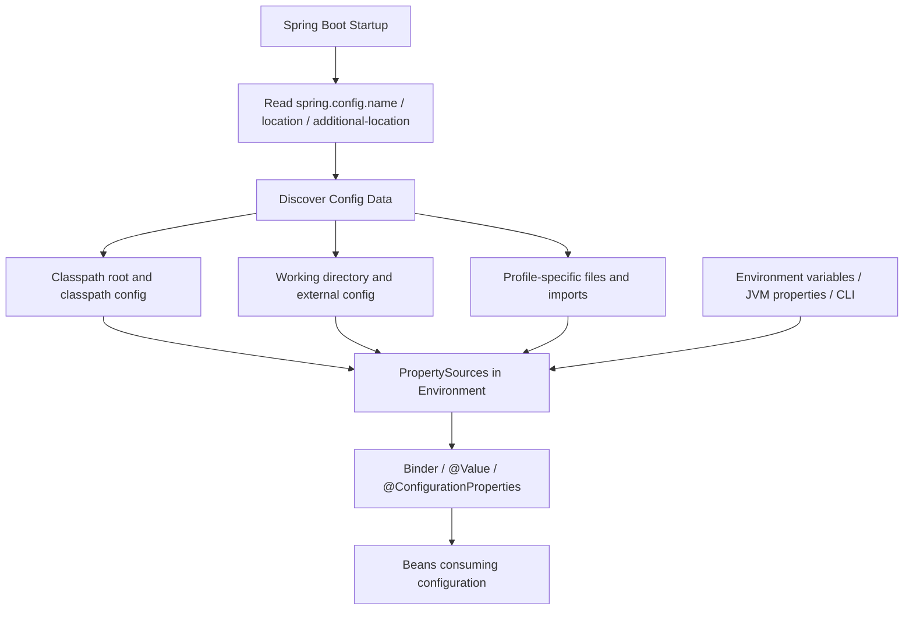

# Configuration Locations Inside and Outside the JAR

Spring Boot lets an application read configuration from both files packaged inside the artifact and files located outside the artifact. This organization is essential in distributed systems: the same JAR can run on a developer machine, test server, container, or Kubernetes, while service URLs, ports, connection settings, profiles, and operational limits vary by environment.

For **SPRING_CLOUD_CORE**, understanding configuration locations is foundational to working with Spring Boot Config Data, Spring Cloud Config Client, discovery, service registries, and refresh mechanisms. This lesson belongs to the **Configuration Loading** chapter and focuses on the questions: where are configuration files located, in what order does Spring Boot search for them, and how can external configuration intentionally override defaults inside the JAR.

## 1. Learning Objectives

After this lesson, you can:

- Distinguish between configuration inside the JAR's classpath and configuration on the host/container filesystem.
- List the five default locations where Spring Boot looks for `application.properties` or `application.yaml`.
- Explain the precedence order between packaged configuration and external configuration.
- Distinguish `spring.config.location`, `spring.config.additional-location`, `spring.config.name`, and `spring.config.import`.
- Configure profile-specific settings for `dev`, `test`, and `prod`.
- Organize configuration when running an executable JAR, Docker, and Kubernetes.
- Recognize why modifying an external file outside the JAR does not automatically reload configuration in a running application.
- Diagnose issues caused by working directory, paths, profiles, file read permissions, or overridden configuration.

## 2. What Are Configurations Inside and Outside the JAR?

### 2.1. Configuration packaged inside the JAR

Files in `src/main/resources` are placed onto the application's classpath by the build tool. In an executable JAR packaged by Spring Boot, they typically reside under `BOOT-INF/classes/`.

Example source structure:

```text
checkout-service/
├── src/
│   └── main/
│       └── resources/
│           ├── application.yaml
│           └── config/
│               └── application.yaml
└── pom.xml
```

After building, both files may appear inside the JAR at corresponding locations:

```text
BOOT-INF/classes/application.yaml
BOOT-INF/classes/config/application.yaml
```

These are classpath configurations:

- `classpath:/application.yaml` points to the resource at the classpath root.
- `classpath:/config/application.yaml` points to the resource inside the `config` package/directory of the classpath.

The advantage of packaged configuration is that it ships with the artifact, which is convenient for default values and makes the artifact self-describing for baseline settings. The disadvantage is that changing a file inside the JAR normally requires rebuilding or repackaging the artifact and deploying a new version.

### 2.2. Configuration outside the JAR

External configuration refers to files on the host filesystem where the application runs, volumes mounted into a container, or a location supplied by the deployment platform. Such files do not need to reside in `src/main/resources` and do not need to be packaged into the JAR.

Example:

```text
/srv/checkout/
├── checkout-service.jar
└── config/
    ├── application.yaml
    └── application-prod.yaml
```

When Spring Boot finds `config/application.yaml` at an external location outside the classpath according to default rules, its values can override matching keys in packaged files. This lets development teams keep one artifact across multiple environments and supply deployment configuration at runtime.

### 2.3. Comparing the two placement approaches

| Criterion | Inside JAR / classpath | Outside JAR / filesystem |
| --- | --- | --- |
| Common location | `src/main/resources/application.yaml` | `./application.yaml`, `./config/application.yaml`, specified directories |
| Lifecycle | Travels with the built artifact | Managed by the deployment environment |
| Changing values | Usually requires repackaging/deploying a new artifact | Can swap files without rebuilding the JAR |
| Best suited for | Default values, environment-independent configuration | URLs, ports, profiles, limits, and environment-specific settings |
| Security | Packaged values can be extracted from the artifact | File permissions can be restricted or secrets mounted; access still must be protected |
| Reproducibility | Tied to the artifact version | Requires managing versions and configuration sources separately |

**Practical rule:** package non-sensitive default values; provide environment-dependent values externally or through a configuration/secret management system. Do not put passwords, tokens, or private keys into the JAR just for testing convenience.

## 3. Five Default Locations Where Spring Boot Looks for Configuration

At startup, Spring Boot automatically searches for `application.properties`, `application.yaml`, or `application.yml` in default locations. According to the Externalized Configuration documentation, the order from **lowest precedence to highest precedence** is:

| Order | Location | Example | Type |
| ---: | --- | --- | --- |
| 1 | Classpath root | `classpath:/application.yaml` | Inside JAR |
| 2 | Classpath `config` directory | `classpath:/config/application.yaml` | Inside JAR |
| 3 | Current working directory | `file:./application.yaml` | Outside JAR |
| 4 | `config` directory beneath working directory | `file:./config/application.yaml` | Outside JAR |
| 5 | Immediate subdirectories of `config` | `file:./config/<group>/application.yaml` | Outside JAR |

Values in higher-precedence locations can override values for the same keys in lower-precedence locations. Therefore, external configuration in the working directory or `config` generally wins over configuration packaged inside the JAR.

### 3.1. Understanding `classpath` and `file`

- `classpath:` looks for resources on the application's classpath, including resources packaged inside the JAR.
- `file:` looks for resources on the process's filesystem.
- `file:./` denotes the current working directory of the process, not automatically the directory containing the JAR.
- Relative paths must be interpreted against the working directory or applicable import rules; in deployments, absolute paths are usually easier to control.

For example, if you run:

```bash
cd /srv/checkout
java -jar /opt/apps/checkout-service.jar
```

then `file:./config/application.yaml` is searched under `/srv/checkout/config/`, because `/srv/checkout` is the working directory. It does not automatically point to `/opt/apps/config/` simply because the JAR resides in `/opt/apps`.

This is a common reason why configuration exists on the machine yet the application fails to read it: the launch command is invoked from a different directory than the operator assumed.

### 3.2. Example of overriding the same property

Suppose `application.yaml` inside the JAR has:

```yaml
spring:
  application:
    name: checkout-service

inventory:
  base-url: http://localhost:8082
  timeout: 2s
  max-attempts: 2
```

External file `./config/application.yaml`:

```yaml
inventory:
  base-url: https://inventory.internal
  timeout: 800ms
```

When run from a directory containing `config/application.yaml`, the resolved result is:

| Property | Final Value | Winning Source |
| --- | --- | --- |
| `spring.application.name` | `checkout-service` | `application.yaml` inside JAR |
| `inventory.base-url` | `https://inventory.internal` | `./config/application.yaml` |
| `inventory.timeout` | `800ms` | `./config/application.yaml` |
| `inventory.max-attempts` | `2` | `application.yaml` inside JAR |

Spring Boot merges properties by key; the external file does not need to repeat the entire configuration from the JAR. Keys not declared in a higher-precedence source can still take their values from a lower-precedence source.

### 3.3. Immediate subdirectories of `config`

By default, Spring Boot also checks immediate subdirectories of the external `config` folder. This is useful when an application receives configuration mounted by group:

```text
config/
├── database/
│   └── application.yaml
├── messaging/
│   └── application.yaml
└── observability/
    └── application.yaml
```

Files in immediate subdirectories can be loaded alongside other default locations. Spring Boot expands the default wildcard location in order of absolute path names; if multiple files set the same key, avoid relying on incidental ordering created by the deployment system. Give each property group a clearly owned source.

The default wildcard applies only to immediate subdirectories and external filesystem locations; do not use classpath wildcards as an arbitrary substitute.

## 4. Configuration Locations in an Executable JAR

### 4.1. Default configuration in `src/main/resources`

With Maven or Gradle, files under `src/main/resources` are copied into output resources and packaged into the JAR. Standard layout:

```text
src/main/resources/
└── application.yaml
```

Example:

```yaml
spring:
  application:
    name: payment-service

server:
  port: 8080

payment:
  currency: VND
  request-timeout: 3s
```

This provides a baseline set of defaults usable for local execution. Do not place production endpoints or real secrets in this file if the artifact is shared across environments.

### 4.2. Inspecting JAR contents

You can list JAR contents using:

```bash
jar tf target/payment-service.jar
```

Look for entries such as:

```text
BOOT-INF/classes/application.yaml
BOOT-INF/classes/config/application.yaml
```

In a Spring Boot executable JAR, the application classpath is structured inside the JAR. `BOOT-INF/classes` is a packaging detail; when configuring, use `classpath:/` and `classpath:/config/` instead of depending directly on internal entry names.

If a file does not appear in the JAR, check:

- Whether the file is actually inside `src/main/resources`.
- Whether the build configuration excludes that resource.
- Whether the filename and extension are correct.
- Whether the artifact being inspected is the freshly built version.

### 4.3. External configuration without modifying the artifact

Keep the JAR at `/srv/payment/payment-service.jar`, and place external configuration at:

```text
/srv/payment/
├── payment-service.jar
└── config/
    └── application.yaml
```

Launch:

```bash
cd /srv/payment
java -jar payment-service.jar
```

Spring Boot automatically discovers `./config/application.yaml` via the default locations. You can deploy the exact same JAR to many machines while managing the `config` directory independently per environment.

### 4.4. Fixing the working directory when running with systemd

If using systemd, set `WorkingDirectory` so `file:./` paths always have a clear meaning:

```ini
[Service]
WorkingDirectory=/srv/payment
ExecStart=/usr/bin/java -jar /opt/apps/payment-service.jar
User=payment
```

In this example, `/srv/payment/config/application.yaml` is resolved relative to the working directory `/srv/payment`, even though the JAR lives in `/opt/apps`. File permissions must also allow the `payment` user to read the file.

## 5. External Configuration with `spring.config.location`

When default locations do not meet deployment requirements, you can specify configuration locations with `spring.config.location`.

Example:

```bash
java -jar payment-service.jar \
  --spring.config.location=file:/etc/payment/
```

If a value points to a directory, the path must end with `/`. Spring Boot searches for the filename chosen by `spring.config.name` in that directory and handles matching profile variants.

You can also point directly to a single file:

```bash
java -jar payment-service.jar \
  --spring.config.location=file:/etc/payment/payment.yaml
```

`spring.config.location` accepts a comma-separated list of locations. These locations **replace the default location set**. If you set only `/etc/payment/`, the application no longer automatically searches classpath root, classpath `config`, working directory, and `./config` from the default list.

### 5.1. When should you use `spring.config.location`?

Use it when you want full control over the entire set of searched configuration locations. For instance, a service running in a locked-down environment that is only allowed to read configuration from `/etc/payment/` and one explicitly specified supplementary file.

In this scenario, make sure the specified directory contains all required settings or that other sources supply the rest. If you accidentally use `spring.config.location` just to add a single override file, default configuration inside the JAR may no longer load as expected.

### 5.2. File or directory?

| Value | Meaning |
| --- | --- |
| `file:/etc/payment/` | Search for configuration files by config name inside the directory |
| `file:/etc/payment/application.yaml` | Read the specified file directly |
| `file:./config/` | Search for configuration in the `config` directory under the working directory |
| `classpath:/defaults/` | Search for configuration in the classpath `defaults` directory |

When specifying a directory, append a trailing `/`. When specifying a file, give the exact filename. Locations can also be expanded to search for profile-specific variants according to Config Data rules.

## 6. Adding External Locations While Keeping Default Configuration

In most deployments, you want to keep defaults packaged in the JAR and add an external directory for overrides. In that case, use `spring.config.additional-location`.

```bash
java -jar payment-service.jar \
  --spring.config.additional-location=optional:file:/etc/payment/
```

This property **adds** locations to the default set. Properties in additional locations are processed with higher precedence than default locations, so they can override values inside the JAR.

### 6.1. Comparing the two properties

| Property | Behavior | When to use |
| --- | --- | --- |
| `spring.config.location` | Replaces the default locations | When you want to completely restrict where config is searched |
| `spring.config.additional-location` | Keeps default locations and adds new higher-precedence locations | When you want to add external override files while preserving defaults in the JAR |

This is the most important distinction when deploying executable JARs. If the goal is simply to externalize environment-specific settings, `spring.config.additional-location` is usually more appropriate.

### 6.2. Configuring startup discovery properties

`spring.config.name`, `spring.config.location`, and `spring.config.additional-location` are used very early to determine configuration data sources. Therefore, pass them via environment variables, JVM system properties, or command-line arguments at startup; they cannot be placed inside the very `application.yaml` they are supposed to locate.

Example with a system property:

```bash
java -Dspring.config.additional-location=file:/etc/payment/ \
  -jar payment-service.jar
```

Example with a command-line argument:

```bash
java -jar payment-service.jar \
  --spring.config.additional-location=file:/etc/payment/
```

In container environments, properties can be passed via environment variables following Spring Boot's property-name mapping rules, or declared in the startup command. Verify the resulting environment variable name after converting dots and hyphens to avoid misconfigured keys.

## 7. Renaming Files with `spring.config.name`

By default, Spring Boot looks for the basename `application`. If you want to use a different name, set `spring.config.name` before Config Data is loaded:

```bash
java -jar payment-service.jar \
  --spring.config.name=payment \
  --spring.config.additional-location=optional:file:/etc/payment/
```

With this configuration, Spring Boot searches for names like `payment.properties`, `payment.yaml`, or profile-specific variants in the selected locations. `spring.config.name` only changes the basename; it does not determine directories on its own.

Example:

```text
/etc/payment/
├── payment.yaml
└── payment-prod.yaml
```

If you only place `payment.yaml` without changing `spring.config.name`, Spring Boot still searches for `application.*` by default; a file named `payment.yaml` will not be picked up automatically under the default basename.

## 8. Profile-Specific Configuration Inside and Outside the JAR

Spring Boot supports both shared configuration files and profile-specific files:

```text
application.yaml
application-dev.yaml
application-test.yaml
application-prod.yaml
```

When the `prod` profile is active, both shared configuration and `application-prod.yaml` are evaluated under the same location rules. Profile-specific files can override shared files. When multiple profiles are active concurrently, profile ordering and location groups affect the final values.

### 8.1. Example of packaged profile and external profile

Inside the JAR, `application.yaml`:

```yaml
spring:
  application:
    name: payment-service

payment:
  timeout: 3s
  currency: VND
```

Inside the JAR, `application-prod.yaml`:

```yaml
payment:
  timeout: 1500ms
```

Outside the JAR, `./config/application-prod.yaml`:

```yaml
payment:
  timeout: 900ms
```

Launch:

```bash
java -jar payment-service.jar --spring.profiles.active=prod
```

The application uses the `prod` profile. The external configuration outside the JAR in a higher-precedence location sets `payment.timeout` to `900ms`; `payment.currency` retains `VND` from the shared configuration in the JAR because no higher-precedence source replaces that key.

### 8.2. Do not activate profiles inside profile-specific files

Do not use `spring.profiles.active` or `spring.profiles.default` inside a document that is itself activated conditionally by profile. Activate profiles from a profile-independent configuration source, such as command-line arguments, system properties, or environment variables. The `application-prod.yaml` file should contain values intended for the `prod` profile.

### 8.3. Profiles in multi-document YAML

A YAML file can contain multiple documents separated by `---`. You can use `spring.config.activate.on-profile` to activate a document only when the profile matches:

```yaml
payment:
  timeout: 3s

---
spring:
  config:
    activate:
      on-profile: prod

payment:
  timeout: 900ms
```

This approach is helpful when consolidating configuration into a single file, though separate `application-prod.yaml` files are usually easier to manage when environments differ across many settings.

## 9. Importing Additional Files with `spring.config.import`

`spring.config.import` allows a configuration document to declare additional Config Data sources. This is useful when a default file inside the JAR needs to specify an external file to read.

Example `application.yaml` inside the JAR:

```yaml
spring:
  application:
    name: payment-service
  config:
    import: "optional:file:./config/payment-overrides.yaml"
```

External file outside the JAR:

```yaml
payment:
  timeout: 750ms
  max-attempts: 4
```

Values from the imported file can override values in the document that declared the import. In this example, `optional:` allows startup to continue if the override file does not exist. If the file is mandatory for production, omit `optional:` so the application fails clearly when it is missing.

### 9.1. Differences between import and additional-location

| Mechanism | How the source is specified | Characteristics |
| --- | --- | --- |
| `spring.config.location` | Set via environment/JVM/command line before loading Config Data | Replaces the default location set |
| `spring.config.additional-location` | Set via environment/JVM/command line before loading Config Data | Adds locations to the default set |
| `spring.config.import` | Declared inside a discovered configuration document | Allows a document to import extra files or Config Data sources |

Imports are processed when Spring Boot encounters the declaration in a document. Imported values are inserted according to Config Data rules and have higher precedence than the document declaring the import. Each import is processed only once even if declared multiple times.

### 9.2. Relative vs. fixed import paths

An import without a URL prefix and not starting with `/` is treated as relative to the declaring file. A path starting with `/` or using a prefix such as `file:` or `classpath:` is a fixed location under the corresponding scheme.

Example:

```yaml
spring:
  config:
    import: "optional:overrides/payment.yaml"
```

The path above is resolved relative to the declaring file. Meanwhile:

```yaml
spring:
  config:
    import: "optional:file:/etc/payment/payment.yaml"
```

explicitly points to `/etc/payment/payment.yaml` on the filesystem. When deploying across multiple environments, fixed paths or environment-configured imports are usually easier to control than unpredictable relative paths.

## 10. Configuration in Docker and Kubernetes

### 10.1. Docker: mounting the `config` directory

Suppose the image contains:

```text
/app/
└── payment-service.jar
```

Run the container with working directory `/app` and mount external configuration files into `/app/config`:

```yaml
services:
  payment:
    image: example/payment-service:1.0
    working_dir: /app
    volumes:
      - ./config:/app/config:ro
    command: ["java", "-jar", "/app/payment-service.jar"]
```

With `working_dir: /app`, `/app/config` is a default external location outside the JAR. Mounting `:ro` ensures the process can only read the configuration. In real deployments, verify that the container user has read permissions on the mounted files and directory.

If the image uses a different working directory, adjust the mount path or pass `spring.config.additional-location` with an absolute path. Do not assume a `config` directory on the host automatically becomes `config` inside the container without a volume mount.

### 10.2. Kubernetes: mounting a ConfigMap as files

ConfigMaps are suitable for non-secret configuration. You can mount an `application.yaml` key as a file inside `/app/config`:

```yaml
apiVersion: v1
kind: ConfigMap
metadata:
  name: payment-config
data:
  application.yaml: |
    payment:
      timeout: 900ms
      max-attempts: 4
```

In the Pod/Deployment, the volume can be mounted as:

```yaml
volumeMounts:
  - name: payment-config
    mountPath: /app/config
    readOnly: true

volumes:
  - name: payment-config
    configMap:
      name: payment-config
```

The application must have `/app` as its working directory or have a configured location pointing to `/app/config`. Otherwise, the mounted file may exist while Spring Boot fails to find it via default locations.

Never store passwords, tokens, or private keys in a ConfigMap. Use a Kubernetes Secret or an appropriate secret management system; for secrets mounted as files, Spring Boot can import them as a configuration tree.

### 10.3. Configuration trees for file-based secrets

A secret volume with structure:

```text
/run/secrets/
├── payment/
│   ├── api-token
│   └── merchant-id
```

Can be imported with:

```yaml
spring:
  config:
    import: "optional:configtree:/run/secrets/"
```

Directory names and filenames are combined into property names. For example, `payment/api-token` can supply the `payment.api-token` property. This mechanism fits platforms that mount secrets as files, letting the application read values without packaging secrets inside the JAR.

If the secret is required for the application to run, omit `optional:` so missing configuration is caught immediately on startup. File access permissions and secret rotation must still be managed at the platform layer.

## 11. Combining with Spring Cloud Config

Files outside the JAR are one way to externalize configuration. When multiple services need centralized configuration, Spring Cloud Config can provide a remote configuration source to applications.

Example with Config Client:

```yaml
spring:
  application:
    name: payment-service
  config:
    import: "optional:configserver:http://config-server:8888"
```

The application needs a compatible Spring Cloud Config Client dependency and an accessible Config Server. Config Server returns configuration based on application name, profiles, and label; Config Client feeds that data into Spring Boot's Config Data pipeline.

Multiple sources can coexist:

- Default values in `application.yaml` packaged inside the JAR.
- Files outside the JAR discovered via default locations or `additional-location`.
- Additional files/sources via `spring.config.import`.
- Configuration sources from Spring Cloud Config.
- Environment variables, JVM properties, and command-line arguments.

When multiple sources declare the same key, the outcome depends on Config Data ordering and overall property source precedence. Always observe final values in the actual runtime environment rather than relying solely on file layout in the repository.

### 11.1. Remote configuration does not automatically mean refresh

Config Client loads configuration during startup via the Config Data mechanism. When data on Config Server changes, a running application does not automatically re-read it immediately. Dynamic updates require an appropriate refresh mechanism, such as Spring Cloud Context, a secured refresh endpoint, or Spring Cloud Bus for multiple instances.

Similarly, when a file mounted from a ConfigMap or external volume changes, Spring Boot does not automatically reload all Config Data merely because the filesystem updated. You need a restart/rollout or a deliberately designed and tested watch-and-refresh mechanism.

`@RefreshScope` only helps manage target beans when a refresh mechanism is triggered; it is not a file watcher and does not automatically detect changes on disk.

## 12. Precedence: Locations vs. Other Configuration Sources

Two questions should be separated:

1. **Within Config Data**, which file is loaded later and can override which file?
2. **Across the entire Environment**, which property source has higher precedence?

The five-location table in Section 3 only describes the ordering of default file locations. Across the entire Spring Boot `Environment`, command-line arguments, system properties, and environment variables also have their own precedence and can usually override values from configuration files.

For example, an external file outside the JAR has:

```yaml
server:
  port: 8080
```

But the process is started with:

```bash
java -jar payment-service.jar --server.port=9090
```

then the command-line property can make the final port `9090`. Looking only at the YAML file would lead to the wrong conclusion about the value the application actually uses.

### 12.1. Summary diagram



This diagram summarizes the sources. Exact precedence in each scenario depends on the property source type, profiles, location groups, and imports; consult the official documentation alongside runtime inspection to confirm.

## 13. Diagnosing When Spring Boot Reads the Wrong File

| Symptom | Common Cause | How to Check |
| --- | --- | --- |
| Values inside the JAR always beat external files | External file placed in the wrong location or not loaded | Check working directory, paths, and Config Data logs |
| File exists but application reports not found | Process runs from a different working directory | Print the process working directory; use absolute paths |
| Default config in the JAR disappears after adding a location | Used `spring.config.location` instead of `additional-location` | Check startup flags and switch to the additional property if needed |
| `application-prod.yaml` is not applied | `prod` profile is not active or filename is wrong | Check `spring.profiles.active` and filename |
| Some keys are right, some are wrong | Multiple sources are overriding individual keys | Inspect property sources and final resolved values |
| Added an import file but see no effect | Wrong import path, wrong scheme, or ordering | Check `spring.config.import`, relative/fixed paths, and `optional:` |
| Container cannot read the file | Wrong volume mount path or insufficient read permissions | Check container mount path and runtime user |
| File changed but application still uses old values | Config Data was loaded at startup; no refresh occurred | Restart/rollout or design an explicit refresh mechanism |
| Secret fails to bind | Directory tree or filename does not match property path | Check `configtree:` and file/directory name mapping |

### 13.1. Step-by-step inspection checklist

1. **Verify the artifact:** Is the running JAR the right build? Are the default files packaged in `BOOT-INF/classes`?
2. **Verify the working directory:** Where is the process launched from? For systemd/containers, check `WorkingDirectory` or `working_dir`.
3. **Verify locations:** Are any `spring.config.location` or `spring.config.additional-location` arguments passed?
4. **Verify basename:** Is the application searching for `application` or another name via `spring.config.name`?
5. **Verify profiles:** Which profiles are active? Do profile-specific files have the right name and location?
6. **Verify imports:** Are additional Config Data sources imported? Are they optional or mandatory?
7. **Verify property source:** Does the final value come from a file, environment variable, JVM property, or command line?
8. **Verify timing:** Was the application restarted/refreshed after changing the configuration source?

### 13.2. Observing without leaking secrets

You can check the final resolved value using `Environment` in diagnostic code:

```java
String timeout = environment.getProperty("payment.timeout");
```

Do not log the entire `Environment` or all property sources. If using Spring Boot Actuator's `env` or `configprops` endpoints, expose them only when needed, restrict access with security controls, and ensure sensitive values are sanitized.

When you need to know which property sources exist without dumping values, you can list `PropertySource` names:

```java
for (PropertySource<?> source : environment.getPropertySources()) {
    log.info("Property source: {}", source.getName());
}
```

## 14. Common Misconceptions

| Misconception | Reality |
| --- | --- |
| "Wherever the JAR lives, that is `file:./`." | `file:./` depends on the process's working directory |
| "Configuration inside the JAR always has highest priority." | External filesystem locations generally have higher precedence than default classpath locations |
| "Just setting `spring.config.location` adds an external file." | That property replaces default locations; use `additional-location` to add locations |
| "An external file outside the JAR must repeat every property." | Sources are merged by key; non-overridden keys keep their default values |
| "Replacing the external file makes the app auto-reload." | Config Data is normally loaded at startup; a restart or refresh mechanism is required |
| "`optional:` should always be enabled." | For mandatory settings, `optional:` can mask deployment errors |
| "A profile is enabled automatically when `application-prod.yaml` exists." | You must activate the `prod` profile from an appropriate source |
| "ConfigMap is a safe place for passwords." | ConfigMaps are for non-secret data; secrets require dedicated secret management |

## 15. Practical Scenario: One JAR for Three Environments

A team develops `checkout-service` and wants to release the exact same artifact for `dev`, `staging`, and `prod`.

### 15.1. Default values in the JAR

`src/main/resources/application.yaml`:

```yaml
spring:
  application:
    name: checkout-service

server:
  port: 8080

checkout:
  request-timeout: 3s
  max-items: 20
```

### 15.2. Environment-specific configuration outside the JAR

`/etc/checkout/application-prod.yaml`:

```yaml
checkout:
  request-timeout: 900ms
  max-items: 50

inventory:
  base-url: https://inventory.internal
```

### 15.3. Startup command

```bash
java -jar checkout-service.jar \
  --spring.profiles.active=prod \
  --spring.config.additional-location=optional:file:/etc/checkout/
```

Spring Boot loads the default configuration from inside the JAR, then adds the external file and matching `prod` profile variant. Properties in `/etc/checkout/application-prod.yaml` override matching keys from the default file.

The operations team manages `/etc/checkout/application-prod.yaml` per environment configuration version. The development team releases a new JAR when code or default values change, without rebuilding the artifact just because a production timeout changes from `900ms` to `800ms`.

### 15.4. What to verify before deployment

- The JAR contains `BOOT-INF/classes/application.yaml`.
- The startup command specifies the `prod` profile and accurate additional location.
- The runtime user can read `/etc/checkout/application-prod.yaml`.
- `Environment` returns the `900ms` timeout in the production configuration.
- Property-bound beans use the expected values after startup.
- File modifications are not expected to auto-refresh unless a refresh mechanism is configured.
- Secrets are supplied via Secret/configuration tree or a secret manager, never embedded in the JAR.

## 16. Summary

Spring Boot supports two major configuration location groups: **classpath inside the JAR** for defaults and **filesystem outside the JAR** for deployment-specific adjustments. Under default ordering, classpath configurations are evaluated first; external locations such as the working directory and `config` folder have higher precedence and can override individual properties.

Three properties to distinguish:

- `spring.config.location`: replaces the default location set.
- `spring.config.additional-location`: adds new locations while preserving default locations.
- `spring.config.import`: imports additional Config Data from a discovered configuration document.

When deploying, control the working directory, active profiles, filenames, mount paths, and read permissions. External configuration allows one artifact to serve multiple environments, but modifying a file does not automatically refresh `Environment` or running beans. Design loading timing, refresh behavior, and secret management explicitly.

## 17. References

- [Spring Boot Reference — Externalized Configuration](https://docs.spring.io/spring-boot/reference/features/external-config.html)
- [Spring Boot Reference — Importing Additional Data](https://docs.spring.io/spring-boot/reference/features/external-config.html#features.external-config.files.importing)
- [Spring Boot Reference — Profile Specific Files](https://docs.spring.io/spring-boot/reference/features/external-config.html#features.external-config.files.profile-specific)
- [Spring Boot Reference — Configuration Trees](https://docs.spring.io/spring-boot/reference/features/external-config.html#features.external-config.files.configtree)
- [Spring Cloud Config — Client Side Usage](https://docs.spring.io/spring-cloud-config/reference/client.html)
- [Spring Cloud Commons — Application Context Services](https://docs.spring.io/spring-cloud-commons/reference/spring-cloud-commons/application-context-services.html)
