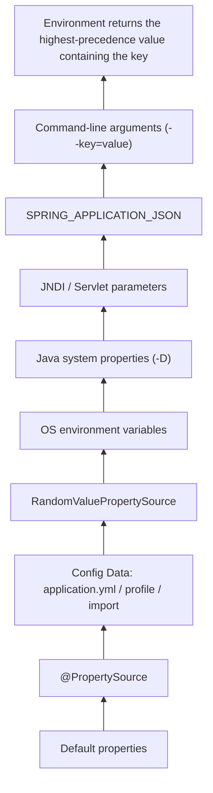
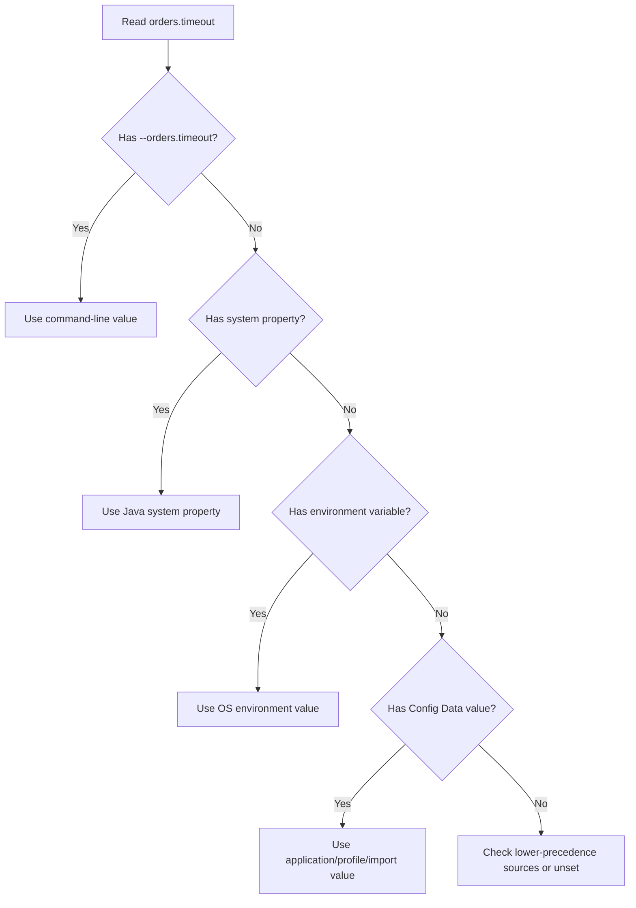

# Precedence Order Between Files, Environment Variables, System Properties, and Command-Line Arguments

## 1. Why Must You Understand Configuration Precedence?

A Spring Boot application typically receives configuration from many places: `application.yml` files, profile-specific configuration files, container environment variables, Java system properties, command-line arguments, and sometimes centralized configuration from Spring Cloud Config. These sources can declare the same key such as `server.port` or `spring.application.name` with different values.

Spring does not pick a value at random. Spring Framework's `Environment` holds multiple `PropertySource` entries in a precedence order. When multiple sources contain the same key, the higher-precedence source wins when the application reads that key. Understanding this rule helps developers explain why a file setting has no effect, why a container behaves differently from a local machine, and how to override configuration at deployment time.

This lesson belongs to the **Configuration Loading** chapter of the **SPRING_CLOUD_CORE** module. It provides the foundation for understanding externalized configuration, centralized configuration, Spring Cloud Context, and operating distributed services. After this lesson, learners can:

- Rank Spring Boot's primary configuration sources.
- Distinguish environment variables, Java system properties, and command-line arguments.
- Explain precedence inside Config Data: packaged files, external files, and profile-specific files.
- Predict the final value when the same property appears in multiple sources.
- Use `Environment`, `@ConfigurationProperties`, and diagnostic tools to find which source is winning.
- Understand how remote configuration from Spring Cloud Config can affect precedence order.

## 2. Core Principle: Ordered PropertySources

Spring Framework represents property sources using `PropertySource`. `Environment` aggregates those sources and resolves a property in order: **search from highest-precedence source to lowest, returning the first value found**.

For example, suppose the same application has:

```yaml
# application.yml
server:
  port: 8080
```

Container environment variable:

```bash
SERVER_PORT=8081
```

Java system property:

```bash
-Dserver.port=8082
```

Application runtime argument:

```bash
--server.port=8083
```

When all four values are provided in a normal Spring Boot launch, the selected port is **8083** because command-line arguments take higher precedence than system properties, environment variables, and Config Data.

Do not assume that the configuration file was "ignored." The file was still loaded; a higher-precedence source simply provided the same key.

### 2.1. General order in Spring Boot

For a normal application launch (excluding test-specific sources or DevTools), remember the order from lowest to highest as follows:

| Order | Source | Example |
| ---: | --- | --- |
| 1 | `SpringApplication` default properties | `application.setDefaultProperties(...)` |
| 2 | `@PropertySource` on configuration classes | Properties files declared via annotation |
| 3 | Config Data | `application.yml`, `application.properties`, profile files, imported files |
| 4 | `RandomValuePropertySource` | `${random.uuid}`, `${random.int}` |
| 5 | OS environment variables | `SERVER_PORT=8081` |
| 6 | Java system properties | `-Dserver.port=8082` |
| 7 | JNDI attributes | `java:comp/env` in suitable environments |
| 8 | ServletContext init parameters | Servlet context initialization parameters |
| 9 | ServletConfig init parameters | Servlet initialization parameters |
| 10 | `SPRING_APPLICATION_JSON` | JSON from environment variable or system property |
| 11 | Command-line arguments | `--server.port=8083` |

The sources in rows 7–9 only apply when running in a suitable Servlet environment. In a typical Boot application, the four most commonly compared sources are:

**Configuration file < environment variable < Java system property < command-line argument.**

The order above describes source precedence in Spring Boot; initialization order or the moment a file is read is not always the same as precedence order. Testing annotations and DevTools configuration have their own rules, covered later.

### 2.2. Configuration source diagram



This diagram focuses on common runtime sources. If the same key appears at multiple layers, a higher layer in the diagram can override a lower layer.

## 3. Distinguishing the Four Common Configuration Sources

### 3.1. Configuration files: Config Data

Spring Boot supports `application.properties` and YAML formats such as `application.yml`. This is the standard way to store defaults, environment-specific settings, and structured property groups.

Example:

```yaml
spring:
  application:
    name: order-service

server:
  port: 8080

orders:
  timeout: 3s
  retry:
    max-attempts: 3
```

Advantages:

- Can be versioned alongside source code or packaged with the artifact.
- Easy to organize by profile such as `application-dev.yml` and `application-prod.yml`.
- Supports nested structures, lists, maps, and object binding.
- Well suited for declaring sensible defaults that can be overridden at deployment.

Configuration files normally have lower precedence than environment variables, system properties, and command-line arguments. Thus, files should hold sensible defaults; the deployment environment can supply different values without rebuilding the artifact.

### 3.2. OS environment variables

Environment variables are typically set by a shell, Docker, Kubernetes, CI/CD pipelines, or the application runtime platform. Spring Boot supports relaxed binding to map variable names to properties.

Common mapping examples:

| Property | Environment variable |
| --- | --- |
| `spring.application.name` | `SPRING_APPLICATION_NAME` |
| `server.port` | `SERVER_PORT` |
| `orders.timeout` | `ORDERS_TIMEOUT` |
| `spring.cloud.service-registry.auto-registration.enabled` | `SPRING_CLOUD_SERVICE_REGISTRY_AUTO_REGISTRATION_ENABLED` |

General rules when converting a canonical property name to an environment variable:

1. Replace dots (`.`) with underscores (`_`).
2. Remove hyphens (`-`).
3. Convert everything to uppercase.

Example running on Linux:

```bash
export SERVER_PORT=8085
export SPRING_APPLICATION_NAME=order-service
java -jar order-service.jar
```

In Docker Compose, you can declare:

```yaml
services:
  order-service:
    image: example/order-service:1.0
    environment:
      SERVER_PORT: "8085"
      SPRING_APPLICATION_NAME: "order-service"
```

In Kubernetes, values can be injected into a container via `env`, `ConfigMap`, or `Secret`. Even when supplied by a ConfigMap or Secret, when the process receives it as an environment variable, Spring Boot still processes it as an environment variable source.

Note: environment variable names can be awkward for representing complex structures such as map keys with special characters or list indices. For complex properties, YAML/JSON files or `SPRING_APPLICATION_JSON` can be easier to read and less error-prone.

### 3.3. Java system properties

Java system properties belong to the JVM and are usually passed with `-Dname=value` before the JAR name or main class:

```bash
java -Dserver.port=8086 -Dspring.application.name=order-service -jar order-service.jar
```

Java programs can also read them via `System.getProperty(...)`, and Spring can access them through `Environment`.

System properties have higher precedence than environment variables. This is useful when passing JVM configuration or application configuration in the launch command. However, do not confuse `-D` with application arguments prefixed with `--`.

**Distinction:**

- `-Dserver.port=8086` is a system property received by the JVM.
- `--server.port=8087` is a command-line property received by Spring Boot.

The two forms look syntactically similar yet enter different configuration sources with different precedence levels.

### 3.4. Command-line arguments

Spring Boot can convert `--key=value` arguments into properties. Example:

```bash
java -jar order-service.jar --server.port=8087 --orders.timeout=5s
```

Command-line arguments have higher precedence than the common sources above, so they are often used to override settings for a specific run, such as ad-hoc testing or starting a container with platform-supplied arguments.

Converting command-line arguments into properties can be disabled with `SpringApplication.setAddCommandLineProperties(false)` if the application has special argument-handling requirements. When disabled, ensure other components do not expect properties generated from `--` arguments.

Avoid passing passwords, tokens, or secrets on the command line if the environment can record commands in process lists, deployment logs, or shell history. Use an appropriate secret mechanism instead.

## 4. Example: Computing the Final Value

Suppose an application has the property `orders.timeout` with these values:

| Source | Value |
| --- | --- |
| `application.yml` | `2s` |
| Environment variable `ORDERS_TIMEOUT` | `3s` |
| System property `-Dorders.timeout=4s` | `4s` |
| Command line `--orders.timeout=5s` | `5s` |

When all four sources are active simultaneously, the result is `5s`.

If the command-line argument is omitted, the winning value is `4s`. If both command-line and system property are omitted, the winning value is `3s`. If only the file remains, the value is `2s`.



This decision tree illustrates only the four primary sources. In practice, additional sources such as JSON and `RandomValuePropertySource` sit between them.

### 4.1. Example running with multiple sources

On Linux/macOS:

```bash
export SERVER_PORT=8081

java -Dserver.port=8082 \
  -jar order-service.jar \
  --server.port=8083
```

If `application.yml` declares `server.port: 8080`, the result is:

```text
server.port = 8083
```

Reason: command line beats system property; system property beats environment variable; environment variable beats Config Data.

In PowerShell, environment variable assignment syntax differs:

```powershell
$env:SERVER_PORT = "8081"
java -Dserver.port=8082 -jar order-service.jar --server.port=8083
```

Do not check precedence simply by reading the YAML file. Inspect the entire way the process is actually launched, including environment variables and JVM/application arguments.

## 5. Precedence Inside Config Data

Config Data itself has multiple layers. A file outside the JAR can normally override a file packaged inside the JAR; profile-specific files normally override shared files within the same location group.

Suppose the artifact contains:

```text
src/main/resources/application.yml
src/main/resources/application-prod.yml
```

And the deployment host adds:

```text
./application.yml
./application-prod.yml
```

With Spring Boot's default configuration, the general lowest-to-highest order across these file groups is:

1. Packaged non-profile file inside the JAR.
2. Packaged profile-specific file inside the JAR.
3. External non-profile file outside the JAR.
4. External profile-specific file outside the JAR.

Therefore, when the `prod` profile is active, `./application-prod.yml` can override the same property from `application-prod.yml` packaged inside the JAR.

Example:

```yaml
# Inside JAR: application.yml
server:
  port: 8080
orders:
  timeout: 2s
```

```yaml
# Outside JAR: application-prod.yml
server:
  port: 9080
orders:
  timeout: 4s
```

When the `prod` profile is active and the external file is found, the resolved values will be `server.port=9080` and `orders.timeout=4s`, unless overridden further by higher-precedence sources like environment variables or command-line arguments.

### 5.1. Profile-specific configuration

Profiles allow different configurations per environment:

```yaml
# application.yml
spring:
  application:
    name: order-service

orders:
  timeout: 2s
```

```yaml
# application-dev.yml
orders:
  timeout: 10s
```

```yaml
# application-prod.yml
orders:
  timeout: 3s
```

Activating a profile via environment variable:

```bash
SPRING_PROFILES_ACTIVE=prod java -jar order-service.jar
```

Or via command line:

```bash
java -jar order-service.jar --spring.profiles.active=prod
```

When multiple profiles are active simultaneously, profile order and how they are grouped/included affect the result. For profiles declared at the same level, a later profile can override an earlier profile for matching keys. Keep profile lists intentional and inspect the actually loaded configuration.

### 5.2. Imported files and configuration locations

Spring Boot supports loading additional configuration via `spring.config.import`. Imports allow another file or configuration source to participate in Config Data processing:

```yaml
spring:
  config:
    import: optional:file:./config/observability.yml
```

An imported document is inserted into Config Data order according to import rules; values in the imported document can override the document declaring the import under Boot's source ordering. When multiple imports exist, consider declaration order and import placement rather than looking only at a single root file.

Two commonly confused properties:

- `spring.config.location` replaces Config Data's default search locations.
- `spring.config.additional-location` adds search locations alongside the default locations, and those additional locations can override values found earlier.

Example:

```bash
java -jar order-service.jar \
  --spring.config.additional-location=optional:file:./deploy/
```

Properties controlling file discovery—such as `spring.config.name`, `spring.config.location`, and `spring.config.additional-location`—must be available very early during startup. Placing them inside the very file they are supposed to help Boot discover can be too late; pass them via environment variables, system properties, or command line.

If both `application.properties` and `application.yml` exist in the same location, the properties file takes precedence over the YAML file under Boot's Config Data rules. For operational clarity, standardize on one format per location instead of duplicating keys across two formats.

## 6. Additional Sources to Recognize

### 6.1. SPRING_APPLICATION_JSON

`SPRING_APPLICATION_JSON` lets you pass a JSON structure into the environment as a property source:

```bash
SPRING_APPLICATION_JSON='{"server":{"port":8090},"orders":{"timeout":"6s"}}' \
java -jar order-service.jar
```

Or via a system property:

```bash
java -Dspring.application.json='{"server":{"port":8090}}' -jar order-service.jar
```

The JSON source has higher precedence than system properties and environment variables, yet lower than command-line arguments in Boot's standard ordering. JSON is useful when passing nested structures that environment variables cannot easily express.

One notable detail: a JSON `null` value is treated as an absent value during Spring property resolution. Consequently, you cannot use `null` in JSON to erase/override a lower-precedence value in the usual way.

### 6.2. RandomValuePropertySource

Spring Boot provides placeholders such as `${random.value}`, `${random.int}`, `${random.long}`, `${random.uuid}`, and bounded forms. This source sits after Config Data and before environment variables in standard ordering.

Example:

```yaml
app:
  instance-token: ${random.uuid}
```

Do not use random values as a long-term secret management mechanism or as a stable identifier across restarts. Values are generated by Boot's random mechanism, not a secret store with lifecycle and access policies.

### 6.3. @PropertySource

Spring Framework lets you declare a properties file on a configuration class:

```java
@Configuration
@PropertySource("classpath:custom.properties")
class CustomPropertiesConfiguration {
}
```

This source has lower precedence than Config Data in Boot's ordering. Furthermore, `@PropertySource` is added during the application context refresh phase, making it unsuitable for properties needed very early at startup, such as certain `logging.*` or `spring.main.*` settings.

When the goal is primary application configuration, prefer Config Data. `@PropertySource` is better suited for clearly scoped integration cases.

### 6.4. Configuration in tests

In tests, additional sources can override application configuration:

- Properties in annotations such as `@SpringBootTest(properties = ...)`.
- `@DynamicPropertySource` for dynamic values from test infrastructure.
- `@TestPropertySource`.
- Other test-specific mechanisms in Spring Test.

These sources can take higher precedence than normal runtime configuration. That is helpful for isolated testing, yet can also allow tests to pass while production configuration is wrong. When debugging, distinguish which property wins in the test context versus which property will win in the production process.

## 7. How Spring Cloud Config Participates in Precedence

Spring Boot externalized configuration handles loading settings from files, environment variables, system properties, and command line. When multiple services need shared centralized configuration, Spring Cloud Config can add Config Server and Config Client.

In modern Config Data integration, a client can declare:

```yaml
spring:
  application:
    name: order-service
  config:
    import: optional:configserver:http://config-server:8888
```

Config Client queries Config Server by application name, profiles, and label to retrieve property sources. Those remote property sources are inserted into the client's `Environment`. **Never assume that local config always beats remote or that remote always beats every runtime source**: override behavior depends on the integration mechanism, how property sources are ordered, and the override policy permitted by Config Server.

Several key points:

- Remote property sources typically have high precedence under Spring Cloud Config's default configuration.
- Whether applications are allowed to override remote configuration is governed by settings on the Config Server/configuration source side, notably `spring.cloud.config.allowOverride`; setting this property only on the local client does not necessarily grant override permission.
- Options `spring.cloud.config.overrideNone` and `spring.cloud.config.overrideSystemProperties` can adjust how remote property sources are ordered when overrides are permitted.
- The `optional:configserver:...` syntax allows the application to continue if Config Server is unavailable under Config Data import semantics; if remote configuration is business-critical, consider omitting `optional:` so startup fails clearly.
- `spring.config.import` is the modern Config Data mechanism; older projects may use the bootstrap context. Do not mix both mechanisms without thoroughly understanding the ordering and behavior of your version.

When a value from Config Server differs from expectations, inspect the actual property sources in `Environment`, the server response, application/profile/label, override policy, and higher-precedence runtime sources. Do not just edit a local file and assume remote config will automatically follow.

### 7.1. Multi-service scenario example

Suppose `order-service` and `payment-service` both read `payments.timeout` from Config Server. Config Server supplies a default of `3s`. The production environment sets `PAYMENTS_TIMEOUT=5s`. One special launch passes `--payments.timeout=8s`.

If remote override settings allow these local sources to override remote values, the run with the command-line argument receives `8s`. If the remote policy forbids overrides, the remote property source can win over local sources depending on integration settings. Hence, local ordering alone is insufficient to predict outcomes when a remote property source is present.

## 8. Reading and Inspecting the Final Value in the Application

### 8.1. Using Environment

`Environment` is the direct API to check a resolved property:

```java
@Component
class ConfigurationInspector {
    private static final org.slf4j.Logger log =
            org.slf4j.LoggerFactory.getLogger(ConfigurationInspector.class);
    private final Environment environment;

    ConfigurationInspector(Environment environment) {
        this.environment = environment;
    }

    void logEffectivePort() {
        String port = environment.getProperty("server.port");
        // Log only non-sensitive values in appropriate environments.
        log.info("Effective server.port={}", port);
    }
}
```

`Environment.getProperty("server.port")` returns the winning value according to property source precedence. This API is helpful for diagnostics, though the final value alone does not reveal which source supplied it.

### 8.2. Binding structured configuration with `@ConfigurationProperties`

Instead of scattering many `@Value` annotations, you can bind a group of properties into a class:

```java
@ConfigurationProperties(prefix = "orders")
public record OrderProperties(
        Duration timeout,
        Retry retry
) {
    public record Retry(int maxAttempts) {}
}
```

Registering the configuration:

```java
@Configuration
@EnableConfigurationProperties(OrderProperties.class)
class OrderConfiguration {
}
```

Values can come from YAML files, environment variables, system properties, or command line. Boot performs relaxed binding and appropriate type conversion, such as converting `"3s"` into a `Duration`. For critical business configuration, add validation with appropriate annotations to catch missing or out-of-range values at startup.

### 8.3. Diagnosing property sources

When you need to identify where a property came from:

- Inspect the startup command, actual environment variables, and JVM options of the process.
- Check active profiles, discovered Config Data files, and imports.
- Use Actuator `env` and `configprops` when the corresponding endpoints are enabled and access-controlled.
- In tests, check extra test annotations and property sources.
- With Spring Cloud Config, verify application/profile/label and server override policies.

Never expose `env` or `configprops` publicly without controls because they can reveal sensitive configuration details. Apply security, sanitization, and endpoint restrictions in accordance with operational policy.

## 9. A Systematic Debugging Workflow

When a property does not receive the expected value, follow these steps in order:

1. **Identify the canonical property name.** For example, `server.port`, not confused with the environment variable name `SERVER_PORT`.
2. **List every source that could declare that key.** Check application files, profiles, imports, env, JVM options, command line, and remote Config Server.
3. **Verify which sources were actually loaded.** Was the external file mounted at the right path? Is the profile active? Did Config Server return the property source?
4. **Apply precedence order.** Check which sources hold a value and whether they have permission to override.
5. **Check binding and data types.** Is the property spelled properly, structured correctly, using valid units, and convertible?
6. **Check read timing.** Some startup-deciding properties must exist before the context completes; changing values later will not automatically reconfigure every component.
7. **Verify the value at runtime.** Read via `Environment` or a secured Actuator endpoint, then match against the actual source.
8. **Fix the authoritative source.** If the value is supplied by Helm, Compose, CI/CD, or Config Server, update it at the owning configuration source so the next deploy does not overwrite your change.

For example: `application.yml` states `server.port: 8080`, yet the application listens on port 8085. Check `SERVER_PORT`, `-Dserver.port`, `--server.port`, and JSON sources before editing the YAML file. If running in Kubernetes, check the manifest or deployment config to see which environment variables or arguments were passed into the container.

## 10. Common Errors and Misconceptions

| Misconception / Symptom | Explanation | How to Fix |
| --- | --- | --- |
| "The YAML file is always the primary configuration." | Config Data can be overridden by env, system properties, JSON, or CLI. | Inspect all property sources in precedence order. |
| "Environment variables beat every other source." | System properties and CLI take higher precedence in standard ordering. | Distinguish `SERVER_PORT`, `-Dserver.port`, and `--server.port`. |
| "`-Dserver.port` and `--server.port` are identical." | One is a JVM system property; the other is a Boot command-line property. | Check how arguments are passed by the runtime/container. |
| "Putting a property in a profile file is enough." | Environment/CLI can still override it; the profile must also be active. | Check active profiles and higher-precedence sources. |
| "`@PropertySource` works for all startup properties." | The annotation is processed during context refresh, which may be too late for very early properties. | Use Config Data or a source available before startup. |
| "`null` in `SPRING_APPLICATION_JSON` clears lower values." | JSON null is treated as no value during property resolution. | Use explicit configuration design instead of relying on null to clear values. |
| "Config Server is always overridden locally." | Remote sources have their own precedence and override policies. | Check server-side override config and actual property sources. |
| "Passing tests mean production gets the same config." | Test annotations and dynamic properties can override runtime sources. | Verify configuration in the real runtime environment. |
| "Editing a config file while the app runs updates all beans automatically." | New values do not automatically refresh every singleton or startup property. | Check reload/refresh mechanisms, scopes, and bean limitations. |

## 11. Principles for Managing Configuration in Distributed Systems

- **One owning source per configuration group:** put defaults in files, environment-specific overrides in deployment config, and centralized values in Config Server if used.
- **Keep override layers intentional:** avoid declaring the same key across too many layers, which makes runtime behavior hard for operators to predict.
- **Never package secrets into artifacts:** use a secret manager, environment/secret injection, or another proper mechanism; avoid putting secrets on command lines or in logs.
- **Distinguish startup configuration from runtime configuration:** ports, web application types, and many initialization settings must be finalized before context completion; refresh does not replace restart for every property type.
- **Manage compatibility:** Spring Boot and Spring Cloud follow release-train compatibility matrices. When changing versions, re-verify Config Data, bootstrap behavior, starters, and override policies.
- **Verify configuration as part of operations:** validate effective values, supplying sources, and active profiles in each deployment environment.
- **Protect configuration information:** diagnostic endpoints can expose settings; expose them only behind secured access controls.

## 12. References

- [Spring Boot — Externalized Configuration](https://docs.spring.io/spring-boot/reference/features/external-config.html): PropertySource precedence, Config Data, profiles, environment variables, system properties, and command line.
- [Spring Framework — Environment Abstraction](https://docs.spring.io/spring-framework/reference/core/beans/environment.html): `Environment`, `PropertySource`, and property resolution mechanics.
- [Spring Boot — Type-safe Configuration Properties](https://docs.spring.io/spring-boot/reference/features/external-config.html#features.external-config.typesafe-configuration-properties): binding and type conversion for structured configuration.
- [Spring Cloud Config](https://docs.spring.io/spring-cloud-config/reference/): Config Server/Client, Config Data import, and remote property source override policies.
- [Spring Cloud — Project and Release Trains](https://spring.io/projects/spring-cloud): checking Spring Cloud compatibility with Spring Boot.

**Remember:** In standard Spring Boot configuration, Config Data files form the baseline; environment variables can override files, Java system properties override environment variables, and command-line arguments take higher precedence than those sources. When profiles, imports, or Spring Cloud Config are involved, also account for ordering within Config Data and remote override policies to determine the exact final value.
