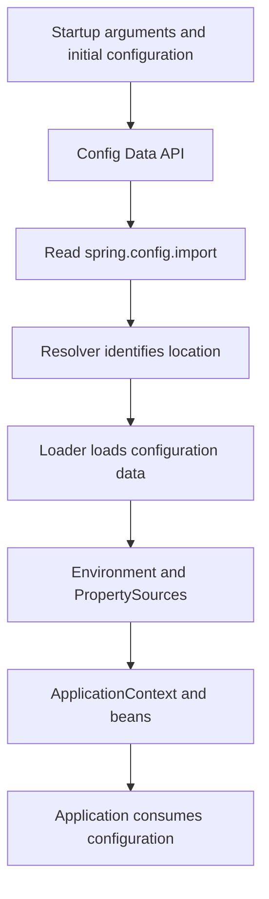
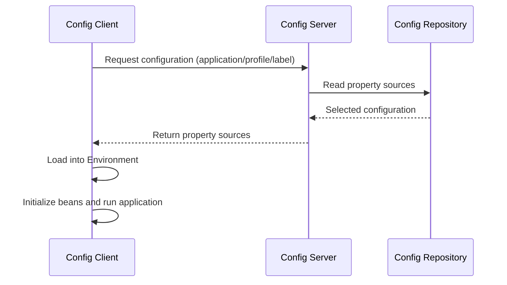

# Importing Configuration with `spring.config.import`

A Spring Cloud application often needs to combine configuration packaged with the artifact with environment-specific or centrally managed configuration. Spring Boot provides the **Config Data API** to locate and load configuration sources while preparing the `Environment`. The `spring.config.import` property is the central declaration point for this mechanism: an application can import additional local files, configuration trees, or data from Spring Cloud Config Server.

Understanding `spring.config.import` properly helps learners determine which configuration is present before beans are created, what happens when a configuration source is unreachable, and how profiles and import ordering affect final values. This is foundational knowledge for the **`SPRING_CLOUD_CORE`** module: understanding Spring Cloud Context, externalized configuration, Spring Boot compatibility, refresh scope, discovery, service registries, and service communication.

## 1. What Problem Does `spring.config.import` Solve?

Before the Config Data API existed, applications could load extra files via various configuration mechanisms or use a bootstrap context in certain Spring Cloud integrations. Spring Boot 2.4 introduced the Config Data API to standardize how configuration data is discovered and loaded. Modern Spring Cloud Config Client versions integrate with this mechanism via locations prefixed with `configserver:`.

Instead of writing custom file-reading code or making HTTP calls in `@PostConstruct`, an application declares its configuration sources upfront:

```properties
spring.config.import=optional:file:./config/extra.properties
```

At startup, Spring Boot processes the declared location, loads the appropriate data, and adds property sources to `Environment`. Beans created afterward can consume those resolved values via `@Value`, `@ConfigurationProperties`, or `Environment`.



This diagram shows the high-level flow. Each location type has a corresponding resolver/loader; for example, `file:` is supported built-in by Spring Boot, while `configserver:` is provided by Spring Cloud Config Client. Custom config data locations can contribute their own mechanisms.

**Important point:** `spring.config.import` participates in configuration loading at startup. It does not continuously watch files or servers to update every bean in a running application. Refreshing configuration after startup is a separate topic involving Spring Cloud Context and an appropriate refresh mechanism.

## 2. Syntax and General Principles

The property can be declared in `application.properties`:

```properties
spring.config.import=optional:file:./config/extra.properties
```

Or in `application.yml`:

```yaml
spring:
  config:
    import: "optional:file:./config/extra.yml"
```

A location can consist of:

- **Source type prefix:** `file:`, `classpath:`, `configtree:`, or an integration-provided prefix such as `configserver:`.
- **Address/location:** a file path, directory, URL, or identifier understood by the corresponding resolver.
- **The `optional:` prefix (when needed):** allows the application to proceed when an optional location is unavailable under loader rules.

Multiple locations can be declared as a comma-separated list:

```properties
spring.config.import=optional:file:./config/local.properties,optional:configserver:
```

Import order within a single declaration affects precedence. Imports are processed in declaration order; when keys overlap, an import appearing later can override an earlier import. In addition, imported data has higher precedence than the configuration document declaring that import. Consider profiles and other property sources as well when determining the final value.

`spring.config.import` can be supplied from an initial configuration source such as `application.yml`, the `SPRING_CONFIG_IMPORT` environment variable, or command-line arguments. Because Boot needs to know the location to fetch data, you cannot rely solely on a `spring.config.import` value living inside a remote source the application does not yet know how to reach.

## 3. Importing Local Configuration Files

### 3.1. Using `file:` to import files outside the artifact

Suppose the deployment layout is:

```text
catalog-service/
  catalog-service.jar
  config/
    catalog-extra.yml
```

The `application.yml` packaged with the application:

```yaml
spring:
  application:
    name: catalog-service
  config:
    import: "optional:file:./config/catalog-extra.yml"
```

Contents of `catalog-extra.yml`:

```yaml
catalog:
  search:
    page-size: 40
    include-discontinued: false
```

Once the location is loaded, a bean can receive those values:

```java
import org.springframework.boot.context.properties.ConfigurationProperties;

@ConfigurationProperties(prefix = "catalog.search")
public class CatalogSearchProperties {
    private int pageSize = 20;
    private boolean includeDiscontinued;

    public int getPageSize() {
        return pageSize;
    }

    public void setPageSize(int pageSize) {
        this.pageSize = pageSize;
    }

    public boolean isIncludeDiscontinued() {
        return includeDiscontinued;
    }

    public void setIncludeDiscontinued(boolean includeDiscontinued) {
        this.includeDiscontinued = includeDiscontinued;
    }
}
```

The properties class still must be registered via `@ConfigurationPropertiesScan` or `@EnableConfigurationProperties`. A successful import only places keys into `Environment`; it does not automatically register Java classes that consume them.

The path `./config/catalog-extra.yml` is relative to the process working directory. Inside a container or service manager, the working directory may differ from a developer machine. For predictable paths, use an environment-appropriate absolute path, or mount configuration directories into a standardized location.

### 3.2. Using `classpath:` when configuration lives inside the artifact

If a file is packaged on the classpath, it can be imported using `classpath:`:

```properties
spring.config.import=classpath:defaults/catalog-defaults.yml
```

This suits baseline defaults released alongside the application. If contents must vary independently per environment without rebuilding the artifact, consider external sources such as `file:` or Config Server.

### 3.3. Using `optional:` intentionally

If an external file only provides supplementary overrides, you can use `optional:` so the application still starts when the file does not exist:

```properties
spring.config.import=optional:file:./config/developer-overrides.properties
```

If the file is a mandatory source, omit `optional:`:

```properties
spring.config.import=file:/etc/catalog/required-settings.yml
```

Then, failing to find or read the source under loader rules causes configuration loading to fail. This is appropriate when running without the configuration means the application cannot serve safely.

Do not attach `optional:` to every source out of habit. If the application needs critical service URLs, connection details, or protective thresholds, silently skipping a configuration source can leave beans with unsafe defaults and cause failures later. Classify locations as mandatory or optional based on business requirements.

## 4. Importing Configuration from Spring Cloud Config Server

Spring Cloud Config Server provides externalized configuration for multiple applications. Config Client queries configuration by application name, profiles, and label; data is commonly managed in Git or another supported backend. With the Config Data API, locations prefixed with `configserver:` are the integration point for clients to fetch data from the server during startup.

### 4.1. Declaring the Config Client dependency

The application needs Spring Cloud Config Client on its classpath. With Maven, the dependency is typically declared via the starter with versions managed by the Spring Cloud BOM:

```xml
<dependency>
    <groupId>org.springframework.cloud</groupId>
    <artifactId>spring-cloud-starter-config</artifactId>
</dependency>
```

With Gradle:

```groovy
dependencies {
    implementation "org.springframework.cloud:spring-cloud-starter-config"
}
```

Do not hardcode a starter version manually if the project already uses the Spring Cloud BOM properly. Cross-check the release train against the Spring Boot version before selecting dependencies.

### 4.2. Declaring the Config Server location

A common configuration in `application.yml`:

```yaml
spring:
  application:
    name: catalog-service
  config:
    import: "optional:configserver:"

  cloud:
    config:
      uri: http://localhost:8888
      label: main
```

Here:

- `spring.application.name` is the application name sent by the client to Config Server, typically used to select the matching configuration set.
- `spring.config.import` declares that Config Data should fetch additional data from Config Server.
- `optional:` allows the application to continue if Config Server is unavailable under Config Client semantics; when reachable, data from the server is still imported.
- `spring.cloud.config.uri` specifies the server address when the `configserver:` location does not include a URL directly. The default is typically `http://localhost:8888` if unconfigured.
- `spring.cloud.config.label` chooses the server-side configuration label/branch/tag according to backend support; `main` in the example is illustrative.

If Config Server is a mandatory dependency for proper startup, omit `optional:`:

```yaml
spring:
  config:
    import: "configserver:http://config.internal:8888"
```

In this example, the URL is specified directly in the location. Either `spring.cloud.config.uri` or an inline URL works; pick one consistent style so effective configuration stays easy to inspect.

**Note:** When using Config Data import, you do not need to enable the legacy bootstrap context just to fetch Config Server settings through the modern mechanism. An older project might still use `bootstrap.yml` with `spring-cloud-starter-bootstrap`; when migrating, identify clearly which mechanism is active and avoid overlapping configurations that obscure value origins.

### 4.3. Which configuration does Config Server select?

Config Client typically sends the application name, active profiles, and label. Example:

```text
application = catalog-service
profiles   = prod
label      = main
```

Config Server uses this information to find matching property sources. The application name normally comes from `spring.application.name`; profiles match the client's active profiles; label identifies the configuration branch/version on the backend, depending on server configuration.

Therefore, when receiving unexpected configuration, check all of these together:

1. Does the client have the right `spring.application.name`?
2. Which profiles are actually active at startup?
3. Does the label match the intended configuration branch/tag?
4. Is Config Server reading the right repository/backend and revision?
5. Are multiple imports or other property sources overriding received values?

Do not infer selected configuration purely from filenames in Git. Inspect the Config Server response in permitted environments, client logs, and final property sources.

### 4.4. Connection configuration must be available early enough

To reach Config Server, the client must know the endpoint and required identity details before fetching remote configuration. Bootstrap values such as URL, credentials, TLS, and service discovery for locating Config Server must be provided from sources accessible to the client during the Config Data phase.

For instance, if Config Server requires authentication, credentials can be supplied via securely managed secrets/environment mechanisms and corresponding Config Client properties. Avoid embedding passwords or tokens in URLs, committed configuration files, or startup logs.

## 5. `optional:` and Policies When a Source Is Unavailable

Deciding whether a configuration source is mandatory or optional directly affects startup reliability.

| Declaration | Operational Meaning | Appropriate Use Case |
| --- | --- | --- |
| `configserver:` | Mandatory import; access/loading failures can fail startup | Application cannot operate safely without centralized configuration |
| `optional:configserver:` | Unreachable Config Server can be skipped to continue startup | Application has safe defaults or a clearly designed degraded mode |
| `file:/etc/app/required.yml` | Mandatory file | File contains indispensable configuration |
| `optional:file:./local-overrides.yml` | File may be absent | Local overrides used only in certain environments |

With Config Server, two design choices are common:

**Require centralized configuration:**

```properties
spring.config.import=configserver:http://config.internal:8888
```

If the server is unreachable or loading fails, startup reports an error so the deployment platform does not put a misconfigured instance into service.

**Allow startup when the server is temporarily absent:**

```properties
spring.config.import=optional:configserver:http://config.internal:8888
```

The application can run with remaining configuration. This is safe only if defaults/local sources are sufficient for permitted operating modes. For example, a service might start yet refuse to process payments if risk limits are missing; readiness checks or guard logic must reflect that condition.

Do not confuse `optional:` with retry. `optional:` determines whether the application may skip an unavailable location; retry is a policy for reattempting connections/fetches over a period. Retry behavior and supporting properties depend on the Spring Cloud Config Client version. If retry is needed, check documentation for your release train and test timeout, DNS, authentication, and server error scenarios.

Spring Boot also offers global properties such as `spring.config.on-not-found=ignore` to ignore certain missing config location errors. This setting has a broader scope than marking a single location `optional:`; use it only when you fully understand every affected source so mandatory files are not silently masked.

## 6. Precedence and Multiple Import Sources

### 6.1. Imports take precedence over the declaring document

Example `application.yml`:

```yaml
catalog:
  search:
    page-size: 20

spring:
  config:
    import: "file:./config/search-overrides.yml"
```

And `search-overrides.yml`:

```yaml
catalog:
  search:
    page-size: 50
```

Imported values can override values in the document declaring the import, so the effective `page-size` is `50` in this simple example.

### 6.2. Order of multiple imports

Suppose:

```properties
spring.config.import=file:./config/base.properties,file:./config/environment.properties
```

If both files declare the same key, an import appearing later has higher precedence than an earlier import in processing order. Hence, in the example above, `environment.properties` can override `base.properties`.

Order imports cleanly: baseline sources first, environment sources next, and intentional overrides last. However, also account for property sources outside the import list, profile-specific configs, command-line arguments, and integration-specific rules.

### 6.3. Profile-specific configuration

Spring Boot can load profile-specific configuration documents, such as `application-prod.yml`, or use multi-document YAML with `spring.config.activate.on-profile`. An imported location can contain profile-specific documents; Boot processes them according to active profiles and Config Data rules.

Multi-document example:

```yaml
catalog:
  client:
    connect-timeout: 2s
---
spring:
  config:
    activate:
      on-profile: prod

catalog:
  client:
    connect-timeout: 800ms
```

The second document applies only when the `prod` profile is active. Do not put `spring.profiles.active` or `spring.profiles.default` inside a document activated conditionally by a profile; specify profiles in a configuration source independent of that condition.

If an import appears only inside a profile-activated document, that location also depends on whether that profile is active. When debugging, record actual active profiles rather than merely reading filenames.

## 7. Importing Secrets with `configtree:`

In containers, Kubernetes, or other deployment platforms, secrets can be mounted as files in a directory. The Config Data API supports `configtree:` to map filenames to property keys and file contents to property values.

Suppose the mount contains:

```text
/run/secrets/
  catalog.api-key
  database.username
  database.password
```

Declaration:

```properties
spring.config.import=optional:configtree:/run/secrets/
```

Filenames become keys such as `catalog.api-key`, `database.username`, and `database.password`; each file's contents become the corresponding value. The application can bind them with `@ConfigurationProperties` or retrieve them via `Environment`.

```java
import org.springframework.beans.factory.annotation.Value;
import org.springframework.stereotype.Component;

@Component
public class CatalogApiCredentials {
    private final String apiKey;

    public CatalogApiCredentials(@Value("${catalog.api-key}") String apiKey) {
        this.apiKey = apiKey;
    }
}
```

For mandatory secrets, consider omitting `optional:` so missing mounts fail startup. Never log secret values, and never expose secret contents in exceptions, messages, or unsecured management endpoints. File permissions and secret rotation are the provisioning platform's responsibility.

## 8. Integrating Config Server via Service Discovery

In some architectures, the Config Server address is not static and instead is registered in a service registry. Config Client can use discovery-first lookup if the matching discovery integration is configured.

Conceptual example:

```yaml
spring:
  application:
    name: catalog-service
  config:
    import: "optional:configserver:"
  cloud:
    config:
      discovery:
        enabled: true
        service-id: configserver
```

When discovery-first is enabled, the client needs a matching discovery client implementation and the registry must be available early enough to locate Config Server. The name `configserver` in the example is an illustrative service ID; it must match the actual registered ID.

Discovery-first adds a dependency step: to fetch configuration, the client must reach the registry first; if the registry is unavailable, the client may fail to find Config Server. For systems with a stable configuration endpoint, a direct URI can be simpler. Choose based on routing requirements, availability, and infrastructure bootstrap capabilities.

## 9. `spring.config.import` Is Not a Runtime Refresh Mechanism

This is a common misconception: editing a configuration file or pushing a new Git commit to Config Server **does not automatically make running instances re-read data** merely because they declare `spring.config.import`.

Distinguish the phases:

| Phase | Mechanism | Outcome |
| --- | --- | --- |
| Startup | Config Data API and `spring.config.import` | Loads property sources to prepare `Environment` before beans consume config |
| Refreshing one instance | Spring Cloud Context refresh mechanism, e.g., an appropriate enabled endpoint | Updates `Environment`/refresh scope per instance capabilities |
| Broadcasting across instances | Spring Cloud Bus or equivalent orchestration | Sends events so clients receive and process refreshes; not a cluster-wide atomic transaction |
| Rollout/restart | Deployment platform replaces or restarts instances | Reloads Config Data from scratch for current artifact and environment |

Initial startup flow:



Post-startup refresh is a separate workflow. When using `@RefreshScope`, only target beans inside that scope that can be recreated are refreshed by that mechanism. When multiple replicas exist, each replica must receive and process the event or undergo rollout; you cannot infer cluster-wide state from a single instance's response.

## 10. Security and Operations for Configuration Sources

Config Server and external configuration files can hold sensitive information or directly alter service behavior. When designing imports, pay attention to:

1. **Authentication and authorization:** only authorized clients may access the configuration of a given application.
2. **TLS:** use protected connections when transmitting configuration data across untrusted networks.
3. **Secret management:** prefer secret stores or secure provisioning mechanisms; never commit plaintext passwords or tokens into configuration repositories.
4. **Label/revision management:** know clearly which branch, tag, or revision clients read; maintain review and rollback procedures for changes.
5. **Auditing:** record who changed configuration and which instances received the change.
6. **Readiness:** do not mark an instance ready if essential configuration failed to load or validation did not pass.
7. **Masking:** restrict Actuator `env` and `configprops`; these endpoints can leak keys or sensitive data even when some values are masked by default.

Never use `optional:` to bypass authentication or TLS errors. If Config Server is a mandatory source, credential or certificate failures should surface clearly at startup and be resolved through proper provisioning workflows.

## 11. Troubleshooting Common Errors

| Symptom | Possible Cause | Where to Check |
| --- | --- | --- |
| `Config data location ... does not exist` | Wrong local file path or missing mount | Check working directory, absolute path, filename, and read permissions |
| `No spring.config.import property has been defined` or Config Client import requirement error | Config Client requires Config Data import but import config is missing | Verify `spring.config.import` in initial source and active profile |
| Cannot connect to Config Server | URI, DNS, port, network policy, TLS, or server not ready | Check effective URL, server/client logs, and connectivity from inside the container |
| Client receives configuration for another application | Wrong `spring.application.name` or mismatched server-side config | Check application/profile/label in request and response |
| Local value does not override remote value as expected | Property source precedence or server-side override policy | Inspect property sources and version-specific `allowOverride`/override settings |
| Application runs with defaults despite Config Server error | Import is optional and app continues with remaining sources | Verify optional/required policy, validation, and readiness |
| Git changes do not appear in running application | Import loads only at startup; client has not refreshed or restarted | Check refresh/bus/rollout workflow and status of each instance |
| Works locally but container cannot find file | Relative path depends on working directory or different volume mount | Check working directory, mount path, and file permissions inside the container |

### Recommended diagnostic sequence

1. Record command-line flags, environment variables, active profiles, and application name.
2. Confirm `spring.config.import` was actually read from an initial source.
3. Identify which locations are required and which carry the `optional:` prefix.
4. Verify URIs/paths, DNS, read permissions, credentials, TLS, and networking from inside the actual runtime environment.
5. Inspect which configuration Config Server returns for the given application/profile/label.
6. Identify which property source provides the final value and whether any key was overridden.
7. Verify validation and values bound into consuming beans.
8. If an issue happens after startup, separate runtime refresh issues from initial Config Data import failures.

In protected environments, Actuator `env` and `configprops` can help inspect property sources and bindings. Enable only necessary endpoints, enforce network/authentication restrictions, and verify masking before use.

## 12. Testing `spring.config.import`

Testing should cover available sources, missing sources, and invalid data.

| Scenario | How to Test | What to Assert |
| --- | --- | --- |
| Mandatory imported file exists | Start context with test file | Properties load and bind accurately |
| Mandatory imported file is missing | Use non-existent path without `optional:` | Startup fails with an identifiable error |
| Optional imported file is missing | Use non-existent path with `optional:` | Application continues per default design |
| Multiple imports share keys | Put different values in each source | Result matches expected precedence order |
| Profile-specific document | Start with and without matching profile | Only matching profile documents apply |
| Config Server available | Use test server or integration environment | Client sends correct application/profile/label and receives property sources |
| Config Server unavailable | Stop server or simulate timeout | Mandatory import fails; optional import continues if semantics permit |
| Secret config tree | Mount test directory with key/value files | Keys map properly and secrets never appear in logs |
| Post-startup refresh | Update source, invoke appropriate refresh mechanism | Assert `Environment`, bean scopes, and each instance independently |

### Example test with a temporary configuration file

You can create a test file outside the classpath and start the application with an import pointing to it. With `@SpringBootTest`, supply the location via an early property during context creation:

```java
import org.springframework.boot.test.context.SpringBootTest;
import org.springframework.test.context.TestPropertySource;

@SpringBootTest
@TestPropertySource(properties = {
    "spring.config.import=optional:file:./src/test/resources/test-extra.properties"
})
class ConfigImportIntegrationTest {
    // Inject property beans and assert the bound values.
}
```

This illustrates supplying the property in a test; Config Data import handling may need verification against your test context startup style and exact Boot version. For Config Server tests, use a dedicated test server/fixture or HTTP mocks at the client boundary; avoid depending on production servers in unit tests.

## 13. Practice: Importing Configuration for `catalog-service`

Suppose `catalog-service` needs local default settings, an optional override file, and Config Server in staging/production environments.

**Step 1 — Declare application name and imports:**

```yaml
spring:
  application:
    name: catalog-service
  config:
    import: "optional:file:./config/catalog-local.yml,optional:configserver:"
  cloud:
    config:
      uri: https://config.internal.example
      label: main
```

**Step 2 — Declare safe defaults in `application.yml`:**

```yaml
catalog:
  client:
    connect-timeout: 2s
    enabled: false
```

**Step 3 — Declare environment-specific configuration on Config Server:**

```yaml
catalog:
  client:
    connect-timeout: 800ms
    enabled: true
```

**Step 4 — Verify:** check Config Client logs, sent application/profile/label, property sources, and bound values. Test starting while Config Server is unreachable to prove the application genuinely operates safely under its defaults and readiness policy.

**Step 5 — Review for production:** if Config Server is a mandatory source, remove `optional:` from that location. If the local override file is developer-only, ensure it is neither mounted nor used in production. Protect URIs/credentials, verify TLS, and inspect every replica after rollout.

### Self-check questions

1. At which stage of startup is `spring.config.import` processed?
2. How does the `optional:` prefix change behavior when a location is unavailable?
3. Why do `spring-cloud-starter-config` and `configserver:` serve different roles?
4. Which pieces of information does Config Server use to select configuration for a client?
5. If two imports define the same key, what does declaration order mean?
6. Why do Git repository changes not automatically update running beans?
7. When Config Server is a mandatory source, why should the import not remain optional?
8. When using `configtree:`, what do filenames and file contents map to?

**Suggested answers:** (1) During the Config Data phase preparing `Environment` before configuration-consuming beans are initialized; (2) Allows skipping an optional location per loader rules; (3) The starter brings Config Client onto the classpath, while `configserver:` declares the location to import; (4) Application name, active profiles, and label; (5) A later import can override an earlier import; (6) Import is a startup loading mechanism, whereas refresh is a separate process; (7) Because the application could start missing essential configuration; (8) Filenames become property keys and contents become property values.

## 14. Principles to Remember

- `spring.config.import` declares Config Data sources to load at startup; corresponding resolvers/loaders handle the locations.
- `file:`, `classpath:`, `configtree:`, and `configserver:` serve different source types; locations must match the actual runtime environment.
- `optional:` is a deliberate decision about skipping unavailable sources. Use it only when the application has safe defaults or a safe fallback operating mode.
- Spring Cloud Config Client requires the matching dependency and `configserver:` import; Config Server selects data using application/profile/label.
- Import order, profiles, and other property sources determine final values. Trace value origins rather than reading only one file.
- Startup imports do not automatically refresh beans or synchronize multiple replicas. Refresh scope, Bus, and rollouts are separate mechanisms.
- Test required/optional imports, missing sources, precedence order, profiles, Config Server failures, secrets, and post-refresh state.

Once you understand how `spring.config.import` feeds configuration into `Environment`, you can clearly separate configuration loading, bean binding, and runtime refresh. This is the foundation for building Spring Cloud applications with clear, testable configuration that operates consistently across multi-instance deployments.
