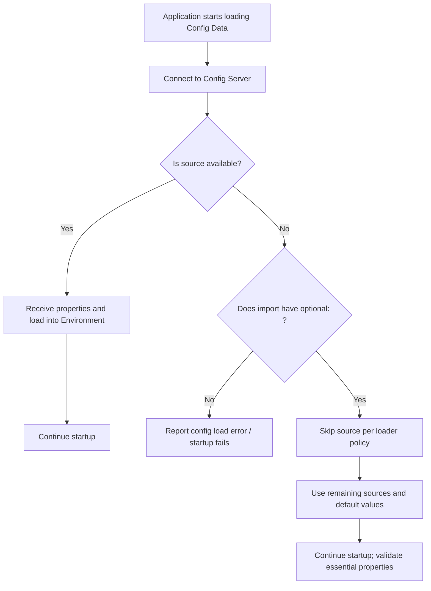

# Mandatory Sources, Optional Sources, and Behavior When Missing

A Spring Boot application can obtain configuration from many places: classpath files, external files, environment variables, command-line arguments, Config Server, or a secret directory mounted into a container. When a configuration source does not exist or is temporarily unreachable, should the application stop starting or continue running with the remaining configuration? The answer depends on whether that source is declared as **mandatory** or **optional**.

In the **SPRING_CLOUD_CORE** module, this topic connects Spring Boot's externalized configuration with Spring Cloud Config Client and Spring Cloud Context mechanisms. Designers must clearly separate three questions: must the configuration source be present, must a critical property have a value, and what will the application do when the source is unavailable.

## 1. Configuration Sources and Why They Must Be Classified

An application can combine many sources:

| Source | Example | Where Provided |
| --- | --- | --- |
| Application default configuration | `application.yml` | Classpath inside the artifact |
| Environment-specific configuration | `application-prod.yml` | Classpath or filesystem |
| External deployment configuration | `/etc/myapp/application.yml` | Host/container |
| Environment variables | `SERVER_PORT=8081` | Process environment |
| Command-line arguments | `--server.port=8081` | Launch command |
| Centralized configuration | Spring Cloud Config Server | Network service |
| Directory-tree secrets | `/run/secrets/db/password` | Mounted volume or secret store |

Not every source carries equal importance. A supplementary file intended for developers may not exist in production while the application still runs properly. Conversely, if production requires fetching connection details or security policies from Config Server, continuing with missing configuration could cause the application to start misconfigured or operate unsafely.

**Mandatory/optional is a policy applied to a declared source**, not a blanket label for every property in the application.

## 2. How Mandatory Sources and Optional Sources Differ

In Spring Boot's Config Data mechanism, an imported location without the `optional:` prefix is treated as mandatory. If the location cannot be found or loaded as required, startup can fail.

When adding the `optional:` prefix, the application can continue starting if that location does not exist or the corresponding source is unavailable according to how the loader handles it. Properties not retrieved from an optional source do not magically appear in `Environment`; the application uses values from other sources or defaults if defined.

| Aspect | Mandatory Source | Optional Source |
| --- | --- | --- |
| Config Data declaration | `file:...`, `classpath:...`, `configserver:...` | `optional:file:...`, `optional:classpath:...`, `optional:configserver:...` |
| When source is missing/unavailable | Normally fails startup | Source can be skipped and startup continues |
| Properties from source | Loaded if source is valid | Loaded when source exists and is readable |
| When property is absent from other sources | Does not synthesize a value | Does not synthesize a value |
| Purpose | Safeguards essential configuration preconditions | Allows supplementary or environment-conditional config |

Distinguish an **optional source** from an **optional property**. For example, a Config Server declared optional might be unavailable while the application still starts. Yet if the application needs `payment.api-key` to process transactions, an optional source failing to supply that property does not make the property optional. The application still needs the value from another source or must fail via configuration validation.

## 3. The `optional:` Syntax in `spring.config.import`

Spring Boot Config Data supports declaring additional sources with `spring.config.import`. For instance, a local file can import another configuration file:

```yaml
spring:
  config:
    import: "optional:file:./config/extra.yml"
```

If `./config/extra.yml` does not exist, the application can proceed without loading that file. If the file is present and valid, its properties enter `Environment` construction under Config Data rules.

If the file must be present, omit the `optional:` prefix:

```yaml
spring:
  config:
    import: "file:./config/required.yml"
```

When a mandatory file does not exist, the application cannot finish loading configuration and startup fails.

Multiple imports can be declared, separated by commas:

```properties
spring.config.import=optional:file:./config/local.yml,optional:file:./config/feature-flags.yml
```

For each location, the optional or required decision is expressed directly in the declaration. Document the purpose of each source clearly so operators understand why a file is allowed to be absent.

### 3.1. Classpath and filesystem

Example importing a file on the classpath:

```properties
spring.config.import=optional:classpath:/defaults/extra.yml
```

Example importing a file on the filesystem:

```properties
spring.config.import=optional:file:/etc/order-service/extra.yml
```

The two locations carry different meanings:

- `classpath:` finds resources packaged with or supplied on the application's classpath.
- `file:` finds resources on the runtime environment's filesystem.
- Relative `file:` paths are interpreted against the process working directory, so define the working directory explicitly during deployment.

You can import a configuration directory rather than a single file; when using a directory location, syntax and separators must follow Spring Boot's Config Data rules. In deployments, absolute paths are usually easier to control than relative paths.

### 3.2. Optional does not hide every file error

The `optional:` prefix indicates that the application may skip a missing/unavailable source under loader rules. It is not a mechanism to "swallow every exception."

For example, a file that exists yet contains invalid YAML syntax, unparseable structure, or content causing binding failures can still make the application fail. Permission errors, authentication errors, and server errors may also be handled specifically by each location type and loader. Never use optional as a way to hide broken configuration.

## 4. With Spring Cloud Config Server: Choosing Mandatory or Optional

Spring Cloud Config Client can retrieve configuration from Config Server via Config Data import. In modern Config Data–based setups, an application commonly declares:

```yaml
spring:
  application:
    name: order-service
  config:
    import: "optional:configserver:"

  cloud:
    config:
      uri: http://localhost:8888
```

In this example:

- `spring.application.name` is the application name Config Client uses in configuration requests.
- `spring.cloud.config.uri` specifies the Config Server address.
- `optional:configserver:` allows the application to continue startup if Config Server is unavailable according to the Config Data loader's handling.

If centralized configuration is mandatory, omit `optional:`:

```yaml
spring:
  application:
    name: order-service
  config:
    import: "configserver:"

  cloud:
    config:
      uri: http://config.internal:8888
```

With a mandatory import, if Config Server cannot be reached while loading configuration, the application will not complete startup. This is the right choice when running without centralized configuration would cause business errors or violate operational requirements.

### 4.1. Decision diagram when Config Server is unavailable



This diagram illustrates the case where Config Server is unavailable. Errors such as malformed server configs, property parsing errors, or authentication failures may behave differently. Inspect specific exceptions and logs rather than assuming `optional:` ignores all errors.

### 4.2. Optional Config Server does not mean the app is always safe when the server is down

Suppose `order-service` retrieves these properties from Config Server:

```yaml
payment:
  gateway:
    base-url: https://payments.example.internal
    api-key: ${PAYMENT_API_KEY}
    connect-timeout: 2s
```

If Config Server is unavailable and the import is optional, the application can continue with local configuration. Yet without `payment.gateway.api-key`, the application cannot call the payment gateway properly.

Therefore, after allowing a source to be absent, determine:
- Which properties have safe defaults?
- Which properties are supplied by a secret store or environment?
- Which properties must be present before the application accepts traffic?
- If an essential property is missing, should the application fail startup or enter a not-ready state?

Never put dummy values or empty strings for credentials just to get past startup.

### 4.3. Version and bootstrap mechanism notes

The `spring.config.import` examples in this lesson use Spring Boot's **Config Data API** (introduced in Spring Boot 2.4) together with a Spring Cloud Config Client version supporting the `configserver:` location. For legacy projects using the bootstrap context mechanism, settings may live in `bootstrap.yml`, and fail-fast/Config Client initialization differs from Config Data. Do not copy `spring.config.import` verbatim into a project that does not yet support it.

Before adopting it, check the Spring Cloud release train compatible with your Spring Boot version, your Config Client version, and the documentation for that exact release train. A BOM aligns Spring Cloud module versions together; it does not automatically migrate a legacy project to Config Data.

## 5. Fallbacks: Where Do Values Come From When a Source Is Missing?

When an optional source is skipped, Spring does not invent replacement values. Effective values can come from:

1. Another property source declaring the same key.
2. A default value declared in a placeholder or binding.
3. A default value initialized in the configuration class.
4. No value at all, in which case the application must handle the absence.

Example placeholder with a default:

```yaml
feature:
  recommendation:
    enabled: ${FEATURE_RECOMMENDATION_ENABLED:false}
```

If no environment variable or other property source provides `FEATURE_RECOMMENDATION_ENABLED`, the default value is `false`.

Example using `@Value`:

```java
@Value("${feature.recommendation.enabled:false}")
private boolean recommendationEnabled;
```

Example using `@ConfigurationProperties`:

```java
import org.springframework.boot.context.properties.ConfigurationProperties;

@ConfigurationProperties(prefix = "feature.recommendation")
public class RecommendationProperties {
    private boolean enabled = false;

    public boolean isEnabled() {
        return enabled;
    }

    public void setEnabled(boolean enabled) {
        this.enabled = enabled;
    }
}
```

In all three cases, the fallback is an explicit application decision. It is not an automatic side effect of `optional:`.

### 5.1. Optional sources and mandatory properties can coexist

An extra configuration file can be optional while a specific property remains mandatory:

```yaml
spring:
  config:
    import: "optional:file:./config/feature-overrides.yml"

payment:
  gateway:
    base-url: ${PAYMENT_GATEWAY_URL}
```

The feature override file is allowed to be missing. Yet if `PAYMENT_GATEWAY_URL` is absent from every source, the unresolved placeholder can fail binding or startup. This separates source flexibility from business configuration requirements.

## 6. Validating Essential Properties with `@ConfigurationProperties`

For critical configuration, group properties into a strongly typed class and validate constraints at startup.

Example:

```java
import jakarta.validation.constraints.NotBlank;
import java.time.Duration;
import org.springframework.boot.context.properties.ConfigurationProperties;
import org.springframework.validation.annotation.Validated;

@Validated
@ConfigurationProperties(prefix = "payment.gateway")
public class PaymentGatewayProperties {
    @NotBlank
    private String baseUrl;

    @NotBlank
    private String apiKey;

    private Duration connectTimeout = Duration.ofSeconds(2);

    public String getBaseUrl() {
        return baseUrl;
    }

    public void setBaseUrl(String baseUrl) {
        this.baseUrl = baseUrl;
    }

    public String getApiKey() {
        return apiKey;
    }

    public void setApiKey(String apiKey) {
        this.apiKey = apiKey;
    }

    public Duration getConnectTimeout() {
        return connectTimeout;
    }

    public void setConnectTimeout(Duration connectTimeout) {
        this.connectTimeout = connectTimeout;
    }
}
```

Enable `@ConfigurationProperties` registration with `@ConfigurationPropertiesScan` or `@EnableConfigurationProperties`, and ensure the corresponding validation dependency is on the classpath. The example uses `jakarta.validation`; older Spring Boot generations may use a different validation namespace. Match your exact Boot version.

Validation catches missing required values as soon as configuration binds, rather than letting an error surface on the first incoming request. If the API key is missing, the application can fail startup cleanly instead of accepting traffic while unable to process payments.

Still, property validation checks only the loaded data. It does not confirm that an external endpoint is actually reachable or that credentials carry permissions; those require appropriate integration or health checks.

## 7. Optional with Config Trees and Mounted Secrets

In container environments, secrets may be mounted as individual files, for example:

```text
/run/secrets/
  payment-api-key
  database-password
```

Spring Boot supports config trees to map filenames into properties. Example:

```yaml
spring:
  config:
    import: "optional:configtree:/run/secrets/"
```

With a config tree, each filename becomes the property name and file contents become the value. If the secret directory is not required in a local environment, the `optional:` prefix allows local startup without mounting that directory.

In production, if secrets are required for the application to handle requests, use a mandatory import or corresponding property validation. Never let an application boot and accept traffic with empty or missing credentials.

Secrets must be managed through appropriate mechanisms, with restricted read permissions and without logging sensitive values. An optional location being absent is no reason to log or dump the entire contents of configuration sources.

## 8. Optional, Profiles, and Environment-Specific Configuration

A source may be needed only in one profile. For instance, developers use local configuration while production additionally pulls configuration from Config Server.

Default configuration:

```yaml
spring:
  application:
    name: order-service
  config:
    import: "optional:file:./config/local-overrides.yml"
```

Production configuration in `application-prod.yml`:

```yaml
spring:
  config:
    import: "configserver:"
  cloud:
    config:
      uri: http://config.internal:8888
```

When the `prod` profile is active, the profile configuration loads under Config Data rules and Config Server becomes a mandatory source in this example. Other profiles might not require Config Server.

Pay attention to:
- Activating the right profile file.
- Avoiding placing imports into a profile document when that profile is not selected.
- Checking logs to verify which property sources actually loaded.
- Avoiding local optional settings accidentally shadowing mandatory production properties.
- Checking precedence order and the actual `Environment` result when multiple sources declare the same key.

### 8.1. Optional sources do not replace profiles

Profiles choose configuration groups per environment or runtime role. Optional determines how the application reacts when a declared location is missing or unavailable. The two concepts complement each other:

| Concept | Purpose | Example |
| --- | --- | --- |
| Profile | Selects configuration per environment/runtime group | `dev`, `test`, `prod` |
| Optional location | Allows a source to be absent | `optional:file:./config/local.yml` |
| Required location | Requires a source to load | `configserver:` |
| Property default | Provides a value when no source defines the key | `${FEATURE_ENABLED:false}` |

## 9. Global Ignore and Settings Requiring Caution

Spring Boot provides `spring.config.on-not-found=ignore` to alter missing-location handling across a broader scope. This is a global choice that can cause many locations—which really ought to be flagged when missing—to be silently ignored.

Example:

```properties
spring.config.on-not-found=ignore
```

Do not use this setting as a default way to bypass missing-source errors. If only one file is optional, attaching `optional:` directly to that location makes intent explicit and easier to review.

Similarly, `spring.config.location` can replace default search locations, whereas `spring.config.additional-location` adds search locations. These two properties have broader effects than a single import; when changing them, verify that the application still discovers desired default configuration.

## 10. Behavior When a Source Is Absent: Cases to Distinguish

| Scenario | Expected Behavior | Action Needed |
| --- | --- | --- |
| Required file does not exist | Startup fails while loading Config Data | Check paths, mounts, and deployment steps |
| Optional file does not exist | Skips location and continues | Confirm defaults/fallbacks are safe enough |
| Optional file exists with invalid YAML syntax | Startup may fail due to parse error | Fix file contents; do not expect optional to hide syntax errors |
| Required Config Server is unreachable | Config loading fails; startup does not finish | Check DNS, network, URI, credentials, and server status |
| Optional Config Server is unavailable | Loader may skip source and allow startup to proceed | Check whether essential properties have another source |
| Config Server returns config missing a key | Source loaded; that key may still be missing | Use intentional defaults or validation |
| Optional secret directory does not exist | Application can continue without loading secrets | Permit only if that environment does not need the secrets |
| Mandatory secret does not exist | Startup should fail or app should fail readiness | Fix mount/secret delivery and verify read permissions |
| Source holds stale values | Application may start with stale data if source is still readable | Check freshness, versioning, and update policies |

This table emphasizes that **does not exist**, **unreachable**, **unparseable**, and **present data missing a key** are distinct states. Diagnostics must rely on actual exceptions, logs, and property sources.

## 11. Testing Required and Optional Behavior

Test both branches rather than only verifying that the application boots when every source is available.

### 11.1. Testing a missing optional file

Suppose configuration is:

```properties
spring.config.import=optional:file:./config/extra.yml
app.mode=local
```

In the test, ensure `./config/extra.yml` does not exist and verify the context still starts with `app.mode` equal to `local`. Also verify that properties existing only in the extra file remain absent when no other source supplies them.

### 11.2. Testing a missing required file

Change the import to:

```properties
spring.config.import=file:./config/required.yml
```

When the location does not exist, the test should verify that context initialization fails. Exact exception types can vary across versions or loader classes, so assert on the failure cause/error category and startup behavior rather than coupling tightly to one message string.

### 11.3. Testing Config Server

You can run a test Config Server in a container or integration environment and verify:
- Server running: client fetches properties for the right application/profile/label.
- Server stopped before startup with required import: application does not complete startup.
- Server stopped before startup with optional import: application can proceed if no other errors exist and essential properties come from other sources.
- Server recovers: the next startup or refresh retrieves updated data under configured mechanisms.
- Server returns config missing a required key: validation catches the error.

Do not rely on unit tests mocking Config Client to conclude that real networking, authentication, and Config Server work. Those parts require integration tests.

### 11.4. Testing properties after loading

A test can read `Environment` or inject `@ConfigurationProperties` to assert effective values. Test both present and absent sources, including:
- Values from default sources.
- Values overridden by profiles/environment.
- Fallback values when keys are absent.
- Validation failures when required properties are missing.

## 12. Observability and Operations

When an application uses optional sources, a successful startup does not guarantee every source loaded. You need observability to know which sources actually participated.

Information to monitor:

- Config Data loading logs, including imported locations and any connection/parse errors.
- Config Client and registry status in integration environments.
- Active profiles and application identity.
- Validation outcomes for essential properties.
- Application readiness: accept traffic only when prerequisites for core functionality are satisfied.
- Timestamp/version of applied configuration, without logging secret contents.

If Config Server is optional and temporarily disconnected, the application may run on local configuration. To decide whether that is safe, know which settings fell back, which features are affected, and whether readiness should transition to not-ready.

### 12.1. Rules for choosing required vs. optional

A source should be **required** when:
- Its absence prevents the application from fulfilling core responsibilities.
- Configuration inside the source is an essential security or connectivity requirement.
- Running on defaults could cause data corruption or unintended side effects.
- The organization wants early detection of deployment errors instead of running misconfigured.

A source can be **optional** when:
- It only supplements non-essential functionality.
- Local/test environments intentionally omit that service by design.
- A clear, tested, safe fallback exists.
- The application can continue with limited capabilities while honoring its defined readiness/contract.

Never decide based solely on "whether the application can start." Base the choice on business and operational consequences when the source data is absent.

## 13. Common Misconceptions

**Optional means every error is ignored.** Incorrect. Optional primarily states that a source may be absent or unavailable according to the loader; parse errors, binding failures, security failures, or other errors still need context-appropriate handling.

**Optional Config Server means every property from the server has a default.** Incorrect. If the server provides no value and no other source exists, the key remains missing. Defaults must be declared separately or enforced via validation.

**A required source means every property in that source is mandatory.** Incorrect. Required ensures the location is loaded; it does not check individual keys automatically. To require individual properties, use validation or explicit checks.

**Optional Config Server is always better to maximize startup resilience.** Not necessarily. If server config specifies payment endpoints, access policies, or critical settings, running without it can be riskier than failing startup.

**Using `spring.config.on-not-found=ignore` instead of classifying each location.** This hides policy away from where each source is declared. Prefer attaching `optional:` specifically to locations that may be missing.

**If an optional file exists, any content inside it is accepted.** Incorrect. The file still must have valid syntax and values; validation can still reject bad data.

## Key Takeaways

Required and optional describe how an application reacts when a declared **configuration source** does not exist or is unavailable. Required supports failing fast when essential prerequisites are missing; optional allows continuing when that source can genuinely be absent. Yet optional neither supplies fallbacks automatically nor makes essential properties optional. With Spring Boot Config Data and Spring Cloud Config, decide per location, define clear defaults, validate critical properties, and test both available and absent source scenarios.
