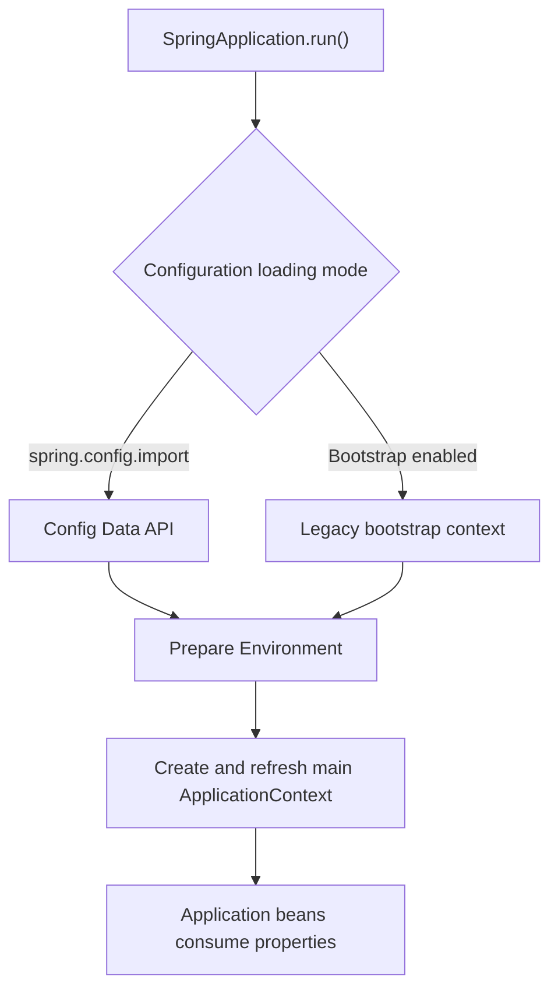

# Distinguishing Config Data from the Legacy Bootstrap Mechanism

## 1. Why Are There Two Ways to Load Configuration?

A Spring Boot application can receive configuration from local files, environment variables, command-line arguments, Config Server, Vault, or other configuration systems. These values must enter `Environment` early enough for Spring Boot to determine profiles, auto-configuration, and values injected into beans.

In earlier generations of Spring Cloud, fetching remote configuration typically relied on the **bootstrap context**: an early context built as the parent of the main application context to prepare external property sources. Applications commonly declared `bootstrap.yml` to configure how to connect to remote sources.

Starting in Spring Boot 2.4, the **Config Data API** provides a standard mechanism to declare configuration sources to import via `spring.config.import`. Spring Cloud Config Client integrates with this mechanism, and it is now the recommended default in current documentation. Applications can load configuration from Config Server before the main application context refreshes without creating a traditional bootstrap context.

Both approaches solve a common need yet differ in lifecycle, activation, configuration placement, and property loading rules. Understanding the distinction avoids configuration being loaded twice, profiles not applying as intended, or applications starting with unintended local values.

This lesson belongs to the **Configuration Loading** chapter of the **SPRING_CLOUD_CORE** module. It situates both mechanisms in the context of Spring Cloud Commons, Context, and Config Client; the goal is to know how to choose a loading mechanism, read precedence order accurately, and verify behavior in real environments.

After this lesson, learners can:

- Explain where the Config Data API and traditional bootstrap context differ.
- Write Config Client configuration using `spring.config.import` and understand the meaning of `optional:`.
- Know when legacy bootstrap must be enabled, how to use `bootstrap.yml`, and how to configure the Config Server address.
- Distinguish bootstrap context, Spring Boot's bootstrap registry, and the main application context.
- Analyze profiles, property source precedence, fail-fast behavior, and startup errors.
- Plan a migration from legacy bootstrap to Config Data while preserving desired configuration behavior.

## 2. Both Mechanisms from the Application Lifecycle Perspective

### 2.1. Config Data API

Config Data is Spring Boot's mechanism for declaring and loading configuration sources. While preparing `Environment`, Boot reads initial configuration, processes import declarations, and delegates to matching resolvers/loaders to load data. Config Client provides integration for locations with the `configserver:` scheme.

Example:

```yaml
spring:
  application:
    name: orders-service
  config:
    import: "optional:configserver:http://config-server:8888"
```

Boot processes imports during configuration preparation, before refreshing the application context. Beans created afterward can read remotely loaded properties through `Environment`. No parent bootstrap context is needed merely to connect to Config Server.

### 2.2. Traditional bootstrap context

In the legacy mechanism, Spring Cloud creates a bootstrap context before the main context. The bootstrap context typically acts as the parent of the main application context. It can instantiate bootstrap beans and execute `PropertySourceLocator` implementations to fetch properties from external sources such as Config Server.

Applications typically include a `bootstrap.yml` file:

```yaml
spring:
  application:
    name: orders-service
  cloud:
    config:
      uri: http://config-server:8888
```

Once bootstrap is enabled, Config Client uses `spring.cloud.config.uri` to connect to Config Server and add remote property sources into `Environment`. The `bootstrap.yml` file configures the bootstrap phase; it is not the same as `application.yml` used for the main application context.

### 2.3. Quick comparison

| Aspect | Config Data API | Traditional Spring Cloud Bootstrap |
| --- | --- | --- |
| Mechanism | Spring Boot Config Data | Spring Cloud bootstrap lifecycle |
| Declaring Config Server | `spring.config.import=configserver:...` | `spring.cloud.config.uri` in bootstrap configuration |
| Typical config files | `application.yml` or environment variables | `bootstrap.yml` / `bootstrap.properties` and environment variables |
| Timing | While Boot prepares Config Data and `Environment`, before context refresh | Creates a bootstrap context before the main context |
| Separate parent context | Not required for Config Data imports | Present in the traditional bootstrap model |
| Profiles | Config Data can load defaults and then activated profiles | Bootstrap prepares remote sources per bootstrap config/profiles |
| Current default | Default approach for modern Config Client | Must be enabled explicitly |
| Recommendation | Preferred for new apps and standard migrations | Retain only while systems still depend on bootstrap lifecycle |

Do not equate Spring Boot's **bootstrap registry** with Spring Cloud's **bootstrap context**. The bootstrap registry is part of Boot's internal startup lifecycle; bootstrap context is Spring Cloud's legacy parent-context model.



## 3. Configuring Config Data with Spring Cloud Config Client

### 3.1. Dependency

With Maven, the application needs the Config Client starter and a Spring Cloud BOM compatible with its Spring Boot version:

```xml
<dependencyManagement>
    <dependencies>
        <dependency>
            <groupId>org.springframework.cloud</groupId>
            <artifactId>spring-cloud-dependencies</artifactId>
            <version>CHOSEN_SPRING_CLOUD_RELEASE_TRAIN</version>
            <type>pom</type>
            <scope>import</scope>
        </dependency>
    </dependencies>
</dependencyManagement>

<dependencies>
    <dependency>
        <groupId>org.springframework.cloud</groupId>
        <artifactId>spring-cloud-starter-config</artifactId>
    </dependency>
</dependencies>
```

The version string in the example is a placeholder. Pick the release train from the official compatibility matrix; do not arbitrarily grab the latest version per module.

### 3.2. Declaring imports

Example using YAML:

```yaml
spring:
  application:
    name: orders-service
  profiles:
    active: dev
  config:
    import: "optional:configserver:http://localhost:8888"
```

Equivalent in `application.properties`:

```properties
spring.application.name=orders-service
spring.profiles.active=dev
spring.config.import=optional:configserver:http://localhost:8888
```

Key elements:

- `configserver:` is the scheme provided by Spring Cloud Config Client for Config Data.
- The address can be placed directly in the import. If specified in both the import and `spring.cloud.config.uri`, the address in the import takes higher precedence.
- `optional:` allows the application to continue startup when Config Server is unreachable. In that case, the application may not receive remote configuration.
- Without `optional:`, Config Client must connect successfully; otherwise, startup fails.

### 3.3. Optional or mandatory?

This is an operational decision, not merely a syntactic difference.

| Mode | Configuration | Behavior when Config Server is unavailable | When appropriate |
| --- | --- | --- | --- |
| Optional | `optional:configserver:...` | Can proceed with remaining configuration sources | Service has safe defaults and tolerates running without remote config |
| Mandatory | `configserver:...` | Failure to retrieve config fails startup | Remote configuration is mandatory for safe operation |

For example, a payment service should not run on default transaction-limit modes if remote configuration carries risk-control policies. In that case, fail-fast is usually safer. Conversely, a demo app with complete local config may accept optional.

Never use optional just to "make startup green." If an application starts missing critical properties, enforce appropriate validation and readiness checks so it never accepts traffic in an invalid configuration state.

### 3.4. Config Data can call Config Server multiple times

Spring Cloud Config Client's Config Data integration processes configuration in two steps:

1. Load configuration with the `default` profile to gather initial properties, which may themselves activate other profiles.
2. Once active profiles are determined, load additional configuration matching those profiles.

Consequently, logs may show multiple requests to Config Server during a single startup. This is normal behavior of the two-step workflow, not necessarily a duplicate-request bug. It allows profiles to be activated from configuration returned by the server.

## 4. Legacy Bootstrap: How to Enable and Configure It

### 4.1. Bootstrap is no longer enabled automatically in standard setups

In modern Spring Cloud applications, using the traditional bootstrap mechanism requires enabling it explicitly. Two common ways exist:

**Option A — add the bootstrap starter:**

```xml
<dependency>
    <groupId>org.springframework.cloud</groupId>
    <artifactId>spring-cloud-starter-bootstrap</artifactId>
</dependency>
```

Its version is managed by the Spring Cloud BOM.

**Option B — enable via system property or environment variable:**

```bash
java -Dspring.cloud.bootstrap.enabled=true -jar orders-service.jar
```

Or set an environment variable:

```bash
SPRING_CLOUD_BOOTSTRAP_ENABLED=true
```

When using `spring.cloud.bootstrap.enabled=true`, Config Client documentation requires setting it via a system property or environment variable so it takes effect early enough for bootstrap. Putting it only inside an `application.yml` read during the main context phase can be too late.

Do not combine both the starter and the environment variable thinking it enables bootstrap "more strongly." Choose the approach matching your deployment and verify against your exact Spring Cloud version.

### 4.2. The `bootstrap.yml` file

Example:

```yaml
spring:
  application:
    name: orders-service
  cloud:
    config:
      uri: http://config-server:8888
  profiles:
    active: dev
```

In this model:

- `spring.application.name` specifies the application name Config Server uses to locate configuration.
- `spring.cloud.config.uri` points to the Config Server address.
- Profiles choose which configuration variant to load; if profiles are decided in the bootstrap phase, place them in appropriate bootstrap configuration.
- Config Client must be on the classpath to execute the integration.

A `bootstrap.yml` file does not enable bootstrap automatically in modern setups unless the bootstrap dependency or flag is enabled.

### 4.3. Context hierarchy and `PropertySource`

The traditional bootstrap context typically becomes the parent of the main application context. Property sources loaded by bootstrap locators are added to the main context under hierarchy rules. Distinguish clearly:

- The property source named `bootstrap` holds data from `PropertySourceLocator` implementations; by traditional default, remote data can have high precedence.
- The property source holding `bootstrap.yml` file contents serves to prepare bootstrap; it typically has lower precedence than configuration loaded in the main context.
- The child application context can override parent properties under Spring's property source resolution rules.

Hence, saying "bootstrap always beats `application.yml`" is overly simplistic and misleading. Check **which specific property source** holds the key being resolved and its precedence position.

## 5. Property Precedence: Why Can the Same Key Yield Different Results?

Spring Boot merges configuration from many sources. For example, `orders.timeout-seconds` may appear in:

- Default configuration packaged inside the JAR.
- `application.yml`.
- Profile-specific files such as `application-dev.yml`.
- Config Server or another imported source.
- Environment variables.
- Java system properties.
- Command-line arguments.

Never memorize a single static order for all scenarios without considering how each source was added. With Config Data, import order and config document order affect precedence; high-precedence Boot sources such as command-line arguments, system properties, and OS environment variables can still override imported values.

Example with two import sources:

```yaml
spring:
  config:
    import:
      - "configserver:http://config-server:8888"
      - "optional:file:./config/region.yml"
```

In Config Data, a later import has higher precedence than an earlier import. Therefore, a value in the regional file can override the same key from Config Server. Reversing import order changes the outcome. When a key yields an unexpected value, check:

1. Which sources actually loaded?
2. What order are imports declared in?
3. Which profiles are active?
4. Is an environment variable, system property, or command-line argument overriding it?
5. Did the application accidentally enable legacy bootstrap at the same time?

Never log the entire `Environment` in production logs. Doing so can leak passwords, tokens, or connection details. Query only non-sensitive keys and use protected diagnostic endpoints.

## 6. Config Data vs. Bootstrap: Which Should You Choose?

### 6.1. Choose Config Data for new applications

Prefer Config Data when:

- The project uses Spring Boot 2.4 or later and a Spring Cloud Config Client supporting the matching release.
- You want to declare external sources directly in application configuration via `spring.config.import`.
- You want explicit ordering across multiple config locations.
- You want profiles activated from remote configuration to participate in the two-step workflow.
- No legacy integration depends on a bootstrap parent context or `PropertySourceLocator` lifecycle.

For example, production configuration can omit `optional:` to enforce loading configuration:

```yaml
spring:
  application:
    name: orders-service
  config:
    import: "configserver:https://config.internal.example"
```

Real addresses, TLS, and authentication must be configured per environment; never place secrets directly into committed configuration files.

### 6.2. Retain bootstrap when specific dependencies require it

Legacy bootstrap may still be needed when:

- An internal library or existing extension is built around the bootstrap context.
- Compatibility must be kept with a tested legacy deployment pipeline that cannot migrate immediately.
- A specific integration requires the bootstrap phase or depends on beans/parent context present only in that model.

In this case, document the reason for keeping it, the Spring Cloud version involved, how bootstrap is enabled, and the migration plan. Never add the bootstrap starter merely because a repo happens to contain an old `bootstrap.yml` file.

### 6.3. Avoid configuring both mechanisms for the same source

Config Data and bootstrap are two separate ways to initialize configuration sources. Avoid simultaneously configuring Config Server via `spring.config.import` and legacy bootstrap without a specific requirement confirmed in version documentation. If both run together, duplicate calls, overlapping property sources, or unpredictable precedence can occur.

When both must coexist during a transition period, establish which source is authoritative, compare actual property sources, and write integration tests for critical keys. Do not treat a successful startup alone as proof that both mechanisms cooperate properly.

## 7. Migrating from Legacy Bootstrap to Config Data

Migration should proceed in verifiable steps.

### Step 1. Record current behavior

Before editing configuration, record:

- Spring Boot, Spring Cloud release train, and Config Client versions.
- Whether `spring-cloud-starter-bootstrap` is declared.
- Where `spring.cloud.bootstrap.enabled` is set.
- Contents of bootstrap and application configuration—especially application name, profiles, Config Server URI, credentials, and label.
- Custom `PropertySourceLocator` implementations or internal libraries participating in bootstrap.
- Critical configuration keys, their effective values, and supplying sources.

### Step 2. Move connection settings to Config Data

Add the import into application configuration:

```yaml
spring:
  application:
    name: orders-service
  config:
    import: "configserver:http://config-server:8888"
```

If the environment allows running on local config when the server is unavailable, you may use `optional:`. If remote configuration is mandatory, keep the import non-optional.

Verify that profiles, label, application name, and authentication credentials are still supplied properly. Some properties can remain in `application.yml` or environment variables; not every value previously in a bootstrap file must move verbatim into a single file.

### Step 3. Remove legacy bootstrap once no longer needed

After Config Data works:

1. Remove `spring-cloud-starter-bootstrap` if no library requires bootstrap.
2. Remove `spring.cloud.bootstrap.enabled=true` from system properties and environment variables.
3. Delete or relocate settings from `bootstrap.yml` to appropriate places; remove it only after confirming no integration still reads it.
4. Check custom code relying on a parent context or `PropertySourceLocator`.

### Step 4. Compare outcomes

Compare effective values of representative keys per profile before and after migration. Inspect Config Client logs, Config Server request counts, sent profiles and labels, and behavior when Config Server is unavailable.

### Step 5. Test rollback

Retain pre-migration configuration and legacy bootstrap activation steps during the transition window. If the application lacks mandatory properties or startup behavior changes unexpectedly, roll back following your release procedure. Once migration stabilizes, remove the legacy path to reduce operational complexity.

## 8. Examples of Testing Both Modes

### 8.1. Testing Config Data

An integration test or lab environment should verify:

1. Config Server returns configuration for the right application name.
2. Default and active profiles load as expected.
3. Remote properties exist in `Environment` before dependent beans initialize.
4. With an optional import, the application boots when the server is unavailable and falls back safely.
5. With a mandatory import, the application halts startup when configuration cannot be loaded.

Observe Config Server requests and startup logs to verify the two-step workflow. Do not verify by reading only a local file, as that does not prove remote sources loaded.

### 8.2. Testing legacy bootstrap

For applications retaining bootstrap, verify:

1. Bootstrap is genuinely enabled via starter or system property/environment variable.
2. The bootstrap context is created before the main context per the legacy model.
3. `spring.cloud.config.uri` is read in the right phase.
4. Remote property sources are added into the main context.
5. Precedence among remote sources, bootstrap files, and application files matches design.

### 8.3. Testing beans consuming configuration

Suppose a bean uses a property:

```java
@Component
public class OrderLimits {
    private final int maxItems;

    public OrderLimits(
            @Value("${orders.max-items:20}") int maxItems) {
        this.maxItems = maxItems;
    }

    public int maxItems() {
        return maxItems;
    }
}
```

Inspect the value the bean receives after context initialization. If runtime refresh is used, write a dedicated test for `@RefreshScope` or rebinding mechanics; Config Data loading properly at startup **does not by itself prove** that a singleton bean will update dynamically later.

## 9. Common Errors and Fixes

| Symptom | Possible Cause | How to Check |
| --- | --- | --- |
| Config Server is not called | Missing Config Client, wrong scheme, or import not read | Check starter, `spring.config.import`, and Config Data logs |
| Startup succeeds yet remote properties are missing | `optional:` was used and server was unavailable | Check connectivity, logs, and fallbacks; consider removing `optional:` if remote is mandatory |
| Startup fails immediately on remote error | Mandatory import or legacy fail-fast | Confirm this is the intended policy; check URI, TLS, credentials, and availability |
| `bootstrap.yml` has no effect | Bootstrap is not enabled | Check bootstrap starter or system property/environment variable |
| Property overridden unexpectedly | Import order, profiles, environment variables, or parent/child property sources | Inspect `Environment` and precedence of each source |
| Remote profile is not loaded | Profile is not active or Config Server does not return expected profile | Check default request, active profiles, and Config Server response |
| Configuration loaded multiple times | Two-step Config Data, retry, or both integrations active | Inspect logs/requests to tell normal two-step behavior from duplicate config |
| Migration changes resolved values | Bootstrap locators, property source ordering, or legacy customizations not ported | Compare before/after effective values and check custom integrations |

## 10. Version-Specific Points to Verify

- The Config Data API was introduced in Spring Boot **2.4**. Applications and Spring Cloud Config Client must use mutually compatible versions.
- Modern Config Client uses Config Data as its default way to connect to Config Server; legacy bootstrap must be enabled explicitly.
- Different Spring Cloud versions can alter when `PropertySourceLocator` runs. Spring Cloud documentation notes that as of 2022.0.3 locators are called twice: first without profiles so profiles can be activated, and next after the main context starts with active profiles. In earlier versions, locators ran in the main context; setting `spring.cloud.config.initialize-on-context-refresh=true` in bootstrap configuration could be used to force running them in the bootstrap context. When maintaining legacy apps, check release-specific migration notes.
- Do not mix arbitrary Spring Boot, Spring Cloud release train, and Config Client versions. Use the official BOM, run the compatibility verifier, and inspect the dependency tree.
- Other configuration systems (Vault, Kubernetes, Consul) may also supply their own Config Data imports; location syntax and precedence depend on the corresponding integration.

## 11. Official Documentation

- [Spring Cloud Config Client — Spring Boot Config Data Import and Config First Bootstrap](https://docs.spring.io/spring-cloud-config/reference/client.html)
- [Spring Cloud Reference — Spring Cloud Context: Bootstrap Application Context](https://docs.spring.io/spring-cloud/docs/current/reference/htmlsingle/spring-cloud.html)
- [Spring Boot Externalized Configuration — Config Data](https://docs.spring.io/spring-boot/reference/features/external-config.html)

When deploying, always consult documentation for your project's exact Spring Boot and Spring Cloud release train versions; current reference pages may describe newer behavior than what you are running.

## 12. Summary and Self-Check Questions

**Config Data** declares configuration sources within Spring Boot's configuration loading pipeline, typically via `spring.config.import`. It is the modern default for Spring Cloud Config Client and requires no traditional bootstrap context. **Legacy bootstrap** creates an early context as parent of the main context; using it requires explicit activation via starter or system property/environment variable and typically places connection settings in `bootstrap.yml`.

When choosing between them, start from versions, integration requirements, and property source ordering. If using Config Data, decide whether remote config is optional or mandatory. If retaining bootstrap, document why and inspect the parent context. When migrating, compare effective values and test both reachable and unreachable Config Server scenarios.

Self-check questions:

1. At which stage of Spring Boot startup is the Config Data API processed?
2. Why does Config Data not need to create a traditional bootstrap context?
3. When is `optional:configserver:...` appropriate, and when should the optional prefix be omitted?
4. In what ways can legacy bootstrap be enabled? Why must the bootstrap-enabling property be supplied early enough?
5. How does the bootstrap context differ from Spring Boot's bootstrap registry?
6. Why can you not assume remote properties always beat application properties simply based on the name "bootstrap"?
7. Why might Config Client's Config Data integration call Config Server more than once?
8. When migrating, what should you compare to ensure the application still receives the right configuration?
