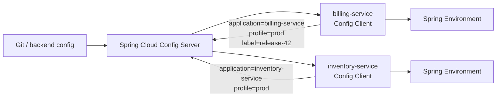
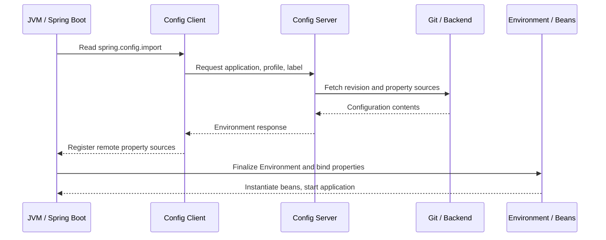

# The Role of Config Client When Connecting to Remote Configuration Sources

In a distributed system, each service typically needs different configuration values per application and environment: dependent service endpoints, timeouts, feature flags, connection limits, or log levels. If every team packages all values into the artifact, updating and controlling differences across dev, staging, and production quickly becomes difficult.

**Spring Cloud Config Client** enables a Spring Boot application to fetch remote configuration from **Spring Cloud Config Server** during startup. The client places received property sources into `Environment` so Spring Boot can bind configuration and instantiate beans. This lets operations teams manage configuration centrally, track revisions, and distribute configuration sets by application name, profile, and label.

This lesson belongs to the **Configuration Loading** chapter of the **SPRING_CLOUD_CORE** module. It focuses on the client's role, connecting to remote sources using Config Data, handling connection errors, security, refresh, testing, and operations.

## 1. Learning Objectives

After this lesson, learners can:

- Distinguish Config Client, Config Server, and the configuration repository/backend.
- Explain how the client specifies application name, profile, and label when requesting configuration.
- Configure Config Client with `spring.config.import` and understand the difference between mandatory and `optional` sources.
- Describe when remote configuration is loaded into `Environment` in the Spring Boot startup lifecycle.
- Understand precedence policies between remote property sources and local configuration without guessing ordering across multiple sources.
- Secure connections to Config Server with authentication, TLS, access control, and secret management.
- Design retry, fail-fast, fallback, refresh, and tests when Config Server is unavailable.

## 2. Where Does Config Client Sit in the Architecture?

Spring Cloud Config splits responsibilities into three parts:

- **Config Client:** a library inside each application needing remote configuration. The client knows the application name, profile, label, and Config Server address; it sends requests, receives property sources, and loads them into the application's configuration environment.
- **Config Server:** a centralized HTTP service that reads configuration from a configured backend (commonly Git, though other backends are supported) and serves data to clients.
- **Configuration repository/backend:** where configuration files are stored and versioned—for example, a Git repository holding `application.yml`, `billing-service-prod.yml`, or an equivalent structure.



Config Client is not Config Server. Adding the starter to an application only equips the application to act as a client; it does not automatically create a server, Git repository, authentication, or configuration synchronization mechanism.

## 3. What Information Does the Client Use to Request Configuration?

A configuration request is typically identified by three elements:

| Element | Default / Declared Source | Meaning |
| --- | --- | --- |
| Application name | `spring.application.name` | Identifies the configuration set belonging to the service |
| Profile | `spring.profiles.active` and activated profiles | Selects shared configuration and environment-specific configuration |
| Label | `spring.cloud.config.label` | Selects the branch, tag, or revision supported by the backend/server |

The client also allows overriding lookup parameters with `spring.cloud.config.name`, `spring.cloud.config.profile`, and `spring.cloud.config.label`. If `spring.cloud.config.name` is set, it can override the application name used to fetch remote properties; therefore check both `spring.application.name` and Config Client settings if the server returns the wrong configuration set.

Application example:

```yaml
spring:
  application:
    name: billing-service
  profiles:
    active: prod
  cloud:
    config:
      label: release-42
```

With application name `billing-service`, profile `prod`, and label `release-42`, Config Client requests matching data from Config Server. Illustrative Config Server endpoint path:

```http
GET /billing-service/prod/release-42
```

Exact paths and how labels are interpreted depend on Config Server's backend and setup. With a Git backend, label typically represents a branch, tag, or commit the server can check out. In production, choose an immutable revision or a clear promotion workflow; pointing to a continuously changing branch can cause two startups to receive different configurations.

If no label is specified, Config Server uses its server-configured default label (with Git backends, usually the repository's default branch). Do not assume the default branch is `main` or `master`; verify it on the server.

Without a separate override, the client normally uses `spring.application.name`. Choosing a stable, unique application name within the configuration scope avoids two services accidentally reading the same property set.

### 3.1. File naming convention in the repository

Illustrative Git backend layout:

```text
config-repo/
├── application.yml
├── application-prod.yml
├── billing-service.yml
├── billing-service-prod.yml
├── inventory-service.yml
└── inventory-service-prod.yml
```

Common convention:

- `application.yml` holds values shared across applications.
- `application-prod.yml` holds shared values for the `prod` profile.
- `billing-service.yml` holds values specific to `billing-service`.
- `billing-service-prod.yml` holds values specific to `billing-service` in the `prod` profile.

Config Server aggregates property sources matching the application and profiles. With a Git backend, shared and application/profile-specific sources are returned in server-defined order; later sources can override earlier sources for matching keys. Do not guess a key's final value merely by looking at filenames; inspect the server response and effective values in the client.

## 4. Adding Config Client to a Spring Boot Application

A Maven application needs the Config Client dependency. Example dependency block:

```xml
<dependency>
    <groupId>org.springframework.cloud</groupId>
    <artifactId>spring-cloud-starter-config</artifactId>
</dependency>
```

This dependency must be managed by a Spring Cloud BOM compatible with your Spring Boot version:

```xml
<properties>
    <java.version>17</java.version>
    <spring-cloud.version>2024.0.0</spring-cloud.version>
</properties>

<dependencyManagement>
    <dependencies>
        <dependency>
            <groupId>org.springframework.cloud</groupId>
            <artifactId>spring-cloud-dependencies</artifactId>
            <version>${spring-cloud.version}</version>
            <type>pom</type>
            <scope>import</scope>
        </dependency>
    </dependencies>
</dependencyManagement>
```

The version pair above only illustrates Maven structure. When deploying, consult the Spring Cloud release train compatibility matrix for Spring Boot and choose a supported project version. Never pair a new Config Client starter with an incompatible Boot version.

## 5. Connecting via Config Data Import

In modern Spring Boot generations (Boot 2.4+), the standard way is declaring Config Server in `spring.config.import`. Example `application.yml` for `billing-service`:

```yaml
spring:
  application:
    name: billing-service
  config:
    import: "configserver:http://localhost:8888"
```

When Spring Boot processes Config Data, Config Client connects to Config Server at that address to fetch property sources before finishing application context initialization. Config Server must be running and hold appropriate configuration for the requested application and profiles.

You can use a service DNS name in container or Kubernetes environments:

```yaml
spring:
  config:
    import: "configserver:http://config-server:8888"
```

The hostname must resolve from inside the application's network namespace. Inside a container, `localhost` refers to that container itself, not automatically to a Config Server in another container.

### 5.1. Mandatory sources vs. optional sources

These two declarations carry different operational semantics:

```yaml
spring:
  config:
    import: "configserver:http://config-server:8888"
```

```yaml
spring:
  config:
    import: "optional:configserver:http://config-server:8888"
```

- **Mandatory:** if configuration cannot be retrieved from Config Server, configuration loading can fail and halt startup. Appropriate when remote configuration is required for safe operation.
- **Optional:** if the remote source is unavailable, Spring can proceed with remaining configuration sources. This is safe only when the application has complete, validated fallback settings that do not point to the wrong environment.

Do not use `optional:` merely to hide Config Server failures. For instance, if the production payment endpoint exists only in remote config, booting with a localhost default can be far riskier than failing startup.

### 5.2. Specifying profile and label

Profiles are commonly enabled via environment variables or startup flags:

```bash
java -jar billing-service.jar --spring.profiles.active=prod
```

Labels can be specified with `spring.cloud.config.label`:

```yaml
spring:
  cloud:
    config:
      label: release-42
```

Or passed on the command line:

```bash
java -jar billing-service.jar \
  --spring.profiles.active=prod \
  --spring.cloud.config.label=release-42
```

The client uses this information to request the exact configuration set. If the server cannot find the label or the backend cannot check out that revision, the request can fail. Verify labels in your release workflow before rollout.

### 5.3. Where can the URI be declared?

The URI is commonly written directly in `spring.config.import`. For settings that vary across environments, pass the import/endpoint through a configuration mechanism compatible with your Boot and Cloud versions. Avoid circular dependencies: an application cannot fetch a value from Config Server if Config Server's own address is only known after reading from Config Server.

Minimum information needed to reach Config Server (host, port, TLS trust, credentials, or service discovery) must be available before the client sends its first request.

Besides placing the URI inline in the import, the client can use `spring.cloud.config.uri` (often defaulting to `http://localhost:8888`). When a URI is written directly inside `spring.config.import`, the URI in the import takes precedence over `spring.cloud.config.uri`. Do not configure two different addresses without clear intent.

### 5.4. Discovering Config Server via service discovery

If Config Server registers itself in an existing registry, the client can locate the server via `DiscoveryClient` instead of using a static URL. This requires a discovery implementation (such as Eureka or Consul) configured and ready before Config Client connects.

Example configuration:

```yaml
spring:
  cloud:
    config:
      discovery:
        enabled: true
        service-id: configserver
```

`configserver` is the common default service ID; it can be changed with `spring.cloud.config.discovery.serviceId`. Discovery-first adds an extra network lookup at startup to find Config Server's address, yet allows server coordinates to change without repackaging a new URL in clients. In the Config Data model, follow your version's `spring.config.import` requirements; current docs require an appropriate import form, commonly `optional:configserver:` for discovery-based lookup. Verify fail-fast/optional behavior on your exact version before adopting it.

### 5.5. Bootstrap context in legacy projects

Some legacy projects use **config-first bootstrap** with `bootstrap.yml` and a bootstrap context. This mechanism does not activate automatically merely because Config Client is on the classpath; enable it with `spring.cloud.bootstrap.enabled=true` (set via system property or environment variable) or add `spring-cloud-starter-bootstrap` per version instructions.

Legacy configuration example:

```yaml
spring:
  application:
    name: billing-service
  cloud:
    config:
      uri: https://config-server.internal:8888
```

With this approach, `bootstrap.yml` provides enough information for the client to locate Config Server and load remote property sources inside the bootstrap context. Never mix legacy bootstrap guidance with Config Data imports without understanding initialization order. Prefer `spring.config.import` for new projects; when upgrading legacy projects, consult migration guides and check override/retry flags tied to bootstrap.

## 6. Remote Configuration Loading Lifecycle

Config Client participates in Spring Boot's early configuration loading phase. High-level flow:



Steps to note:

1. Spring Boot reads initial configuration sources to discover imports, application name, and connection details.
2. Config Client sends a request to Config Server.
3. Config Server queries its backend and selects matching files/property sources.
4. The client receives the response and inserts remote property sources into the application configuration per version rules.
5. Spring Boot proceeds to bind properties and create beans based on the effective `Environment`.

This is why Config Data import matters: remote values can be needed immediately when constructing beans. Waiting until a controller receives an HTTP request to call a config API would mean beans were already created with missing or wrong values.

### 6.1. Clients may issue multiple queries at startup

Config Data resolves configuration in two stages: first the client loads configuration with the `default` profile so Spring Boot can discover any additional profiles activated by configuration; afterward, the client loads additional configuration for active profiles. Consequently, logs may show multiple requests to Config Server during one startup. This is normal Config Data import behavior, not necessarily a bug or infinite duplicate fetching.

If logs show abnormal repetition, inspect profile activation settings, imports, and version-specific behavior.

## 7. Remote Properties and Local Configuration

A common source of confusion is precedence order between remote property sources and local property sources.

Config Server returns property sources that are placed into the client's `Environment`. With **legacy config-first bootstrap**, override policies can be governed by flags supplied from the **remote repository**, such as:

```yaml
spring:
  cloud:
    config:
      allowOverride: true
      overrideNone: false
      overrideSystemProperties: true
```

These flags illustrate Spring Cloud Config override policies. Crucially, `allowOverride` must be placed in the remote configuration according to Config Server mechanics; merely adding it in a local file does not necessarily change precedence rules enforced by the server. Documentation notes that `overrideNone` applies only to config-first bootstrap. With **Config Data import**, the placement of the import and ordering among imports determine how property sources are merged into configuration; imports are processed where declared, and imported data can override the document declaring the import. Therefore, do not treat bootstrap flags as universal rules for all Config Data apps. Consult release-train docs and verify effective values inside the application itself.

When diagnosing an incorrect value, never conclude "remote always wins" or "environment always wins" without verifying:

- Which property sources did the server return and in what order?
- Did the client request the right application, profile, and label?
- Which local sources does the remote override policy permit to override?
- Is an environment variable, command-line flag, or system property changing the outcome?
- Was the bean's value bound at startup or refreshed later?

Never print secret values into logs while tracing property origins.

## 8. Authentication and Connection Security

Config Server often stores data affecting endpoints, credentials, feature flags, and behavior across many services. Client connections must be protected like an administrative channel.

### 8.1. HTTP Basic authentication

If Config Server is protected with HTTP Basic, the client can be configured with platform-supplied credentials. Illustrative example:

```yaml
spring:
  cloud:
    config:
      username: ${CONFIG_SERVER_USERNAME}
      password: ${CONFIG_SERVER_PASSWORD}
```

Verify exact property names and credential passing mechanisms for your Config Client version. In production, inject values via a secret manager or platform secrets; never commit real usernames/passwords into Git or container images.

Never embed credentials into the import URL, because URLs can appear in logs, process arguments, or diagnostic output.

### 8.2. TLS and certificates

Use HTTPS whenever Config Client communicates across untrusted networks. On release trains supporting dedicated TLS settings for Config Client, you can declare truststore and keystore settings as follows:

```yaml
spring:
  cloud:
    config:
      tls:
        enabled: true
        key-store: /run/secrets/config-client.p12
        key-store-type: PKCS12
        key-store-password: ${CONFIG_KEYSTORE_PASSWORD}
        key-password: ${CONFIG_KEY_PASSWORD}
        trust-store: /run/secrets/config-server-trust.p12
        trust-store-type: PKCS12
        trust-store-password: ${CONFIG_TRUSTSTORE_PASSWORD}
```

Exact property names and TLS support vary by version; check documentation for your release train. If no dedicated truststore is specified, the JVM may use its default truststore. Never disable hostname verification or certificate validation as a workaround for TLS issues.

If mutual TLS is required, the client needs an appropriate certificate and private key. Mount files with minimal permissions, inject passwords via a secret manager, and never commit keystores or private keys into Git.

### 8.3. Timeouts and health indicator

You can set limits for connecting to and reading responses from Config Server:

```yaml
spring:
  cloud:
    config:
      request-connect-timeout: 2000
      request-read-timeout: 5000
```

Both example values are in milliseconds. Pick timeouts based on network latency and your platform's startup budget; overly long timeouts slow rollouts, while overly short timeouts fail startups under normal network jitter.

Config Client can provide a health indicator verifying ability to load configuration from Config Server. Depending on version, it can be disabled with `management.health.config.enabled=false` and its cache TTL tuned with `health.config.time-to-live` (milliseconds). The indicator typically caches results to avoid calling Config Server continuously. If using this indicator for readiness/liveness, distinguish a transient Config Server outage from an instance that already holds valid loaded configuration; never let one failed health probe trigger unnecessary mass restarts.

### 8.4. Access control by service and environment

Each client should read only the configuration it needs. If all services share a single credential with repository-wide read permissions, a compromise in one service can expose configurations belonging to every other service.

Consider:

- Separate credentials or roles per workload or workload group.
- Access control by repository, path, profile, or backend if supported.
- Separating sensitive data from general configuration files.
- Restricting network access to Config Server.
- Auditing which client accessed which configuration revision and when.

### 8.5. Secrets should not be treated as ordinary properties

Config Server helps distribute configuration, yet a plain Git repository is not a safe place for plaintext secrets. Use a secret manager/Vault backend or properly managed encryption and decryption mechanisms. Protect encryption keys as well; never store decryption keys alongside encrypted data in the same store under the same access permissions.

## 9. Handling Unavailable Config Server

Config Server can become unreachable due to DNS, network policies, TLS, expired credentials, Git backend failures, or ongoing server deployments. Decide whether the application should stop or proceed.

| Scenario | Behavior to Consider |
| --- | --- |
| Remote config mandatory for production endpoints | Fail fast; never accept traffic while missing |
| Remote config supplies only non-critical feature flags and local defaults are validated | Optional/fallback may be acceptable if tested |
| Server temporarily fails during startup | Bounded retry with backoff if appropriate |
| Server fails after application is already running | Application normally continues using in-memory config; new changes are not fetched |
| Invalid credentials/TLS | Fix identity or trust chain; infinite retries will not fix the error |

### 9.1. Fail-fast and retry

For mandatory configuration, keep the import without `optional:` so the application does not start with missing config. To use the retry mechanism supported in Config Client docs, add both `spring-retry` and `spring-boot-starter-aop` dependencies, then configure version-appropriate retry properties.

Illustrative retry configuration:

```yaml
spring:
  cloud:
    config:
      fail-fast: true
      retry:
        max-attempts: 6
        initial-interval: 1000
        max-interval: 5000
        multiplier: 1.5
```

Both Spring Retry and AOP are required for the retry mechanism described above. Retry works with `spring.config.import`; if the import is declared in a profile-specific file, retry parameters may need to be placed as URL query parameters directly on the import, per version documentation. Retry only helps with transient errors such as network timeouts or server restarts. It cannot fix bad credentials, missing labels, invalid YAML, or incompatible versions.

For example, when declared in a profile-specific file, retry options can be appended on the URI (verify exact names and usage against your version):

```yaml
spring:
  config:
    import: "configserver:https://config-server.internal:8888?fail-fast=true&max-attempts=6&initial-interval=1000&max-interval=5000&multiplier=1.5"
```

Do not configure excessive retry counts or unbounded retries; prolonged startups can stall rollouts or exceed orchestrator startup probe deadlines. Align retry budgets with orchestrator timeouts.

### 9.2. Optional and fallback

If using `optional:configserver:`, explicitly design your fallback configuration set:

- Mandatory properties must still pass validation.
- Default endpoints must never accidentally point to sandbox/local in production.
- Default feature flags must be business-safe.
- Logs/metrics must surface that the client failed to load remote configuration.
- Readiness must transition to ready only when the application can genuinely handle requests safely.

A fallback can let an application start successfully while behaving wrongly. Therefore, "process is running" does not equal "configuration is valid."

### 9.3. Running applications when Config Server loses connectivity

Once startup completes, the application holds configuration in `Environment` and bound beans. If Config Server temporarily loses connectivity, in-flight and incoming traffic normally continues using already-loaded configuration. The client does not automatically alter active configuration simply because the server became unreachable.

When a refresh is needed, the client must reconnect or receive a refresh signal through the designed mechanism. If fetching an updated snapshot fails, retain active valid configuration and emit alerts; never wipe valid in-memory config merely because one fetch failed.

## 10. Refreshing After Remote Configuration Changes

Config Client loads configuration at startup. If the Git repository updates afterward, running instances do not automatically receive changes simply because a new commit appeared.

Common ways to distribute changes include:

- **Restart/rolling restart:** newly started instances pick up the updated configuration revision.
- **Controlled manual refresh:** an administrative actor invokes the application's refresh mechanism; Config Client reloads configuration and Spring Cloud Context emits events so relevant components update.
- **Spring Cloud Bus:** when integrated, Bus can broadcast refresh notifications across multiple instances; configure the broker, authentication, and observability for event delivery.

`@RefreshScope` helps recreate target beans after a refresh. It does not guarantee every singleton or every resource updates automatically. Connection pools, HTTP clients, caches, static fields, and objects that copied property values may require dedicated handling.

If using Actuator's refresh endpoint, expose only necessary endpoints, secure them with authentication/authorization, and enforce network restrictions. Refresh endpoints alter runtime behavior, so pair them with auditing and rollback plans.

## 11. Testing Config Client

Testing should cover both happy paths and connection failures. A test that merely starts a context with local files does not prove Config Client retrieves remote configuration.

### 11.1. Verifying the Config Server contract

Use curl to call the Config Server endpoint (matching your environment's address, application, profile, and label):

```bash
curl -i http://localhost:8888/billing-service/prod/release-42
```

The response is typically JSON describing application, profiles, label/version, and a list of property sources. Verify:

- HTTP status indicates success.
- Application/profile/label in the response match the request.
- Expected property sources appear.
- Sensitive configuration values are encrypted/masked per policy and never leaked in logs or test output.

### 11.2. Testing the client with a mock server

You can use WireMock, MockWebServer, or a test Config Server to return deterministic responses. Tests should assert that the client sends the right application/profile/label and that remote values bind into beans.

Example test property:

```yaml
demo:
  payment:
    endpoint: https://payment.test.internal
```

In the test, inject properties and assert the endpoint equals the value returned by the server. Never hardcode dependencies on production Config Server inside unit tests; tests must remain reproducible without real credentials.

### 11.3. Testing connection failures

Simulate these cases:

1. Config Server port is closed or times out.
2. Server returns HTTP 401/403 due to invalid credentials.
3. Server returns 404 because application/profile/label does not exist.
4. TLS handshake fails due to truststore/certificate issues.
5. Git backend is unreachable or label does not exist.
6. Remote YAML/properties contain invalid types causing binding/validation failure.

For each case, verify whether the application halts or continues according to its mandatory/optional policy. Check both logs and health/readiness—not just exit codes.

### 11.4. Preventing tests from accidentally calling real servers

Tests annotated with `@SpringBootTest` can inherit `spring.config.import` from application config. If the import points to a mandatory Config Server, tests will attempt to connect to that server on every run. Provide explicit test configuration, a mock server, or a version-appropriate way to disable Config Client. Even when using optional imports for offline tests, verify tests do not silently pass against unintended default values.

## 12. Observability and Operations

A production Config Client must be monitored as a critical infrastructure dependency.

Metrics and signals to track:

- Connection latency to Config Server and property source load duration.
- Startup failure rates caused by Config Server, DNS, TLS, or authentication.
- Loaded application name, profiles, and label/revision.
- Timestamp of the last successful configuration load.
- Number of instances running the new revision after a refresh/rollout.
- Readiness status when remote configuration is mandatory.

Never log full property values. Log only non-sensitive keys, sources, revisions, or permitted checksums. Avoid putting credentials, tokens, authenticated private endpoints, or secrets into metric labels.

Actuator can expose health/metrics and diagnostic endpoints depending on dependencies, versions, and exposure settings. Secure `env`, `configprops`, `conditions`, and management endpoints; never expose them broadly merely for debugging convenience.

### 12.1. Configuration release workflow

A safe release workflow can include:

1. Commit configuration to a branch/label intended for a testing environment.
2. Validate YAML syntax, property names, and schemas/constraints.
3. Boot a staging instance with the matching application/profile/label.
4. Run smoke tests and inspect logs, health, and integration endpoints.
5. Promote the verified revision to an immutable production label/revision.
6. Perform rolling restarts or refreshes following an approved procedure.
7. Confirm every instance received the intended revision; monitor errors and roll back if needed.

Configuration changes are operational changes. Review them with the same rigor as code changes, especially when they alter endpoints, timeouts, security, or feature flags.

## 13. Common Incidents and Troubleshooting

| Symptom | Possible Cause | Where to Check |
| --- | --- | --- |
| App fails to start because Config Server is not found | Wrong URI, DNS/network issue, server down | Check `spring.config.import`, DNS, port, and server logs |
| HTTP 401 | Wrong or expired username/password or token | Check secret injection and client permissions |
| HTTP 403 | Client authenticated yet lacks read permission for config | Check role/repository/path policies |
| HTTP 404 | Wrong application, profile, label, or file pattern | Check `spring.application.name`, active profiles, label, and repository |
| Received another service's configuration | Duplicate or overridden application name | Check effective `spring.application.name` property |
| Loaded wrong environment | Profile not activated or wrong profile specified | Check `spring.profiles.active` for that exact process |
| Remote value does not appear | Property source not returned or overridden by another source | Check server response, override policy, and `Environment` |
| TLS handshake error | Wrong truststore/CA/certificate/hostname | Check certificates and trust chain; never disable validation |
| Slow startup when server fails | Excessive retry/timeout duration | Tune retry budget and startup probes |
| New commit yet app still uses old values | Not restarted/refreshed or instance missed event | Check active revision and refresh distribution mechanism |
| Only some instances received new config | Partial refresh/rollout or failed request on some replicas | Compare revisions and status across every instance |

Always start from the concrete request: which client, which application, which profile, which label, and which HTTP status code the server returned. That narrows down the root cause far faster than changing multiple settings at once.

## 14. Practice Exercise

A system has two services, `order-service` and `inventory-service`. Both share a Config Server at `http://config-server:8888`. Production requires the exact inventory endpoint and a 2-second connection timeout; services must not start if mandatory configuration cannot be retrieved.

Complete the following:

1. Add `spring-cloud-starter-config` and import a compatible Spring Cloud BOM.
2. Declare `spring.application.name` for each service.
3. Configure `spring.config.import` as mandatory.
4. Create shared configuration files and service/profile-specific files in the repository.
5. Specify the `prod` profile and an immutable release label.
6. Add validation for endpoint and timeout properties.
7. Design bounded retry for transient failures; describe behavior when Config Server returns 401, 404, or times out.
8. Design a test using a mock Config Server to verify application/profile/label and property binding.
9. Propose a rollout workflow when a configuration revision changes and how to verify every instance received the new revision.

**Analysis question:** If Config Server goes down after both services have started, do in-flight requests automatically lose configuration? What happens if a new instance is created while the server is still down? Contrast in-memory configuration inside existing instances against startup configuration loading required by a new instance.

## 15. Takeaways

- Config Client runs inside the application; Config Server is the configuration-serving service; the repository/backend stores configuration data.
- Clients identify a configuration set using application name, profile, and label.
- `spring.config.import` is the standard Config Data integration in modern Spring Boot generations; legacy bootstrap is used by some older projects.
- Mandatory sources enforce fail-fast when configuration is missing; `optional` is safe only when fallbacks are explicitly designed and validated.
- Remote configuration loads during startup before bean creation completes; repository changes do not automatically update running instances.
- Authentication, TLS, authorization, secret management, and clear labels/revisions are operational requirements for Config Client.
- Retries must be bounded; authentication errors, wrong labels, or invalid configs cannot be solved by infinite retries.
- Refreshing requires an explicit reload and event-publishing mechanism; `@RefreshScope` does not refresh every bean or resource type.
- Test server responses, bound values, connection failures, and instance behavior across both startup and refresh.

## 16. References

- [Spring Cloud Config Client Reference](https://docs.spring.io/spring-cloud-config/reference/client.html) — Config Data import, legacy bootstrap, discovery-first, retry, labels, security, and health indicators.
- [Spring Boot Externalized Configuration](https://docs.spring.io/spring-boot/reference/features/external-config.html) — how Spring Boot loads and merges configuration sources.

