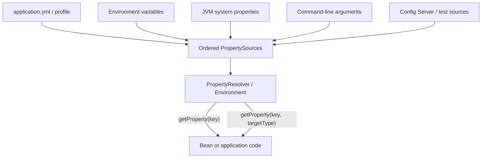

# Reading Properties with `getProperty`, Data Types, and Default Values in Spring Environment

## 1. Objectives and Context

A Spring Boot application typically runs across multiple environments: local, testing, staging, and production. Service URLs, timeouts, retry counts, or feature flags may differ between environments. Hardcoding these values in Java would mean modifying the source and repackaging the application whenever the environment changes.

Spring provides the `Environment` abstraction to read properties from multiple configuration sources. Spring Boot adds Config Data, profiles, environment variables, command-line arguments, and other sources. Spring Cloud Config can supply additional properties from a centralized configuration server.

For example, `order-service` needs to call `inventory-service`:

```yaml
inventory:
  client:
    base-url: http://localhost:8081
    timeout: 800ms
    max-attempts: 3
    enabled: true
```

Java code asks `Environment` for properties by key. Spring handles finding the source and converting types. After this lesson, readers will be able to use the right `getProperty` overloads, distinguish missing/empty/malformed values, set intentional defaults, and know when to use `@ConfigurationProperties`.

## 2. Environment, PropertyResolver, and PropertySource

`Environment` belongs to Spring Core and extends `PropertyResolver`. `PropertyResolver` defines property reading and placeholder resolution operations; `Environment` adds active profiles and default profiles.

An `Environment` can see multiple `PropertySource` instances. Each source supplies key/value pairs:

| Source | Example | Role |
| --- | --- | --- |
| Configuration file | `application.yml` | Common application values |
| Profile-specific file | `application-prod.yml` | Values for the production environment |
| Environment variable | `INVENTORY_CLIENT_ENABLED` | Configuration from container/host |
| Java system properties | `-Dinventory.client.timeout=1s` | JVM configuration |
| Command-line arguments | `--inventory.client.max-attempts=5` | Overrides when running Spring Boot |
| Config Server | Configuration by application/profile/label | Centralized management |
| Test source | Map or test properties | Isolating test scenarios |

Sources are organized in precedence order. When a key appears in multiple sources, the higher-precedence source is used. The exact order depends on the Boot version, source type, and how it is configured; when you need to determine the winning source, inspect the actual property sources rather than guessing by filename.



The diagram represents the sources that can participate in resolution; it does not claim every application enables all sources or always has the same order. Spring Boot defines the externalized configuration order; consult the documentation for your specific version if your application depends on that order.

### 2.1. Injecting Environment into a Bean

```java
import org.springframework.core.env.Environment;
import org.springframework.stereotype.Service;

@Service
public class InventorySettingsReader {
    private final Environment environment;

    public InventorySettingsReader(Environment environment) {
        this.environment = environment;
    }
}
```

Do not instantiate `new StandardEnvironment()` yourself inside an application bean. A manually created instance does not necessarily contain the configuration sources that Spring Boot loaded into the application context.

## 3. Overloads of getProperty

`Environment` inherits property-reading methods from `PropertyResolver`:

| Method | When value is read | When no result is found |
| --- | --- | --- |
| `getProperty(String key)` | Returns `String` | Returns `null` |
| `getProperty(String key, String defaultValue)` | Returns `String` | Returns default |
| `getProperty(String key, Class<T> targetType)` | Converts to the requested type | Returns `null` |
| `getProperty(String key, Class<T> targetType, T defaultValue)` | Converts to the requested type | Returns default of type `T` if resolved/converted result is `null` |
| `getRequiredProperty(String key)` | Returns `String` | Throws `IllegalStateException` |
| `getRequiredProperty(String key, Class<T> targetType)` | Converts to the requested type | Throws `IllegalStateException` |
| `containsProperty(String key)` | Checks whether the key has a value | Returns `false` if absent |

### 3.1. Reading String

```java
String baseUrl = environment.getProperty("inventory.client.base-url");

String region = environment.getProperty(
        "inventory.region",
        "local"
);
```

`baseUrl` can be `null` if the key does not exist. `region` receives `"local"` when the key is not found. If the key exists with an empty string, the default does not automatically replace the empty string.

### 3.2. Reading Typed Values

```java
Integer maxAttempts = environment.getProperty(
        "inventory.client.max-attempts",
        Integer.class,
        3
);

Boolean enabled = environment.getProperty(
        "inventory.client.enabled",
        Boolean.class,
        false
);
```

Spring uses the property resolver's conversion service to convert the source value to the target type. For basic types like `Integer` and `Boolean`, the standard conversion service already supports them.

### 3.3. Reading Required Properties

```java
String endpoint = environment.getRequiredProperty(
        "inventory.client.base-url"
);

Integer maxAttempts = environment.getRequiredProperty(
        "inventory.client.max-attempts",
        Integer.class
);
```

If the key does not exist, `getRequiredProperty` throws `IllegalStateException`. If the key has a value that cannot be converted to the target type, a conversion error can still occur. Use this method when missing configuration prevents the application from operating safely.

### 3.4. containsProperty

```java
if (environment.containsProperty("inventory.client.base-url")) {
    String endpoint = environment.getProperty("inventory.client.base-url");
    // Process the declared endpoint.
}
```

Existence does not prove the value is valid. A key can exist yet be empty, malformed, or violate business rules. You need to validate the value after reading it.

## 4. Data Type Conversion

### 4.1. ConversionService

Many configuration sources store values as strings. When calling `getProperty(key, Integer.class)`, Spring asks the conversion service to convert the value to `Integer`:

```yaml
inventory:
  client:
    max-attempts: "4"
    enabled: "true"
    pool-size: "12"
```

```java
Integer attempts = environment.getProperty(
        "inventory.client.max-attempts",
        Integer.class
);
Boolean enabled = environment.getProperty(
        "inventory.client.enabled",
        Boolean.class
);
Long poolSize = environment.getProperty(
        "inventory.client.pool-size",
        Long.class
);
```

Do not manually cast from an `Object` retrieved directly from `PropertySource`. The source value can be a string, number, or object depending on the source; request the target type through the resolver so conversion is centrally managed.

### 4.2. Enum

```java
public enum InventoryMode {
    LOCAL,
    REMOTE
}

InventoryMode mode = environment.getProperty(
        "inventory.client.mode",
        InventoryMode.class,
        InventoryMode.LOCAL
);
```

Configuration values must follow the converter's conversion rules. For custom data types, you can register an appropriate converter with the Spring-managed conversion service. Standardize enum naming conventions and test invalid values.

### 4.3. Duration and Spring Boot Specific Types

Spring Boot typically provides converters for types like `Duration` or `DataSize`:

```yaml
inventory:
  client:
    timeout: 750ms
```

```java
import java.time.Duration;

Duration timeout = environment.getProperty(
        "inventory.client.timeout",
        Duration.class,
        Duration.ofSeconds(2)
);
```

This example requires a conversion service that supports unit-suffixed strings to `Duration`, as in the corresponding Spring Boot environment. With Spring Framework's plain `StandardEnvironment` or a custom environment, do not assume every Boot-specific converter is available; inspect the conversion service or register the necessary converters. Writing explicit units such as `750ms` or `2s` helps avoid misunderstanding.

### 4.4. Conversion Failure Does Not Fall Back to Default

Suppose configuration has `max-attempts: many` while code requests `Integer`:

```java
Integer attempts = environment.getProperty(
        "inventory.client.max-attempts",
        Integer.class,
        3
);
```

The default `3` is used when reading for the target type yields `null`; the common case is that the key is not found. With some converters, an empty string may also convert to `null`, whereas other converters may reject it or preserve the empty value. If the key has the value `many` which cannot be converted to an integer, Spring reports a conversion error; do not expect the default to replace a malformed value.

Distinguish four states:

- **Missing:** the key is absent from the examined sources.
- **Present and valid:** the key exists and the value converts cleanly.
- **Present but invalid:** the key exists but fails conversion or violates application rules.
- **Present but blank:** the key exists with an empty string or whitespace; handling depends on target type and converter.

Do not collapse all these states into a single null check.

## 5. Default Values and Required Properties

### 5.1. Default in getProperty

```java
String region = environment.getProperty("inventory.region", "local");

Integer maxAttempts = environment.getProperty(
        "inventory.client.max-attempts",
        Integer.class,
        3
);
```

The default in the String overload is used when the resolver finds no value; in the typed overload, the default is used when the resolved/converted result is `null`. Therefore, how an empty string is handled can depend on the converter and target type. Defaults do not write values back to `Environment`, do not modify configuration files, and do not cause the key to appear in any source.

### 5.2. Default vs. Required

A timeout may have a sensible default; a production endpoint may need to be explicitly required:

```java
Duration timeout = environment.getProperty(
        "inventory.client.timeout",
        Duration.class,
        Duration.ofMillis(800)
);

String baseUrl = environment.getRequiredProperty(
        "inventory.client.base-url"
);
```

If you use a default for a value that is actually required, configuration errors can be masked and only surface when real requests are sent. Clearly decide which keys have safe defaults and which keys must be present.

### 5.3. Defaults in YAML, Placeholders, and Java

**In YAML:**

```yaml
inventory:
  client:
    max-attempts: 3
```

**In a placeholder:**

```java
@Value("${inventory.client.max-attempts:3}")
private int maxAttempts;
```

**In a `getProperty` call:**

```java
int maxAttempts = environment.getProperty(
        "inventory.client.max-attempts",
        Integer.class,
        3
);
```

They differ in location and when they apply. YAML is a property source value; a placeholder has a default when Spring resolves the expression; the `getProperty` overload provides a default for that specific read call. You should not set multiple different defaults for the same key without a clear convention.

## 6. Missing, Blank, Malformed, and Out-of-Range Values

| Scenario | Example | Interpretation |
| --- | --- | --- |
| Key missing | `inventory.region` not declared | `getProperty` returns null; overload with default returns default |
| Empty string | `inventory.region: ""` | Key has an empty value; default does not automatically replace it |
| Whitespace | `inventory.region: "   "` | Do not assume it is missing; normalize/validate per requirements |
| Wrong type | `max-attempts: many` when Integer expected | Conversion error detected |
| Out of valid range | `max-attempts: 0` when > 0 required | Conversion succeeds but business validation rejects it |

Example of intentionally treating null, empty string, and whitespace as the same case:

```java
String region = environment.getProperty("inventory.region");
if (region == null || region.isBlank()) {
    region = "local";
}
```

This is a **business decision**, not the default behavior of `getProperty`. Only use it when a blank value is genuinely allowed to be treated as undeclared.

For retry counts, you also need to check the value range:

```java
Integer attempts = environment.getProperty(
        "inventory.client.max-attempts",
        Integer.class
);

if (attempts == null || attempts < 1 || attempts > 10) {
    throw new IllegalStateException(
            "inventory.client.max-attempts must be between 1 and 10"
    );
}
```

For multiple configuration fields, consider `@ConfigurationProperties` combined with validation instead of repeating conditions across many beans.

## 7. Complete Example: Reading Client Configuration

```yaml
inventory:
  client:
    base-url: http://localhost:8081
    timeout: 750ms
    max-attempts: 4
    enabled: true
```

```java
import java.net.URI;
import java.time.Duration;

import org.springframework.core.env.Environment;
import org.springframework.stereotype.Component;

@Component
public class InventoryClientSettings {
    private final URI baseUrl;
    private final Duration timeout;
    private final int maxAttempts;
    private final boolean enabled;

    public InventoryClientSettings(Environment environment) {
        this.baseUrl = URI.create(
                environment.getRequiredProperty("inventory.client.base-url")
        );
        this.timeout = environment.getProperty(
                "inventory.client.timeout",
                Duration.class,
                Duration.ofSeconds(2)
        );
        this.maxAttempts = environment.getProperty(
                "inventory.client.max-attempts",
                Integer.class,
                3
        );
        this.enabled = environment.getProperty(
                "inventory.client.enabled",
                Boolean.class,
                false
        );

        if (maxAttempts < 1 || maxAttempts > 10) {
            throw new IllegalStateException(
                    "inventory.client.max-attempts must be between 1 and 10"
            );
        }
    }

    public URI getBaseUrl() { return baseUrl; }
    public Duration getTimeout() { return timeout; }
    public int getMaxAttempts() { return maxAttempts; }
    public boolean isEnabled() { return enabled; }
}
```

This example illustrates reading individual keys, defaults, and simple validation. The `Duration` property requires an appropriate conversion service as configured in a Spring Boot environment. If `base-url` is empty or an invalid URI, `URI.create` throws an error; defaults on other properties do not mask that error.

## 8. When to Use Binder and ConfigurationProperties?

`Environment.getProperty` is suitable when reading one or a few standalone keys. If configuration consists of multiple related fields, Spring Boot Binder and `@ConfigurationProperties` are usually easier to manage.

| Reading Approach | Suitable When | Points to Note |
| --- | --- | --- |
| `Environment.getProperty` | Reading a single key or context-dependent value | Code organizes reading multiple fields and validation itself |
| `@Value` | Injecting a single value into a bean | Placeholders, defaults, and conversion; becomes scattered with many properties |
| `@ConfigurationProperties` | Binding a structured configuration group | Relaxed binding, metadata, validation, and grouped properties |
| `Binder` | Programmatically binding from `Environment` into a data type | Useful in infrastructure or dynamic binding logic |

### 8.1. ConfigurationProperties Example

```java
import java.net.URI;
import java.time.Duration;

import jakarta.validation.constraints.Max;
import jakarta.validation.constraints.Min;
import jakarta.validation.constraints.NotNull;

import org.springframework.boot.context.properties.ConfigurationProperties;
import org.springframework.validation.annotation.Validated;

@Validated
@ConfigurationProperties(prefix = "inventory.client")
public class InventoryClientProperties {
    @NotNull
    private URI baseUrl = URI.create("http://localhost:8081");

    @NotNull
    private Duration timeout = Duration.ofMillis(750);

    @Min(1)
    @Max(10)
    private int maxAttempts = 3;

    private boolean enabled = true;

    public URI getBaseUrl() { return baseUrl; }
    public void setBaseUrl(URI baseUrl) { this.baseUrl = baseUrl; }
    public Duration getTimeout() { return timeout; }
    public void setTimeout(Duration timeout) { this.timeout = timeout; }
    public int getMaxAttempts() { return maxAttempts; }
    public void setMaxAttempts(int maxAttempts) { this.maxAttempts = maxAttempts; }
    public boolean isEnabled() { return enabled; }
    public void setEnabled(boolean enabled) { this.enabled = enabled; }
}
```

Register the class using `@ConfigurationPropertiesScan` or `@EnableConfigurationProperties` depending on the application structure. Validation requires the appropriate validation dependency/provider. Initial values in the class act as defaults for unbound fields; min/max/not-null annotations enforce constraints when validation is enabled.

The validation namespace also depends on the Spring Boot generation: Boot 3 projects use `jakarta.validation`; Boot 2 projects typically use `javax.validation`. Choose dependencies and imports matching your project's Boot branch.

`Environment` is useful in integration classes or factories that need to read a property conditionally. For client configuration involving URLs, timeouts, retries, and feature flags, `@ConfigurationProperties` helps centralize data types, defaults, and validation. Do not inject `Environment` into every business class just to replace an already-bound configuration object.

## 9. Placeholders, Profiles, and Spring Cloud Config

### 9.1. Placeholders

Spring can resolve placeholders referencing other properties:

```yaml
service:
  host: localhost
  port: 8081
  url: "http://${service.host}:${service.port}"
```

Or in an annotation:

```java
@Value("${inventory.client.max-attempts:3}")
private int maxAttempts;
```

`Environment` provides `resolvePlaceholders` and `resolveRequiredPlaceholders` to resolve placeholders within a string:

```java
String message = environment.resolvePlaceholders(
        "Inventory endpoint: ${inventory.client.base-url:unset}"
);
```

A placeholder can have its own default inside the expression. `resolveRequiredPlaceholders` throws an error if a required placeholder cannot be resolved. Do not log the resolved string if it might contain tokens or passwords.

### 9.2. Profiles

```yaml
# application.yml
inventory:
  client:
    base-url: http://localhost:8081
    max-attempts: 2
```

```yaml
# application-prod.yml
inventory:
  client:
    base-url: https://inventory.internal
    max-attempts: 4
```

When the `prod` profile is activated, profile-specific configuration enters the property source set according to Spring Boot's ordering. Reading code still uses the same key:

```java
String url = environment.getRequiredProperty("inventory.client.base-url");
```

Business code does not need to know whether the value comes from a local file or a profile file. How profiles are activated and their exact precedence order should be checked in the Spring Boot documentation for your project's version.

### 9.3. Spring Cloud Config and Refresh

Spring Cloud Config can bring properties from Config Server into the client's environment. Once Config Client loads the configuration successfully, the application still reads using the same API:

```java
String inventoryUrl = environment.getRequiredProperty(
        "inventory.client.base-url"
);
```

The source supplying the property changes, while the `PropertyResolver` contract used by code remains the same. However, **reading through Environment does not automatically mean beans always receive new configuration**:

1. If a bean reads a property at initialization and stores it in a field, the field keeps the read value until the bean is recreated or code explicitly updates it.
2. If you call `environment.getProperty` each time a value is needed, the resolver reads from the current property sources. But property sources only change when a configuration/refresh mechanism updates them.

Spring Cloud Context provides refresh mechanisms for supported beans, such as `@RefreshScope`. When centralized configuration changes, you need to trigger the appropriate refresh workflow and understand which beans get refreshed. Simply editing a file on Config Server does not automatically push new values into every running instance.

## 10. Testing Property Reading

`MockEnvironment` from Spring Test creates a lightweight environment with test-controlled properties:

```java
import static org.assertj.core.api.Assertions.assertThat;

import org.junit.jupiter.api.Test;
import org.springframework.mock.env.MockEnvironment;

class EnvironmentPropertyTests {

    @Test
    void readsTypedValueAndUsesDefaultWhenMissing() {
        MockEnvironment environment = new MockEnvironment()
                .withProperty("inventory.client.max-attempts", "5")
                .withProperty("inventory.client.enabled", "true");

        Integer attempts = environment.getProperty(
                "inventory.client.max-attempts",
                Integer.class
        );
        Boolean enabled = environment.getProperty(
                "inventory.client.enabled",
                Boolean.class,
                false
        );
        Integer missing = environment.getProperty(
                "inventory.client.timeout-seconds",
                Integer.class,
                2
        );

        assertThat(attempts).isEqualTo(5);
        assertThat(enabled).isTrue();
        assertThat(missing).isEqualTo(2);
    }

    @Test
    void distinguishesBlankFromMissing() {
        MockEnvironment environment = new MockEnvironment()
                .withProperty("inventory.region", "");

        assertThat(environment.containsProperty("inventory.region")).isTrue();
        assertThat(environment.getProperty("inventory.region")).isEmpty();
        assertThat(environment.containsProperty("inventory.unknown")).isFalse();
    }
}
```

The first test verifies type conversion and default handling when a key does not exist. The second test emphasizes that an empty string is distinct from a missing key. Additional tests can cover malformed values, missing required properties, and business limits.

| Test Case | Data | Expected Result |
| --- | --- | --- |
| Valid key present | `max-attempts=5` | Receives integer 5 |
| Missing key, with default | Not declared | Receives default |
| Missing key, required | Not declared | Throws missing property error |
| Empty string present | `region=""` | Distinguished from missing |
| Malformed value | `max-attempts=many` | Conversion error detected |
| Out of valid range | `max-attempts=0` | Business validation rejects it |
| Declared in multiple sources | YAML and system property | Uses higher-precedence source value |
| Different profiles | `dev` and `prod` | Same key, profile-specific value |

`MockEnvironment` only tests the resolver in isolation; it does not verify Spring Boot's full externalized configuration ordering. For integration testing, use application context tests with profiles and property overrides to confirm configuration loads as in the real runtime environment.

## 11. Troubleshooting and Inspecting Property Sources

| Symptom | Possible Cause | How to Handle |
| --- | --- | --- |
| `getProperty` returns `null` | Wrong key name, profile not enabled, or source not loaded | Check key, active profiles, and property sources |
| Blank value gives unexpected result | String may keep empty string; target type converter may return null or throw | Check overload, target type, and converter; normalize/validate blank if business logic allows |
| Error converting to Integer/Boolean | Malformed value or unsuitable converter | Check source value, target type, and conversion service |
| Unexpected value | Higher-precedence property source overrides it | Check sources containing the key and precedence order |
| Config Server changed but bean still uses old value | Bean stored value at initialization or not refreshed | Check refresh event/scope and bean lifecycle |
| Test differs from production | Test uses MockEnvironment or different profile | Add context tests and verify runtime |
| Scattered configuration | Reading individual keys in many beans | Use `@ConfigurationProperties` and validation |
| Numeric value out of range | Conversion succeeded but domain rule failed | Check min/max and validation |

When you need to know which source supplies a key, you can iterate over `ConfigurableEnvironment.getPropertySources()` in a diagnostic environment:

```java
import org.springframework.core.env.ConfigurableEnvironment;
import org.springframework.core.env.PropertySource;

if (environment instanceof ConfigurableEnvironment configurable) {
    for (PropertySource<?> source : configurable.getPropertySources()) {
        if (source.containsProperty("inventory.client.max-attempts")) {
            System.out.println("Property is present in: " + source.getName());
        }
    }
}
```

This snippet only logs the source name, without printing the value. This is a safer option when a property might contain sensitive information. Avoid logging tokens, passwords, private keys, or entire property sources.

## 12. Usage Principles

1. Use `getProperty(key)` when a missing value is acceptable and you want to handle `null` yourself.
2. Use an overload with a default when the default value is genuinely safe; understand that typed overloads use the default when resolution/conversion yields null.
3. Use an overload with `targetType` so Spring performs type conversion instead of scattered manual parsing.
4. Use `getRequiredProperty` for required configuration to catch errors early.
5. Distinguish missing, blank, malformed, and out-of-range values.
6. Use `@ConfigurationProperties` for structured configuration groups needing relaxed binding and validation.
7. With Spring Cloud Config, remember that configuration sources may change, but beans already holding old values will not automatically update without proper refresh.
8. Do not log secret values or entire property sources.

`Environment` is the unified access point to properties loaded by Spring. Understanding `getProperty` overloads, the conversion service, and default rules helps applications read configuration predictably, stay easy to test, and adapt to multiple environments without coupling business logic to a specific configuration source.
