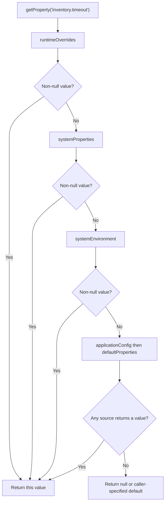

# MutablePropertySources and Lookup Order

In a Spring application, a property such as `inventory.timeout` can be declared in many places: configuration files in the JAR, external files, environment variables, JVM system properties, command-line arguments, or configuration sources integrated by the application. When multiple sources provide the same key, Spring needs a clear rule to decide which value takes effect.

`PropertySource` represents a source of properties; `MutablePropertySources` manages that collection of sources in precedence order; `Environment` uses these sources to resolve properties. Understanding these three components is foundational for operating **SPRING_CLOUD_CORE**, especially when integrating Spring Boot externalized configuration, Spring Cloud Config, discovery, service registry, and refresh scope.

This lesson belongs to the **Environment** chapter, focusing on how property sources are ordered, looked up, and modified. The goal is to explain why one value overrides another, how to add configuration sources at the right position, and the limits of modifying `Environment` in a running application.

## 1. Learning Objectives

After this lesson, you will be able to:

- Distinguish `PropertySource`, `PropertySources`, `MutablePropertySources`, and `Environment`.
- Explain the ordered lookup rule: higher-precedence sources are checked first.
- Use `addFirst`, `addLast`, `addBefore`, `addAfter`, `replace`, and `remove`.
- Recognize the role of `PropertySource` names and how to inspect precedence positions.
- Distinguish the default ordering of `StandardEnvironment` from the set of configuration sources added by Spring Boot.
- Understand how the property resolver handles `null`, empty strings, and type conversion.
- Distinguish updating `Environment` from rebinding or recreating beans.
- Test property source ordering deterministically and diagnose configuration override issues.

## 2. Four Foundational Concepts

### 2.1. `PropertySource`: A Source of Properties

`org.springframework.core.env.PropertySource<T>` is an abstract class wrapping a named data source. It defines the essential operation:

```java
Object getProperty(String name);
```

The method returns the value if the source has the corresponding key, or `null` if it does not supply that value. The data source can be a map, environment variables, JVM properties, or a custom system.

Common implementations:

| Type | Data Source |
| --- | --- |
| `MapPropertySource` | `Map<String, Object>` |
| `SystemEnvironmentPropertySource` | Process environment variables |
| `PropertiesPropertySource` | `java.util.Properties` object |
| `CompositePropertySource` | Multiple `PropertySource` instances combined together |
| `StubPropertySource` | Placeholder source used during certain context initialization phases |

`EnumerablePropertySource` is an extension branch capable of listing property names. Not every `PropertySource` can enumerate keys; a remote source may only support lookup by name.

Source names help distinguish and manage sources within `PropertySources`. Use stable, clear names such as `runtimeOverrides`, `tenantDefaults`, or `remoteConfiguration`.

### 2.2. `PropertySources`: Contract for a Collection of Sources

`PropertySources` is the interface representing a collection of `PropertySource<?>`. It allows iterating over sources in order. The interface itself does not require the collection to be mutable.

### 2.3. `MutablePropertySources`: A Mutable Collection of Sources

`org.springframework.core.env.MutablePropertySources` is the implementation that allows adding, replacing, removing, and reordering `PropertySource` instances. It is typically accessed via `ConfigurableEnvironment#getPropertySources()`.

```java
ConfigurableEnvironment environment = new StandardEnvironment();
MutablePropertySources sources = environment.getPropertySources();
```

Core characteristic: **the order inside `MutablePropertySources` is the precedence order when resolving properties**. An earlier element has higher precedence than a later element.

`MutablePropertySources` supports thread-safe access and updates to the source collection at the collection level. That does not by itself guarantee that every object inside a data source is thread-safe, or that a runtime configuration change will be applied synchronously to all beans.

### 2.4. `Environment`: Interface for Reading Configuration

`Environment` provides operations such as:

```java
String region = environment.getProperty("service.region");
Integer port = environment.getProperty("server.port", Integer.class);
boolean enabled = environment.getProperty(
        "feature.enabled", Boolean.class, false);
```

`Environment` also provides profile-related operations, such as `getActiveProfiles()` and `acceptsProfiles(...)`.

Normal applications read properties through `Environment`; the underlying implementation iterates through `PropertySource` instances in order. If you need to modify the source collection, you need `ConfigurableEnvironment` or access to the corresponding `MutablePropertySources`.

## 3. Lookup Rule: The First Source with a Value Wins

Suppose the source collection has the order:

```text
runtimeOverrides       <- highest precedence
systemProperties
systemEnvironment
applicationConfig
defaultProperties      <- lowest precedence
```

When calling:

```java
String timeout = environment.getProperty("inventory.timeout");
```

Spring queries each source in turn. The first source that returns a non-`null` value determines the result. Subsequent sources are no longer consulted for that key.



This is a conceptual overview. The actual set of sources and order depend on the `Environment` type, Spring Boot, Spring Test, and registered integrations.

### 3.1. Example of Two Sources Declaring the Same Key

```java
MutablePropertySources sources = new MutablePropertySources();

Map<String, Object> defaults = Map.of(
        "inventory.timeout", "2000",
        "inventory.region", "local");

Map<String, Object> deployment = Map.of(
        "inventory.timeout", "800");

sources.addLast(new MapPropertySource("applicationDefaults", defaults));
sources.addFirst(new MapPropertySource("deploymentOverrides", deployment));

PropertySourcesPropertyResolver resolver =
        new PropertySourcesPropertyResolver(sources);

String timeout = resolver.getProperty("inventory.timeout");
String region = resolver.getProperty("inventory.region");
```

Result:

| Key | Result | Reason |
| --- | --- | --- |
| `inventory.timeout` | `"800"` | `deploymentOverrides` comes first and has a value |
| `inventory.region` | `"local"` | Higher-precedence source lacks the key; resolver continues searching in `applicationDefaults` |

This example uses `PropertySourcesPropertyResolver` to illustrate the algorithm `Environment` relies on. In a Spring Boot application, you normally use the `Environment` configured by the framework directly.

### 3.2. `null` Differs from an Empty String

The resolver continues to the next source when `getProperty(name)` returns `null`. An empty string `""` is still a non-`null` value, so it **blocks** lower-precedence sources.

Example:

```java
Map<String, Object> defaults = Map.of("service.endpoint", "http://localhost:8080");
Map<String, Object> deployment = Map.of("service.endpoint", "");
```

If `deployment` precedes `defaults`, the result is an empty string. Spring does not automatically skip an empty value to fall back to the default URL. This is why an environment variable set to an empty string can unexpectedly override a valid configuration in a file.

With `MapPropertySource`, a map entry whose value is `null` is also treated as not providing a value when queried. If you need to represent a "configured as intentionally blank" state, use an explicit value convention and check it at the application layer.

### 3.3. Default Values in `getProperty` Calls

Overloads allow passing a default value:

```java
int maxAttempts = environment.getProperty(
        "inventory.max-attempts", Integer.class, 3);
```

The default value is only used when no source returns a value for the key. If a high-precedence source returns `""`, the resolver does not automatically switch to the default; converting an empty string to the target type may fail or depend on the converter.

`getRequiredProperty(...)` is appropriate when the application must have the key: if not found, it throws an error instead of returning `null`.

## 4. Default Ordering of Common Environments

There is no single fixed property source list for every Spring application. The source set is determined by the Environment type and configured frameworks/integrations.

### 4.1. `StandardEnvironment`

`StandardEnvironment` is a `ConfigurableEnvironment` commonly used for applications not tied to a web context. Upon initialization, it has two standard sources:

| Lookup Order | Source Name | Meaning |
| ---: | --- | --- |
| 1 | `systemProperties` | JVM system properties, e.g., `-Dservice.region=local` |
| 2 | `systemEnvironment` | Process environment variables, e.g., `SERVICE_REGION=prod` |

Because `systemProperties` comes first, if both sources provide a property, the JVM system property wins in a default `StandardEnvironment`.

`StandardServletEnvironment` extends this model for servlet applications and adds Servlet API-related sources, such as init parameters of `ServletContext` and `ServletConfig`. The exact ordering is described in the Javadoc of the corresponding class.

### 4.2. Spring Boot Adds Many More Sources

Spring Boot prepares the Environment during `SpringApplication` startup. Beyond the standard sources, Boot adds Config Data, random values, command-line arguments, JSON application properties, test property sources, and other environment-specific sources.

A **condensed ascending-precedence** order commonly encountered in Boot applications is:

1. Default values set by `SpringApplication#setDefaultProperties`.
2. `@PropertySource` on configuration classes.
3. Config Data such as `application.yaml`, profile-specific files, and imported sources.
4. Runtime sources such as environment variables and JVM system properties.
5. `SPRING_APPLICATION_JSON`.
6. Command-line arguments.
7. Test sources such as `@DynamicPropertySource` and `@TestPropertySource` when running tests.

This is a high-level list to understand the principle, not an exhaustive enumeration for all application types. Boot may add sources for JNDI, servlet, devtools, and testing; exact order can vary by version. When you need a definitive answer in production, inspect `environment.getPropertySources()` of that exact process and cross-reference the corresponding Boot documentation.

### 4.3. Why You Should Not Infer Order from Filenames

An application might have:

- `application.yaml` inside the JAR.
- `application-prod.yaml` inside the JAR.
- External `./config/application.yaml`.
- External `./config/application-prod.yaml`.
- Environment variable `INVENTORY_TIMEOUT`.
- Argument `--inventory.timeout=500`.

The final result depends not only on file order, but also on active profiles, Config Data locations, imports, Boot-created property sources, and higher-precedence runtime sources. Inspect **the loaded source set**, then see which source the key appears in.

## 5. Operations of MutablePropertySources

`MutablePropertySources` provides the main methods to manage the collection.

| Method | Effect | Precedence Impact |
| --- | --- | --- |
| `addFirst(source)` | Moves source to the front of the list | Highest precedence |
| `addLast(source)` | Moves source to the end of the list | Lowest precedence |
| `addBefore(name, source)` | Inserts before the source named `name` | Higher than reference source |
| `addAfter(name, source)` | Inserts after the source named `name` | Lower than reference source |
| `replace(name, source)` | Replaces existing source with new source at same position | Preserves precedence position |
| `remove(name)` | Removes source by name | Following sources shift up |
| `get(name)` | Retrieves source by name | Does not change order |
| `contains(name)` | Checks whether source exists | Does not change order |
| `precedenceOf(source)` | Gets precedence index of the source | Read-only |

### 5.1. `addFirst` and `addLast`

```java
MutablePropertySources sources = environment.getPropertySources();

sources.addFirst(new MapPropertySource(
        "emergencyOverrides",
        Map.of("payment.read-only", "true")));

sources.addLast(new MapPropertySource(
        "fallbackDefaults",
        Map.of("payment.retry-limit", "2")));
```

`addFirst` is used when a source must take higher precedence than existing sources. `addLast` is used for low-precedence fallbacks/defaults. If a source with the same name already exists, add operations remove the old position before adding the source at the new position; therefore source names must be managed consistently.

Do not use `addFirst` just because you want to "ensure a value is present." It can override command-line arguments, JVM properties, or environment variables that the operations team expects to take precedence.

### 5.2. `addBefore` and `addAfter`

When you need to place a source relative to a known source:

```java
MutablePropertySources sources = environment.getPropertySources();

sources.addBefore(
        "systemEnvironment",
        new MapPropertySource(
                "deploymentMetadata",
                Map.of("service.region", "ap-southeast-1")));
```

The `deploymentMetadata` source will be checked before `systemEnvironment`, yet after sources already preceding `systemEnvironment`. The reference source name must exist; otherwise, the operation cannot determine the insertion point and will throw an error.

`addAfter` has the opposite effect: the new source is checked after the reference source. Choosing a relative position helps preserve the framework's overall precedence policy.

### 5.3. `replace` Preserves Position, `remove` Deletes Source

```java
MutablePropertySources sources = environment.getPropertySources();

sources.replace(
        "deploymentMetadata",
        new MapPropertySource(
                "deploymentMetadata",
                Map.of("service.region", "ap-southeast-2")));

sources.remove("fallbackDefaults");
```

`replace` is useful when the data source needs to be swapped while preserving its precedence position. The replaced source name must exist. `remove` deletes the source from the collection; after removal, the resolver continues searching remaining sources for the key.

### 5.4. Inspecting the Current Order

```java
MutablePropertySources sources = environment.getPropertySources();

for (PropertySource<?> source : sources) {
    log.info("PropertySource: {}", source.getName());
}

PropertySource<?> deployment = sources.get("deploymentMetadata");
if (deployment != null) {
    log.info("Deployment precedence: {}", sources.precedenceOf(deployment));
}
```

Index `0` is the first position and has the highest precedence. When diagnosing, logging source names and positions is usually more helpful than dumping all contents.

## 6. Practical Example: Adding an Override Source for an Application

Suppose `checkout-service` has defaults:

```yaml
inventory:
  region: local
  max-attempts: 2
  enabled: true
```

In a test environment, the operations team wants to override `region` and `max-attempts` using a `deploymentOverrides` source.

### 6.1. Creating a MapPropertySource Before Context Refresh

```java
import java.util.Map;

import org.springframework.context.ApplicationContextInitializer;
import org.springframework.context.ConfigurableApplicationContext;
import org.springframework.core.env.MapPropertySource;

public class DeploymentOverridesInitializer
        implements ApplicationContextInitializer<ConfigurableApplicationContext> {

    @Override
    public void initialize(ConfigurableApplicationContext context) {
        Map<String, Object> values = Map.of(
                "inventory.region", "ap-southeast-1",
                "inventory.max-attempts", "4");

        context.getEnvironment().getPropertySources().addFirst(
                new MapPropertySource("deploymentOverrides", values));
    }
}
```

Register the initializer when creating `SpringApplication`:

```java
SpringApplication application = new SpringApplication(CheckoutApplication.class);
application.addInitializers(new DeploymentOverridesInitializer());
application.run(args);
```

`ApplicationContextInitializer` runs before context refresh, so the new source can participate in bean creation and the evaluation of many auto-configuration conditions. However, an initializer is not always early enough for decisions already made during Environment preparation or Config Data loading. If the source needs to influence Config Data location resolution itself, use an appropriate early Environment hook such as `EnvironmentPostProcessor` and order it properly relative to Config Data processing.

### 6.2. Reading the Result via Environment

```java
@Component
public class InventorySettings {
    private final String region;
    private final int maxAttempts;
    private final boolean enabled;

    public InventorySettings(Environment environment) {
        this.region = environment.getProperty(
                "inventory.region", "unknown");
        this.maxAttempts = environment.getProperty(
                "inventory.max-attempts", Integer.class, 1);
        this.enabled = environment.getProperty(
                "inventory.enabled", Boolean.class, false);
    }
}
```

Expected result after the initializer is registered:

| Key | Value | Source |
| --- | --- | --- |
| `inventory.region` | `ap-southeast-1` | `deploymentOverrides` |
| `inventory.max-attempts` | `4` | `deploymentOverrides` |
| `inventory.enabled` | `true` | `application.yaml` |

Keys absent from the higher-precedence source continue to be looked up in lower-precedence sources. This is per-key merging behavior, not replacing an entire file.

### 6.3. Notes on Registration Timing

If a source is added after a singleton has already been created, new `Environment#getProperty` calls can see the new value, but fields already injected via `@Value` or `@ConfigurationProperties` do not automatically change. Therefore, you must choose the right timing:

- **Before context refresh:** when the source needs to affect bean creation conditions, Config Data, or startup configuration.
- **After context is running:** only when the application actively manages updates, rebinding, or bean refresh by design.

Do not use an ordinary `@Bean` to modify the Environment and assume all previously evaluated auto-configurations will be re-evaluated.

## 7. Custom PropertySource

When configuration comes from a source that is not a map or file, you can create a custom `PropertySource<T>` implementation.

```java
public final class RegionPropertySource
        extends PropertySource<RegionSettings> {

    public RegionPropertySource(String name, RegionSettings source) {
        super(name, source);
    }

    @Override
    public Object getProperty(String name) {
        if ("service.region".equals(name)) {
            return getSource().region();
        }
        if ("service.zone".equals(name)) {
            return getSource().zone();
        }
        return null;
    }
}
```

The implementation above demonstrates converting a configuration object into a property source. If the data source has many keys and needs to enumerate them, you can extend `EnumerablePropertySource<T>` and implement `getPropertyNames()`.

### 7.1. Considerations for Custom Sources

- **Latency:** `getProperty` may be called frequently. Do not make synchronous network calls to Config Server on every lookup.
- **Caching:** if caching remote data, define TTL, updates, and handling when the source is unavailable.
- **Data types:** return appropriate values or convertible strings; avoid surprising converters with unexpected types.
- **Security:** prevent `toString`, debugging, or logging from accidentally printing credentials.
- **Ordering:** place the source at the proper position according to override policy.
- **Errors:** clearly decide how to handle missing keys (return `null`), timeouts, or authentication errors.
- **Lifecycle:** sources holding connections or resources must have proper cleanup when the context stops.

In many applications, integrating Spring Cloud Config or an existing platform configuration mechanism is more appropriate than writing a network-accessing property source yourself.

## 8. PropertySources and Spring Boot's Binding Mechanism

Spring Boot uses `Environment` to provide configuration, and also has the Binder mechanism to bind properties into `@ConfigurationProperties` objects. These two access paths are related, though not completely identical.

### 8.1. Exact Lookup via Environment

```java
String timeout = environment.getProperty("inventory.timeout");
```

This is a lookup by property name through the resolver and property sources. Some implementations, such as `SystemEnvironmentPropertySource`, have name-mapping rules for environment variable compatibility.

### 8.2. Relaxed Binding via Binder

Spring Boot Binder supports relaxed binding for equivalent configuration name forms in supported contexts. For example, `inventory.max-attempts` can be represented by the environment variable `INVENTORY_MAX_ATTEMPTS` when binding `@ConfigurationProperties`.

```java
@ConfigurationProperties(prefix = "inventory")
public record InventoryProperties(
        String region,
        int maxAttempts,
        boolean enabled) {
}
```

Binder uses the `ConfigurationPropertySource` mechanism to normalize and bind properties according to Boot's rules. Do not assume every `Environment#getProperty` call shares all of Binder's relaxed binding behavior.

### 8.3. Does an Added Configuration Source Affect Binder?

When a `PropertySource` is added to the Environment at the right time and adapted via Boot's configuration adapters, Binder can see those properties. However, if a source is added late after the `@ConfigurationProperties` bean has already bound, the existing object does not automatically update just because the new source appeared.

If configuration must be updated after startup, use a supported rebind/refresh mechanism in the running architecture, and verify which beans actually get updated.

## 9. Relationship with Spring Cloud Config and RefreshScope

Spring Cloud Config Client brings remote configuration into Spring Boot's Config Data workflow. Once loaded, those values are represented in the Environment via the corresponding property sources. They participate in lookups according to the Environment's precedence order.

A simplified model:

```text
Command-line arguments
        |
        v
Environment
        ^
        |
Spring Cloud Config property source
        ^
        |
Config Server
```

Config Server does not replace `MutablePropertySources`; it is a data provider integrated into the configuration pipeline. If multiple sources declare `inventory.region`, the higher-precedence source in Environment determines the result.

### 9.1. Changing Sources Does Not Mean Refreshing Beans

Suppose `Environment` initially returns `inventory.timeout=2s`. Later a property source is replaced and the new value is `800ms`.

- Subsequent `environment.getProperty("inventory.timeout")` calls can see `800ms`.
- A singleton bean that read `2s` in its constructor still holds the old field.
- `@ConfigurationProperties` beans are not automatically rebound in all cases.
- Beans in `@RefreshScope` require the refresh mechanism to invalidate the target; the next access creates a new target with the current configuration.

Spring Cloud Context adds mechanisms supporting refresh and rebinding. They must be properly configured, triggered, and secured; `MutablePropertySources` itself does not broadcast refresh events.

### 9.2. Do Not Use MutablePropertySources as a Business State Store

You can add a runtime source to provide controlled overrides, but you should not use Environment as a place to store transaction state, user state, or per-request changing data.

Environment is suited for **application configuration**. If each tenant has a different value per request, use a tenant context or a dedicated configuration service. Adding a global PropertySource per request can leak configuration across requests and create business race conditions.

## 10. Testing Lookup Order

Testing lookup order ensures a new source does not accidentally override critical configuration.

### 10.1. Unit Testing with MutablePropertySources

```java
class PropertySourceOrderTest {

    @Test
    void firstNonNullSourceWins() {
        MutablePropertySources sources = new MutablePropertySources();
        sources.addLast(new MapPropertySource(
                "defaults",
                Map.of("service.region", "local")));
        sources.addFirst(new MapPropertySource(
                "deployment",
                Map.of("service.region", "ap-southeast-1")));

        PropertySourcesPropertyResolver resolver =
                new PropertySourcesPropertyResolver(sources);

        assertThat(resolver.getProperty("service.region"))
                .isEqualTo("ap-southeast-1");
    }
}
```

### 10.2. Testing Fallback When Higher Source Lacks the Key

```java
@Test
void missingKeyFallsThroughToLowerPrioritySource() {
    MutablePropertySources sources = new MutablePropertySources();
    sources.addFirst(new MapPropertySource(
            "runtime",
            Map.of("service.region", "staging")));
    sources.addLast(new MapPropertySource(
            "defaults",
            Map.of("service.timeout", "2000")));

    PropertySourcesPropertyResolver resolver =
            new PropertySourcesPropertyResolver(sources);

    assertThat(resolver.getProperty("service.timeout"))
            .isEqualTo("2000");
}
```

### 10.3. Testing Empty String Override

```java
@Test
void emptyStringIsStillAResolvedValue() {
    MutablePropertySources sources = new MutablePropertySources();
    sources.addFirst(new MapPropertySource(
            "deployment",
            Map.of("service.endpoint", "")));
    sources.addLast(new MapPropertySource(
            "defaults",
            Map.of("service.endpoint", "http://localhost:8080")));

    PropertySourcesPropertyResolver resolver =
            new PropertySourcesPropertyResolver(sources);

    assertThat(resolver.getProperty("service.endpoint")).isEmpty();
}
```

These tests isolate the lookup algorithm without depending on developer machine environment variables. For Spring Boot testing, `ApplicationContextRunner` can be used to verify property sources and auto-configuration inside a lightweight context.

### 10.4. Integration Testing Real Environment

When you need to verify configuration in a Boot application:

1. Initialize the context with properties declared across multiple sources.
2. Retrieve `ConfigurableEnvironment` from the context.
3. List `PropertySource` names in their current order.
4. Read key property values via `Environment`.
5. Verify bound beans receive expected values.
6. Check profiles and remote configuration sources if present.

This test helps uncover differences between a manually constructed `MutablePropertySources` order and the real order prepared by Spring Boot at startup.

## 11. Observing and Diagnosing in Runtime Environments

When a property has the wrong value, inspect in order:

1. **Key:** is the property name exact? Are hyphens, dots, or uppercase letters mismatched?
2. **Sources:** which `PropertySource` instances contain the key?
3. **Order:** which source is first and which source returns the first non-`null` value?
4. **Value:** is a higher-precedence source returning an empty string or unexpected value?
5. **Type:** can the value be converted to the target type?
6. **Timing:** was the source added before or after the bean read the property?
7. **Refresh:** if configuration changes at runtime, do beans have an appropriate rebind or refresh mechanism?

Example listing source order without printing values:

```java
ConfigurableEnvironment environment =
        (ConfigurableEnvironment) applicationContext.getEnvironment();

int index = 0;
for (PropertySource<?> source : environment.getPropertySources()) {
    log.info("PropertySource[{}] = {}", index++, source.getName());
}
```

In Spring Boot Actuator, the `env` and `configprops` endpoints can assist in diagnosing sources and binding. Expose them only when necessary, restrict access permissions, and ensure sensitive data is masked. Do not put tokens, passwords, or secret contents into logs to hunt down overriding sources.

### 11.1. Common Symptoms

| Symptom | Possible Cause | Resolution Approach |
| --- | --- | --- |
| YAML file has new value but `Environment` returns old value | A higher-precedence source is overriding it | List property sources and check env vars/JVM/CLI |
| `Environment` returns new value but bean still uses old value | Bean read the property at initialization | Check binding, refresh scope, and bean lifecycle |
| `addBefore` or `addAfter` throws error | Reference source name does not exist | Check `get(name)` and actual source names |
| Added source but key not found | Source returns `null`, wrong key, or added to a different Environment | Check `getProperty`, active context, and source identity |
| An empty environment variable overrides file | Empty string is not `null` | Check actual variable value and validation |
| Tests pass but production differs | Boot creates extra sources or different ordering | Inspect real Environment in the exact profile/runtime |
| Binder and `Environment#getProperty` give different results | Relaxed binding/adapter differs from direct name lookup | Check canonical name and `@ConfigurationProperties` binding |

## 12. Design Mistakes to Avoid

- Adding every source with `addFirst`: breaks expected precedence policies for command line, system properties, or environment variables.
- Unintentionally duplicating source names: add operations may move/replace an existing source.
- Calling `addBefore` with unstable names: breaks easily when changing Boot versions or Environment types.
- Using `replace` to change position: `replace` keeps the position; to change precedence, use the appropriate insertion operation.
- Modifying `MutablePropertySources` after beans are initialized and expecting beans to update themselves: Environment lookup and bean lifecycle are separate concerns.
- Using global PropertySources to store per-request/tenant data: easily causes cross-thread interference.
- Logging entire property sources: may expose secrets or sensitive operational data.
- Using a hand-built `MutablePropertySources` test to conclude production Boot ordering: that test only proves the resolver and the test-constructed order.

## 13. Real-World Scenario: Why Didn't Deployment Configuration Win?

`checkout-service` has three sources:

```text
1. applicationDefaults
   inventory.timeout = 2000

2. deploymentOverrides
   inventory.timeout = 800

3. emergencyOverrides
   inventory.timeout = 500
```

The development team expected `deploymentOverrides` to win, yet the application still used `500`. Upon inspecting Environment, `emergencyOverrides` was found to have been added using `addFirst`.

Analysis:

- The resolver does not know which source is "more reasonable"; it follows the collection order.
- `emergencyOverrides` is at the front, so `500` wins.
- The proper fix is redefining the precedence policy and source insertion position, not arbitrarily altering property-reading code or renaming keys.
- If `emergencyOverrides` is only meant to be temporary, there must be an operation to remove the source and tests ensuring fallback values return properly.

Removal example:

```java
environment.getPropertySources().remove("emergencyOverrides");
```

After removal, the resolver continues searching and can return `800` from `deploymentOverrides`. If a bean previously retained `500`, appropriate lifecycle/rebind handling is needed for the bean to pick up the new value.

## 14. Usage Principles in Spring Cloud Core

1. Treat `MutablePropertySources` as a **precedence-ordered list**, not an unordered merged map.
2. Add default sources with `addLast`, intentional overrides with `addFirst` or relative insertion; always document why.
3. Use stable source names and check the reference source before calling `addBefore`, `addAfter`, or `replace`.
4. Register configuration sources early if they affect auto-configuration or bean creation conditions.
5. Use `Environment` to read properties; use `@ConfigurationProperties` for structured configuration groups.
6. Distinguish direct lookup from Spring Boot Binder's relaxed binding.
7. When changing configuration at runtime, explicitly design Environment updates, rebinding, and bean refresh separately.
8. Do not use Environment in place of a business data store or authorization mechanism.
9. Test both the precedence algorithm and the actual Environment created by Spring Boot.
10. Protect secrets and only inspect source names/authorized values during diagnostics.

## 15. Summary

`PropertySource` represents a source of properties. `MutablePropertySources` manages multiple sources in order; earlier elements take higher precedence. When resolving a key, the resolver finds the first source returning a non-`null` value. Consequently, an empty string can still override a valid value in a lower-precedence source.

`StandardEnvironment` has default sources for JVM system properties and system environment; Spring Boot adds Config Data, command-line arguments, JSON, test sources, and environment-specific sources. Therefore, the order in a real Boot application should be observed directly and cross-referenced with the documentation of the version in use.

`addFirst`, `addLast`, `addBefore`, `addAfter`, `replace`, and `remove` allow controlling precedence. However, modifying the collection only affects subsequent lookups; it does not automatically refresh fields already injected into beans. In a Spring Cloud system, updating configuration requires proper coordination between Environment, Binder, Spring Cloud Context, and bean lifecycles.

## 16. References

- [Spring Framework Reference — Environment Abstraction](https://docs.spring.io/spring-framework/reference/core/beans/environment.html)
- [Spring Framework Javadoc — MutablePropertySources](https://docs.spring.io/spring-framework/docs/current/javadoc-api/org/springframework/core/env/MutablePropertySources.html)
- [Spring Framework Javadoc — PropertySource](https://docs.spring.io/spring-framework/docs/current/javadoc-api/org/springframework/core/env/PropertySource.html)
- [Spring Framework Javadoc — PropertySourcesPropertyResolver](https://docs.spring.io/spring-framework/docs/current/javadoc-api/org/springframework/core/env/PropertySourcesPropertyResolver.html)
- [Spring Framework Javadoc — StandardEnvironment](https://docs.spring.io/spring-framework/docs/current/javadoc-api/org/springframework/core/env/StandardEnvironment.html)
- [Spring Boot Reference — Externalized Configuration](https://docs.spring.io/spring-boot/reference/features/external-config.html)
- [Spring Boot Reference — Type-safe Configuration Properties](https://docs.spring.io/spring-boot/reference/features/external-config.html#features.external-config.typesafe-configuration-properties)
- [Spring Cloud Commons — Application Context Services](https://docs.spring.io/spring-cloud-commons/reference/spring-cloud-commons/application-context-services.html)
- [Spring Cloud Config — Client Side Usage](https://docs.spring.io/spring-cloud-config/reference/client.html)
