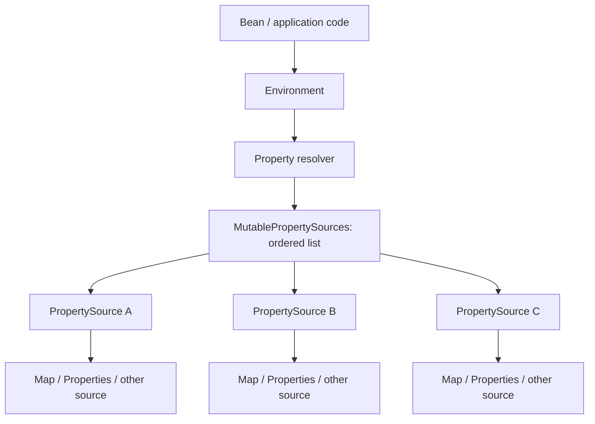

# MapPropertySource, PropertiesPropertySource, and CompositePropertySource

In Spring Framework, `Environment` provides a unified way to read configuration whether values come from files, environment variables, command-line arguments, or an external system. The foundation of this mechanism is `PropertySource`: a named source that knows how to return a value by property name. Spring provides several `PropertySource` types to represent different kinds of data.

Three types to understand well are:

- `MapPropertySource`: reads properties from a `Map<String, Object>`.
- `PropertiesPropertySource`: reads properties from a `java.util.Properties` object.
- `CompositePropertySource`: combines multiple `PropertySource` instances into a composite source with an internal lookup order.

They all belong to the `org.springframework.core.env` package. Understanding the exact differences between them helps you read configuration precedence orders, build programmatic configuration sources, integrate external configuration, and test Spring Cloud Commons/Context behavior.

## 1. Where Does PropertySource Sit in Spring Environment?

Spring `Environment` represents the application's environment, consisting of profiles and property sources. When calling:

```java
String serviceName = environment.getProperty("spring.application.name");
```

Spring does not need to know whether the value came from a YAML file, a properties file, an environment variable, or a configuration source supplied by an integration. It looks up through the `PropertySource` instances in their configured order.

Conceptual structure:



`Environment` provides the property-reading API. `MutablePropertySources` is the ordered collection of sources and allows adding, replacing, or removing sources when needed. Each `PropertySource` represents a specific lookup target.

When the same key appears in multiple sources, order matters: the source searched earlier can supply the effective value. Therefore, understanding source structure and precedence is just as important as knowing which file contains a property.

## 2. PropertySource and EnumerablePropertySource

`PropertySource<T>` is the base abstraction for a named configuration source. It holds a source object of type `T` and provides a method to look up values by key. Subclasses decide how to read data from that object.

Some sources also extend `EnumerablePropertySource<T>`. This kind can list the property names contained in the source via `getPropertyNames()`. `MapPropertySource` and `PropertiesPropertySource` are enumerable examples because they can extract a key list from their underlying data.

| Type | Underlying Data | Can Enumerate Keys? | Use When |
| --- | --- | --- | --- |
| `PropertySource<T>` | Depends on implementation | Not necessarily | Only lookup by key is needed |
| `EnumerablePropertySource<T>` | Depends on implementation | Yes | Need to know the keys present in the source |
| `MapPropertySource` | `Map<String, Object>` | Yes | Map-shaped data |
| `PropertiesPropertySource` | `java.util.Properties` | Yes | Properties-shaped data |
| `CompositePropertySource` | Collection of PropertySources | Can aggregate keys from enumerable sources | Combining multiple sources into one logical source |

Do not assume every `PropertySource` can list all keys. A source may only know how to answer "does this key have a value?" without being able to supply a complete list of keys.

## 3. MapPropertySource: A Configuration Source from a Map

`MapPropertySource` is a subclass of `EnumerablePropertySource<Map<String, Object>>`. It uses a map as its backing data and looks up values by property name.

Example:

```java
import java.util.LinkedHashMap;
import java.util.Map;
import org.springframework.core.env.MapPropertySource;

Map<String, Object> values = new LinkedHashMap<>();
values.put("spring.application.name", "order-service");
values.put("server.port", 8081);
values.put("feature.checkout.enabled", true);

MapPropertySource source =
        new MapPropertySource("runtimeOverrides", values);
```

The name `runtimeOverrides` is the identifying name of the source. Keys and values reside in the map. Values can be strings or typed objects, depending on how the application uses them.

You can add the source to Environment:

```java
import org.springframework.core.env.ConfigurableEnvironment;

void addRuntimeOverrides(ConfigurableEnvironment environment) {
    Map<String, Object> overrides = Map.of(
            "feature.checkout.enabled", true,
            "checkout.timeout.seconds", 3
    );

    environment.getPropertySources().addFirst(
            new MapPropertySource("runtimeOverrides", overrides)
    );
}
```

`ConfigurableEnvironment` provides `getPropertySources()`, returning a `MutablePropertySources` collection. Calling `addFirst` puts the source at the front of the list, giving it higher lookup precedence than sources behind it.

This example suits configuration generated in code, override values for tests, or an adapter that needs to convert data from a map structure into a Spring PropertySource. In real applications, add sources at the right time during context initialization, before beans depending on the properties are created and bound.

### 3.1. MapPropertySource Holds a Reference to the Map

`MapPropertySource` uses the passed-in map as its data source. If that map is mutable, updating the map can change the result of subsequent lookups:

```java
Map<String, Object> flags = new LinkedHashMap<>();
flags.put("feature.search.enabled", false);

MapPropertySource source =
        new MapPropertySource("featureFlags", flags);

flags.put("feature.search.enabled", true);

// Subsequent lookups can see the new value in the map.
Object enabled = source.getProperty("feature.search.enabled");
```

This is the behavior of the backing data source; it does not mean every bean that already bound the old value will automatically update. For example, a field injected with `@Value` typically retains the value from when the bean was created. For beans to receive new configuration, an appropriate update mechanism is needed, such as refresh scope in supported scenarios.

For configuration that can change concurrently across multiple threads, you must ensure thread safety of the map and update process yourself. Do not share a `HashMap` being written concurrently by multiple threads without proper synchronization.

### 3.2. What Value Types Suit MapPropertySource?

A map can contain non-string values:

```java
Map<String, Object> values = Map.of(
        "feature.audit.enabled", true,
        "retry.max-attempts", 4,
        "service.tags", new String[] {"internal", "critical"}
);
```

When reading via `Environment.getProperty(key, TargetType.class)`, Spring can convert the value through the appropriate conversion mechanism. Specific conversion capabilities depend on the data type, registered converters, and framework version.

For application configuration with many related fields, `@ConfigurationProperties` is usually more suitable than reading scattered individual keys. `MapPropertySource` is only a way to represent a source; it does not replace binding, validation, or configuration rules.

## 4. PropertiesPropertySource: A Source from java.util.Properties

`PropertiesPropertySource` is a form of `MapPropertySource` dedicated to `java.util.Properties` data. It allows integrating traditional key/value data into the same Environment mechanism.

Example:

```java
import java.util.Properties;
import org.springframework.core.env.PropertiesPropertySource;

Properties properties = new Properties();
properties.setProperty("spring.application.name", "inventory-service");
properties.setProperty("server.port", "8082");
properties.setProperty("inventory.cache.enabled", "true");

PropertiesPropertySource source =
        new PropertiesPropertySource("legacyProperties", properties);
```

Then add it to Environment in the desired order:

```java
environment.getPropertySources().addLast(source);
```

`Properties` typically stores values as strings. Therefore, when you need an integer or boolean, you can request the target type when reading:

```java
String appName = environment.getProperty("spring.application.name");
Integer port = environment.getProperty("server.port", Integer.class);
Boolean cacheEnabled =
        environment.getProperty("inventory.cache.enabled", Boolean.class);
```

### 4.1. When to Use PropertiesPropertySource?

Use `PropertiesPropertySource` when data is already in the form of a `Properties` object, for example:
- A legacy library supplies configuration via `Properties`.
- An adapter reads a `.properties` file or receives data from another system and builds a `Properties` object.
- The application needs to bring `Properties` data into Environment without writing a custom PropertySource implementation.

Note: `PropertiesPropertySource` is **not a file reader**. It represents a `Properties` object already in memory. Reading resources from the filesystem or classpath is the responsibility of resource-loading code or another class.

### 4.2. Comparing MapPropertySource and PropertiesPropertySource

| Criterion | MapPropertySource | PropertiesPropertySource |
| --- | --- | --- |
| Input data | `Map<String, Object>` | `java.util.Properties` |
| Value type | Can be any object | Usually key/value strings |
| Purpose | Flexible configuration, data built in code | Integrating traditional Properties data |
| Lookup | By key in the map | By key in Properties |
| Key enumeration | Yes | Yes |
| Inheritance | Extends EnumerablePropertySource | Extends MapPropertySource |
| When to choose | Already have Map-shaped data | Already have Properties-shaped data |

Architecturally, `PropertiesPropertySource` specializes how `Properties` data is represented. Both participate in Environment's same precedence mechanism; there is no default precedence rule just because a source is a Map or Properties.

## 5. CompositePropertySource: Combining Multiple Sources into One

`CompositePropertySource` is an `EnumerablePropertySource<Object>` containing multiple `PropertySource<?>` instances inside. It is useful when an integration wants to present multiple configuration sources as a single named logical source.

For example, an application can combine shared configuration and tenant configuration:

```java
import java.util.Map;
import org.springframework.core.env.CompositePropertySource;
import org.springframework.core.env.MapPropertySource;

MapPropertySource tenantOverrides = new MapPropertySource(
        "tenantOverrides",
        Map.of(
                "checkout.banner", "Welcome to tenant A",
                "checkout.timeout.seconds", 2
        )
);

MapPropertySource sharedDefaults = new MapPropertySource(
        "sharedDefaults",
        Map.of(
                "checkout.banner", "Welcome",
                "checkout.timeout.seconds", 5,
                "checkout.audit.enabled", true
        )
);

CompositePropertySource checkoutConfig =
        new CompositePropertySource("checkoutConfiguration");

checkoutConfig.addPropertySource(tenantOverrides);
checkoutConfig.addPropertySource(sharedDefaults);
```

The composite contains two sources in the order they were added. When looking up a key, it searches the child sources sequentially and returns the first value found. In the example:

- `checkout.banner` gets its value from `tenantOverrides`.
- `checkout.timeout.seconds` gets the value `2` from `tenantOverrides`.
- `checkout.audit.enabled` is not in the tenant source, so it takes the value from `sharedDefaults`.

Thus, a composite creates a logical configuration by looking up each key across multiple sources. It does not need to merge all maps into a single new map.

### 5.1. Ordering Inside CompositePropertySource

The order in which child sources are added affects overlapping keys. For example, if two sources both declare `checkout.timeout.seconds`, the first searched source with a non-null value wins.

```text
CompositePropertySource: checkoutConfiguration
  1. tenantOverrides
       checkout.timeout.seconds = 2
  2. sharedDefaults
       checkout.timeout.seconds = 5

Result: checkout.timeout.seconds = 2
```

Reversing the order of the two sources can change the effective value. Therefore, ordering inside a composite is part of the configuration policy, not a harmless implementation detail.

### 5.2. CompositePropertySource Is Not MutablePropertySources

Both relate to multiple sources, but at different levels:

| Component | Role |
| --- | --- |
| `MutablePropertySources` | List of PropertySources at the Environment level; supports addFirst/addLast and top-level reordering |
| `CompositePropertySource` | A single PropertySource containing multiple child PropertySources inside |
| `Environment` | API for reading properties and accessing profiles, using the source list |

You can visualize it as:

```text
Environment
  |
  +-- MutablePropertySources
        |
        +-- commandLineArgs
        +-- systemEnvironment
        +-- checkoutConfiguration (CompositePropertySource)
        |      +-- tenantOverrides
        |      +-- sharedDefaults
        +-- applicationConfig
```

At the outer level, Environment compares sources according to their order in `MutablePropertySources`. When an outer source is a composite, the composite looks up according to the order of its child sources. Hence there are two layers of precedence:

1. Order among PropertySources at the Environment level.
2. Order among PropertySources inside the CompositePropertySource.

## 6. Lookup Behavior and Precedence Rules

When the application calls `environment.getProperty("checkout.timeout.seconds")`, the resolver iterates through the source list in order. The first source returning a non-`null` value supplies the result. If a source lacks the key, searching continues in subsequent sources.

Example:

```java
ConfigurableEnvironment environment = new StandardEnvironment();

MapPropertySource highPriority = new MapPropertySource(
        "runtimeOverrides",
        Map.of("checkout.timeout.seconds", "2")
);

MapPropertySource lowPriority = new MapPropertySource(
        "defaults",
        Map.of("checkout.timeout.seconds", "5")
);

environment.getPropertySources().addFirst(highPriority);
environment.getPropertySources().addLast(lowPriority);

String timeout = environment.getProperty("checkout.timeout.seconds");
// Value: "2"
```

`addFirst` puts the source at the front of the list, giving it higher precedence than sources behind it. `addLast` puts the source at the end of the list. Beyond these two operations, `MutablePropertySources` can also add before/after a known source, replace, or remove sources by name.

### 6.1. An Empty Value Differs from a Missing Key

This is an important point when handling fallbacks:

- If the first source lacks the key and returns `null`, the resolver continues searching subsequent sources.
- If the first source has the key with an empty string `""`, that is still a non-`null` value; it can shadow values in lower-precedence sources.
- Default values in placeholders are normally used when a property is not found, not to automatically replace every empty string.

Example:

```java
MapPropertySource high = new MapPropertySource(
        "high",
        Map.of("service.region", "")
);

MapPropertySource low = new MapPropertySource(
        "low",
        Map.of("service.region", "ap-southeast-1")
);
```

If `high` is placed before `low`, the lookup result is an empty string. If the application wants to treat an empty string as a missing value, handle that rule in binding/validation or application logic; do not assume Environment will skip it automatically.

### 6.2. Precedence Inside a Composite and Outside in Environment

Suppose the top-level Environment has:
- `runtimeOverrides` first.
- `remoteConfiguration` as a CompositePropertySource next.
- `applicationDefaults` last.

Inside the composite, `tenantOverrides` precedes `sharedDefaults`.

If a key appears in all three layers, the outcome is:
1. Environment checks `runtimeOverrides` first.
2. If the key is absent, it moves to the composite.
3. The composite checks `tenantOverrides` then `sharedDefaults`.
4. If the composite lacks the key, Environment continues to `applicationDefaults`.

A value in a top-level source can beat any value inside the composite if the top-level source precedes the composite. Conversely, the composite can beat other sources if it is added to the front of the Environment list.

## 7. Combining All Three PropertySource Types in an Application

The following example illustrates a composite containing a Map source and a Properties source, which is then added to Environment:

```java
import java.util.LinkedHashMap;
import java.util.Map;
import java.util.Properties;

import org.springframework.core.env.CompositePropertySource;
import org.springframework.core.env.ConfigurableEnvironment;
import org.springframework.core.env.MapPropertySource;
import org.springframework.core.env.PropertiesPropertySource;

public class PropertySourceSetup {

    public void configure(ConfigurableEnvironment environment) {
        Map<String, Object> runtimeValues = new LinkedHashMap<>();
        runtimeValues.put("feature.checkout.enabled", true);
        runtimeValues.put("checkout.timeout.seconds", 3);

        MapPropertySource runtime =
                new MapPropertySource("runtimeOverrides", runtimeValues);

        Properties legacyValues = new Properties();
        legacyValues.setProperty("checkout.timeout.seconds", "5");
        legacyValues.setProperty("checkout.currency", "VND");

        PropertiesPropertySource legacy =
                new PropertiesPropertySource("legacyProperties", legacyValues);

        CompositePropertySource composite =
                new CompositePropertySource("checkoutConfiguration");

        composite.addPropertySource(runtime);
        composite.addPropertySource(legacy);

        environment.getPropertySources().addFirst(composite);
    }
}
```

Lookup results:
- `feature.checkout.enabled` comes from the Map source.
- `checkout.timeout.seconds` comes from the Map source because the composite searches `runtime` first.
- `checkout.currency` comes from the Properties source because the key is not in the Map source.

Reading via Environment:

```java
Boolean enabled = environment.getProperty(
        "feature.checkout.enabled", Boolean.class, false);

Integer timeout = environment.getProperty(
        "checkout.timeout.seconds", Integer.class, 0);

String currency = environment.getProperty("checkout.currency");
```

Examples using `Map.of` and modern Java syntax in earlier sections require Java 9 or later. If the project uses Java 8, you can use `Collections.singletonMap` or `LinkedHashMap` to create maps.

### 7.1. Where in the Lifecycle Should Sources Be Added?

Adding a PropertySource before beans needing configuration are created is the easiest approach to control. If you add or modify sources after the context has initialized:
- Subsequent direct Environment reads can see the new value.
- Fields already injected via `@Value` may still keep old values.
- Beans already bound with `@ConfigurationProperties` are not automatically recreated in all cases.
- Components that already created connection pools, server sockets, or clients may not automatically apply the new configuration.

If the goal is refreshing configuration at runtime, design it together with Spring Cloud Context, refresh scope, or a corresponding update mechanism. Changing PropertySource order only changes where Environment looks up; it does not automatically refresh every live object.

## 8. Relationship with Spring Cloud Config and Externalized Configuration

Spring Cloud Config Client fetches properties from Config Server and brings them into the application's environment. An integration may represent the received data as one or more PropertySources, or group them into a CompositePropertySource to keep a logical group of sources.

Conceptual example:

```text
Environment
  |
  +-- systemEnvironment
  +-- commandLineArgs
  +-- configService (CompositePropertySource)
         +-- application-wide remote config
         +-- profile-specific remote config
         +-- label / repository source
  +-- local application defaults
```

Exact names and how property sources are organized depend on the Spring Cloud Config Client version and configuration loading mechanism. Do not rely on a fixed internal source name in business logic. When you need to check, observe Environment at runtime or inspect Config Client logs for your version.

### 8.1. Composite Does Not Equal Config Server

`CompositePropertySource` is a Spring Core structure for grouping sources. Config Server is a service that provides configuration over the network. Config Client is the integration inside the application that fetches data from the server.

An application can create a CompositePropertySource on its own without a Config Server. Conversely, a Config Client can organize its internal property sources in its own way. Do not equate a Spring Core abstraction with an infrastructure service.

### 8.2. Relationship with Spring Cloud Context

After a property source is updated in Environment, Spring Cloud Context can participate in the bean refresh workflow. However, changing the configuration source and updating objects currently using configuration are two distinct steps.

For example:
1. Config Client downloads new properties.
2. The PropertySource is updated or replaced.
3. Environment looks up the new value.
4. The refresh mechanism is triggered.
5. Beans in refresh scope can be recreated.

If you stop at step 2, beans holding old values may remain unchanged. If you only refresh beans while the source lacks the new value, newly created beans still read old data or fallbacks.

## 9. Inspecting Sources and Order in Environment

You can iterate over top-level sources to observe their names and positions:

```java
import org.springframework.core.env.ConfigurableEnvironment;
import org.springframework.core.env.PropertySource;

void printPropertySourceNames(ConfigurableEnvironment environment) {
    for (PropertySource<?> source : environment.getPropertySources()) {
        System.out.println(source.getName()
                + " -> " + source.getClass().getSimpleName());
    }
}
```

If a source is a `CompositePropertySource`, you can iterate through its child sources using the composite's API to inspect their order. When debugging, log source names and types rather than all configuration values, as they may contain credentials or secrets.

One way to check a specific key:

```java
String value = environment.getProperty("checkout.timeout.seconds");
Boolean enabled = environment.getProperty(
        "feature.checkout.enabled", Boolean.class);
```

To understand why a value was chosen, check:
- Which sources contain the key?
- Which source comes first in the top-level list?
- If it is a composite, which child source comes first?
- Is the value in the first source `null`, an empty string, or an actual value?
- Does any conversion/binding alter the data type after lookup?

### 9.1. Actuator and Sensitive Information

Spring Boot Actuator has endpoints supporting Environment inspection depending on configuration and version. When enabling this endpoint, restrict access permissions and keep sensitive-value masking enabled. Do not expose the property source list or configuration values publicly to unauthorized users.

## 10. Testing Precedence and CompositePropertySource

You can test ordering using a new `StandardEnvironment` and two MapPropertySources:

```java
import static org.assertj.core.api.Assertions.assertThat;

import java.util.Map;
import org.junit.jupiter.api.Test;
import org.springframework.core.env.MapPropertySource;
import org.springframework.core.env.StandardEnvironment;

class PropertySourceOrderTest {

    @Test
    void firstSourceWinsWhenKeysOverlap() {
        StandardEnvironment environment = new StandardEnvironment();

        environment.getPropertySources().addFirst(
                new MapPropertySource(
                        "highPriority",
                        Map.of("demo.region", "north")
                )
        );

        environment.getPropertySources().addAfter("highPriority",
                new MapPropertySource(
                        "lowPriority",
                        Map.of("demo.region", "south")
                )
        );

        assertThat(environment.getProperty("demo.region"))
                .isEqualTo("north");
    }
}
```

Testing a composite can also verify fallback between child sources:

```java
@Test
void compositeChecksItsSourcesInOrder() {
    CompositePropertySource composite =
            new CompositePropertySource("combined");

    composite.addPropertySource(new MapPropertySource(
            "tenant",
            Map.of("demo.region", "tenant-region")
    ));

    composite.addPropertySource(new MapPropertySource(
            "global",
            Map.of(
                    "demo.region", "global-region",
                    "demo.currency", "VND"
            )
    ));

    StandardEnvironment environment = new StandardEnvironment();
    environment.getPropertySources().addFirst(composite);

    assertThat(environment.getProperty("demo.region"))
            .isEqualTo("tenant-region");
    assertThat(environment.getProperty("demo.currency"))
            .isEqualTo("VND");
}
```

These two tests verify Spring Core's lookup rules. They do not test Config Server, Eureka, networking, or Config Data ordering of a specific Boot application. Those integrated parts require dedicated context/integration tests.

### 10.1. Test Cases to Include

| Test Case | Expectation |
| --- | --- |
| Key only in first source | Takes first source value |
| Key only in later source | Continues searching and takes later source value |
| Overlapping key in two sources | Higher-precedence source wins |
| First source returns `null` | Continues looking up in later source |
| First source contains empty string | Empty string can shadow value in later source |
| Composite has overlapping key | Earlier child source wins |
| Composite lacks key | Environment continues to next top-level source |
| Map changes after adding source | Subsequent lookup can see new map; bound beans must be checked separately |
| Properties source | String values are read and converted when requested |
| Source contains secrets | Observation/logging does not leak sensitive values |

## 11. Common Mistakes and Misconceptions

**MapPropertySource automatically creates a configuration file.** Incorrect. It wraps a Map that already exists in memory. Reading files is the responsibility of a resource loader or another configuration mechanism.

**PropertiesPropertySource is a .properties file reader.** Incorrect. It wraps a `java.util.Properties` object; loading a file to populate that object is a separate step.

**CompositePropertySource merges all keys into a single Map.** Not necessarily. It holds multiple child sources and looks them up sequentially in order; for overlapping keys, the earlier-searched child source can win.

**addFirst is only a display order.** Incorrect. It affects the lookup order and therefore affects the effective value.

**A preceding MapPropertySource always wins even when the value is null.** Incorrect. The resolver generally continues when a source returns `null`. An empty string is a non-`null` value and can shadow lower-precedence sources.

**Changing the Map automatically refreshes every bean.** Incorrect. Subsequent Environment reads can see the new value, but objects bound/injected earlier are not automatically updated in all cases.

**CompositePropertySource and MutablePropertySources are the same kind of collection.** Incorrect. One is a PropertySource containing child sources; the other is the Environment-level list of sources.

## Summary

`MapPropertySource` and `PropertiesPropertySource` represent two different backing data forms yet both participate in Spring Environment's key lookup mechanism. `CompositePropertySource` groups multiple child sources and applies an internal lookup order; `MutablePropertySources` determines source order at the Environment level. The effective value is determined by precedence across both layers. When integrating external configuration or Spring Cloud Config, verify which sources are added, what their order is, how overlapping keys are handled, and whether beans need refreshing.
