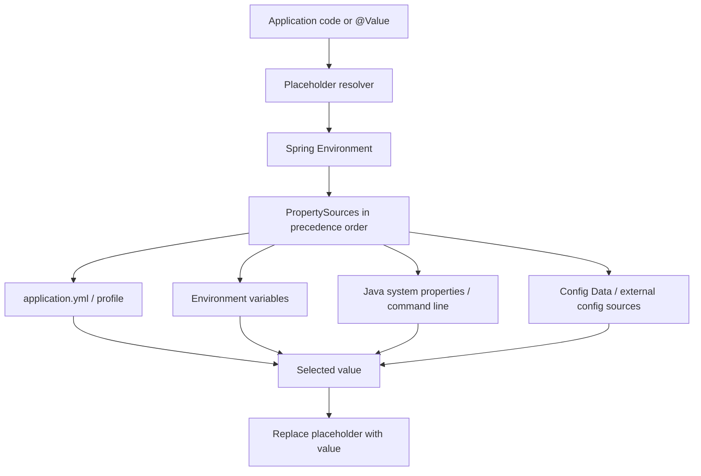

# Placeholders, Referenced Values, and Unresolved Errors

In a Spring Boot application, a configuration value rarely stands alone. A connection URL may combine a hostname, port, and database name; one service may share another service's endpoint; environment names or deployment info may come from environment variables, configuration files, or Config Server. Duplicating the same value in multiple places makes configurations drift easily when changes occur.

Spring supports **placeholders** so one configuration value can reference another. The common syntax is `${property.name}`. When Spring resolves a placeholder, it looks up the key across `Environment`'s configuration sources, replaces the expression with the corresponding value, and can fall back to a default value if the key does not exist yet.

This lesson belongs to the **Environment** chapter of **SPRING_CLOUD_CORE**. The focus is on placeholder syntax, default values, nested references, configuration sources and precedence order, usage with `@Value`/`@ConfigurationProperties`, Spring Cloud Config integration, relationship with refresh scope, and troubleshooting unresolved placeholder errors.

## 1. Learning Objectives

After this lesson, learners will be able to:

1. Explain what placeholders are and why configuration should reference values instead of duplicating them.
2. Write basic placeholders, placeholders with default values, and nested placeholders.
3. Distinguish missing keys, empty values, and default values.
4. Explain how `Environment` and `PropertySources` look up values across multiple sources.
5. Distinguish placeholders in `@Value` from typed binding with `@ConfigurationProperties` and SpEL expressions.
6. Understand unresolved placeholder errors, circular references, wrong keys, and configuration source errors.
7. Diagnose and test placeholders in Spring Boot and Spring Cloud applications.

## 2. What Is a Placeholder?

A placeholder is an expression representing a value to be looked up when Spring processes configuration. For example, a configuration file may declare:

```yaml
app:
  service:
    host: inventory.internal
    port: 8082
    url: http://${app.service.host}:${app.service.port}
```

The effective value of `app.service.url` after resolving placeholders is:

```text
http://inventory.internal:8082
```

The `host` and `port` properties are declared once; the URL references them. When the inventory address changes, the team only needs to update the original value at the appropriate configuration source.

Another example using an environment variable:

```yaml
app:
  payment:
    endpoint: ${PAYMENT_ENDPOINT:https://sandbox-payments.example}
```

If `PAYMENT_ENDPOINT` has a value in Environment, that value is used. If the key does not exist, Spring uses the default URL written after the `:` separator.

A placeholder is **not a computation**. It performs lookup and value substitution. If you want to compose values, set defaults, or convert data types, use the appropriate mechanism for each; do not treat placeholders as a configuration programming language.

### 2.1. Where Are Placeholders Processed?

Placeholders can appear in:

- Values in `application.properties` or `application.yml`.
- `@Value` annotations on fields, constructor parameters, or method parameters.
- Bean definitions and Spring configuration that use an embedded value resolver.
- Certain external configurations loaded into `Environment`.
- Properties brought into Environment by Spring Cloud Config Client.

The same expression may be resolved at different phases depending on where it appears. In typical Boot application configuration, Config Data is loaded into Environment before beans needing the values are created. When `@Value` is processed, placeholders are replaced with values from Environment.

## 3. Basic Syntax and Default Values

### 3.1. Referencing a Property

Syntax:

```text
${property.name}
```

Example:

```yaml
app:
  inventory:
    host: inventory.internal
    port: 8082
    base-url: http://${app.inventory.host}:8082
```

`app.inventory.base-url` references `app.inventory.host`. Spring looks up the key in the current Environment; the two properties do not need to live in the same file.

Property names should be written in canonical kebab-case, such as `app.inventory.base-url`. This format aligns cleanly across YAML, properties, environment variables, and Spring Boot configuration metadata.

### 3.2. Placeholders with Default Values

Syntax:

```text
${property.name:defaultValue}
```

Example:

```yaml
app:
  discovery:
    registry-url: ${DISCOVERY_REGISTRY_URL:http://localhost:8761}
    connect-timeout: ${DISCOVERY_CONNECT_TIMEOUT:2s}
```

If the key is absent, the value after `:` is used. Default values are especially useful for development settings, optional values, or values with safe fallbacks.

**Do not arbitrarily use defaults for required configuration.** If production must declare a dedicated endpoint or secret, a default pointing to localhost or a test account can mask deployment mistakes. For required data, leaving the placeholder without a default and failing fast when missing is usually safer.

### 3.3. A Missing Key Differs from an Empty Value

Suppose:

```yaml
app:
  feature:
    label: ""
```

And code/config uses `${app.feature.label:Unknown}`. Because the key exists and its value is an empty string, the placeholder receives the empty string. The default `Unknown` is not automatically used just because the string is empty.

| Property State | Example | Result of `${app.feature.label:Unknown}` |
| --- | --- | --- |
| Does not exist | No key present | `Unknown` |
| Has a value | `label: Ready` | `Ready` |
| Has an empty value | `label: ""` | Empty string |
| Has whitespace | `label: "   "` | Whitespace string |

If you want to treat blank as invalid, use validation or separate checking logic. Placeholder defaults only address the case where no value is found according to resolver rules.

### 3.4. Empty Default and Optional Properties

You can write:

```yaml
app:
  proxy:
    username: ${PROXY_USERNAME:}
```

When the key does not exist, the result is an empty string. This works for optional fields if code clearly understands what an empty string means. However, for secrets or critical endpoints, an empty default can make errors surface much later; consider validation to report clearly right at startup.

## 4. Nested Placeholders and Multi-Level References

### 4.1. Referencing a Property That Already Contains Placeholders

One property can reference another property, and the referenced property can itself contain placeholders:

```yaml
app:
  network:
    host: inventory.internal
    port: 8082
    authority: ${app.network.host}:${app.network.port}
    url: http://${app.network.authority}/api
```

When the value is resolved, nested placeholders are processed recursively until a final value is reached.

This helps separate configuration by responsibility: host/port are raw inputs, authority is a composition, and URL is the endpoint consumed. When reading files, operators need to trace the reference chain to understand the effective value.

### 4.2. Default Values Can Also Be Placeholders

Example:

```yaml
app:
  network:
    default-host: localhost
    host: ${INVENTORY_HOST:${app.network.default-host}}
    port: ${INVENTORY_PORT:8082}
    url: http://${app.network.host}:${app.network.port}
```

The selection order for host is:

1. Use `INVENTORY_HOST` if it has a value.
2. Otherwise, use `app.network.default-host`.
3. If that default value also does not exist, the final placeholder has no value to resolve and may throw an error.

Nested placeholders help express multi-tier fallbacks, though they should not be overused to the point of becoming hard to trace. Across multiple environments and configuration sources, a clear canonical property is often easier to maintain than a deeply nested expression.

### 4.3. Placeholders in URLs and Strings with Delimiters

Example:

```yaml
app:
  service:
    url: ${SERVICE_URL:https://api.example:8443/v1}
```

The first `:` separates the key from the default value. Subsequent `:` characters belong to the default URL content. If the default contains special characters or spaces, you can wrap it in quotes in YAML to avoid confusion with YAML syntax; quoting does not alter Spring's placeholder resolution rules.

### 4.4. Avoiding Circular References

Two properties referencing each other:

```yaml
app:
  first: ${app.second}
  second: ${app.first}
```

There is no root value to resolve. Spring can detect the cycle and report a circular placeholder reference error. A long multi-level reference chain is also hard to diagnose if a cycle exists in the middle.

Design principles:

- Choose a single root property for each configuration value.
- Have derived properties reference in one direction only.
- Do not let two profiles or two configuration sources create an indirect reference cycle.
- If a default is needed, place it at an appropriate point with operational meaning.

## 5. Environment and PropertySources: Where Values Are Found

Spring `Environment` provides the interface to access an application's profiles and properties. Values are drawn from multiple `PropertySource` instances, such as configuration files, environment variables, system properties, command-line arguments, or property sources integrated from external systems.



The diagram only illustrates common source groups; exact ordering depends on source types and how the application loads configuration. When the same key appears multiple times, the resolver uses the higher-precedence source according to Environment/Config Data rules.

### 5.1. Reading Values with Environment

You can inject `Environment` and look up directly:

```java
import org.springframework.core.env.Environment;
import org.springframework.stereotype.Component;

@Component
class InventoryEndpointProvider {

    private final String endpoint;

    InventoryEndpointProvider(Environment environment) {
        this.endpoint = environment.getProperty(
            "app.inventory.url",
            "http://localhost:8082"
        );
    }

    String endpoint() {
        return endpoint;
    }
}
```

`getProperty` allows passing a default value and has overloads supporting type conversion. If the property is absent and no default is given, the method returns `null`. Hence, code must clearly decide whether that value is required or optional.

If you need to resolve placeholders inside an arbitrary string, Environment provides two notable methods:

```java
String resolved = environment.resolvePlaceholders(
    "http://${app.inventory.host:localhost}:${app.inventory.port:8082}"
);

String required = environment.resolveRequiredPlaceholders(
    "${app.inventory.host}"
);
```

Important difference:

- `resolvePlaceholders` is non-strict mode: unresolved placeholders can be left as-is in the resulting string.
- `resolveRequiredPlaceholders` requires every placeholder to resolve; if missing, it throws `IllegalArgumentException`.

Do not use non-strict mode for values the application needs to establish connections or ensure security. If an unexpanded placeholder gets passed down to an HTTP client, errors will appear elsewhere and be hard to trace back to the source.

### 5.2. Property Values Can Come from a Higher-Precedence Source

Example `application.yml`:

```yaml
app:
  inventory:
    host: inventory.default.internal
    port: 8082
    url: http://${app.inventory.host}:${app.inventory.port}
```

If the deployment environment supplies environment variables for host and port, the effective value can change without editing the file. In Spring Boot, environment variable names are commonly derived from canonical names by replacing dots with underscores, removing dashes, and uppercasing; for example, `APP_INVENTORY_HOST` corresponds to `app.inventory.host` under relaxed binding.

Do not inspect only the configuration file to conclude the final URL. Check which source is overriding the key and which value Environment selected.

### 5.3. Placeholders Do Not Alter Precedence

Suppose `app.service.host` exists in both the default file and an environment variable. The placeholder `${app.service.host}` receives the effective value after source precedence rules have been applied. A placeholder does not pick a profile file or configuration source that "looks better"; it uses the already-built Environment.

This is a key point when investigating differences between local, staging, and production: the same YAML file can yield different results due to profiles, environment variables, command-line arguments, or Config Server.

## 6. Using Placeholders in @Value

`@Value` is a mechanism for injecting values into beans. Placeholders can be used on fields, constructor parameters, or method parameters.

```java
import java.time.Duration;
import org.springframework.beans.factory.annotation.Value;
import org.springframework.stereotype.Component;

@Component
class InventoryClientSettings {

    private final String baseUrl;
    private final Duration timeout;

    InventoryClientSettings(
            @Value("${app.inventory.base-url}") String baseUrl,
            @Value("${app.inventory.timeout:2s}") Duration timeout) {
        this.baseUrl = baseUrl;
        this.timeout = timeout;
    }

    String baseUrl() {
        return baseUrl;
    }

    Duration timeout() {
        return timeout;
    }
}
```

In this example, Spring resolves the placeholder and then converts the string value to the target type if a suitable converter exists. If the required property `app.inventory.base-url` does not exist, bean creation can fail with an unresolved placeholder message. Timeout has a default of `2s`, so it still gets a value when undeclared.

### 6.1. Default Values in @Value

Syntax:

```java
@Value("${app.banner.message:Welcome}")
private String bannerMessage;
```

If the property is absent, the field receives `Welcome`. Distinguish the case where the key exists yet is empty; the default does not necessarily replace an empty string.

For required configuration, do not add a default just so the application can get past startup. Missing configuration errors should be caught at startup with a message clearly stating the key name.

### 6.2. Placeholders Differ from SpEL

These two forms use two different mechanisms:

```java
@Value("${app.inventory.timeout:2s}")
private Duration timeout;

@Value("#{systemProperties['user.timezone']}")
private String timeZone;
```

- `${...}` is a placeholder: looks up a property from Environment.
- `#{...}` is a SpEL expression: evaluates an expression in the Spring context.

Do not use SpEL for simple property lookup. Placeholders are easier to read, easier to verify precedence for, and fit application configuration. SpEL is meant for cases that genuinely need expression evaluation.

### 6.3. Configuring Placeholders in Plain Spring Applications

Spring Boot sets up the necessary placeholder infrastructure automatically for typical cases. For Spring Framework applications not using Boot, resolving placeholders in bean definitions and `@Value` may require declaring a `PropertySourcesPlaceholderConfigurer`:

```java
import org.springframework.context.annotation.Bean;
import org.springframework.context.annotation.Configuration;
import org.springframework.context.support.PropertySourcesPlaceholderConfigurer;

@Configuration
class PlaceholderConfiguration {

    @Bean
    static PropertySourcesPlaceholderConfigurer
            propertySourcesPlaceholderConfigurer() {
        return new PropertySourcesPlaceholderConfigurer();
    }
}
```

This configurer resolves placeholders based on the context's property sources. The factory method is declared `static` so the bean post-processor can be created early without instantiating the configuration class first.

In Spring Boot, do not add a duplicate configurer just because you see this example. Use Boot's default infrastructure unless you have a specific requirement for how placeholders are processed.

## 7. @ConfigurationProperties: Type-Safe Binding

`@Value` is convenient for a few single values. When you have a group of related settings, `@ConfigurationProperties` is usually better because it binds configuration into a typed object, supporting relaxed binding, validation, and IDE metadata.

Example:

```yaml
app:
  inventory:
    base-url: ${INVENTORY_BASE_URL:http://localhost:8082}
    connect-timeout: ${INVENTORY_CONNECT_TIMEOUT:2s}
    read-timeout: ${INVENTORY_READ_TIMEOUT:5s}
    enabled: ${INVENTORY_ENABLED:true}
```

Configuration class:

```java
import java.time.Duration;
import org.springframework.boot.context.properties.ConfigurationProperties;
import org.springframework.validation.annotation.Validated;
import jakarta.validation.constraints.NotNull;

@Validated
@ConfigurationProperties(prefix = "app.inventory")
public record InventoryProperties(
        String baseUrl,
        @NotNull Duration connectTimeout,
        @NotNull Duration readTimeout,
        boolean enabled
) {
}
```

Register the class with `@ConfigurationPropertiesScan` or `@EnableConfigurationProperties(InventoryProperties.class)` according to your application structure. Once bound, code uses a structured object instead of scattering many `@Value` annotations across beans.

### 7.1. Placeholder Resolution and Binding Are Two Distinct Steps

You can think of the processing flow as:

1. Config Data loads property sources into Environment.
2. Placeholders inside property values are resolved using available sources.
3. Binder reads properties under the prefix and converts them to target data types.
4. Validation checks declared constraints.
5. The configuration bean is used by application components.

If a property has an unresolvable placeholder, an error can occur before or during binding. If the placeholder resolves but the value cannot be converted, the application encounters a conversion/binding error. If conversion succeeds yet violates a constraint, validation reports an error.

These are three distinct error classes; read the root cause in the exception rather than lumping everything together as a "YAML error."

### 7.2. Choosing Canonical Property Names

When referencing a property in `@Value`, use the canonical kebab-case form, such as `${app.inventory.read-timeout}`. For environment variables, Spring Boot has corresponding name conversion rules; avoid inventing multiple variants such as `app.inventory.readTimeout` and `APP_INVENTORY_READ_TIMEOUT` across environments.

Consistent names keep placeholders, binding, and configuration docs referring to the exact same key.

## 8. Placeholders with Externalized Configuration and Spring Cloud Config

In a distributed system, a service may receive configuration from local files, environment variables, a secret store, or Config Server. Once a configuration source has been loaded into Environment, placeholders can reference those values.

### 8.1. Spring Boot Config Data

Spring Boot uses the Config Data mechanism to load configuration files and imported sources. For example, an application using Spring Cloud Config Client can declare:

```yaml
spring:
  application:
    name: inventory-service
  config:
    import: "optional:configserver:"
```

The configuration above requires the appropriate Config Client dependency and an accessible Config Server per deployment settings. The `optional:` prefix allows the application to continue starting when the Config Server source is unavailable under Config Data import semantics.

A value supplied by Config Server can be used in the application's placeholders:

```yaml
app:
  inventory:
    host: ${inventory.host:localhost}
    base-url: https://${app.inventory.host}/api
```

Here `inventory.host` can come from Config Server's property source; if absent, the application uses `localhost`. When omitting `optional:` or marking an imported source as required, errors accessing the configuration source can prevent the application from starting.

### 8.2. Optional Import Does Not Replace Defaults for Required Properties

There are two independent questions:

1. Should the application continue starting when Config Server is unreachable?
2. After continuing, do required properties actually exist?

`optional:configserver:` addresses the first question. It does not magically create a value for a required placeholder like `${payment.api-key}`. If the external source fails to load and the key does not exist in another source, resolution can still fail when beans needing that key are created.

This is why configuration needs to be classified:

- **Required:** must exist in every environment; fail fast if missing.
- **Optional:** can be omitted or use a safe default.
- **Refreshable:** changes at runtime via a supported mechanism.
- **Startup-only:** changes require restarting or recreating components.

### 8.3. Placeholders and Profiles

A configuration file can be activated by profile or imported conditionally. Placeholders are resolved against Environment after appropriate sources have been loaded through the Config Data pipeline.

Example:

```yaml
# application.yml
app:
  service:
    name: inventory
    url: ${app.service.base-url:http://localhost:8082}
```

```yaml
# application-prod.yml
app:
  service:
    base-url: https://inventory.prod.internal
```

When the `prod` profile is active, the corresponding property source can supply the base URL. In other environments, the default is used if the key is absent from remaining higher-precedence sources.

Do not assume a single file is always the final source. Check active profiles, imported configs, environment variables, and precedence order whenever a value looks unexpected.

## 9. Placeholders and Spring Cloud Context Refresh Scope

Spring Cloud Context provides `@RefreshScope` to manage the lifecycle of target beans that can be refreshed. Placeholders can be used inside these beans to read current values when the target is created.

```java
import org.springframework.beans.factory.annotation.Value;
import org.springframework.cloud.context.config.annotation.RefreshScope;
import org.springframework.stereotype.Component;

@Component
@RefreshScope
class InventoryBanner {

    private final String message;

    InventoryBanner(
            @Value("${app.inventory.banner:Inventory service}")
            String message) {
        this.message = message;
    }

    String message() {
        return message;
    }
}
```

When Environment is updated and a valid refresh is triggered, the refresh-scoped bean's target can be evicted from cache so it is recreated on the next access. The constructor receives the placeholder value from the new Environment again.

### 9.1. Regular Singletons Do Not Automatically Change Values

If a regular singleton receives `@Value` in its constructor, the value is injected when the bean is created. Modifying a property source afterward does not automatically change the `final` field stored in that object.

If you need to receive new values, choose a clear mechanism:

- Place the bean in `@RefreshScope` when its lifecycle fits.
- Use the supported rebinding mechanism for typed configuration in your Spring Cloud version.
- Read values through an abstraction accessing Environment when dynamic, controlled values are truly needed.
- Restart/recreate the application when configuration changes require reinitializing the entire infrastructure.

### 9.2. Refresh Does Not Fix Unresolved Placeholders

If a required property is still absent in the new Environment, recreating the target can continue failing because the placeholder cannot be resolved. Refresh does not invent defaults, fix typos, or guarantee Config Server returned all required properties.

Operational procedures should verify that the new configuration source loaded successfully and that keys have valid values before triggering refresh. If the refresh endpoint is exposed via Actuator, protect it with authentication, authorization, and network policies.

## 10. Unresolved Placeholder Errors

A common error looks like:

```text
Could not resolve placeholder 'app.inventory.host'
in value "${app.inventory.host}"
```

The message indicates the resolver could not find the needed value in the property sources available at processing time. It does not necessarily tell you which YAML file is wrong; the key may be missing, misspelled, outside the active profile, or from a configuration source that was not loaded.

### 10.1. Common Causes

| Cause | Example | How to Check |
| --- | --- | --- |
| Key not declared | Using `${app.inventory.host}` with no property set | Search for the key in effective configuration sources |
| Wrong name or wrong prefix | `app.inventory.hostname` instead of `app.inventory.host` | Compare referenced key and declared key |
| Profile not active | Property only in `application-prod.yml` while profile is not prod | Check active profiles |
| Wrong environment variable name | Using `INVENTORY_HOST` while deployment sets `INVENTORY_URL` | Check the process's environment |
| Config Server failed to load | Import is optional and remote source is unavailable | Check Config Client logs and fallback sources |
| Nested placeholder missing key | Default references another property that also does not exist | Trace the placeholder chain |
| Circular reference | A references B and B references A | Inspect property dependency graph |
| Configuration only exists in tests | Running outside tests without test properties | Identify the environment's profiles/PropertySources |

### 10.2. No Default for Required Properties

Example:

```yaml
app:
  payment:
    endpoint: ${PAYMENT_ENDPOINT}
```

If `PAYMENT_ENDPOINT` is missing from Environment, the application may stop when the property is resolved. For a payment endpoint, this is usually the right behavior: the application should not silently connect to an environment-inappropriate default address.

If the key is optional, a default can be used:

```yaml
app:
  payment:
    mock-enabled: ${PAYMENT_MOCK_ENABLED:false}
```

This default only makes sense if application semantics allow disabling the mock when undeclared. Do not use defaults to hide required configuration.

### 10.3. Wrong Property Name

Suppose configuration declares:

```yaml
app:
  inventory:
    base-url: https://inventory.internal
```

Yet code references:

```java
@Value("${app.inventory.url}")
private String inventoryUrl;
```

`base-url` and `url` are two different keys. Relaxed binding supports equivalent name forms per Boot's rules in appropriate contexts, but it cannot infer two semantically different names. Standardize the canonical key and fix one side.

### 10.4. Value Exists But Has Wrong Type

A placeholder may resolve to a string, yet when injected into `Duration`, `URI`, `Integer`, or another type, conversion can fail.

Example:

```yaml
app:
  inventory:
    timeout: soon
```

If a bean expects `Duration`, the string `soon` is not a valid duration. This error is not an unresolved placeholder; it is a conversion or binding error. The value should have a valid form such as `2s`, `500ms`, or a format supported by the converter.

### 10.5. Circular References and Long Dependency Chains

If `app.a` references `app.b`, `app.b` references `app.c`, and `app.c` points back to `app.a`, the resolver cannot produce a final value. Separating root values, eliminating cycles, and reducing reference depth make errors easier to spot.

### 10.6. Do Not Confuse Placeholder Errors with Connection Errors

A placeholder may resolve to `http://inventory.internal:8082`, yet the service remains unreachable. At that point, the issue lies in DNS, routing, TLS, firewall, readiness, or the service registry; it is no longer a property resolution error.

Distinguish in order:

1. Was the placeholder replaced with a real value?
2. Is the substituted value properly formatted?
3. Can the client build a request from that value?
4. Does connecting to the endpoint succeed?
5. Does the service return a valid business response?

## 11. Layered Diagnostics

### 11.1. Inspecting Environment Directly

In a bean or test, read properties by key:

```java
String host = environment.getProperty("app.inventory.host");
String url = environment.getProperty("app.inventory.url");

if (host == null || host.isBlank()) {
    throw new IllegalStateException(
        "Required property app.inventory.host is missing"
    );
}
```

This separates missing-key errors from errors in the client consuming the value. Do not log the entire Environment or all properties; that can accidentally expose passwords, tokens, and sensitive data.

### 11.2. Inspecting Property Sources with Actuator

If Actuator is installed and the `env` endpoint is configured and exposed, you can inspect:

```text
GET /actuator/env/app.inventory.host
GET /actuator/env/app.inventory.url
```

The endpoint can display the property source and origin information depending on configuration/version. However, environment data can contain secrets. Expose the endpoint only within the necessary administrative scope, enable authentication/authorization, and keep appropriate masking/sanitization enabled. Do not open this endpoint publicly just to debug a placeholder.

### 11.3. Checking Profiles and Environment Variables

Questions to answer:

- Which profiles are active?
- Which environment variables did the process actually receive?
- Are any command-line arguments or system properties overriding it?
- Which configuration files were imported?
- Did Config Server return a property source?
- Does the referenced property key match the canonical name?

A configuration that works in the IDE can fail in a container if environment variables were not passed into the container. Inspect the environment of the **running process**, not just the developer's terminal.

### 11.4. Error Messages Should Identify the Key and Context

When manually checking required configuration, produce actionable messages:

```java
String endpoint = environment.getProperty("app.payment.endpoint");

if (endpoint == null || endpoint.isBlank()) {
    throw new IllegalStateException(
        "Missing required configuration: app.payment.endpoint"
    );
}
```

Do not include secret values in exception messages. The key name is usually enough for operators to locate the right configuration source.

## 12. Testing Placeholders

Placeholders are part of the configuration contract. You should test cases with values present, values missing, defaults, overrides from higher-precedence sources, and wrong data types.

### 12.1. Testing a Property with a Default

With Spring Boot, you can use `ApplicationContextRunner` or `@SpringBootTest` with test properties. A simple example using the context runner:

```java
class InventoryPropertiesTests {

    private final ApplicationContextRunner runner =
        new ApplicationContextRunner()
            .withUserConfiguration(InventoryConfiguration.class);

    @Test
    void usesDefaultWhenPropertyIsMissing() {
        runner.run(context -> {
            InventoryProperties properties =
                context.getBean(InventoryProperties.class);

            assertThat(properties.connectTimeout())
                .isEqualTo(Duration.ofSeconds(2));
        });
    }
}
```

The test assumes the configuration has a default of `2s` and `InventoryProperties` is registered. Tests must use the project's test dependencies and configuration-properties registration pattern.

### 12.2. Testing Overrides

```java
@Test
void environmentPropertyOverridesDefault() {
    runner
        .withPropertyValues(
            "app.inventory.connect-timeout=750ms"
        )
        .run(context -> {
            InventoryProperties properties =
                context.getBean(InventoryProperties.class);

            assertThat(properties.connectTimeout())
                .isEqualTo(Duration.ofMillis(750));
        });
}
```

This test confirms the value provided in the test Environment is used instead of the default. If the application has multiple configuration sources, add tests showing which source takes higher precedence per deployment requirements.

### 12.3. Testing Unresolved Placeholders

You can create a bean requiring a mandatory property and confirm the context fails to start when the key is missing:

```java
@Configuration(proxyBeanMethods = false)
class RequiredEndpointConfiguration {

    @Bean
    RequiredEndpoint requiredEndpoint(
            @Value("${app.payment.endpoint}") String endpoint) {
        return new RequiredEndpoint(endpoint);
    }
}

record RequiredEndpoint(String value) {}
```

Tests can use `ApplicationContextRunner` to verify context failure when `app.payment.endpoint` is not passed, then pass the property and confirm the context starts successfully. Inspect the root cause in `context.getStartupFailure()` rather than only asserting that the context failed; the error should specifically be an unresolved placeholder.

### 12.4. Test Matrix

| Case | Data | Expected Result |
| --- | --- | --- |
| Key has a value | `app.inventory.host=inventory.internal` | Placeholder receives that value |
| Key missing, has default | `${app.inventory.host:localhost}` | Receives `localhost` |
| Key missing, no default | `${app.inventory.host}` | Required resolution fails when processed |
| Key has empty string | `app.inventory.host=""` | Receives empty string, does not auto-use default |
| Higher-precedence source | Env provides a different host than file | Receives value from higher-precedence source |
| Nested placeholder | Default references another key | Resolves along the chain if keys exist |
| Circular reference | A → B → A | Reports circular reference error |
| Wrong type | `timeout=soon` for Duration | Conversion/binding error |
| Optional remote config unavailable | Config Server unreachable | Application can continue; required properties still need another source |

Do not test only the happy path. Missing configuration and type mismatches are common causes of production startup failures.

## 13. Safe Configuration Design Practices

**Classify properties by requirement level.** Endpoints, authentication keys, and environment identifiers usually need explicit declaration. A banner or display label can use a default.

**Use a single source of truth for each value.** If host is declared at one key, the URL should reference that key rather than repeating the host in multiple places.

**Prefer canonical names.** Use consistent kebab-case and clear environment variable naming conventions.

**Limit nested placeholder depth.** One or two fallback tiers are usually easy to follow; long reference chains raise investigation costs.

**Do not put secrets into default values.** Secrets must come from a secret manager or protected configuration source; avoid writing them into source control, logs, or exceptions.

**Validate configuration early.** Use `@ConfigurationProperties` together with validation to report clear errors when values are missing, blank, or out of range.

**Separate resolution errors from runtime errors.** A resolved endpoint may still be unreachable; observe and test connectivity separately.

**Control refreshes carefully.** Only refresh beans with compatible lifecycles; if a property change affects context structure or non-refresh-safe infrastructure, use a restart/rolling deployment.

## 14. Common Misconceptions

**"Having a default means the application cannot fail due to a missing property."** A default only applies to a specific placeholder when the key does not exist. It does not guarantee the value has the right type, matches the environment, or points to a reachable endpoint.

**"An empty property will use the default."** An empty value is still a present value; the default does not automatically replace it.

**"Declared in application.yml means it is definitely used."** Environment can receive values from higher-precedence sources such as environment variables, system properties, or command-line arguments.

**"Placeholders are SpEL."** Placeholders look up properties; SpEL evaluates expressions. The two mechanisms have different syntax and purposes.

**"Optional Config Server import will provide defaults for all properties."** Optional only affects how an unavailable import source is handled. Required placeholders can still remain unresolved.

**"Refresh scope makes every singleton pick up new values."** Only target beans in refresh scope are recreated via the corresponding mechanism; regular singletons do not automatically update injected fields.

**"A Could not resolve placeholder error is a network error."** It is usually a missing value in Environment. Only after a valid endpoint is resolved should you investigate DNS, TLS, and networking.

## 15. Practice Exercises

### Exercise 1. Composing a Service Endpoint

An application has the configuration:

```yaml
app:
  inventory:
    host: ${INVENTORY_HOST:localhost}
    port: ${INVENTORY_PORT:8082}
    base-url: http://${app.inventory.host}:${app.inventory.port}/api
```

Determine `base-url` in three cases:

1. No environment variables are provided.
2. `INVENTORY_HOST=inventory.prod.internal` and `INVENTORY_PORT=9090`.
3. The file has `host: ""` with no corresponding environment variable.

Explain why the third case does not automatically use `localhost`.

### Exercise 2. Investigating an Unresolved Placeholder

An application stops at startup with the message:

```text
Could not resolve placeholder 'payment.gateway.url'
in value "${payment.gateway.url}"
```

Outline an investigation sequence including:

- Identifying the canonical property key.
- Checking active profiles.
- Checking property sources and process environment variables.
- Verifying whether Config Server import is working.
- Deciding whether the property is required or permitted to have a default.
- Adding tests for the missing-property case.

Do not resolve this by putting a guessed production URL into a default value.

### Exercise 3. Placeholders and Refresh

A `PaymentBanner` bean injects `@Value("${app.payment.banner}")` in its constructor. After Config Server changes the value and a refresh event is sent, the bean still displays the old string.

Explain the difference between a regular singleton and a `@RefreshScope` bean, describe how a refresh-scoped target is recreated, and list the conditions required for the new value to appear in Environment before refreshing.

### Self-Check Questions

1. How do `${key}` and `${key:default}` differ?
2. Is an empty value treated as a missing key?
3. How does `Environment.resolvePlaceholders` differ from `resolveRequiredPlaceholders`?
4. Can a placeholder reference a property from a configuration source in a different file? Why?
5. Where does Spring Cloud Config Client place remote properties so the application can use them?
6. Why does `optional:configserver:` not replace defaults for a required property?
7. How does an unresolved placeholder error differ from a `Duration` conversion error?
8. When should you use `@ConfigurationProperties` instead of multiple `@Value` annotations?

## 16. Reference Sources

- [Spring Boot Reference — Externalized Configuration](https://docs.spring.io/spring-boot/reference/features/external-config.html): Config Data, property sources, placeholders, profiles, and precedence order.
- [Spring Framework Reference — Environment Abstraction](https://docs.spring.io/spring-framework/reference/core/beans/environment.html): Environment, PropertySource, and PropertyResolver.
- [Spring Framework Reference — Using @Value](https://docs.spring.io/spring-framework/reference/core/beans/annotation-config/value-annotations.html): injecting values, placeholders, and SpEL.
- [Spring Cloud Config Reference](https://docs.spring.io/spring-cloud-config/reference/): Config Server/Client and Config Data integration.
- [Spring Cloud Context Reference](https://docs.spring.io/spring-cloud-commons/reference/spring-cloud-commons/application-context-services.html): refresh scope and application context services.

## Summary

Placeholders allow one property to reference another value in Spring Environment. Understand the `${key:default}` syntax, distinguish missing keys from empty values, track property sources and precedence order, and separate resolution from type conversion. With Spring Cloud, Config Server can supply additional property sources and refresh scope can recreate target beans to read new configuration. When encountering an unresolved placeholder error, trace the key, profile, configuration source, and reference chain; only use defaults when those values are genuinely safe for business logic.
