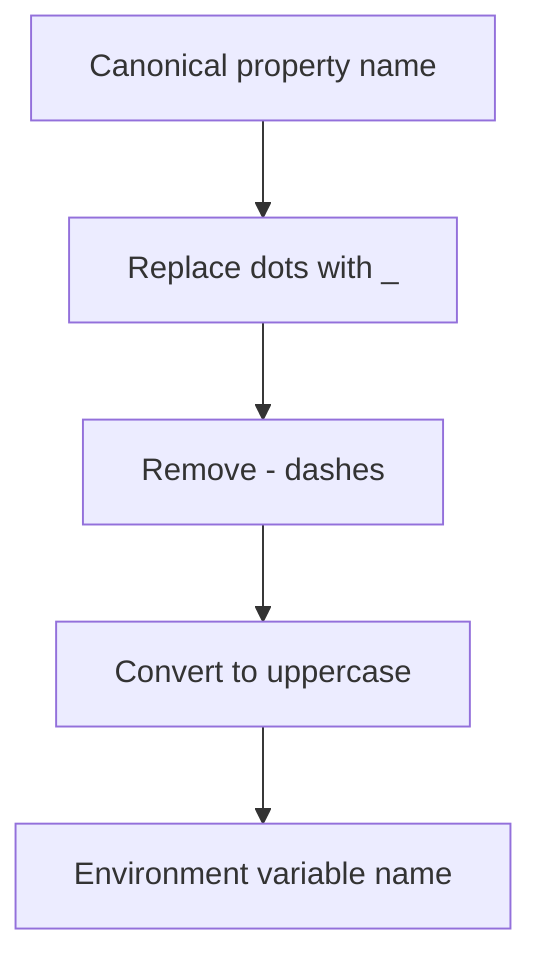

# Relaxed Binding and Environment Variable Naming Rules

Spring Boot allows the same configuration property to be supplied from multiple sources: YAML, properties, environment variables, Java system properties, command-line arguments, and remote configuration. In deployment environments like Docker or Kubernetes, environment variables are often the way to pass configuration into containers without modifying the artifact. However, environment variable names do not necessarily match property names in YAML. Spring Boot uses **relaxed binding** to convert names and values according to each source's rules.

In the **`SPRING_CLOUD_CORE`** module, this skill is especially useful when configuring Spring Cloud Config Client, Context, discovery, and service communication. For example, `spring.config.import` in a YAML file can be overridden with `SPRING_CONFIG_IMPORT`; `spring.cloud.config.uri` can receive its value from `SPRING_CLOUD_CONFIG_URI`. To avoid misconfiguration during deployment, you need to understand name conversion, list/map binding, precedence order, and the limitations of each source.

## 1. What Is Relaxed Binding?

**Relaxed binding** is Spring Boot's ability to map different representations of property names to the same configuration property in supported contexts. For example, a Java property named `connectTimeout` can be configured using the canonical key `connect-timeout` in YAML; the corresponding environment variable can have `CONNECTTIMEOUT` at the end of the name chain.

Example configuration class:

```java
import java.time.Duration;
import org.springframework.boot.context.properties.ConfigurationProperties;

@ConfigurationProperties(prefix = "catalog.client")
public class CatalogClientProperties {
    private Duration connectTimeout = Duration.ofSeconds(2);

    public Duration getConnectTimeout() {
        return connectTimeout;
    }

    public void setConnectTimeout(Duration connectTimeout) {
        this.connectTimeout = connectTimeout;
    }
}
```

Sources can express the same property in forms suited to each source:

```yaml
catalog:
  client:
    connect-timeout: 1500ms
```

```properties
catalog.client.connect-timeout=1500ms
```

```text
CATALOG_CLIENT_CONNECTTIMEOUT=1500ms
```

Spring Boot Binder combines property names and data types to assign values to objects. Relaxed binding does not mean any arbitrary string is equivalent; each source has specific conversion rules, and some characters cannot be fully represented in environment variable names.

### Canonical Names to Use

When naming properties in documentation and source code, use **lowercase kebab-case** as the canonical form:

```text
catalog.client.base-url
catalog.client.connect-timeout
spring.cloud.config.discovery.enabled
spring.config.import
```

The canonical form has these benefits:

- Easy to read and separate words in long names.
- Matches Spring Boot conventions and configuration metadata.
- Has clear conversion rules into environment variables.
- Reduces confusion between Java camelCase field names and configuration keys.

In Java, field/getter names usually use camelCase (`baseUrl`, `connectTimeout`); in YAML/properties, use kebab-case (`base-url`, `connect-timeout`).

## 2. Rules for Converting Property Names to Environment Variables

Spring Boot specifies converting a property name into an environment variable name in three main steps:

1. Replace dots (`.`) with underscores (`_`).
2. Remove dashes (`-`).
3. Convert everything to uppercase.

Examples:

| Canonical property | Environment variable |
| --- | --- |
| `spring.application.name` | `SPRING_APPLICATION_NAME` |
| `server.port` | `SERVER_PORT` |
| `spring.config.import` | `SPRING_CONFIG_IMPORT` |
| `spring.cloud.config.uri` | `SPRING_CLOUD_CONFIG_URI` |
| `spring.cloud.config.discovery.enabled` | `SPRING_CLOUD_CONFIG_DISCOVERY_ENABLED` |
| `catalog.client.base-url` | `CATALOG_CLIENT_BASEURL` |
| `catalog.client.connect-timeout` | `CATALOG_CLIENT_CONNECTTIMEOUT` |
| `management.endpoints.web.exposure.include` | `MANAGEMENT_ENDPOINTS_WEB_EXPOSURE_INCLUDE` |

Common pitfall: dots are converted to `_`, whereas dashes are **removed**, not converted to `_`. Thus `base-url` converts to `BASEURL`, not `BASE_URL`.



Detailed example:

```text
spring.cloud.config.discovery.enabled
          |         |         |
          v         v         v
SPRING_CLOUD_CONFIG_DISCOVERY_ENABLED
```

When reading configuration in containers, verify variable names against this rule instead of rewriting separators by intuition.

### 2.1. Why Should You Not Add Underscores for Dashes Yourself?

Suppose the canonical property is:

```text
catalog.client.base-url
```

The variable name according to the rule is:

```text
CATALOG_CLIENT_BASEURL
```

If you set `CATALOG_CLIENT_BASE_URL`, Binder may interpret it as a property name with an extra word boundary instead of the intended key. Especially when multiple properties have similar words, deviating from the rule makes debugging difficult. Determine the canonical property first, then apply the exact transformation.

### 2.2. Case Sensitivity of Environment Variables

Environment variable names across operating systems and runtimes can have different case-sensitivity rules. On Linux, environment variable names are case-sensitive; `CATALOG_CLIENT_BASEURL` and `catalog_client_baseurl` are two different names. On Windows, variable names are typically handled case-insensitively.

In deployment docs, use uppercase names per Spring Boot convention for consistency across local, CI, and containers. Do not rely on an environment automatically normalizing case.

## 3. Binding Nested Properties

Consider the configuration:

```yaml
catalog:
  client:
    base-url: https://catalog.internal
    connect-timeout: 1500ms
    read-timeout: 3s
    enabled: true
```

The corresponding environment variables:

```text
CATALOG_CLIENT_BASEURL=https://catalog.internal
CATALOG_CLIENT_CONNECTTIMEOUT=1500ms
CATALOG_CLIENT_READTIMEOUT=3s
CATALOG_CLIENT_ENABLED=true
```

A Java object can group those properties:

```java
import java.time.Duration;
import org.springframework.boot.context.properties.ConfigurationProperties;

@ConfigurationProperties(prefix = "catalog.client")
public class CatalogClientProperties {
    private String baseUrl;
    private Duration connectTimeout = Duration.ofSeconds(2);
    private Duration readTimeout = Duration.ofSeconds(3);
    private boolean enabled = true;

    public String getBaseUrl() { return baseUrl; }
    public void setBaseUrl(String baseUrl) { this.baseUrl = baseUrl; }
    public Duration getConnectTimeout() { return connectTimeout; }
    public void setConnectTimeout(Duration value) { this.connectTimeout = value; }
    public Duration getReadTimeout() { return readTimeout; }
    public void setReadTimeout(Duration value) { this.readTimeout = value; }
    public boolean isEnabled() { return enabled; }
    public void setEnabled(boolean enabled) { this.enabled = enabled; }
}
```

The properties class must be registered via `@ConfigurationPropertiesScan` or `@EnableConfigurationProperties`. Setting properly named environment variables will not automatically create properties beans if the application has not enabled registration.

## 4. Binding Lists and Element Indices

For list properties, element indices must be surrounded by underscores when converted to environment variables.

Indexed property:

```text
my.service[0].other
```

Converts to:

```text
MY_SERVICE_0_OTHER
```

YAML configuration example:

```yaml
catalog:
  endpoints:
    - name: primary
      url: https://catalog-a.internal
    - name: replica
      url: https://catalog-b.internal
```

Environment variables:

```text
CATALOG_ENDPOINTS_0_NAME=primary
CATALOG_ENDPOINTS_0_URL=https://catalog-a.internal
CATALOG_ENDPOINTS_1_NAME=replica
CATALOG_ENDPOINTS_1_URL=https://catalog-b.internal
```

With configuration class:

```java
import java.util.ArrayList;
import java.util.List;
import org.springframework.boot.context.properties.ConfigurationProperties;

@ConfigurationProperties(prefix = "catalog")
public class CatalogProperties {
    private List<Endpoint> endpoints = new ArrayList<>();

    public List<Endpoint> getEndpoints() { return endpoints; }
    public void setEndpoints(List<Endpoint> endpoints) { this.endpoints = endpoints; }

    public static class Endpoint {
        private String name;
        private String url;

        public String getName() { return name; }
        public void setName(String name) { this.name = name; }
        public String getUrl() { return url; }
        public void setUrl(String url) { this.url = url; }
    }
}
```

When using environment variables for lists, the index is part of the property name. If the configuration has many elements, make sure no index is skipped or misassigned. For long or frequently changing endpoint lists, YAML, Config Server, or a structured configuration source can be easier to maintain than a large batch of environment variables.

**Note:** Surrounding the index with `_` distinguishes the index number from text parts of the property name. For example, `MY_SERVICE_0_OTHER` corresponds to `my.service[0].other`; do not drop either underscore around the index.

## 5. Binding Maps and Key Representation Limits

Maps are often used to configure dynamic key/value sets, such as headers, metadata, or per-tenant options.

YAML:

```yaml
catalog:
  client:
    headers:
      region: ap-southeast
      channel: web
```

For simple keys, environment variables can be expressed along the property path:

```text
CATALOG_CLIENT_HEADERS_REGION=ap-southeast
CATALOG_CLIENT_HEADERS_CHANNEL=web
```

In practice, environment variable names supported by the OS, container runtime, and deployment platform may restrict allowed characters. Therefore, map keys containing dashes, dots, spaces, or special characters must be carefully tested on the target environment. Do not assume every arbitrary key in YAML can be losslessly turned into an environment variable.

When binding maps from environment variables, Spring Boot lowercases map keys. This matters if the application needs to preserve case-sensitive keys. For complex keys or keys that must preserve exact characters, consider YAML/properties, `SPRING_APPLICATION_JSON`, or another suitably structured configuration source.

Java map example:

```java
import java.util.LinkedHashMap;
import java.util.Map;
import org.springframework.boot.context.properties.ConfigurationProperties;

@ConfigurationProperties(prefix = "catalog.client")
public class CatalogClientProperties {
    private Map<String, String> headers = new LinkedHashMap<>();

    public Map<String, String> getHeaders() { return headers; }
    public void setHeaders(Map<String, String> headers) { this.headers = headers; }
}
```

If map keys are business data with custom naming rules, test directly on the actual property source type and deployment runtime rather than inferring from YAML syntax alone.

## 6. Binding Typed Values

A correct variable name only solves property identification. The value must still be convertible to the Java type required by the bean.

| Java Type | Example Values | Notes |
| --- | --- | --- |
| `boolean` | `true`, `false` | Use clear values, avoid non-standard strings |
| `int`, `long` | `8080`, `5000` | Must fall within the type's range |
| `Duration` | `1500ms`, `2s` | Should write explicit units |
| `DataSize` | `10MB`, `512KB` | Use meaningful, consistent units |
| `enum` | `ROUND_ROBIN` | Must match an enum value after conversion |
| `List<T>` | Indexed elements | Surround indices with `_` in env vars |
| `Map<K,V>` | Dynamic key/value | Mind lowercasing and env var character limits |

Timeout example:

```text
CATALOG_CLIENT_CONNECTTIMEOUT=1500ms
CATALOG_CLIENT_READTIMEOUT=3s
```

If `connectTimeout` has type `Duration`, Binder converts the string `1500ms` into the corresponding duration. If using `long` to mean milliseconds, name it clearly (`connect-timeout-ms`) and supply a numeric value. Avoid using the same key with different units assumed per environment.

### Validation After Binding

Bean Validation can be used to reject invalid configuration:

```java
import jakarta.validation.constraints.Max;
import jakarta.validation.constraints.Min;
import jakarta.validation.constraints.NotBlank;
import org.springframework.boot.context.properties.ConfigurationProperties;
import org.springframework.validation.annotation.Validated;

@Validated
@ConfigurationProperties(prefix = "catalog.client")
public class CatalogClientProperties {
    @NotBlank
    private String baseUrl;

    @Min(100)
    @Max(10000)
    private int connectTimeoutMs = 1500;

    public String getBaseUrl() { return baseUrl; }
    public void setBaseUrl(String baseUrl) { this.baseUrl = baseUrl; }
    public int getConnectTimeoutMs() { return connectTimeoutMs; }
    public void setConnectTimeoutMs(int value) { this.connectTimeoutMs = value; }
}
```

Ensure a Bean Validation provider dependency is on the classpath. Older Spring Boot applications may use the pre-`jakarta` validation namespace; choose imports matching your actual version. For required configuration, validation should fail startup early rather than letting the first request discover bad values.

## 7. Environment Variables and Other Configuration Sources

Environment variables are only one of the property sources. The final value is determined by Spring Boot's precedence order and the sources enabled in the application.

In Spring Boot's default configuration, common sources have a general precedence order from lowest to highest as follows:

1. Default values declared in the application.
2. `@PropertySource`.
3. Config Data, including `application.properties`, YAML, and sources imported via `spring.config.import`.
4. `RandomValuePropertySource`.
5. OS environment variables.
6. Java system properties (`-D...`).
7. JNDI and servlet sources in corresponding web applications.
8. `SPRING_APPLICATION_JSON`.
9. Command-line arguments.
10. Test sources such as `@TestPropertySource` or test properties depending on the test mechanism.

The list above is a guide to standard sources; detailed ordering may include additions depending on Boot version, web environment, and integrations. When multiple sources define the same key, higher-precedence sources can override lower ones.

Example `application.yml`:

```yaml
server:
  port: 8080
```

Environment variable:

```text
SERVER_PORT=9090
```

When no higher-precedence source overrides it, the effective `server.port` can be `9090`. If run with an additional command-line argument:

```bash
java -jar catalog-service.jar --server.port=10080
```

then command-line arguments have higher precedence than environment variables in the standard order, so the effective port can be `10080`.

### 7.1. `SPRING_APPLICATION_JSON` for Complex Structures

When you need to pass nested configuration or keys difficult to express via environment variable names, Spring Boot supports `SPRING_APPLICATION_JSON`:

```bash
export SPRING_APPLICATION_JSON='{"catalog":{"client":{"base-url":"https://catalog.internal","connect-timeout":"1500ms"}}}'
```

On Windows PowerShell, setting variables and escaping JSON strings differs from Bash; the illustrative example above uses POSIX-style shell syntax. In deployment environments, configure JSON through the appropriate env mechanism and ensure quotes are preserved intact.

JSON can represent objects/lists more clearly than flat variables. However, it does not automatically solve secret management, authorization, or precedence. Because `SPRING_APPLICATION_JSON` has higher precedence than ordinary environment variables in the standard order, a JSON value can override a value thought to be set by an individual variable. Check both when debugging.

### 7.2. Placeholders Referencing Other Properties

One property can reference another value:

```yaml
catalog:
  client:
    host: catalog.internal
    base-url: "https://${catalog.client.host}"
```

The `CATALOG_CLIENT_HOST` environment variable can supply the host; the placeholder is resolved when the property is used per Spring's mechanism. You can set a default for the placeholder:

```yaml
catalog:
  client:
    host: "${CATALOG_CLIENT_HOST:localhost}"
```

A default should only be used if `localhost` is a safe, meaningful value in that environment. In production, a default accidentally pointing to localhost can cause the application to mistakenly connect to its own container.

## 8. `@ConfigurationProperties` and `@Value` When Using Environment Variables

### 8.1. ConfigurationProperties for Property Groups

`@ConfigurationProperties` fits structured property groups needing conversion, nested objects, lists/maps, and validation. It uses Spring Boot's Binder, making it a natural choice when configuration comes from multiple sources.

```java
@ConfigurationProperties(prefix = "spring.cloud.config")
public class ConfigClientSettings {
    private String uri;
    private String label;

    public String getUri() { return uri; }
    public void setUri(String uri) { this.uri = uri; }
    public String getLabel() { return label; }
    public void setLabel(String label) { this.label = label; }
}
```

Corresponding variables:

```text
SPRING_CLOUD_CONFIG_URI=https://config.internal
SPRING_CLOUD_CONFIG_LABEL=main
```

The properties class needs to be registered in the context via `@ConfigurationPropertiesScan` or `@EnableConfigurationProperties`.

### 8.2. Value for a Few Standalone Properties

`@Value` is usually suitable when a bean only needs a single value:

```java
@Component
public class ConfigServerEndpoint {
    private final String uri;

    public ConfigServerEndpoint(
            @Value("${spring.cloud.config.uri}") String uri) {
        this.uri = uri;
    }
}
```

When using placeholders, write keys in canonical kebab-case. `@Value` does not provide the full relaxed binding and bulk binding experience of `@ConfigurationProperties`; do not rely on it to map complex map/list structures.

### 8.3. Caution with Key Names and Maps

Relaxed binding can accept multiple spellings in supported cases, but that does not make all environment variable names equivalent. If configuration contains dynamic map keys, underscores, or meaningful uppercase letters, test the Binder output directly. For keys that must preserve exact characters, structured configuration in YAML/JSON is usually more predictable.

## 9. Applying to Docker and Kubernetes

### 9.1. Docker: Passing Variables at Run Time

Example container launch:

```bash
docker run --rm \
  -e SPRING_PROFILES_ACTIVE=prod \
  -e SERVER_PORT=8080 \
  -e SPRING_CLOUD_CONFIG_URI=http://config-server:8888 \
  -e SPRING_CONFIG_IMPORT=optional:configserver: \
  catalog-service:1.0.0
```

Variables are passed into the process inside the container. Mind trailing spaces and shell syntax; the `SPRING_CONFIG_IMPORT` value in the example intentionally passes the literal string `optional:configserver:`. If Config Server is a required source, omit `optional:` per startup policy.

Do not pass passwords/tokens directly on the command line or into shell history. Use Docker secrets or the appropriate platform secret mechanism.

### 9.2. Kubernetes: env and envFrom

Variables can be declared directly in the Pod:

```yaml
apiVersion: v1
kind: Pod
metadata:
  name: catalog-service
spec:
  containers:
    - name: app
      image: catalog-service:1.0.0
      env:
        - name: SPRING_PROFILES_ACTIVE
          value: prod
        - name: SERVER_PORT
          value: "8080"
        - name: SPRING_CLOUD_CONFIG_URI
          value: http://config-server:8888
        - name: SPRING_CONFIG_IMPORT
          value: optional:configserver:
```

Or load multiple keys from a ConfigMap:

```yaml
envFrom:
  - configMapRef:
      name: catalog-service-config
```

Secrets can be referenced via `secretKeyRef` or `envFrom.secretRef`, depending on deployment structure. Manage Secret read permissions, encryption at rest, and rotation workflows according to your organization's Kubernetes policies.

When updating a ConfigMap/Secret used as environment variables, a running process **does not automatically receive the new values in its environment**. Typically you must create a new Pod or restart the workload for the process to pick up the new variables. This is an important difference compared to mounting a volume and having the application actively re-read files; even when a mounted file changes, Spring Boot does not automatically rebind every bean.

### 9.3. Commonly Used Spring Cloud Configuration Variables

| Purpose | Canonical property | Environment variable |
| --- | --- | --- |
| Application name | `spring.application.name` | `SPRING_APPLICATION_NAME` |
| Active profile | `spring.profiles.active` | `SPRING_PROFILES_ACTIVE` |
| Config Data import | `spring.config.import` | `SPRING_CONFIG_IMPORT` |
| Config Server URI | `spring.cloud.config.uri` | `SPRING_CLOUD_CONFIG_URI` |
| Config label | `spring.cloud.config.label` | `SPRING_CLOUD_CONFIG_LABEL` |
| Discovery-first lookup | `spring.cloud.config.discovery.enabled` | `SPRING_CLOUD_CONFIG_DISCOVERY_ENABLED` |
| Config Server service ID | `spring.cloud.config.discovery.service-id` | `SPRING_CLOUD_CONFIG_DISCOVERY_SERVICEID` |
| HTTP port | `server.port` | `SERVER_PORT` |

Property names and option availability depend on the Spring Boot/Spring Cloud version. This table illustrates the name transformation; cross-reference the documentation for your exact release train before using a specific property.

## 10. Troubleshooting When Environment Variables Are Not Bound

When a value in the application is not as expected, check in order:

1. **Canonical key:** identify the exact key in `@ConfigurationProperties` or metadata, e.g., `catalog.client.base-url`.
2. **Variable name:** replace `.` with `_`, remove `-`, uppercase; e.g., `CATALOG_CLIENT_BASEURL`.
3. **Was the variable passed to the process:** check Docker/Kubernetes/CI configuration and the actual container's environment.
4. **Is the source overridden:** check system properties, `SPRING_APPLICATION_JSON`, command line, and profile-specific config.
5. **Is the bean registered:** confirm `@ConfigurationPropertiesScan` or `@EnableConfigurationProperties`.
6. **Data type:** confirm the string can convert to `Duration`, numbers, enums, lists, or the target type.
7. **Validation:** inspect binding/validation errors in startup logs.
8. **Map/list naming:** check indices, key lowercasing, and special characters.
9. **Actual runtime:** verify you are inspecting the right Pod/replica and the right image/tag.

### Common Errors

| Symptom | Common Cause | How to Fix |
| --- | --- | --- |
| Value still comes from YAML | Wrong env name, not passed to process, or higher-precedence property source | Check canonical key and actual env; check precedence |
| `BASE_URL` does not override `base-url` | Used underscore in place of removed dash | Use `BASEURL` per conversion rule |
| List missing expected element | Index not surrounded by `_` | Use the form `MY_SERVICE_0_OTHER` |
| Map key case changed | Environment-variable map keys are lowercased during binding | Use lowercase keys or a configuration source that preserves keys |
| Properties bean not found | Class not scanned/enabled | Register using the appropriate ConfigurationProperties mechanism |
| Startup reports conversion error | Value has wrong type or unit | Fix value and use explicit units |
| Works locally, fails on Kubernetes | Old Pod, ConfigMap not referenced, or deployment not rolled out | Check Pod template, env, and running image |
| Config Server URI right but no config loaded | Wrong application/profile/label or import not loaded | Check request, Config Server response, and startup log |

Actuator `env` or `configprops` can be used to inspect property sources and bound objects in protected environments. Do not expose these endpoints carelessly: they can reveal key names, internal structure, or sensitive data if masking is misconfigured.

## 11. Practice: Configuring Config Client with Environment Variables

Suppose `catalog-service` fetches configuration from Config Server and uses some custom properties.

In `application.yml`:

```yaml
spring:
  application:
    name: catalog-service
  config:
    import: "optional:configserver:"
  cloud:
    config:
      uri: http://localhost:8888
      label: main

catalog:
  client:
    base-url: http://localhost:8081
    connect-timeout: 2s
```

When deploying, supply environment variables:

```text
SPRING_PROFILES_ACTIVE=prod
SPRING_CLOUD_CONFIG_URI=https://config.internal
SPRING_CLOUD_CONFIG_LABEL=release
CATALOG_CLIENT_BASEURL=https://catalog.internal
CATALOG_CLIENT_CONNECTTIMEOUT=1500ms
```

Then verify:

1. Did the process receive all environment variables?
2. Is the `prod` profile active?
3. Did Config Client send the right application name, profile, and label?
4. Are values from Config Server overridden by environment variables according to precedence order?
5. Does `CatalogClientProperties` bind `baseUrl` and `connectTimeout` properly?
6. When running two replicas, do both replicas have the same image and the same required set of configuration variables?

In this example, environment variables normally have higher precedence than Config Data, so `CATALOG_CLIENT_BASEURL` can override `catalog.client.base-url` received from Config Server. This behavior is useful when intentionally designed, yet can be surprising if you want Config Server to be the authoritative source. Clearly define which sources are allowed to override and verify the actual outcome.

## 12. Exercises and Self-Check Questions

### Exercise 1 — Convert Property Names

Convert the following keys into environment variable names:

1. `spring.cloud.config.uri`
2. `spring.cloud.config.discovery.service-id`
3. `catalog.client.read-timeout`
4. `management.endpoints.web.exposure.include`
5. `catalog.nodes[1].host`

**Answers:**

1. `SPRING_CLOUD_CONFIG_URI`
2. `SPRING_CLOUD_CONFIG_DISCOVERY_SERVICEID`
3. `CATALOG_CLIENT_READTIMEOUT`
4. `MANAGEMENT_ENDPOINTS_WEB_EXPOSURE_INCLUDE`
5. `CATALOG_NODES_1_HOST`

### Exercise 2 — Analyze Precedence

Suppose the same property `server.port` is set to `8080` in `application.yml`, `SERVER_PORT=9090` as an environment variable, and `--server.port=10080` on the command line. Which value takes effect under the standard source order?

**Answer:** `10080`, because command-line properties have higher precedence than environment variables and Config Data by default.

### Exercise 3 — Diagnose List Binding

A properties class has `List<Endpoint> endpoints`, yet the variable `CATALOG_ENDPOINTS0_URL` does not bind the first element. What form must it be changed to?

**Answer:** `CATALOG_ENDPOINTS_0_URL`, where index `0` is surrounded by `_`.

### Self-Check Questions

1. What are the three steps for converting a property name into an environment variable?
2. Does `base-url` convert to `BASEURL` or `BASE_URL`? Why?
3. Why should canonical properties use kebab-case?
4. How do environment variables represent list indices?
5. What happens to map keys when binding from environment variables?
6. Why can't you assume env vars always beat every other configuration source?
7. What advantages does `@ConfigurationProperties` have over `@Value` when configuration contains nested objects and lists?
8. When updating a ConfigMap used as environment variables, why do Pods usually need to be recreated?

## 13. Principles to Remember

- Use lowercase kebab-case as the canonical property name in YAML/properties and configuration documentation.
- Convert to environment variables using the rule: dots to `_`, remove dashes, uppercase.
- For lists, surround element indices with `_`; for maps, note that keys are lowercased and variable names have character limits.
- Values must be convertible to Java types; use `Duration`, `DataSize`, enums, and validation explicitly.
- Environment variables have their own precedence level; `SPRING_APPLICATION_JSON`, system properties, and command-line arguments can override them in the standard configuration order.
- `@ConfigurationProperties` fits structured configuration; `@Value` fits a few simple values.
- Inspect variables inside the actual process/container and verify bound beans; do not check only manifests or YAML files.

Mastering relaxed binding keeps Spring Cloud configuration consistent across developer machines, CI, and container environments. When property names, environment variables, source precedence, and data types are clearly defined, components such as Config Client, discovery, and service communication will receive the exact configuration the application needs.
