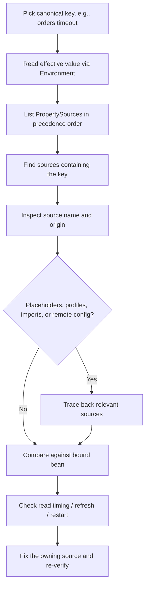
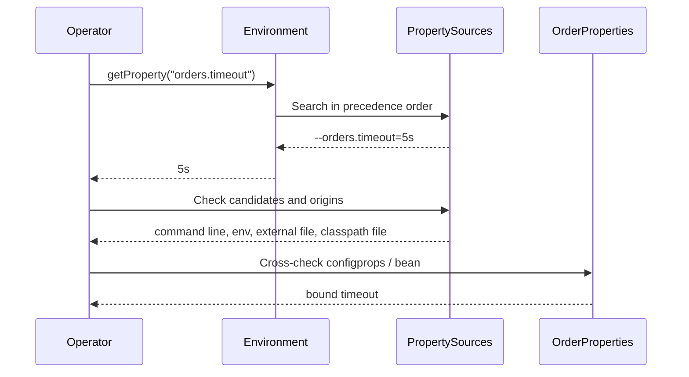

# Tracing the Source That Produces the Effective Configuration Value

## 1. The Problem: Knowing the Value Is Not Enough

When a Spring Boot application reads `orders.timeout=5s`, operators also need to answer three questions:

1. **What is the effective value?** Is the application actually using `5s` or a different value?
2. **Which source provides that value?** A YAML file, profile, environment variable, Java system property, command-line argument, test property, or Spring Cloud Config?
3. **Why did that source win?** Does it have higher precedence, was it loaded later in a Config Data group, or was it specially processed by a binding/placeholder mechanism?

If you only look at `application.yml`, you might miss an environment variable injected by Kubernetes, a `--` argument from a manifest, a system property set by the JVM launcher, or a remote property source. In that case, editing the file will not solve the root cause.

This lesson belongs to the **Environment** chapter of the **SPRING_CLOUD_CORE** module. The module focuses on Spring Cloud Commons, Spring Cloud Context, externalized configuration, Spring Boot compatibility, refresh scope, discovery, and testing/operating shared abstractions. Being able to trace configuration sources is foundational to operating these services predictably and diagnosably.

After this lesson, learners will be able to:

- Distinguish the effective value from candidate values across property sources.
- Use `Environment` and `PropertySource` to identify which source supplies a key.
- Read origins to locate the file, line, or source that produced a value when metadata is supported.
- Use Actuator `env` and `configprops` safely.
- Distinguish simple property lookup from binding via `Binder` / `@ConfigurationProperties`.
- Trace configuration coming from profiles, Config Data imports, test overrides, and Spring Cloud Config.
- Determine when configuration changes take effect and when refresh or restart is needed.

## 2. Foundational Concepts

### 2.1. Environment and PropertySource

Spring Framework provides the `Environment` abstraction to access profiles and configuration properties. A `ConfigurableEnvironment` holds a collection of `PropertySource` instances; each property source is a key/value source, such as a map from a file, system properties, or environment variables.

`Environment.getProperty("orders.timeout")` returns the value resolved according to precedence order. When multiple sources contain the key, higher-precedence sources are checked first.

Common components:

| Component | Role | Example |
| --- | --- | --- |
| `Environment` | API for reading properties and active profiles | `environment.getProperty("server.port")` |
| `ConfigurableEnvironment` | Variant allowing access/configuration of the property source set | `getPropertySources()` |
| `PropertySource` | A key/value source | `applicationConfig: [classpath:/application.yml]` |
| `MutablePropertySources` | Ordered collection of property sources | `addFirst`, `addLast`, `replace` |
| `PropertyResolver` | Resolves keys, placeholders, and type conversions | `getProperty`, `resolvePlaceholders` |
| `Binder` | Binds structured configuration into objects | `@ConfigurationProperties` |

Distinguish **the source containing the value** from **the object receiving the value**. `Environment` answers where a property is resolved from in the source set; `@ConfigurationProperties` builds a structured object from multiple properties; business beans can then receive that object via dependency injection.

### 2.2. Effective Value, Candidate Values, and Origin

Suppose the same key `orders.timeout` appears in three places:

```yaml
# application.yml
orders:
  timeout: 2s
```

```bash
ORDERS_TIMEOUT=4s
```

```bash
java -jar app.jar --orders.timeout=5s
```

There are three **candidate values**. In a typical Spring Boot configuration, command-line properties take higher precedence than environment variables and Config Data, so the effective value is `5s`.

- **Effective value:** the result returned by the resolver when the application reads the property.
- **Candidate value:** a value a property source could supply if evaluated at its precedence position.
- **Origin:** metadata describing the location or origin of the value, such as the YAML file and line number if the loader retains that metadata.
- **Property source name:** the name of the source containing the value, such as system environment, system properties, command line, or a Config Data resource.

Origin does not always exist. An environment variable or a custom property source may not provide detailed location info. When no origin is available, the property source name still helps narrow it down.

## 3. Workflow for Tracing from Key to Source

A diagnostic workflow applicable to most applications:

1. Record the **canonical property name** and the value observed in the application, e.g., `orders.timeout`.
2. Identify where the property is consumed: `@Value`, `@ConfigurationProperties`, `Binder`, or direct `Environment` call.
3. Read the effective value via the exact API the application uses.
4. List property sources in order and find all sources containing the key.
5. Check the origin or source name of the highest-precedence candidate.
6. If placeholders, profiles, imports, or remote config are involved, trace back through each relevant layer.
7. Compare the value bound into the bean with the value in `Environment`.
8. Check read timing and bean scope to determine whether changes have taken effect.



Do not start by editing every file that contains the key. First determine the effective value and the winning source; otherwise, a change in a lower-precedence source still will not affect the application.

## 4. Reading Effective Values with Environment

### 4.1. Simple Property Lookup

`Environment` can be injected into a bean:

```java
import java.time.Duration;
import org.springframework.core.env.Environment;
import org.springframework.stereotype.Component;

@Component
class TimeoutInspector {

    private final Environment environment;

    TimeoutInspector(Environment environment) {
        this.environment = environment;
    }

    Duration effectiveTimeout() {
        return environment.getProperty(
                "orders.timeout",
                Duration.class,
                Duration.ofSeconds(2)
        );
    }
}
```

`getProperty(name, targetType, defaultValue)` both fetches the property and converts it to the requested type via the appropriate conversion service. If the key is not found, the example returns a default value of two seconds.

Distinguish a default value passed to the API from a property source: this default is only used when the resolver finds no value; it does not create a configuration source with an origin in `Environment`.

### 4.2. Querying Placeholders

One property can reference another property:

```yaml
orders:
  timeout: ${ORDERS_TIMEOUT:3s}
```

In this case, the final value depends on resolving the `ORDERS_TIMEOUT` placeholder and the `3s` default. When tracing, distinguish:

- Key requested by the bean: `orders.timeout`.
- Declared expression: `${ORDERS_TIMEOUT:3s}`.
- Referenced key: `ORDERS_TIMEOUT`.
- Final value after placeholder resolution.

Reading `orders.timeout` alone may show either the expression or the resolved value depending on the property source and API. When you need to find the root of a placeholder value, continue tracing the referenced key.

### 4.3. Reading Active Profiles

Profiles affect which Config Data documents are loaded. You can read profile lists via `Environment`:

```java
String[] activeProfiles = environment.getActiveProfiles();
String[] defaultProfiles = environment.getDefaultProfiles();
```

If `getActiveProfiles()` returns an empty array, Spring uses the default profiles according to the current configuration. That does not mean the application is running with an explicitly activated profile named `default`; distinguish active profiles from default profiles.

Profiles are part of identifying configuration sources. When a value is unexpected, verify active profiles before assuming a profile-specific file was loaded.

## 5. Listing PropertySources and Finding Candidates

### 5.1. Order in MutablePropertySources

With `ConfigurableEnvironment`, you can iterate over `getPropertySources()`. The `MutablePropertySources` iterator traverses in precedence order, from highest precedence to lowest.

The following example logs only the **source name** and **origin**, not values, to avoid exposing sensitive configuration:

```java
import org.springframework.boot.origin.Origin;
import org.springframework.boot.origin.OriginLookup;
import org.springframework.core.env.ConfigurableEnvironment;
import org.springframework.core.env.PropertySource;
import org.slf4j.Logger;
import org.slf4j.LoggerFactory;
import org.springframework.stereotype.Component;

@Component
class PropertySourceTracer {

    private static final Logger log =
            LoggerFactory.getLogger(PropertySourceTracer.class);

    private final ConfigurableEnvironment environment;

    PropertySourceTracer(ConfigurableEnvironment environment) {
        this.environment = environment;
    }

    void trace(String key) {
        boolean first = true;

        for (PropertySource<?> source : environment.getPropertySources()) {
            Object candidate = source.getProperty(key);
            if (candidate == null) {
                continue;
            }

            Origin origin = OriginLookup.getOrigin(source, key);
            String role = first ? "first matching source in traversal order" : "subsequent matching source";

            log.info("key={}, role={}, source={}, origin={}",
                    key, role, source.getName(), origin);

            first = false;
        }
    }
}
```

This snippet requires an appropriate logger in a real class. If you do not want to add logging to the application, you can perform the same inspection using Actuator or an access-controlled internal diagnostic tool.

Limitations of direct traversal:

- This probes **raw candidates** on each source; it does not replace `Environment`'s full resolution pipeline.
- Placeholders may reference other keys; to find the ultimate source you must trace referenced keys.
- `@ConfigurationProperties` uses Binder and relaxed binding, so mapped property names may differ from raw key lookups.
- A `CompositePropertySource` can contain child sources; to see details you must inspect its internal structure.
- Some sources are adapters or wrappers, so the same value may appear under multiple source names.
- `null` is not treated as a normal property value to override a lower-precedence value.

In the example, the `first` variable only marks the first source having a raw candidate for the passed canonical key. An adapter like `configurationProperties` or a `CompositePropertySource` may delegate to another source, so this label is not absolute proof of the final origin. It is a helpful investigative clue; cross-check against `environment.getProperty(key)`, origin, and bean binding before concluding.

### 5.2. Do Not Equate Source Order with File Read Order

The Config Data loader can read multiple files and documents and then create property sources in a computed order. Source names often include resource info, yet you should not infer precedence solely from filenames or timestamps.

For example, `application-prod.yml` does not always beat another file just because its name includes a profile. The outcome also depends on location, packaged/external config, imports, profile groups, and higher-precedence runtime sources.

## 6. Origin: Locating the File and Declaration Position

### 6.1. What Is Origin Metadata?

Spring Boot supports origin metadata to explain where a value came from. For Config Data loaded from files, origin can point to the resource and declaration line. For example, a property may be shown with an origin such as:

```text
class path resource [application.yml] - 12:11
```

The exact display format depends on the loader and version. Not every property source has an origin; for system properties or environment variables, only the source name may be known.

Origin helps answer "where was it declared?", while property source name helps answer "which source is supplying it?" Both are useful when multiple files or sources contain the same key.

### 6.2. OriginLookup

In Spring Boot, `OriginLookup` is the abstraction for reading origin if the property source supports it:

```java
Origin origin = OriginLookup.getOrigin(propertySource, "orders.timeout");
```

If the source does not support origin or has no metadata for the key, the result can be `null`. Do not treat missing origin as a configuration error.

### 6.3. Reading Origin via Actuator

When the application integrates Spring Boot Actuator, the `env` endpoint can display property sources and origin info. Example:

```text
GET /actuator/env/orders.timeout
```

This endpoint is useful because it aggregates multiple sources in the running runtime context, rather than reading only a single file. Results can include property source name, sanitized value, and origin if available.

To expose endpoints over HTTP, configure exposure and security properly:

```yaml
management:
  endpoints:
    web:
      exposure:
        include: health,info,env,configprops
```

This configuration snippet only illustrates exposing endpoints. It is **not a complete security configuration**. In production, restrict network access, enforce authentication/authorization, sanitization, and value-visibility policies for `env`/`configprops`. Do not publicly expose configuration diagnostic endpoints to external users.

## 7. Using Actuator env and configprops for the Right Purpose

### 7.1. The env Endpoint: Property Sources and Resolved Values

`/actuator/env` focuses on `Environment`:

- Lists property sources visible to the application context.
- Shows a property's value after resolution.
- When origin is supported, can point to the file and declaration line.
- Allows querying a specific property via sub-endpoints such as `/actuator/env/orders.timeout`.

Values may be sanitized or hidden per endpoint configuration. This is necessary behavior because property sources often contain passwords, tokens, secret keys, connection strings, and infrastructure details.

### 7.2. The configprops Endpoint: Binding Results

`/actuator/configprops` focuses on beans bound via `@ConfigurationProperties`:

- Shows prefixes and managed configuration beans.
- Displays bound fields and related metadata when available.
- Helps detect properties present in Environment that did not bind into objects as expected.
- Useful for checking validation, data types, and nested structures.

The two endpoints answer two different questions:

| Endpoint | Primary Question | Use When |
| --- | --- | --- |
| `env` | Which sources hold properties in Environment and how are values resolved? | Finding overriding sources, profiles, imported files, or env variables |
| `configprops` | Which values did configuration beans receive after binding? | Investigating relaxed binding, object structure, conversion, or validation |

Example: `env` shows `orders.retry.max-attempts` exists, yet `configprops` lacks the expected value. In that case, check prefix, field name, data type, bean registration annotation, and validation. Conversely, if both show the old value, look for a higher-precedence property source or verify whether the context has been refreshed.

## 8. Tracing in Complex Scenarios

### 8.1. Profiles and Multiple Config Data Files

Suppose an application has:

```text
classpath:/application.yml
classpath:/application-prod.yml
file:./config/application.yml
file:./config/application-prod.yml
```

When `prod` is active, multiple documents can define `orders.timeout`. How to investigate:

1. Confirm `Environment.getActiveProfiles()`.
2. Use the `env` endpoint or traverse property sources to identify which resources were loaded.
3. Find the sources that all contain `orders.timeout`.
4. See which source has the highest precedence and inspect its origin.
5. Check whether environment/system/command line overrides Config Data.

Do not assume an external file always beats every source: it may beat packaged files within the Config Data group yet still be overridden by environment variables or command-line properties.

### 8.2. Environment Variables and Relaxed Binding

Spring Boot supports relaxed binding to map environment variable names to properties. For example, `ORDERS_TIMEOUT` can be mapped to `orders.timeout` when binding according to the corresponding naming rules.

Some sources like `SystemEnvironmentPropertySource` also support name variants during lookup. Therefore, when probing raw properties, use the canonical key (`orders.timeout`) rather than searching only for the exact string `ORDERS_TIMEOUT` across every source.

For complex map keys or list indices, variable naming rules have additional details. If a value does not bind as expected, check `configprops` and relaxed binding documentation rather than inspecting variable names by eye alone.

### 8.3. Spring Cloud Config Remote Property Sources

When using Spring Cloud Config Client, remote property sources are brought into the application's Environment. Source names usually help identify data coming from Config Server, while origin can indicate the resource/label depending on how the backend supplies it.

Example import configuration:

```yaml
spring:
  application:
    name: order-service
  config:
    import: optional:configserver:http://config-server:8888
```

When `orders.timeout` has an unexpected value:

- Check which application name, profile, and label Config Server is returning.
- Check whether the remote property source is present in Environment.
- Check Spring Cloud Config's remote override policy.
- Check whether local sources are configured to be allowed to override remote sources.
- Check whether environment variables and command line take precedence under current policy.
- Determine whether the application fetched configuration at startup or uses a refresh mechanism.

Do not assume every version of Spring Cloud Config orders remote sources identically. Override behavior depends on release train, bootstrap/Config Data integration, and server-side configuration. Inspect the actual sources in the running runtime.

### 8.4. Test Overrides and Values Differing from Production

In Spring Test, configuration can be altered by:

- `@SpringBootTest(properties = ...)`.
- `@TestPropertySource`.
- `@DynamicPropertySource`.
- `TestPropertyValues` or `ApplicationContextInitializer`.

Example:

```java
@SpringBootTest(properties = "orders.timeout=50ms")
class OrderServiceTest {
    // Test context receives a dedicated value for this test.
}
```

If tests pass while production uses a different timeout, check test property sources before concluding binding code is broken. Tests intentionally isolate configuration to reproduce scenarios; they do not prove production manifests or Config Server supply the same value.

## 9. Binder and @ConfigurationProperties: Tracing Sources After Binding

### 9.1. Why Can Environment and Binder Appear to Differ?

`Environment` reads a property by a specific name. `Binder` maps a group of properties into an object structure and supports relaxed binding, aggregates, nested objects, collections, and conversion.

Example:

```java
@ConfigurationProperties(prefix = "orders")
public record OrderProperties(
        Duration timeout,
        Retry retry
) {
    public record Retry(int maxAttempts) {}
}
```

The properties `orders.timeout` and `orders.retry.max-attempts` are bound into an object. If a field fails to map due to a wrong prefix, wrong name, or conversion error, seeing a property in `env` is not enough to conclude the bean received that value.

### 9.2. Binding Directly to Inspect

In diagnostic tools or tests you can use `Binder`:

```java
Binder binder = Binder.get(environment);

BindResult<OrderProperties> result =
        binder.bind("orders", Bindable.of(OrderProperties.class));

if (result.isBound()) {
    OrderProperties properties = result.get();
    // Inspect non-sensitive values or assert in tests.
}
```

This snippet illustrates binding against the same Environment the application uses. Ensure target types and converters match the real application. For production beans, prefer inspecting the bean already bound by Boot rather than creating a second object with different configuration.

### 9.3. Inspecting Origin After Binding

With Spring Boot supporting configuration property origins, Actuator `configprops` can show the origin of certain bound properties. This is often the easiest way to link a bean field back to its configuration source.

If building custom tooling, use `ConfigurationProperty` and `Origin` APIs matching your Boot version; do not assume a field in an object always retains complete origin metadata. Metadata can be lost when the application manually maps to another object or copies values into custom beans.

## 10. Configuration Changing at Runtime: Does Refresh Replace Sources?

Source tracing does not end at startup. In systems using Spring Cloud Context, certain configurations can be updated and certain beans can be recreated when refresh is triggered.

Distinguish three steps:

1. **Source changes:** Config Server, an environment provider, or a property source is updated.
2. **Environment is updated:** the context receives new properties or is refreshed via integration.
3. **Beans use the new values:** beans must be rebound/reinitialized or read properties in a way that supports change.

`@RefreshScope` can cause target beans to be recreated after refresh. Regular singleton beans holding fields injected at startup may continue using old values. Therefore, when `env` reflects a new value yet the application still behaves with the old value, check whether the bean was refreshed, whether its scope is appropriate, and whether the component maintains its own cache.

Refresh does not replace restart for every property. Settings determining the web server, port, application context type, or infrastructure layout may require a restart/rollout. Check the documentation and behavior of your deployed Spring Boot/Spring Cloud versions.

## 11. Complete Investigation Example

Suppose the `order-service` API expects a timeout of `2s` yet logs show requests waiting up to `5s`.

Sources that might declare it:

```yaml
# classpath:/application.yml
orders:
  timeout: 2s
```

```yaml
# file:./config/application-prod.yml
orders:
  timeout: 3s
```

```bash
ORDERS_TIMEOUT=4s
```

```bash
java -jar order-service.jar --orders.timeout=5s
```

How to investigate:

1. Confirm the `prod` profile is active.
2. Read `Environment.getProperty("orders.timeout")`; if it returns `5s`, confirm the effective value.
3. Use the `env` endpoint or a tracer to list sources containing the key.
4. Identify that the command-line source has `5s` and precedes the remaining sources.
5. Inspect `configprops` to confirm `OrderProperties.timeout` bound to five seconds.
6. If a bean still operates with two seconds, check whether the bean retains an old value or was created before configuration updated.
7. Fix deployment arguments if `5s` is unintended; there is no need to edit the packaged file declaring `2s`.
8. Restart or refresh via the appropriate mechanism, then re-verify the effective value and bean.



In practice, Actuator endpoints may not expose plain values due to sanitization. This is information-protection behavior; do not disable sanitization just for production debugging convenience. You can inspect source names/origins or assert in test environments using non-sensitive data.

## 12. Security When Tracing Configuration

Configuration can contain sensitive information. A useful tracing tool must limit the data it reveals.

- Do not log values of passwords, tokens, private keys, secrets, or URLs containing credentials.
- Do not expose `/actuator/env` and `/actuator/configprops` publicly.
- Use authentication/authorization, network policies, and limit endpoint exposure.
- Keep sanitization enabled for sensitive keys; do not switch to displaying all values just to debug.
- When reproducing bugs, use mock values in tests instead of production secrets.
- Recording the source name and origin is usually enough to narrow down issues without printing raw values.
- Control read permissions on Config Server and configuration stores; remote property sources can also contain secrets.

If you must add an internal tracing endpoint, design it with an allowlist of non-sensitive keys, audit access, and disallow arbitrary queries against secret properties.

## 13. Checklist When Configuration Behaves Unexpectedly

| Question | Evidence to Confirm |
| --- | --- |
| What is the canonical key? | Exact property name, prefix, and nested structure |
| What is the effective value? | Result of `Environment.getProperty` at runtime |
| Which source is winning? | `PropertySource` order, source name, and candidates |
| Is there an origin? | Resource, file, line, or metadata from provider |
| Which profiles are active? | `getActiveProfiles()` and loaded profile files |
| Are there Config Data imports? | Import paths, remote Config Server, and locations |
| Are runtime sources overriding? | Environment, `-D`, `--`, JSON, JNDI/Servlet sources |
| Did the bean receive that value? | `configprops`, Binder result, or bean value in tests |
| Are there placeholders? | Trace referenced keys and default expressions |
| Is refresh/restart needed? | Bean scope, binding timing, and property kind |
| Are there test overrides? | Annotations, dynamic properties, and initializers |
| Is diagnostics safe? | Sanitization, access control, and logged data |

## 14. Reference Sources

- [Spring Framework — Environment Abstraction](https://docs.spring.io/spring-framework/reference/core/beans/environment.html): `Environment`, `PropertySource`, and profile management.
- [Spring Boot — Externalized Configuration](https://docs.spring.io/spring-boot/reference/features/external-config.html): Config Data, property sources, origin, binding, and precedence order.
- [Spring Boot Actuator — Endpoints](https://docs.spring.io/spring-boot/reference/actuator/endpoints.html): `env` and `configprops` endpoints and visibility controls.
- [Spring Boot — Configuration Metadata and Type-safe Properties](https://docs.spring.io/spring-boot/reference/features/external-config.html#features.external-config.typesafe-configuration-properties): Binder and `@ConfigurationProperties`.
- [Spring Cloud Config](https://docs.spring.io/spring-cloud-config/reference/): remote property sources, Config Data import, and override policy.
- [Spring Cloud Commons](https://docs.spring.io/spring-cloud-commons/reference/): shared abstractions integrated into Spring Cloud applications.

**Key takeaway:** To find out why an application uses a certain value, go from the canonical key to the effective value in `Environment`, list property sources in order, inspect the winning source's origin, and cross-check against bound beans. For placeholders, remote config, profiles, and refresh, trace each layer down to the true owning source; always protect sensitive values during diagnostics.
