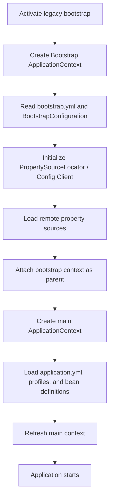
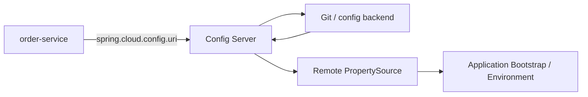

# Bootstrap Context and When to Use It

> **Chapter:** Bootstrap  
> **Module:** `SPRING_CLOUD_CORE` — core foundations of Spring Cloud in distributed systems, especially Spring Cloud Commons, Context, externalized configuration, discovery, service registry, service communication, and how to test and operate shared abstractions.  
> **Focus:** The bootstrap context is an early-initialized ApplicationContext that typically acts as the parent for the main context to prepare property sources and foundational components. This lesson explains the legacy mechanism, how to enable it, when it is needed, and how to choose between bootstrap and modern Config Data.

## 1. What problem does the bootstrap context solve?

A Spring Boot application may need remote configuration before creating business beans. For example, `order-service` needs to fetch the database URL, registry connection details, feature flags, or client configuration from Spring Cloud Config Server. The application must know how to contact Config Server before it can load the rest of its configuration.

In the legacy Spring Cloud architecture, the **bootstrap context** solves the problem of preparing configuration sources and foundational components before the main ApplicationContext. It is created separately and usually serves as the **parent context** of the application context. The required property sources and profiles from the bootstrap phase are fed into the configuration environment used by the main application.

This mechanism is useful in systems that use `BootstrapConfiguration`, `PropertySourceLocator`, `bootstrap.yml`, or require a separate configuration phase before the main application initializes. However, since Spring Boot 2.4, Config Data has provided a way to integrate external configuration following Boot's standard lifecycle; Spring Cloud Config now treats `spring.config.import` as the default approach for connecting to Config Server. Therefore, **not every Spring Cloud application needs a bootstrap context**. The Config Client documentation describes both Config Data and Config First Bootstrap.

### Learning Outcomes

After this lesson, learners can:

1. explain the bootstrap context, the main ApplicationContext, and the parent/child relationship;
2. distinguish the bootstrap context from the `bootstrap.yml` file, Spring Boot's `BootstrapRegistry`, and Config Data;
3. identify how to activate legacy bootstrap and the required configurations;
4. describe how Config Client connects to Config Server using Config First or Discovery First;
5. understand the roles of `BootstrapConfiguration`, `PropertySourceLocator`, and `spring.factories`;
6. analyze precedence between remote property sources, `bootstrap.yml`, and application configuration;
7. decide when to retain bootstrap, when to use `spring.config.import`, and how to test during migration.

## 2. Distinguishing three commonly confused concepts

### 2.1. Bootstrap context

This is a separate Spring `ApplicationContext` created during the bootstrap phase. In the legacy model, this context serves as the parent of the main application context. It can initialize bootstrap configurations, beans needed to access configuration sources, and custom `PropertySourceLocator` implementations.

### 2.2. The bootstrap.yml file

`bootstrap.yml` or `bootstrap.properties` is the configuration file for the **bootstrap context**. This file typically contains information needed early, such as the application name, Config Server address, and profiles used to fetch configuration.

Merely creating a file named `bootstrap.yml` **does not automatically enable legacy bootstrap** in modern Spring Cloud configurations. The bootstrap mechanism must be activated in the manner appropriate for the release train in use. If bootstrap is not enabled, this file may not be processed in the way the project expects.

### 2.3. Spring Boot BootstrapRegistry

Spring Boot has the concepts of `BootstrapRegistry` and `BootstrapRegistryInitializer`, especially in the Config Data preparation mechanism. This is a registry used to register certain objects needed during the Config Data bootstrap process. It is **not** the Spring Cloud legacy bootstrap `ApplicationContext`, not the parent context of the main application, and does not imply creating `bootstrap.yml`.

The names are similar, but the responsibilities differ:

| Concept | Role |
| --- | --- |
| Spring Cloud bootstrap context | Early-initialized ApplicationContext, typically the parent of the main context in legacy mode |
| `bootstrap.yml` | Configuration file read for the bootstrap context when legacy bootstrap is enabled |
| Spring Boot `BootstrapRegistry` | Registry supporting the initialization phase of certain components, such as Config Data loaders |

When reading old documentation or code, you must identify which mechanism is being discussed to avoid applying the wrong configuration approach.

## 3. Where does the bootstrap context sit in the application lifecycle?

### 3.1. Parent and child relationship

In the legacy model, the process can be visualized as follows:

1. Spring Cloud detects that bootstrap mode has been activated.
2. A bootstrap ApplicationContext is created from the bootstrap configurations.
3. Beans in the bootstrap context prepare configuration sources; for example, Config Client connects to Config Server or a `PropertySourceLocator` queries a custom source.
4. The bootstrap context is attached as the parent of the main ApplicationContext.
5. The main context inherits the appropriate property sources/profiles according to context hierarchy rules and continues the normal Spring Boot lifecycle.



The diagram is a conceptual model. Details of when `PropertySourceLocator` executes have changed across release trains; Section 8 clarifies those differences.

### 3.2. Why use a context hierarchy?

A parent context can provide shared beans or property sources for a child context. This helps separate responsibilities:

- The bootstrap context prepares the information needed to locate configuration sources.
- The main context initializes business beans and service integrations.
- Some applications with more complex context hierarchies may use `SpringApplicationBuilder` to create parent, child, or sibling contexts.

Do not assume all child or sibling contexts share the same `Environment` object. How the `Environment` is shared depends on how the hierarchy is built. Spring Cloud has rules so that property sources from bootstrap are added to the main context without accidentally pushing every value from one context branch to another.

### 3.3. Commonly appearing components

| Component | Responsibility |
| --- | --- |
| `BootstrapConfiguration` | Declares configurations and beans loaded into the bootstrap context |
| `PropertySourceLocator` | Creates or queries a `PropertySource` to add to the Environment |
| Config Client | Connects to Config Server and retrieves remote configuration |
| `ApplicationContextInitializer` | An initializer that the bootstrap context can provide to the main SpringApplication |
| `bootstrap.yml` | Provides startup configuration such as application name, profiles, and Config Server URI |
| `spring.factories` | Registration mechanism for certain bootstrap configurations in Spring Cloud generations using legacy bootstrap |

## 4. When is the bootstrap context needed?

### 4.1. Cases with a clear rationale

Legacy bootstrap may be appropriate when:

- **An existing application depends on the bootstrap lifecycle:** the project already uses `BootstrapConfiguration`, `PropertySourceLocator`, or initializers loaded from the bootstrap context.
- **A custom property source is needed in the bootstrap phase:** for example, fetching configuration from an internal service or a custom configuration store via `PropertySourceLocator`.
- **The architecture relies on a context hierarchy:** certain beans/configurations need to be created in the parent context and shared according to the application's design.
- **Legacy system behavior must be preserved during an upgrade:** changing the configuration loading mechanism at the same time as upgrading the release train can make it harder to pinpoint the root cause of failures.
- **A legacy integration requires bootstrap:** a library or internal component was designed for `BootstrapConfiguration` and has not yet been migrated to Config Data.

In these cases, identify exactly which component requires bootstrap and check the documentation for the Spring Cloud release train you are using. The bootstrap context is an architectural decision, not merely a configuration filename.

### 4.2. When the bootstrap context is not needed

For new applications that only need to fetch configuration from Spring Cloud Config Server on a release train supporting Config Data, you should normally use:

```yaml
spring:
  application:
    name: order-service
  config:
    import: "optional:configserver:http://config-server:8888"
```

There is no need to create `bootstrap.yml` just to declare Config Server with this approach. Config Client uses `spring.config.import`, and Config Data handles fetching property sources during Environment preparation.

Other cases that also typically do not need bootstrap:

- only local configuration from `application.yml` is needed;
- only changing `logging.level.*` or a business value is needed;
- only creating a shared configuration bean without needing a parent context is needed;
- only loading an external configuration file already supported by Config Data is needed;
- only enabling `@RefreshScope` is needed — refresh scope is a Spring Cloud Context capability and does not require every application to enable legacy bootstrap.

### 4.3. Quick decision table

| Need | Approach to consider |
| --- | --- |
| New application fetching configuration from Config Server | Config Data with `spring.config.import` |
| Local configuration file or file external to JAR | Spring Boot Config Data |
| Need custom Config Data loader/bootstrap registry | `BootstrapRegistryInitializer` and corresponding Boot extensions |
| Legacy system using `BootstrapConfiguration`/`PropertySourceLocator` | Retain legacy bootstrap while evaluating migration |
| Need remote property source following legacy bootstrap rules | Legacy bootstrap, after verifying precedence and release train |
| Only need to refresh a bean when properties change | `@RefreshScope` or appropriate rebinding mechanism |
| Only need to change log levels at runtime | Actuator `loggers` or appropriate logging rebinding mechanism |

**Do not use the bootstrap context just because the application has "Spring Cloud" in its stack.** Choose the smallest mechanism that satisfies the configuration requirements and is compatible with the version.

## 5. Conditions to activate legacy bootstrap

### 5.1. Bootstrap does not enable itself just because bootstrap.yml exists

In modern Spring Cloud setups, legacy bootstrap must be explicitly activated using one of the supported ways:

- add the `spring-cloud-starter-bootstrap` dependency to the classpath; or
- set `spring.cloud.bootstrap.enabled=true` via a system property or environment variable before `SpringApplication` starts.

Example with JVM:

```bash
java -Dspring.cloud.bootstrap.enabled=true -jar order-service.jar
```

Example with environment variable:

```bash
export SPRING_CLOUD_BOOTSTRAP_ENABLED=true
```

Note: placing `spring.cloud.bootstrap.enabled=true` inside `application.yml` is usually too late to activate the bootstrap reading process itself, because the main application's configuration file is processed later in the lifecycle. Use the starter, system property, or environment variable according to your release train's documentation.

In older Spring Cloud generations, default behavior and activation mechanisms may differ. When upgrading, verify against the actual version rather than copying legacy configuration from another project.

### 5.2. Sample dependencies for legacy Config Client

Maven example:

```xml
<dependencies>
    <dependency>
        <groupId>org.springframework.cloud</groupId>
        <artifactId>spring-cloud-starter-config</artifactId>
    </dependency>

    <dependency>
        <groupId>org.springframework.cloud</groupId>
        <artifactId>spring-cloud-starter-bootstrap</artifactId>
    </dependency>
</dependencies>
```

Versions should be managed by the Spring Cloud BOM matching Spring Boot. Do not specify individual versions for each starter without a clear reason.

If the application does not use Config Server but has a custom `BootstrapConfiguration`, the bootstrap mechanism can still be activated by the starter/property; specific dependencies depend on the components required.

### 5.3. Minimal bootstrap.yml configuration

A config-first example:

```yaml
spring:
  application:
    name: order-service
  profiles:
    active: prod
  cloud:
    config:
      uri: http://localhost:8888
      fail-fast: true
```

Key values:

- `spring.application.name`: application name used to look up corresponding configuration on Config Server;
- `spring.profiles.active`: profiles to fetch, if already known during the bootstrap phase;
- `spring.cloud.config.uri`: Config Server address in config-first mode;
- `spring.cloud.config.fail-fast`: instructs the application to stop if configuration cannot be fetched under the fail-fast policy.

The application name and profile should be set in a source available early enough for Config Client to request the right documents. If the URI or credentials depend on the environment, provide them via appropriate environment variables/secret management.

## 6. Config First and Discovery First

### 6.1. Config First: knowing the Config Server address upfront

This is the simplest approach: the application knows the Config Server URL via `spring.cloud.config.uri` or an environment variable. When bootstrap runs, Config Client connects directly to that address.



Example:

```yaml
spring:
  application:
    name: inventory-service
  cloud:
    config:
      uri: https://config.internal.example
      fail-fast: true
```

This address must be available before Config Client looks up remote sources. If Config Server uses TLS or authentication, trust material/credentials must be configured per the version's instructions; never store passwords directly in the repository.

### 6.2. Discovery First: finding Config Server via registry

In some systems, the Config Server address may change. Instead of configuring a fixed host, the client can locate Config Server through a service registry. This is a Config Client option for locating Config Server; if using Config Data, you still need to declare `spring.config.import` as required by the Config Data mechanism. The example below illustrates discovery properties and does not by itself enable legacy bootstrap.

General prerequisites:

1. Config Server is registered with the service registry.
2. The client application has a compatible discovery implementation.
3. The client knows how to connect to the registry from an initial configuration source.
4. Config Client discovery lookup is enabled, e.g., `spring.cloud.config.discovery.enabled=true`.
5. Configure the service ID if not using the default `configserver`.

```yaml
spring:
  cloud:
    config:
      discovery:
        enabled: true
        service-id: configserver
```

The example only shows Config Client properties. Registry address, credentials, metadata, context path, and TLS mechanisms depend on the provider (Eureka, Consul, or another implementation). Discovery lookup adds an extra network round trip at startup to locate Config Server.

Discovery First is useful when Config Server coordinates change while the registry has a stable endpoint. If the registry itself also requires remote configuration to know its address, an independent minimal bootstrap source is needed to avoid a dependency cycle.

### 6.3. Comparing the two approaches

| Criterion | Config First | Discovery First |
| --- | --- | --- |
| How Config Server is located | Directly configured URI | Service registry |
| Initial configuration | Required URL/host and credentials | Registry endpoint and discovery configuration |
| Complexity | Lower | Higher, depends on registry |
| Network round trips | Calls Config Server | Adds a service lookup step before calling |
| When appropriate | Stable Config Server address | Infrastructure with a registry as a stable discovery point |
| Primary risk | Stale URI when server address changes | Registry not yet ready or client unable to locate server |

## 7. PropertySource and precedence order

### 7.1. Remote property sources and bootstrap.yml are different

A common misconception is that every property in `bootstrap.yml` has the highest priority. In reality, you must distinguish:

- Remote property sources loaded in the bootstrap phase (often grouped under a source named `bootstrap`) can have high precedence.
- Values read directly from `bootstrap.yml` are used to configure the bootstrap context and may be added to the main context with lower precedence than `application.yml` and the main application's normal configuration sources.

Therefore, `bootstrap.yml` is usually suited for declaring initialization values or defaults, such as Config Server URI, application name, and profiles. Remote property sources are the actual configuration data fetched from the server.

### 7.2. Remote config may not be overridden locally by default

With legacy bootstrap, remote property sources usually do not allow the application to override them with local configuration by default. If you want local/system properties to override remote config, Config Server must grant permission via `spring.cloud.config.allowOverride=true` in the remote property source.

Two common fine-tuning options:

- `spring.cloud.config.overrideNone=true`: allows local property sources to override remote values;
- `spring.cloud.config.overrideSystemProperties=false`: allows only system properties, command-line arguments, and environment variables to override, not local configuration files.

Do not set `allowOverride` in the client's `application.yml` expecting it to unlock overrides; this permission must be granted from the remote source according to Spring Cloud Config rules. Always verify the actual precedence of the release train you are running.

### 7.3. Profiles and context hierarchy

`bootstrap.yml` can have profile-specific files, such as `bootstrap-prod.yml`. If a profile is already determined from the environment or initial configuration, profile-specific values can be used in the bootstrap context.

The main context can receive property sources from its parent while also having its own sources such as `application.yml`, profile files, and command-line arguments. In multi-level hierarchies, properties in a child context can override the parent according to Spring rules. Do not assume all sibling contexts share the same configuration simply because they share a bootstrap parent.

## 8. Extending bootstrap with BootstrapConfiguration

### 8.1. When is a custom BootstrapConfiguration needed?

If an application needs to initialize specialized beans in the bootstrap context, legacy Spring Cloud allows registering configuration classes via the `org.springframework.cloud.bootstrap.BootstrapConfiguration` key in `META-INF/spring.factories`.

Configuration example:

```java
@Configuration
public class InternalBootstrapConfiguration {

    @Bean
    PropertySourceLocator internalPropertySourceLocator() {
        return environment -> {
            Map<String, Object> values = Map.of(
                    "platform.region",
                    environment.getProperty("PLATFORM_REGION", "local")
            );

            return new MapPropertySource("internal-platform", values);
        };
    }
}
```

Declaration in `src/main/resources/META-INF/spring.factories`:

```properties
org.springframework.cloud.bootstrap.BootstrapConfiguration=com.example.bootstrap.InternalBootstrapConfiguration
```

This is a minimal example of a `PropertySourceLocator`: it receives the `Environment` and returns a property source. In a real application, you must handle configuration source errors, timeouts, authentication, caching, and precedence.

### 8.2. Avoiding accidental component scanning of bootstrap configuration

Bootstrap configuration classes should be placed in a separate package, outside the package scope scanned by the main application's `@SpringBootApplication` or `@ComponentScan`.

If the main context redundantly scans the bootstrap configuration, the same configuration may be loaded in two contexts, leading to duplicate beans, confusing initialization order, or dependencies bound to the wrong context. This is hard to diagnose because the application may create two instances of a component assumed to be singular.

### 8.3. PropertySourceLocator and differences across release trains

`PropertySourceLocator` is an abstraction for adding property sources. However, when locators are invoked has changed across Spring Cloud generations.

- Prior to Spring Cloud 2022.0.3, `PropertySourceLocator` beans (including Config Client's locator) ran in the main application context per the documented default behavior.
- You could request running them in the bootstrap context via `spring.cloud.config.initialize-on-context-refresh=true` in `bootstrap.yml` in versions where that mechanism applied.
- Starting with Spring Cloud 2022.0.3, Spring Cloud calls locators twice: the first time without profiles to fetch configuration that might activate profiles; the next time after the main context starts with resolved profiles to fetch additional profile-specific configuration.

This point is critical when migrating or writing custom locators. Do not assume a locator always runs only once, and do not put non-idempotent side effects inside `locate()`. Read the documentation for your exact release train and design locators to tolerate multiple invocations.

## 9. Bootstrap and logging

Legacy bootstrap can be useful when remote properties are needed before early initialization steps. In Spring Cloud Context, the documentation advises placing logging configuration in `bootstrap.yml` if you want it to apply to all application events.

Example:

```yaml
spring:
  application:
    name: payment-service
  cloud:
    config:
      uri: http://localhost:8888

logging:
  level:
    root: INFO
    com.example.payment: DEBUG
```

Remember that `bootstrap.yml` only takes effect if legacy bootstrap has been enabled. If the project uses Config Data, place logging configuration in `application.yml` or an early-loaded Config Data source aligned with the modern lifecycle.

Bootstrap is not the only way to configure logging early. Config Data can load properties before logging initialization; choose according to your application's overall configuration mechanism. Avoid having two sources control the same key without clear precedence rules.

## 10. Legacy bootstrap and modern Config Data

### 10.1. What problem was Config Data created to solve?

Spring Boot 2.4 introduced the Config Data mechanism via `spring.config.import`. Spring Cloud Config now uses this as the default approach to connect to Config Server. With this approach, a `bootstrap.yml` file is not needed.

Example in `application.yml`:

```yaml
spring:
  application:
    name: order-service
  config:
    import: "optional:configserver:http://config-server:8888"
```

`optional:` allows the application to continue if Config Server is unreachable. Omitting `optional:` makes Config Client require the configuration source to be available; if it cannot connect, startup fails. This choice must reflect operational requirements: whether a service may run with default config or must have remote config.

Config Data processes configuration in multiple steps. Config Client may query first with the `default` profile, then query again for activated profiles. Multiple requests during startup are normal behavior for this mechanism, allowing remote configuration to activate additional profiles.

### 10.2. Comparison table

| Criterion | Legacy bootstrap | Config Data |
| --- | --- | --- |
| Mechanism | Separate Bootstrap ApplicationContext, usually acting as parent | Spring Boot Config Data during Environment preparation |
| Configuration file | `bootstrap.yml` when bootstrap is enabled | `application.yml` with `spring.config.import` |
| Activation | Starter or system property/environment variable | Import declaration and Config Client dependency |
| Custom extension | `BootstrapConfiguration`, `PropertySourceLocator` | Appropriate Config Data loader and BootstrapRegistry extensions |
| Context relationship | Has a bootstrap parent in the legacy model | Does not create a Spring Cloud bootstrap parent context solely for importing |
| For new projects | Only when there is a specific legacy reason | Usually the preferred choice with Config Server |
| Migration | Must review property precedence and locator lifecycle | Uses Boot's standard configuration mechanism |

### 10.3. Migrating from bootstrap.yml to Config Data

Suppose a legacy application has:

```yaml
# bootstrap.yml — legacy configuration
spring:
  application:
    name: order-service
  cloud:
    config:
      uri: http://config-server:8888
```

With Config Data, move the required details to `application.yml`:

```yaml
# application.yml — Config Data
spring:
  application:
    name: order-service
  config:
    import: "optional:configserver:http://config-server:8888"
```

Next:

1. verify that your Spring Boot/Spring Cloud versions support Config Data;
2. ensure `spring-cloud-starter-config` and a compatible BOM are present;
3. remove the bootstrap starter dependency or legacy bootstrap activation property if no longer needed;
4. audit `BootstrapConfiguration`, `PropertySourceLocator`, and custom initializers;
5. move properties to the appropriate files or sources;
6. compare remote/local precedence, profiles, and effective values;
7. test startup both with and without Config Server available;
8. deploy with a rollback-capable strategy.

Do not simply rename `bootstrap.yml` to `application.yml`. Review the meaning of each property, especially values used to locate Config Server and remote property sources that have distinct override rules.

## 11. Controlling Config Server connection failures

### 11.1. Fail fast and optional

With legacy bootstrap, `spring.cloud.config.fail-fast=true` instructs the client to stop startup if configuration cannot be retrieved under the configured conditions. With Config Data, omitting the `optional:` prefix in `spring.config.import` enforces a required connection.

These two options express different policies:

- **Optional:** the service is allowed to run using remaining configuration sources when Config Server is temporarily unavailable.
- **Required/fail fast:** the service must not run if remote configuration is missing.

If remote properties determine critical database, security, or routing connections, running with defaults can be more dangerous than failing startup. Conversely, if remote config only provides a non-essential feature flag, optional may be reasonable.

### 11.2. Startup retry

Config Client can support retrying when connecting to Config Server fails, depending on the bootstrap method and version. In legacy config-first, retry configuration usually requires fail-fast and the appropriate retry/AOP dependencies; properties under `spring.cloud.config.retry.*` control attempt counts and backoff.

With Config Data import, retry parameters can be attached alongside the import URL in cases where configuration resides within profiles, per the Config Client documentation. Do not copy a retry configuration between mechanisms without verifying the version.

Startup retry increases startup duration. Calculate the total retry duration against startup timeouts, readiness probes, orchestrator restart policies, and deployment wait times. If retries take too long, the orchestrator may repeatedly kill the container before Config Client completes.

### 11.3. Avoiding discovery dependency cycles

Discovery First requires the registry to be operational before the client looks up Config Server. If the registry address itself only exists in remote config that the client needs Config Server to fetch, the application will hit a dependency cycle.

Provide an independent minimal configuration set for the bootstrap step: registry address, trust material, and necessary credentials. Only after remote config is fetched should the remaining configurations be applied.

## 12. Testing and operating bootstrap

### 12.1. Scenario-based startup testing

| Scenario | How to simulate | What to verify |
| --- | --- | --- |
| Bootstrap not enabled | Remove starter and do not set activation property | `bootstrap.yml` is not expected to auto-load in legacy mode |
| Bootstrap enabled | Add starter or supply system property/environment variable | Bootstrap context is created according to the version in use |
| Config Server available | Run server with configuration for application/profile | Remote property source appears |
| Config Server unavailable, optional | Use optional configuration or matching policy | Application continues using remaining sources; fallback values are safe |
| Config Server unavailable, required | Omit `optional:` or enable legacy fail-fast | Startup fails clearly |
| Discovery First | Stop registry or deregister Config Server | Client cannot find server; error is categorized properly |
| Profile changes | Run with different profiles | Client requests configuration matching the profile |
| Local/remote override | Declare the same key in both sources | Winning value matches the `allowOverride` policy |
| Custom locator | Have locator return a property source | Locator may be called the expected number of times for the release train |
| Config Data migration | Run the same test suite before/after conversion | Effective properties and startup behavior match requirements |

### 12.2. Data to observe

- active profiles and application name;
- Config Server URI or discovery service ID (do not log credentials);
- timing and outcome of fetching remote property sources;
- retry count, startup duration, and fail-fast cause;
- present property sources and precedence (mask/redact secrets);
- readiness state after context initialization;
- refresh events if the application updates configuration after startup.

Actuator `env` or `configprops` can aid investigation if the endpoints are exposed and properly secured. Never expose sensitive configuration data to the Internet and never write passwords/tokens to logs.

### 12.3. Testing PropertySourceLocator

A custom locator should be verified to:

- be registered in the right context;
- not be accidentally component-scanned into the main context;
- handle both no-profile and active-profile cases;
- produce no side effects when called multiple times;
- behave predictably on timeouts and remote source errors;
- provide a property source with a distinct name, clear precedence, and no unintended overrides.

For Spring Cloud 2022.0.3 and later, note the documented behavior where locators are invoked twice. Tests should account for this rather than assuming exactly one invocation.

## 13. Common mistakes

**"Just creating bootstrap.yml means Spring Cloud will read it."**  
Incorrect in modern setups. Legacy bootstrap must be activated; if using Config Data, put imports in the application configuration.

**"Setting spring.cloud.bootstrap.enabled=true in application.yml is enough."**  
Usually too late to enable the bootstrap reading mechanism. Use the starter or a system property/environment variable before `SpringApplication` runs.

**"Every property in bootstrap.yml has the highest priority."**  
No. The remote `bootstrap` property source and the `bootstrap.yml` file are two different sources; the bootstrap file can act as a default source with lower precedence than application config.

**"The bootstrap context is Config Server."**  
No. The bootstrap context is an ApplicationContext; Config Server is a remote property source that a client can connect to.

**"Using Config Data still requires bootstrap.yml."**  
No. A Config Client using `spring.config.import` does not need a bootstrap file for this approach.

**"PropertySourceLocator always runs exactly once."**  
No. Behavior depends on the release train; starting from Spring Cloud 2022.0.3 there is a two-pass invocation flow to handle profiles.

**"Discovery First doesn't need the registry ready upfront."**  
No. The client must have enough configuration to contact the registry before locating Config Server.

**"Disabling bootstrap disables all of Spring Cloud Context."**  
No. The legacy bootstrap context and other Spring Cloud Context capabilities are two separate concepts. `RefreshScope` or `EnvironmentChangeEvent` do not disappear just because legacy bootstrap is not used.

## 14. Practice exercises

### Exercise 1 — Application does not read bootstrap.yml

A service has a `bootstrap.yml` file containing `spring.cloud.config.uri`, yet logs show Config Client still calling the default address. Identify the activation conditions for legacy bootstrap, how to pass the activation property before startup, and how to verify the starter is on the runtime classpath.

### Exercise 2 — Choosing Config First or Discovery First

A company has multiple Config Server instances whose addresses change by environment and already has Eureka/Consul as a stable registry. Analyze when Discovery First is helpful, the minimal startup dependencies, and the risk of adding an extra network round trip.

### Exercise 3 — Local config cannot override remote config

A developer sets `spring.datasource.hikari.maximum-pool-size` in `application-local.yml`, but the value from Config Server still wins. Explain the default behavior of remote property sources in legacy bootstrap and how the server grants override permission appropriately. Do not assume client-side property changes will take effect on their own.

### Exercise 4 — Custom PropertySourceLocator runs twice

A locator calls an audit API every time `locate()` is executed. After upgrading Spring Cloud, audit records double. Relate this to the change since Spring Cloud 2022.0.3, propose how to make the locator idempotent, and identify the tests needed.

### Exercise 5 — Migrating to Config Data

A new application only needs to fetch configuration from Config Server and has no custom `BootstrapConfiguration`. Write the `spring.config.import` configuration, choose optional or required based on how critical remote config is, and list the tests to run before removing legacy bootstrap.

### Quick self-check

1. What is the bootstrap context? **An early-initialized ApplicationContext, typically acting as the parent of the main context in legacy mode.**
2. Does `bootstrap.yml` automatically enable bootstrap? **No, in modern configurations legacy bootstrap must be activated.**
3. Does Config Data import require a bootstrap context? **No.**
4. What is `PropertySourceLocator` used for? **Adding a property source to the Environment from an appropriate configuration source.**
5. Why does Discovery First need the registry ready? **Because the client must locate Config Server through the registry before fetching remote config.**
6. Do `bootstrap.yml` and the remote bootstrap property source have the same precedence? **No; you must distinguish the bootstrap file from the remote source added by the locator.**
7. What notable change happened in Spring Cloud 2022.0.3? **`PropertySourceLocator` is invoked twice in a no-profile-then-profile sequence.**

## 15. Selection and operations checklist

Before enabling or keeping the bootstrap context, answer:

1. Which component truly needs to be created in the bootstrap context?
2. Does the application use `BootstrapConfiguration`, `PropertySourceLocator`, or legacy initializers?
3. How does the release train in use activate bootstrap?
4. Can Config Data be used instead?
5. Are the minimal URI/registry/credentials available before fetching remote config?
6. Has the remote/local override policy been defined?
7. When Config Server is unavailable, should the service fail fast or continue?
8. Can the locator tolerate being called multiple times?
9. Are there tests for profiles, property precedence, startup retries, and readiness?
10. If migrating, have effective values and rollback behavior been compared?

**Core takeaway:** The bootstrap context is a valuable legacy tool when an application needs a parent ApplicationContext to prepare property sources and foundational configuration before the main context. For Config Server in modern applications, Config Data via `spring.config.import` is usually the default, simpler choice that integrates directly with the Spring Boot lifecycle. Retain bootstrap only when there is a concrete requirement, with a clear understanding of activation, precedence, context hierarchy, and release-train differences.

**References:** [Spring Cloud Config Client — Config Data and Config First Bootstrap](https://docs.spring.io/spring-cloud-config/reference/client.html), [Spring Cloud Commons — Bootstrap Application Context and Context Hierarchies](https://docs.spring.io/spring-cloud-commons/reference/spring-cloud-commons/application-context-services.html), [Spring Cloud](https://spring.io/projects/spring-cloud), and [Spring Boot Externalized Configuration](https://docs.spring.io/spring-boot/reference/features/external-config.html). Legacy bootstrap details vary by version; always verify against the release train in use.
