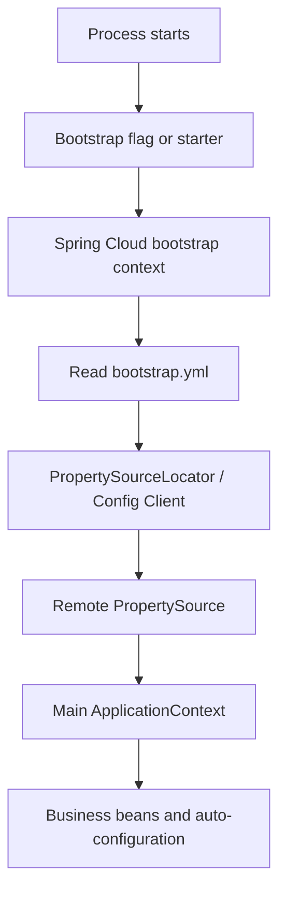

# Enabling Bootstrap Using a Starter or Version-Appropriate Property

## 1. When is it necessary to enable Spring Cloud bootstrap?

In the traditional model, Spring Cloud creates a **bootstrap context** before the main application context. The bootstrap context prepares property sources and infrastructure beans so the application can read external configuration right from the start. It usually serves as the parent of the main application context and can use `bootstrap.yml` or `bootstrap.properties` to declare Config Server connection details.

Since Spring Cloud **2020.0 (Ilford)**, bootstrap is no longer enabled by default in standard configurations. Projects that still need the legacy mechanism can activate it via the `spring-cloud-starter-bootstrap` dependency or the `spring.cloud.bootstrap.enabled=true` property. However, the property choice must consider the version: `spring.config.use-legacy-processing=true` was previously mentioned as a way to re-enable it during the initial transition period, but **it no longer activates bootstrap when using Spring Boot 3 / Spring Cloud 2022.0 and later**.

For new applications, Spring Cloud recommends using the Config Data API (`spring.config.import`) when the integration supports it. This lesson focuses on cases where there is a sound reason to retain legacy bootstrap, how to enable it properly by version, and how to confirm bootstrap is actually active.

This content belongs to the **Bootstrap** chapter of the **SPRING_CLOUD_CORE** module. In distributed systems, bootstrap is part of the configuration loading pipeline; it can prepare properties for Spring Cloud Commons, Context, and Config Client before business beans are created. How bootstrap is enabled must be compatible with Spring Boot, the Spring Cloud release train, and the application deployment method.

After this lesson, learners can:

- Identify why bootstrap does not auto-enable on modern release trains.
- Enable bootstrap with the starter or a system property at the right time.
- Choose the appropriate activation method between Spring Cloud 2020.0 and Spring Cloud 2022.0+.
- Configure `bootstrap.yml` for Config Client and distinguish it from `application.yml`.
- Verify the parent context, remote property sources, and startup behavior.
- Avoid enabling bootstrap alongside Config Data redundantly or unintentionally.

## 2. Changes across versions

| Generation | Bootstrap behavior | How to handle |
| --- | --- | --- |
| Spring Cloud prior to 2020.0 | Traditional bootstrap was typically enabled by default in legacy integrations | Legacy applications often have `bootstrap.yml` and Config Client using the bootstrap lifecycle. When upgrading, re-verify behavior instead of assuming defaults still hold. |
| Spring Cloud 2020.0 | Bootstrap is no longer enabled by default | Can be enabled with `spring-cloud-starter-bootstrap` or `spring.cloud.bootstrap.enabled=true`. Release notes from this period also mentioned `spring.config.use-legacy-processing=true` as a transitional option. |
| Spring Cloud 2022.0 with Spring Boot 3 | `spring.config.use-legacy-processing=true` no longer enables bootstrap due to changes in Boot 3.0 | Use `spring.cloud.bootstrap.enabled=true` or `spring-cloud-starter-bootstrap`. |
| Modern release trains | Bootstrap remains a legacy mechanism that must be explicitly enabled | Prefer Config Data for new applications; enable bootstrap only when an integration or existing architecture requires it. |

These two properties should not be treated as synonymous:

- `spring.cloud.bootstrap.enabled=true` is Spring Cloud's flag to activate bootstrap.
- `spring.config.use-legacy-processing=true` was a legacy processing flag used during Spring Boot 2.4's Config Data transition phase. It is not a reliable way to enable bootstrap in newer Boot generations.

**Rule of thumb:** if your project uses Spring Boot 3 and Spring Cloud 2022.0 or later, choose the starter or `spring.cloud.bootstrap.enabled=true`. Do not use `spring.config.use-legacy-processing=true` to fix bootstrap not running.

## 3. Approach 1 — adding spring-cloud-starter-bootstrap

This is the explicit dependency-level approach: the application brings the bootstrap starter onto the classpath to enable Spring Cloud's bootstrap mechanism.

### 3.1. Maven

Declare the dependency, letting the Spring Cloud BOM manage the version:

```xml
<dependencyManagement>
    <dependencies>
        <dependency>
            <groupId>org.springframework.cloud</groupId>
            <artifactId>spring-cloud-dependencies</artifactId>
            <version>SELECTED_SPRING_CLOUD_RELEASE_TRAIN</version>
            <type>pom</type>
            <scope>import</scope>
        </dependency>
    </dependencies>
</dependencyManagement>

<dependencies>
    <dependency>
        <groupId>org.springframework.cloud</groupId>
        <artifactId>spring-cloud-starter-config</artifactId>
    </dependency>
    <dependency>
        <groupId>org.springframework.cloud</groupId>
        <artifactId>spring-cloud-starter-bootstrap</artifactId>
    </dependency>
</dependencies>
```

`SELECTED_SPRING_CLOUD_RELEASE_TRAIN` is a placeholder: replace it with a release train compatible with the Spring Boot version in use. Do not assign a separate version to the bootstrap starter if the BOM already manages that artifact.

- `spring-cloud-starter-config` provides Config Client to connect to Config Server.
- `spring-cloud-starter-bootstrap` enables the bootstrap lifecycle.
- The bootstrap starter does not create a Config Server and does not replace Config Client. If the goal is to fetch configuration from Config Server, the application still needs Config Client and connection details.

### 3.2. Gradle

Example with Gradle and the Spring Cloud BOM:

```groovy
dependencies {
    implementation platform(
        "org.springframework.cloud:spring-cloud-dependencies:SELECTED_SPRING_CLOUD_RELEASE_TRAIN"
    )
    implementation "org.springframework.cloud:spring-cloud-starter-config"
    implementation "org.springframework.cloud:spring-cloud-starter-bootstrap"
}
```

If the project already uses Spring's dependency management plugin or a build-level platform, follow the existing mechanism and avoid importing the BOM twice with different versions.

### 3.3. When should you choose the starter?

The starter is suitable when bootstrap is a permanent part of the architecture, multiple environments need identical behavior, or you want the dependency graph to clearly show that the application uses bootstrap. The advantage is that the enabled state is recorded in the build file and easy to review. On the other hand, the starter alters the classpath; you must check the BOM and transitive dependencies.

## 4. Approach 2 — enabling via system property

Spring Cloud Config Client supports enabling bootstrap through the property:

```properties
spring.cloud.bootstrap.enabled=true
```

This property must be present **early enough**, as a Java system property or an environment variable. The Config Client documentation explicitly notes that you should not rely solely on placing this flag in `application.yml`, because that file belongs to the main context configuration process and may be read after the point at which bootstrap activation is required.

### 4.1. Java system property

```bash
java -Dspring.cloud.bootstrap.enabled=true -jar orders-service.jar
```

Place the flag before `-jar` so the JVM passes it as a system property right at launch.

### 4.2. Environment variable on Linux/macOS

```bash
SPRING_CLOUD_BOOTSTRAP_ENABLED=true java -jar orders-service.jar
```

Or export it for the current shell:

```bash
export SPRING_CLOUD_BOOTSTRAP_ENABLED=true
java -jar orders-service.jar
```

### 4.3. Environment variable on PowerShell

```powershell
$env:SPRING_CLOUD_BOOTSTRAP_ENABLED = "true"
java -jar .\orders-service.jar
```

When the process is run by Docker, Kubernetes, or CI/CD, configure the environment variable in the manifest/deployment pipeline. Ensure the variable is passed to the **actual container/process running the application**, not merely set in a different terminal session.

### 4.4. When should you choose the property?

A system property is appropriate when only certain environments or a single run need bootstrap enabled, when you want to experiment with migration without immediately changing the dependency graph, or when deployment already centrally manages JVM arguments/environment variables. If bootstrap is a long-term requirement across all environments, the starter usually expresses intent more clearly. Avoid unmanaged environment flags causing local, CI, and production to behave differently.

## 5. Which versions is spring.config.use-legacy-processing suitable for?

This is a frequent point of confusion during upgrades.

In Spring Cloud 2020.0, release notes documented that bootstrap could be re-enabled using `spring.cloud.bootstrap.enabled=true` or `spring.config.use-legacy-processing=true`; the properties are supplied via an environment variable, Java system property, or command-line argument.

During that era, `spring.config.use-legacy-processing=true` was an option tied to Spring Boot 2.4's legacy configuration processing mechanism. However, Spring Cloud 2022.0 explicitly states that this property **no longer enables bootstrap due to changes in Spring Boot 3.0**. With Boot 3 and corresponding release trains, use:

```bash
SPRING_CLOUD_BOOTSTRAP_ENABLED=true
```

or add `spring-cloud-starter-bootstrap`.

| Configuration | Spring Cloud 2020.0 / Boot 2.4 era | Spring Cloud 2022.0 + Boot 3 |
| --- | --- | --- |
| `spring-cloud-starter-bootstrap` | Can enable bootstrap | Can enable bootstrap |
| `spring.cloud.bootstrap.enabled=true` | Can enable bootstrap | Recommended property-based activation |
| `spring.config.use-legacy-processing=true` | Mentioned in 2020.0 release notes as a transitional option | No longer enables bootstrap |

Do not take old examples from blogs or forums and apply them blindly to every version. When upgrading a major Boot version or Spring Cloud train, read the breaking changes and release notes of the target train.

## 6. Configuring bootstrap.yml after bootstrap is enabled

Once the bootstrap lifecycle is activated, the application can use `bootstrap.yml` to declare information needed for the bootstrap phase. For Config Client, a typical configuration is:

```yaml
spring:
  application:
    name: orders-service
  cloud:
    config:
      uri: http://config-server:8888
  profiles:
    active: dev
```

Key properties:

- `spring.application.name`: application name used by Config Server to identify the configuration.
- `spring.cloud.config.uri`: Config Server address; Config Client's default is typically `http://localhost:8888`.
- `spring.profiles.active`: profiles to fetch from Config Server. With legacy bootstrap, if profiles are required for loading configuration, declaring them in the bootstrap phase is appropriate.
- `spring.cloud.config.label`: configuration label/branch/tag to fetch if the Config Server setup uses labels.

For example, the address can be set via an environment variable to avoid hardcoding the endpoint in the file:

```yaml
spring:
  application:
    name: orders-service
  cloud:
    config:
      uri: ${SPRING_CONFIG_URI:http://localhost:8888}
```

Never commit usernames/passwords, tokens, or secrets into `bootstrap.yml`. Use a secret manager, environment injection, or the credential mechanism appropriate for the deployment platform.

### 6.1. Distinguishing three types of configuration

| File / source | Timing and purpose |
| --- | --- |
| `bootstrap.yml` | Read during the bootstrap phase when bootstrap is enabled; usually contains the application name, profiles, and external config source address. |
| `application.yml` | Configuration for the main application context and application; used for server port, bean properties, logging, and runtime options. |
| Environment / system properties | Can supply the bootstrap activation flag early enough and override other configurations according to Spring precedence. |

**Do not place the bootstrap activation flag only inside `application.yml` and expect it to retroactively activate an already-passed phase.** The flag must be supplied via the starter, system property, or environment variable before Spring Cloud begins bootstrap.

## 7. How does the bootstrap context participate in ApplicationContext?

When enabled, the bootstrap context is created before the main application context and usually becomes its parent. It can run bootstrap configurations, create required beans, and discover `PropertySourceLocator` beans to load properties from external sources. Appropriate property sources are added to the Environment used by the main application.



Things to distinguish:

- The bootstrap context is a separate context in the legacy model.
- The main application context holds controllers, services, repositories, and most application beans.
- `Environment` supplies property sources for configuration resolution; parent/child relationships and precedence determine the final values.
- Bootstrap properties (properties loaded in the bootstrap phase) are not synonymous with the contents of the `bootstrap.yml` file. These two concepts can have different precedence orders.

In the legacy model, remote property sources created by a locator can have high priority. However, you should not make a blanket claim that every value in bootstrap always overrides every application value. You must inspect specific property sources, precedence order, and override settings for the version in use.

## 8. Verifying that bootstrap is actually enabled

Seeing a `bootstrap.yml` file in the project does not prove bootstrap is running. You must check configuration, dependencies, and startup behavior.

### 8.1. Checking dependencies

With Maven:

```bash
./mvnw dependency:tree -Dincludes=org.springframework.cloud:spring-cloud-starter-bootstrap,org.springframework.cloud:spring-cloud-starter-config,org.springframework.cloud:spring-cloud-commons
```

With Gradle:

```bash
./gradlew dependencyInsight --dependency spring-cloud-starter-bootstrap --configuration runtimeClasspath
```

Check the versions resolved by the BOM and ensure the modules belong to a compatible release train.

### 8.2. Checking the flag on the right process

In the container or host running the application, verify:

- JVM arguments contain `-Dspring.cloud.bootstrap.enabled=true` if using a system property.
- The process environment contains `SPRING_CLOUD_BOOTSTRAP_ENABLED=true` if using an environment variable.
- Runtime dependencies include the bootstrap starter if choosing the dependency approach.

Checking in the terminal where the project was built is not sufficient if the application runs in another container or service manager.

### 8.3. Checking the configuration loading result

Place a non-sensitive verification property in Config Server, for example:

```yaml
app:
  bootstrap:
    marker: "remote-config-loaded"
```

After startup, verify that a bean or integration test reads that value:

```java
@Component
public class BootstrapMarker {
    private final String value;

    public BootstrapMarker(
            @Value("${app.bootstrap.marker:missing}") String value) {
        this.value = value;
    }

    public String value() {
        return value;
    }
}
```

If the result is `missing`, check in order: whether bootstrap is enabled; whether Config Client is on the classpath; whether Config Server is reachable; whether the application name/profile/label is correct; and whether the remote property source was added to the Environment. Never use a real secret as a marker.

You can use startup logs or Actuator `env` in development environments to inspect configuration sources, though this endpoint can expose sensitive information. Expose it only temporarily, configure sanitization, and secure access.

## 9. Common mistakes

| Symptom | Possible cause | How to resolve |
| --- | --- | --- |
| `bootstrap.yml` exists, but Config Server is not called | Bootstrap is no longer auto-enabled since Spring Cloud 2020.0 | Add the starter or set `spring.cloud.bootstrap.enabled=true` early enough. |
| Using Boot 3, but `spring.config.use-legacy-processing=true` has no effect | The old property no longer activates bootstrap since Spring Cloud 2022.0 | Switch to `spring.cloud.bootstrap.enabled=true` or the starter. |
| `spring.cloud.bootstrap.enabled=true` set in `application.yml`, yet bootstrap still does not run | Flag is read too late | Move it to a system property, environment variable, or add the starter. |
| Starter dependency is present, but Config Server is not called | Missing Config Client or missing `spring.cloud.config.uri` | Add Config Client, verify the URI and connection details in bootstrap config. |
| Config Server returns configuration for the wrong application | Incorrect `spring.application.name` | Set the application name in bootstrap configuration or the appropriate environment. |
| Wrong remote profile | `spring.profiles.active` missing in the required phase or overridden | Check bootstrap profile, active profiles, and the Config Server request. |
| Works locally, fails in container | Environment/JVM argument not passed into the container | Inspect the actual process's variables and command line. |
| Remote property overridden unexpectedly | Different `PropertySource` precedence or override settings | Inspect `PropertySource` names and order; do not guess from filenames. |
| Both Config Data and legacy bootstrap are present | Two mechanisms connecting to the same source | Choose one primary approach or write clear tests during the transition period. |

## 10. Testing and operating by environment

### 10.1. Local development

Local development can use a Config Server running on `localhost:8888` with a non-sensitive marker property. If Config Server is not running, decide explicitly whether the application is allowed to continue with local defaults or must fail. Do not accidentally use optional just to mask an unprepared dev environment.

### 10.2. CI

CI should verify the dependency graph and run a startup/integration test with the proper bootstrap flag. If CI uses a system property, pass it on the test process command line; if using the starter, ensure the dependency is in the runtime/test classpath as designed.

### 10.3. Containers and Kubernetes

Set `SPRING_CLOUD_BOOTSTRAP_ENABLED=true` in the container's environment or pass the JVM argument in the entrypoint. For Config Server, configure the URI and credentials using ConfigMap/Secret or the corresponding secret manager. Ensure Config Server is ready before client readiness is considered successful if remote config is mandatory.

Do not place bootstrap enabled inside a ConfigMap provided by the Config Server itself if the application needs bootstrap to connect to that Config Server. That creates a dependency cycle: the application needs the flag to start bootstrap, yet needs bootstrap to fetch the flag.

### 10.4. Production

If bootstrap is an operational requirement, prefer expressing it consistently in dependencies or deployment configuration and document why legacy is used. Secure Actuator endpoints, avoid logging secrets, monitor connection errors, and define a startup policy when Config Server is unavailable.

## 11. Deciding between enabling bootstrap or using Config Data

| Question | If yes | Recommended action |
| --- | --- | --- |
| New application and Config Client supports Config Data? | Yes | Prefer `spring.config.import=configserver:...`. |
| Internal library requires a bootstrap parent context? | Yes | Enable bootstrap via the starter or version-appropriate flag. |
| Application runs Spring Cloud 2022.0 / Boot 3 or later? | Yes | Use `spring.cloud.bootstrap.enabled=true` or the starter; do not use the legacy-processing flag. |
| Only need to test bootstrap in one environment? | Yes | Consider a system property/environment variable, clearly tracking where it is enabled. |
| Both `spring.config.import` and legacy bootstrap present? | Yes | Investigate why; avoid unintentionally loading the same source twice. |

If there is no specific dependency on bootstrap, Config Data generally offers a simpler model and is recommended for modern applications. Keeping bootstrap should be treated as a reasoned architectural decision, not merely a habit carried over from old configurations.

## 12. Official references

- [Spring Cloud Config Client — Config Data Import and Config First Bootstrap](https://docs.spring.io/spring-cloud-config/reference/client.html)
- [Spring Cloud 2020.0 Release Notes — default bootstrap changes](https://github.com/spring-cloud/spring-cloud-release/wiki/Spring-Cloud-2020.0-Release-Notes)
- [Spring Cloud 2022.0 Release Notes — changes with Spring Boot 3.0](https://github.com/spring-cloud/spring-cloud-release/wiki/Spring-Cloud-2022.0-Release-Notes)

Official documentation should be verified against the exact release train running; do not copy properties from examples of one Spring Cloud generation to another without checking.

## 13. Summary and self-check questions

To enable legacy bootstrap, there are two main options: **add `spring-cloud-starter-bootstrap`** to dependencies or **set `spring.cloud.bootstrap.enabled=true`** early enough as a system property/environment variable. Since Spring Cloud 2020.0, bootstrap is no longer enabled by default. With Spring Cloud 2022.0 and Spring Boot 3, do not use `spring.config.use-legacy-processing=true` to enable bootstrap; this property no longer takes effect for that purpose.

Once enabled, Config Client must be present if the application fetches configuration from Config Server; `bootstrap.yml` provides the application name, URI, profiles, and appropriate bootstrap details. Verify using the dependency graph, process arguments/environment, logs, and a non-sensitive marker property. If a new application does not depend on the bootstrap context, consider using the Config Data API instead.

Self-check questions:

1. Why does Spring Cloud 2020.0 not auto-enable bootstrap like earlier legacy configurations?
2. What are the two main ways to enable bootstrap in modern release trains?
3. Why must `spring.cloud.bootstrap.enabled=true` be supplied before the main application context reads `application.yml`?
4. What limitation does `spring.config.use-legacy-processing=true` have when using Spring Boot 3?
5. How does `spring-cloud-starter-bootstrap` differ in responsibility from `spring-cloud-starter-config`?
6. After enabling bootstrap, which properties are typically placed in `bootstrap.yml` so Config Client connects to the right source?
7. How can you prove bootstrap has loaded a remote property source without exposing secrets?
8. When should you migrate to Config Data instead of continuing to maintain legacy bootstrap?
