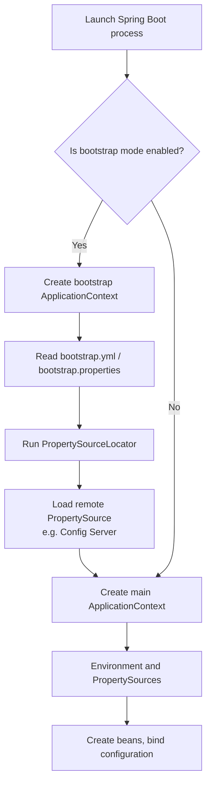
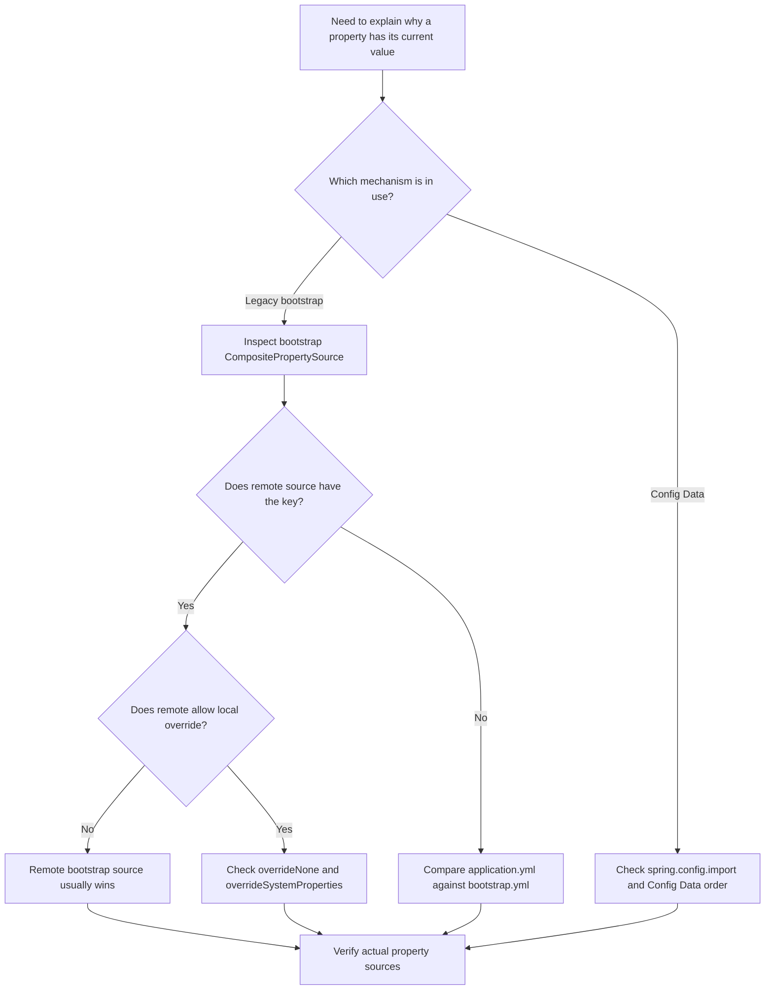

# High-Priority Bootstrap Sources and Low-Priority Bootstrap Files

## 1. A frequently confused issue

In a Spring Cloud application using the traditional **bootstrap context** mechanism, two concepts are often lumped together as "bootstrap":

- **Bootstrap property source**: a property source loaded during the bootstrap phase, typically coming from an external system such as Spring Cloud Config Server.
- **The `bootstrap.yml` or `bootstrap.properties` file**: a local configuration file used to initialize the bootstrap context.

These two **do not have the same priority**. According to Spring Cloud Context rules, the property source named `bootstrap` created from a `PropertySourceLocator` (e.g., Config Server) has high priority. Meanwhile, the property source `applicationConfig: [classpath:bootstrap.yml]` containing values from the `bootstrap.yml` file has lower priority than `application.yml` and the regular property sources of the main application context.

Therefore, the statement "bootstrap has high priority" is only accurate when referring to **properties loaded during the bootstrap phase**, such as a remote property source. You cannot deduce that every property written in `bootstrap.yml` wins over `application.yml`.

This lesson belongs to the **Bootstrap** chapter of **SPRING_CLOUD_CORE**. Learners need to understand how Spring Cloud loads external configuration, distinguish the bootstrap context from the main context, and know when traditional bootstrap rules still apply. This is especially important when integrating Spring Cloud Config Client and handling overridden configuration values.

## 2. What is the bootstrap context?

In the traditional bootstrap model, Spring Cloud creates a **bootstrap ApplicationContext** as the parent context of the main application context. The bootstrap context is created early to load necessary configuration sources before the main application completes initialization.

Overview flow:



The bootstrap context typically handles:

- Reading properties needed to connect to external configuration sources.
- Running `PropertySourceLocator` components to fetch remote property sources.
- Feeding appropriate property sources and bootstrap configurations into the main context via the context hierarchy mechanism.
- In supported Spring Cloud configurations, handling certain functions related to external configuration before the main application is created.

The bootstrap context is a **separate Spring ApplicationContext**, not a YAML file. It can have its own beans and property sources. The main context is a child context that inherits property sources from its parent according to Spring rules.

The two contexts can share the `Environment` in the standard bootstrap model. When building complex context hierarchies with `SpringApplicationBuilder`, note that each context can have its own bootstrap property sources; child contexts have their own precedence and inheritance rules. Do not assume every context in a hierarchy shares the exact same property sources.

## 3. Distinguishing the bootstrap property source and the bootstrap.yml file

This is the core part of the lesson.

### 3.1. The bootstrap property source has high priority

If the bootstrap context finds a `PropertySourceLocator` and the locator returns properties, Spring Cloud can add a `CompositePropertySource` named `bootstrap` to the main context. A common example is a property source loaded from Spring Cloud Config Server.

This source contains **remote** properties, for example:

```yaml
app:
  greeting: Hello from Config Server
inventory:
  reservation:
    enabled: true
```

In the traditional bootstrap model, the `bootstrap` property source is added with high priority. By default, these remote values **cannot be overridden by local configuration**. This is how a centralized configuration system retains control over values supplied by the server.

Note: the high priority described above applies to the property source loaded by the locator. It does not mean every property source in the bootstrap context has high priority.

### 3.2. The bootstrap.yml file has lower priority than application.yml

The `bootstrap.yml` (or `bootstrap.properties`) file is used to configure the **bootstrap context**. Values in this file are then inherited by the main context when the parent-child relationship is established.

Example `bootstrap.yml`:

```yaml
spring:
  application:
    name: inventory-service
  cloud:
    config:
      uri: "http://localhost:8888"

app:
  greeting: Hello from bootstrap.yml
```

The main application's `application.yml` file:

```yaml
app:
  greeting: Hello from application.yml
```

If no remote property source supplies `app.greeting`, the value from `application.yml` has higher priority than the local value inherited from `bootstrap.yml`. The result is:

```text
app.greeting = Hello from application.yml
```

The reason is that the main context's property sources take precedence over property sources inherited from the parent bootstrap context during property resolution.

### 3.3. Comparison table

| Component | Typical content | Role | Priority in bootstrap mode |
| --- | --- | --- | --- |
| `bootstrap` CompositePropertySource | Properties from Config Server or `PropertySourceLocator` | Provides external configuration during the bootstrap phase | **High**, does not allow local overrides by default |
| `applicationConfig: [classpath:bootstrap.yml]` | Local properties in `bootstrap.yml` and profile files | Configures the bootstrap context, e.g., Config Server address | **Lower** than main context property sources |
| `applicationConfig: [classpath:application.yml]` | Local configuration of the main application | Application configuration and environment defaults | Higher than `bootstrap.yml` |
| Environment variables / system properties / command line | Values from the runtime environment | Overrides according to property source rules and remote source override permissions | Depends on the source and override policy |

**Do not equate the filename with the property source name.** `bootstrap.yml` typically creates a property source named like `applicationConfig: [classpath:bootstrap.yml]`; it is not the `CompositePropertySource` named `bootstrap` containing Config Server data.

## 4. Example of determining the final value

Suppose three sources all define `app.greeting`:

**`bootstrap.yml` file:**

```yaml
app:
  greeting: from-bootstrap-file
```

**`application.yml` file:**

```yaml
app:
  greeting: from-application-file
```

**Remote configuration from Config Server:**

```yaml
app:
  greeting: from-config-server
```

In traditional bootstrap mode, if Config Server returns `app.greeting` and does not grant override permission to local sources, the remote value in the `bootstrap` property source takes priority. Result:

```text
app.greeting = from-config-server
```

If the remote source **does not define** the `app.greeting` key, the local value from the main context is chosen:

```text
app.greeting = from-application-file
```

In the second case, `application.yml` beats `bootstrap.yml`. This example demonstrates the exact difference between the remote bootstrap property source and the local bootstrap file.

You can inspect the value in the application using `Environment`:

```java
import org.springframework.core.env.Environment;
import org.springframework.stereotype.Component;

@Component
public class GreetingReader {

    private final Environment environment;

    public GreetingReader(Environment environment) {
        this.environment = environment;
    }

    public String greeting() {
        return environment.getProperty("app.greeting", "default-greeting");
    }
}
```

Do not just read the final value and conclude which source won. When debugging, inspect both the property source names and their order; Actuator `env` can assist with this in a secured environment.

## 5. Allowing local configuration to override remote properties

By default, remote property sources loaded by the bootstrap context usually do not allow local configuration to override them. Spring Cloud Config provides a mechanism allowing the server to **grant override permission**.

Key point: the `spring.cloud.config.allowOverride=true` property must be placed in the **remote property source returned by Config Server**. Putting it in the client's `application.yml` does not grant override permission to the client itself.

### 5.1. Enabling override permission from Config Server

Example in the remote configuration file for the application:

```yaml
spring:
  cloud:
    config:
      allowOverride: true

app:
  greeting: from-config-server
```

Once the remote source allows overrides, two properties control the exact positioning of the remote property source relative to local configuration.

### 5.2. `overrideNone=true`

```yaml
spring:
  cloud:
    config:
      allowOverride: true
      overrideNone: true
```

When `overrideNone=true`, any local property source can override remote values. This includes configuration in the application's local files.

For example, remote provides `app.greeting=from-config-server`, while `application.yml` declares `app.greeting=from-application-file`; local sources are allowed to override, so the local value can win.

### 5.3. `overrideSystemProperties=false`

```yaml
spring:
  cloud:
    config:
      allowOverride: true
      overrideSystemProperties: false
```

This setting restricts overrides from local sources: system properties, command-line arguments, and environment variables can override remote settings, but **local config files** such as `application.yml` cannot be used to override the remote source.

Summary table:

| Remote configuration | Behavior |
| --- | --- |
| `allowOverride` omitted or `false` | Remote property source does not allow local overrides by default |
| `allowOverride=true` | Enables override configuration; granular flags control position and scope |
| `allowOverride=true` + `overrideNone=true` | Any local property source can override remote |
| `allowOverride=true` + `overrideSystemProperties=false` | System properties, command line, and environment variables can override; local config files cannot override remote |

Use these flags intentionally. If Config Server is the authoritative source for security configuration or operational policies, enabling `overrideNone=true` can let individual services override values the platform intends to control centrally.

## 6. Activating traditional bootstrap mode

Since Spring Boot 2.4, the default way to connect to Spring Cloud Config Server is **Config Data import** via `spring.config.import`. This approach does not require `bootstrap.yml`.

If the traditional bootstrap mechanism is needed, bootstrap must be explicitly enabled in one of two ways:

1. Add the `spring-cloud-starter-bootstrap` dependency to the classpath.
2. Set `spring.cloud.bootstrap.enabled=true` via a system property or environment variable **before the application starts**.

Do not place the bootstrap activation flag solely inside `bootstrap.yml`, because that file is only read after the bootstrap process has already been activated.

### 6.1. Illustrative Maven dependencies

Use a Spring Cloud BOM compatible with the project's Spring Boot version to manage versions:

```xml
<dependencyManagement>
    <dependencies>
        <dependency>
            <groupId>org.springframework.cloud</groupId>
            <artifactId>spring-cloud-dependencies</artifactId>
            <version>2025.1.4</version>
            <type>pom</type>
            <scope>import</scope>
        </dependency>
    </dependencies>
</dependencyManagement>

<dependencies>
    <dependency>
        <groupId>org.springframework.cloud</groupId>
        <artifactId>spring-cloud-starter-config</artifactId>
    </dependency>
    <dependency>
        <groupId>org.springframework.cloud</groupId>
        <artifactId>spring-cloud-starter-bootstrap</artifactId>
    </dependency>
</dependencies>
```

The snippet above assumes the project already inherits from `spring-boot-starter-parent` or has imported the Spring Boot BOM separately to manage Boot dependencies. `spring-cloud-dependencies` only manages Spring Cloud modules belonging to the release train; choose a BOM version compatible with your project's Spring Boot line.

### 6.2. Enabling via environment variable

Linux/macOS:

```bash
SPRING_CLOUD_BOOTSTRAP_ENABLED=true java -jar inventory-service.jar
```

Windows PowerShell:

```powershell
$env:SPRING_CLOUD_BOOTSTRAP_ENABLED = "true"
java -jar inventory-service.jar
```

If using a system property:

```bash
java -Dspring.cloud.bootstrap.enabled=true -jar inventory-service.jar
```

These methods activate the bootstrap process before the main application loads configuration.

## 7. What is the bootstrap.yml file used to configure?

The local bootstrap file should contain values needed to start bootstrap, typically application identification and the remote configuration source address.

Example:

```yaml
spring:
  application:
    name: inventory-service
  profiles:
    active: dev
  cloud:
    config:
      uri: "http://localhost:8888"
```

- `spring.application.name` helps Config Server identify the configuration set for the service.
- `spring.profiles.active` indicates the profiles the client requests from Config Server. If the application name and profile are needed to determine the context ID right in the bootstrap phase, place them in `bootstrap.yml` or the corresponding bootstrap source.
- `spring.cloud.config.uri` specifies the Config Server location in the config-first bootstrap model.

Files such as `bootstrap-dev.yml` or `bootstrap-development.properties` can be loaded once the corresponding profile is determined in the bootstrap context. You can change the filename or location with the properties:

| Property | Default | Meaning |
| --- | --- | --- |
| `spring.cloud.bootstrap.name` | `bootstrap` | Base name of the bootstrap file |
| `spring.cloud.bootstrap.location` | Empty | Replaces default locations with specified locations |
| `spring.cloud.bootstrap.additional-location` | Empty | Adds additional configuration locations to the default locations |

Properties controlling the bootstrap location must be supplied early enough, typically via system property or environment. Usage is similar to Spring Boot's `spring.config.*` group but applies to the bootstrap context.

Do not put all business configuration into `bootstrap.yml`. Keep day-to-day application configuration in `application.yml` or an appropriate remote source; keep the bootstrap file lean with values serving configuration connection and initialization.

## 8. Distinguishing traditional bootstrap from modern Config Data

Both mechanisms can connect to Config Server, but their initialization flow and property source rules differ.

### 8.1. Config Data import — the modern default approach

Example in `application.yml`:

```yaml
spring:
  application:
    name: inventory-service
  profiles:
    active: dev
  config:
    import: "optional:configserver:http://localhost:8888"
```

The application needs the `spring-cloud-starter-config` dependency. Spring Boot Config Data processes the import when loading configuration. Neither `bootstrap.yml` nor creating a legacy bootstrap parent context is needed solely to connect to Config Server.

If you omit the `optional:` prefix, the application will fail if it cannot connect to Config Server while loading configuration. With `optional:`, the application can start even if Config Server is unavailable; this is suitable when remote configuration is not mandatory in that environment.

Config Data loads configuration in stages: first with the `default` profile, then it may query additional configuration for activated profiles. Therefore, multiple requests to Config Server on startup can be normal behavior.

### 8.2. Legacy config-first bootstrap

With traditional bootstrap mode:

- Enable bootstrap via starter or system property/environment.
- Create `bootstrap.yml` to set `spring.cloud.config.uri`, application name, and required profiles.
- Config Client connects to Config Server during the bootstrap phase and loads the remote property source.
- The remote property source normally has high priority according to bootstrap rules, unless the server grants override permission to local sources.

### 8.3. Quick comparison

| Criterion | Legacy bootstrap | Config Data import |
| --- | --- | --- |
| How to activate | `spring-cloud-starter-bootstrap` or `spring.cloud.bootstrap.enabled=true` | `spring.config.import` |
| `bootstrap.yml` file | Used to configure the bootstrap context | Not needed |
| Bootstrap parent context | Yes | Not needed for the Config Data flow |
| Loading Config Server | Via `PropertySourceLocator` in the bootstrap flow | Via Config Data loader |
| Precedence semantics | `bootstrap` CompositePropertySource has high precedence; local `bootstrap.yml` is lower than `application.yml` | Follows Spring Boot Config Data import and property source ordering |
| When to use | Legacy applications or integrations depending on the bootstrap context | Default choice for new applications |

Do not mix the two models unintentionally. When migrating from bootstrap to Config Data, move the Config Server address and profiles to `application.yml`/environment, add `spring.config.import`, then re-verify the source and precedence of each property. You cannot blindly carry the conclusion "the remote bootstrap source always wins" over to every Config Data case.

## 9. Details on versions and context hierarchy

In modern Spring Cloud, how `PropertySourceLocator` executes has changed across releases. Spring Cloud Context documentation notes that prior to **Spring Cloud 2022.0.3**, `PropertySourceLocators` (including Config Client's locator) ran in the main application context rather than the bootstrap context by default. They could be forced to run in the bootstrap context using `spring.cloud.config.initialize-on-context-refresh=true` in `bootstrap.yml` on applicable versions.

Starting with Spring Cloud 2022.0.3, the bootstrap property locator mechanism is called twice in the documented flow: first to fetch profile-agnostic sources to allow activating profiles; after the main context initializes, the locator may be called again with active profiles to fetch profile-specific sources. Therefore, when reading startup logs or debugging Config Server request counts, cross-reference your exact release train rather than applying an older description to all versions.

With a custom context hierarchy created using `SpringApplicationBuilder`, each context can have its own `spring.application.name`, profiles, and property sources. A child context's property source can override the parent's source; if the child has a source with the same name as one in the parent, the parent's source with that name may not be included in the child. This is Spring's context hierarchy behavior and should not be simplified into a single precedence list applicable to every architecture.

## 10. Common mistakes

| Symptom | Possible cause | How to resolve |
| --- | --- | --- |
| `bootstrap.yml` exists, but Config Server is not called | Bootstrap mode has not been activated | Add `spring-cloud-starter-bootstrap` or enable the property via system property/environment |
| `spring.cloud.bootstrap.enabled=true` placed in `bootstrap.yml` has no effect | The file is not read because bootstrap is not yet activated | Supply the flag before startup via environment/system property or use the starter |
| `application.yml` does not override values from Config Server | Remote source disallows local override by default | Check `spring.cloud.config.allowOverride` granted from the remote source and the two override flags |
| `bootstrap.yml` does not beat `application.yml` | This is the expected property source hierarchy behavior | Place defaults in the bootstrap file; use the remote source if high priority is needed |
| Unsure where a property comes from | Looking only at the final value instead of property sources | Use Actuator `env` in a secured environment or inspect property sources in code |
| Config Data import does not use `bootstrap.yml` | Using the modern flow | Place `spring.config.import` in `application.yml`/profile config or environment |
| Multiple requests to Config Server on startup | Config Data loads `default` then active profiles; or locator is called multiple times depending on version | Check logs and documentation for the current release train |
| Local override does not work as expected | `allowOverride` set on the client instead of the remote source, or misunderstanding detailed flags | Set permission in the remote property source and verify each override source |

## 11. Process for checking precedence in a project

When a property has an unexpected value, inspect in sequence:

1. Determine whether the application uses **legacy bootstrap** or **Config Data import**.
2. Check whether bootstrap mode is activated at the right time.
3. Confirm Config Client connects to Config Server and receives the expected application/profile.
4. Check whether the key exists in the remote property source.
5. If using bootstrap mode, distinguish the property source named `bootstrap` from `applicationConfig: [classpath:bootstrap.yml]`.
6. Check the same key in `application.yml`, profile-specific files, environment variables, system properties, and command-line arguments.
7. If local overrides of remote values are desired, check `spring.cloud.config.allowOverride` in the remote source and the `overrideNone`/`overrideSystemProperties` settings.
8. Verify the final result in the actual process/profile and re-test after a restart.

Decision diagram:



## 12. Self-check questions

1. Which component creates the `bootstrap` CompositePropertySource and what data does it typically contain?
2. Why does the `bootstrap.yml` file have lower priority than `application.yml` despite having "bootstrap" in its name?
3. In legacy bootstrap mode, if Config Server and `application.yml` both define a key, which value is chosen by default?
4. Why is setting `spring.cloud.config.allowOverride=true` in the client's `application.yml` not sufficient to allow local overrides?
5. How does `overrideNone=true` differ from `overrideSystemProperties=false`?
6. Why does Config Data import not need `bootstrap.yml`?
7. Where must `spring.cloud.bootstrap.enabled=true` be placed to activate legacy bootstrap?
8. When a child context and parent context both have property sources, what inheritance/override rules must be kept in mind?

## 13. Official references

- [Spring Cloud Context — Application Context Services](https://docs.spring.io/spring-cloud-commons/reference/spring-cloud-commons/application-context-services.html) — bootstrap context, property source order, `bootstrap.yml`, remote overrides, and context hierarchies.
- [Spring Cloud Config Client](https://docs.spring.io/spring-cloud-config/reference/client.html) — Config Data import, legacy config-first bootstrap, discovery-first lookup, and retry.
- [Spring Boot — Externalized Configuration](https://docs.spring.io/spring-boot/reference/features/external-config.html) — property sources and Config Data in Boot applications.
- [Spring Cloud Release Train Reference](https://docs.spring.io/spring-cloud-release/reference/index.html) — determine documentation and behavior matching the release train in use.

*This document distinguishes legacy bootstrap rules from modern Config Data. Before modifying precedence in production, verify the Spring Boot/Spring Cloud version and inspect the application's actual property sources.*
