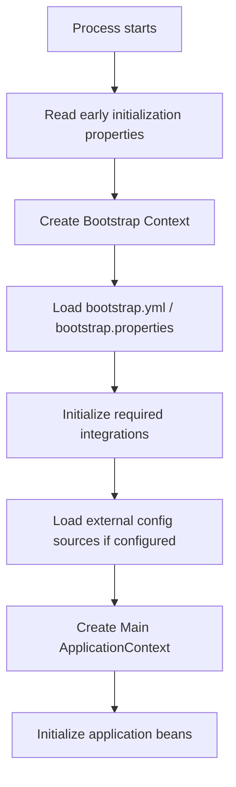

# spring.cloud.bootstrap.name, location, and additional-location

In some Spring Cloud applications, startup can create a **bootstrap context** before the main ApplicationContext. The bootstrap context is used to load configuration needed for the initialization phase, such as details to connect to Config Server or external configuration sources. When using the legacy bootstrap mechanism, the three properties `spring.cloud.bootstrap.name`, `spring.cloud.bootstrap.location`, and `spring.cloud.bootstrap.additional-location` control the name and lookup locations for bootstrap configuration.

These properties are easily confused with Spring Boot Config Data's `spring.config.name`, `spring.config.location`, and `spring.config.additional-location`. Their names are similar, but they belong to **two different configuration loading mechanisms and two different initialization phases**. Understanding this boundary clearly helps keep Spring Cloud Config Client configuration stable and avoids placing properties where they take effect too late.

## 1. What is the bootstrap context?

In the legacy bootstrap model, Spring Cloud creates a parent context (the bootstrap context) before the application's main context. This context can create the beans and property sources needed to prepare the environment for the Spring Boot application.

Conceptual flow:



The bootstrap context is typically used to prepare necessary details before business beans are initialized. For example, Config Client can use the application name, profile, and Config Server address to fetch remote properties. The resulting property sources can be fed into the Environment used by the main context.

Key points to remember:

- The bootstrap context is an in-process JVM mechanism, not a separate server or registry.
- Config Server, Vault, the registry, or another configuration system remain external services/infrastructure.
- The bootstrap context helps initialize integrations early to fetch configuration; it does not create configuration sources by itself.
- The legacy bootstrap context is one way Spring Cloud organizes configuration loading. Modern Spring Boot applications can use the Config Data API instead of this mechanism.

## 2. Roles of the three bootstrap properties

| Property | Role | Common value |
| --- | --- | --- |
| `spring.cloud.bootstrap.name` | Sets the base name of the bootstrap configuration file | `bootstrap` |
| `spring.cloud.bootstrap.location` | Specifies the bootstrap configuration location; used when adjusting default search locations | `file:/etc/order-service/bootstrap/` |
| `spring.cloud.bootstrap.additional-location` | Adds bootstrap configuration search locations alongside the defaults | `file:/etc/order-service/overrides/` |

By legacy convention, the default bootstrap name is `bootstrap`; applications usually have `bootstrap.yml` or `bootstrap.properties`. When the name is changed, the loader searches for configuration matching the chosen name, such as `bootstrap-prod.yml` if the base name is `bootstrap-prod`.

In short:

- **name** answers: "What filename should we look for as the bootstrap file?"
- **location** answers: "Where should we search for bootstrap configuration?"
- **additional-location** answers: "Besides the default locations, where else should we search?"

These three properties control configuration lookup for the legacy bootstrap context. They are not general properties for locating all configuration files of the main ApplicationContext.

## 3. spring.cloud.bootstrap.name

When using legacy bootstrap, the default filename is `bootstrap`. You can change the base name using:

```properties
spring.cloud.bootstrap.name=bootstrap-prod
```

Then the loader uses the specified name to find matching bootstrap configuration files, such as:

```text
bootstrap-prod.yml
bootstrap-prod.yaml
bootstrap-prod.properties
```

Supported formats and locations depend on the loader mechanism and application configuration. The key point is that `name` changes the **base name** of the bootstrap configuration file; it does not change `spring.application.name`.

The two properties have distinct meanings:

```yaml
spring:
  application:
    name: order-service
```

`spring.application.name` sets the logical identity of the application, typically used as the service name or application name when accessing centralized configuration. `spring.cloud.bootstrap.name` chooses the bootstrap filename in the legacy mechanism. Renaming the bootstrap file does not automatically change the Service ID to `bootstrap-prod`.

### 3.1. When is renaming needed?

Renaming can be useful when:
- Multiple bootstrap configuration sets need to be selected by deployment purpose.
- A platform mandates a filename different from `bootstrap`.
- You want to avoid confusion across bootstrap files for multiple applications or profiles.

However, if you only need different values across local, test, and production, profiles or externalized configuration are usually clearer choices. Avoid creating multiple bootstrap names if a single shared bootstrap file with profiles already meets the requirement.

### 3.2. Supplying name early enough

There is a common circular dependency pitfall: to read `bootstrap-prod.yml`, the loader must know the name `bootstrap-prod` before reading the file. Therefore, putting `spring.cloud.bootstrap.name` inside the very bootstrap file it is supposed to select is usually too late to decide the initial file.

Supply this property via a configuration source available before the bootstrap context starts, such as a JVM system property or an environment variable:

```bash
java -Dspring.cloud.bootstrap.name=bootstrap-prod -jar order-service.jar
```

Or:

```text
SPRING_CLOUD_BOOTSTRAP_NAME=bootstrap-prod
```

The exact delivery method depends on the launch environment. The goal is for the property to be present in the Environment at the moment the bootstrap loader decides the filename.

## 4. spring.cloud.bootstrap.location

`spring.cloud.bootstrap.location` specifies the location legacy bootstrap uses to look for configuration. For example, an organization stores bootstrap configuration outside the artifact:

```bash
java \
  -Dspring.cloud.bootstrap.location=file:/etc/order-service/bootstrap/ \
  -jar order-service.jar
```

The directory can contain bootstrap files matching the chosen name:

```text
/etc/order-service/bootstrap/
  bootstrap.yml
  bootstrap.properties
```

If the name is set to `bootstrap-prod`, the corresponding file must follow that name, such as `bootstrap-prod.yml`.

For filesystem locations, note:
- The process has read permission on the file/directory.
- The path exists in the filesystem visible to the process (especially when running inside a container).
- Use the appropriate URI/prefix, such as `file:` for the filesystem.
- If using a relative path, the result depends on the working directory.
- If specifying multiple locations, separate and order them using syntax supported by the loader.

In the legacy mechanism, `location` is used to change the bootstrap search location according to the provided setting. When setting it, check the documentation for the release train in use to see exactly which default locations are replaced and how it combines with other sources. Do not assume it is synonymous with Spring Boot's `spring.config.location`.

## 5. spring.cloud.bootstrap.additional-location

`spring.cloud.bootstrap.additional-location` is used when you want to **add** search locations for bootstrap configuration in addition to the default locations. For example, keeping packaged bootstrap configuration inside the application while adding an override directory mounted from the deployment environment:

```bash
java \
  -Dspring.cloud.bootstrap.additional-location=file:/etc/order-service/bootstrap-overrides/ \
  -jar order-service.jar
```

Example directory structure:

```text
classpath:
  bootstrap.yml

/etc/order-service/bootstrap-overrides/:
  bootstrap.yml
```

This pattern is useful when you want to keep default configuration with the artifact while letting the platform supply additional environment-specific configuration.

### 5.1. Distinguishing location and additional-location

| Property | Intent | Usage |
| --- | --- | --- |
| `spring.cloud.bootstrap.location` | Re-specifies the bootstrap config search location | When moving lookup to an externally managed location |
| `spring.cloud.bootstrap.additional-location` | Adds search locations | When keeping default locations and adding external directories |

The names reflect a crucial difference: `location` is used to change the search location; `additional-location` is used to append locations. The two should not be treated as interchangeable.

Precedence when the same key appears in multiple locations also depends on the loader's processing rules and location order. Verify the effective value via Environment/logs rather than relying solely on property names.

## 6. Which sources should supply bootstrap properties?

Properties used to determine the bootstrap filename/location must be available **before the loader reads those files**. Common early delivery methods are JVM system properties or process environment variables.

Example with JVM:

```bash
java \
  -Dspring.cloud.bootstrap.name=bootstrap-prod \
  -Dspring.cloud.bootstrap.location=file:/etc/order-service/bootstrap/ \
  -Dspring.cloud.bootstrap.additional-location=file:/etc/order-service/overrides/ \
  -jar order-service.jar
```

Example with environment variables:

```text
SPRING_CLOUD_BOOTSTRAP_NAME=bootstrap-prod
SPRING_CLOUD_BOOTSTRAP_LOCATION=file:/etc/order-service/bootstrap/
SPRING_CLOUD_BOOTSTRAP_ADDITIONAL_LOCATION=file:/etc/order-service/overrides/
```

Spring Boot relaxed binding maps property names to environment variables by uppercasing and replacing dots/hyphens with underscores. When using a launcher, container, or orchestrator, confirm that the environment variables are actually injected into the process.

Do not place properties that decide where to find the bootstrap file solely inside the file whose loading they govern. That is an initialization ordering issue.

## 7. Complete bootstrap configuration example

Suppose `order-service` uses legacy bootstrap and needs to fetch configuration from Config Server. A bootstrap file might contain:

```yaml
spring:
  application:
    name: order-service

  cloud:
    config:
      uri: http://config.internal:8888
      fail-fast: true
```

This file illustrates the client configuration portion. Using legacy bootstrap also depends on the starter/activation method appropriate for the release train. To change the filename and location, pass the bootstrap control properties early via JVM or environment:

```bash
java \
  -Dspring.cloud.bootstrap.name=bootstrap \
  -Dspring.cloud.bootstrap.location=file:/etc/order-service/bootstrap/ \
  -jar order-service.jar
```

In the example:
- `spring.application.name` identifies the application for integrations such as Config Client.
- `spring.cloud.config.uri` is the Config Server address.
- `spring.cloud.config.fail-fast` expresses the policy on how to react when configuration cannot be fetched according to the corresponding Config Client mechanism.
- `spring.cloud.bootstrap.name` and `location` determine which bootstrap file is looked up in the early phase.

Do not confuse `spring.cloud.config.uri` with `spring.cloud.bootstrap.location`: one property is the Config Server service endpoint; the other is the location of bootstrap configuration files.

## 8. Distinguishing legacy bootstrap from Spring Boot Config Data

This is the most important distinction when working across different Spring Boot/Spring Cloud versions.

Spring Boot 2.4 introduced the Config Data API, significantly changing how configuration is loaded. Spring Cloud Config Client on generations supporting Config Data can use:

```yaml
spring:
  application:
    name: order-service
  config:
    import: "optional:configserver:"
  cloud:
    config:
      uri: http://config.internal:8888
```

In this mechanism, `spring.config.import` is the entry point to load Config Server as a Config Data location. It does not need to use the legacy bootstrap context just to fetch remote configuration the old way.

| Item | Legacy bootstrap | Spring Boot Config Data |
| --- | --- | --- |
| Mechanism | Spring Cloud bootstrap context | Spring Boot Config Data API |
| Typical config files | `bootstrap.yml` / `bootstrap.properties` | `application.yml` / profile files and imports |
| Filename selection property | `spring.cloud.bootstrap.name` | `spring.config.name` |
| Location property | `spring.cloud.bootstrap.location` | `spring.config.location` |
| Additional location property | `spring.cloud.bootstrap.additional-location` | `spring.config.additional-location` |
| Config Server | Can be initialized in the bootstrap context | Uses `spring.config.import=configserver:` |
| Purpose | Compatibility/legacy mechanism in applications needing a bootstrap context | Modern Spring Boot configuration loading mechanism |

Properties across the two columns cannot be swapped arbitrarily. If an application uses Config Data and you only set `spring.cloud.bootstrap.location`, that does not change where Spring Boot looks for `application.yml`. Conversely, `spring.config.location` is not the property controlling `bootstrap.yml` in legacy bootstrap.

### 8.1. Is legacy bootstrap always enabled?

Do not assume the bootstrap context always runs automatically. In newer Spring Cloud generations, the legacy bootstrap mechanism is no longer the default for all applications; to use it, activate it in a way supported by the release train, typically via `spring-cloud-starter-bootstrap` or a bootstrap enablement property supplied early as a system property/environment variable.

Example adding the starter in Maven:

```xml
<dependency>
    <groupId>org.springframework.cloud</groupId>
    <artifactId>spring-cloud-starter-bootstrap</artifactId>
</dependency>
```

The dependency and activation method must be compatible with your project's Spring Boot and Spring Cloud release train. Do not add the starter merely because you see a `bootstrap.yml` file in the repository; first determine whether the application uses Config Data or legacy bootstrap.

### 8.2. When should legacy bootstrap be kept?

Keeping this mechanism may be necessary when:
- An existing application depends on the bootstrap context or bootstrap property source initializers.
- An internal integration was designed for the bootstrap context.
- Migrating to Config Data requires a separate, tested, and controlled change window.

If a new project uses Config Data and has no legacy compatibility requirements, prefer the modern mechanism supported by the version's documentation. Do not mix both mechanisms just to "see which one works"; that obscures loading order and effective property sources.

## 9. Precedence and determining which configuration wins

In an application with multiple configuration sources, the same key can appear in:
- JVM system properties or environment.
- Bootstrap files.
- Property sources from Config Server.
- Application and profile files.
- External configuration files.
- Command-line arguments.

Do not deduce overall precedence solely from the order of YAML lines. Legacy bootstrap has rules for merging property sources into the main Environment; Config Server also has its own override policy; Spring Boot Config Data has its own precedence rules for locations/profiles/imports.

A safe approach is:
1. Identify the loading mechanism in use: legacy bootstrap or Config Data.
2. Check startup logs to see which locations were loaded.
3. Inspect the list of `PropertySource` objects in Environment if needed.
4. Read the effective value of the specific key.
5. Check Config Server override policy and active profiles.

Example checking effective values in the application:

```java
import org.springframework.core.env.Environment;
import org.springframework.stereotype.Component;

@Component
public class BootstrapDiagnostics {
    private final Environment environment;

    public BootstrapDiagnostics(Environment environment) {
        this.environment = environment;
    }

    public void logIdentity() {
        String name = environment.getProperty("spring.application.name");
        String configUri = environment.getProperty("spring.cloud.config.uri");

        // Log only non-sensitive values permitted for observation.
        System.out.println("application.name=" + name);
        System.out.println("config.uri=" + configUri);
    }
}
```

Never log tokens, passwords, private keys, or entire property source contents. If detailed inspection is needed, restrict management endpoints and mask sensitive values.

## 10. Common mistakes and troubleshooting

| Symptom | Possible cause | How to check |
| --- | --- | --- |
| Changed `spring.cloud.bootstrap.name`, but old file still loads | Property set too late or legacy bootstrap not activated | Pass property via JVM/environment before startup; check starter/activation |
| `bootstrap.yml` is not read | Legacy bootstrap not enabled or incompatible dependencies | Identify config loading mechanism and release train |
| External file not found | Wrong URI, working directory, mount, or read permission | Check location in the process's filesystem |
| Set `spring.cloud.bootstrap.location`, yet `application.yml` stays in the old place | Confused bootstrap location with Boot Config Data location | Use `spring.config.location`/additional-location for main config when appropriate |
| Config Server is not called | Client config placed in wrong context, missing dependency, or using Config Data without import | Check Config Client starter, import, and logs |
| Remote config does not override local values as expected | Precedence or Config Server override policy | Check `PropertySource` and override settings |
| Bootstrap context does not appear in a new application | Legacy mechanism is no longer default | Activate properly per release train or switch to Config Data |
| Works locally, but container fails to read file | Path exists on host but not mounted into container | Check container volume, path, and user |

### 10.1. Short diagnostic workflow

When bootstrap configuration has no effect, answer in sequence:

1. Does the project actually use legacy bootstrap?
2. Is the bootstrap mechanism activated and is the dependency present?
3. Are `spring.cloud.bootstrap.*` properties already in Environment before the bootstrap loader runs?
4. Do the filename and location match the process's filesystem/classpath?
5. Can Config Client connect to Config Server?
6. Is the expected property source added to Environment?
7. Is the effective value overridden by a higher-precedence source?

Following this sequence separates bootstrap activation errors, file lookup errors, remote connection errors, and precedence errors.

## 11. Testing name/location/additional-location choices

Bootstrap properties govern behavior at a very early stage. Therefore, ordinary unit tests that instantiate a bean after the context has already initialized are not enough to prove the loader chose the right file. You need integration tests that start the application with system properties/environment supplied beforehand.

A test plan may include:

| Test case | Input configuration | What to verify |
| --- | --- | --- |
| Default | Do not set bootstrap name | Loader uses the default `bootstrap` naming convention when legacy bootstrap is active |
| Rename | `spring.cloud.bootstrap.name=bootstrap-prod` | File with the new name is selected |
| Custom location | Pass `spring.cloud.bootstrap.location` | Bootstrap loader searches at the configured location |
| Additional location | Pass `spring.cloud.bootstrap.additional-location` | Additional location is included in the configuration search |
| Invalid path | Non-existent location | Error/optional behavior matches loader and declaration |
| Legacy not enabled | No bootstrap starter/activation | Do not expect legacy bootstrap properties to control Config Data |
| Config Server unavailable | Required or optional per design | Startup reacts according to the chosen policy |

When testing, create files with distinct marker keys to identify which source was actually loaded. For example, set `bootstrap.source=classpath` in the classpath file and `bootstrap.source=external` in the external file; after startup, read Environment to verify the effective value.

Do not verify only that the process started successfully. Verify that the right file was selected and the expected property is actually in Environment.

## 12. Operational principles

- Place properties selecting bootstrap name/location in a source available before the bootstrap context initializes.
- Use absolute paths or explicit URIs in deployment environments to avoid depending on the working directory.
- Ensure the container/process has read permissions on the location.
- Document explicitly in deployment docs whether the application uses legacy bootstrap or Config Data.
- Choose one mechanism as the primary source for remote configuration; avoid mixing two mechanisms unintentionally.
- Verify Spring Boot, Spring Cloud release train, and Config Client versions before changing dependencies or syntax.
- Observe property sources and effective values without leaking secrets.
- Test scenarios with file present, file absent, Config Server unavailable, and overridden properties.

## Takeaways

In legacy bootstrap, `spring.cloud.bootstrap.name` chooses the bootstrap filename, `spring.cloud.bootstrap.location` adjusts search locations, and `spring.cloud.bootstrap.additional-location` appends search locations. They must be supplied early enough for the bootstrap loader to use. Distinguish these three properties from Spring Boot Config Data's `spring.config.name/location/additional-location`. Before configuring, confirm the initialization mechanism and Spring Cloud version running; then verify the actual file loaded and effective values in Environment.
