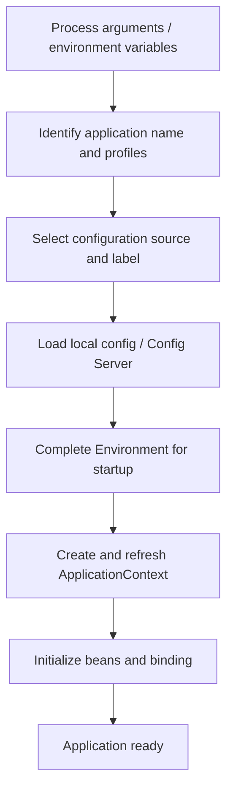

# Loading Profile-Specific Configuration in the Bootstrap Phase

A Spring Cloud application may need to know its **application name, profiles, Config Server address, and configuration label** before business beans are created. These values determine which configuration set the application fetches, from which source, and at which version. If you do not clearly distinguish the bootstrap phase from creating the main `ApplicationContext`, it is easy to hit issues like loading the wrong `default` configuration, connecting to the wrong Config Server, or having a profile work on a developer machine but fail to take effect inside a container.

This lesson belongs to the **Bootstrap** chapter of module `SPRING_CLOUD_CORE`. The focus is how profiles participate in configuration loading, the role of the bootstrap context in the legacy Spring Cloud mechanism, and how Spring Boot Config Data integrates with Spring Cloud Config Client in modern applications. This forms the foundation for understanding externalized configuration, Spring Cloud Context, refresh scope, and operating multiple instances with a shared configuration contract.

## 1. What phase is bootstrap?

**Bootstrap** is the phase that prepares the information needed for the application to construct its configuration environment and initialize primary components. For a Spring Cloud application, several pieces of information are needed very early:

- Application name (`spring.application.name`) so Config Server selects the corresponding configuration set.
- Active profiles (`spring.profiles.active`) to select configuration by environment or deployment role.
- Label (`spring.cloud.config.label`) to select the branch, tag, or configuration revision in the backend.
- Config Server address and connection details (`spring.cloud.config.uri`, TLS, authentication).
- Import declarations and config locations to know which additional configuration sources to load.

This information must be available early enough for the system to know which configuration to read. After `Environment` is prepared, Spring creates and refreshes `ApplicationContext`, registers and initializes beans, binds `@ConfigurationProperties`, and only then is the application ready to serve requests.



The diagram illustrates the conceptual relationship. Specific implementation details depend on the Spring Boot/Spring Cloud line: the traditional bootstrap context mechanism and the modern Config Data API have different internal sequences. Do not apply a single description across every version.

## 2. What is a profile and how does it affect configuration loading?

A profile is a conditional tag to enable configuration or beans suited to an environment or runtime role. For example:

| Profile | Illustrative purpose |
| --- | --- |
| `local` | Local development on an individual machine |
| `test` | Running integration tests |
| `staging` | Pre-production verification |
| `prod` | Production environment |
| `region-a` | Configuration specific to one deployment region |

A profile does not create an isolated environment by itself. It participates in selecting configuration documents and conditions for activating beans. For example, `application-prod.yml` can override certain values in `application.yml` when the `prod` profile is activated.

### 2.1. Activating profiles

Profiles can be activated from multiple sources:

```yaml
spring:
  profiles:
    active: prod,region-a
```

Or via environment variable:

```text
SPRING_PROFILES_ACTIVE=prod,region-a
```

Or command-line arguments:

```bash
java -jar catalog-service.jar --spring.profiles.active=prod,region-a
```

Command-line arguments have high priority among Spring Boot's standard configuration sources, so they can override profile values coming from Config Data or environment variables. When debugging, check the effective value of `spring.profiles.active`, rather than reading just one configuration file.

If no profile is activated, Spring Boot uses the default profile named `default` for documents/beans applying to the default profile. The `default` profile is a naming convention; it does not mean the application automatically uses production or local settings.

### 2.2. Multiple profiles active simultaneously

A process can activate multiple profiles, for example:

```text
SPRING_PROFILES_ACTIVE=prod,region-a,metrics
```

This allows combining configuration by environment, region, and capability. When multiple documents define the same key, profile order and property source precedence can determine the final value. In typical cases, profiles listed later can override earlier profiles within the same profile-specific configuration group; verify against the actual sources and version.

Do not use many profiles as a substitute for structured configuration management. If profile combinations become numerous and cross-dependent, consider profile groups or cleanly separating base, environment, and regional configuration.

### 2.3. Profile groups

Spring Boot supports grouping multiple profiles under one composite name:

```yaml
spring:
  profiles:
    group:
      production:
        - prod-db
        - prod-metrics
        - prod-security
```

When `production` is activated, member profiles are included in the active profile set according to Spring Boot rules. Thus, deployment commands can use one meaningful name instead of listing many sub-profiles.

The properties `spring.profiles.active`, `spring.profiles.default`, `spring.profiles.include`, and profile group declarations must be placed in non-profile-specific configuration documents. Do not put `spring.profiles.active` inside a document that is only activated by another profile; Spring Boot disallows this circular configuration. For conditional documents, use `spring.config.activate.on-profile` to specify when the document's content applies.

## 3. Two loading mechanisms: legacy bootstrap and Config Data

Historically in Spring Cloud, the bootstrap context was used to load remote configuration before creating the main application context. Spring Boot 2.4 introduced the Config Data API; modern Spring Cloud Config Client integrates with this mechanism via `spring.config.import`.

| Aspect | Legacy bootstrap context | Modern Config Data API |
| --- | --- | --- |
| Common activation | `spring-cloud-starter-bootstrap` or a bootstrap flag set early enough | Declare `spring.config.import` |
| Typical files/configs | `bootstrap.yml`, `bootstrap.properties` | `application.yml`, profile-specific documents, and config imports |
| How Config Server is fetched | Config Client's bootstrap integration | `configserver:` location via Config Data resolver/loader |
| Place in architecture | Separate bootstrap context, typically parent of the main context | Loaded during Spring Boot's Config Data Environment preparation flow |
| Guidance for new apps | Use only for specific compatibility/architectural reasons | Recommended approach for modern applications |

Do not assume both mechanisms are active or need to be configured at the same time. In many modern Spring Boot/Spring Cloud combinations, legacy bootstrap is not enabled automatically; to use it, you must add the starter or enable the corresponding mechanism per the release train documentation. Verify your version before choosing a configuration approach.

## 4. Legacy bootstrap context and bootstrap.yml

### 4.1. How does the bootstrap context work?

In the traditional mechanism, Spring Cloud creates a separate **bootstrap context** before the main context. This context is responsible for loading foundational configuration and remote property sources. Afterward, the main application context is created with the environment augmented from bootstrap.

`bootstrap.yml` or `bootstrap.properties` is where information needed for this phase is typically placed. Example:

```yaml
spring:
  application:
    name: catalog-service
  cloud:
    config:
      uri: https://config.internal.example
      label: main
      profile: prod,region-a
```

The values in the example tell Config Client the application name, server address, label, and profiles to query. Never put secrets directly into committed files; use a secure provisioning mechanism for credentials/TLS.

### 4.2. Enabling the bootstrap mechanism

In Spring Cloud lines using legacy bootstrap, this mechanism is commonly enabled via the dependency:

```xml
<dependency>
    <groupId>org.springframework.cloud</groupId>
    <artifactId>spring-cloud-starter-bootstrap</artifactId>
</dependency>
```

Or via a system property/environment variable read early enough:

```text
SPRING_CLOUD_BOOTSTRAP_ENABLED=true
```

Do not put the bootstrap activation flag inside a configuration source that can only be read after the bootstrap context has already run. Activation methods and default states depend on the Spring Cloud version; use dependency management compatible with Spring Boot and check release documentation.

### 4.3. Distinguishing bootstrap.yml and application.yml

| File | Typical role in legacy mode |
| --- | --- |
| `bootstrap.yml` | Configuration telling the bootstrap context how to load foundational/remote sources |
| `application.yml` | Main application configuration, used to create beans and run the service |
| `application-prod.yml` | Application configuration for the `prod` profile |
| `bootstrap-prod.yml` | Profile-specific bootstrap document if supported by the mechanism/version in use and the profile is determined early enough |

Keep `bootstrap.yml` small and focused on information needed before loading remote configuration. Business settings such as timeouts, downstream endpoints, and processing limits should be placed in appropriate application configuration sources rather than crammed into bootstrap.

In legacy mode, the bootstrap context is typically the parent context of the main application. That does not make it a cluster-wide context: each JVM still has its own bootstrap context and application context. Property sources can be shared through the parent-child relationship within the same process, but are not automatically shared across instances.

### 4.4. Application name, profile, and label sent to Config Server

Config Client needs to select the right configuration set on Config Server. Common properties:

| Property | Meaning |
| --- | --- |
| `spring.application.name` | Default application name used to select configuration |
| `spring.cloud.config.name` | Application name used by Config Client when overriding the default name |
| `spring.cloud.config.profile` | Profiles requested from Config Server; if unspecified, the client usually relies on active/default profiles per the corresponding mechanism |
| `spring.cloud.config.label` | Label such as branch, tag, or commit identifier depending on backend |
| `spring.cloud.config.uri` | Config Server address when connecting directly |

Example logical request:

```text
application = catalog-service
profiles    = prod,region-a
label       = main
```

Config Server uses those parameters to combine shared property sources with application/profile-specific property sources. If one of the parameters is wrong, the client may connect successfully yet receive unintended configuration. Therefore, "HTTP 200 from Config Server" is not enough to prove the right configuration set was retrieved.

## 5. Profile-specific configuration with the Config Data API

For modern applications, Config Server import can be declared directly in `application.yml`:

```yaml
spring:
  application:
    name: catalog-service
  config:
    import: "optional:configserver:https://config.internal.example"
```

`optional:` allows the application to continue when Config Server is unavailable according to Config Client semantics. If Config Server is a mandatory source, omit `optional:` so startup fails when essential configuration cannot be loaded.

Profiles can be supplied via environment variable or startup arguments:

```text
SPRING_PROFILES_ACTIVE=prod,region-a
SPRING_CLOUD_CONFIG_LABEL=main
```

Config Client uses the application name, profiles, and label to fetch configuration from the server. When multiple profiles exist, the server can return corresponding property sources for the client to merge following Config Data ordering and precedence rules.

### 5.1. Profile-specific documents in application.yml

Spring Boot allows multiple YAML documents separated by `---`, with a profile activation condition:

```yaml
catalog:
  client:
    connect-timeout: 2s
    read-timeout: 3s
---
spring:
  config:
    activate:
      on-profile: prod

catalog:
  client:
    connect-timeout: 800ms
    read-timeout: 1500ms
```

The second document is only applied when the `prod` profile is active. The same structure can be organized in `application-prod.yml`. Profile-specific keys generally have higher priority than profile-agnostic documents within the same Config Data context.

Do not use `spring.profiles.active` to activate the profile-specific document itself. Activate the profile from a source independent of that profile, such as the `SPRING_PROFILES_ACTIVE` environment variable, command-line arguments, or a shared configuration document.

### 5.2. Profile-specific configuration from Config Server

A configuration repository can organize files like:

```text
config-repo/
  application.yml
  application-prod.yml
  catalog-service.yml
  catalog-service-prod.yml
  catalog-service-region-a.yml
```

Exact filenames depend on the backend and Config Server conventions. Typically, `application` contains shared configuration; the application name contains service-specific configuration; and the profile suffix represents profile-specific configuration. When a client requests `catalog-service` with profile `prod`, Config Server combines matching sources according to server mechanics and returns them to the client.

Shared configuration example:

```yaml
# application.yml in the configuration repository
catalog:
  client:
    connect-timeout: 2s
    retries: 2
```

Production-specific configuration:

```yaml
# catalog-service-prod.yml
catalog:
  client:
    connect-timeout: 800ms
    retries: 4
```

Region-specific configuration:

```yaml
# catalog-service-region-a.yml
catalog:
  client:
    base-url: https://catalog-a.internal
```

Inspect the Config Server response and returned property sources to verify which files actually took effect. Do not deduce precedence order solely from filenames when multiple profiles, labels, or override policies exist.

## 6. Profile order, property sources, and effective values

A final value can come from multiple layers:

1. Defaults in Java code or application configuration.
2. Shared `application.yml` configuration.
3. Profile-specific documents, such as `application-prod.yml`.
4. Configuration imported from Config Server.
5. Environment variables, system properties, `SPRING_APPLICATION_JSON`, and command line.
6. Property sources added by integrations or tests.

The list above is only to illustrate common layers, not a fixed absolute order for every configuration. Actual order depends on Config Data import, profiles, property sources, and Spring Cloud Config override rules. Specifically, Config Server can control remote property source overriding via properties like `spring.cloud.config.allowOverride`, `overrideNone`, and `overrideSystemProperties` per the version's semantics. Several of these override properties must be set from the **remote source** to take effect; do not just add them on the local client and assume the policy changed.

For example, if `catalog.client.connect-timeout` is set to `2s` in shared config, `800ms` in profile `prod`, and `500ms` in an environment variable, the final value depends on precedence order and the active remote override policy. The reliable way is to inspect `Environment`/property sources in a secured environment and observe the value bound into beans.

## 7. Conditional remote configuration loading by profile

Sometimes only one profile needs to import Config Server or an external source. Config Data supports declaring imports inside conditional documents:

```yaml
spring:
  application:
    name: catalog-service
---
spring:
  config:
    activate:
      on-profile: prod
    import: "configserver:https://config.internal.example"
```

In the example, the Config Server location is only used when the conditional `prod` document is activated. Place required details early enough for the resolver to work and explicitly test behavior when the profile is inactive. If every environment needs Config Server, declaring the import in the shared document is usually easier to understand and operate.

Do not place `spring.config.import` inside remote configuration that the application can only read after connecting to Config Server. To start connecting, the client needs the location from a source already available beforehand.

## 8. Legacy bootstrap and Config Data: choosing and migrating

### 8.1. When is legacy bootstrap still needed?

Legacy bootstrap may still be needed for older applications or integrations built around the bootstrap context. If a system is running stably, before migrating verify:

- The Spring Boot and Spring Cloud release train in use.
- Whether the `spring-cloud-starter-bootstrap` dependency or bootstrap flag is present.
- Which properties `bootstrap.yml`/`bootstrap-{profile}.yml` files contain.
- Whether any custom `PropertySourceLocator`, bootstrap configuration, or internal library depends on the bootstrap context.
- How the Config Server remote override policy is being used.
- Whether both `spring.config.import=configserver:` and legacy bootstrap are loading the same source.

Do not remove the bootstrap starter simply because you see `spring.config.import` in a file. First confirm no component still requires the bootstrap context and test profile/precedence behavior after switching.

### 8.2. General migration process

1. Document current profiles, application name, URI, label, authentication, and remote sources.
2. Identify which dependencies and extensions depend on legacy bootstrap.
3. Choose the Config Data import supported by the Boot/Cloud version.
4. Move the Config Server location and required connection properties to the appropriate initial configuration source.
5. Move profile activation to `spring.profiles.active`, profile-specific documents, or profile groups following the rules.
6. Compare property sources and bound values before and after migration.
7. Test when Config Server is unavailable, when profiles change, and when remote property sources share keys with local ones.
8. Remove legacy bootstrap only after confirming no dependencies or extensions require it.

### 8.3. Avoiding duplicate configuration loading

If legacy bootstrap and Config Data both access Config Server, some property sources may appear twice or in an unexpected order. As a result, a value may be overridden unobviously, requested profiles may be inconsistent, or startup may make more requests than necessary.

Choose one mechanism as the primary loading path for Config Server in each application. If both mechanisms must be kept temporarily during a transition period, document the purpose clearly and verify property source order with integration tests.

## 9. Profiles and conditional beans

Profiles can also control which beans are registered:

```java
import org.springframework.context.annotation.Profile;
import org.springframework.stereotype.Component;

@Component
@Profile("prod")
public class ProductionAuditPublisher implements AuditPublisher {
    // Implementation used in production.
}
```

Or configuring multiple profiles:

```java
@Component
@Profile({"prod", "staging"})
public class RemoteAuditPublisher implements AuditPublisher {
    // Registered when one of the matching profiles is active.
}
```

`@Profile` controls bean registration in the context. It does not change the Config Server label, does not create property sources, and does not synchronize beans across instances. If two replicas start with different profiles, they may register different sets of beans and behave differently.

For a homogeneous replica deployment, provide the same required profiles to all Pods in the same workload. If there are specialized replicas by role or region, express that difference intentionally in deployment manifests, readiness, and monitoring.

## 10. Testing profile-based configuration loading

Tests should verify not only that the context starts, but also **the actual active profiles, selected configuration sources, and values received by beans**.

| Scenario | How to test | What to verify |
| --- | --- | --- |
| No active profile | Start with default configuration | `default` profile and default values apply |
| Single profile | Activate `prod` | `prod` document loads and overrides the right keys |
| Multiple profiles | Activate `prod,region-a` | Merge order and result match design |
| Profile group | Activate `production` group | Member profiles become active as declared |
| Config Server | Use a test server and fixed app/profile/label | Client receives the expected property sources |
| Required remote config | Stop Config Server | Startup fails as policy requires |
| Optional remote config | Stop Config Server | Application continues only when defaults are safe |
| Remote/local collision | Same key has different values | Final value matches the override policy |
| Legacy bootstrap | Run with version-appropriate bootstrap starter/flag | Bootstrap context loads the expected sources and profiles |
| Migration | Run both approaches in isolated test environments | Property binding results match requirements |

Example test with specific profiles:

```java
import org.junit.jupiter.api.Test;
import org.springframework.beans.factory.annotation.Autowired;
import org.springframework.boot.test.context.SpringBootTest;
import org.springframework.core.env.Environment;
import org.springframework.test.context.ActiveProfiles;

@SpringBootTest
@ActiveProfiles({"prod", "region-a"})
class ProfileConfigurationTest {
    @Autowired
    Environment environment;

    @Test
    void loadsExpectedProfiles() {
        // Assert profiles prod and region-a are active.
        // Assert profile-specific properties have expected values.
    }
}
```

This is an illustrative skeleton. If tests need to verify a real Config Server, configure a dedicated test endpoint or use a fixture/mock at the HTTP boundary; avoid depending on production Config Server. With legacy bootstrap, test context initialization and bootstrap activation may require version-specific configuration.

## 11. Diagnosing bootstrap and profile issues

| Symptom | Possible cause | Investigation approach |
| --- | --- | --- |
| Client receives `default` configuration | Profile was not active when Config Client sent the request | Check `SPRING_PROFILES_ACTIVE`, command line, and startup logs |
| Config Server connection succeeds, but wrong configuration | Wrong application name, profile, or label | Inspect the request and property sources returned by the server |
| `bootstrap.yml` has no effect | Legacy bootstrap is not enabled or using Config Data mode | Check bootstrap dependency and loading mechanism for the version |
| `spring.config.import` is ignored | Import is inside an inactive document/profile or Config Client is missing from classpath | Check active profiles, Config Data import, and dependencies |
| Two remote sources override each other | Both legacy bootstrap and Config Data load Config Server | Check duplicate property sources and pick one primary mechanism |
| Local does not override remote as expected | Remote override policy does not allow it | Check server-granted override properties and version semantics |
| One replica uses a different profile | Different deployment env/args or image | Compare Pod specs, process args, image digests, and active profiles |
| Startup fails when server is absent | Required import or retries exhausted | Check `optional:`, timeout, retry, and fail-fast policy |
| Startup succeeds, but critical keys are missing | Optional import skipped or wrong profile | Check validation, readiness, and actual property sources |

Recommended investigation sequence:

1. Record the Spring Boot version and Spring Cloud release train.
2. Determine whether the application uses legacy bootstrap or Config Data.
3. Check the application name, active profiles, profiles requested from Config Server, and label.
4. Verify Config Server URI, authentication, TLS, and reachability from the exact instance.
5. Inspect returned property sources and final precedence order.
6. Check values bound into `@ConfigurationProperties` and consuming beans.
7. Compare each replica to spot differences in profiles, env, image, and config revision.

Actuator `env`/`configprops` can aid diagnostics if enabled and properly secured. Do not expose these endpoints indiscriminately, as they can reveal key names, configuration structure, or sensitive data.

## 12. Practice: running the same service in staging and production

Suppose `catalog-service` uses Config Server. Shared configuration in `application.yml`:

```yaml
spring:
  application:
    name: catalog-service
  config:
    import: "configserver:https://config.internal.example"
```

In the staging environment:

```text
SPRING_PROFILES_ACTIVE=staging,region-a
SPRING_CLOUD_CONFIG_LABEL=main
```

In production:

```text
SPRING_PROFILES_ACTIVE=prod,region-a
SPRING_CLOUD_CONFIG_LABEL=release-2026
```

Config Server can maintain shared configuration for `catalog-service`, then apply profile- and label-specific parts. The same JAR is deployed across both environments, yet `Environment` and bean properties are bound according to the configuration set selected at each startup.

Verification steps:

1. Confirm both workloads use the exact same artifact/image digest if the goal is comparing configuration.
2. Record active profiles and the Config Server label for each workload.
3. Inspect the Config Server response for the corresponding application/profile/label.
4. Check critical property values after binding without logging secrets.
5. Confirm readiness and health checks accurately reflect mandatory configuration conditions.
6. When configuration changes, determine whether refresh, event broadcasting, or rollout/restart is needed per the application's mechanism.

### Self-check questions

1. Why must the application name and profiles be known before fetching configuration from Config Server?
2. How does the bootstrap context in legacy Spring Cloud differ from the modern Config Data API?
3. If no profile is active, which default profile does Spring Boot use?
4. When multiple profiles are active simultaneously, why must you check profile order and property sources?
5. What information is `spring.cloud.config.label` used to select?
6. Why should `spring.profiles.active` not be placed inside a document activated only by a profile?
7. How do `optional:configserver:` and `configserver:` differ when the server is unavailable?
8. Why should you not load the same Config Server using both legacy bootstrap and Config Data without a plan?
9. Does one replica receiving the `prod` profile prove another replica also uses `prod`?

**Answer hints:** (1) So the server selects the right application/profile configuration; (2) Legacy uses a separate bootstrap context, whereas Config Data loads locations in Boot's standard configuration flow; (3) `default`; (4) Because sources with the same key can override one another; (5) Configuration branch/tag/revision; (6) Avoid circular dependencies when determining profiles; (7) Optional lets the loader skip an unavailable source per loader semantics, while required fails startup; (8) Avoid duplicate loading and unpredictable precedence; (9) No, each replica has its own environment and startup arguments.

## 13. Principles to remember

- Bootstrap is the phase that prepares information needed to load configuration and create the application context; application name, profiles, and label must be determined early enough.
- Legacy bootstrap context and Config Data API are two different mechanisms. Choose according to the Spring Boot/Spring Cloud version and avoid enabling overlapping mechanisms unintentionally.
- Profiles control configuration documents and conditional beans; when multiple profiles are active together, you must understand order and precedence.
- Config Server selects data by application, profile, and label. A successful connection alone is not enough to prove the selected configuration set is correct.
- `spring.config.import` is a startup loading mechanism; runtime refresh and broadcasting events to multiple instances are separate workflows.
- Each replica has its own bootstrap/configuration lifecycle. Provide consistent profiles and observe each instance's configuration state.
- Test required/optional cases, single/multiple profiles, remote overrides, Config Server failures, and differences across replicas.

Once you master profile-based configuration loading during the bootstrap phase, you can control configuration selection from the environment through Config Server, distinguish legacy behavior from Config Data, and build the right foundation for Spring Cloud Context, refresh scope, and shared abstractions in distributed systems.
