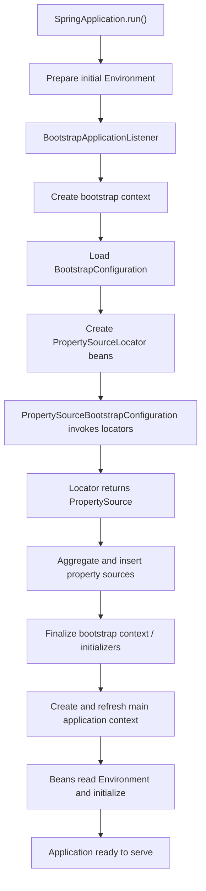
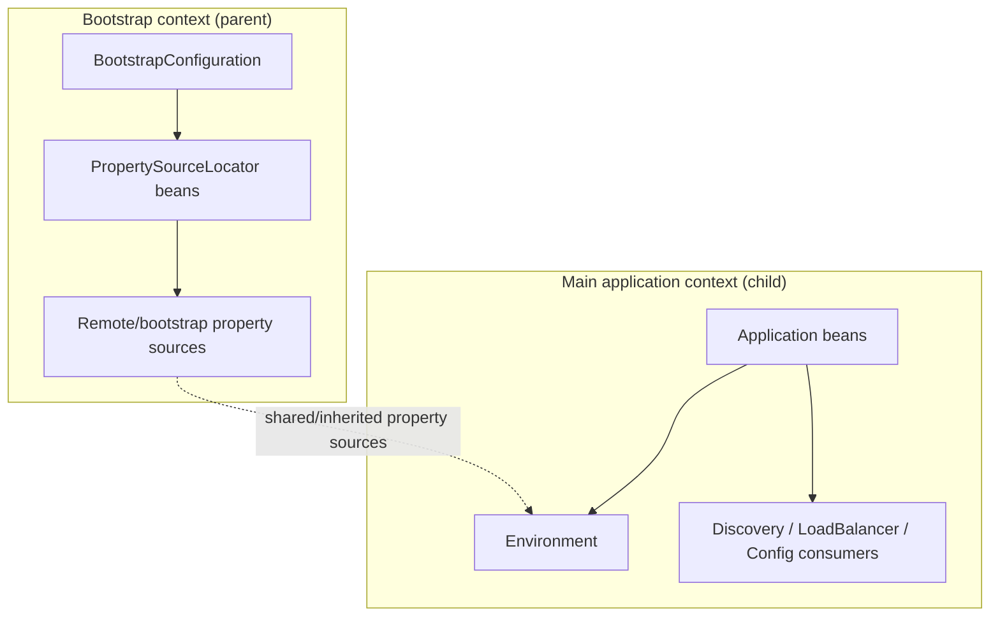
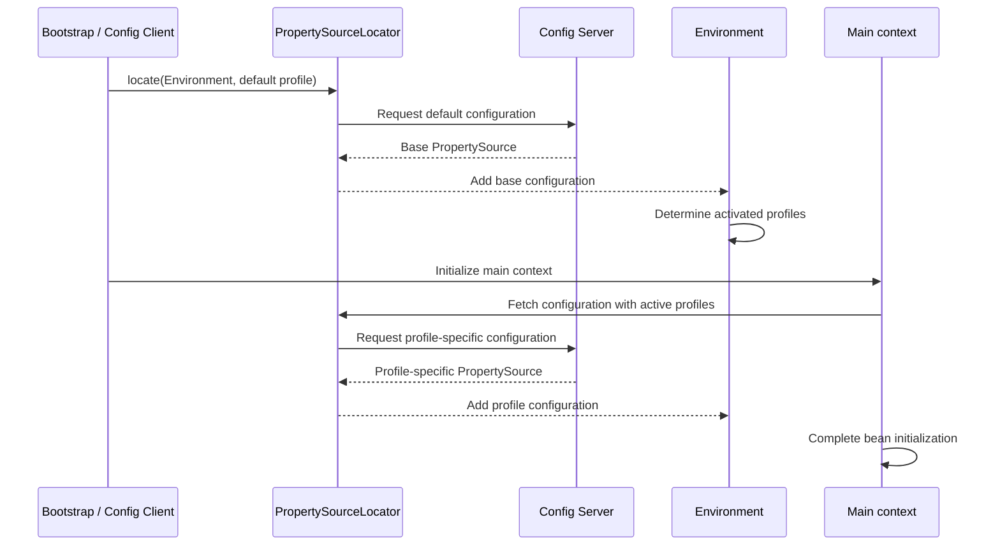
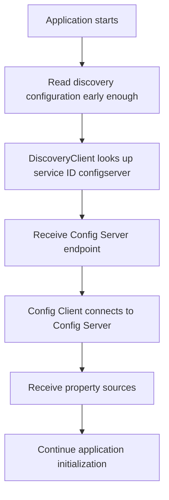

# Position of PropertySourceLocator in the Startup Sequence

In a Spring Cloud application, remote configuration must be loaded into `Environment` early enough for beans and auto-configurations to use the right values. `PropertySourceLocator` is a Spring Cloud Context extension point for the **traditional bootstrap mechanism**: it locates one or more `PropertySource` instances from external sources and provides them to the context being initialized.

Understanding the position of `PropertySourceLocator` helps distinguish three things that are often confused: creating the bootstrap context, loading property sources, and initializing the main application context. This is especially important when integrating Spring Cloud Config, discovery, service registry, and shared abstractions in **SPRING_CLOUD_CORE**.

This lesson belongs to the **Bootstrap** chapter. The focus is the locator invocation lifecycle, how to register a custom locator, the precedence order of returned data, and the differences between legacy bootstrap and modern Spring Boot Config Data.

## 1. Learning Objectives

After this lesson, you will be able to:

- Explain the role of `PropertySourceLocator` in Spring Cloud bootstrap.
- Describe the relationship between the bootstrap context and the main application context.
- Identify when the locator is called in the startup sequence.
- Distinguish `bootstrap.yml` from property sources returned by the locator.
- Register a custom locator via `BootstrapConfiguration`.
- Understand multiple locator invocations for fetching default and profile-specific configuration.
- Explain the precedence order of remote property sources and rules allowing local overrides.
- Distinguish legacy bootstrap from `spring.config.import`/Config Data.
- Design locators that are testable, safe under repeated invocations, and easy to diagnose.

## 2. What problem does PropertySourceLocator solve?

Suppose `checkout-service` needs to retrieve the following properties from a centrally managed source:

```yaml
inventory:
  base-url: https://inventory.internal
  timeout: 800ms
  max-attempts: 3
```

The application wants to read them via `Environment` or bind them into `@ConfigurationProperties`. It does not want every business service to make raw HTTP calls to Config Server or parse remote YAML files on its own.

`PropertySourceLocator` decouples locating configuration from consuming configuration:

1. Spring Cloud creates the context/bootstrap infrastructure according to the enabled mechanism.
2. The bootstrap infrastructure discovers `PropertySourceLocator` beans.
3. Each locator receives the `Environment` of the application about to be initialized and fetches appropriate data.
4. The locator returns one or more `PropertySource<?>` instances.
5. Spring Cloud combines those sources and inserts them into `Environment` following bootstrap rules.
6. The main application context and application beans use the augmented `Environment`.

A locator can fetch data from Config Server, a database, an internal configuration service, or another source. It is not a registry, does not create business beans, and does not automatically refresh every bean when configuration changes.

## 3. Components in the bootstrap mechanism

| Component | Responsibility |
| --- | --- |
| `BootstrapApplicationListener` | Recognizes the early startup phase and orchestrates creation of the bootstrap context in legacy mode |
| Bootstrap context | Parent context used to prepare bootstrap components and configuration |
| `BootstrapConfiguration` | Declares configuration classes loaded into the bootstrap context |
| `PropertySourceLocator` | Locates and returns property sources for the Environment |
| `PropertySourceBootstrapConfiguration` | Invokes locators, aggregates property sources, and inserts them into the Environment |
| `Environment` | Where property sources are queried in precedence order |
| Main application context | Primary context holding business beans and Spring Boot/Spring Cloud integrations |

`PropertySourceLocator` is the extension contract. `PropertySourceBootstrapConfiguration` is a component orchestrating calls to that contract. `BootstrapApplicationListener` participates in the early startup phase to build the bootstrap context in legacy mode.

## 4. Position in the startup sequence

In legacy bootstrap mode, the general flow can be visualized as follows:



This is the conceptual model of the traditional bootstrap mode. Exact details of when locators are called have changed across Spring Cloud releases; Section 6 covers the key change since Spring Cloud 2022.0.3.

### 4.1. Step 1 — SpringApplication begins preparing Environment

When calling:

```java
SpringApplication.run(CheckoutApplication.class, args);
```

Spring Boot creates or prepares `Environment`, processes initial configuration sources, and publishes the corresponding startup events. Values readable at this stage include JVM arguments, environment variables, command-line arguments, and previously prepared properties.

Bootstrap must be activated from an early enough source. In legacy mode, you can use the bootstrap starter or set `spring.cloud.bootstrap.enabled=true` as a system property/environment variable. Putting this flag inside an `application.yml` loaded later can be too late to enable bootstrap.

### 4.2. Step 2 — BootstrapApplicationListener creates the bootstrap context

When legacy bootstrap is enabled, `BootstrapApplicationListener` participates in early startup. It builds a bootstrap context and loads bootstrap configurations and classes registered under `BootstrapConfiguration`.

The bootstrap context is typically the **parent context** of the main application context. The contexts can share the `Environment`; thus, property sources prepared during bootstrap can be visible when the main context resolves properties.

Do not equate the bootstrap context with a separate service or Config Server. It is an early-created Spring `ApplicationContext` that prepares configuration and components for the main application.

### 4.3. Step 3 — Loading BootstrapConfiguration

Spring Cloud allows libraries or applications to register bootstrap configuration classes via an entry in:

```text
META-INF/spring.factories
```

The key used is:

```text
org.springframework.cloud.bootstrap.BootstrapConfiguration
```

Listed classes are used to create the bootstrap context. They can declare `PropertySourceLocator` beans, `ApplicationContextInitializer` instances, and components supporting the bootstrap process.

### 4.4. Step 4 — Invoking PropertySourceLocator

`PropertySourceBootstrapConfiguration` receives the list of locators and calls `locate(Environment)` or the corresponding collection method in the Spring Cloud version in use.

The `Environment` passed in is the Environment of the application context about to be configured. It already contains standard property sources prepared by Spring Boot, so the locator can read identifying details such as:

- `spring.application.name`.
- Active profiles (if already present).
- Addresses or connection details supplied from bootstrap sources.
- Properties identifying tenant, region, or configuration group.

For example, Config Client can use `spring.application.name` to request the right configuration set for a service. A locator should not assume the application name is always present; if missing, provide a fallback or fail intentionally.

### 4.5. Step 5 — Inserting property sources into Environment

The locator returns `PropertySource<?>`. Spring Cloud can wrap them into a bootstrap property source or combine multiple sources into a `CompositePropertySource`.

The main context uses the same Environment or receives property sources through the parent/child context relationship. When beans are created, `Environment`, `@Value`, and `@ConfigurationProperties` can read the added values.

Key point: a locator **does not directly return a configuration object to each service bean**. It supplies a property source to the shared configuration resolution mechanism.

## 5. Bootstrap context and main application context

### 5.1. Parent/child relationship

In legacy bootstrap, the bootstrap context is typically the parent of the main application context. The child context inherits visibility of beans and property sources from the parent according to Spring hierarchy rules.



The diagram highlights the configuration relationship; it does not mean every bean in the parent is automatically copied as a new bean into the child. The child context has its own bean and property source lookup rules; identically named property sources or beans can affect the outcome under hierarchy rules.

### 5.2. Two types of property sources often confused

Spring Cloud bootstrap can introduce two distinct groups of sources into the main context:

| Group | Content | Role |
| --- | --- | --- |
| `applicationConfig: [classpath:bootstrap.yml]` and variants | Configuration values used to prepare the bootstrap context | Provides defaults/Config Server address and details needed early |
| `bootstrap` composite/property source | Sources discovered by `PropertySourceLocator`, e.g., configuration from Config Server | Provides external configuration that can carry high priority |

**`bootstrap.yml` is not itself the remote property source.** This file configures the bootstrap process. The property source returned by the locator is the data from the source the locator accesses.

According to current Spring Cloud documentation, property sources added during bootstrap typically have high priority and disallow local configuration overrides by default. Meanwhile, values from `bootstrap.yml` are added with lower priority than the main context's `application.yml` and can act as defaults.

### 5.3. Example bootstrap.yml

```yaml
spring:
  application:
    name: checkout-service
  cloud:
    config:
      uri: http://config-server:8888
```

In legacy Config First bootstrap, `bootstrap.yml` can declare the application name and Config Server address. The application name helps Config Server identify the matching configuration set; the URI indicates the endpoint the client connects to.

If fetching configuration for a specific profile in traditional bootstrap, the profile may need to be declared in an appropriate bootstrap source. In newer Spring Cloud lines, the locator mechanism can perform an initial fetch with the default profile and a subsequent fetch with activated profiles; see Section 6.

## 6. Important change since Spring Cloud 2022.0.3

Do not describe `PropertySourceLocator` as if every Spring Cloud version invokes it at the exact same point. Spring Cloud Commons documentation notes significant changes:

1. **Before Spring Cloud 2022.0.3:** `PropertySourceLocator` beans, including Spring Cloud Config's locator, ran in the main application context rather than the bootstrap context.
2. **Since Spring Cloud 2022.0.3:** Spring Cloud invokes locators twice in the supported bootstrap flow: first to fetch profile-agnostic property sources so profiles can be activated; after the main application context starts, a second time to fetch property sources matching active profiles.
3. If you need to force locators to run in the bootstrap context under the documented compatibility mechanism, you can set `spring.cloud.config.initialize-on-context-refresh=true` in `bootstrap.yml`/`bootstrap.properties`.

### 6.1. Why are two invocations needed?

A Config Server may return the property:

```yaml
spring:
  profiles:
    active: region-ap-southeast
```

The first fetch using the default profile can return values that activate additional profiles. Once profiles are determined, the next fetch can request configuration specific to those profiles.



This is a conceptual model of the multi-invocation locator process. Exact steps and timing depend on the release train, bootstrap mode, and configuration. Inspect actual logs if the application has multiple profiles or multiple remote sources.

### 6.2. Consequences for custom locators

A locator must assume it **can be invoked multiple times**:

- Do not create non-repeatable side effects such as writing transactions, allocating permanent resources, or mutating business state.
- Do not rely on a single invocation to cache global state.
- It may receive an Environment with a different set of profiles between calls.
- Return consistent property sources based on application name/profile.
- If accessing the network, enforce clear timeouts, error handling, and retry policies.
- Log enough information to identify each call without logging tokens or secrets.

If the locator fetches configuration by profile, clearly distinguish default responses from profile-specific responses to avoid mis-merging data.

## 7. Creating a custom PropertySourceLocator

Spring Cloud documentation allows extending bootstrap by registering a `PropertySourceLocator` bean in the bootstrap context. The following example illustrates a locator providing properties by application name.

### 7.1. Simple implementation

```java
package sample.bootstrap;

import java.util.Map;

import org.springframework.core.env.Environment;
import org.springframework.core.env.MapPropertySource;
import org.springframework.core.env.PropertySource;
import org.springframework.cloud.bootstrap.config.PropertySourceLocator;

public class CheckoutPropertySourceLocator implements PropertySourceLocator {

    @Override
    public PropertySource<?> locate(Environment environment) {
        String applicationName = environment.getProperty(
                "spring.application.name", "unknown-service");

        Map<String, Object> values = Map.of(
                "external-config.application", applicationName,
                "inventory.timeout", "800ms",
                "inventory.max-attempts", 3);

        return new MapPropertySource("checkoutExternalProperties", values);
    }
}
```

In the example, the locator reads `spring.application.name` from the input Environment, then returns a `MapPropertySource`. The sample code makes no network calls; when connecting to a real configuration source, the access code must have appropriate timeouts and error handling.

### 7.2. Registering via BootstrapConfiguration

Create the bootstrap configuration class:

```java
package sample.bootstrap;

import org.springframework.context.annotation.Bean;
import org.springframework.context.annotation.Configuration;
import org.springframework.cloud.bootstrap.config.PropertySourceLocator;

@Configuration(proxyBeanMethods = false)
public class CheckoutBootstrapConfiguration {

    @Bean
    PropertySourceLocator checkoutPropertySourceLocator() {
        return new CheckoutPropertySourceLocator();
    }
}
```

Register the configuration class in the file:

`src/main/resources/META-INF/spring.factories`

```properties
org.springframework.cloud.bootstrap.BootstrapConfiguration=\
sample.bootstrap.CheckoutBootstrapConfiguration
```

In legacy bootstrap mode, Spring Cloud uses the `org.springframework.cloud.bootstrap.BootstrapConfiguration` key to discover bootstrap configuration classes. Ensure dependencies support bootstrap and bootstrap is enabled; having `spring.factories` alone does not activate all of legacy bootstrap if the application does not use that mechanism.

### 7.3. Separating the bootstrap package from main component scanning

Place `CheckoutBootstrapConfiguration` in a package that is not accidentally scanned by the main application's `@ComponentScan`. If placed in the same package as the main application, the bootstrap configuration may also appear in the main context and cause duplicate bean registration or initialization at the wrong time.

Example layout:

```text
src/main/java/
├── com/example/checkout/
│   └── CheckoutApplication.java
└── sample/bootstrap/
    ├── CheckoutBootstrapConfiguration.java
    └── CheckoutPropertySourceLocator.java
```

In a real project, establish a dedicated bootstrap namespace per organization rules and confirm component scanning does not cover that package.

### 7.4. Ordering among multiple locators

When there are multiple `PropertySourceLocator` beans, Spring Cloud orders them using `Ordered`/`@Order` before invoking them. A locator without an explicit order is typically processed after locators with explicit order values.

Example:

```java
@Component
@Order(10)
public class TenantPropertySourceLocator implements PropertySourceLocator {
    // locate(...)
}
```

Do not assume a smaller or larger order always maps directly to final property source precedence in every custom configuration. Inspect how the framework aggregates returned sources, their order inside `CompositePropertySource`, and Environment insertion rules for the version in use. If two locators declare the same key, write an integration test to verify which source wins.

## 8. Precedence rules for property sources from bootstrap

Property sources added by bootstrap are typically placed in a composite source whose name starts with `bootstrap`. In the default configuration, this source has high priority compared to the application's local configuration.

Suppose:

```text
bootstrap composite:
  inventory.timeout = 800ms

application.yml:
  inventory.timeout = 2s

command line:
  --inventory.timeout=500ms
```

Do not conclude the final value based solely on the snippet above, because remote property sources have their own override protection rules by default. With Spring Cloud Config, the server-side property `spring.cloud.config.allowOverride` determines whether local sources are allowed to override remote sources.

### 8.1. Allowing local overrides of remote properties

According to Spring Cloud Context documentation:

- By default, remote property sources added by bootstrap usually do not allow local properties to override them.
- To allow local overrides, the remote property source must declare `spring.cloud.config.allowOverride=true`.
- Setting `spring.cloud.config.allowOverride=true` only in local application configuration does not grant override permission.

Once the remote source grants permission, you can fine-tune:

| Property | Meaning |
| --- | --- |
| `spring.cloud.config.allowOverride=true` | Enables applying override rules from local sources |
| `spring.cloud.config.overrideNone=true` | Allows any local property source to override the remote source |
| `spring.cloud.config.overrideSystemProperties=false` | Only system properties, command-line arguments, and environment variables can override remote; local config files cannot override |

These properties belong to the Spring Cloud Config remote property source mechanism; do not apply them arbitrarily to every custom `PropertySourceLocator`.

### 8.2. Do not confuse bootstrap.yml with bootstrap composite

`bootstrap.yml` provides bootstrap configuration values and can serve as defaults. The composite created by the locator holds external data retrieved by the locator. Both sources may appear in the Environment yet have different precedence.

When investigating overridden values, examine:

1. Property source names and order.
2. Which source actually contains the key.
3. Whether the remote source enables `allowOverride`.
4. Whether any command-line, JVM, or environment property exists.
5. Whether the main context has a property source with the same name or hierarchy effects altering the outcome.

## 9. Legacy bootstrap and modern Spring Boot Config Data

Spring Boot 2.4 introduced the Config Data API via `spring.config.import`. This is the modern default way to connect to Spring Cloud Config Server. It has its own configuration loading sequence and **does not require `bootstrap.yml`**.

### 9.1. Legacy Config First bootstrap

To use legacy bootstrap, add `spring-cloud-starter-bootstrap` or enable `spring.cloud.bootstrap.enabled=true` via system property/environment variable.

Example `bootstrap.yml`:

```yaml
spring:
  application:
    name: checkout-service
  cloud:
    config:
      uri: http://config-server:8888
```

Config Client on the classpath will use the bootstrap address to connect to Config Server and add the remote property source into Environment under the bootstrap mechanism.

In this mode, `PropertySourceLocator` is the appropriate extension point for adding configuration sources under the bootstrap contract.

### 9.2. Modern Config Data import

Example `application.yml`:

```yaml
spring:
  application:
    name: checkout-service
  config:
    import: optional:configserver:http://config-server:8888
```

Config Client uses the Config Data API to resolve and load the `configserver:` source during Boot's configuration processing. A `bootstrap.yml` file is not needed for this import approach.

### 9.3. The two mechanisms should not be mixed arbitrarily

| Criterion | Legacy bootstrap | Config Data import |
| --- | --- | --- |
| Activation | `spring-cloud-starter-bootstrap` or `spring.cloud.bootstrap.enabled=true` | Declare `spring.config.import=configserver:...` |
| Typical config file | `bootstrap.yml` | `application.yml`/`application.properties` |
| Extension point | `PropertySourceLocator` in bootstrap infrastructure | `ConfigDataLocationResolver` and `ConfigDataLoader` for custom Config Data sources |
| Lifecycle | Bootstrap context and main context | Boot Config Data processing before finalizing ApplicationContext |
| Needs bootstrap context? | Yes | Not needed for Config Data import |
| Goal | Compatibility with systems using traditional bootstrap | Modern default configuration loading approach |

Do not enable legacy bootstrap while simultaneously loading the same source via `spring.config.import` without clearly understanding how they integrate. In some integrations, both mechanisms can conflict or load sources redundantly. Pick one consistent configuration path per your release train documentation.

If writing a new configuration source specifically for modern Config Data, implement the appropriate Config Data extension points instead of expecting `PropertySourceLocator` to run automatically.

## 10. Discovery First Lookup during configuration retrieval

Spring Cloud Config Client can locate Config Server via a fixed address (Config First) or via `DiscoveryClient` (Discovery First). With Discovery First, the application needs enough configuration to reach the discovery service before locating Config Server.

Conceptual configuration example:

```yaml
spring:
  cloud:
    config:
      discovery:
        enabled: true
        service-id: configserver
```

Property details may vary by version and provider; you must also supply the matching discovery configuration, such as the Eureka or Consul address. Discovery First adds an extra network round trip to look up the Config Server registration at startup.

Overview flow:



This is the link between discovery and remote configuration: discovery helps locate Config Server, while Config Server returns configuration data. Do not confuse `PropertySourceLocator` with `DiscoveryClient`; they have different responsibilities.

## 11. Error handling and readiness during bootstrap

Bootstrap happens before the application serves requests, so configuration retrieval errors can prevent the application from starting.

### 11.1. Fail-fast and optional

With Config Data import:

```yaml
spring:
  config:
    import: configserver:http://config-server:8888
```

Without the `optional:` prefix, the application will fail if it cannot connect to Config Server per Config Client behavior. If configuration is optional:

```yaml
spring:
  config:
    import: optional:configserver:http://config-server:8888
```

With legacy bootstrap, `spring.cloud.config.fail-fast=true` can be used to instruct the client to fail startup when configuration cannot be fetched. Choose behavior based on operational requirements:

- Mandatory configuration such as credentials or critical endpoints should generally fail-fast.
- Non-essential supplementary configuration may allow startup to proceed with defaults if business logic permits.

### 11.2. Retry and timeout

If Config Server may be temporarily unavailable when the client starts, Config Client supports retries when properly configured and with Spring Retry/AOP dependencies per version documentation. Configure:

- Reasonable connect/read timeouts.
- Maximum number of attempts.
- Exponential backoff and an overall time bound.
- Logs distinguishing DNS, connection, authentication, and config response errors.
- Health/monitoring to distinguish an application running despite failed remote config.

Never set infinite retries. A service can enter an extended startup loop and block rollout completion if Config Server experiences prolonged downtime.

### 11.3. Custom locators should define clear error behavior

A locator must define:

- When no data exists: return `null`, an empty collection, or an empty property source according to the contract in use.
- When the source is unavailable: skip, retry, or throw an exception to fail startup?
- When data is invalid: stop startup or fall back to defaults?
- When credentials expire: report clear authentication errors without logging credentials.
- When the locator is called multiple times: is caching appropriate, or could it serve stale profile-specific data?

Do not swallow every exception and return an empty property source; that can let the application start with unsafe default settings.

## 12. Testing PropertySourceLocator

Tests should verify both the result returned by the locator and where it is invoked during startup.

### 12.1. Unit testing the locator

```java
class CheckoutPropertySourceLocatorTest {

    @Test
    void returnsPropertiesForApplication() {
        MockEnvironment environment = new MockEnvironment()
                .withProperty("spring.application.name", "checkout-service");

        CheckoutPropertySourceLocator locator =
                new CheckoutPropertySourceLocator();

        PropertySource<?> source = locator.locate(environment);

        assertThat(source.getProperty("external-config.application"))
                .isEqualTo("checkout-service");
        assertThat(source.getProperty("inventory.timeout"))
                .isEqualTo("800ms");
    }
}
```

This test verifies application name mapping logic and returned data. It does not prove the locator was loaded into the bootstrap context by Spring Cloud.

### 12.2. Testing bootstrap registration

Create an integration test that starts `SpringApplication` with the corresponding dependencies and bootstrap mode, then verify:

1. Is the bootstrap configuration class discovered from `spring.factories`?
2. Is the locator bean created?
3. Does the property source appear in the main context's Environment?
4. Does `Environment#getProperty(...)` return the value from the locator?
5. Does the value have the expected precedence when colliding on a key with `application.yml`?

For tests using a real Config Server, run a server in a test environment or replace the endpoint with a controlled stub. Do not use a locator unit test to conclude that networking and authentication work.

### 12.3. Testing multiple locator invocations

For Spring Cloud releases with the two-call behavior since 2022.0.3:

- Record the invocation count and the Environment's profiles on each call.
- Verify the first call can receive default configuration.
- Verify the subsequent call receives active profiles.
- Verify there are no duplicate side effects.
- Verify profile-specific values override properly per source rules.

Tests must match the specific release train. If a test expects exactly one invocation, it may break upon upgrading Spring Cloud even though the application is behaving properly under the new lifecycle.

### 12.4. Testing the Config Data path

If the application uses `spring.config.import=configserver:`, test the Config Data integration instead of testing only `PropertySourceLocator`. Verify:

- The import resolves.
- Config Server is reachable or the application fails according to `optional`/required.
- Default/profile configurations are fetched accurately.
- Ordering across multiple imports meets requirements.
- Final values in Environment and bean bindings are correct.

## 13. Observing the startup sequence

When determining whether a locator was invoked, observe layer by layer:

1. **Bootstrap mode:** does the application have `spring-cloud-starter-bootstrap` or the bootstrap flag enabled from an early enough source?
2. **Configuration registration:** is the `BootstrapConfiguration` key in `spring.factories` accurate?
3. **Package scan:** is the bootstrap configuration class being accidentally scanned into the main context?
4. **Locator bean:** does the bootstrap context create the `PropertySourceLocator` bean?
5. **Invocation:** do logs show at which stage and how many times the locator executed?
6. **Environment:** does the property source appear in the target context's Environment?
7. **Precedence:** which property source wins when both declare the same key?
8. **Binding:** do created beans receive the resolved values?

An example log inside a locator:

```java
@Override
public PropertySource<?> locate(Environment environment) {
    String applicationName = environment.getProperty(
            "spring.application.name", "unknown-service");
    String[] profiles = environment.getActiveProfiles();

    log.info("Locating external properties for application={} profiles={}",
            applicationName, Arrays.toString(profiles));

    // Fetch or build the PropertySource here.
    return buildPropertySource(applicationName, profiles);
}
```

Log only non-sensitive identifying details. Never log the entire Environment or property source contents if they contain secrets.

## 14. Common mistakes

| Symptom | Common cause | How to resolve |
| --- | --- | --- |
| Locator is not invoked | Legacy bootstrap not enabled or application is using Config Data | Identify configuration mechanism; enable bootstrap if genuinely using legacy |
| Locator bean not found | Wrong `BootstrapConfiguration` key, wrong class name, or config not loaded | Check `spring.factories`, dependencies, and bootstrap context |
| Locator reads wrong application name | `spring.application.name` not yet present at call time | Place value in bootstrap source early enough or use an intentional fallback |
| First call gets config, but profile is missing | Missing profile-based fetch or locator does not handle active profiles | Check behavior since Spring Cloud 2022.0.3 and profile logic |
| Remote property always beats local | Remote source does not allow overrides | Check `spring.cloud.config.allowOverride` set from remote |
| Locator called twice and creates duplicate data | Implementation has side effects or assumes single invocation | Make locator idempotent, handle profile/default explicitly |
| Property source is present, yet bean still uses old value | Bean was created before the new source was added or not refreshed | Check initialization order, binding, and lifecycle |
| Application fails to start when Config Server is down | Required import or fail-fast enabled | Choose optional/required according to business policy |
| Main context has duplicate bootstrap beans | Bootstrap configuration is inside component scan scope | Separate bootstrap package from main application packages |
| Using `PropertySourceLocator` with `spring.config.import`, yet it does not run | The two mechanisms have different extension points | Use Config Data resolver/loader or switch explicitly to legacy bootstrap |

## 15. Design principles for Spring Cloud Core

- Use `PropertySourceLocator` for integrations under the legacy bootstrap mechanism; verify explicitly whether the application enables bootstrap.
- Keep locators small: identify application/profiles, fetch data, return property sources.
- Do not place business logic or service registration logic inside a locator.
- Make locators safe across multiple invocations and free of unnecessary side effects.
- Design timeouts, retries, fail-fast, and fallbacks according to how critical the configuration is.
- Register `BootstrapConfiguration` with the exact key and separate its package from main component scanning.
- Distinguish bootstrap properties in `bootstrap.yml` from remote property sources returned by locators.
- Verify precedence order and remote override rules instead of assuming local always wins.
- For modern Config Data, use `spring.config.import` and corresponding Config Data extension points.
- Test locator logic, bootstrap registration, profile-specific fetching, and final Environment outcomes.

## 16. Summary

`PropertySourceLocator` is Spring Cloud Context's extension point for locating property sources in the traditional bootstrap mechanism. It is created within the bootstrap infrastructure, receives the Environment of the application being configured, and returns property sources for Spring Cloud to aggregate and insert into the Environment. The bootstrap context and main application context have a parent/child relationship; property sources from bootstrap can be used by the main context during bean creation.

When a locator is invoked depends on the version. Prior to Spring Cloud 2022.0.3, locators ran in the main context; starting with 2022.0.3, documentation describes two invocations to support profile activation and fetching profile-specific configuration. Therefore, custom locators must tolerate multiple invocations and must be tested against the actual release train.

In modern integrations, Spring Cloud Config defaults to Spring Boot Config Data via `spring.config.import`. This mechanism does not require `bootstrap.yml` and should not be conflated with legacy `PropertySourceLocator`. Choosing the right extension point and understanding the startup sequence ensures external configuration is loaded at the right time, preventing bean, profile, and precedence bugs in distributed systems.

## 17. References

- [Spring Cloud Commons — Spring Cloud Context: Application Context Services](https://docs.spring.io/spring-cloud-commons/reference/spring-cloud-commons/application-context-services.html)
- [Spring Cloud Commons — Customizing the Bootstrap Property Sources](https://docs.spring.io/spring-cloud-commons/reference/spring-cloud-commons/application-context-services.html#customizing-the-bootstrap-property-sources)
- [Spring Cloud Config — Client Side Usage and Config Data Import](https://docs.spring.io/spring-cloud-config/reference/client.html)
- [Spring Cloud Config — Config First Bootstrap](https://docs.spring.io/spring-cloud-config/reference/client.html#config-first-bootstrap)
- [Spring Cloud Commons source — PropertySourceBootstrapConfiguration](https://github.com/spring-cloud/spring-cloud-commons/blob/main/spring-cloud-context/src/main/java/org/springframework/cloud/bootstrap/config/PropertySourceBootstrapConfiguration.java)
