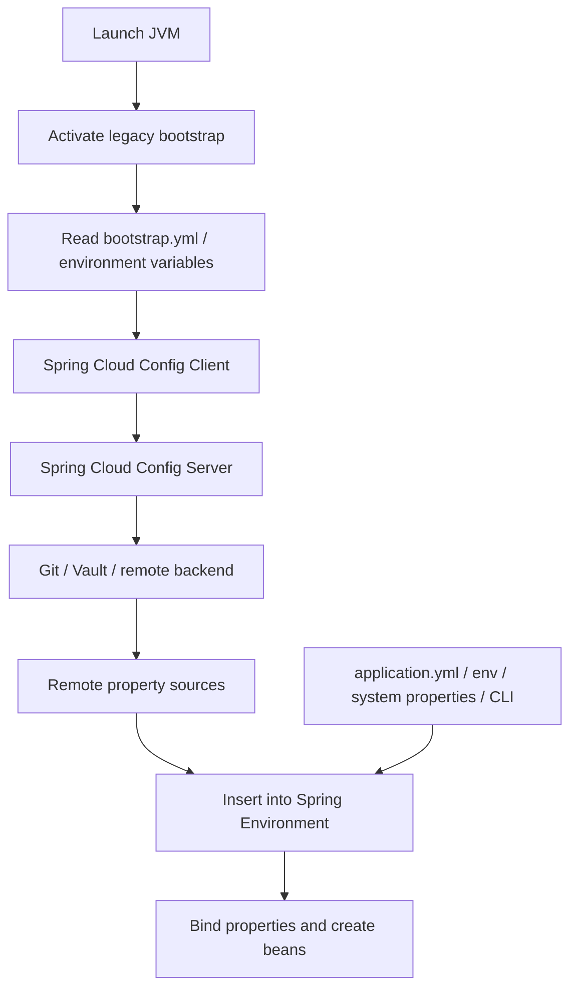

# allowOverride, overrideNone, and overrideSystemProperties in Config-First Bootstrap

In the centralized configuration model, Spring Cloud Config Server provides one or more **remote property sources** to an application. Remote configuration typically contains endpoints, timeouts, feature flags, and shared operational values. However, each environment may also need local values passed in by the deployment platform.

Spring Cloud Context provides three properties to determine the **priority position of remote property sources relative to local configuration sources** when using the **config-first bootstrap** mechanism:

- `spring.cloud.config.allowOverride`
- `spring.cloud.config.overrideNone`
- `spring.cloud.config.overrideSystemProperties`

These three properties do not change the contents of configuration files. They control how Spring Cloud inserts remote property sources into the application's `Environment`, thereby deciding which value is read when multiple sources declare the same key.

This lesson belongs to the **Bootstrap** chapter of the **SPRING_CLOUD_CORE** module. The focus is understanding override permission properly, comparing flag combinations, applying them to a real service, and testing precedence order. The mechanism covered is legacy bootstrap; do not apply these conclusions mechanically to Spring Boot Config Data import.

## 1. Learning Objectives

After this lesson, learners can:

- Explain remote property sources and their position in `Environment` when using config-first bootstrap.
- Distinguish the roles of `allowOverride`, `overrideNone`, and `overrideSystemProperties`.
- Identify where override permission must be declared and explain why putting `allowOverride` in a local file does not grant permission.
- Predict the effective value when the same key appears in remote configuration, `application.yml`, environment variables, system properties, and command-line arguments.
- Design policies so remote configuration retains control or allows specific local configuration layers to override.
- Test and diagnose bugs caused by unexpected configuration overrides.
- Distinguish config-first bootstrap from Spring Boot's modern `spring.config.import` mechanism.

## 2. Context: remote property sources in config-first bootstrap

In config-first bootstrap, the application creates a **bootstrap context** before the main application context. The bootstrap context loads minimal configuration to know how to connect to Config Server, usually via `bootstrap.yml` or environment variables. Config Client fetches remote configuration and feeds those property sources into the application's configuration environment.

Overview flow:



`Environment` contains multiple `PropertySource` entries. When the same key appears in multiple sources, Spring looks up from the highest-priority source first. Earlier sources can determine the value bound into beans.

Example declaring the key `billing.payment.timeout` across sources:

| Source | Value |
| --- | --- |
| Config Server | `2s` |
| Local `application.yml` | `5s` |
| Environment variable | `3s` |
| Java system property | `4s` |
| Command-line argument | `6s` |

Without controlling the order, operators might think command-line arguments will always win, whereas the remote property source is placed at a higher-priority position. The three flags in this lesson determine this ordering in config-first bootstrap.

### 2.1. Activating legacy bootstrap

Since Spring Cloud 2020.0, bootstrap is no longer enabled by default in new configurations. A project wishing to use config-first bootstrap must explicitly enable it in one of two ways:

**Method 1: set a system property or environment variable before the application starts.**

PowerShell:

```powershell
$env:SPRING_CLOUD_BOOTSTRAP_ENABLED = 'true'
java -jar billing-service.jar
```

Bash:

```bash
SPRING_CLOUD_BOOTSTRAP_ENABLED=true java -jar billing-service.jar
```

**Method 2: add the bootstrap starter** to the Maven project. The dependency version is managed by a Spring Cloud BOM compatible with Spring Boot:

```xml
<dependency>
    <groupId>org.springframework.cloud</groupId>
    <artifactId>spring-cloud-starter-bootstrap</artifactId>
</dependency>
```

In a project using this mechanism, `bootstrap.yml` on the client side can declare the information needed to locate Config Server:

```yaml
spring:
  application:
    name: billing-service
  cloud:
    config:
      uri: http://config-server:8888
```

`bootstrap.yml` is the **client's local** bootstrap configuration. It tells the client where to connect. Flags allowing remote properties to be overridden must be placed in the **remote configuration returned by Config Server**, as shown in the next section.

## 3. What do the three properties control?

### 3.1. `allowOverride` — does the remote source allow overrides?

`spring.cloud.config.allowOverride` is the flag that grants local configuration sources permission to override the remote property source.

- `true`: allows applying the granular override policy defined by the other two flags.
- `false`: keeps the remote property source in a high-priority position; `overrideNone` and `overrideSystemProperties` cannot unlock overrides.

**Key point:** this permission must be granted from the **remote property source** (for example, a file in the Git repository served by Config Server). Setting `spring.cloud.config.allowOverride=true` in the client's `application.yml` or `bootstrap.yml` cannot grant override permission to the client itself.

Example in the remote file `billing-service-prod.yml`:

```yaml
spring:
  cloud:
    config:
      allowOverride: true
```

That file is returned by Config Server for `billing-service` with profile `prod`. Only then can the client apply the granular policies of `overrideNone` and `overrideSystemProperties`.

Some versions of Spring Cloud Commons list this property's default as `true` in configuration metadata. However, Config Server guidance requires the remote property source to grant permission explicitly. For predictable behavior and easy review across release trains, declare `allowOverride` explicitly in remote configuration rather than relying on the default value.

### 3.2. `overrideNone` — does the remote source move to the bottom of the list?

`spring.cloud.config.overrideNone` applies when `allowOverride=true`.

- `true`: remote properties have the lowest priority; existing local property sources can override them, including the application's configuration files.
- `false`: does not automatically move remote properties to the bottom of the list. In this case, `overrideSystemProperties` decides whether remote sits before or after the group of system properties, command line, and environment variables.

The default value is typically `false`.

In other words, `overrideNone=true` allows local configuration at all standard layers to beat remote configuration. This is useful when remote only provides shared defaults and each deployment needs to choose its own endpoints or timeouts.

### 3.3. `overrideSystemProperties` — does the remote source beat system properties?

`spring.cloud.config.overrideSystemProperties` also only takes effect when `allowOverride=true` and `overrideNone=false`.

- `true`: remote properties are placed ahead of system property and environment sources; remote can beat system properties, command-line arguments, and environment variables.
- `false`: system properties, command-line arguments, and environment variables can override remote properties, while local configuration files such as `application.yml` still sit behind remote and cannot beat remote.

The default value is typically `true`.

The property name can mislead readers. Read it in the direction of **whether remote properties are allowed to override system properties**. When set to `false`, priority is yielded to the system/environment/CLI group.

## 4. Precedence matrix

For comparison, suppose the application has the following sources and all declare `billing.payment.timeout`:

- Remote Config Server: `2s`
- Local `application.yml` file: `5s`
- Environment variable `BILLING_PAYMENT_TIMEOUT`: `3s`
- Java system property `-Dbilling.payment.timeout=4s`: `4s`
- Command-line argument `--billing.payment.timeout=6s`: `6s`

The table below shows the order from **highest priority to lowest priority** in config-first bootstrap:

| allowOverride | overrideNone | overrideSystemProperties | Main precedence order |
| --- | --- | --- | --- |
| `false` | Any | Any | Remote → CLI/system/env → local config |
| `true` | `true` | Any | CLI/system/env/local config → Remote |
| `true` | `false` | `false` | CLI/system/env → Remote → local config |
| `true` | `false` | `true` | Remote → CLI/system/env → local config |

The relative order among CLI, system properties, environment variables, and local configuration files still follows Spring Boot's standard precedence order. The table focuses on the position of the remote property source relative to local groups.

### 4.1. Disallowing local overrides

Remote configuration:

```yaml
spring:
  cloud:
    config:
      allowOverride: false
      overrideNone: true
      overrideSystemProperties: false

billing:
  payment:
    timeout: 2s
```

Regardless of whether the other two flags are set to `true` or `false`, `allowOverride=false` keeps the remote source in a high-priority position. In the example above, the effective value is `2s`.

This choice fits when an organization needs centralized control over critical values and does not want individual applications changing them via files, environment variables, or runtime flags. However, consider emergency operational needs and the change workflow for remote configuration.

### 4.2. Allowing only CLI, system properties, and environment overrides

Remote configuration:

```yaml
spring:
  cloud:
    config:
      allowOverride: true
      overrideNone: false
      overrideSystemProperties: false

billing:
  payment:
    timeout: 2s
```

In this case:

- Command-line argument `6s` can beat remote.
- System property `4s` can beat remote.
- Environment variable `3s` can beat remote.
- Value in local `application.yml` (`5s`) remains lower than remote.

If no CLI argument, system property, or environment variable is present, the remote value `2s` is used instead of `5s` in the local file.

This mode is useful when you want local configuration files not to accidentally alter global policy, while still letting the deployment platform pass explicit runtime values.

### 4.3. Allowing all local sources to override remote

Remote configuration:

```yaml
spring:
  cloud:
    config:
      allowOverride: true
      overrideNone: true
      overrideSystemProperties: true

billing:
  payment:
    timeout: 2s
```

When `overrideNone=true`, the remote source is placed at the bottom of the list. Local sources can beat remote. With the values in the example, CLI `6s` still has the highest priority; if CLI is absent, system properties, environment variables, or local configuration files can supply the value according to Spring Boot precedence.

In this mode, `overrideSystemProperties` no longer decides the remote position because `overrideNone` already moves remote to the end. Setting `overrideSystemProperties` to `true` or `false` does not alter the outcome of this branch.

### 4.4. Keeping remote at the highest position

Remote configuration:

```yaml
spring:
  cloud:
    config:
      allowOverride: true
      overrideNone: false
      overrideSystemProperties: true

billing:
  payment:
    timeout: 2s
```

The remote source is placed at the top of the list. The value `2s` beats `5s`, `3s`, `4s`, and `6s` in the example. Even though `allowOverride=true`, the values of the two granular flags still determine whether remote actually yields priority.

This is also the default combination listed in configuration properties on some release trains: `allowOverride=true`, `overrideNone=false`, and `overrideSystemProperties=true`. Therefore, seeing `allowOverride=true` alone is not enough to conclude that local configuration is allowed to override remote.

## 5. Deployment example with billing-service

Suppose `billing-service` uses Config Server. The remote repository has `billing-service-prod.yml`:

```yaml
spring:
  cloud:
    config:
      allowOverride: true
      overrideNone: false
      overrideSystemProperties: false

billing:
  payment:
    base-url: https://payment.prod.internal
    timeout: 2s
```

The client has `application.yml`:

```yaml
spring:
  application:
    name: billing-service

billing:
  payment:
    timeout: 5s
```

The client starts with profile `prod` and an environment variable:

```powershell
$env:SPRING_PROFILES_ACTIVE = 'prod'
$env:BILLING_PAYMENT_TIMEOUT = '3s'
java -jar billing-service.jar
```

Because remote configures `overrideSystemProperties=false`, the environment variable can beat remote. The effective timeout value is `3s`. The local file declaring `5s` does not beat remote under this combination.

If a command-line argument is added:

```bash
java -jar billing-service.jar \
  --spring.profiles.active=prod \
  --billing.payment.timeout=6s
```

then `6s` beats `3s` according to Spring Boot's precedence among local sources.

If you want the local `application.yml` file to also beat remote, update the **remote repository**:

```yaml
spring:
  cloud:
    config:
      allowOverride: true
      overrideNone: true
```

Then `overrideNone` moves the remote source to the bottom, allowing local files, environment variables, system properties, and CLI to provide custom values.

## 6. Why must the flags be placed in the remote repository?

The three flags describe the policy of the **remote property source**. Config Server returns the property source along with metadata about override permissions; Config Client uses that metadata when inserting the remote source into `Environment`.

Setting the flags locally on the client has no effect in granting permission to the remote source. The example below cannot unlock overrides on its own if the remote source disallows it:

```yaml
# application.yml on the client side
spring:
  cloud:
    config:
      allowOverride: true
      overrideNone: true
```

The configuration must be served from the repository/backend that Config Server reads, for example:

```text
config-repo/
├── application.yml
├── application-prod.yml
├── billing-service.yml
└── billing-service-prod.yml
```

You can place the flags in a shared file such as `application-prod.yml` or a service-specific file `billing-service-prod.yml`, depending on the desired scope. If placed in a shared file, multiple applications receive the same policy. If placed in a service-specific file, the policy applies only to that service's configuration.

When verifying, query Config Server with the exact application/profile/label to confirm the remote response actually contains these flags. Do not inspect only the file in Git, because the client might be using a different profile, label, or revision.

## 7. Distinguishing from spring.cloud.config.server.overrides

Spring Cloud Config has another feature called **server property overrides**. This feature allows administrators to declare a global configuration map in Config Server:

```yaml
spring:
  cloud:
    config:
      server:
        overrides:
          company.region: ap-southeast-1
          company.support-contact: platform-team
```

This is a **Config Server-side** configuration used to append shared properties for client applications. It is not the three flags `allowOverride`, `overrideNone`, and `overrideSystemProperties`.

| Property group | Where declared | Purpose |
| --- | --- | --- |
| `spring.cloud.config.allowOverride` | Remote property source received by client | Grants permission for local property sources to override remote |
| `spring.cloud.config.overrideNone` | Remote property source received by client | Moves remote to the lowest priority |
| `spring.cloud.config.overrideSystemProperties` | Remote property source received by client | Controls whether remote sits before or after system properties/environment |
| `spring.cloud.config.server.overrides` | Config Server configuration | Supplies shared properties for clients |

Do not use `server.overrides` to fix local config failing to override remote. The two features solve different problems.

## 8. Relationship with Spring Boot Config Data import

The flags in this lesson belong to **legacy config-first bootstrap**. They control where remote property sources are inserted into `Environment` by the bootstrap context.

Since Spring Boot 2.4, the standard way to integrate Config Server for new projects is **Config Data import**:

```yaml
spring:
  config:
    import: "configserver:http://config-server:8888"
```

With this approach, `spring.config.import` determines import position and ordering during Config Data loading. Spring Cloud Commons documentation explicitly notes that `overrideNone` only takes effect with config-first bootstrap. Therefore:

- Do not use `overrideNone` to predict precedence in an application using only `spring.config.import`.
- Do not assume placing `allowOverride` in the remote repository will alter Config Data ordering the same way as legacy bootstrap.
- With Config Data, look at where the import is declared, import ordering, profile-specific configs, and Spring Boot precedence rules.
- When migrating from legacy bootstrap to Config Data, rewrite precedence tests against actual sources; do not merely copy the three flags into the new file.

A project may still keep legacy bootstrap for compatibility or an incomplete migration. Identify clearly which mechanism is active before diagnosing.

## 9. Testing precedence order

Do not verify only that the application starts successfully. Verify the actual values received by beans.

### 9.1. Preparing a test key

Remote configuration:

```yaml
spring:
  cloud:
    config:
      allowOverride: true
      overrideNone: false
      overrideSystemProperties: false

demo:
  precedence:
    source: remote
```

Local `application.yml`:

```yaml
demo:
  precedence:
    source: local-file
```

Environment variable:

```powershell
$env:DEMO_PRECEDENCE_SOURCE = 'environment'
```

Java system property and command line:

```bash
java -Ddemo.precedence.source=system \
  -jar app.jar \
  --demo.precedence.source=command-line
```

### 9.2. Expected outcome matrix

| Remote configuration | Sources able to beat remote | Final value in example |
| --- | --- | --- |
| `allowOverride=false` | No local overrides per remote policy | `remote` |
| `allowOverride=true, overrideNone=false, overrideSystemProperties=true` | Remote sits above local sources | `remote` |
| `allowOverride=true, overrideNone=false, overrideSystemProperties=false` | CLI, system properties, environment | `command-line` |
| `allowOverride=true, overrideNone=true` | Any local source, including application files | `command-line` |

To test each layer individually, run multiple times while removing the command-line argument, system property, or environment variable one by one. When no runtime source remains, verify whether the local file beats remote under the `overrideNone=true` combination.

### 9.3. Inspecting PropertySources

You can check effective sources and values with an integration test or a secured diagnostic endpoint. `/actuator/env` can display property sources and origins depending on version, dependencies, and exposure configuration.

When using Actuator:

- Expose only necessary endpoints.
- Protect with authentication/authorization and network restrictions.
- Never share output containing tokens, passwords, API keys, or sensitive data.
- Inspect property source names and ordering, not just a single resolved value.

You can enable appropriate logging for bootstrap/Config Client in test environments to confirm the remote source was loaded. Do not leave overly verbose logging enabled in production if it could print sensitive information.

## 10. Common issues

| Symptom | Common cause | How to resolve |
| --- | --- | --- |
| Set `allowOverride=true` in a local file, yet local still does not win | Override permission must come from the remote property source | Move the flag into the file actually served by Config Server |
| Environment variable does not beat remote | `overrideSystemProperties=true` or `allowOverride=false` | Check all three flags in the remote response |
| Environment variable wins, but `application.yml` does not | `overrideSystemProperties=false` and `overrideNone=false` | This is expected behavior; if the local file must win, set `overrideNone=true` remotely |
| All local configs unexpectedly beat remote | `overrideNone=true` | Inspect remote policy and active profile/label |
| CLI still does not beat remote | Remote is placed in a high-priority position | Check `allowOverride` and `overrideSystemProperties` |
| Precedence fails in only one environment | Remote profile file has different flags or wrong profile/label | Compare Config Server responses for the exact profile and label |
| Three flags have no effect in a new application | Project uses Config Data import, not legacy bootstrap | Identify config loading mechanism; design precedence for Config Data |
| Config in Git updated, yet app keeps old value | Instance has not restarted/refreshed or uses an old revision | Verify label/version and configuration update mechanism |

### 10.1. Layer-by-layer checklist

When troubleshooting, proceed in order:

1. Confirm legacy bootstrap is actually activated via system property/environment or bootstrap starter.
2. Confirm Config Client connected to the right Config Server.
3. Check application name, profile, and label to ensure the right remote file was loaded.
4. Query the Config Server endpoint or inspect loaded property sources to confirm the remote response includes all three flags.
5. Verify the flags reside in the remote repository, not solely in local `bootstrap.yml` or `application.yml`.
6. Confirm each flag's value and predict precedence order using the matrix.
7. Check the effective property origin/value in the client via a secured diagnostic channel.
8. If remote config was changed, restart or refresh per project mechanism; verify the actual instance received the new revision.

Do not change all three flags at once while debugging. Change one value at a time, re-run the same test, and record the winning source to know exactly what altered the outcome.

## 11. Choosing a production policy

No single flag combination fits every configuration key. Classify properties by desired level of control:

| Configuration type | Typically suitable policy | Rationale |
| --- | --- | --- |
| Internal service endpoints controlled by the platform | High-priority remote | Prevents instances from pointing to unintended endpoints |
| Timeouts or pool sizes tuned per workload | Allow env/system/CLI overrides | Platform can adjust runtime without editing repositories |
| Shared defaults customizable by each application | `overrideNone=true` | Application's local file can replace shared values |
| Centrally controlled feature flags | High-priority remote or dedicated policy | Reduces risk of out-of-band toggling |
| Secrets and credentials | Secret manager with dedicated access controls | Precedence does not replace secret protection |

A high-priority remote property source helps organizations maintain consistent policies, but also prevents emergency overrides from the local environment from taking effect. Conversely, moving remote to the bottom gives workloads autonomy while reducing centralized control. Choose based on operational ownership, change workflows, and the impact of a misconfigured source.

These three flags only control **configuration precedence**. They do not replace Config Server authentication, repository access controls, secret management, change reviews, or auditing.

## 12. Practice exercise

An `order-service` receives `order.processing.timeout` from Config Server with a value of `3s`. The local application declares `5s`, an environment variable declares `4s`, and the command line declares `6s`.

Answer and verify:

1. With `allowOverride=false`, which value takes effect?
2. With `allowOverride=true`, `overrideNone=false`, `overrideSystemProperties=true`, which value takes effect?
3. With `allowOverride=true`, `overrideNone=false`, `overrideSystemProperties=false`, which value takes effect?
4. With `allowOverride=true` and `overrideNone=true`, which value takes effect?
5. Why does placing `allowOverride=true` in a local file not grant override permission over remote property sources?
6. If the application migrates from legacy bootstrap to `spring.config.import`, how should precedence tests change?

**Hands-on requirement:** spin up a test Config Server or mock configuration backend; run the client with each flag combination placed in remote configuration; inspect the value bound into beans and record the top-ranked `PropertySource`. Do not rely solely on guessing from flag names.

## 13. Key takeaways

- `allowOverride` is permission granted by the remote property source; declaring it locally on the client does not grant permission.
- `allowOverride=false` keeps the remote source in a high-priority position.
- Only when `allowOverride=true` do the two granular flags determine how local overrides apply.
- `overrideNone=true` moves remote properties to the lowest priority, allowing all local sources to override.
- `overrideNone=false` and `overrideSystemProperties=false` allow CLI, system properties, and environment variables to beat remote; local config files remain below remote.
- `overrideSystemProperties=true` places remote where it can beat system properties, CLI, environment variables, and local files.
- `overrideNone` only works in config-first bootstrap; do not apply this matrix to Config Data import.
- Always check the remote response, application/profile/label, and property origin before concluding which value is effective.

## 14. References

- [Spring Cloud Reference — Overriding the Values of Remote Properties](https://docs.spring.io/spring-cloud/docs/current/reference/htmlsingle/#_overriding_the_values_of_remote_properties): describes override permission and the two granular flags in bootstrap.
- [Spring Cloud Config — Using Bootstrap To Override Properties](https://docs.spring.io/spring-cloud-config/reference/server/environment-repository/using-bootstrap-to-override-properties.html): guide to declaring override permission in remote configuration.
- [Spring Cloud Commons — Configuration Properties](https://docs.spring.io/spring-cloud-commons/reference/configprops.html): describes properties and defaults across release trains.
- [PropertySourceBootstrapConfiguration.java](https://github.com/spring-cloud/spring-cloud-commons/blob/main/spring-cloud-context/src/main/java/org/springframework/cloud/bootstrap/config/PropertySourceBootstrapConfiguration.java): implementation inserting remote property sources according to the three flags.
