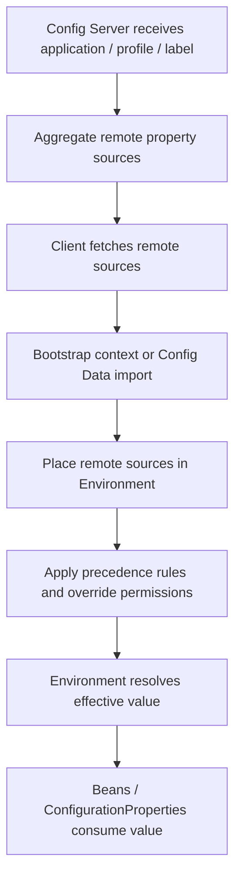

# Scope of Applicability for Remote Configuration Override Rules

## 1. Objectives and scope

A Spring Boot application can receive configuration from local files, environment variables, Java system properties, command-line arguments, and remote sources such as Spring Cloud Config Server. When the same key appears in multiple places, you must know which source can override another and during which phase that rule is applied.

Spring Cloud provides properties controlling the position of remote property sources relative to local sources. However, these are not universal switches for every type of configuration. The rules in this lesson focus on remote property sources introduced into the application via **legacy config-first bootstrap**. Projects using Spring Boot Config Data import must be evaluated separately.

This lesson belongs to the **Bootstrap** chapter of the **SPRING_CLOUD_CORE** module, focusing on Spring Cloud Commons, Spring Cloud Context, externalized configuration, Spring Boot compatibility, and operating shared abstractions.

After this lesson, learners can:

- Explain why remote property sources in bootstrap have high priority by default and disallow local overrides.
- Distinguish the three properties `spring.cloud.config.allowOverride`, `spring.cloud.config.overrideNone`, and `spring.cloud.config.overrideSystemProperties`.
- Identify where override permission must be declared and which local sources are allowed to override.
- Distinguish remote property sources from Config Server operator overrides.
- Distinguish legacy bootstrap from modern Config Data import.
- Verify effective ordering using `Environment`, Actuator, and integration tests.
- Avoid confusing override permissions with refresh mechanisms or a security boundary.

## 2. Two priority layers to separate

When saying "remote configuration beats local configuration," people may mean two different things:

1. **Order within configuration returned by Config Server:** the server aggregates shared files, application-specific files, profiles, labels, and repositories into remote property sources.
2. **Order between remote property sources and client sources:** after the client receives the data, where the remote source sits inside `Environment` and whether local sources are allowed to override it.

For example, a profile-specific file in Git can beat a default file in the same remote repository. That still does not answer whether an environment variable in the container can override the remote value.



The rules in this lesson focus on steps E–F. They do not decide which Git branch, profile, or file Config Server selects.

## 3. Defaults in legacy config-first bootstrap

In the traditional bootstrap model, Spring Cloud creates a **bootstrap ApplicationContext** before the main application context. The bootstrap context is used to load initial configuration components, commonly including connecting to Spring Cloud Config Server and adding remote property sources to Environment.

A remote property source added through the bootstrap context has high priority by default and **cannot be overridden by local configuration** under standard mechanics. The goal is to prevent centralized configuration policies from being accidentally changed by each individual application.

Example returned by a remote repository:

```yaml
# Remote repository: order-service-prod.yml
orders:
  timeout: 3s
  retry:
    max-attempts: 4
```

The client has a local file:

```yaml
# application-prod.yml in the client application
orders:
  timeout: 5s
```

With a bootstrap remote property source and default behavior, the remote value `orders.timeout=3s` can continue to beat the local file's `5s`. Editing only the local file does not guarantee changing the effective value.

### 3.1. Bootstrap context and bootstrap.yml are not the same property source

Two concepts are frequently confused:

- **Bootstrap context:** parent application context used by Spring Cloud to initialize remote configuration sources and bootstrap configurations.
- **bootstrap.yml / bootstrap.properties:** local configuration files that can be used to configure the bootstrap context.

The `bootstrap.yml` file is not synonymous with the remote property source. The local bootstrap file can have lower priority than the main application context's `application.yml`, whereas the remote property source introduced by the bootstrap context can have higher priority than those local sources.

When determining which source wins, inspect the actual property source names and positions in Environment rather than guessing from filenames.

### 3.2. Enabling legacy bootstrap

In current Spring Cloud versions, the legacy bootstrap mechanism must be explicitly enabled, for example via the `spring-cloud-starter-bootstrap` starter or the `spring.cloud.bootstrap.enabled=true` property supplied early via a system property/environment variable.

Example local bootstrap configuration:

```yaml
# bootstrap.yml
spring:
  application:
    name: order-service
  cloud:
    config:
      uri: http://config-server:8888
```

Once bootstrap is enabled and Config Client is on the classpath, the client initializes remote property sources during bootstrap. A bootstrap file is not required with the modern Config Data import approach.

Do not add `bootstrap.yml` solely because a project includes Spring Cloud Config Client. First determine whether the project uses config-first bootstrap or Config Data import; the two approaches have different initialization flows and applicability rules.

## 4. Three properties controlling override permission

Spring Cloud describes three properties related to the position of remote property sources:

| Property | Meaning | Key point to remember |
| --- | --- | --- |
| `spring.cloud.config.allowOverride` | Allows the remote property source to yield priority per granular override settings | Permission must be granted from the remote property source; setting it solely on the local client does not grant permission |
| `spring.cloud.config.overrideNone` | Moves external/remote properties to low priority so all local property sources can override | Effective for config-first bootstrap per current metadata |
| `spring.cloud.config.overrideSystemProperties` | Controls whether remote properties sit above system properties | `false` allows system properties, command line, and environment variables to override remote; local config files still do not override in this mode |

### 4.1. allowOverride: permission must be granted from the remote side

To allow the client to override a remote property source, the remote source must grant permission with:

```yaml
spring:
  cloud:
    config:
      allow-override: true
```

This configuration must reside in the repository/configuration source that Config Server returns to the client. Setting `spring.cloud.config.allow-override=true` in local `application.yml` or local `bootstrap.yml` cannot grant override permission to the client by itself.

This is a critical boundary: **remote configuration decides whether the client is allowed to apply override rules**. If the remote source does not grant permission as required by documentation, setting properties locally on the client does not alter the policy.

### 4.2. overrideNone: all local sources can override

Once the remote source allows overrides, configuring:

```yaml
spring:
  cloud:
    config:
      allow-override: true
      override-none: true
```

allows **any local property source** to override the remote property source. For example, local `application-prod.yml` can supply a replacement value for a key defined by the remote repository.

`overrideNone` means remote properties are placed at lower priority than local sources, not that the remote source is deleted or Config Server is disabled.

According to current Spring Cloud configuration metadata, `spring.cloud.config.override-none` defaults to `false` and only takes effect when using config-first bootstrap. Keep this limitation in mind when reading older documentation or migrating projects to Config Data import.

### 4.3. overrideSystemProperties: allowing only runtime sources to override

A narrower mode is:

```yaml
spring:
  cloud:
    config:
      allow-override: true
      override-system-properties: false
```

When applied in the bootstrap override policy, **system properties, command-line arguments, and environment variables** can override remote properties; local config files such as `application.yml` are not allowed to override remote properties in this mode.

The property name is easy to misread. Read it from the perspective of the remote source:

- `override-system-properties: true`: external/remote properties are allowed to sit above system properties per the default described in metadata.
- `override-system-properties: false`: system properties, command line, and environment variables are allowed to sit above remote properties.

The default recorded in current metadata for `override-system-properties` is `true`. Set an explicit value in the remote repository if you want an easily auditable policy without relying on version-specific defaults.

### 4.4. Decision table

Suppose the same key `orders.timeout` appears in remote Config Server, a local application file, an environment variable, and the command line:

| Bootstrap policy | Local application file | Environment variable | System property / command line |
| --- | --- | --- | --- |
| Remote does not grant override permission | Remote wins | Remote wins per default remote policy | Remote wins per default remote policy |
| `allowOverride=true`, `overrideNone=false`, `overrideSystemProperties=true` | Remote wins | Remote wins | Remote wins |
| `allowOverride=true`, `overrideNone=false`, `overrideSystemProperties=false` | Remote wins | Local wins | Local wins |
| `allowOverride=true`, `overrideNone=true` | Local wins | Local wins | Local wins |

The table describes rules for bootstrap remote property sources. When flag combinations are ambiguous, avoid setting conflicting policies together; pick one mode, test against your exact release train, and verify the actual order in Environment.

## 5. Practical example with a remote repository

Suppose Config Server serves `order-service/prod` from a Git repository. The remote file contains:

```yaml
# order-service-prod.yml in the config repository
spring:
  cloud:
    config:
      allow-override: true
      override-none: false
      override-system-properties: false

orders:
  timeout: 3s
```

The client has the file:

```yaml
# application-prod.yml in the application
orders:
  timeout: 4s
```

Deployment environment:

```bash
ORDERS_TIMEOUT=5s
```

Launch command:

```bash
java -jar order-service.jar --orders.timeout=6s
```

With the bootstrap mode described above:

- The remote repository grants override permission.
- The local application file cannot override remote because `overrideNone=false`.
- The environment variable can override remote because `overrideSystemProperties=false`.
- The command-line argument can override remote.
- If no command-line argument is passed, the value from the environment variable can beat remote.

The expected result in the example is `6s`. If `--orders.timeout=6s` is omitted, the result can be `5s`. The local file declaring `4s` does not beat remote under the chosen mode.

If you want the local application file to also override remote, switch the remote policy to `override-none: true` and re-test in config-first bootstrap.

## 6. Scope of applicability: not all remote sources are the same

### 6.1. Does not apply to all externalized configuration

The rules in this section apply to remote property sources brought into the client by the bootstrap context, typically from Spring Cloud Config Server. They do not automatically alter the ordering of:

- Local Config Data files loaded by Spring Boot.
- OS environment variables when no remote bootstrap source is involved.
- Java system properties and command-line arguments in a plain Boot application.
- Property sources added by the application itself via `EnvironmentPostProcessor` or `PropertySourceLocator`.
- Any other configuration system such as Consul, Vault, or custom providers if their integrations do not use this exact mechanism/property set.

Other providers may have their own precedence policies. Read the corresponding integration documentation and inspect actual property sources.

### 6.2. Does not apply to ordering among repositories on Config Server

Config Server can aggregate configuration from multiple repositories or multiple files. The order among remote sources is determined by server configuration, repository order, application/profile/label, and the `EnvironmentRepository` mechanism.

For example, a shared remote file `application.yml` can supply defaults; a service-specific `order-service.yml` and profile-specific `order-service-prod.yml` can have higher priority. This is the **server-side remote Environment construction order**.

The `allowOverride`, `overrideNone`, and `overrideSystemProperties` flags control the relationship between remote sources and client-side local sources; they do not reorder files/repositories on the server side.

### 6.3. Not synonymous with Config Server operator overrides

Config Server also has the `spring.cloud.config.server.overrides` feature so operators can supply shared values to clients. Example server-side configuration:

```yaml
spring:
  cloud:
    config:
      server:
        overrides:
          company.region: ap-southeast
          company.support-url: https://support.example.com
```

These are **operator-provided property overrides**, distinct from `spring.cloud.config.allowOverride` in the remote repository:

| Mechanism | Who configures it? | Goal |
| --- | --- | --- |
| `allowOverride` / `overrideNone` / `overrideSystemProperties` | Owner of the remote property source | Determines to what extent local clients can override the remote source |
| `spring.cloud.config.server.overrides` | Config Server operator | Supplies shared values to clients |

Operator overrides are useful for pushing shared defaults into all applications. However, Spring Cloud documentation also notes that a configuration system cannot inviolably force an application to consume data in a single way. Do not treat property overrides as a security boundary; security constraints must be enforced in the appropriate place.

## 7. Traditional bootstrap and modern Config Data import

Spring Boot 2.4 introduced the Config Data import mechanism; this is the modern default way to connect to Spring Cloud Config Server. The two models must be distinguished clearly:

| Characteristic | Config-first bootstrap (legacy) | Config Data import |
| --- | --- | --- |
| Activation | Enable bootstrap via starter or `spring.cloud.bootstrap.enabled=true` | Declare `spring.config.import` |
| Bootstrap file | Can use `bootstrap.yml` to supply URI and bootstrap configuration | `bootstrap.yml` is not needed for this import approach |
| Remote load timing | Via bootstrap context before the main application context | Within Spring Boot's Config Data processing |
| `overrideNone` flag | Effective per current configuration documentation | Current metadata specifies it only takes effect with config-first bootstrap |
| How to verify | Inspect bootstrap property sources and remote source position | Inspect Config Data imports, import order, and Environment after startup |

Config Data import example:

```yaml
spring:
  application:
    name: order-service
  config:
    import: optional:configserver:http://config-server:8888
```

This approach does not require `bootstrap.yml`. The `optional:` prefix allows the application to continue if Config Server is unavailable per Config Data import semantics; if remote configuration is mandatory for the application to run safely, omit `optional:` so connection errors fail startup clearly.

When migrating from bootstrap to Config Data:

1. Do not copy property source ordering assumptions verbatim from the old model.
2. Check the documentation for the release train in use and metadata for override properties.
3. Inspect `spring.config.import`, other imports, and profile-specific configs.
4. Run integration tests with local files, environment variables, system properties, and command line all declaring the same key.
5. Use Actuator `env` or the Environment API to verify where the remote source sits.
6. Draw conclusions only after verifying against actual dependency versions.

If local overrides are needed in Config Data mode, use mechanisms supported by current documentation for that configuration, such as import/profile ordering or appropriate placeholders; do not assume `overrideNone` is a shared switch across both models.

## 8. Placeholders: making remote values customizable

Another way to let applications customize values without altering the entire property source order is to declare placeholders in remote configuration.

Remote config example:

```yaml
orders:
  banner: \${ORDERS_BANNER:Default message from Config Server}
```

In remote YAML, the backslash preserves the placeholder so Config Server does not resolve it prematurely; Spring Environment on the client side resolves the expression when the application reads configuration. For `.properties` files, escape the backslash according to that format's syntax. The client supplies `ORDERS_BANNER` in an appropriate local configuration source; if missing, the default part of the expression is used.

This differs from letting local config directly override the `orders.banner` key:

- The remote property source still owns the `orders.banner` key.
- The local application supplies the referenced `ORDERS_BANNER` key.
- The final value of `orders.banner` is produced from the placeholder.
- If the application does not provide the referenced variable, the default value in the remote expression is used.

Placeholders fit when you want Config Server to supply a default structure/policy while letting each client supply a specific input. Never use placeholders to leak secrets into logs or build an ad-hoc secret management mechanism.

## 9. Override is not synonymous with refresh

Override rules answer **which source wins when Environment resolves a property**. They do not decide when the application fetches updated configuration or which beans receive new values.

Separate three distinct actions:

1. **Loading configuration:** the client connects to Config Server and receives remote property sources on startup or when loading is invoked.
2. **Precedence resolution:** Environment picks values according to property source order and override policy.
3. **Runtime application:** beans rebind, refresh scope recreates beans, or the application restarts depending on configuration type.

Spring Cloud Config Client does not poll Config Server by default to detect every change. To update configuration across multiple instances, design an appropriate trigger/notification mechanism, such as Spring Cloud Bus or a controlled refresh workflow.

`@RefreshScope` helps recreate certain beans after a refresh; it does not change remote/local override rules. If local sources are still disallowed from overriding remote, refreshing merely makes the application re-read the same priority policy. Similarly, `allowOverride=true` does not automatically update running beans when the Git repository changes.

## 10. Verifying policy with Actuator and integration tests

### 10.1. Checking property sources at runtime

With Spring Boot Actuator configured and secured, the `/actuator/env` endpoint can show the remote source alongside local sources:

```text
GET /actuator/env/orders.timeout
```

When checking:

- Confirm whether the remote property source was loaded.
- Note the source name and origin if available.
- Check whether local files, environment variables, system properties, and command line contain the same key.
- Compare the final value against the chosen override policy.

Never expose the `env` endpoint publicly or disable sanitization carelessly; configuration data can contain credentials and secrets.

### 10.2. Integration test matrix

A test should run the application under the actual bootstrap or Config Data model, with different values for the same key.

| Test case | Remote | Local file | Environment | Command line | What to verify |
| --- | --- | --- | --- | --- | --- |
| Remote wins by default | `3s` | `4s` | Unset | Unset | Remote source has high priority |
| Allow all local sources | `3s` | `4s` | `5s` | `6s` | With `overrideNone=true`, local sources are allowed to win |
| Allow only runtime sources to override | `3s` | `4s` | `5s` | `6s` | With `overrideSystemProperties=false`, local file loses, while env/CLI can win |
| Remote does not grant permission | `3s` | `4s` | `5s` | `6s` | Local override flags cannot be self-granted by client |
| Config Data import | `3s` | `4s` | `5s` | `6s` | Verify per Config Data order of the version in use; do not assume `overrideNone` applies |

Do not mock a single Map or PropertySource and conclude that bootstrap integration works. Use a test context or test container with Config Server/test server to verify how real remote sources are added to Environment.

### 10.3. Verification during rollout

In a multi-instance environment:

- Record the application name, active profiles, Config Server label, and configuration version.
- Verify all instances receive the expected override policy.
- Check whether local sources injected by containers/manifests alter the outcome.
- After refresh or restart, verify both Environment values and bound beans.
- Monitor Config Server connection errors and decide clearly between fail-fast or allowing startup with local configuration.
- Never write secret values to logs when comparing instances.

## 11. Common errors and misconceptions

| Misconception / symptom | Cause | How to resolve |
| --- | --- | --- |
| Set `allow-override=true` in `application.yml`, yet local still loses | Permission must be granted in the remote property source | Update the repository served by Config Server |
| `overrideNone=true` has no effect | Likely using Config Data import instead of config-first bootstrap | Identify the config loading model and check metadata/version |
| Local `application.yml` still loses to environment variable | Remote source is placed above local file sources under current policy | Check all three override flags and property source positions |
| Wanted only env/CLI to override, yet local file also wins | Wrong override mode or confused with `overrideNone=true` | Use `overrideSystemProperties=false` within appropriate bootstrap scope |
| Updated Git repository, yet client does not update | Config Client does not continuously poll by default | Design refresh/Bus or rollout |
| `bootstrap.yml` is not read | Legacy bootstrap not enabled or project uses Config Data import | Verify starter/property and how Config Server is connected |
| Config Server supplies shared values clients cannot change | Using `server.overrides` or another remote policy | Distinguish operator overrides from client override permissions |
| Tests pass, yet production differs | Test context has its own property sources or deployment injects other sources | Run tests matching deployment config and inspect runtime Environment |
| Thinking remote overrides are absolute security | Client can still be launched with other sources or alter how config is used | Enforce authorization/validation at the execution layer, not via property order |

## 12. Override policy design checklist

Before taking a service to production, answer:

1. Does the client use legacy config-first bootstrap or Spring Boot Config Data import?
2. Does the remote property source come from a Config Server repository, custom locator, or another provider?
3. Is there a requirement for local application files to override remote?
4. Should only environment/system/CLI be allowed to override remote?
5. Is `allowOverride` declared in the right remote source?
6. Is the policy compatible with the Spring Cloud release train in use?
7. Is `server.overrides` being used for shared values?
8. Would placeholders or profile-specific local config be a cleaner solution?
9. When remote config changes, which refresh/rollout mechanism applies?
10. Are there integration tests confirming final values and property source ordering?
11. Are Actuator diagnostics secured and sanitized?
12. If Config Server is unreachable, will the client fail fast or run with local configuration?

## 13. Official references

- [Spring Cloud Context — Overriding the Values of Remote Properties](https://docs.spring.io/spring-cloud/docs/current/reference/htmlsingle/#overriding-bootstrap-properties): `allowOverride`, `overrideNone`, and `overrideSystemProperties` rules for remote property sources added via bootstrap context.
- [Spring Cloud Config Client](https://docs.spring.io/spring-cloud-config/reference/client.html): modern Config Data import, legacy config-first bootstrap, and how clients connect to Config Server.
- [Spring Cloud Commons — Configuration Properties](https://docs.spring.io/spring-cloud-commons/reference/configprops.html): default values and effective scope of Spring Cloud configuration properties.
- [Spring Cloud Config — Property Overrides](https://docs.spring.io/spring-cloud-config/reference/server/environment-repository/property-overrides.html): operator-provided overrides on Config Server.
- [Spring Cloud Config — Environment Repository](https://docs.spring.io/spring-cloud-config/reference/server/environment-repository.html): how the server aggregates configuration by application, profile, label, and repository.

**Remember:** Spring Cloud bootstrap's remote override rules govern the relationship between remote property sources and client local sources. Override permission must be granted from the remote side; `overrideNone` allows all local sources to override, whereas `overrideSystemProperties=false` allows only system properties, command line, and environment variables to override. Identify whether you are using legacy bootstrap or Config Data import before applying them, and verify actual ordering in Environment.
